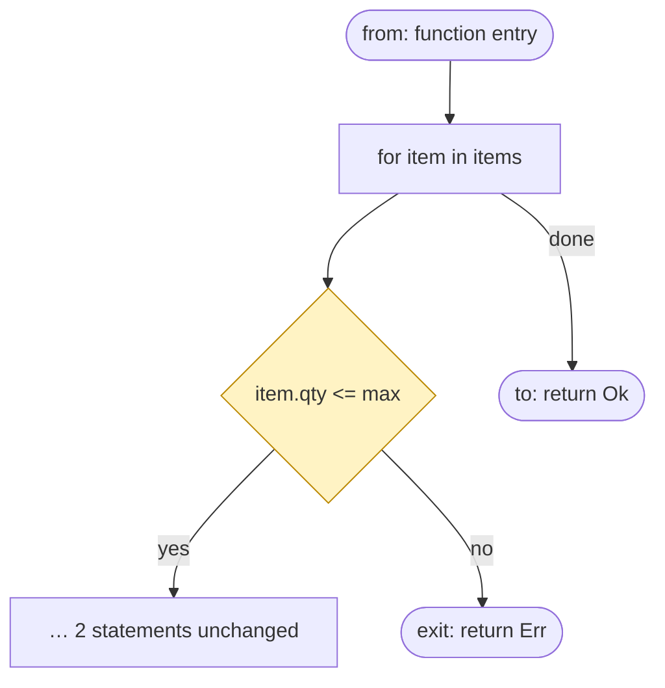

# Semilla design (draft 2)

Status: draft, with an MVP implementation (section 18). Date: 2026-11-08.

## 1. Goal and scope

Semilla makes code review faster. It replaces the line diff with verified semantic changes.

1. An agent writes the code.
2. The agent tags its work with **claims**: a list of semantic changes, organized in steps and groups.
3. Semilla **verifies** the claims. It does not guess the changes.
4. A reviewer reads the verified changes in a local UI, with flow graphs and a change tree.

Scope:

- The first language is Rust. Strong types and MIR make the verification possible.
- The scope is a full Cargo workspace, with all its member crates.
- Semilla is local. It does not push to GitHub and does not use a remote service.

## 2. Principles

1. **The agent declares, semilla verifies.** The agent makes claims. Semilla checks them. A mismatch fails the check.
2. **Unclaimed means unchanged.** At every level of the tree, a node without a claim must be unchanged.
3. **The residual comes from the verifier.** The agent cannot hide a change. It can only declare a change badly.
4. **Proof over trust.** A proof (MIR equality, an SMT result, an exact diff shape) is better than an LLM judgment.
5. **A small trusted core.** Only the verifier is trusted. All helpers are untrusted.
6. **Refactor first, then change.** Neutral steps come first. The semantic changes after them are small.

## 3. Architecture

```
           untrusted                               trusted
┌──────────────────────────────┐         ┌──────────────────────────┐
│ agent + its own edit tools   │         │ semilla verify           │
│ semilla tag tools (MCP, CLI) │ claims  │  - entity trees, 3 views │
│ hints, subgroup suggestions  │ ──────▶ │  - claim checkers        │
│ UI, optional LLM intent check│         │  - SMT checks            │
└──────────────────────────────┘         │  - coverage              │
                                         └──────────────────────────┘
                                                   │
                                     accepted / rejected + reasons
```

| Component | Trusted | Purpose |
|---|---|---|
| Verifier | yes | Checks the claims and the coverage. |
| Indexer | yes (shared with the verifier) | Builds the entity trees, the three views, and the workspace graph. |
| Tag tools | no | Let the agent record steps and claims. |
| Helpers | no | Hints, subgroup suggestions, the optional LLM intent check. |
| UI | no | Shows the review. |

Local storage:

| Data | Location |
|---|---|
| Claims, steps, groups | git notes under `refs/notes/semilla` |
| Step snapshots | git trees under `refs/semilla/<commit>/step-<n>` |
| Caches, graph index, review state | `.semilla/` (not in git) |

## 4. The entity tree

### 4.1 Levels

```
workspace
 └─ crate
     └─ module
         └─ item (fn, struct, enum, trait, impl, const, static)
             ├─ signature / header
             └─ body (for a fn)
                 └─ block
                     └─ statement            let, expression statement, item, tail
                         └─ expression       call, method call, binary op, …
                             └─ leaf         literal, path, opaque macro
```

Items can move between crates of the workspace. A `move-item` claim across crates also updates the `use` paths and the `Cargo.toml` dependencies that the move needs.

Rules:

- **Statements give the structure. Expressions give the content.**
- Block-like expressions (`if`, `match`, `loop`, block, closure, `async` block) contain blocks. The tree continues below them.
- Structs have fields. Enums have variants. `impl` blocks have methods. Traits have items.
- Patterns (in `let` and in `match` arms) are small trees with leaves.
- A macro call is an opaque leaf. Known `std` macros (`format!`, `println!`, `assert!`, `vec!`, `matches!`) have their arguments as children.

### 4.2 Expression roles

| Kind | Children (roles) |
|---|---|
| literal, path | none (leaves) |
| binary op | `lhs`, `rhs` |
| unary op, `?`, `&`, `*`, cast | `operand` |
| call | `callee`, `args[i]` |
| method call | `recv`, `args[i]` (the method name is an attribute) |
| field, index | `base`, `index` |
| struct, tuple, array literal | `fields[name]`, `elems[i]` |
| `if` | `cond`, `then`, `else` |
| `match` | `scrutinee`, `arm[i].pat`, `arm[i].guard`, `arm[i].body` |
| loop | `header`, `body` |
| closure | `params`, `body` |

A method chain shows as one flat list of links, not as nested `recv` nodes.

### 4.3 Node IDs and anchors

- Each node has a **stable ID**. Its path and its name are attributes. A move or a rename does not change the ID.
- An anchor is an item ID, a statement path, and a role path:

```
Cart::total/S2/S2.0/cond/rhs
parse/S4/init/recv/args[0]/body
```

- The agent gets anchors from the `anchor` tool. It never writes them by hand.

### 4.4 Three views

Each node has three views. A change is covered only if every view that it touches has an explanation.

| View | Source | What it sees |
|---|---|---|
| **Syntax** | AST without whitespace | everything, including comments and attributes |
| **Signature** | rustc types, rustdoc JSON | signatures, types, trait impls, the public API |
| **Body** | normalized MIR | runtime behavior |

Each expression node also stores its type from the rustc type check.

## 5. Claims

### 5.1 Three types of op

| Type | Ops | Applies to |
|---|---|---|
| **Identity** | `move`, `rename`, `add`, `remove`, `reorder` | any node (`rename` only for nodes with a name) |
| **Own content** | `change-signature`, `change-condition`, `add-field`, `change-operator`, … | the attributes of one node, not its children |
| **Across nodes** | `extract-function`, `inline-function`, `move-statement`, `split-module`, `merge-module` | a subtree that moves to another parent |

A claim on a node covers only its own attributes. Each change to a child needs its own claim. Free edits are the exception: they mask their children. **Free edits exist only at the expression level** (section 5.6). Above the expression level, each change needs a structured op.

### 5.2 Item ops

- `add-item`, `remove-item`, `move-item`, `rename`
- `change-signature` (now only for the signature edits that no fact covers, see 22.7)
- the signature, visibility, member, attribute, and trait impl changes are facts now (section 22): no claim
- `bump-dependency`, `edit-doc`

### 5.3 Statement ops (structure)

All changes above the expression level use these ops. No free edit exists for a statement, a block, or a function body.

| Group | Ops |
|---|---|
| Add a statement | `add-let`, `add-expression-statement` (a call, an assignment), `add-if`, `add-match`, `add-loop`, `add-return`, `add-break`, `add-continue`, `add-macro-statement`, `add-nested-item` |
| Block | `delete-statement`, `move-statement` (in a block or to another block), `wrap-statements` (in `if`, a loop, a block, `unsafe`), `unwrap-statements` |
| Variables | `extract-variable`, `inline-variable`, `rename-local`, `change-mutability`, `change-type-annotation` |
| `if` | `add-else`, `add-else-if`, `remove-else`, `remove-if` (keep one branch), `invert-if`, `swap-branches` |
| `match` | `add-arm`, `remove-arm`, `move-arm`, `merge-arms`, `split-arm`, `reorder-arms` |
| Loops | `change-loop-kind` (`for`, `while`, `loop`), `add-loop-label` |
| Conversions | `if-to-match`, `match-to-if`, `if-let-to-let-else`, `let-else-to-match`, `loop-to-iterator`, `iterator-to-loop` |
| Attributes | `add-attribute`, `remove-attribute` (on a statement) |

The same ops work at an expression position for block-like expressions. For example, `add-match` can create the `match` in `let x = match y { … };`.

**New code:** an `add-*` op carries the full new subtree, for example the body of a new `if`. New code is not a mask. The verifier builds its full tree, and the UI shows it in full, as a tree and in a flow view.

### 5.4 Expression ops (content)

| Group | Ops |
|---|---|
| Leaves | `change-literal`, `change-path` |
| Operators | `change-operator`, `negate`, `swap-operands` |
| Wrap | `wrap-expression` (`Ok(x)`, `Some(x)`, `&x`, `x.clone()`, `x as T`, `x?`), `unwrap-expression` |
| Calls | `add-argument`, `remove-argument`, `chain-method`, `remove-chain-link` |
| Extract | `extract-variable`, `extract-constant`, `extract-closure` |
| Many sites | `rewrite-pattern` (one rule for many sites; `sites: all` or a list) |
| Patterns | `change-pattern` (in `let` and in `match` arms), `add-binding`, `remove-binding` |
| Free | `replace-expression`, `replace-pattern`, `replace-type` |

Header changes are expression ops on a role. For example, `change-condition` is an edit of `if.cond`, and `change-guard` is an edit of `arm[i].guard`.

### 5.5 Rust-specific groups

- **Borrow checker fixes:** `add-clone`, `borrow-to-owned`, `wrap-in-rc`, `wrap-in-arc`, `change-borrow`. They change performance, not logic. A custom `Clone` impl rejects `add-clone`.
- **Panic sites:** the verifier counts the explicit sites (`unwrap`, `expect`, `panic!`, `unreachable!`, `todo!`, slice indexing). A claim gives the delta.
- **Always spotlight:** changes in `unsafe`, `#[cfg(...)]`, features, `build.rs`, and proc macro crates.

### 5.6 Free edits: the expression level only

The free ops are `replace-expression`, `replace-pattern`, and `replace-type`. They have three limits:

1. **Block-free:** the replaced subtree, old and new, must not contain a block-like expression with statements (`if`, `match`, a loop, a block, a closure with a block body, an `async` block). A change that adds, removes, or edits such an expression needs a structured op. An expression closure such as `|x| x + 1` is block-free.
2. **The tightness rule:** the verifier finds the lowest node that contains each change. A free claim must be on that node, or close to it. If the claim is too wide, the verifier rejects it, with a hint to the smaller node. One free claim on the lowest common node of several changes is correct. The agent does not need one claim for each leaf.
3. **No free edit above the expression level.** A free claim on a statement, a block, or a function body is `malformed`.

Order of preference:

| Rank | Op | Scope |
|---|---|---|
| 1 | exact expression ops (`change-operator`, `wrap-expression`, …) | one expression |
| 2 | `replace-expression`, `replace-pattern`, `replace-type` | one block-free subtree |

Each change above the expression level is a composition of structured ops: add, delete, move, wrap, unwrap, convert, and header edits.

**Macro calls:** the input of an opaque macro is a token tree, not an expression. `replace-macro-input` edits it. It gets a spotlight, because the token tree can contain statements (see B20).

### 5.7 The rule table

The rule table is data. The verifier and the docs both use it.

| Op | Node kinds | The children |
|---|---|---|
| `move`, `rename` | any / named nodes | unchanged, unless other claims say otherwise |
| `remove` | any | all removed |
| `add` | any | all new |
| `extract-function` | a range of sibling statements | moved unchanged; a call takes their place |
| `inline-function` | a call statement | the callee body takes its place, unchanged |
| `change-signature` | fn | the body is not affected |
| `add-if`, `add-match`, `add-loop`, other `add-*` | statement or block-like expression | all new (the reviewer reads them) |
| `delete-statement` | statement | all removed |
| `move-statement` | statement | moved unchanged |
| `wrap-statements`, `unwrap-statements` | a range of sibling statements | unchanged, in the new parent |
| conversions (`if-to-match`, …) | `if`, `match`, `let-else`, loop | the bodies move unchanged into the new form |
| `replace-expression`, `replace-pattern`, `replace-type` | a block-free subtree | masked (tightness rule) |

## 6. Steps, groups, and subgroups

### 6.1 Steps (the verification unit)

A step has one op or an atomic group of ops, an intent text, a declared class, and a tree snapshot.

```
parent ─▶ step 1 ─▶ step 2 ─▶ … ─▶ step N  ==  commit tree
```

- All claims in one step refer to the "before" snapshot. They are simultaneous. Steps are sequential.
- New nodes get "after" IDs from the claim that creates them.
- Each snapshot must pass `cargo check`. An atomic group can contain ops that do not compile alone.

### 6.2 Groups (declared by the agent)

A group is a set of steps with one intent. It is about the size of one commit. It has a title, a kind, and a "why" text.

| Kind | Rule that the verifier checks |
|---|---|
| `refactor` | all steps are neutral |
| `rename`, `move` | only identity claims |
| `api` | only signatures, types, and their call sites |
| `tests` | only test code |
| `deps` | only `Cargo.toml`, `Cargo.lock`, and the call sites |
| `fix`, `feature`, `behavior` | no rule |

- Each step belongs to exactly one group.
- If a group has two parts with no link in the call graph or the type graph, the UI suggests a split (a warning only).

### 6.3 Subgroups (suggested by the engine, edited by the agent)

The engine suggests subgroups by **role**:

| Role | Contents | Default |
|---|---|---|
| Interface | new or changed types, signatures, traits, public API | open |
| Core logic | control flow and logic changes | open |
| Tests | new or changed tests, linked to the core nodes that they reach | open |
| Config | `Cargo.toml`, features, `build.rs` | open |
| Propagation | call site updates, `rewrite-pattern`, match arms that the compiler needs | folded |
| Mechanical | renames, moves, extracts, borrow fixes, formatting | folded |

The agent can rename, merge, and split subgroups, move claims, and add custom subgroups.

Rules for the edited layout:

1. The role label must match the contents. For example, `Mechanical` can contain only proved neutral claims.
2. The contents decide the fold state, not the label. A subgroup with a claim that is not neutral is open by default.
3. The engine computes role badges for custom subgroups, for example `custom · 2 ctrl flow · 1 logic`.
4. Each claim is in exactly one subgroup.
5. When the agent adds steps, the engine keeps the agent's edits. It puts new claims in the suggested subgroup and marks them.

The UI marks the subgroups that the agent edited. The reviewer can switch to the engine suggestion.

## 7. Agent tools

The agent keeps its own edit tools. Semilla gives it tag tools, through an MCP server and the CLI.

| Tool | Purpose |
|---|---|
| `step_begin(intent)` | Starts a step and saves the tree (`git write-tree`). |
| `claim(op, args)` | Adds a claim. A typed JSON schema checks the syntax immediately. |
| `step_end()` | Ends the step and saves the tree. |
| `anchor(file, line, column)` | Returns the canonical anchor for a location. |
| `check_step()` | Verifies the current step only. |
| `tag(commit, claims)` | "Tag after" mode: all steps and claims at one time. |
| `group_set(group)` | Declares a group: title, kind, why, steps. |
| `subgroups_suggest(group)` | Returns the engine's subgroup suggestion. |
| `subgroups_set(group, layout)` | Sends the final subgroup layout. |

Optional helpers (untrusted): edit tools that also add a claim, for example `rename_and_claim`.

The `check_step()` result contains the change tree, with the uncovered nodes marked. The agent sees the same structure as the reviewer.

## 8. Verification

### 8.1 Inputs and checks before verification

```
parent tree, step snapshots S1..SN, commit tree, claims, groups, subgroups
```

1. **Chain:** S0 is the parent. After `rustfmt`, SN is the same as the commit tree.
2. **Build:** each snapshot passes `cargo check`.
3. **Syntax of claims:** each claim matches the schema. Each anchor resolves. If not, the result is `malformed`.

### 8.2 The normal form ladder

Each normalization step must keep the behavior the same. Then "equal after normalization" proves "equivalent". **The normalization keeps all drops**, because drop order is observable in Rust.

| Level | Form | Absorbs | MVP |
|---|---|---|---|
| N0 | MIR with only the required passes (`-Zmir-opt-level=0`), without names, spans, storage markers, and borrow-check-only statements; a canonical block and local order; `move` treated as a copy; stable closure names | formatting, comments, imports, local renames, type annotations, lifetimes, visibility, `mut` removal, plain `if` inversion | yes |
| N1 | N0 + call targets addressed by content hash (a Merkle tree over the call graph; one hash for each strongly connected component) | item renames and moves | yes |
| N2 | rustc optimized MIR, with the same flags on both sides | extract and inline variable, temporaries, constant folding | yes |
| N3 | N2 + bounded inlining of the workspace's own functions | extract and inline function | yes |
| N4 | e-graphs over a dataflow graph (`egglog`) | reordered independent statements, inverted `if`, conversions, algebra | yes |

**Panic locations are not behavior.** Two panics with the same message are the same, also at different source locations. The order of panics with different messages is behavior.

**Members by name, one view (batch 5e).** The source names a struct field and an enum variant by its name. The MIR names them by an index, and a step can change the map from names to indexes (a reorder, or a member added or removed that is not the last one). So the driver prints names in the text of all levels and in the N4 term:
- A field projection on a struct, a union, or an enum variant prints the field path: `(*_1).k::Pair.a`, `k::Ev::A.x`. A field of a tuple, a closure, or a coroutine keeps its position. A tuple struct field has its position as its name (`k::T.0`).
- A downcast, an aggregate, and `SetDiscriminant` print the variant path (`k::Kind::Small`). A coroutine state keeps its index.
- An ADT aggregate prints each operand with its field path, sorted: `adt k::Pair fields {k::Pair.a: _1, k::Pair.b: _2}`. The order of the operands has no effect, because the statements before the aggregate evaluate them. The compare sorts the operands again after the rename map (a rename can change the order).
- A `switchInt` on a discriminant prints each target with the variant path, sorted, when the only uses of the discriminant local are `switchInt` operands. The values are different, so the order of the targets has no effect. The N4 term tests the variants by name in the same order (`is-variant`).
- Another read of a discriminant (a cast, a compare, a derived `PartialOrd` or `Hash`, `std::mem::discriminant`) prints the value of each variant: `discriminant(_2) cast of k::Kind values [k::Kind::Large = 1, k::Kind::Small = 0]`. The result depends on the values.
- A constant in memory, a transmute, and a cast of a pointer to another pointee type print the layout of each local ADT in their types, with the member names (`layout-of k::Pair: …`). The bytes are in the order of the layout, not of the names.
- The signature line of a generic body has its type and const parameters with their positions: `generics <A#0, B#1>`. A body names a type parameter by its name, and a caller gives the generic arguments by position.

A rename of a field or a variant is then a path in the rename map, like a rename of an item, and proves at N1 (`rename-map`). The derived bodies that show the name (`Debug`) do not change.

**The rustc inliner is not a proof method.** At N2, rustc inlines some small functions, so some extracts and renames become equal. This depends on heuristics. N1 and N3 must prove these changes (spike S1, finding 5).

**A proof holds for each build configuration (batch 5k, A1). Decided by Claude.** A check build is one build configuration: one target, one profile, one feature set, one environment. A proof of `neutral` must hold for each build. So no step of a proof uses a value that the build configuration decides. The rule uses allow lists (I3).

1. **The MIR.** A value is configuration-free only if it is equal in each build: a literal of the source text, a named constant of the local crate with a configuration-free initializer and no `cfg` attribute, and the constants `MIN`, `MAX`, and `BITS` of an integer type with a fixed width. Each other constant is opaque: `cfg!`, `debug_assertions`, `option_env!`, `env!`, a constant of another crate, a constant with `usize` or `isize` arithmetic. The driver puts each opaque constant through `black_box` before the optimizer runs, and the text of the value names its source (`@cfg!(debug_assertions)`). The same applies to an operation that the target decides: an operation with a `usize` or `isize` result on values that can be constants, `size_of`, `align_of`, `transmute`, and the length of an array as a value. A constant in a pattern that is not configuration-free stops the term of the body.
2. **The source text.** The compiler removes the code of a false `cfg` attribute before the MIR. So the verifier reads the token text of each body with a text edit. An attribute or a macro call that is not in an allow list stops the proof of the body. A `cfg` or `cfg_attr` attribute in the body, and a macro of the workspace with one in its definition, is a use of the build configuration. A macro or an attribute of another crate is a use that Semilla cannot see into. A glob import from a crate outside the workspace makes the names of the standard macros not known in that file.
3. **The solver.** An SMT check of a condition runs for each build of a list: 64, 32, and 16 bits for `usize` and `isize`, with and with no overflow checks. One counterexample in one build refutes the claim.
4. **The output.** A body with a use of the build configuration is not `neutral`. Its facts have the class of their edits and the spotlight "build configuration: this code depends on the build configuration. Semilla checks one configuration (debug, this target)", with the list "Uses: …". The unseen case has its own text: "Semilla cannot see if this code depends on the build configuration". A fact in this spotlight needs a reason. An identity claim (`rename`, `move-item`) on such a step is `unproved`.

The answers to the questions of the brief:

- **Overflow checks.** N0 to N3 compare structure, so an overflow check that is in the two bodies is equal in each build. The N4 identities hold for wrapped values. The SMT check is the one place that used the debug profile and the width of 64 bits: rule 3 fixes it.
- **`#[cfg_attr]`.** On a statement or in a body: rule 2. On the item: the fact for a changed attribute has its spotlight (27.7).
- **`#[track_caller]` and `Location::caller`.** Not an input of the build configuration. A panic location is not behavior (above).
- **Layout.** `size_of`, `align_of`, and a cast to `usize` or `isize` stay opaque. A `transmute` and `from_ne_bytes` give facts to read, not a proof.
- **Trait selection by a feature.** The body oracle compares the default features and each feature set that the root manifest lists (8.12). It does not find the feature sets itself. A workspace with no list has one checked feature set, so the oracle does not catch a variant, a field, or an `impl` under `cfg(feature = …)`. The rule of batch 5l catches it in the source text (inputs 4 and 5).
- **`target_feature`.** It is not in the allow lists: the attribute stops the proof, and `cfg!(target_feature = …)` is opaque.
- **`panic = "abort"`.** The normal forms keep each unwind path. No proof uses the panic strategy.
- **A `cfg` on a statement, `cfg_select!`, a macro of another crate.** Rule 2.

The cost of rule 2: a neutral rewrite in a body with a macro of another crate (`anyhow::bail!`) needs a reason.

**Each input of a proof is configuration-free by an allow list, or it is opaque (batch 5l). Decided by Claude.** Batch 5k had two limits: "a body with no text edit keeps its status", and "a `cfg` attribute on the item itself is free for the body proof". The two limits were wrong. A proof of a changed body uses the content of other items, and the compiler selects one of two items under `cfg`. The rule now: the default of each input is opaque. No normal form looks through an opaque input: it does not fold it, does not inline it, and does not use its layout.

The inputs that a form uses from outside the token text of the changed body, and the state of each:

1. **A constant.** Free by rule 1. Also not free: a constant whose text fails the source rule (a `cfg` attribute on a statement of the initializer), and a constant that names a type alias of input 4. An opaque constant stays in the term as an opaque node (`black_box`).
2. **The value of a static.** Free only if the static is not `mut`, has no interior mutability, is not thread-local or foreign, has no `cfg` or `cfg_attr`, and has a configuration-free initializer by the constant rule. A static of a different crate is free only with an entry in the list of free constants of a workspace crate. An opaque read stays as an opaque node with the text `static NAME`.
3. **The body of a callee.** The forms that look into a callee: the content hash of N1, the inline steps of N3 (N4 and the solver use the N3 term). The rustc inliner is off (`-Zinline-mir=no`). A `const fn` call in a constant is part of input 1. A callee is free only if its item is in the syntax tree, has one definition, has no `cfg` or `cfg_attr` on itself or on an ancestor (module, `impl`, `mod` declaration, inner attribute of the file), passes the source rule (also with no text edit), names no hard name (input 4), and uses no opaque type (input 5). The same rule applies to each callee of the callee: the N3 record lists each inlined callee, and one opaque callee in the list drops the record. The call of an opaque callee stays as a call node, equal in the two trees. A call of a function under `cfg` stops the proof of the caller, with one exemption: the node rule (below, batch 5o).
4. **The resolution of a name.** A name is hard if the build configuration selects its meaning: an item, a field, a variant, a `use`, or a member of an `impl` or a trait under `cfg` or under a `cfg_attr` outside the allow list (itself or an ancestor); a path with more than one definition; an item that a macro call with `cfg` makes; an item whose signature uses a hard alias or module; a type with a default of a `const` parameter that is not a literal. A type alias of a crate outside the workspace is opaque (`core::ffi::c_long`): the MIR shows only its target. The allow list of free aliases has five paths of the standard library (`io::Result`, `fmt::Result`, `thread::Result`, `LockResult`, `TryLockResult`). A hard name cannot stay as an opaque node: the definitions can have different types (the node rule below is the one exemption). So a body with a text edit that uses a hard name gets no proof, at each level (N0 included): the same MIR in the check build is not a proof for a different build. A callee that uses a hard name is opaque (input 3). "Uses" has an exact meaning (batch 5o, below): the compiler resolves a use of the body to the item, or a token of the body can mean the item by its place and its form. The text of an identifier alone is not a use.
5. **The layout, the fields, and the drop of a type.** A type is opaque with a field, a variant, or a trait `impl` under `cfg`, with a field of an opaque type, or with a hard alias in its declaration. The driver lists the types of each body (through the fields, not the standard library). A body with a text edit that uses an opaque type gets no proof. Batch 5o: the walk stops at a pointer in a field, and a type of the hold set is opaque only for a body that reads a part of its value (below). A type of a crate outside the workspace is opaque (P10): Semilla does not read the source of that crate, so it cannot see a variant, a field, or a `Drop` impl under a feature. The driver gives the entry `foreign PATH` for such a type. A type of the standard library is free by an allow list of crates (`core`, `alloc`, `std`, `proc_macro`, `test`): one toolchain and one target give one definition. `size_of`, `align_of`, and each layout query stay opaque by rule 1.
6. **An item of a different crate (the standard library included).** No form looks into a function of a different crate, member or not: N3 inlines only functions of the local crate with no generic argument, and the content hash has no text for such a callee. A constant is opaque unless the list of free constants of a workspace crate names it (rule 1). A static: input 2. A type alias: input 4. The items of a workspace member crate are in the syntax tree, so the inputs 3 to 5 apply to them.
7. **Other inputs.** A promoted constant: its MIR decides by rule 1. A `const` generic argument and an array length: the MIR text keeps a named or computed argument as the path of its constant, not as a value, so it is not equal to a literal (probes; Semilla has no rule of its own for this). A type-level constant as an operand stops the term (rule 1). The default of a `const` parameter: input 4. The default of a type parameter: equal in each build unless it names a hard name (inputs 4 and 5). `type_name`, `needs_drop`, and each intrinsic call: opaque by rule 1. `Location::caller`: a call of a different crate (input 6). `env!` and `option_env!` (also a value of a build script): opaque by rule 1.

The output: the output rule of rule 4 stays. A body whose new code names an opaque input gets the spotlight "build configuration" with "Uses: …", and the list names the item: "`strict` (2 definitions under `cfg`)", "`wide` (`#[cfg(target_pointer_width="64")]`)", "static `LEVEL` (`usize::BITS`)", "`core::ffi::primitives::c_long` (a type alias of a different crate)". A use only in code with no change gets no spotlight: the reviewer of this step reads no new use. But the body gets no proof, and its facts have the class of their edits. The rule "changed code" below makes this exact (batch 5o).

The exemption: an item is opaque by its own attributes and the attributes of its ancestors, not by a sibling. A `#[cfg(test)] mod tests` makes only its own items opaque. A name under a `cfg` module is not hard for a reader in that module.

Limits (decisions):

- A body that uses a hard name in code with no change loses the proof of an honest rewrite. The node rule (batch 5o) is the one exemption.
- A `cfg_attr` with content outside the allow list is a root (batch 5o: the allow list and the `derive` rule, below).
- A type of a crate outside the workspace is opaque (input 5). The cost: an honest rewrite of a body that uses such a type (`serde_json::Value`, `anyhow::Error`), also in a field of a local type, gets no proof. The edits are facts to read, with no spotlight. A body that only calls a function of such a crate, with no type of it, keeps its proof.
- A removed use of an opaque input gets no spotlight: the output rule names only new code. The removed code is a fact to read, not a proof.
- An item macro of a crate outside the workspace that makes items under `cfg`, with no `cfg` token in the call: the made bodies have no item in the syntax tree, so they are opaque callees, but their names are not hard.
- A text edit that is only a rename of the rename map keeps the status `Equal` at N0 and N1.

**The exact rule of a use (batch 5o). Decided by Claude.** Batch 5l used the identifier: a body with the word `default` used each item with the name `default`. That rule was sound, but it was too coarse: the control group of the mutation run fell from 112 proofs to 59, and a call `Default::default()` got a wrong spotlight. The list of inputs above stays. The meaning of "a body uses an input" is now exact. It has two sources: the compiler, for the code that the checked configuration compiles, and a name rule with a place and a form, for the code that the compiler does not show. The default stays opaque: a case with no exact rule keeps the rule of batch 5l.

*The compiler (an active item).* The driver gives the uses of each body by the name resolution and the type check (`config::uses` on the HIR, the locals of the MIR, `reach::note_layout`). The entries:

- `cfg PATH`: an item of the local crate that a `#[cfg]` selects (the item or a parent). The body names it, calls it (a method call, an operator, and an index too), or has a value of this type.
- `PATH`: a type of the workspace in the type of an expression, a pattern, a local, or a step of an adjustment (the method lookup tries each of these types).
- `touch PATH`: the code reads a part of a value of this type: a pattern, a field, a cast, a generic argument of a callee that can read the layout.
- `std PATH`, `foreign PATH`, `alias PATH`: a type of the standard library, a type of a crate outside the workspace, a type alias of a different crate.

The walk includes each closure and each constant block. An entry `cfg PATH` stops the proof of the body (the exemptions: a reader inside the root of the item, and the node rule). The argument: the entry is a fact of the compiler, so no use of an active item is missing because of a name, an alias, a re-export, a method call, or a value with no name. Semilla does not evaluate a `cfg` condition, so the syntax tree does not tell which item is active. So the name rule below applies to each item under `cfg`, active or not. For an active item it adds nothing that the compiler does not give.

*The name rule (an inactive item).* A hard name has a place and a form (`Place`, `Form` in `opaque.rs`; `hit` decides). A token of a body with a text edit uses the name only if the place and the form agree.

- **An item of a module `M`** (a function, a constant, a static, a type, an alias, a module, a leaf of a `use`): the form is "path", the place is `M`. A token uses it if it is the first segment of a path in an item that sees the names of `M`, or if it follows `M::`, `crate::` (and the root sees `M`), `self::`, or `super::` (each module above the reader counts). An item sees `M` if its module is `M`, or if a chain of glob imports goes to `M`. A glob import with a source that is not a known module (`super::*`, `crate::*`, a name of an `as`) sees each module. A path that starts with `::` and a path after a name of an `as` count as a use. The argument: Rust resolves a path with no qualifier in the scope of the module of the code (its items, its imports, its glob imports, the prelude). A name after `.` is a method or a field: no item of a module can be its meaning. A segment after a type or a trait (`Default::default`) resolves in that type or trait. A local variable with the same name counts as a use (the safe side).
- **A member of an inherent `impl` for a local type `T`**: the form is "member" (after `.` or `::`), the place is the type `T`. A token uses it only in a body that uses a type with the name `T`: the entries of the driver have the name, the body has no entry, or the text has the word `T` (also `Self` in an `impl` of `T`). The argument: the method lookup tries only the types of the receiver chain (by value, `&`, `&mut`, each step of `Deref`), and the driver gives each of these types.
- **A trait `impl` for a local type `T`**: the same place and form, for the members of the `impl` and for each member of the trait (a trait of the workspace, or a table of known traits: `Clone`, `Default`, `PartialEq`, `Hash`, `Display`, `Serialize`, …). The coarse rule applies (the type `T` is opaque, and its name is hard) if the code can use the `impl` with no name: a trait with a drop, an operator, a `Deref`, an iterator, or a conversion meaning (`SILENT_TRAITS`); a member that is not a function (an associated type or constant); two impls of the same shape (the type of a number with no suffix depends on the set of impls); a trait that Semilla does not know; a header that does not parse. This is wider than the brief: an inactive trait `impl` can change more than a method call. **Batch 5q: this rule alone is not sufficient.** It says that a trait `impl` under `cfg` for `T` gives only the members of its trait. That is wrong: a generic `impl` with a bound gives more names to `T` when the bound starts to hold. The rival rule below covers that case. The rule here stays for the inactive `impl` (the union of part B3).
- **The self type of an `impl` header** is the local type only if the module scope proves it (`visible`): a type with the name exists, and no module in the scope has an alias with the name, a `use` with the name, or a macro call that makes items. A private glob import of a source module counts only for an importer in or below that module. If a glob source is not a known module, there is no proof. With no proof, the members are hard in each place. An `impl` in a module that sees a glob import under `cfg` and names an item that is not an item of the module has no fixed self type or trait (`unpinned`): the coarse rule.
- **A field or a variant under `cfg`** of a type `T`: each form, in a body that uses a type with the name `T`. With no known owner: each place.
- **A `use` under `cfg`**: each leaf is a name of its module. For a known trait, its members are hard as members in that module. A leaf that can be a trait that Semilla does not know makes the module a glob module.
- **The coarse rule of batch 5l stays** for: a blanket `impl` and an `impl` with no known self type (each member, each place and form); an `impl` for a type of a different crate (the type is opaque for each body with a value of it); a trait under `cfg` (its members, each place); a glob `use` under `cfg` and an item macro with `cfg` (each body of a module that sees the module gets no proof); an item in a function body; a token in the arguments of a macro that is not of the standard library (the position in the expansion is not known).
- **A type alias** is hard only by a hard name in its target. An alias of a type with a part under `cfg` needs no name rule: the driver gives the type.
- **The name of a function in its definition** (`fn name`) is not a use. The definition does not resolve the name.
- **Twins** (a path with two definitions): the name rule with the scope of the item, and the entry `cfg PATH` of the active one.

*The node rule (A3).* A call of a function under `cfg` stays an opaque call node, and the caller can keep its proof, if all of these are true: the item is a function of a module, and the caller is in the same module; each definition of the path is a function with the same header text; each definition has only attributes of the allow list (an attribute macro can change the signature); the header has no `const`, no hard name, no hard alias, and no opaque type; the name is not a function of the prelude (`drop`, `Some`, `None`, `Ok`, `Err`); the module has no import of the name, no glob import, and sees no glob module. The argument is a uniform substitution: in each configuration, the name means the one definition of that path (an item of the module hides a glob import and the prelude), and each definition has the same type. So the two trees have the same call node in each configuration, and a proof with an unknown function for the node is valid for each definition. If one condition fails, the name is a hard name.

*The hold set and the pointer rule (input 5).* A struct or an enum with a field or a variant under `cfg` is in the hold set if each part under `cfg` is plain data, and the type has a size, a value, and the same drop code in each configuration: a struct needs a field with no `cfg` of a pointer type or a primitive type, an enum needs two variants with no `cfg`. A type of the hold set is opaque only for a body with an entry `touch` (a pattern, a field, a cast, a layout use). A body that only moves the value keeps its proof. The argument: a move of a whole value has the same MIR for each layout, except for a type with the size zero (rustc can replace a read of such a value with a constant), and the anchor field excludes that. The walk through the fields stops at a pointer in a field (a reference, a raw pointer, `NonNull`): the owner has no part and no drop code of the pointee, and the code that reads the pointee has an expression with the type of the pointee, which has its own entry.

*Changed code (A4).* The spotlight shows only for a use in the new or changed code of the step. Three parts: (1) the source rule reads the changed statements and the full statement around each block that holds them (`srcconfig::changed`); (2) a hard name counts if the new text has it more times than the old text, or if one of its tokens is a changed token (batch 5p: the token diff below; batch 5o used one range from the first changed token to the last); (3) an entry of the driver (`cfg`, an opaque type, a foreign alias) counts if the old body does not have it. A use in code with no change gives no spotlight. It still stops the proof, except by the node rule.

*`cfg_attr` (A5).* A `cfg_attr` does not make its item opaque if its content is in the allow list: `allow`, `warn`, `deny`, `expect`, `forbid`, `doc`, `inline`, `cold`, `must_use`, `deprecated`. A `derive` in a `cfg_attr` counts as a trait `impl` under `cfg` for the type: a `derive` of the allow list gives the member names of its trait for a body that uses the type, and each other `derive` makes the type opaque. The allow list has the built-in derives and the two derives of `serde` (batch 5p, the table of known traits below). A name of the allow list counts only if no import can give it a different meaning (batch 5q, the `derive` name rule below). Each other content keeps the item opaque (`repr`, `path`, `macro_use`, a proc macro attribute).

Limits of batch 5o (decisions):

- The text of a nested function is a part of the text of the outer item, so a hard name in the nested function also stops the proof of the outer body.
- A struct with a field under `cfg` and no anchor field, and an enum with one variant with no `cfg`, are not in the hold set: a rewrite of a body that only moves such a value gets no proof.
- A type of a crate outside the workspace stays opaque (part B is not built). The check needs the source of the registry crate, the name rule across crates, and a field walk for its types. The two examples of the brief depend on the build configuration in fact: `serde_json::Value` (the map type is an alias with two definitions under a feature) and `anyhow::Error` (`cfg` names of the build script).
- The changed token range was one range, from the first changed token to the last. A use between two changes counted as changed. Batch 5p replaces the range with a token diff (below).
- Result on the stored mutation set (four crates, 2240 mutants, 201 control rewrites): no false `neutral`; 126 control rewrites have a proof (batch 5k: 112, batch 5l: 59); 16 runs have the "build configuration" spotlight, each with a true use in the changed token range (batch 5l: 59).

**The names of the expanded code (batch 5p). Decided by Claude.** The name rule of batch 5o read the tokens of the source text of a body. A macro puts names into the body that the text does not have: a workspace macro `call!()` with the body `lim()`, a macro in a macro, and `write!(w, …)`, which gives the method call `w.write_fmt(…)`. So a step could replace `m::lim()` with `call!()` and get `neutral`, while the release build calls a different function `lim` under `cfg`. Now the names of a body come from two sources.

- *The token scan* (as in batch 5o): each name in the source text of the item. It sees the code that the checked configuration removes (a statement under `cfg`), and each token of a macro argument.
- *The driver* (`config::names`): each name of the body after the expansion (the HIR), in the checked configuration. A name has a word and a form: a path segment with its qualifier, a method call, a field, a field of a struct expression or a struct pattern, a binding, a type path, an associated item. The driver resolves `$crate`. A name has the name of the outermost macro call that gives it, and a line. A name that a desugaring of the compiler adds (`for`, `?`) is not in the list: it is a language item, and the rule of the silent traits covers the `impl` that it selects. The walk includes each closure and each constant block of the body.

*The union.* A name is a use if the token scan gives it or the driver gives it. `Opaque::hard_names` applies the name rule (`hit`, with the place and the form) to each name of each source. No source is a superset of the other for a form: the driver has no name of the code that the configuration removes, and the token scan has no name that a macro makes. So no form uses only one source. The argument for the union: a name of a body in a configuration `C` is in the text of the body, or a macro call of the body gives it. The driver gives each name of each macro call for the checked configuration. A macro gives the same names in `C` if no macro of the expansion depends on the configuration. The source rule of batch 5k covers each macro that can depend on it. Each case gives the spotlight or the coarse rule, as before:

- a macro definition with `cfg!` or a `cfg` attribute;
- two definitions of a macro under `cfg`;
- a macro call with a path;
- a macro of a different crate that is not a macro of the standard library.

*A text with no driver names.* The name rule has no driver list for these texts: a signature, a struct declaration, an `impl` header, a type alias, the value of a constant. For these texts, a call of a workspace macro adds each word of each definition of that macro, and of each macro that the definition calls. A call of a different macro that is not in the list of free macros of the standard library can give each name. `Opaque::widen` adds these tokens. A body does not get them: the driver list is exact for a body, and the words of a definition are not.

*The value of a constant.* The name of a `const` or a `static` is hard if its value uses a hard name (with a macro or with no macro). The same applies to an associated constant of an `impl` or a trait (`member_values`). Batch 5o read the value only for `cfg!` and the target width, so `const C: u64 = X;` with a second `X` under `cfg` gave a false `neutral`.

*A callee.* `Opaque::callee` uses the same union for the item of a callee that a normal form looks into. A callee with no item in the source (a function that a derive macro or an item macro makes) is opaque.

*Changed code for a name from an expansion.* A name of the new expanded body that comes from an expansion belongs to its macro call. It is changed code, and gets the spotlight, in two cases. (1) A token of a call of that macro is a changed token of the new text or of the old text. The match is by the name of the macro. (2) The expanded body of the new side has the name more times than the old side. A name with no known macro call counts as changed. A name in code with no change gives no spotlight, and it stops the proof (except by the node rule). A step that only removes a use gets no spotlight: the hard name of the old body stops the proof, and the removal is a fact to read.

*The token diff (C1).* A token of the new text is changed if it is not in a longest common sequence of the tokens of the old text and the new text (`token_diff`). A token that the edit moves across the common part is not in the sequence, so it is changed. Two long texts with more than 4,000,000 pairs of changed tokens get the range rule of batch 5o. Only the spotlight rule uses the diff. The rule that stops a proof does not change: a hard name in a body with a text edit stops the proof.

*The table of known traits (C2).* `KNOWN_TRAITS` has a row for each known trait: the name, the path in the compiler, the names that the trait gives to a type, and a flag for a `derive` of the allow list. The test `trait_table` compiles a small crate with the driver and reads from the compiler: the associated items of each trait, each blanket impl with the traits of its bounds, and each `impl` that a `derive` makes. It compares each row with these facts. The names of a row are the items of the trait, and the items of each `pub` trait that a blanket impl gives to a type with the trait. Examples: `ToString` from `Display`; `ToOwned` from `Clone`; `Into`, `TryFrom`, and `TryInto` from `From`. A trait that is not `pub` gives no name: code outside its crate cannot name it. The test found missing names (`clone_into`, `try_from`, `try_into`, and hidden methods), and the table has them now. The rows `Serialize` and `Deserialize` are traits of `serde`: the test reads them from the version of `serde` in the lock file of Semilla. A `derive` in a `cfg_attr` is free only if its name has the flag: a built-in derive (`Clone`, `Copy`, `Debug`, `Default`, `Eq`, `Hash`, `Ord`, `PartialEq`, `PartialOrd`) or a derive of `serde`. A name with no built-in derive (`Display`, `Error`, `From`) is a macro that Semilla does not know, so the type is opaque. A derive macro of the workspace with a name of the table makes the type opaque too. The trust decision: the table uses the short name of a trait. Semilla trusts that a `derive` with a name of the allow list is the built-in derive or the derive of `serde 1`, if the workspace does not define it. Semilla trusts also that each version of `serde 1` gives the same members.

Limits of batch 5p (decisions):

- The match of a name to a macro call is by the name of the macro. A change in one call of `m!` makes each name from each call of `m!` in the body changed code. This is the safe side.
- A macro of a different crate in a field type or a signature can give each name, so its type is opaque. In the hidden-type scan of a function signature it does not count; the source rule gives the spotlight for a body with such a call.
- An associated type gets the member rule only through a macro. A hard name in the text of an associated type is covered by the rule for a member that is not a function (the coarse rule).
- The driver list can have the name of a language item that a macro of the standard library uses in its expansion. This can only stop a proof.
- The token diff keeps the longer part of a swap in the common sequence. A hard name that moves with that part gets no spotlight. The rule that stops a proof keeps the result not `neutral`.

The measurement of batch 5p (2,441 stored runs): the 22 `neutral` mutants are the 22 equivalent mutants of batch 5o. The control group stays at 126 of 201. The `build configuration` rejections go from 16 to 3, by the token diff.

**A trait fact that depends on the configuration (batch 5q). Decided by Claude.** The defect: `impl<X: Mark> Sup for X` gives the method `Sup::dig` to each type with `Mark`. With `#[cfg(not(debug_assertions))] impl Mark for T {}`, the call `t.dig()` means `Other::dig` in the debug build and `Sup::dig` in the release build. The trait `Mark` has no member, so the name rule finds no hard name, and a step from `Other::dig(&t)` to `t.dig()` got `neutral`. No table can list these names: the generic `impl` can be in the workspace, in the standard library, or in a dependency. So the compiler gives the answer.

*The rival rule (the driver, `semilla-mir/src/rival.rs`).* The method lookup gives a rank to each associated item with the name of a call. The lookup makes a list of steps: the type of the receiver, each type that `Deref` gives, and the slice type after an array. Each step has three positions: the type, `&` of the type, `&mut` of the type. At one position, an inherent item comes before an item of a trait in scope. A **rival** is a different item with the name of the call that matches a position before the position of the winner (or the same position, for an inherent item against a trait winner). A rival does not apply now, so a trait fact must change before it wins. The driver walks the bounds of the rival and gives an entry with the kinds of these facts:

- `closed:TRAIT:HEAD`: a new `impl` of the trait `TRAIT` for a type with the name `HEAD` (`*`: a type with no simple name);
- `auto`: an auto trait must start to hold;
- `unstable`: the rival applies now, and the compiler puts it after each stable item because the crate does not have its feature; also a winner that is unstable;
- `foreign`: a crate outside the workspace (not the standard library) can add the `impl`;
- `open`: the driver does not know the facts (an alias, a projection, a bound that it cannot bind).

A path `Type::name` has one position: an inherent item with the name is the rival of a trait item. A winner that is inherent and at the first position has no rival.

*The winner rule (part C1, `uses`).* The winner can apply only because of an `impl` that the active configuration has. The driver walks the trait fact of the winner and the bounds of each `impl` that can give it. An `impl` of the workspace is an entry `closed:TRAIT:HEAD`. An `impl` of a crate outside the workspace is `foreign`. The match is by structure: it finds more `impl`s than the selection of the compiler uses, not fewer.

*The rule of the verifier (`Facts` in `opaque.rs`).* An entry is an input of the build configuration if a fact of its kind can change. It stops the proof, and the changed-code rule gives the spotlight with the call and the rival: "the call means `Other::dig` now; `Sup::dig` wins if `Coin: Sup` holds in a different configuration".

- `foreign` and `unstable`: always. Semilla does not read the `cfg` items of a crate outside the workspace, and a `cfg_attr` at the crate root can select a feature.
- `open`: if the workspace has a trait fact under `cfg`: a trait `impl` under `cfg` or `cfg_attr`, a `derive` in a `cfg_attr`, a `use` under `cfg`, a trait under `cfg` or with a `cfg` in it, an item macro with `cfg`.
- `auto`: the same, or a field or a variant under `cfg`.
- `closed:TRAIT:HEAD`: if the workspace has an `impl` under `cfg` of a trait with that short name for a type with that name (or with no simple name), or a `derive` with that name in a `cfg_attr`, or a coarse case.
- The coarse cases (Semilla cannot list the facts): an item macro with `cfg`, a glob `use` under `cfg`, an `impl` under `cfg` that Semilla cannot read or with a renamed trait, an unknown `derive`, a trait under `cfg` with a bound that is not a trait of the workspace.
- A trait under `cfg`, or a trait with a member under `cfg`, makes each trait of its bounds a fact (supertraits, `where` clauses, the bounds of associated types). A supertrait that only one configuration has gives `T: Sup` to each `T` with the trait.

If the workspace has no such fact, a call with a rival is free. The inline rule uses the entries of the callee. A call node (A3) does not hide an entry.

*The argument.* The meaning of a call can change between two configurations in three ways. (1) An item with a higher rank starts to apply. It is a candidate now, or it is not. If it is a candidate (an item of a trait in scope, or an inherent item of a type of the steps), the driver finds it, and each trait fact that it needs is in the entry. A new trait fact needs a new `impl`: the workspace source has it under `cfg` (the verifier reads each `impl`, active or not), or a coarse case hides it, or a different crate has it (`foreign`). (2) The winner stops to apply: the winner rule gives each `impl` that it needs. (3) The set of candidates changes: a `use` under `cfg` brings a trait into scope, or an inactive inherent `impl` adds an item. The compiler does not see these, so the older name rules stay (the union, part B3).

*The orphan rule (part B4, `std_only`).* Only the standard library can have an `impl` of its trait with no parameter for its type or for a type of the language (`usize`, a slice, a tuple). `&T`, `&mut T`, `Box<T>`, and `Pin<T>` are local if `T` is local, and `dyn Tr` is local if `Tr` is local. A fact of this kind gives no `closed` entry: `usize: Iterator` holds in no configuration, so `a.cmp(&b)` is free. A generic `impl` of the standard library stays in the walk: `Box<Tok>: Iterator` holds if `Tok: Iterator` holds. The measurement needs this rule: a glob `use` under `cfg` in `fixedbitset` made each `len` call on a slice an input.

*The `derive` name rule (part C2, `Shadow`).* The name of a derive macro is a short name. The compiler looks for it in this order: the names of the module (a `use`, then a glob `use`), the macros of each `#[macro_use] extern crate`, then the prelude of the standard library. So a `use`, a glob `use`, or a `macro_use` can give the name `Clone` to a macro of a different crate, and that macro can make each kind of item. A `derive` name in a `cfg_attr` is in the allow list only if none of these applies to the module of the type:

- a `use` in the workspace gives the name (also with `as`) from a path that is not `std`, `core`, `alloc`, `serde`, `serde_derive`, or a workspace item with no such source. `use serde::{self}` gives no name;
- the module, or a module above it, has a glob `use` of a crate outside the workspace, or of a module with such a glob `use` (a chain of `pub use`);
- the crate has a `#[macro_use] extern crate` of a crate that is not in the trusted list, an `extern crate x as serde`, or a `use` that Semilla cannot read.

If one applies, the item is an item under `cfg`. The rule of the brief was for the crate. The module rule is equal for soundness and keeps the proofs of a crate with `use rand::prelude::*` in a test target. Limits: a rename in the manifest (`serde = { package = "x" }`) and an item macro of a different crate that expands to a `use` are not covered.

*A macro call in a type position (part C3).* A macro call of a different crate (not the standard library) in the type of a signature, a field, or an alias makes that type opaque. Semilla does not scan the source of the dependency.

Limits of batch 5q (decisions):

- A glob `use` under `cfg` stays a coarse case. An `impl` with no `cfg` can name a trait or a type through the glob (`fixedbitset` has a different `Block` for each target). The cost: a new call whose winner uses a workspace `impl` gets the spotlight in such a workspace.
- An unstable inherent rival is always an input. An `impl` of the standard library that depends on the target is not a fact.
- The winner rule walks a method call and a path. An operator, a `for` loop, and `?` select a language item: the rule of the silent traits covers them.
- A `cfg_attr` at the crate root makes only the items of the root file facts.
- The standard library is known by the name of the crate (`core`, `alloc`, `std`, `proc_macro`, `test`).

The measurement of batch 5q (2,441 stored runs): the 22 `neutral` mutants are the 22 of batch 5p. The control group stays at 126 of 201 (35, 39, 33, 19). The `build configuration` rejections go from 3 to 10: seven mutants of `fixedbitset` put `Default::default()` into a body, and the glob `use` under `cfg` of that crate makes `impl Default` a fact. They were facts to read before.

The verifier tries the levels in order and stops at the first equal level. It stores the level as the proof type, for example `neutral (N1)`. If no level is equal, it uses N0 to find the changed nodes, because N0 is the closest to the source.

#### N3: bounded inlining

- Inline only functions of the workspace, never external functions.
- Inline to a fixed depth (for example, 2) and a fixed size limit.
- Do not inline recursive functions (functions in a cycle of the call graph).

#### N4: equality saturation

1. **Convert each body to a dataflow graph.** Use a form with structured control flow: a "gamma" node for a branch, and a "theta" node for a loop (as in RVSDG). All side effects (writes through `&mut`, calls, I/O, drops, panics) take and return an explicit **state value**. So the effects keep their order, and only pure parts can move.
2. **Run equality saturation** with `egglog` on the "before" and "after" graphs together.
3. **Use audited rewrite rules only.** Each rule must keep the behavior the same for the Rust types it applies to. The rule list is part of the trusted core, like the normalization rules.
4. **Use limits.** Node, iteration, and time limits stop the run. A stop gives `unproved`, never a false proof.
5. **Show the proof.** The chain of rules that connects the two graphs goes into the claim result, for example `neutral (N4: invert-if, de-morgan)`.

The SMT checks (section 8.8) and N4 work together. N4 handles the structure (branches, loops, statement order). SMT handles the conditions and the integer expressions inside them.

### 8.3 Match the items

1. Identity claims give a map from "before" IDs to "after" IDs at all levels.
2. Unclaimed nodes match by the same path and the same kind. No two items share a path: twins (two items of one module with the same path, for example `cfg` variants or two `impl` blocks of one type) get the suffix `#N` in source order (`sys::sep#0`, `sys::sep#1`, `sys::imp#1::open`). An item without a twin keeps the plain path.
3. `rename` and `move-item` claims give a rename map (section 22.4). The verifier applies the map before each compare.
4. A node on one side only, with no claim, is uncovered.

### 8.4 Indirect changes

The MIR of a function can change when its text does not change. Examples: a new trait impl changes method selection, a changed generic function, a changed `macro_rules!`, a changed type of a variable.

The verifier hashes the normalized MIR of **every** body in the workspace. A body with a new hash and no text change is an indirect change. Semilla derives its owner (8.16). The agent cannot name the affected bodies: the `affects` argument is retired.

"No text change" means no edit of the item that can change its body: a body edit, a signature or member edit, or an added or removed item. A doc, visibility, or attribute edit does not count, so it cannot hide a MIR change of the body. The MIR comparison follows the claimed renames, also when the body moves to another crate: the build targets of the two sides then differ, and the bodies are equal only when each side has one distinct text and the two texts are the same.

### 8.5 Check methods

| Method | How it works | Claims |
|---|---|---|
| **Predict** | Compute the expected "after" from "before" and the claim. Compare. | identity claims, neutral claims (N0–N4) |
| **Match the diff shape** | The diff at the anchor must have the exact shape and content of the claim. | most statement and expression ops |
| **Mask** | Hide the anchor subtree on both sides. The rest must be equal. The subtree must be block-free. | `replace-expression`, `replace-pattern`, `replace-type`, `replace-macro-input` |
| **SMT** | Prove a relation between the old and new expression. | effects, neutral expression rewrites |

The verifier does not run refactors. It checks that the diff matches the claim.

### 8.6 Hierarchical check (top-down)

1. Build the trees and the three views.
2. Apply the identity claims and get the ID map.
3. Apply the claims across nodes. Check that each moved subtree is the same in its new place.
4. For each pair of matched nodes: compare the node's own attributes, assign each difference to a claim, align the children, and repeat for each child.
5. Compare the MIR of each matched function. For `extract-function`, inline the new function and compare again.

### 8.7 Body changes and spans

- The verifier maps each MIR change to the lowest expression node whose span contains it. This mapping uses N0.
- A drop belongs to the statement that declared the variable.
- If a span is too wide (macros, some desugarings), the verifier uses the statement level for that change.

### 8.8 SMT checks

SMT is in the MVP.

| Check | Example | Result |
|---|---|---|
| Condition effect | `x < n` → `x <= n` | `widen`, with an example input |
| Neutral expression rewrite | `!(a < b)` → `a >= b` | `neutral (SMT)` |
| `swap-operands` | `a + b` → `b + a` | `neutral` if the op is commutative for the types |
| `invert-if`, `swap-branches` | the new condition is the negation | `neutral` |
| Guard change | `x > 0` → `x >= 1` on integers | `equivalent` |

Effect labels:

| Effect | Meaning | Proof |
|---|---|---|
| `narrow` | Fewer inputs take the branch. | `to → from` |
| `widen` | More inputs take the branch. | `from → to` |
| `negate` | The opposite inputs take the branch. | `to ≡ ¬from` |
| `equivalent` | No behavior change. | `to ≡ from` |
| `unrelated` | No simple relation. | none of the above |

The engine computes the effect label. The agent does not declare it.

#### 8.8.1 The effect label is a hint (batch 5n, B2). Decided by Claude.

The solver compares the text of the two conditions. It does not compare the bodies. So the label is a hint for the reviewer, and it is not a proof. The rules:

- The text of the label says so: `(effect hint: widen, example: x = 5)`.
- Only a definite answer shows: `narrow`, `widen`, and `negate`.
- `equivalent` does not show on a fact. Only the MIR proves that a body has no change, and a proved body shows as `neutral rewrite (proved N…)`. The answer `equivalent` stays an input of the class, and the class rule does not make a fact neutral without the MIR.
- `unrelated` does not show. It has two meanings ("no simple relation" and "the solver does not know": a method call, a float, a timeout), and the reviewer cannot see which one applies.
- A plain negation (`C` to `!(C)`, or the reverse) gets `negate` from its tokens, with no solver. So the same change gets the same label for each type of the terms.

Encoding:

- **Interface:** SMT-LIB text through a pipe to a solver process (Z3 or cvc5). The UI can show each query.
- **Integers:** bitvectors with the exact width and sign from rustc.
- **Overflow:** the effect is computed under "no panic". The verifier reports separately when the panic conditions are different.
- **Floats:** `unrelated` in the MVP.
- **Atoms:** an expression that SMT cannot model becomes an uninterpreted value. The same text, after the rename map, gives the same value. If the set or the order of the calls changes, the result is `unrelated`.
- **Witness:** for `narrow`, `widen`, and `unrelated`, the solver gives an example input.
- **Safety:** a timeout or `unknown` gives `unrelated`. Each query has a time limit (about 2 seconds).
- **Determinism:** a pinned solver version, a fixed random seed, and a cache by query hash.

### 8.9 Extra checks for some claims

| Claim | Extra check |
|---|---|
| `add-clone` | The `Clone` impl is a derive or from `std`. |
| logic claims | The graph shape inside the anchor did not change. |
| `swap-operands` | Both operands have no side effects (the MIR shows the calls). |
| `reorder-arms` | The patterns do not overlap (rustc pattern analysis). |
| `change-visibility`, `api` groups | `cargo-semver-checks` or a rustdoc JSON compare checks the API level. |
| `bump-dependency` | Only that line changed. `Cargo.lock` agrees. |

### 8.10 Coverage

The verifier assigns each difference, in all three views, to one claim.

1. A difference without a claim is **uncovered**.
2. A claim without a difference is **empty**.
3. Masks must not overlap. If an exact claim is inside a mask, the verifier asks for one of them only.
4. **File coverage is exhaustive.** Each path whose entry differs between the two git trees of a step (the content, the mode, a symbolic link, a submodule) gives at least one edit. A Rust file that the syntax loader parses on each side keeps the syntax diff (a formatting-only change gives no edit). Any other changed path gives a file edit (`FileAdded`, `FileRemoved`, `FileChanged`) with a note (`binary file changed`, `mode 100644 → 100755`). The app reads the entries with `git ls-tree -r`; without git, the loader reads them from the folder.
5. **Inactive code.** An edit inside a function that no checked configuration compiles has no MIR check. It gets a spotlight line, and a neutral claim on such a function is `unproved`.

### 8.11 Claim results

| Result | Meaning | Effect |
|---|---|---|
| `verified` | The check passed. The result stores the proof type. | OK |
| `unproved` | A neutral claim that no level could prove. | Rejected. The hint says to tag it as logic. No other cost. |
| `refuted` | Evidence of a false claim. | Hard fail |
| `empty` | The claim explains nothing. | Fail |
| `malformed` | Bad syntax, or the anchor does not resolve. | Fail |

The change set is **accepted** only if every claim is `verified`, nothing is uncovered, and the group and subgroup rules pass.

### 8.12 Configurations

A claim must be true in each configuration: the default features, each feature set that the project lists, and `--tests` when the test layer is on.

In a workspace, Cargo unifies the features across the member crates. The verifier uses the same feature resolution as `cargo check --workspace`.

### 8.13 What the verifier trusts

| Trusted | Not trusted |
|---|---|
| rustc (MIR, and the optimizations for N2) | the agent |
| the normalization rules | rust-analyzer |
| the claim checkers and the rule table | the hints and the suggestions |
| the SMT solver | the LLM intent check |
| `egglog` and the N4 rewrite rules | |
| `rustfmt`, git | the UI |

### 8.14 Cost

- Check the last snapshot first. Bisect only when a later check fails (about log2(N) compiles).
- In a workspace, rebuild only the crates that a step changes and the crates that depend on them.
- Compare the full views only for the nodes that the claims touch. Compare only the MIR hashes for all other bodies.
- Run N3, N4, and SMT only for the claims that need them.
- Cache all results by tree hash and by query hash.
- `check_step()` checks one step, so the agent gets fast feedback.

### 8.15 Example report

```
step 1  "rename Cart::sum to Cart::total"
  ✓ rename crate::cart::Cart::sum → total        verified (N1)
  ✓ edit-doc Cart::total                          verified (syntax)

step 2  "return 0 for an empty cart"
  ✓ add-if Cart::total > S0                       verified (shape)
  ✗ uncovered  Cart::total/S2/S2.0/cond
       syntax: item.qty < max  →  item.qty <= max
       hint: add change-operator (the engine computes: widen)

step 3  "accept u32 quantities"
  ✓ add-trait-impl From<Qty> for u32              verified
  ◆ f1 derived: indirect change, cause not known: `crate::report::summary` [logic]
      ✗ spotlight: an indirect change that Semilla cannot explain: give the cause as the reason

result: rejected (2 uncovered)
```


### 8.16 What Semilla does not model must be loud

Status: implemented in batch 5a (2026-11-11), after blind trial 2. Each accepted cheat of that trial used a part of the language or the build that Semilla did not model, and Semilla stayed silent. Four invariants make such a part loud.

**I1. The MIR backstop.** Each body with a different normal form, and each body on one side only, has an owner in the report: a claim or a fact that lists the body in its `affected` list, or an uncovered entry. The owner of a fact or a claim must have a class that is not neutral (an unverified claim rejects the step anyway). A final assertion checks this on each step result. A failure gives the error "internal: a changed body has no owner" and rejects the step. The only exception is a derived body that a verified identity claim records (22.4, rule 3).

The owner of a body (`owners.rs`):
1. An edit of its item, or for a body on one side only, of an item that contains it. The owner of that edit is the owner of the body. A doc or visibility edit never owns a body. An attribute edit owns it only when the attribute can change a body (I3).
2. Else the evidence (I2).
3. Else a new fact "indirect change, cause not known: BODY" (or "code that Semilla does not see: BODY" for a body with no syntax item). The fact has the spotlight, so the agent must give a reason.

**I2. No agent list of affected bodies.** The `affects` argument is retired. A claim with it is malformed (CLI: an error). Semilla derives each indirect change from evidence:
- F5 (22.6): the callee list, the external calls, a named type;
- a named const or static whose MIR changed: the owner of the const owns the body;
- a file that the compiler reads for the body: a body whose MIR span is in a changed file with a file fact, and a body whose item contains `include_str!`, `include_bytes!`, or `include!` with a changed file;
- a changed `macro_rules!` macro or a changed proc macro (a function with a `proc_macro` attribute) that the body expands with `name!` or uses as an attribute;
- a new item in the MIR callee list of the body (a new method that method selection now picks);
- a manifest fact with the spotlight, or a `package` key fact for a body that reads `CARGO_PKG_*`.

A claim lists its bodies in `affected` too (the text report: "changed bodies").

**I3. Allow lists, not deny lists.**
- An attribute fact needs no reason only if each changed attribute is in the allow list: `doc`, the lint levels (`allow`, `warn`, `deny`, `forbid`, `expect`), `must_use`, `inline`, `cold`, `deprecated`, `derive`, and the tool attributes `rustfmt::`, `clippy::`, `diagnostic::`. Each other attribute is in the spotlight: `ignore`, `should_panic`, `cfg`, `cfg_attr`, `path`, `test`, `repr`, `no_mangle`, `link*`, `macro_use`, `macro_export`, `track_caller`, a proc-macro attribute, and each unknown attribute. Only the attributes of the allow list without `derive` cannot own a body.
- A manifest key needs no reason only if it is `package.version`, a descriptive `package` key (`description`, `authors`, `license`, `license-file`, `repository`, `readme`, `keywords`, `categories`, `homepage`, `documentation`, also under `workspace.package`), or a version change of an existing registry dependency. Each other key is in the spotlight, also `workspace.members`, `workspace.default-members`, and `workspace.exclude`.
- No fact is neutral by its kind. A fact is neutral only when it owns no changed body and its kind cannot change the behavior outside the MIR. A trait impl, an attribute outside the allow list, a manifest key, a file, a source file mismatch, and an indirect change are never neutral. A fact that owns a changed body has at least the class `logic`.
- A new or removed impl of `Drop`, `Deref`, or `DerefMut` is in the spotlight: the compiler calls it with no call in the text, so the MIR of the callers does not show the change. A hand-written trait impl that replaces a derive of the same trait is in the spotlight.

**I4. The compiler and the syntax tree read the same code.**
- The loader follows `#[path = "…"]` on a `mod` line. Outside an inline module, the path is relative to the folder of the current file; inside an inline module, to the folder of that module. The child modules of a file that `#[path]` names are in its own folder.
- A changed body whose MIR span is in a Rust file of the tree that the loader does not parse (an `include!` file), or in another file than its syntax item, gets a fact in the spotlight: "the compiler reads this item from another file". The MIR records have the span file already, so the driver and the cache key did not change for this rule.

**Other fixes of batch 5a.**
- The N3 stand-in (8.2): two bodies can have one name (a `#[test]` function and its `TestDesc` const). The N3 record of the function hid the N2 record of the const, so the compare did not see a changed `ignore` field (T5). The stand-in key now has the signature line of the body. The position mask hides only the four consecutive position fields (`start_line`, `start_col`, `end_line`, `end_col`). The test name string prints as the def path of the test, so that a `rename` of a test stays neutral.
- The driver prints the value of an unevaluated const with no generic argument. Before, it printed only the path, so a changed value of a const without its own MIR record (a const of an `include!` file or of a file that a build script writes) was not visible. A new driver binary gives a new cache key.
- `status COMMIT` computes phase 1 again on this machine. Phase 2 comes only from the local report of this machine (`.semilla/reports/`), never from the report note. Without a local report, `status` says "not checked on this machine" and starts the check. `status --wait [SECONDS]` waits for phase 2. `status COMMIT` waits by default (600 seconds), because a list of pending facts has no use for a reviewer; `status COMMIT --no-wait` prints the present state (batch 5k). `status` with no commit does not wait. A stale report always starts a new check.
- After `tag`, the change set is closed: the next `step begin` starts a new change set at `HEAD`.
- The property claims state their scope (21.4).

## 9. Incentives

### 9.1 Hard rules

1. No uncovered change.
2. No change outside the claim anchors.
3. No empty claim.
4. An over-claim (`refuted`) is the worst failure. It costs more than an honest free edit.
5. A free claim must be block-free and pass the tightness rule.
6. No free claim above the expression level.

### 9.2 Score

Status: removed in batch 5f (24.9). The result of a change set is accepted or rejected, with the counts of the facts. The table below is the first design.

| Claim type | Score |
|---|---|
| Neutral, proved | highest |
| Structured op (statement or expression) | high |
| `replace-expression`, `replace-pattern`, `replace-type` | medium; the cost grows with the size of the subtree |
| `replace-macro-input` | low |

The agent instructions, a local CI, or an agent training loop can use the score as a target.

### 9.3 Easy compliance

- Tag tools record the steps while the agent works.
- The hints in each rejection name the exact claim to add.
- `check_step()` is fast.

## 10. The workspace graph

### 10.1 Levels

```
Level 0  workspace map    member crates and their dependencies
Level 1  crate map        modules and their dependencies
Level 2  call graph       functions, with call edges (also across crates)
Level 3  function flow    statements and regions in one function
```

The tree (section 4) continues below level 3 to statements and expressions. The graph stops at statements. A changed expression shows in the label of its statement node.

- Each node and edge has a status: `same`, `added`, `removed`, `changed`, `moved`.
- Edge kinds: `call`, `flow`, `return`, `err`, `panic`, `dispatch`.
- The region tree comes from the source-level structure (`semilla-syntax/src/flow.rs`). Spike S2 measured Charon LLBC and rejected it for now: no `async` support, loops and matches lose their source shape, and it needs a second nightly. The MIR driver will add the facts that the source does not show (exact `?` edges, panic sites, drops), mapped to statements by their spans.
- For `async fn`, the graph comes from the source-level regions. `.await` is a node. The MIR state machine is used only for the equality check.

### 10.2 Dependencies (option B)

Member crates of the workspace are not external. They have the full graph.

Calls to crates outside the workspace go to an `external` leaf with a signature summary:

- A return type of `Result` or `Option` gives an `err` edge.
- An `&mut` argument can change.
- Badges for `async`, `unsafe`, `const`.
- A `-> !` return type makes the leaf an exit.

Closures that the crate passes to a dependency become child nodes of the external call, with a "called 0..n times" edge.

Later work: expand a dependency on demand, and a semantic diff of dependency upgrades.

### 10.3 Entry points and tests

- Entry points: `main` of each binary crate, `pub` items of each library crate, `#[test]` functions.
- Tests are an optional layer. The layer is off by default.

### 10.4 Index and cache

`semilla index` builds the graph and stores it in `.semilla/`. The tree hash is the key. Each body has a MIR hash, so the indexer analyzes only the changed bodies again.

## 11. Review UI

`semilla ui` starts an HTTP server on `localhost` and opens the browser. The binary contains all the JavaScript. The UI works offline.

### 11.1 The review hierarchy

```
Change set          summary: groups, risk, coverage, API level, panic delta
 └─ Group           one intent (agent)
     └─ Subgroup    one role or a custom concern (engine + agent)
         └─ Component   flow view, signature diff, rename list, site list
             └─ Expression diff
```

Three ways to navigate the same claims:

- **By intent** (groups and subgroups): the default.
- **By structure** (the change tree).
- **By time** (the steps): to replay the work.

### 11.2 Order

1. **Groups:** by risk (control flow, `unsafe`, public API, panic delta), then by dependency. A group that adds a type comes before the group that uses it.
2. **Subgroups:** Interface → Core logic → Tests → Config → Propagation → Mechanical.
3. **Components:** by dependency in the call graph. A callee comes before its callers.

### 11.3 The change-set view

```
┌ Change set: 4 groups · 31 steps · coverage 0.94 · API: minor · panics −2 ┐
│                                                                           │
│ ▾ G1  fix   "Return 0 for an empty cart"                   risk ●●○      │
│    ├ Core logic   cart.rs                                  1 ctrl flow    │
│    │   └ Cart::total  [flow view] + if items.is_empty() → return Ok(0)   │
│    ├ Tests        cart_tests.rs                            1 new, reaches │
│    │                                                       Cart::total ✓  │
│    └ Mechanical   (folded) 2 renames                       ✓ proved       │
│                                                                           │
│ ▸ G2  api   "Return Result from Cart::total"               risk ●●●      │
│    Interface · Propagation (14 sites, 1 rule) · Mechanical                │
│                                                                           │
│ ▸ G3  refactor "Extract pricing into billing module"       ✓ all neutral │
│ ▸ G4  tests "Cover quantity limits"                                       │
└───────────────────────────────────────────────────────────────────────────┘
```

A subgroup that crosses files shows its locations as a strip under its title, for example `cart.rs · billing.rs · api/handler.rs`.

### 11.4 The change tree

```
crate
└─ ~ mod cart → mod billing                                  moved
   ├─ ~ fn Cart::sum → Cart::total                            renamed
   │  │    1 ctrl flow · 2 logic · 1 extract · 2 unchanged
   │  ├─ ~ signature   -> u32  →  -> Result<u32, CartError>  logic
   │  ├─ + if self.items.is_empty() { return Ok(0) }          ctrl flow
   │  ├─   let mut sum = 0;                                    ≡
   │  ├─ ~ for item in &self.items
   │  │  ├─ ~ if item.qty > MAX_QTY …
   │  │  │  └─ ~ cond: item.qty ⟦>⟧→⟦>=⟧ MAX_QTY               widen
   │  │  └─ ⤴ sum += item.price * item.qty  →  line_total()   extracted
   │  └─ ~ tail: ⟦sum⟧→⟦Ok(sum)⟧                              wrap-expression
   ├─ + fn line_total                     ⤴ from Cart::total  neutral
   └─ ≡ 4 items unchanged
```

| Marker | Meaning |
|---|---|
| `+` | added |
| `−` | removed (grey) |
| `~` | changed (the node or its children) |
| `→` | moved or renamed |
| `⤴` | extracted or inlined, with a link to the other place |
| `≡` | unchanged (folded) |
| `✗` | uncovered (in the agent's `check_step()` output) |

- The tree shows statements by default. It expands expressions only on the path to a changed leaf.
- `⟦old⟧→⟦new⟧` marks a changed leaf inside a line.
- Code that moved across nodes shows in both places, with a link.

### 11.5 Flow views

A **flow view** is the smallest part of a control flow graph that contains a change. (The code calls it a "CFG frame".)

Selection:

1. The frame is the lowest common ancestor of all changed nodes.
2. The UI expands the changed children. It expands a child again if it has a control flow change.
3. Each unchanged subtree becomes one summary node, for example `… 4 statements unchanged`.
4. A changed leaf shows its diff inline.
5. If the frame has more than about 12 visible nodes, the UI collapses the nodes with the fewest changes.

Moves are a special case: the UI shows the move with the old and new places marked.



### 11.6 Navigation

- A click on a component opens its flow view.
- The entry and exit stubs open the caller, the callee, or the next region. The reviewer can walk all the unchanged flow.
- The breadcrumb moves up the levels. A click on a node moves down.
- Back and forward history.
- The path view shows the call paths from the entry points to a changed node.
- The impact overlay marks all callers that can reach a changed node.
- A toggle shows the before, after, or merged graph.
- At levels 0 to 2, the colors show the number of changes in each crate, module, and function.

### 11.7 Search

| Query | Result |
|---|---|
| `total` | fuzzy search on symbol names |
| `"qty <= max"` | text search on labels and source |
| `changed:`, `class:logic`, `step:3`, `group:G2` | filters by diff status |
| `kind:panic`, `kind:unsafe`, `kind:err` | panic sites, `unsafe` blocks, error exits |
| `callers:Cart::total`, `callees:…` | graph neighbors |
| `path:main -> Cart::total` | call paths |

### 11.8 Review state

- The reviewer marks a subgroup or a group as reviewed. Semilla saves the state in `.semilla/`.
- The state follows the claims, not the lines. When the agent changes its work, only the changed claims become "not reviewed".

### 11.9 Renderers

- **Workspace map, crate map, call graph (levels 0–2):** Cytoscape.js with the ELK layout.
- **Flow views (level 3):** Mermaid. Mermaid is also the export format.

### 11.10 Server API

```
GET  /api/changeset
GET  /api/group/:id
GET  /api/search?q=…
GET  /api/node/:id
GET  /api/node/:id/children
GET  /api/node/:id/neighbors
GET  /api/flow/:node
GET  /api/path?from=…&to=…
GET  /api/source/:id?v=before|after
POST /api/review/:claim_or_group
```

## 12. Tool stack

| Need | Tool |
|---|---|
| MIR access | `rustc_driver` / `rustc_public` (pinned nightly), behind one internal "MIR adapter" |
| Structured MIR | Charon (LLBC) |
| Syntax view | rust-analyzer syntax crates (`ra_ap_syntax`, pinned) |
| SMT | Z3 or cvc5, through SMT-LIB text |
| Format | `rustfmt` |
| Public API | `cargo-semver-checks`, rustdoc JSON |
| Equivalence (N4) | `egglog` |
| Equivalence, later | Kani, `cargo-fuzz` |
| Agent tools | an MCP server |
| Local UI | `axum`, Cytoscape.js + ELK, Mermaid |

The analyzer runs as a separate driver binary, like Clippy or Miri. The user's crate keeps its own toolchain for normal builds.

## 13. Decisions

| Topic | Decision |
|---|---|
| First language | Rust |
| Scope | The full Cargo workspace |
| Hosting | Local only. No GitHub. |
| Roles | The agent declares. Semilla verifies. Small trusted core. |
| Agent tools | Tag tools. The agent keeps its own edit tools. |
| Tree leaves | Expressions |
| Free edits | Expression level only (expressions, patterns, types), block-free, with a tightness rule. Structured ops for everything above. |
| Hierarchy | Stable IDs. Unclaimed means unchanged. |
| Normal forms in the MVP | N0 to N4 |
| SMT | In the MVP |
| Review hierarchy | Group (agent) → subgroup (engine suggests, agent edits) → component |
| Review UI | Local web UI on `localhost` |
| Graph scope | The full workspace, searchable |
| Dependencies | Signature summary leaves (option B) |
| Entry points | `main`, `pub` items, `#[test]` functions |
| Tests in the graph | Optional layer, off by default |
| UI term | "Flow view" in the UI. "CFG frame" in the code. |

## 14. Open questions

1. Is a pinned nightly toolchain acceptable for the analyzer?
2. Tightness threshold for free claims (spike S1 measures real commits).
3. Default node budget for a flow view (about 12)?
4. Solver: Z3 or cvc5 as the default? How to install it (a pinned binary in `.semilla/tools/`, or the system package)?
5. N4 rule set: which rewrite rules go into the first audited list?

## 15. Foreseeable blockers

Severity: **Critical** can stop the approach. **High** needs real work, with a known fix. **Medium** and **Low** have simple fixes or limits.

| # | Blocker | Severity | Fix |
|---|---|---|---|
| B1 | MIR normalization gives false results | Critical | Small, tested normalization rules from a corpus of real refactors. A false "logic" is safe. Keep all drops. |
| B2 | Dependency on compiler internals (nightly, `rustc_public` not published) | Critical | One MIR adapter, a pinned nightly with a fixed update schedule, a separate driver binary. |
| B3 | Compile cost per step | Critical | Check the last snapshot first, then bisect. Incremental builds. Caches by tree hash. `check_step()` for one step. |
| B4 | Charon is alpha software | High | Spike S2. Fallback: build the regions from raw MIR and HIR spans (dominator trees). Untranslated functions are opaque. |
| B5 | Steps that compile in "tag after" mode | High | `step_begin` / `step_end` while the agent works. Atomic groups. |
| B6 | `async` MIR is a state machine | High | MIR only for equality. Graphs from source-level regions. |
| B7 | MIR spans: desugarings and macros | Medium | Group blocks by span and desugaring kind. Use the statement level when a span is too wide. |
| B8 | The syntax and signature views are new work | Medium | Reuse rust-analyzer syntax crates and rustdoc JSON. |
| B9 | Indirect changes and long `affects` lists | Medium | MIR hashes for all bodies. A rule to declare an effect for a full module. |
| B10 | Tree diff inside a function | Medium | GumTree on one function at a time, with the claim anchors as fixed points. |
| B11 | Features and `cfg` | Medium | Default features in the MVP. Listed feature sets later. Code that no checked set compiles gets a spotlight. |
| B12 | SMT encoding of exact Rust semantics | Medium | Bitvectors from rustc types. Effects under "no panic". Floats are `unrelated`. Atoms with changed calls are `unrelated`. |
| B13 | The SMT solver is trusted | Medium | Pinned version. Later: a second solver, or cvc5 proof certificates. |
| B14 | Tightness threshold | Low | Measure it in spike S1. |
| B15 | Deep trees in method chains and closures | Low | Flat chains in the tree. Closures as child entities. |
| B16 | Build scripts and proc macros | Low | Class "other" with a spotlight. The generated code is still in the MIR. |
| B17 | Panic site noise from implicit checks | Low | Count explicit sites by default. |
| B18 | Graph scale and layout | Low | Cytoscape + ELK for the map, Mermaid for small flow views, lazy loading. |
| B19 | Agents that game the score (removed in batch 5f) or the subgroups | Low | The size cost on free edits, the tightness rule, and the subgroup rules. |
| B20 | Macros with statements in their input (`tokio::select!`, custom DSLs) | Medium | `replace-macro-input` with a spotlight. Later: parse the input of known macros into statements. |
| B21 | More claims for the agent, because no free edit exists above expressions | Medium | An untrusted helper `suggest_claims(step)` that converts the tree diff (a GumTree edit script) into structured claims. The agent checks and sends them. |
| B22 | Gaps in the structured op catalog | Medium | Prove in a test that each statement-level tree diff decomposes into the ops of section 5.3. A real change that does not decompose shows a missing op. |
| B23 | N4: MIR to a dataflow graph with explicit effects | Critical | This is the largest single part of the work. Start with loop-free functions, then add loops (theta nodes). Every unsupported construct gives `unproved`, not a failure. Spike S6. |
| B24 | N4: soundness of the rewrite rules | High | A small audited rule list. Test each rule with the SMT solver on its Rust types before it goes into the list. |
| B25 | N4 and N3: cost | High | Strict node, iteration, and time limits. Run them only after N0–N2 fail. Cache by the hash of both bodies. |
| B26 | Workspace scale: more crates, more MIR, longer builds | High | Rebuild only the changed crates and their dependents. One index per crate, merged at query time. |
| B27 | Moves across crates | Medium | `move-item` across crates also checks the `use` and `Cargo.toml` changes. N1 hashes work across crates. |

Resolved: the verifier does not replay refactors, so rust-analyzer version changes do not affect the trusted core.

## 16. Plan

### 16.1 Spikes

| # | Spike | Question | Blockers |
|---|---|---|---|
| S1 | MIR normalization | For each rust-analyzer assist, which level (N0 to N3) makes the MIR equal? | B1, B2, B14 |
| S2 | Charon coverage | What percentage of functions does Charon translate on 3 real crates? Closures? `async`? | B4, B6 |
| S3 | Compile cost | How long do `cargo check` and the MIR extraction take per snapshot on a medium crate? | B3 |
| S4 | SMT encoding | Can real conditions from 3 crates go to SMT-LIB with rustc types? How many get a label other than `unrelated`? | B12 |
| S5 | UI prototype | Can Cytoscape + Mermaid show the workspace graph and a flow view from S2 output? | B18 |
| S6 | N4 prototype | Can 20 real loop-free functions go to a dataflow graph in `egglog`? Does N4 prove `invert-if` and reordered independent statements? | B23, B24, B25 |

S1 is the most important. If neutral refactors do not keep the MIR equal after a small normalization, the "neutral" class needs another proof method.

### 16.2 MVP milestones

| # | Milestone | Contents |
|---|---|---|
| M0 | Spikes | S1–S6 |
| M1 | Index | Workspace entity tree, anchors, three views, MIR hashes, `semilla index` |
| M2 | Verifier core | Claim format, steps, item matching, N0–N2, predict / match / mask, coverage, the CLI report |
| M3 | Statement and expression ops | The op catalog, block-free free edits, the tightness rule, SMT checks |
| M4 | Strong normal forms | N3 (bounded inlining), N4 (dataflow graph + `egglog`, audited rules) |
| M5 | Agent tools | The MCP server, `check_step()`, `suggest_claims()`, groups, subgroups |
| M6 | UI | Change-set view, change tree, flow views, workspace map, search, review state |

Not in the MVP: dependency expansion and upgrade diffs, Kani and fuzzing, the LLM intent check.

## 17. Prior art

- **Research:** RefactoringMiner 3.x (refactoring-aware AST diff), ARCTIC (intent and drift for AI diffs), structure-aware labels of code changes, differential fuzzing of LLM refactorings (19–35% not equivalent), Tao et al. 2012 (engineers want refactorings and behavior changes separated), Fregnan et al. 2022 (file order changes review attention).
- **Tools:** semantic-review (LLM grouping, no verification), RAID, SemanticDiff, GitClear.
- **Rust analysis:** Charon, Flowistry, mirage-analyzer, cga, coviz.
- **Equivalence:** Peggy and equality saturation, `egg`, Horwitz et al. (dependence graphs), SymDiff, Alive2.
- **Version control:** Jujutsu, Darcs, Pijul, Unison.

No known project combines verified semantic claims, MIR classes, and a crate flow explorer.

## 18. Implementation status (MVP)

All milestones M0 to M6 have an implementation. `cargo test --workspace` runs the tests; `crates/semilla/tests/e2e.rs` runs the real binary on a two-crate git repository.

| Milestone | Status | Notes |
|---|---|---|
| M0 Spikes | S1, S2, S3 done; S4 and S6 done inside the crates | S1 proves 17 of 17 neutral cases; 19 negative controls stay different (`spikes/s1/README.md`). S2: keep the source-level regions, not Charon (`spikes/s2/README.md`). S3: the compile cost is too high for a synchronous check on large crates (`spikes/s3/`), see section 19. |
| M1 Index | Done | `semilla-syntax` (entity tree, anchors, three views), `semilla index` (graph, items, N0/N1 body hashes). |
| M2 Verifier core | Done | `semilla-verify`: predict / match / mask, coverage, indirect changes, class checks. |
| M3 Ops and SMT | Done | All ops of section 5 have a checker. Free edits are block-free and tight. `semilla-smt` computes effects with Z3 4.15.4. |
| M4 Strong normal forms | Done | `semilla-normal`: N1 (rename maps, content hashes), N3 (bounded inlining), N4 (loop-free terms in egglog, audited rules). |
| M5 Agent tools | Done | CLI and MCP server: steps, claims, `anchor --before`, `check_step`, `suggest_claims`, groups, subgroups, `tag`. |
| M6 UI | Done | `semilla-ui`: change set, change tree, flow views, workspace map, search, review state. |

### Changes to the design from the implementation

1. **`anchor --before`.** Claims on existing code use the "before" numbering, so the anchor tool can read the tree before the open step.
2. **Known `std` macros** (`println!`, `format!`, `assert!`, `vec!`, …) have their arguments as children (`args[i]`). Other macros stay opaque.
3. **A final block-like expression** (`if`, `match`, a loop) is a statement (`S<i>`), not the `tail`.
4. **Panic locations are not behavior** (section 8.2). N4 has rules that commute asserts with the same message.
5. **The MIR printer** of the driver replaces `Body::dump`, because `dump` can print two different bodies as the same text (cast kinds, constants).
6. **Flow views** come from source-level regions, not from Charon (spike S2).
7. **Subgroups** have IDs, and the engine marks the claims that it adds after the agent's edit (`new_claims`).

### Limits

- N3 does not inline trait methods, closures, generic functions, or functions of other crates. N4 handles loop-free bodies only.
- An extracted expression with a closure that borrows a local is not proved neutral: after the extraction, the closure borrows the new parameter (a different place in memory).
- The API level is an estimate from the syntax view, not from `cargo-semver-checks`.
- The LLM intent check, the revert check, and the dependency upgrade diff are not implemented.

### Real agent trials

A fresh agent with only `docs/agent-guide.md` made three changes (a refactor, a fix with a test, a new API) on `semver` 1.0.28. The first trial found these defects, and they are fixed: a changed control flow graph gave `refuted` for a correct extraction; `rename-local` missed uses next to delimiters; the test harness `main` showed as an indirect change; a closed step could not be fixed (`step reopen`); unknown arguments were accepted; a rejected subgroup layout was saved; claim diffs showed token text; and several hints and guide sections were wrong.

## 19. Background verification

Spike S3 showed that a full check of one step can take a minute on a large crate. The agent must not wait for it. So the check has two phases.

| | Phase 1: at `step_end` and `tag` (synchronous) | Phase 2: in the background |
|---|---|---|
| Contents | The syntax view: anchors, shapes, coverage, the block-free and tightness rules, groups, subgroups | The MIR builds, N1 to N4, SMT effects, indirect changes, the final verdict |
| Time | Under 1 s for most crates | Seconds to minutes |
| Neutral claims | `pending` | `verified`, `unproved`, or `refuted` |

The flow:

1. `step_end` and `tag` run phase 1, and add a phase 2 job to a local queue (`.semilla/queue/`).
2. A worker (`semilla worker`) runs the jobs. `tag` starts it in the background when it does not run, and it stops when the queue is empty. It checks steps in parallel, and caches the trees and the MIR records.
3. The worker stores the report as a git note on the commit (`refs/notes/semilla-report`), with the hashes of the trees and of the claims. A changed claim gives a new job; the old report becomes stale.
4. The agent reads the results with `semilla status` or the MCP tool `results`, and fixes a refuted claim in a new step.
5. The reviewer runs `semilla review <commit>` when the status is "ready". It opens the local UI, or writes a standalone report for humans: one HTML file with all assets inline, or Markdown.

The cost work (B3: rebuild only the changed crates, compare only the changed bodies) stays. It now shortens the wait of the reviewer, not of the agent.

### 19.1 Baseline and deltas

`semilla init` builds a baseline for `HEAD`, and stores it in a content-addressed cache. After that, each step builds only a delta.

| Layer | Baseline | Delta |
|---|---|---|
| Files | The blob hash of each file | The files with a new blob |
| Syntax index | The parsed items of each file, keyed by the blob hash | Parse only the changed files |
| Build folder | One fixed folder for each level, with the incremental state of cargo | Write only the changed files; cargo rebuilds only the changed crates and their dependents |
| MIR records | The records of each crate, keyed by the crate hash | Reuse the records of an unchanged crate |
| Body compare | The content hash of each body | Compare only the bodies with a new hash |

The crate hash must include every input that can change the MIR, because a stale cache gives a false proof:

- the files of the crate, including `build.rs`;
- its `Cargo.toml`, and the locked versions of its dependencies;
- the hashes of the workspace crates that it depends on;
- the toolchain, the level flags, the features, and the driver version.

A crate with a build script or a proc macro can also depend on the environment. Such a crate is rebuilt every time, until the key covers its inputs.

`semilla init` can also install a local `post-commit` hook that queues the phase 2 job of each tagged commit.

### 19.2 Status

Implemented:

- Phase 1: `check` and the MCP tool `check_step`. Neutral claims are `pending`. `check --full` runs both phases.
- Phase 2: `step end` and `tag` add a job to `.semilla/queue/` and start `semilla worker`. The worker stores each report with the hash of its change set, in `.semilla/reports/` and as a git note under `refs/notes/semilla-report`.
- `semilla status [commit]` and the MCP tool `results` show `ready`, `queued`, `stale`, or `missing`.
- `semilla review [commit] [--md FILE] [--html FILE]` waits for phase 2, then opens the UI or writes a standalone report.
- The delta build folders of 19.1, with lazy N2 and N3 builds. The tree cache and the build folders are safe for concurrent processes.

Not implemented yet: the per-file syntax cache, the crate hash keys for records (cargo's fingerprints decide the reuse now), and the `post-commit` hook of `semilla init`.

## 20. The replay: claims after the work

### 20.1 The problem

A step must start before its edits. An agent that forgets `step begin` cannot claim the change: the edit is in the base (the gap of trial 3), or `step begin` refuses the tree. The agent also must know the step order before it writes the code.

A single claim set for the whole commit diff is not a solution. A neutral claim needs a body proof of its whole function. If the same function also has a behavior change in the commit, the bodies differ, and the neutral claim is unproved.

### 20.2 The design

The agent makes all its changes first. Then it rebuilds the same changes as a series of consecutive steps, and semilla checks each step as before:

1. `replay begin` saves the working tree as the **target** tree, and keeps it with a ref. Then it puts the **base** tree (`HEAD`) in the working tree. With `--commit <rev>`, the target is the commit and the base is its parent.
2. In each step, the agent brings a part of the target back:
   - `replay take FILE:START-END` copies the line hunks at these target lines;
   - `replay take <item path>` copies the hunks of one item;
   - `replay take FILE` copies a whole file;
   - the agent can also edit by hand, for example to write the old version of code that a later step changes.
3. The claims, the checks, and the background proofs are the same as in a normal step. The free edits stay at the expression level, so the agent must split a method refactor into a series of structured steps.
4. `step end` and `replay status` show the hunks that remain.
5. `replay end` requires that the last step ends at the target. A difference in formatting only is allowed. Then it restores the working tree of `replay begin`.

The steps are ordinary steps, so the verifier, the reports, the UI, and `tag` do not change. The intermediate trees are real trees that the agent made, and the body proof of each step compares two of them.

### 20.3 Rules

- `replay take` needs an open step, so each taken hunk is inside a step.
- The first step must start at the base of the replay.
- `tag` and `verify --final` refuse a session with a replay in progress.
- With `--commit`, the final check compares the base with the parent of that commit, not with `HEAD`.
- `replay abort` removes the steps and restores the working tree of `replay begin`.

### 20.4 Limits

- A hunk is a unit of lines. Two changes on one line need a hand edit.
- The semantic list of `replay status` compares the whole remaining difference. In a large difference, the statement pairing is less reliable (a changed statement can show as a removed and an added statement). In a step, the difference is small.

## 21. Plans, pair warnings, and property claims

### 21.1 The plan

A large replay needs many steps, and each step needs about five tool calls. So the agent plans all steps first and submits the whole plan at once.

- `replay plan` writes a draft. The engine builds the units of the remaining diff: each hunk links the innermost item that it touches on each side (a hunk can replace one item with another). Then it joins these units:
  - a removed item and a similar added item (a pair). For a pair under one parent, the users of the old name do not join: the rename step changes them all. For a move, the units that use the old name join the pair;
  - an item with a changed signature, with the units that use its name;
  - a new item, with the units that use it, so that each step compiles.
- Each set of joined units is one step. The order is: new items, renames, signature changes, other changes, removed items, other files.
- Each pair under the same parent gives a rename step with a whole-word edit (proved by the rename map). Its set of units is then one changed item, not a removed item and an added item, and it gives a later step for the hunks that remain. This is the honest split, made by the engine.
- A parameter or a local variable with a new name gives a `rename-local` claim (`from`, `to`, the function as the anchor), when the item text changes only by one consistent change of names.
- The intent of a draft step names the items of its claims.
- The draft simulates each step in memory (`tree_with`), so the draft claims have the anchors of that step. The claims of a step come after the rename map, and expression claims under one parent merge into one `replace-expression`.
- `replay apply` starts again from the base, runs every step (the takes, the hand edits, the claims), and checks the whole change set. It reports all problems at once. Before the reset, it refuses a working tree with files that the target does not have.

The plan format refuses unknown fields, so a field in the wrong place (a claim `note` outside `args`) is an error, not a silent loss. A refusal from `pair refuse` stays when the agent applies the plan again.

The plan positions (`base:`, `target:`, `before:`, `after:`) let the agent point at code without the anchor numbering of the intermediate trees. The apply maps the line through the line hunks between the trees.

### 21.2 Pair warnings

`add-item` has no content check, so `remove-item` plus `add-item` is a free edit at the item level. The pair warning makes this visible:

- The verifier pairs each verified `remove-item` with a verified `add-item` of the same kind. The similarity is the longest common token sequence of the item texts, with the item names replaced by one token. The match is greedy and one-to-one, from the most similar pair. The threshold is 0.7.
- The warning does not reject the change set. The agent can refuse it with a reason (`pair refuse`, or `refusals` in a plan).
- The reviewer decides in the UI (`/api/pair`). The decision goes into the review file. If the reviewer accepts the warning, the change set is rejected until the agent claims the pair as one changed item.

`rewrite-item` is the honest way to claim a whole rewrite. It needs a `note`, it can give a new path (the references follow it, like a rename), it is always in the spotlight, and it gives the highest group risk.

### 21.3 The precision line

Each step report counts the changed lines by the kind of claim that explains them: fine-grained, new (`add-item`), removed (`remove-item`), and rewritten (`rewrite-item`). The report shows the sum and the part of fine-grained lines.

### 21.4 Property claims

Since batch 5f, section 25.1 gives the scope of a property claim and the rule of `no-io`, and `tested-by` uses the MIR (24.9). The text below is the first design.

New code has no "before". A property claim states a fact about a function after the step, and the verifier checks it on the function and its local callees:

- `no-unsafe`, `tested-by`: from the syntax and the syntax call graph, in phase 1.
- `no-panic`: the explicit panic sites from the syntax (phase 1, a site refutes the claim), then the implicit panic sites from the MIR (phase 2): each MIR `Assert` terminator (a division or a remainder by zero, a bounds check, an overflow check) is a panic site. The checked build is the dev profile of the tree, so the overflow checks are on unless the profile turns them off. A call to a function of another crate is not examined: the result is then `verified (partial)`, with the list of these calls.
- `no-io`, `calls-only`: from the external calls in the MIR records (`BodyOracle::facts`), in phase 2. The MIR callees extend the set of local callees.

Each verified property claim states its scope (the text report: "scope: …"). Examples: "only partly verified: no panic site in the function `f`; 3 call(s) to other crates are not examined, and they can panic: …"; "the test `t` calls `f` (by the syntax call graph); Semilla does not run the test"; "Semilla does not examine the bodies of other crates, calls through function pointers, or calls through trait objects".

A property claim has no class and explains no edit. It is valid without an edit, and it fits in every group and subgroup. A false property claim is `refuted`.

### 21.5 Limits

- `no-panic` does not examine the callees of other crates. Their calls make the result `verified (partial)`.
- The syntax call graph guesses method calls by name.
- The draft plan cannot split one hunk. A refactor and a behavior change on the same lines need a hand edit in the plan.
- An extraction that changes the grouping of an expression (`(a + b) + 1` to `a + fee(b)`) is not a pure extraction: the overflow checks move, and the control flow graphs differ. The agent first regroups with a hand edit (a free edit), then extracts.
- The review UI shows the data from its start. After a new `tag`, restart `semilla ui`.
- A `cfg` twin that no checked configuration compiles has only the syntax check. The spotlight shows each edit in such a function. Add a feature set (8.12) to check it. Non-function twins (a struct, a const) get no spotlight line.
- Twin suffixes follow the source order. A new twin before an old one changes the suffix of the old twin, so its edits show as a removed and an added item.
- The comments of a parsed Rust file outside its items give no edit. (The inner attributes `#![…]` give an attribute edit of the module; a crate root has the crate name as its anchor.)
- The MIR body proof of a body that moves to another crate needs one distinct text for all targets of each side. A body with `cfg(test)` code inside is `unproved` after such a move.
- `move-item` explains the private `use` edits of the source and destination modules because a meaning change shows in a MIR body. A `use` change that changes only a type in a struct field or in a signature, with no body that uses it, has no MIR body to show it.

## 22. Type-level changes

Status: approved by the user on 2026-11-11 (the revision after the audit). The first priority group (22.8) is implemented, with the differences in 22.10. The second and third groups are not.

### 22.1 The problem

A probe with about 25 common type changes in one step showed these defects:

- `change-signature` on a struct or a trait is "verified (shape)" for any mix of changes. The check is only "the text changed".
- A removed, renamed, or retyped member gives "fields or variants changed". Only `rewrite-item` can cover it.
- Members have no anchors. A field rename needs one free edit for each use.
- A changed impl header (`impl<T: Clone> Wrapper<T>` to `impl<'a, T: Clone + Debug> Wrapper<'a, T>`) shows each method as removed and added.
- Trait methods are not items. A changed default body shows as a signature change of the whole trait.

### 22.2 The principle: claims and facts

A claim is necessary only when it says something that the diff does not determine.

- **A fact** is a change that the diff determines. Semilla derives it. The agent writes nothing.
- **A claim** is a statement that the diff does not determine. The agent makes it, and the verifier checks it.

A shape-only op fails this test. Its checker only confirms that the diff contains the named edit, and the hint already gives the op name to the agent.

At the type level, the diff does not determine one thing: identity. The diff shows "removed" and "added". It does not show that the two are the same entity. So `rename` and `move-item` are the only type-level claims. All other type changes are facts.

### 22.3 Entities

| # | Improvement |
|---|---|
| A1 | Fields (named and tuple), variants, and variant fields are nodes with anchors. |
| A2 | Trait methods are function items. Default bodies get statement claims and MIR proofs. |
| A3 | Associated types and consts are nodes, in traits and in impls. |
| A4 | An impl keeps its identity when its generics or bounds change. |
| A5 | A signature has parts: generics, bounds, each parameter, the return type, the qualifiers. |
| A6 | A const, a static, and a type alias have a type node and a value node. The existing expression ops then apply to the value. |
| A7 | Equal forms give no edit: an inline bound and the same `where` bound; a different bound order. |

Anchor form for members: `shop::Account.balance` and `shop::Pair.0` for fields, `shop::Event::Close.reason` for variant fields. A field and a method can have the same name, so `::` is not safe for fields.

### 22.4 Identity steps

`rename` and `move-item` are identity claims. They apply to an item, a module, a field, a variant, and a trait method.

**A step that has an identity claim must be neutral.** The rules:

1. The identity claims of the step make one name map.
2. The MIR rule for each body (after the name map), revised after the blind trial:
   - A body with no text edit can be equal at each level (N0 to N4). A test descriptor of `#[test]` holds the source position of the test; the compare ignores that position.
   - A body with a text edit must be equal at N0 or N1. The MIR names the fields and the variants by their paths (8.2), so the name map of a field or a variant rename applies to the MIR text too (N1: `rename-map`).
   - A derived body (an impl that a `#[derive]` of a claimed type makes, with no hand-written impl of the trait) can differ. The claim records "N derived bodies show the name". For a trait other than `Debug`, the claim needs a reason (`semilla reason`). The implementation finds a derived body by the syntax (the derive attribute, and no hand-written impl), not by the `#[automatically_derived]` attribute of the driver.
   - Each other body that differs rejects the step. With a second change in the step, the hint is "split the step". Without one, the message names the body and says that the change is real.
3. The MIR proof covers each text edit inside a body. The name map is not necessary inside bodies, so a second type with the same member name causes no false report.
4. A body with no MIR record (inactive code) has no proof. Its edits stay uncovered unless the name map explains them exactly. The spotlight shows them.
5. Outside the bodies, the step can contain only:
   - the declarations that the claims name;
   - the forced edits of the claims: private `use` lines, changed paths, a removed or added `mod` line, a file move, a wider visibility that the move needs, and a new dependency edge;
   - doc and comment edits. Since batch 5d (the user's decision) a doc edit does not stop a claimed or derived identity. It stays its own fact with the class `other`;
   - a rename of a parameter (a removed and an added parameter of one function with the same type at the same position), when the body of the function is equal at N0 or N1. A parameter name and a local name are not in the MIR. The rename stays its own neutral fact. A local rename inside a body is covered by the body proof (rule 3).
6. Any other edit or fact gives the rejection "split the step".

A chain of changes is thus a sequence of steps. Example: `balance: u32` becomes `pub amount: u64` in two steps: the `rename` (proved neutral), then the type and visibility facts.

A split is always possible. An identity change does not change behavior, so the tree after it builds. Only the order can change.

In a step with no identity claim, Semilla pairs entities by name. A member or an item with a new name is "removed" and "added".

Positions without names stay ambiguous. Example: `Pair(u32, u32)` becomes `Pair(u32, u32, u32)`. Semilla makes no guess. It reports one coarse fact ("the tuple fields changed") with all sites under it.

### 22.5 Facts

A fact is the difference in one part of a paired entity. The parts are independent, so the set of facts is unique.

| Part | Facts |
|---|---|
| Member (field, variant, variant field) | added; removed; type changed; visibility changed; discriminant changed; order changed |
| Parameter | added; removed; type changed; order changed; receiver changed |
| Return type | changed |
| Generics | parameter added; parameter removed; parameter renamed (a local name: the compare ignores it); bounds changed; lifetimes changed |
| Qualifiers | `async`, `const`, `unsafe`, `extern` changed |
| Item | visibility changed; attribute changed (a derive fact names the trait); trait impl added; trait impl removed |
| Const, static, type alias | type changed |

Rules:

1. **Accounting.** Each edit must be under a claim or under a fact. All other edits are uncovered, as before.
2. **Class.** Semilla compares the MIR of all bodies. The result is "neutral (proved)" or the list of the affected bodies (22.6, F5).
3. **Display.** A fact is a report entry with the status "derived". `semilla check` prints the facts before the tag, so the agent sees each one.
4. **Spotlight.** These facts get the spotlight: a changed `unsafe` or `extern` qualifier; an order change in a type with `#[repr]` or an order derive; a fact in inactive code; an attribute that the present rules put in the spotlight.
5. **Reason.** A fact with the spotlight needs a reason from the agent. The reason is free text for the reviewer. The verifier does not mark it as verified. The step is rejected while a reason is missing.

### 22.6 Forced edits

A fact owns its forced edits. The review shows all sites under the fact.

| # | Rule |
|---|---|
| F1 | A parameter is added: each call gets one new argument at that position. A parameter is removed: each call drops that argument. |
| F2 | A field is added: each struct literal gets the field, and each pattern gets the field or `..`. A field is removed: the literals and the patterns drop it. |
| F3 | A variant field change covers the constructors and the patterns. |
| F4 | A trait method fact covers the same fact in each impl. |
| F5 | The verifier computes the affected bodies: bodies with a changed MIR that use the changed entity. The MIR callee list is the evidence where it exists. Other changed bodies get the fact "indirect change, cause not known" (8.16). This replaces the hand-written `affects` list. |
| F6 | A site edit that is more than the forced edit is an ordinary edit. It needs a claim. |

Semilla groups the sites of a fact by the inserted expression: "37 calls add `None`, 2 calls add `Some(ctx)`". No `arg=` or `init=` parameter exists.

A removed argument that is not a plain path or a literal can have a side effect. That site gets the spotlight.

### 22.7 Retired ops

These ops fail the test of 22.2. Facts replace them:

- `change-signature`
- `change-visibility`
- `add-struct-field`
- `add-enum-variant`
- `change-attribute`
- `add-trait-impl`

A claim with a retired op gives a clear error: the op is retired, Semilla derives the fact, remove the claim.

### 22.8 Priority

1. First: A5; the fact mechanism (22.5); the member and parameter facts; the identity steps (22.4); F1, F2, F5; the retired ops.
2. Second: A3, A6, A7; exact rules for bounds, generics, and lifetimes; F3, F4.
3. Third: exact rules for derives, qualifiers, and order.

The fact mechanism is generic: each difference in a part is a fact. The second and third groups add precision (equal forms, exact forced edits), not coverage.

### 22.9 Limits

- A change of the item kind (alias to newtype, struct to enum, tuple struct to named struct) is not a fact. `rewrite-item` stays the op for these.
- `add-item`, `remove-item`, `edit-doc`, and the statement and expression ops also contain shape-only checks. The same audit for these ops is open.
- More steps cause more MIR builds. The machine cost work (the record cache, the early cutoff) becomes more important.

### 22.10 Implementation notes (first priority group)

- **Entities.** Fields, variants, and variant fields are items (`shop::Account.balance`, `shop::Pair.0`, `shop::Event::Open`, `shop::Event::Close.reason`). Trait methods are function items (`shop::Price::label`). A function has a signature node with the parts `qualifiers`, `generics`, `where`, `param[NAME]` (`param[self]` for the receiver), and `ret`; the anchor of a part is `shop::f/sig/param[a]`. Impl paths have no generic arguments; two impls of one type are twins (`impl W#0`, `W::get#1`).
- **Identity steps.** The proof is one MIR compare of the whole workspace: each body must be equal at N0 or N1. The MIR proof of a body that is equal at N0 or N1 covers the edits inside it, also a const or static initializer. The claim result is the highest level, for example `N1: rename-map`. A step with another claim (except `edit-doc`), a fact, or another edit gives `unproved: … split the step`. The forced edits outside the bodies are the private `use` lines that name the item (and, for `move-item`, the private `use` lines of the source and destination modules), the paths, and a wider visibility of a moved item. A new dependency edge in `Cargo.toml` is not a forced edit yet: put it in its own step first.
- **Facts.** The mechanism is generic: each edit of an entity part that no claim explains is (a part of) one fact. A fact has the status `derived`, an ID (`f1`), a class (neutral when no affected body exists, `None` before phase 2), the affected bodies, the sites, and an optional spotlight with the reason of the agent. `semilla reason --at ANCHOR "text"` (MCP: `reason`) stores the reason with the open step. A body edit is never a fact. A const or static value change, a `macro_rules!` body, and a changed field kind are not facts.
- **Visibility and attribute facts** do not explain a MIR change (the rule of 8.4). Since batch 5a, an attribute outside the allow list (8.16, I3) owns the changed bodies of its item (for example `cfg` or a proc-macro attribute); it is in the spotlight.
- **Forced edits.** A call site is under a parameter fact when it has the same callee and exactly one argument more (or less) at the position of the parameter, and the MIR callee list of the calling body names the function. Without a MIR record (phase 1, inactive code), the site stays uncovered. A struct literal is under a field fact when it has the same path and exactly that field more (or less). A pattern is under a field fact when it gets `..` or the field (a new field), or drops the field (a removed field). The same rule applies to the struct variant of an enum by its name.
- **Affected bodies (F5).** A changed body is affected by a function part when its MIR callee list names the function, and by a type part when its text names the type. These bodies are not indirect-change errors.
- **Retired ops.** `change-visibility`, `add-struct-field`, `add-enum-variant`, `change-attribute`, and `add-trait-impl` are retired. A claim with one of them is rejected (CLI) or `malformed` (stored claims). **`change-signature` stays**, but only for the signature edits that no fact covers: a `macro_rules!` body, and a function signature without a changed part. The value of a const or a static is a fact since batch 4b (`value of X changed: 25 → 250`); its class and its affected bodies come from the MIR compare (F5).
- **The plan draft** puts the rename steps first. A drafted step with an identity claim and other claims gets a to-do line "split the step". The draft does not split a move component by itself.
- **Bodies on one side only.** A MIR body that exists only before or only after, with no edit of its item or of an item that contains it, gets the fact "indirect change, cause not known" (8.16).

## 23. Manifest facts and file facts

Status: approved by the user on 2026-11-11, implemented in batch 4.

The principle of 22.2 applies to the files with no parsed Rust code: the diff determines the change, so the agent writes no claim.

1. **Parse.** Semilla parses each changed TOML manifest on the two sides with the `toml` crate: `Cargo.toml` (root and members), `Cargo.lock`, each file under a `.cargo/` folder, `rust-toolchain.toml`. Since batch 5d the legacy names count too, in each folder: `.cargo/config` is TOML, and `rust-toolchain` is TOML or one line of text (the channel, the key `toolchain.channel`).
2. **One fact for each changed key**, with the dotted key path: `Cargo.toml: profile.dev.overflow-checks added (false)`, `crates/a/Cargo.toml: dependencies.serde.version "1.0.1" → "1.0.2"`, `Cargo.toml: workspace.members: "crates/x" added`.
3. **Equal values give no fact.** A change of the format, the key order, or a comment gives one neutral fact for the file: `format only`. The arrays `workspace.members`, `workspace.exclude`, `workspace.default-members`, and the feature lists are sets. Each other array is compared in order.
4. **`Cargo.lock`** gives one fact for each package that is added, removed, or has a new version. The same version with a new source or checksum is in the spotlight.
5. **Class.** A manifest fact has the class `other`. Only `format only` is neutral.
6. **Spotlight and reason.** Since batch 5a this is an allow list (8.16, I3). These facts need a reason, and also each key that is not in the allow list: each key under `profile`; a new dependency; a changed source (`git`, `path`, `registry`, `branch`, `rev`, `tag`, `package`) or the features of a dependency; `patch`, `replace`, `features`, `lints`; the `lib`, `bin`, `test`, `bench`, `example`, and `target` tables; `package.edition`, `package.build`, `package.links`, `package.rust-version`; each key of `.cargo/config.toml` and `rust-toolchain.toml`. A version change of an existing registry dependency, `package.version`, and the descriptive `package` keys are plain facts. A `workspace` key (`members`, `default-members`, `exclude`) is in the spotlight. The reason anchor is `FILE:KEY` (for example `Cargo.toml:profile.dev.overflow-checks`).
7. **Affected bodies: the reach rule (batch 5f).** A body with a changed MIR, no text edit, and no other owner goes under each build input fact of the step that can reach its crate (8.16, I2). The build input facts are:
   - a key change of a `Cargo.toml` of a member, except a descriptive `package` key and a `format only` fact. It reaches the member and each crate that depends on it. `package.version` is a build input: it is a part of the crate hash;
   - a key change of another manifest (the root `Cargo.toml`, `Cargo.lock`, a file under `.cargo/`, `rust-toolchain.toml`). It reaches each crate;
   - a build script (`build.rs`, or the file that `package.build` names). It reaches its crate and each crate that depends on it;
   - a file that a crate reads at build time (rule 14).

   A build input that owns a body is in the spotlight, also when its key is on the allow list: one reason on the cause accepts the step (`--reason 'crates/core/build.rs:=<why>'`). The text gives the count of the bodies. If more than one build input can reach a body, the body goes under each of them, and the text says "The bodies have one of these causes: …". A body in a crate that no build input reaches stays "indirect change, cause not known". Before batch 5f, the first manifest fact with the spotlight owned each such body in each crate, and a build script owned none: one new build script gave nine facts that needed a reason.
8. **Identity steps.** A new path dependency on a crate of the workspace is a forced edit of a `move-item` claim that moves an item to another crate. Each other manifest fact in an identity step gives "split the step".
9. **Retired ops.** `edit-config` and `bump-dependency` give the retired-op error of 22.7.
10. **Other files** (YAML, text, scripts, binary files): one file fact each, `added`, `removed`, or `changed`, with the note of the file edit (`binary file changed`, the mode). In the spotlight: a file mode, a symbolic link, a submodule, a manifest that does not parse, and a Rust file that no crate root reaches (`build.rs`, `examples/`, `src/bin/`). The spotlight text names each cause that applies, and no other cause (26.4). Before the retirement, `edit-config` owned these files. Now each file has a fact, so no file is without an owner.
11. **Allow list of files (batch 5d, I3).** A file fact has no spotlight only if no tool reads the file to build or to test: `*.md`, `*.txt`, `LICENSE*`, `COPYING*`, `NOTICE*`, `CHANGELOG*`, `AUTHORS*`, and images. A doc file that a `doc` attribute includes (`#![doc = include_str!(…)]`) is not on the list: its doc tests run. `.gitignore` and `.gitattributes` are not on the list: an ignored file is not in the tree of a step but cargo reads it, and a git filter changes a checkout. Each other file (CI files, scripts, `clippy.toml`, `rustfmt.toml`, `.env`, linker scripts, unknown files) needs a reason.
12. **Content (batch 5d).** Each file fact holds the content change (`Fact.content`): a line diff of at most 40 lines, or "binary, N bytes". Each report shows it (Markdown, HTML, UI).
13. **The build folder (batch 5d).** The MIR builds of the trees run in a folder outside the repository (`$TMPDIR/semilla-build/<hash of the root>`). Cargo reads each `.cargo/config` of the parent folders of a build. A build inside the repository read the `.cargo/config` of the working tree for each tree, so a new `.cargo/config` changed the builds of both sides of its step, and its effect on the MIR was not visible.
14. **A file that a crate reads at build time (batch 5f).** A file that `include!`, `include_str!`, or `include_bytes!` reads is a build input, also when its name is on the allow list of rule 11 (`rate.txt`, `notes.md`, `logo.png`). Semilla finds the reader from two sources: the text of the items and of the Rust files (a literal path, or the file name in a computed path such as `concat!(env!("CARGO_MANIFEST_DIR"), "/terms.txt")`), and the file of a MIR span. It does not use the dep-info of the compiler.
    - If the MIR of a body changes, the file fact has the class `logic` and the bodies under "affected bodies". No reason is necessary: the fact shows the cause and the effect.
    - If no body changes (a `#[doc = include_str!(…)]` file, or a reader that no checked configuration compiles), the fact has the class `other` and needs a reason. The text names the reader.
    - The fact holds the content change (rule 12).
    - Limit: a file that only a build script reads is not detected. The build script itself needs a reason when it changes.

## 24. The minimal agent protocol

Status: decided by Claude on 2026-11-11 under the user's target (no corrections, a minimal count of claims and tool calls). The user did not review the details yet. Evidence: `scratchpad/op-audit.md`.

### 24.1 The target

For one small change, the agent does two things: it edits the code, and it runs one Semilla command with the intent. A check does not reject correct work.

Trial numbers for six changes: trial 1 used 163 commands and 25 claims. The floor of the old protocol is about 47 commands. The floor of this protocol is 8 commands and 0 claims.

### 24.2 Each change is a fact

Design 22.2 applies to all ops. The audit sorts the ops into three kinds:

- **S (shape):** the diff determines the op and its arguments. Semilla derives a fact.
- **P (proof):** Semilla can try the proof with no input. Semilla derives a fact with a computed class.
- **A (agent input):** intent, reasons, and optional statements.

Rules:

1. **Each edit gets a fact.** Semilla uses the shape rules and the checkers of the old ops. An edit with no exact shape gets the general fact "changed NODE: A → B". So an uncovered edit cannot exist.
2. **The class comes from the proofs.** A body with equal MIR is "neutral (proved Nk)", and its edits fold under one line. A body with a changed MIR lists its facts with their classes. SMT computes the effect of a changed condition.
3. **Semilla names a neutral rewrite when it can.** Example: "extracted `helper` from `total` (proved N2)". If no name fits, the text is "neutral rewrite of the body".
4. **Identity is derived when the step is neutral.** Semilla finds candidate pairs (a removed and an added entity of the same kind). It tries the name map. If the rules of 22.4 hold, it derives "renamed" or "moved" with the proof. If the step has other changes, the pair shows as removed and added, with a note: "put the rename in its own step to get a proof". This note does not reject the step.
5. **Explicit claims are optional.** They stay for these cases:
   - `rename`, `move-item`: when the search finds no pair, or finds more than one map;
   - `rewrite-pattern`: the statement that a rule covers all sites;
   - the property claims: `no-panic`, `no-unsafe`, `no-io`, `calls-only`, `tested-by`;
   - a declared class;
   - a refused pair.
   An explicit claim is an assertion. If it is false, the step is rejected.
6. **The S and P ops are retired as claims.** The `claim` command gives the retired-op message for them. The checkers stay as the machinery of the facts.
7. **A reason stays necessary for a spotlight fact.** This is the only input that Semilla demands. The message gives the exact option to add.

### 24.3 One command for each step

```
semilla step "<intent>" [--group "<title>"] [--claim '<op> <anchor> key=value'] [--reason '<anchor>=<text>'] [--class <class>]
```

- "Before" is the head tree of the last step (or `HEAD` for the first step). "After" is the working tree.
- The command derives the facts, checks the explicit claims, and stores the step only when the result is accepted.
- When the result is rejected, the command stores nothing. The message gives the exact text to add to the command.
- Since batch 5d, phase 2 runs in the command by default, and the command prints one final result: the facts with their computed classes, the claims, the pair warnings of the step, and the notes. The old rule ("phase 2 runs in the background because it cannot reject") was wrong: phase 2 can reject a step (an indirect change with no known cause). The "before" side of a step is the "after" side of the step before, so its records come from the cache.
- `--fast` gives the old behavior for a large project: phase 2 runs in the command only when the step has an identity (derived or explicit), a property claim, or a declared class; else it runs in the background, and `status --wait` waits for it.
- An anchor can be a position: `FILE:LINE[:COLUMN]`. No `anchor` call is necessary.
- Steps with the same `--group` title make one group. A step with no group is its own group, with its intent as the title.
- `semilla tag` (after the git commit) runs the final check, waits for phase 2, and stores the change set.

The MCP server has the same tool (`step`) with a JSON object.

The old commands (`old-step begin`, `claim`, `check`, `old-step end`, `group`) stay for the replay and for compatibility. They are hidden. `step` has no subcommand: its first argument is always the intent (26.2). The agent guide teaches only the new command.

### 24.4 Not in this design

- Steps from git commits (`tag --commits BASE..HEAD`). It needs only one command, but the agent gets the result late, and a correction then needs a history rewrite.
- Computed properties for each new function with no claim (the tests that call it, panic, unsafe, I/O).

### 24.5 Implementation notes (batch 5b)

- **Edit facts** (`semilla-verify/src/edits.rs`): with `Options::derive_edits` (the app sets it always), each edit that no claim and no type-level fact explains gets a fact. The machinery is the old checker of the op that `hints::suggest` names (and `remove-if` with each branch); the fact text uses the words of the op. Without a shape, the text is "changed NODE: `A` → `B`". The edits of a body with an equal MIR fold into "`f`: neutral rewrite (proved Nk)" (or "renamed local `a` → `b`"). The class comes from the body status; without phase 2 data it is `None` ("pending"). A remaining edit with no fact is the error "internal: an edit has no fact". The unit tests of the verifier use `verify_step` (the old protocol) and keep the uncovered path.
- **The step command** (`semilla/src/onestep.rs`): `semilla step "<intent>"` with `--group`, `--claim`, `--reason`, `--class`, `--tree`. The old subcommands win over an intent of the same word (`begin`, `end`, `reopen`, `edit`, `drop`). Phase 2 runs in the command for an identity claim, a property claim, or a declared class. The group kind is `rename` or `move` for an identity step, else `behavior`. `semilla undo` removes the last stored step.
- **Retired claims**: the `claim` command, the `step --claim` option, and the plan draft accept only the claims of 24.2, rule 5. Stored claims of the old ops still verify. `suggest-claims` prints a retirement note. `semilla ops` lists the claims that stay.
- **`tag`** prints the result line first. The final check runs phase 2; `tag` stores that report as the local report of the commit, so `status HEAD` is ready at once. A rejection lists each reason with its step.
- **Pair warnings** also use the removed and added items of the derived facts.
- **Not implemented in 5b** (done in 5c, see 24.6): the derived identity of rule 4, the MCP `step` tool, the grouping of equal facts in phase 1, and the display fixes D6, D7, D8, D11, D12, D15.

This section replaces these parts of older sections: the agent loop of 7 (the claims for each change), the coverage rule of 8.10 (an edit without a claim is uncovered), the retired-op lists of 22.7 and 23.9 (now nearly all ops are retired as claims), and `suggest-claims`.

### 24.6 Implementation notes (batch 5c)

- **Derived identity** (`semilla-verify/src/identity.rs`, rule 4): in a step with no identity claim, the candidates are a removed and an added entity of the same kind (function, struct, enum, trait, const, static, type, module, field, variant). A rename keeps the owner and changes the name; a move keeps the name and changes the owner (no move for a field or a variant). A child of a removed entity follows its owner. A candidate needs a similar text (the own name is one token; the pair threshold 0.7).
  - Limits: at most 4 removed and 4 added entities of one kind in one owner, and at most 24 name maps (the matchings with the most pairs). Above a limit, or when more than one map passes, Semilla derives nothing and gives a note.
  - The proof: each map becomes `rename` and `move-item` claims, and the step is checked with them by the same function as a claimed identity (`verify_core`, design 22.4). A map passes when each of its claims is verified and the check has no error. The claims then become facts: "renamed `A` → `B` (proved …)" or "moved `A` → `B` (proved …)", with the edits and the bodies of the claims. A derived body of another trait than `Debug` puts the first identity fact in the spotlight, so it needs a reason (the anchor is the old item).
  - A pair that does not pass shows as removed and added, with the note "… show(s) as removed and added: REASON. Put the rename in its own step to get a proof". The note does not reject the step.
  - Phase 1 has no MIR: a step with a candidate gets the note "phase 2 tries the proof" and the flag `identity_candidates`. The `step` command then runs phase 2 at once.
  - A public rename or move is in the public API changes.
- **Short output** (`edits::fold`): two edit facts fold when the text (without the place), the class, and the spotlight are equal; two neutral body facts fold when the proof text is equal. The places go to `sites`, and the text report prints "in: BODY (N), …". In phase 1 of the new protocol, the syntax call graph gives the call sites of a parameter fact (only for the display; the class stays pending, and phase 2 uses the MIR callee list). A removed and an added parameter of one function with the same type at the same position give one fact "parameter `a` of `f` renamed to `b`".
- **Messages**: a rejection prints the text form of the claim status and the claim text; the "run again" command removes the false claims and uses the computed class; a cause that only a code change can fix prints no command. The class error names the facts and the claims that give the class. Phase 1 prints no score. `status --wait` starts a lost job again and runs it in the process. `semilla --help` lists `step`, `undo`, `tag`, `status`, `review`, `ops` first and hides the old commands.
- **Display**: the change tree uses the trees of each step for the statement labels, and a statement of one step never takes the edits of another step (D6). A field of a public variant is public (D7). A tuple field fact shows the types (D8). A changed `use` line is one fact and one tree node (D12). The site list of a fact names the bodies (D15). An empty claim at the place of the change gets the hint "remove the claim" (D11). The split warning of a group links two items through a fact (its entity, its affected bodies, its sites).
- **Group kinds**: `organize::derived_kind` (in `semilla-core`): only identity facts give `rename` or `move`, only proved neutral facts and claims give `refactor`, else `behavior`; no kind while a class is pending. The `step` command uses it when phase 2 ran; the review computes it again for a `behavior` group.
- **MCP**: the tools are `step`, `undo`, `tag`, `results`, `ops`, `verify`, `pair_refuse`, and the replay tools with a plan. The tools of the old protocol are not served.
- **Replay**: a plan edit with `field: true` changes a field name only at the field positions. The draft of a field rename uses it. The draft has no identity claim (Semilla derives it). A plan step that no plan group names is its own group.
- **Claim words**: inside a JSON list or object (`calls=["core::","std::"]`) the quotes stay.

### 24.7 Implementation notes (batch 5d)

- **Property claims (A3).** The scope of `no-panic`, `no-unsafe`, `no-io`, and `calls-only` is the syntax call graph and the MIR callees. The MIR callees now hold each function item that a body uses as a value, each closure that a body makes, and the impl method that a trait method call on a known type resolves to. A body with no syntax item (a derived impl) keeps its own name, so the check examines it. The driver lists the calls that it cannot resolve (a call through a function pointer, a call on a trait object, a trait method call on a type parameter). Such a call makes the result `verified (partial)`, with the count. A callee with no MIR facts is not named as examined. `no-panic` checks the explicit panic sites of each examined item and the MIR calls to the panic functions.
- **`tested-by` (A2).** The test must have a `#[test]` attribute (or a test attribute of a framework, for example `#[tokio::test]`) and no `#[ignore]`. Else the claim is `malformed`.
- **Labels (A4).** The risk and the "all neutral" label of a group come from the classes of the facts of its steps too. A fact with no class counts as logic. A spotlight fact adds one point. A pair warning of a fact counts as a pair warning of a claim.
- **Pair diff (A4).** When a derived identity fails, each edit inside the new item under the name map becomes a fact: "`pct` differs from the removed `percent`: changed literal `100` → `10`".
- **Field order (B2).** A struct whose fields keep their names and change their order gave a field order map to the compare. Batch 5e removed it: the map changed the text levels but not the N4 term, and it made a false proof (24.8).
- **Panic sites (B3).** An assert whose condition compares two different constants never fails (the zero check of `x / 100`). The type map of the SMT check has the fields of a struct parameter. A panic example with an input of an unknown integer type is not real, so the text says that no example exists.
- **Protocol (B4, C9).** `step` prints a note when `HEAD` moved since the change set began, with the `git reset --soft <base>` route. `tag` gives the same route. `undo` gives the `git restore --source=<tree>` command. A rejected step after `tag` keeps the tagged change set.
- **Messages (C).** A doc fact has the class `other`. The pair warning uses the `--claim` syntax and names no retired op. The command to run again is the last line of a rejection. A long fact text is cut around the first difference, and the full text is the content of the fact. The worker log lines are not in the `status` output. The group titles of the reports have the steps of the group.

### 24.8 Implementation notes (batch 5e)

**The defect.** The MIR text and the N4 term named a struct field and an enum variant by its index. A step that changed the map from names to indexes could make a real change look like "neutral rewrite (proved)". Examples:
- A reorder `a, b` → `b, a` and a reader `p.a` → `p.b`: the field index map of B2 made the constructor equal at N0, and the reader was equal by index at N4.
- A new field `c` between `a` and `b`, and a reader `p.b` → `p.c`: the reader reads index 1 before and after.
- A reorder of a fieldless enum with a cast (`k as u8`): no body changed, but the result of the cast changed.
- A constant `Pair { a: 1, b: 2 }` → `Pair { b: 1, a: 2 }` with a reorder: the same bytes.
- `fn size<A, B>()` → `fn size<B, A>()`: the callers give the arguments by position, and the body names `A`.

**The fix: one view, by name.** See 8.2 for the printed forms. The field index map (`semilla-normal/src/fields.rs`) is removed.

**The member order fact.**
- It is never neutral: the class is `logic`. A member order has effects outside the MIR records: the drop order of the fields, the output order of the derives, the discriminant values of an enum. For an enum, the text says that the discriminant values of the variants with no explicit value change.
- The spotlight rule for a type with `#[repr]` or an order derive now has `Hash` too.
- The spotlight has a new rule: an enum whose discriminant value a cast (`as`) reads in a body of the workspace. The driver marks such a read (`discriminant(_2) cast of k::Kind values […]`), and the MIR facts give the casts of each item.
- A body whose MIR text shows the layout or the discriminant values of a type (a constant of the type, a cast, a transmute) uses that type for the owner rule (F5), also when the source of the body does not name the type. So such a body goes under the fact of the type, not under "indirect change, cause not known".

**What a pure reorder still changes.** The readers, the constructors, and a `match` on the variants are equal by name. These bodies differ and go under the member order fact: the derived bodies that depend on the order (`Debug`, `PartialEq`, `PartialOrd`, `Hash`), a body with a constant of the type (also a promoted constant, for example `k == Kind::Small`), a cast of a discriminant, a transmute, and a pointer cast.

**The cache.** The record cache key has the size and the modification time of the driver binary, and the delta build passes them to cargo as `SEMILLA_MIR_RUN`. A new driver binary thus gives new records. The old records stay in the cache folder and are not used.

**Limits.**
- A rename of a field or a variant proves at N1 (`rename-map`), not at N0: the MIR text has the name now.
- The N4 term does not sort the operands of an aggregate again after the rename map. A body that needs N4 and has an aggregate whose order a rename changes is not proved (it differs; no false proof).
- A variant rename of an enum with a derived `Debug` was not derived as an identity. Batch 5f removed this limit (24.9).
- The layout note covers the local ADTs only. A dependency that changes the order of its members needs a manifest fact first.

### 24.9 Implementation notes (batch 5f)

Source: the fourth agent trial (`scratchpad/t4/report.md`). The trial reached the target of 24.1: 7 `step` commands and 1 `tag`, no rejected result. It also found four accepted cheats. Section 25 has the two new rules (the scope of a property claim, the base commit). This section has the other changes.

**The result (D1).** The score is removed. A score of 1.00 said "all claims proved" for a change set that changed the logic. The result line has the counts that the reviewer reads:

```
result: accepted · 7 steps · 23 facts: 3 proved neutral, 20 to read (0 with a spotlight) · 2 claims: 2 verified
```

- "proved neutral": a fact with the class `neutral`. "to read": each other fact. "with a spotlight": a fact in the spotlight. In an accepted result, each of them has a reason.
- The words "uncovered" and "free edit" are not in the result: each edit has a fact (24.2, rule 1). An edit with no fact is an internal error, and the tree shows it with `✗`.

**A closed change set (B1).**
- After `tag`, the session has no open change set. `status` says "no open change set; the last tagged commit is X". A rejected first step does not open the closed change set again.
- `tag` on a commit with no step says: "commit X has no step. Run `git reset --soft <tagged commit>`, then `semilla step "<intent>"`, then `git commit`, then `semilla tag`."
- `tag` after an edit with no step says: "an edit after the last step has no step. Run `semilla step "<intent>"` for the edit, then `git commit --amend --no-edit`, then `semilla tag`."
- A rejected `tag` prints "result: rejected" first. No message names a hidden command.
- A pair that an identity proof covers gives no pair warning. Phase 1 gives no pair warning for a pair that waits for its proof.

**The note and the refs (A5).** `tag` keeps the tree of each step under `refs/semilla/<commit>/step-N`. Each command that reads a note (`status COMMIT`, `review COMMIT`, `load`) compares the trees of the note with these refs. A difference gives "the note does not agree with the step refs: …", and the result is not accepted.

**Claim values (A4).**
- `calls-only` compares full path segments. Before, it used a text prefix: `calls=["st"]` passed for `std::fs::write`, and `calls=[""]` passed for each call. An entry can end with `::`. An empty entry and an entry that is not a path are `malformed`. `calls=[]` is the true claim "no call to another crate" (since batch 5g: "apart from `core` and `alloc`", see 26.3). For `<T as Trait>::m`, the path of `T` and the path of `Trait` must each be under an entry.
- Each claim rejects an empty value and a partial value: `test=`, `to=`, `from=`, an empty anchor.
- An empty intent and a reason with no text are errors. A reason whose anchor belongs to no fact of the step is not silent: the output names it, and the command to run again has the correct anchor. If the anchor is the MIR name of a body of a fact with a spotlight, the output gives the key of that fact (batch 5l). The line `! spotlight: build configuration: BODY` also gives the key.

**`tested-by` (A2).** The claim needs a reachable call. The driver folds the constant conditions of the MIR of the test and gives the calls of the blocks that the start block reaches. A call in `if false { … }` refutes the claim: "the test `T` has a call to `F` only in code that cannot run". The verified text is: "the test `T` has a reachable call to `F`. Semilla does not run the test and does not check what the test asserts." A test name with no path resolves in the full workspace when it is unique. Limits: a call through a trait object or a function pointer is not followed, and a condition that does not fold counts as reachable.

**Facts (part C).**
- A new type is one fact: "added `T`". Its fields, variants, and derives are not facts of their own (C1).
- One expression edit is one fact. A new operand in a chain gives "added operand `+ extra()`", not one fact for each level of the expression (C2).
- The note of a pair with no proof names the cause: "the pair has a difference: changed literal `200` → `170`", or the other change of the step (C3).
- A rename of a variant, or of a field of a variant, with a derived `Debug` is a derived identity: "renamed `A` → `B` (proved N1: rename-map; neutral, but 1 derived body shows the name (Debug for `T`))". Two causes: the type of a variant claim was the variant and not the enum, and the driver sorts the targets of a switch before the rename map, so `semilla-normal` sorts them again after a rename (C4).
- The same type change in many places is one fact: "type `u32` → `u64` in 8 places: …". A fact with a spotlight, a reason, or forced-edit sites does not fold (C5).
- The claim IDs count the stored claims of the change set. A cargo error shows the first error of the compiler. A body with a forced edit and an equal MIR is under "equal bodies with a site (proved): …", not under "affected bodies" (C6).

**Short outputs (D2).**
- `status` prints one line for each step ("step N  "intent" · F facts: a proved neutral, b to read"), each line that makes the result not accepted, the result line, and the pair warnings. `status --verbose` adds the facts.
- `review --md FILE` writes the short report: the result, the groups with their facts, and the flow views of the functions with a changed logic. It shows each fact one time. `--full` adds the change tree, the public API changes, all flow views, and all sources. For the trial 4 change set, the report has 291 lines (before: 1105).

**One change tree (D3).**
- The change tree of a change set is one diff from the base tree to the head tree (`views::final_edits`). Before, it was the union of the edits of each step, and a statement path such as `S1` names different statements in different steps: one function showed the same node two or three times.
- The renames of the steps compose into one rename map from the base names to the head names (`views::composed_renames`).
- Each node shows the steps that changed it ("step 3", "steps 0, 4"). The label comes from a text match of the final edit with the step edits of the same item. With no match, the node gets the steps of the item.
- A step edit with no fact that the final diff does not show (an edit that a later step reverts) keeps its own node with `✗`. So an edit with no owner cannot hide.
- A change set of one step keeps the exact edits of that step.
- The flow view of a function takes its statuses from the final edits, so a node that an early step adds keeps the class `added`.
- The group kind does not count a doc fact: a rename with a doc change is `rename`, and a group with only doc facts is `refactor`.
- The "changed lines" count has only the lines that a claim explains, so it shows only for a change set with no fact.

## 25. The scope of a property claim, and the base commit

Status: decided by Claude in batch 5f, from the cheats C1 and C3 of the fourth trial. The user did not review the details yet.

### 25.1 The scope of a property claim

**The defect.** `no-io` on `label` was "verified" when `label` called `to_string` on a local type whose `Display::fmt` writes a file. The check followed only the calls that the MIR of `label` names. The call from `to_string` (code of `alloc`) back to the local `fmt` is not in that MIR. The same hole existed for a `Drop` impl, and for `no-panic`, `no-unsafe`, and `calls-only`. The I/O rule was a deny list of printed paths, so an unknown function passed.

**The rule.** A property claim is "verified" in full only when Semilla examined each local body that can run when the function runs. The scope (`semilla-verify/src/scope.rs`) is the closure of these parts:

1. The function and its local callees: the syntax calls and the MIR callees (each function that a body uses as a value, each closure, each resolved trait method; 24.7). A function of another crate of the workspace is local.
2. **The trait impl route.** When a value of a workspace type goes to the code of another crate (a generic argument of a call to another crate, or a cast to a trait object), each trait impl of that type is in the scope. Semilla does not compute which trait the other crate calls: all impls of the type count. So `Label(..).to_string()` puts `<Label as Display>::fmt` in the scope.
3. **The drop bodies.** The `Drop` impl of each workspace type that the code in the scope can drop is in the scope.
4. An async body and a closure body are bodies of their function.

Each part that Semilla cannot examine is a **gap**. A gap makes the result `verified (partial)`, and the text names it:

- a call through a function pointer, a call on a trait object, a trait method call on a type parameter;
- a foreign function (`extern`) with no body, and inline assembly;
- a local body with no MIR;
- a value of a library type that can hold code (not in the allow list of plain types below) that goes to another crate, or that a constant, a static, or a parameter of the function holds;
- a parameter of the function that is or holds a trait object or a function pointer: the caller gives its code;
- the trait impls or the destructor of a type of a third crate;
- a `#[global_allocator]` (each allocation runs its code) and a `#[panic_handler]` (each panic runs its code) in the workspace.

The result text is: "examined: N local bodies (M through trait impls, K drop bodies); not examined: …". A site in a body of the scope names its route: "in `<Label as Display>::fmt` (a trait impl of `Label`, which goes to the code of another crate)".

**The rule of `no-io`: the defining crate.** The driver records, for each call to another crate, the crate that defines the function and its def path. A re-export does not change them.

- `core` and `alloc` have no operating system below them: no I/O.
- `std`: each `std::…` path in the def path must be in the allow list `STD_NO_IO`: `std::collections`, `std::hash`, `std::error`, `std::f16`, `std::f32`, `std::f64`, `std::f128`, `std::num`, `std::ascii`, `std::ffi`, `std::sync`, `std::alloc`, `std::panic`, `std::panicking`, `std::rt`, `std::thread::local`, `std::sys::thread_local`. Each other function of `std` counts as I/O and refutes the claim (`std::fs`, `std::io`, `std::net`, `std::process`, `std::env`, `std::time`, `std::thread`, `std::os`, …).
- Each other crate: "not examined". The result is partial, with the list of the calls.
- A dropped value of a `std` type follows the same list (the destructor of `std::fs::File` is I/O).

**Plain types.** A value of a library type is plain data when its module is in the allow list `PLAIN_TYPES` (`alloc::string`, `alloc::vec`, `alloc::boxed`, `alloc::collections`, `core::option`, `core::result`, `core::cell`, `core::num`, `std::collections`, `std::path`, `std::sync`, …; the full list is in `scope.rs`). A type outside the list can hold a trait object or a function pointer (`core::fmt::Arguments`, `std::io::Error`, `core::task::Waker`).

**The other property claims.**
- `no-panic`: the explicit and implicit panic sites of each body of the scope. A call to another crate is "not examined" (partial), as before.
- `no-unsafe`: no `unsafe` in the local code that can run. The text says that Semilla does not look for `unsafe` in the code of other crates.
- `calls-only`: each call to another crate from each body of the scope, and each dropped `std` type, must be under an entry of `calls` (24.9). A call to a function that `core` or `alloc` defines is always allowed (26.3).
- `no-unsafe` now waits for the MIR facts (phase 2), because the scope comes from the MIR.

**All lists are allow lists (I3).** An unknown function, type, or crate is I/O or a gap. It is never a pass.

**Limits.**
- The trait impl route is coarse. It can refute an honest `no-io` or `calls-only` claim: a type with a `Display` impl that does I/O and a `Clone` impl that does not, when the function only clones the value through generic code of another crate.
- A value of a library type that hides code is found only at these places: the parameters of the function, constants and statics, and generic arguments of calls to other crates. A local variable of such a type that stays in local code is not a gap; its calls are (a call through a function pointer or a trait object).
- A `#[global_allocator]` static gets no spotlight of its own: it only makes each property claim partial.

### 25.2 The base commit

**The defect.** A change set has a base tree. Semilla checks the steps from the base to the head. Cheat C3: one commit with plain `git` (no step) changes a constant; then an honest change set with one doc step starts on that commit. The result was "accepted", and no output named the commit with no check.

**The rule.** Semilla does not reject such a change set: the first change set of a repository has always a base with no check, and a merge or a pull brings such commits in honest work. But each output names the base and tells if it has a check:

- "base `2f12d95`: it has a Semilla check": the base commit has a note of `tag` that belongs to it (the trees agree, and the note agrees with the step refs).
- "! 1 commit before this change set has no Semilla check: `8f2e57d` tidy (the last checked commit is `2f12d95`)": the log from the base back to the last checked commit, with at most 10 commits and the count of the others.
- "base `7adafc0`: no Semilla check (no checked commit before it)": no commit in the last 500 commits of the base has a check.

Rules:

1. The answer comes from git when Semilla prints it (`App::base_notice`). It is not a value in the note, so an edited note cannot hide a commit.
2. The line shows in the output of the first `step` of a change set, in the output of `tag`, in `status`, and at the top of each report (Markdown, HTML, UI).
3. A line that starts with `!` is a warning for the reviewer. It does not reject the result.
4. The base of an open change set is the commit whose tree is the base tree. The base of a tagged change set is the parent of its commit.

Limit: a note of `tag` exists only on the machine that made it, unless the notes ref `refs/notes/semilla` goes with the commits. On another machine, the line says "no Semilla check" for commits that had one.

## 26. Batch 5g: the test harness, the `step` command, and `calls-only`

Status: rules of the user (the brief of batch 5g). Claude decided the details that the text marks as "decision".

### 26.1 The `main` of the test harness

**The defect.** A step that removed the only test module of a binary crate was rejected: "indirect change, cause not known: `ledger_cli::main` (the MIR changed, but the text did not)". The first test of a binary crate had the same result.

**The cause.** For a test build (`--test`), rustc generates a function `main` at the crate root. It calls the test runner with the list of the tests: `test::test_main_env_args(&[&t1, &t2])`. Its def path is `<crate>::main`. In a binary crate this is also the def path of the `main` of the user. Semilla put the two records under one name, and the body index gave the name to the syntax item of the user's `main`. Each change of the list of the tests changed the generated record, so the `main` of the user looked changed with no text edit. In a library crate the same record changed, but an old rule skipped a body `<crate>::main` when the source had no `main` item. That rule used only the name.

**The rule now.**

1. The driver finds the generated `main` by its origin in the compiler (`crates/semilla-mir/src/harness.rs`): the crate is a test build, the span of the function comes from the expansion pass `AstPass::TestHarness`, and the function is the entry function of the crate. The name is not a part of the test.
2. The record of the generated `main` has the name `<crate>::{test-harness-main}`. The name cannot be a Rust path, so no item of the user can have it. The `main` of the user keeps the name `<crate>::main`, and the full check applies to it.
3. The text of the record has the test runner and no list of the tests: "test harness main (rustc generates it for a test build) / runner: … / argument: the list of the tests of this target". The driver uses this text only when the body has the known form: one call of a function with one argument, and no other code. A body with another form keeps its full MIR text.
4. Each test function has its own record. So a new test or a removed test shows as a body that exists on one side, below the fact of the test ("added `k::tests`"). The list in the generated `main` adds nothing.
5. A harness record that exists on one side only (a new or a removed test target) needs no owner. Decision: the fact of the test target owns the change.
6. A harness record with another text on the two sides (another test runner, or another form) gets a fact in the spotlight: "the test harness of `k` changed: the test runner, or the form of the generated `main`".
7. The inline pass of the driver never takes the generated `main` as the callee of a call to `main`.
8. The old rule by name is removed. A body `k::main` with no source item (for example from a macro) is now "code that Semilla does not see", with a spotlight.

**A second effect of the defect.** A change of a profile changes the key of each compiled target. Then no target map exists, and a body is equal only if each side has exactly one text for all its targets (`same_bodies` in `semilla-normal`). The name `<crate>::main` of a binary crate had two texts in the test build. So each profile change gave `<crate>::main` as an affected body, with no change of its MIR. With the separate record name, a profile change gives only the bodies whose MIR changes. The rule itself did not change: a name with two texts in its targets (a `#[test]` function and its `TestDesc` constant) still shows as changed after a profile change.

### 26.2 `step` has no subcommand

**The defect.** `semilla step "edit"` ran the old subcommand `edit`. The words `begin`, `end`, `reopen`, `edit`, and `drop` were subcommands of `step`.

**The rule now.** The first argument of `semilla step` is always the intent. The old subcommands are in the hidden command `old-step` (`begin`, `end`, `reopen`, `edit`, `drop`), for a replay by hand and for the tests. No message of the usual flow names it. Decision: a message that shows only while a step of the old protocol is open names `old-step`, because it must give the way out (`semilla old-step end`, `semilla old-step drop`).

The sections before section 24 use the old names `step begin` and `step end`. Read them as `old-step begin` and `old-step end`.

The other old commands (`claim`, `reason`, `unclaim`, `check`, `show`, `anchor`, `group`, `subgroups`) stay hidden. With no open step of the old protocol, `claim`, `reason`, and `unclaim` stop with an error that names the usual flow.

### 26.3 `calls-only`: `core` and `alloc` are always allowed

**The defect.** The trait impl route of 25.1 adds the derived impls of each type that goes to the code of another crate. They call `core` (`Clone::clone`, `PartialEq::eq`, `Formatter::debug_struct_field1_finish`). So the true claim for a function that writes a file was `calls=["core","alloc","std::fs"]`, and `calls=["std::fs"]` was refuted.

**The rule now.**

1. A call to a function that `core` or `alloc` defines is always allowed. The crate that defines the function decides, as for `no-io` (25.1): `std::iter::Iterator::sum` is a function of `core`. These crates have no operating system below them, so the claim loses no data about effects.
2. `calls=[]` is the claim "no call to another crate, apart from `core` and `alloc`".
3. Each result says so. Verified: "each call to another crate is below an allowed path; calls to `core` and `alloc` are always allowed; examined: …". Refuted: "external calls outside the list of `calls`: … (calls to `core` and `alloc` are always allowed)".
4. A function that `std` defines needs an entry, also when its path is in the allow list of `no-io`. A dropped `std` type needs an entry, as before.
5. The check of a list did not change in other ways: full path segments, and the two paths of `<T as Trait>::m`.

**The complete list.** When a `calls-only` claim is refuted, Semilla computes the complete list (`ClaimResult.complete_calls`):

- the entries of the claim;
- for each call and each dropped type outside the list, the shortest module path of each compared path. A type or a trait loses its name, and a function loses its name first: `std::fs::write` and `std::fs::File::open` give `std::fs`; `<std::net::TcpStream as std::io::Write>::write_all` gives `std::net` and `std::io`; `std::f64::<impl f64>::sqrt` gives `std::f64`;
- an entry below another entry of the list goes out.

The list must pass the same check as a list of the agent. If it does not, Semilla gives no list, and the command to run again omits the claim.

The command to run again has the claim with the complete list. The line before it says that the command changes the claim, and names the new entries: "the command below changes the claim c1: it adds `std::fs` to `calls`. Use it only if the function must make these calls. If not, change the code." Decision: the agent must see the new entries, because a longer list is a weaker claim.

### 26.4 Messages

- **A failed claim prints one time.** A rejected step prints the full text of each claim that is not verified in its first lines ("✗ claim c1 (`…`) is refuted: …"). The claim list below has only the status and a short cause: "✗ c1 refuted: external calls outside the list of `calls`". The short cause is the start of the reason, to the first `:`, `;`, `.`, or `(` outside a code span, with at most 80 characters (`views::short_cause`). An accepted step and each report keep the full text.
- **A file spotlight text fits its fact.** A mode change of a `.rs` file that the loader parses had the text for Rust code that Semilla does not parse. Now `files::file_spotlight` makes the text from the causes that apply: "a file mode", "a symbolic link", "a submodule", and the cause from the content (Rust code that Semilla does not parse, a manifest whose keys Semilla cannot compare, a file that is not on the allow list, a doc include). The cause from the content applies when the content changed, or when no other cause applies. A manifest with a mode change and a key change now gets its key facts and one fact for the mode. Before, it got one fact with the mode text only.
- **The layout note has member paths.** The MIR text of a constant in memory has a note with the members of each local type in the order of the layout. The note had bare field names (`k::Pair (a, b)`), so the name map of a rename did not apply to it, and a field rename of a type with such a constant was not proved. The note now has the member paths (`k::Pair (k::Pair.a, k::Pair.b)`), as a field place has.

## 27. Batch 5h: the trust boundary

Status: rules of the user (the brief of batch 5h). Claude decided the details that the text marks as "decision".

### 27.1 The trust model

1. The agent controls all content of the repository folder: the working tree, the git objects, the refs, the notes, `.git/config`, `.git/info`, `.git/hooks`, and `.semilla/`.
2. The agent does not control the machine outside the repository folder: the Semilla binary, the toolchain, the cargo home folder, the solver, and the cache folder of the user.
3. Code of the change set runs during the check (a build script, a proc macro). It must not change the result.
4. A result for a reviewer is each output of `review`, `ui`, `load`, `status <commit>`, and `verify`.
5. A git note and a step ref are claims. Semilla computes each fact and each proof again.

**Invariant I5.** No result for a reviewer depends on a file of the repository folder that is not a git object. A result comes only from git objects that Semilla reads as data, and from computation by tools outside the repository folder.

### 27.2 What a reviewer command reads and runs (A1)

| Input | Where | Rule |
|---|---|---|
| The commit, its trees, the blobs | git objects | Read as data: `rev-parse`, `cat-file`, `ls-tree`, `diff` of two trees |
| The step refs `refs/semilla/<commit>/…` and the note `refs/notes/semilla` | git refs and objects | A claim. Semilla checks each step again, and it checks that the note agrees with the step refs |
| The note `refs/notes/semilla-report` | git objects | Semilla writes it. No command reads it for a result |
| `.git/config`, `.git/info`, `.git/hooks` | repository folder | Git reads the configuration. The overrides of 27.4 stop each program and each hook |
| `.semilla/session.json` | repository folder | A claim of the agent, for `step`, `undo`, `tag`, and `status` with no commit. `tag` checks each step again |
| `.semilla/plan.json`, `.semilla/index.json`, `.semilla/report.json` | repository folder | Agent side only (the replay, `index`, `verify` output). No result reads them |
| The snapshots, the MIR records, the build folders, the stored results, the queue, the review state | the cache folder of the user | 27.3 |
| `git`, `cargo`, `rustc` of the pinned toolchain | `PATH`, the rustup folder | Outside the repository folder |
| The MIR driver | next to the Semilla binary, or `SEMILLA_MIR_DRIVER` | A path in the repository folder gives a warning line in the result |
| The solver | the search order below | A candidate in the repository folder is skipped |
| The files of a tree for a build | a snapshot in the cache folder | Written from the raw blobs (27.4) |

The search order of the solver: `SEMILLA_Z3`; a `z3` next to the Semilla binary or in `<user cache>/tools`; a `z3` in an absolute folder of `PATH`; the `.semilla/tools/z3` of the Semilla workspace that built the binary. Semilla skips a candidate of the last three places that is in the checked repository folder. Decision: an explicit `SEMILLA_Z3` or `SEMILLA_MIR_DRIVER` in the repository folder is used, and the result has the line "… is in the repository folder: the agent can change it, so this is not a result for a reviewer".

### 27.3 The cache folder (A2)

1. The folder is `$SEMILLA_CACHE_DIR`, else `$XDG_CACHE_HOME/semilla`, else `~/.cache/semilla`. Each repository has one folder there. Its name is a hash of the absolute path of the repository.
2. The content: `snapshots/<tree>`, `mir/<tree>/…`, `target/<name>`, `build/<name>`, `build/<name>-records`, `reports/<key>.json`, `queue/`, `worker.log`, `worker.lock`, `review.json`, and `tmp/`.
3. If Semilla cannot write the folder, it uses a temporary folder (no cache), and one note on stderr says so.
4. `--fresh` (a global option) reads no cache: Semilla computes each record again in a temporary folder and removes the folder at the end. Use it when the agent could write outside the repository folder.
5. `tag` stores its result in `reports/`. So `status <commit>` right after `tag` prints the result at once, with no new check. A stored result has a key of the tools (the Semilla binary, the driver, the solver): a result of other tools is not used.
6. A record of the MIR cache is complete only with its `.complete` file. A record of a build with no sandbox has the file `.no-sandbox` with the cause.

### 27.4 Git reads data only (A3)

1. Each git command gets a safe configuration with `-c`: `core.hooksPath=/dev/null`, `core.fsmonitor=false`, `commit.gpgSign=false`, `gc.auto=0`, `maintenance.auto=false`, `core.pager=cat`, `core.editor=true`, `core.sshCommand=false`, `diff.external=`, `log.showSignature=false`, `core.commitGraph=false`, and `protocol.allow=never` with each `protocol.<name>.allow=never`.
2. Each git command gets a safe environment: `GIT_NO_REPLACE_OBJECTS=1`, an empty `GIT_SHALLOW_FILE`, `GIT_GRAFT_FILE=/dev/null`, `GIT_NO_LAZY_FETCH=1`, `GIT_TERMINAL_PROMPT=0`, `GIT_OPTIONAL_LOCKS=0`. Semilla removes `GIT_DIR`, `GIT_WORK_TREE`, `GIT_INDEX_FILE`, `GIT_OBJECT_DIRECTORY`, `GIT_ALTERNATE_OBJECT_DIRECTORIES`, `GIT_EXTERNAL_DIFF`, `GIT_CONFIG_PARAMETERS`, `GIT_CONFIG_COUNT`, and `GIT_NAMESPACE`.
3. Semilla writes the files of a tree from the raw blobs (`cat-file --batch`). No smudge filter, no attribute, no conversion of line ends, and no hook applies. A path of a tree that can leave the folder (`..`, an absolute path, `.git`), and a path that occurs two times, stop the command.
4. Each `diff` has `--no-ext-diff --no-textconv`. A replace ref and a graft file have no effect.
5. The tree of a step is the tree that `git commit` makes. `step` makes it with `git add -A .` and a private index, so the clean filters of the repository apply, as for the commit. This is the one git command that runs a program of the repository configuration. It is on the agent side: each check reads the tree as raw blobs, so a filter cannot hide a change from a result.
6. Limit: Semilla does not check that a git object agrees with its hash. `git fsck` does.

### 27.5 The Rust roots come from `cargo metadata` (A4)

1. For a tree, Semilla runs `cargo metadata --no-deps --offline` on the snapshot. Each target of each workspace member gives a root file with its kind.
2. A `lib`, `bin`, `test`, and `proc-macro` target is parsed as Rust, with each name and each suffix of its file.
3. A `custom-build` target is the build script, with each name (`package.build = "NOTES.md"`). Each change of it has the spotlight "build script: this file is code of … Cargo runs it before each build of the package, and it can change the code and the result of the build".
4. An `example` and a `bench` target is a code file that Semilla does not parse: a spotlight.
5. `package.readme` and `package.license-file` are descriptive. `workspace.members` has a spotlight, and `cargo metadata` gives the members. A target file of a package that is not a member (a `path` dependency, `[patch]`) is a code file with a spotlight.
6. The allow list of files (`*.md`, `*.txt`, …) applies only to a file that no target, no module, and no build input names.
7. If `cargo metadata` fails, the check stops with the error. Decision: no fallback to the manual discovery for a result. The index of the working tree (`semilla index`) keeps the manual discovery.

### 27.6 The sandbox of a check build (A5)

1. Each `cargo` build of a check runs in a Landlock sandbox (`crates/semilla-normal/src/sandbox.rs`). The sandbox limits only writes. It needs Landlock version 3 (Linux 6.2), because that version can stop a truncate.
2. The writable paths: the cargo target folder of the build (`<cache>/target/<name>`, with its `tmp/` as `TMPDIR`), the folder of the MIR records (`<cache>/build/<name>-records`), `/dev/null`, and the `Cargo.lock` of the build folder only when the tree has none.
3. The cargo home folder is read-only: the smallest set of writable paths there is the empty set. So no download works in the sandbox. A dependency that is not in the cargo cache stops the build, and the error gives the hint.
4. With no sandbox (no Landlock, another system, or `SEMILLA_NO_SANDBOX`), the build runs, and each result has the line "the build ran with no sandbox: a build script or a proc macro of this change set can change the result", with the cause. The MIR records keep the mark, so a later result that uses them has the line too.
5. Limits. (a) The driver writes the MIR records in the sandbox, so build code of the change set can write a record of its own build. (b) The target folder and the records folder are for all trees of a repository, so build code of one tree can write data that a later check of another tree reads. Each change of a build script has a spotlight. A change of a proc macro of the workspace is a fact of its body, and a new dependency has a spotlight. So the reviewer sees the code that can do this. `--fresh` uses no data of an earlier build. A separate folder for each tree, or a record that the driver gives to Semilla through a pipe, closes the limit; it is not done.

### 27.7 Facts and spotlights (B1 to B4)

1. **A doc test is code (B1).** A code block in a doc comment gives the fact "doc test of `ITEM` added | changed | removed (block attributes: …)", with the part "doc test", the class `logic`, and the diff of the full doc lines. A doc change with no code block is `other`, as before. A doc test change stops the proof of an identity step: the step is not neutral. Limit: a text change after the first code block of an item shows as a doc test change. A new item with a doc test shows only as "added `ITEM`".
2. **Attributes of a new item (B2).** The allow list of 24 applies to a new item also. The list: `doc`, `allow`, `warn`, `deny`, `forbid`, `expect`, `must_use`, `inline`, `cold`, `rustfmt::skip`, `deprecated`, `derive`, and the lint tools `clippy::`, `diagnostic::`, `rustfmt::`. A new item also allows `#[test]` and exactly `#[cfg(test)]`. Each other attribute, also an unknown one, needs a reason: "a new item with an attribute that can change the behavior: `path` on `k::extra`".
3. **A manifest key that changes bodies (B3).** A manifest key is a build input. If the MIR of a body changes with no edit of its text, and the key is a possible cause, the key gets the spotlight and needs a reason. This applies to each key, also to a descriptive key (`package.description` through `env!("CARGO_PKG_DESCRIPTION")`).
4. **Generic arguments by position (B4).** A changed order of the generic parameters of an item changes the meaning of each explicit argument list (`tier::<10, 2>`). The fact adds "; generic arguments go by position: N site(s) in M other item(s)" (a site is the name in the code of an item, not in a comment or in a literal), and each body with such a site is under the fact. The fact has the class `logic`. Before this rule, a swap of two type parameters of a `#[repr(C)]` type could show as neutral.

### 27.8 The outputs (part C)

1. A report counts a partial claim as partial: "2 claims: 2 partial" in the summary and in the group line.
2. A `--fast` step is a step with no final result. The session keeps its state (`fast_steps`). Each later `step` prints the state of each such step: "step N: phase 2 accepted", "step N: phase 2 rejected: …" with the commands of the fix, or "step N: phase 2 runs (the result: `semilla status --wait`)". A full step computes the state. A `--fast` step uses the result of the background check only when that result is for the same stored steps.
3. In a phase 1 result, each file fact with the class `other` is `pending`. Decision: a build script or a macro can read each file, so only phase 2 knows that the file changes no body.
4. When `tag` rejects a step, it prints the commands of the fix: `semilla undo` K times (the files stay), then one line for each removed step: `git restore --source=<tree> --worktree -- . && semilla step '<intent>' …` with the group, the claims, the reasons, and the class of the step. If the first step is rejected after a commit, the first command is `git reset --soft <base>`.
5. `status` with a closed change set says if `HEAD` has a check, when `HEAD` is not the tagged commit: "HEAD `76ee28f` has no Semilla check", or "HEAD `76ee28f` has a Semilla check: for its result, run `semilla status 76ee28f`".
6. A list of bodies under a fact shows 6 names, then "and N more". The short report adds "(the full list: `--full`)". The full report and the HTML report show each body.
7. A short text has no cut in a token. A token is a run of letters, digits, and `_`. The cut moves to the end of the token.
8. The list "equal bodies with a site (proved)" of 24.9 has the title "bodies with a changed call site and no change of behavior (proved)".
9. The hint of a rejected identity claim has the sentence about the split one time.

### 27.9 The text of the agent, and the labels of a reviewer output (batch 5k, A2, A3)

Status: rules of the user (the brief of batch 5k). Claude decided the details.

**The text of the agent is data (A2).** An intent, a group title, a `why`, a reason, a claim argument, a path, an identifier, a literal in a fact, and each diff line can have each character. One function decides which character is hidden (`semilla_core::text::is_hidden`, an allow list of ranges: C0, DEL, C1, the bidirectional controls, the zero-width characters, U+2028, U+2029, U+FEFF). Each output shows a hidden character as an escape:

| Output | Rule |
|---|---|
| Terminal | `\n`, `\r`, `\t`, `\u{1b}`. Inline text never starts a new output line. A diff block keeps its line breaks. Each print of the command goes through the same escape a second time |
| Markdown | The same. Inline text also cannot start or close a block (a heading, a quote, a list, a fence, a table, HTML). A code span and a code fence are longer than each run of backticks in their content |
| HTML report | The same, then the HTML escape |
| UI data (JSON) | The JSON escape. The response also gives each other hidden character as `\uXXXX`. The UI escapes each text at output |

`step` does not reject an intent for its characters. An identifier with a character outside ASCII shows its escape form after the name (`сharge` (`\u{441}harge`)), and the fact has the spotlight "an identifier with characters outside ASCII".

**A reviewer output shows computed labels (A3).** A git note and the session file are claims (27.1). Each field that reaches a reviewer output is one of three kinds:

| Field | Kind |
|---|---|
| `base_tree`, `head_tree`, `tree_before`, `tree_after` | Checked against the trees and the step refs |
| `Step.index`, `Group.id`, `Group.steps`, `Claim.id` | Structure. The organization check reads it |
| `Step.claims` (`op`, `at`, `args`), `Step.class` | Checked against the trees. A false claim or class rejects the step |
| `Group.kind` | Computed again from the facts and the claim results. The stored value is not shown, and it gives no risk dot |
| `subgroups` (`role`, `title`, `why`, `edited`, `new_claims`) | Computed again: a reviewer output uses the suggestion of the engine |
| `pair_refusals` (`old`, `new`) | Keys of computed pair warnings |
| `Step.intent`, `Group.title`, `Group.why`, `Step.reasons`, `PairRefusal.reason` | Words of the agent, in quote marks |
| Session: `open`, `last_claim`, `replay`, `commit`, `fast_steps`, `tagged` | Agent side only. No reviewer command with a commit reads the session |

The words of the agent are in quote marks in each output, with an escape for a quote mark in the words. The Markdown report, the HTML report, and the UI have one line near the top: "Text in quote marks is the text of the agent. Semilla does not check it."

## 28. Batch 5i/5j: the build code rule

Status: rules of the user (the briefs of batch 5i and 5j). Claude decided the details that the text marks as "decided by Claude".

### 28.1 The term

Build code is code that the compiler runs during a build, and code that chooses the build. It is:

- a build script (the file that `package.build` names, with each name and suffix, its modules, and each file that it reads with `include!`);
- a proc macro crate (a `proc-macro = true` crate);
- a host package: a proc macro crate, a build dependency of a package with a build script, and the closure over the normal and the build dependencies of these;
- a cargo or rustup configuration file (a file under `.cargo/`, `rust-toolchain.toml`, the legacy names), and a manifest key that names a program (`profile.*.rustflags`, `codegen-backend`, `cargo-features`).

A host package differs from a target package: a target package is the code that the change set checks. A build script and a proc macro run on the host during the build, so no sandbox separates a proc macro from the MIR driver (it runs in the compiler process).

### 28.2 The test of A1

`changed_build_code(base, tree, full)` gives the changed build code parts of a tree against a trusted base (empty: clean). The order protects soundness: it never runs a program of the tree before it knows the tree is safe.

1. The changed paths. No change: clean.
2. A changed configuration file, or a changed file whose base name a configuration file names. This stops first, before the full metadata, because the full metadata starts the program that a configuration file names.
3. A changed build script file (by the module trees of the two sides).
4. The host packages. The full metadata of the base (trusted) gives the host package set, the features, and the build script map. The full metadata of the tree runs only after step 2, and only when a manifest or a lock file changed. The identity of a package is its name, version, source, and the checksum from the lock file. For a tree with a lock file, the metadata command has `--locked`: cargo does not write the lock file of a snapshot, with or without the sandbox. A lock file that does not agree with the manifests is not a decision about build code: the command stops with one message that names the tree and the command `cargo update --workspace --offline` (batch 5k). The check build cannot build such a tree, so no result is lost.
5. The files of the host packages of the tree.
6. Each other changed path must be on the allow list: (a) a Rust file that a target owns; (b) a neutral file that no build code names; (c) a manifest or lock file with no host difference and only plain keys; (d) each other file, but only when neither tree has build code.

Stricter rules, for soundness (decided by Claude):

- A changed file in the folder of an in-tree host package is changed build code, also its `Cargo.toml`.
- A manifest change is clean only when each changed key is on the plain-key allow list.
- A link (a symbolic link) in place of a file is never rule (a), (b), or (c).

The assumption of rule (d): a file that no build code reads, and that no target owns, changes no build when neither tree has build code. With build code in the tree, Semilla cannot know what the build code reads, so such a file is changed build code.

A trusted base (decided by Claude): the parent tree of the checked commit, the tree of a commit in the last 200 commits of `HEAD`, or the empty tree. Else each tree of the change set counts as a tree with changed build code. A limit that stays: a commit with bad build code that the agent puts below its change set is a trusted base; the base notice shows a commit with no check.

### 28.3 Invariant I6, and the commands that run build code (A2, A3)

**Invariant I6.** No reviewer command runs build code that the change set changes, unless the reviewer allows it. No result without that permission shows a proof that used such build code.

- A tree with changed build code never uses the shared target folder or the shared records folder. It uses a separate folder set for the change set (the key is the base tree, with a mark). The sandbox write set of such a build is only that separate folder set. The record has a mark, and a stored result that used such a record has the mark too.
- The agent commands (`step`, `tag`, `status` with no commit, the replay, `index`) run the changed build code in the sandbox, in the separate folders. The result is complete, and it has the line of A4.
- The reviewer commands (`review`, `ui`, `load`, `status <commit>`, `verify`) do not build a tree with changed build code, and they read no marked record and no marked result. This is the default.
- The option `--trust-build-code` (on `status`, `review`, `ui`, `verify`) allows it. Then the reviewer command builds the trees (or reads the marked records), and the result is complete, with the line of A4.
- At the end of each check build, Semilla stops the process group of the build (the second barrier). The separate folders and the record marks are the main defense (decided by Claude: the process group kill drops the subreaper scan of batch 5h, which broke the parallel level builds).

### 28.4 The outputs (A4)

1. `step`, when the step changes build code, or an earlier step did: the full line in the step of the change (`! build code changed in step 3: crates/core/build.rs. It runs during the check and can change each result from step 3 on. A reviewer command checks these steps only with --trust-build-code.`), a short form in a later step.
2. `tag`: the result line gets ` · build code changed from step 3`.
3. A reviewer command with no permission: the steps before the first change have the full result. Each later step shows its phase 1 facts with the class `not checked` (never `neutral`), no proof, no affected bodies, and no verified claim (a claim shows as `not checked`). The facts of the build code change show with their spotlight, their reason, and their diff. The result word is `not complete`: `result: not complete · steps 0–2: … · steps 3–6 not checked: build code changed in step 3 (crates/core/build.rs). Read that change. Then run the command again with --trust-build-code.`. The Markdown report, the HTML report, and the UI show the same text at the top.
4. A reviewer command with `--trust-build-code`: the complete result, and the line at the top of each output: `! this result ran the build code that the change set changes (--trust-build-code): crates/core/build.rs (step 3). That code can change each result from step 3 on.`.
5. A change of a file of a host package gets the spotlight "build code", as a build script does, and it needs a reason.

The exit code of `not complete` is 1 (like a pending result), for `status`, `review --md/--html`, and `verify`.

Case 7 (build code changes in step 1 and goes back in step 3): a reviewer command with no permission does not check steps 1, 2, and 3. The old side of step 3 has changed build code, so step 3 is not sound without the permission. Step 4 and the later steps have two trees with the build code of the base: the full result. No span check in this batch.

## 29. Batch 5n: the honest workflow on real crates

**Decided by Claude.** A mutation harness ran changes on real crates. It showed that a correct first step was rejected on some crates. Each rule below removes one cause. No rule weakens a check: a changed body that Semilla cannot explain keeps its fact.

### 29.1 A caller of a function with a changed MIR signature (A1)

The MIR signature of a function shows the type behind an `impl Trait` return type. A change of that type changes the MIR of each caller, and the text of the caller has no edit. Rule: a changed body with no other evidence is an affected body of the fact of a callee if these three conditions are true:

1. the callee is in the MIR callee list of the body (the path from the body to the changed item);
2. the callee has an owner fact in this step;
3. the signature line of the MIR text of the callee is different on the two sides.

The fact of the callee gets the note "the MIR signature of `f` changed". A callee with the same MIR signature is not a cause.

### 29.2 Associated constants and `const fn` (A2)

- An associated constant is a source item. The member list of an `impl` or a `trait` holds the full text of each constant and each type (no attributes, no visibility). So a change of the value is an edit of the member list.
- A MIR body with no item of its own, whose span is in an `impl` or a `trait` that has a constant with the same name, is that associated constant.
- The compiler evaluates the initializer of a constant, so the MIR of the constant holds the value and not the call. A changed constant or static is an affected body of the fact of a changed `const fn` if the text of the constant names a `const fn`, and the MIR callee lists go from that function to the changed function.

### 29.3 Each target kind has source items (A4)

- The loader parses each target that `cargo check --all-targets` compiles: lib, bin, test, example, and bench. An example is parsed as a binary, and a bench is parsed as a test.
- A target with the name of the package (`benches/hex.rs` in the package `hex`) is a module of the package: the item path is `hex::hex::main`.
- The MIR name of a constant of such a target starts with the crate name of the target. The span and the last name of the body find the item.
- Two targets can have a body with the same name. The span of such a name comes from the target whose N0 text changed.
- A proved rewrite of an item whose text is an input of other bodies is not neutral. Its text gets: "the edit changed other bodies (the affected bodies), so the fact is not neutral".

### 29.4 A name has no line number (A3)

An item with no name of its own had the name `item@LINE`. A new line above it gave a removed fact, an added fact, and a pair warning. Now the name is `item#INDEX`: the index among the items with no name in the same parent, in source order. An item with a name from its content (`extern crate x`, a union) keeps that name, with a twin suffix (`#0`, `#1`) if two items have the same name. A new item of this kind above an old one changes the index of the old one: this is a known limit.

### 29.5 A failed read of the dependency graph, and a missing dependency (A6)

- A failed read of the dependency graph is not a decision about build code. The command stops with its own message. Semilla does not store the failure in the cache.
- A step that stops with an error starts nothing: the tagged change set stays as it was.
- The check build runs cargo with `--offline`. The sandbox stops the network, so a build with no `--offline` failed with a registry error in a tree with no lock file.
- A dependency that is not in the cargo cache is not a build failure of the code. The texts of cargo for this case are on an allow list. The message says: run `cargo fetch`, then run the command again; a code change is not necessary.

### 29.6 One order for the operands of a symmetric operation (A5 and the first-step table)

The optimizer of rustc gives the operands of a symmetric operation an order that depends on the source text. So `x += y` and `x = x + (y)` got different MIR texts. The operands are places and constants: the read of an operand has no effect. Rule, for the types on the allow list (the integers, `bool`, `char`):

- a symmetric operation prints the operand with the smaller text first;
- `Gt(a, b)` prints as `Lt(b, a)`, and `Ge(a, b)` prints as `Le(b, a)`.

Each other type (a float, a pointer) keeps the order of rustc.

### 29.7 An `impl` in a function body (A5)

A body of an `impl` in a function body keeps the name of the outer function. An own name is not a small change: the anchors, the edit paths, and the body index all use the item of the outer function. The fact names the outer function, and the proof of the nested body is a part of the proof of that function. This is an open point.

### 29.8 The driver and generic code (first-step table)

- A `const` parameter is generic (`[usize; N]`). The driver does not ask rustc for the impl of a call with such an argument: rustc stops with an internal error. The call shows as "a call on a type parameter" (the safe direction).
- rustc has no layout for a generic local type (`Entry<T>`). The layout note of such a type was a mark that is different in each build, so a body with a pointer cast of that type was never equal to itself. Now the note is the declared layout: the `repr` options and the type of each member, in the order of the declaration. A change of one of these parts changes the note.

### 29.9 The text of a moved node (B1)

A swap of two statements, two operands, or two branches gave a fact with the same text on the two sides of "→". Rule: a fact line never shows two equal texts with "→". A moved node shows its text one time, with its two places: "moved let: `let n = v.len();` from `S0` to `S1` in `f`". If the two places are in different items, the text gives the two full anchors.

### 29.10 The effect label is a hint (B2)

See section 8.8.1.

### 29.11 Not solved: a promoted constant with no known source

The build configuration rule prints a promoted constant with no known source as an opaque value with a mark that is different in each build. A body with such a constant is never equal to itself. So a test body with `assert_eq!(x, 5 - 1)` or with `size_of` shows as an "indirect change" in each step that changes a body that the test body reaches. This rejects the first step on bit-vec, httpdate, bech32, and slab. The cause is in the build configuration rule, and a different work stream owns it. A possible rule: the mark of an opaque value is its content (the same in each build of the same code), and not a counter.
