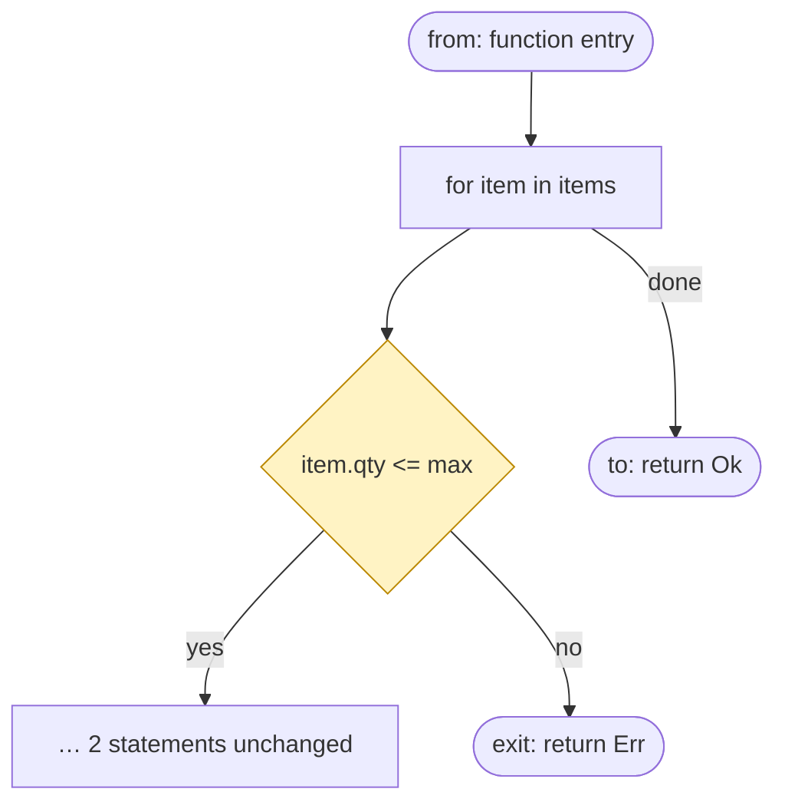

# Semilla design (draft 2)

Status: draft, with an MVP implementation (section 18). Date: 2026-11-08.

## 1. Goal and scope

The goal, in the words of the user (2026-11-23):

> "semilla's goal is not to assume that the agent is dishonest, but rather to provide a semantic diff with as much information as possible and as complete as possible so that a human can review the code as quickly as possible. The requirement that the facts should cover all the diff code matters in that case because we want to fully cover the diff so that the reviewer has all the information. Also semilla should also support tagging a commit a posteriori. Agents should not always be working on commits as they write it"

Semilla gives a **semantic diff**: a list of facts about a change of the code, with as much information as possible and as complete as possible. A human then reviews the code fast: the facts say what changed, and the reviewer reads the facts instead of a line diff.

1. Semilla derives the facts from the code before and after a change (sections 48, 49): a rename, a moved item, a changed condition, a new field, a manifest key. Each fact has a category, and a spotlight when the reviewer must read it with care.
2. **The cover rule is the main requirement:** each changed line of the diff is in a fact (55, 56). The reason: the reviewer gets all the information. A changed line with no fact is information that the reviewer does not get, so it is a defect of Semilla.
3. The agent can add information: the intent of a step, its facts (`same`, `change`), its tags, and the reasons for the facts in the spotlight. Semilla checks each fact of the agent against the edit, so the text that the reviewer reads first is true.
4. **The proofs stay:** `code equal`, `same graph`, `equivalent`, and `expansion equal` (35, 60, 61). The reason: the reviewer relies on them and reads less, so they must be true.
5. Two workflows give the same facts: the agent records **steps while it works** (`semilla step`, then `semilla tag`), or Semilla **tags a commit after the commit** (`semilla tag <rev>`, `semilla tag A..B`, section 62).
6. A reviewer reads the facts in a local UI or a report, with flow graphs and a change tree.

Scope:

- The first language is Rust. Strong types and MIR make the proofs possible.
- The scope is a full Cargo workspace, with all its member crates.
- Semilla is local. It does not push to GitHub and does not use a remote service.

## 2. Principles

1. **Complete information.** Each changed line of the diff is in a fact (the cover rule). A fact text never says less than its change.
2. **Semilla derives the facts.** The facts come from the code, not from the agent. The text of the agent (an intent, a fact, a reason, a tag) is more information for the reviewer, and Semilla checks each fact of the agent against the edit.
3. **A proof must be true.** A result that says that the code did not change is a statement that the reviewer relies on. A proof (MIR equality, an SMT result, an exact diff shape) is better than an LLM judgment, and Semilla gives no proof that it did not compute.
4. **Code of a crate runs in a sandbox.** A build script or a proc macro runs during the check. Such code is not trusted for the safety of the machine and for the correctness of a result, not because the agent is dishonest (27, 28).
5. **A small trusted core.** Only the verifier computes a fact or a result. The helpers (the UI, the hints) do not change a result.
6. **Small steps help the reviewer.** A step with one intent is easy to read: refactor first, then change. Steps are an option: a tag after the commit gives the facts of one step for each commit (62).

History: before 2026-11-23, sections 1 and 2 said "the agent declares, semilla verifies", "unclaimed means unchanged", and "the agent cannot hide a change", and the trials assumed a hostile agent. Since batch 9a the facts come from Semilla (48, 49), and these principles are now principle 1 (the cover rule) and principle 2. The sections of the trials keep the old framing as history.

## 3. Architecture

```
           untrusted                               trusted
┌──────────────────────────────┐         ┌──────────────────────────┐
│ agent + its own edit tools   │         │ semilla verify           │
│ semilla tag tools (MCP, CLI) │ claims  │  - entity trees, 3 views │
│ hints, subgroup suggestions  │ ──────▶ │  - claim checkers        │
│ UI, optional LLM intent check│         │  - SMT checks            │
└──────────────────────────────┘         │  - coverage              │
                                         └──────────────────────────┘
                                                   │
                                     accepted / rejected + reasons
```

| Component | Trusted | Purpose |
|---|---|---|
| Verifier | yes | Checks the claims and the coverage. |
| Indexer | yes (shared with the verifier) | Builds the entity trees, the three views, and the workspace graph. |
| Tag tools | no | Let the agent record steps and claims. |
| Helpers | no | Hints, subgroup suggestions, the optional LLM intent check. |
| UI | no | Shows the review. |

Local storage:

| Data | Location |
|---|---|
| Claims, steps, groups | git notes under `refs/notes/semilla` |
| Step snapshots | git trees under `refs/semilla/<commit>/step-<n>` |
| Caches, graph index, review state | `.semilla/` (not in git) |

## 4. The entity tree

### 4.1 Levels

```
workspace
 └─ crate
     └─ module
         └─ item (fn, struct, enum, trait, impl, const, static)
             ├─ signature / header
             └─ body (for a fn)
                 └─ block
                     └─ statement            let, expression statement, item, tail
                         └─ expression       call, method call, binary op, …
                             └─ leaf         literal, path, opaque macro
```

Items can move between crates of the workspace. A `move-item` claim across crates also updates the `use` paths and the `Cargo.toml` dependencies that the move needs.

Rules:

- **Statements give the structure. Expressions give the content.**
- Block-like expressions (`if`, `match`, `loop`, block, closure, `async` block) contain blocks. The tree continues below them.
- Structs have fields. Enums have variants. `impl` blocks have methods. Traits have items.
- Patterns (in `let` and in `match` arms) are small trees with leaves.
- A macro call is an opaque leaf. Known `std` macros (`format!`, `println!`, `assert!`, `vec!`, `matches!`) have their arguments as children.

### 4.2 Expression roles

| Kind | Children (roles) |
|---|---|
| literal, path | none (leaves) |
| binary op | `lhs`, `rhs` |
| unary op, `?`, `&`, `*`, cast | `operand` |
| call | `callee`, `args[i]` |
| method call | `recv`, `args[i]` (the method name is an attribute) |
| field, index | `base`, `index` |
| struct, tuple, array literal | `fields[name]`, `elems[i]` |
| `if` | `cond`, `then`, `else` |
| `match` | `scrutinee`, `arm[i].pat`, `arm[i].guard`, `arm[i].body` |
| loop | `header`, `body` |
| closure | `params`, `body` |

A method chain shows as one flat list of links, not as nested `recv` nodes.

### 4.3 Node IDs and anchors

- Each node has a **stable ID**. Its path and its name are attributes. A move or a rename does not change the ID.
- An anchor is an item ID, a statement path, and a role path:

```
Cart::total/S2/S2.0/cond/rhs
parse/S4/init/recv/args[0]/body
```

- The agent gets anchors from the `anchor` tool. It never writes them by hand.

### 4.4 Three views

Each node has three views. A change is covered only if every view that it touches has an explanation.

| View | Source | What it sees |
|---|---|---|
| **Syntax** | AST without whitespace | everything, including comments and attributes |
| **Signature** | rustc types, rustdoc JSON | signatures, types, trait impls, the public API |
| **Body** | normalized MIR | runtime behavior |

Each expression node also stores its type from the rustc type check.

## 5. Claims

### 5.1 Three types of op

| Type | Ops | Applies to |
|---|---|---|
| **Identity** | `move`, `rename`, `add`, `remove`, `reorder` | any node (`rename` only for nodes with a name) |
| **Own content** | `change-signature`, `change-condition`, `add-field`, `change-operator`, … | the attributes of one node, not its children |
| **Across nodes** | `extract-function`, `inline-function`, `move-statement`, `split-module`, `merge-module` | a subtree that moves to another parent |

A claim on a node covers only its own attributes. Each change to a child needs its own claim. Free edits are the exception: they mask their children. **Free edits exist only at the expression level** (section 5.6). Above the expression level, each change needs a structured op.

### 5.2 Item ops

- `add-item`, `remove-item`, `move-item`, `rename`
- `change-signature` (now only for the signature edits that no fact covers, see 22.7)
- the signature, visibility, member, attribute, and trait impl changes are facts now (section 22): no claim
- `bump-dependency`, `edit-doc`

### 5.3 Statement ops (structure)

All changes above the expression level use these ops. No free edit exists for a statement, a block, or a function body.

| Group | Ops |
|---|---|
| Add a statement | `add-let`, `add-expression-statement` (a call, an assignment), `add-if`, `add-match`, `add-loop`, `add-return`, `add-break`, `add-continue`, `add-macro-statement`, `add-nested-item` |
| Block | `delete-statement`, `move-statement` (in a block or to another block), `wrap-statements` (in `if`, a loop, a block, `unsafe`), `unwrap-statements` |
| Variables | `extract-variable`, `inline-variable`, `rename-local`, `change-mutability`, `change-type-annotation` |
| `if` | `add-else`, `add-else-if`, `remove-else`, `remove-if` (keep one branch), `invert-if`, `swap-branches` |
| `match` | `add-arm`, `remove-arm`, `move-arm`, `merge-arms`, `split-arm`, `reorder-arms` |
| Loops | `change-loop-kind` (`for`, `while`, `loop`), `add-loop-label` |
| Conversions | `if-to-match`, `match-to-if`, `if-let-to-let-else`, `let-else-to-match`, `loop-to-iterator`, `iterator-to-loop` |
| Attributes | `add-attribute`, `remove-attribute` (on a statement) |

The same ops work at an expression position for block-like expressions. For example, `add-match` can create the `match` in `let x = match y { … };`.

**New code:** an `add-*` op carries the full new subtree, for example the body of a new `if`. New code is not a mask. The verifier builds its full tree, and the UI shows it in full, as a tree and in a flow view.

### 5.4 Expression ops (content)

| Group | Ops |
|---|---|
| Leaves | `change-literal`, `change-path` |
| Operators | `change-operator`, `negate`, `swap-operands` |
| Wrap | `wrap-expression` (`Ok(x)`, `Some(x)`, `&x`, `x.clone()`, `x as T`, `x?`), `unwrap-expression` |
| Calls | `add-argument`, `remove-argument`, `chain-method`, `remove-chain-link` |
| Extract | `extract-variable`, `extract-constant`, `extract-closure` |
| Many sites | `rewrite-pattern` (one rule for many sites; `sites: all` or a list) |
| Patterns | `change-pattern` (in `let` and in `match` arms), `add-binding`, `remove-binding` |
| Free | `replace-expression`, `replace-pattern`, `replace-type` |

Header changes are expression ops on a role. For example, `change-condition` is an edit of `if.cond`, and `change-guard` is an edit of `arm[i].guard`.

### 5.5 Rust-specific groups

- **Borrow checker fixes:** `add-clone`, `borrow-to-owned`, `wrap-in-rc`, `wrap-in-arc`, `change-borrow`. They change performance, not logic. A custom `Clone` impl rejects `add-clone`.
- **Panic sites:** the verifier counts the explicit sites (`unwrap`, `expect`, `panic!`, `unreachable!`, `todo!`, slice indexing). A claim gives the delta.
- **Always spotlight:** changes in `unsafe`, `#[cfg(...)]`, features, `build.rs`, and proc macro crates.

### 5.6 Free edits: the expression level only

The free ops are `replace-expression`, `replace-pattern`, and `replace-type`. They have three limits:

1. **Block-free:** the replaced subtree, old and new, must not contain a block-like expression with statements (`if`, `match`, a loop, a block, a closure with a block body, an `async` block). A change that adds, removes, or edits such an expression needs a structured op. An expression closure such as `|x| x + 1` is block-free.
2. **The tightness rule:** the verifier finds the lowest node that contains each change. A free claim must be on that node, or close to it. If the claim is too wide, the verifier rejects it, with a hint to the smaller node. One free claim on the lowest common node of several changes is correct. The agent does not need one claim for each leaf.
3. **No free edit above the expression level.** A free claim on a statement, a block, or a function body is `malformed`.

Order of preference:

| Rank | Op | Scope |
|---|---|---|
| 1 | exact expression ops (`change-operator`, `wrap-expression`, …) | one expression |
| 2 | `replace-expression`, `replace-pattern`, `replace-type` | one block-free subtree |

Each change above the expression level is a composition of structured ops: add, delete, move, wrap, unwrap, convert, and header edits.

**Macro calls:** the input of an opaque macro is a token tree, not an expression. `replace-macro-input` edits it. It gets a spotlight, because the token tree can contain statements (see B20).

### 5.7 The rule table

The rule table is data. The verifier and the docs both use it.

| Op | Node kinds | The children |
|---|---|---|
| `move`, `rename` | any / named nodes | unchanged, unless other claims say otherwise |
| `remove` | any | all removed |
| `add` | any | all new |
| `extract-function` | a range of sibling statements | moved unchanged; a call takes their place |
| `inline-function` | a call statement | the callee body takes its place, unchanged |
| `change-signature` | fn | the body is not affected |
| `add-if`, `add-match`, `add-loop`, other `add-*` | statement or block-like expression | all new (the reviewer reads them) |
| `delete-statement` | statement | all removed |
| `move-statement` | statement | moved unchanged |
| `wrap-statements`, `unwrap-statements` | a range of sibling statements | unchanged, in the new parent |
| conversions (`if-to-match`, …) | `if`, `match`, `let-else`, loop | the bodies move unchanged into the new form |
| `replace-expression`, `replace-pattern`, `replace-type` | a block-free subtree | masked (tightness rule) |

## 6. Steps, groups, and subgroups

### 6.1 Steps (the verification unit)

A step has one op or an atomic group of ops, an intent text, a declared class, and a tree snapshot.

```
parent ─▶ step 1 ─▶ step 2 ─▶ … ─▶ step N  ==  commit tree
```

- All claims in one step refer to the "before" snapshot. They are simultaneous. Steps are sequential.
- New nodes get "after" IDs from the claim that creates them.
- Each snapshot must pass `cargo check`. An atomic group can contain ops that do not compile alone.

### 6.2 Groups (declared by the agent)

A group is a set of steps with one intent. It is about the size of one commit. It has a title, a kind, and a "why" text.

| Kind | Rule that the verifier checks |
|---|---|
| `refactor` | all steps are neutral |
| `rename`, `move` | only identity claims |
| `api` | only signatures, types, and their call sites |
| `tests` | only test code |
| `deps` | only `Cargo.toml`, `Cargo.lock`, and the call sites |
| `fix`, `feature`, `behavior` | no rule |

- Each step belongs to exactly one group.
- If a group has two parts with no link in the call graph or the type graph, the UI suggests a split (a warning only).

### 6.3 Subgroups (suggested by the engine, edited by the agent)

The engine suggests subgroups by **role**:

| Role | Contents | Default |
|---|---|---|
| Interface | new or changed types, signatures, traits, public API | open |
| Core logic | control flow and logic changes | open |
| Tests | new or changed tests, linked to the core nodes that they reach | open |
| Config | `Cargo.toml`, features, `build.rs` | open |
| Propagation | call site updates, `rewrite-pattern`, match arms that the compiler needs | folded |
| Mechanical | renames, moves, extracts, borrow fixes, formatting | folded |

The agent can rename, merge, and split subgroups, move claims, and add custom subgroups.

Rules for the edited layout:

1. The role label must match the contents. For example, `Mechanical` can contain only proved neutral claims.
2. The contents decide the fold state, not the label. A subgroup with a claim that is not neutral is open by default.
3. The engine computes role badges for custom subgroups, for example `custom · 2 ctrl flow · 1 logic`.
4. Each claim is in exactly one subgroup.
5. When the agent adds steps, the engine keeps the agent's edits. It puts new claims in the suggested subgroup and marks them.

The UI marks the subgroups that the agent edited. The reviewer can switch to the engine suggestion.

## 7. Agent tools

The agent keeps its own edit tools. Semilla gives it tag tools, through an MCP server and the CLI.

| Tool | Purpose |
|---|---|
| `step_begin(intent)` | Starts a step and saves the tree (`git write-tree`). |
| `claim(op, args)` | Adds a claim. A typed JSON schema checks the syntax immediately. |
| `step_end()` | Ends the step and saves the tree. |
| `anchor(file, line, column)` | Returns the canonical anchor for a location. |
| `check_step()` | Verifies the current step only. |
| `tag(commit, claims)` | "Tag after" mode: all steps and claims at one time. |
| `group_set(group)` | Declares a group: title, kind, why, steps. |
| `subgroups_suggest(group)` | Returns the engine's subgroup suggestion. |
| `subgroups_set(group, layout)` | Sends the final subgroup layout. |

Optional helpers (untrusted): edit tools that also add a claim, for example `rename_and_claim`.

The `check_step()` result contains the change tree, with the uncovered nodes marked. The agent sees the same structure as the reviewer.

## 8. Verification

### 8.1 Inputs and checks before verification

```
parent tree, step snapshots S1..SN, commit tree, claims, groups, subgroups
```

1. **Chain:** S0 is the parent. After `rustfmt`, SN is the same as the commit tree.
2. **Build:** each snapshot passes `cargo check`.
3. **Syntax of claims:** each claim matches the schema. Each anchor resolves. If not, the result is `malformed`.

### 8.2 The normal form ladder

Section 35 replaces the verdict rules of this section.

Each normalization step must keep the behavior the same. Then "equal after normalization" proves "equivalent". **The normalization keeps all drops**, because drop order is observable in Rust.

| Level | Form | Absorbs | MVP |
|---|---|---|---|
| N0 | MIR with only the required passes (`-Zmir-opt-level=0`), without names, spans, storage markers, and borrow-check-only statements; a canonical block and local order; `move` treated as a copy; stable closure names | formatting, comments, imports, local renames, type annotations, lifetimes, visibility, `mut` removal, plain `if` inversion | yes |
| N1 | N0 + call targets addressed by content hash (a Merkle tree over the call graph; one hash for each strongly connected component) | item renames and moves | yes |
| N2 | rustc optimized MIR, with the same flags on both sides | extract and inline variable, temporaries, constant folding | yes |
| N3 | N2 + bounded inlining of the workspace's own functions | extract and inline function | yes |
| N4 | e-graphs over a dataflow graph (`egglog`) | reordered independent statements, inverted `if`, conversions, algebra | yes |

**Panic locations are not behavior.** Two panics with the same message are the same, also at different source locations. The order of panics with different messages is behavior.

**Members by name, one view (batch 5e).** The source names a struct field and an enum variant by its name. The MIR names them by an index, and a step can change the map from names to indexes (a reorder, or a member added or removed that is not the last one). So the driver prints names in the text of all levels and in the N4 term:
- A field projection on a struct, a union, or an enum variant prints the field path: `(*_1).k::Pair.a`, `k::Ev::A.x`. A field of a tuple, a closure, or a coroutine keeps its position. A tuple struct field has its position as its name (`k::T.0`).
- A downcast, an aggregate, and `SetDiscriminant` print the variant path (`k::Kind::Small`). A coroutine state keeps its index.
- An ADT aggregate prints each operand with its field path, sorted: `adt k::Pair fields {k::Pair.a: _1, k::Pair.b: _2}`. The order of the operands has no effect, because the statements before the aggregate evaluate them. The compare sorts the operands again after the rename map (a rename can change the order).
- A `switchInt` on a discriminant prints each target with the variant path, sorted, when the only uses of the discriminant local are `switchInt` operands. The values are different, so the order of the targets has no effect. The N4 term tests the variants by name in the same order (`is-variant`).
- Another read of a discriminant (a cast, a compare, a derived `PartialOrd` or `Hash`, `std::mem::discriminant`) prints the value of each variant: `discriminant(_2) cast of k::Kind values [k::Kind::Large = 1, k::Kind::Small = 0]`. The result depends on the values.
- A constant in memory, a transmute, and a cast of a pointer to another pointee type print the layout of each local ADT in their types, with the member names (`layout-of k::Pair: …`). The bytes are in the order of the layout, not of the names.
- The signature line of a generic body has its type and const parameters with their positions: `generics <A#0, B#1>`. A body names a type parameter by its name, and a caller gives the generic arguments by position.

A rename of a field or a variant is then a path in the rename map, like a rename of an item, and proves at N1 (`rename-map`). The derived bodies that show the name (`Debug`) do not change.

**Two rules of N0 for simple rewrites (batch 5u, parts E and F). Decided by Claude.** The rules are in `crates/semilla-mir/src/normalize.rs` with their arguments, and they apply at each level.

- *Rule 3c2: forward a copy across a call.* `_t = copy p` before a call, with the only use of `_t` in the return block of the call, becomes a read of `p` at the use. The conditions: `p` is a local or a field of a local, the body takes the address of neither local, no statement between the copy and the use writes the local of `p`, the call does not name the two locals, and the return block has no other predecessor (an unwind edge counts). Then the callee has no pointer to `p`, so `p` has the same value before and after the call. The rule proves `i < f()` → `f() > i` and `x += f()` → `x = x + (f())` for a loop variable. It does not apply to a place behind a reference, to a `Cell`, or to a local that a closure has by reference (negative tests). (Since 46: a part of rule 3c, which follows each path from the copy to the use. A call on a path that names neither local keeps the value, and a borrow stops the rule only if a path goes from it to the use. The proof `i < f()` → `f() > i` holds again in a `const fn`, where the driver adds an `opaque` call before the call.)
- *Rule 3e: a branch on `Ne` is a branch on `Eq`.* `_t = Ne(a, b)` with a `switchInt` on `_t` as the only other mention becomes `_t = Eq(a, b)` with the two targets in the opposite order. The MIR operators `Eq` and `Ne` are only for the primitive types, and `Ne` is `!Eq` for each of them (also for a NaN). A comparison with a `PartialEq` impl is a call, and the rule does not change it (negative test).

**Honest rewrites with no proof (batch 5u, known limits).** Each of these facts keeps its class, and the reviewer reads it. No step is rejected for them. (a) `is_empty()` → `len() == 0`: the two are different calls of a different crate. (b) The order of two `let` statements with calls: the order of two calls is behavior if Semilla cannot see into them. (c) An inlined `let`: the evaluation time of the value changes. (d) An extracted function whose arguments have calls (`strsim-c-0048`): the old text does `2 * n` (a possible overflow panic in `dev`) before the calls `a.len()` and `b.len()`; the new text evaluates the arguments first and multiplies in the new function. The order of a panic and a call with no known body is behavior, so no sound rule closes this. (e) A hard name with no crate limit (`fixedbitset-c-0020`).

**The rustc inliner is not a proof method.** At N2, rustc inlines some small functions, so some extracts and renames become equal. This depends on heuristics. N1 and N3 must prove these changes (spike S1, finding 5).

**A proof holds in each checked configuration (batch 5s). Decided by the user (2026-11-12).** The promise before batch 5s was: a proof of `neutral` holds for each build configuration. Semilla checked one configuration, and hand-written rules stopped a proof if an input of the proof depended on the configuration. Five rule rounds (batches 5k, 5l, 5o, 5p, 5q) did not make the rules complete: the batch 5q build gave nine false `neutral` results that the release build showed. A spike (batch 5r) showed that almost each body of a real crate reads some code under `cfg`. So a rule "no input depends on the configuration" cannot be sound and useful together. The new promise is narrower and exact:

- A proof of `neutral` holds in each checked configuration. Semilla builds the two trees of a step in each configuration of a list (8.12) and compares the MIR in each one.
- Semilla makes no promise for a configuration that is not in the list. Each reviewer output names the checked configurations, the target, each configuration of the default list that Semilla did not check, and each `cfg` condition that the checked configurations do not cover.

The rules of the compare:

1. **One result from all configurations.** A body is `neutral (proved)` only if it is equal in each checked configuration that compiles it. Semilla combines the states of two configurations with the same function that combines two views of one body (`combine`). An indirect change in one configuration is an indirect change, and its text names the configuration. Each claim check must hold in each checked configuration. *Decided by Claude:* the claim `tested-by` holds if the call path exists in one checked configuration.
2. **A proof in only some configurations is a note (batch 5u, part A). Decided by Claude.** A body that is equal in one or more checked configurations and not equal in a different one is not `neutral`. Its fact keeps the class of its edit and needs no reason: the case is not more dangerous than a rewrite with no proof in each configuration, and Semilla found no proof; it did not prove a difference. The fact has the note "proved neutral in `dev`, `dev, all features`; not proved in `release`, `release, all features`" in `step`, `status`, `review` (the two report forms), the UI, and the MCP output. Before batch 5u, the case was the spotlight "build configuration: not neutral in `release`", and the step was rejected. A property claim on the body stays a check in each configuration: a claim that fails in one configuration is refuted. *Decided by Claude:* for a fact with two or more bodies, "proved" lists a configuration only if each body of the fact that is not equal has a proof in it, and "not proved" lists each configuration where one body has no proof. A body that is not equal in each configuration that compiles it has a plain fact with no note. The note cannot make a fact `neutral`: the state of such a body is not "equal".
   **A removed proof has a note with the cause (batch 5u). Decided by Claude.** When the rule of the build configuration removes the proof of a body and the fact has no spotlight (the use is in code with no change), the fact has the note "no proof: `ledger_core::fees::use_h` uses `feature = "fa"`, and Semilla did not check that condition". The note names at most three uses and then a count. It changes no class and no decision. Known limit: a proof that stops in the normal forms (the marks of the driver) has no such note.
3. **A body that no checked configuration compiles** keeps the spotlight "inactive code". Known limit: an item with two definitions under `cfg` (`chk#0`, `chk#1`) has no body result, and a change of one definition shows with this spotlight.
4. **The release profile.** Semilla uses the release profile of cargo and the same levels (N0 to N4). The MIR of the release profile has no overflow check: `CheckedAdd` and `CheckedMul` with an assert become `Add` and `Mul`. The value of `debug_assertions` is false if the profile says so. No rule of N4 uses a fact that holds only with overflow checks. The SMT check has its own list of six builds (rule 3 below).

**A covered condition (batch 5s, B2 and part C; batch 5t, part A).** A condition is the predicate of a `cfg` attribute, of a `cfg_attr` attribute, or of `cfg!` in the source of the workspace. **The compiler gives the true values (batch 5t). Decided by Claude.** Batch 5s read the features and the `debug-assertions` value from the unit graph of cargo. The unit graph does not show each cause: a `rustflags` entry of a cargo configuration file, `RUSTFLAGS`, a `cargo:rustc-cfg` line of a build script, a target with `harness = false`. So batch 5s gave a false `neutral` for a condition that had one value in each build. Now the MIR driver writes one unit record as the first line of each record file:

- the set of the true `cfg` names and pairs of the session;
- the source files of the workspace that the unit reads (the source map), with each `mod` file and each `include!` file;
- the package, its folder, the root file of the crate, and the target.

The cover logic (`crates/semilla-verify/src/cfgcond.rs`) uses only these records:

1. A condition at a place in a file is covered only if one checked unit that reads this file has the condition true and one has it false. This must hold in the two trees of the step.
2. No rule decides by the name of an atom. Batch 5s said "each configuration covers `test`". This is false for a file under `tests/`: each unit that reads the file has `test` true. The rule is gone. A cost: the name of an item under `cfg(test)` in such a file is a hard name for each crate of the workspace. The control `fixedbitset-c-0020` loses its proof for this cause (the trait method `alternate` in `tests/tests.rs`). An atom with no evaluation rule (`version(…)`, `accessible(…)`) makes its condition not covered.
3. A unit from the cache gives the same record, because the record is a line of the record file. A record file with no unit record makes each condition not covered (I3). A file that no checked unit reads has no covered condition.
4. A text with no known file (a `cfg!` call of a body with no source position) is covered only if the condition is covered at each place in the two trees.
5. The condition line of the reviewer outputs (8.12) uses the same logic.

Semilla does not read the unit graph of cargo. The function `unit_settings` is gone: no other part used it. The driver keeps the value of `cfg!` opaque also for a covered condition. A covered `cfg_attr` with content that Semilla does not know stays an input of the rule.

**The conditions of one proof must be covered together (batch 5t, part B). Decided by Claude.** One proof can use more than one condition. Each condition can be covered, and the proof can still be false in a build that is not in the list. Probe d11e of batch 5s: the type aliases `TA` and `TB` are under `feature = "fast"` and `feature = "slow"`. The list has the two features off and the two on. The step `a as TA as TB as u64` → `a as TB as u64` is equal in each checked build, and it is false with only `fast`. The rule (`crates/semilla-verify/src/joint.rs`):

1. *The conditions of a proof.* Semilla finds them with the rule of the build configuration itself. The rule sees each input of a proof: the two sides, each callee that a form inlines, each type, constant, and name, and each `cfg!` call. Semilla runs the body check again with the rule on for a part of the covered conditions:
   - with the rule on for each condition. A body with the same result uses no covered condition, and its result stands;
   - with the rule on for the conditions of one atom, for each atom. `A` is the set of the atoms that change the result of the body;
   - with the rule on for each condition that is not a condition of the atoms of `A` in a file of the crate of the body. The result must be the first result. Then the proof uses only conditions that the units of the body evaluate, with atoms of `A`.
2. *The check.* A valuation of `A` is checked if one checked configuration has a unit with this valuation that compiles the body in the tree before the step, and one in the tree after it. The rule goes off only if each valuation of `A` that can occur is checked.
3. *A valuation that cannot occur.* Only an exact cause excludes a valuation, and it must hold in the two trees:
   - the feature table of the manifest of the package: with `std = ["alloc"]`, no build has `std` on and `alloc` off. Only a plain feature name counts, through each chain;
   - a `#[cfg(P)]` attribute of the body, or of an item around the body in the same file, that the valuation makes false: no build with this valuation has the body.

   *The full line.* The attribute of an item counts only if the item has the full line of the body. Only white space is before the item on its first line. Only white space or a line comment is after the item on its last line. A line can have the code of two items, and then the attribute of one item says nothing about the body (probes w2, w2e, w2s of batch 5t).

   *The places of a body.* A body can have twins under `cfg`: two definitions with one name. A unit compiles one of them. A place is the file and the line of the body in a unit. Each place has its own units and its own attributes. An atom of these attributes is possibly not in `A`, because the attribute selects the twin and is not an input of the proof (probe w1). So the check uses each valuation of `A` and of these extra atoms. A valuation is excluded only if, in each tree, the feature table excludes it or each place has a false attribute. Else each place with no false attribute in the tree before the step, with each such place in the tree after it, needs one checked configuration that has units at the two places with the values of `A`. A unit that compiles a twin is not a check of the body.
4. *Semilla adds the configuration (batch 5u, part C). Decided by Claude.* When a valuation is missing, Semilla computes a feature selection that gives it: the default features and a list, or `--no-default-features` and a list if a default feature must be off. The feature table of the package gives the selection (the smallest list first, then the order of the names). Semilla adds the two profiles of the selection to the list of the step, builds them for the two trees, and does each check of the step again with the longer list. It repeats this for the next gap. The limit is 4 added selections for one step. *Sound:* an added configuration is a checked configuration in each respect. Each proof of the step must hold in it, a step that breaks its build is rejected, and the joint check runs again from the start with the records of the longer list. So the added configuration can only remove a proof or close a gap that its own units show. If it does not build before the step, or if its units do not have the valuation, the gap stays, and the text says so. *Deterministic:* the added list is a function of the two trees. Each reviewer command runs the same loop and gets the same list. *The hint:* the cache folder (not the repository) keeps the selections that the last step of the workspace needed (`added-configurations.json`), and the next step builds them at its start. The hint has no part in the decision: the loop starts from the default list each time, and a wrong or missing hint changes only the time. *The outputs:* the header shows an added configuration with a mark (8.12), and `semilla step` prints one line. The key `feature-sets` stays as the manual way.
   *Else the rule stays on.* The body gets the result of the run with the rule on for each condition. The spotlight "build configuration" has the gap and the fix in one line: "Not checked together: `feature = "fast"` on with `feature = "slow"` off. Add `feature-sets = [["fast"]]` to `[workspace.metadata.semilla]`". The fix text is there only if a `feature-sets` entry gives the state.
5. *The limits.* The check applies also to a proof with one atom. A proof with more than 6 atoms keeps the rule on. The extra atoms count for a body with twins. For a body with one place and more than 6 atoms in the sum, an attribute with an extra atom excludes nothing. A proof that uses a condition of a different crate keeps the rule on, and the text says so. The same applies to a condition in a file that a unit of a different crate also reads. A test under `tests/` that uses an item under `cfg` of the library is such a proof (the mutant `min-max-heap-f1-0122`; a known limit). *The limits of batch 5u:* (a) Semilla adds at most 4 selections for one step. A proof that needs more keeps the spotlight with the first missing state. (b) A state that does not build before the step stays a gap. (c) A body with twins needs a shared checked state for each pair of its places, and an added configuration does not change this. (d) **A `cfg` attribute on an expression, a statement, or a match arm excludes nothing (part D, not done). Decided by Claude.** The control `bs58-c-0050` shows the cause. Its closures are in match arms under `#[cfg(feature = "check")]` and `#[cfg(feature = "cb58")]`, and the exclusion reads only the attributes of items. The number of a closure depends on the conditions, so one name (`{closure#1}`) is at two places. An exact rule must know each `cfg` source around the place, also in a macro, and the syntax tree does not give the macro case. The proof of this control uses the three atoms `alloc`, `cb58`, and `check`, and it needs 5 selections. So the control stays rejected.

*No input is missing:* each rule of batches 5k to 5q asks `cfgcond` if a condition is covered. So a run with the rule on for a set of conditions shows each use of these conditions that the rule knows. The third run is the check of the set: the proof stands with the rule on for each other condition. *The cost:* a step with no covered condition has no added run. A step with a covered condition has one added compare of the stored records, and a body with an open result has one compare for each atom. No added build is necessary.

*A body with equal MIR:* the rule applies also to a changed body that is equal at N0 in each checked build (d11e is such a body). A body with no text change keeps its result.

**The best-effort layer: the rules of batches 5k to 5q (batch 5s, part C). Decided by the user (2026-11-12).** The rule text from here to the end of 8.2 applies only to a condition that is not covered. An input with a dependence that comes only from covered conditions is not hard: the compare in each configuration is the proof. An input with a condition that is not covered stays hard, and an input with no condition (`size_of`, `usize` arithmetic, a macro of another crate) stays as before. **This layer is not complete.** The known open classes:

- **The target cases.** A change that only a different target shows (probes v17, w8, w8b, w16, w2b of batch 5q: a trait selection that depends on a fact of the target). Semilla checks one target and names it in each output.

The joint feature case of batch 5s (probe d11e) is not a limit after batch 5t: the rule above keeps the proof open until the list has each joint state.

**The rule of batch 5k (A1). Decided by Claude.** A check build is one build configuration: one target, one profile, one feature set, one environment. The rule stops a proof that uses a value that a condition decides, if the condition is not covered. The rule uses allow lists (I3).

1. **The MIR.** A value is configuration-free only if it is equal in each build: a literal of the source text, a named constant of the local crate with a configuration-free initializer and no `cfg` attribute, and the constants `MIN`, `MAX`, and `BITS` of an integer type with a fixed width. Each other constant is opaque: `cfg!`, `debug_assertions`, `option_env!`, `env!`, a constant of another crate, a constant with `usize` or `isize` arithmetic. The driver puts each opaque constant through `black_box` before the optimizer runs, and the text of the value names its source (`@cfg!(debug_assertions)`). The same applies to an operation that the target decides: an operation with a `usize` or `isize` result on values that can be constants, `size_of`, `align_of`, `transmute`, and the length of an array as a value. A constant in a pattern that is not configuration-free stops the term of the body.
2. **The source text.** The compiler removes the code of a false `cfg` attribute before the MIR. So the verifier reads the token text of each body with a text edit. An attribute or a macro call that is not in an allow list stops the proof of the body. A `cfg` or `cfg_attr` attribute in the body, and a macro of the workspace with one in its definition, is a use of the build configuration. A macro or an attribute of another crate is a use that Semilla cannot see into. A glob import from a crate outside the workspace makes the names of the standard macros not known in that file.
3. **The solver.** An SMT check of a condition runs for each build of a list: 64, 32, and 16 bits for `usize` and `isize`, with and with no overflow checks. One counterexample in one build refutes the claim.
4. **The output.** A body with a use of the build configuration is not `neutral`. Its facts have the class of their edits and the spotlight "build configuration: this code depends on a build condition that Semilla did not check. A proof holds only in the checked configurations.", with the list "Uses: …". The list names the condition: "`lim` (under `#[cfg(not(unix))]`)", "`lim` (2 definitions, one under `#[cfg(not(unix))]`)". The unseen case has its own text: "Semilla cannot see if this code depends on a build condition that it did not check". A fact in this spotlight needs a reason. An identity claim (`rename`, `move-item`) on such a step is `unproved`.

The answers to the questions of the brief:

- **Overflow checks.** N0 to N3 compare structure, so an overflow check that is in the two bodies is equal in each build. The N4 identities hold for wrapped values. The SMT check is the one place that used the debug profile and the width of 64 bits: rule 3 fixes it.
- **`#[cfg_attr]`.** On a statement or in a body: rule 2. On the item: the fact for a changed attribute has its spotlight (27.7).
- **`#[track_caller]` and `Location::caller`.** Not an input of the build configuration. A panic location is not behavior (above).
- **Layout.** `size_of`, `align_of`, and a cast to `usize` or `isize` stay opaque. A `transmute` and `from_ne_bytes` give facts to read, not a proof.
- **Trait selection by a feature.** The body oracle compares the default features and each feature set that the root manifest lists (8.12). It does not find the feature sets itself. A workspace with no list has one checked feature set, so the oracle does not catch a variant, a field, or an `impl` under `cfg(feature = …)`. The rule of batch 5l catches it in the source text (inputs 4 and 5).
- **`target_feature`.** It is not in the allow lists: the attribute stops the proof, and `cfg!(target_feature = …)` is opaque.
- **`panic = "abort"`.** The normal forms keep each unwind path. No proof uses the panic strategy.
- **A `cfg` on a statement, `cfg_select!`, a macro of another crate.** Rule 2.

The cost of rule 2: a neutral rewrite in a body with a macro of another crate (`anyhow::bail!`) needs a reason.

**Each input of a proof is configuration-free by an allow list, or it is opaque (batch 5l). Decided by Claude.** Batch 5k had two limits: "a body with no text edit keeps its status", and "a `cfg` attribute on the item itself is free for the body proof". The two limits were wrong. A proof of a changed body uses the content of other items, and the compiler selects one of two items under `cfg`. The rule now: the default of each input is opaque. No normal form looks through an opaque input: it does not fold it, does not inline it, and does not use its layout.

The inputs that a form uses from outside the token text of the changed body, and the state of each:

1. **A constant.** Free by rule 1. Also not free: a constant whose text fails the source rule (a `cfg` attribute on a statement of the initializer), and a constant that names a type alias of input 4. An opaque constant stays in the term as an opaque node (`black_box`).
2. **The value of a static.** Free only if the static is not `mut`, has no interior mutability, is not thread-local or foreign, has no `cfg` or `cfg_attr`, and has a configuration-free initializer by the constant rule. A static of a different crate is free only with an entry in the list of free constants of a workspace crate. An opaque read stays as an opaque node with the text `static NAME`.
3. **The body of a callee.** The forms that look into a callee: the content hash of N1, the inline steps of N3 (N4 and the solver use the N3 term). The rustc inliner is off (`-Zinline-mir=no`). A `const fn` call in a constant is part of input 1. A callee is free only if its item is in the syntax tree, has one definition, has no `cfg` or `cfg_attr` on itself or on an ancestor (module, `impl`, `mod` declaration, inner attribute of the file), passes the source rule (also with no text edit), names no hard name (input 4), and uses no opaque type (input 5). The same rule applies to each callee of the callee: the N3 record lists each inlined callee, and one opaque callee in the list drops the record. The call of an opaque callee stays as a call node, equal in the two trees. A call of a function under `cfg` stops the proof of the caller, with one exemption: the node rule (below, batch 5o).
4. **The resolution of a name.** A name is hard if the build configuration selects its meaning: an item, a field, a variant, a `use`, or a member of an `impl` or a trait under `cfg` or under a `cfg_attr` outside the allow list (itself or an ancestor); a path with more than one definition; an item that a macro call with `cfg` makes; an item whose signature uses a hard alias or module; a type with a default of a `const` parameter that is not a literal. A type alias of a crate outside the workspace is opaque (`core::ffi::c_long`): the MIR shows only its target. The allow list of free aliases has five paths of the standard library (`io::Result`, `fmt::Result`, `thread::Result`, `LockResult`, `TryLockResult`). A hard name cannot stay as an opaque node: the definitions can have different types (the node rule below is the one exemption). So a body with a text edit that uses a hard name gets no proof, at each level (N0 included): the same MIR in the check build is not a proof for a different build. A callee that uses a hard name is opaque (input 3). "Uses" has an exact meaning (batch 5o, below): the compiler resolves a use of the body to the item, or a token of the body can mean the item by its place and its form. The text of an identifier alone is not a use.
5. **The layout, the fields, and the drop of a type.** A type is opaque with a field, a variant, or a trait `impl` under `cfg`, with a field of an opaque type, or with a hard alias in its declaration. The driver lists the types of each body (through the fields, not the standard library). A body with a text edit that uses an opaque type gets no proof. Batch 5o: the walk stops at a pointer in a field, and a type of the hold set is opaque only for a body that reads a part of its value (below). A type of a crate outside the workspace is opaque (P10): Semilla does not read the source of that crate, so it cannot see a variant, a field, or a `Drop` impl under a feature. The driver gives the entry `foreign PATH` for such a type. A type of the standard library is free by an allow list of crates (`core`, `alloc`, `std`, `proc_macro`, `test`): one toolchain and one target give one definition. `size_of`, `align_of`, and each layout query stay opaque by rule 1.
6. **An item of a different crate (the standard library included).** No form looks into a function of a different crate, member or not: N3 inlines only functions of the local crate with no generic argument, and the content hash has no text for such a callee. A constant is opaque unless the list of free constants of a workspace crate names it (rule 1). A static: input 2. A type alias: input 4. The items of a workspace member crate are in the syntax tree, so the inputs 3 to 5 apply to them.
7. **Other inputs.** A promoted constant: its MIR decides by rule 1. A `const` generic argument and an array length: the MIR text keeps a named or computed argument as the path of its constant, not as a value, so it is not equal to a literal (probes; Semilla has no rule of its own for this). A type-level constant as an operand stops the term (rule 1). The default of a `const` parameter: input 4. The default of a type parameter: equal in each build unless it names a hard name (inputs 4 and 5). `type_name`, `needs_drop`, and each intrinsic call: opaque by rule 1. `Location::caller`: a call of a different crate (input 6). `env!` and `option_env!` (also a value of a build script): opaque by rule 1.

The output: the output rule of rule 4 stays. A body whose new code names an opaque input gets the spotlight "build configuration" with "Uses: …", and the list names the item: "`strict` (2 definitions under `cfg`)", "`wide` (`#[cfg(target_pointer_width="64")]`)", "static `LEVEL` (`usize::BITS`)", "`core::ffi::primitives::c_long` (a type alias of a different crate)". A use only in code with no change gets no spotlight: the reviewer of this step reads no new use. But the body gets no proof, and its facts have the class of their edits. The rule "changed code" below makes this exact (batch 5o).

The exemption: an item is opaque by its own attributes and the attributes of its ancestors, not by a sibling. A `#[cfg(test)] mod tests` makes only its own items opaque. A name under a `cfg` module is not hard for a reader in that module.

Limits (decisions):

- A body that uses a hard name in code with no change loses the proof of an honest rewrite. The node rule (batch 5o) is the one exemption.
- A `cfg_attr` with content outside the allow list is a root (batch 5o: the allow list and the `derive` rule, below).
- A type of a crate outside the workspace is opaque (input 5). The cost: an honest rewrite of a body that uses such a type (`serde_json::Value`, `anyhow::Error`), also in a field of a local type, gets no proof. The edits are facts to read, with no spotlight. A body that only calls a function of such a crate, with no type of it, keeps its proof.
- A removed use of an opaque input gets no spotlight: the output rule names only new code. The removed code is a fact to read, not a proof.
- An item macro of a crate outside the workspace that makes items under `cfg`, with no `cfg` token in the call: the made bodies have no item in the syntax tree, so they are opaque callees, but their names are not hard.
- A text edit that is only a rename of the rename map keeps the status `Equal` at N0 and N1.

**The exact rule of a use (batch 5o). Decided by Claude.** Batch 5l used the identifier: a body with the word `default` used each item with the name `default`. That rule was sound, but it was too coarse: the control group of the mutation run fell from 112 proofs to 59, and a call `Default::default()` got a wrong spotlight. The list of inputs above stays. The meaning of "a body uses an input" is now exact. It has two sources: the compiler, for the code that the checked configuration compiles, and a name rule with a place and a form, for the code that the compiler does not show. The default stays opaque: a case with no exact rule keeps the rule of batch 5l.

*The compiler (an active item).* The driver gives the uses of each body by the name resolution and the type check (`config::uses` on the HIR, the locals of the MIR, `reach::note_layout`). The entries:

- `cfg PATH`: an item of the local crate that a `#[cfg]` selects (the item or a parent). The body names it, calls it (a method call, an operator, and an index too), or has a value of this type.
- `PATH`: a type of the workspace in the type of an expression, a pattern, a local, or a step of an adjustment (the method lookup tries each of these types).
- `touch PATH`: the code reads a part of a value of this type: a pattern, a field, a cast, a generic argument of a callee that can read the layout.
- `std PATH`, `foreign PATH`, `alias PATH`: a type of the standard library, a type of a crate outside the workspace, a type alias of a different crate.

The walk includes each closure and each constant block. An entry `cfg PATH` stops the proof of the body (the exemptions: a reader inside the root of the item, and the node rule). The argument: the entry is a fact of the compiler, so no use of an active item is missing because of a name, an alias, a re-export, a method call, or a value with no name. Semilla does not evaluate a `cfg` condition, so the syntax tree does not tell which item is active. So the name rule below applies to each item under `cfg`, active or not. For an active item it adds nothing that the compiler does not give.

*The name rule (an inactive item).* A hard name has a place and a form (`Place`, `Form` in `opaque.rs`; `hit` decides). A token of a body with a text edit uses the name only if the place and the form agree.

- **An item of a module `M`** (a function, a constant, a static, a type, an alias, a module, a leaf of a `use`): the form is "path", the place is `M`. A token uses it if it is the first segment of a path in an item that sees the names of `M`, or if it follows `M::`, `crate::` (and the root sees `M`), `self::`, or `super::` (each module above the reader counts). An item sees `M` if its module is `M`, or if a chain of glob imports goes to `M`. A glob import with a source that is not a known module (`super::*`, `crate::*`, a name of an `as`) sees each module. A path that starts with `::` and a path after a name of an `as` count as a use. The argument: Rust resolves a path with no qualifier in the scope of the module of the code (its items, its imports, its glob imports, the prelude). A name after `.` is a method or a field: no item of a module can be its meaning. A segment after a type or a trait (`Default::default`) resolves in that type or trait. A local variable with the same name counts as a use (the safe side).
- **A member of an inherent `impl` for a local type `T`**: the form is "member" (after `.` or `::`), the place is the type `T`. A token uses it only in a body that uses a type with the name `T`: the entries of the driver have the name, the body has no entry, or the text has the word `T` (also `Self` in an `impl` of `T`). The argument: the method lookup tries only the types of the receiver chain (by value, `&`, `&mut`, each step of `Deref`), and the driver gives each of these types.
- **A trait `impl` for a local type `T`**: the same place and form, for the members of the `impl` and for each member of the trait (a trait of the workspace, or a table of known traits: `Clone`, `Default`, `PartialEq`, `Hash`, `Display`, `Serialize`, …). The coarse rule applies (the type `T` is opaque, and its name is hard) if the code can use the `impl` with no name: a trait with a drop, an operator, a `Deref`, an iterator, or a conversion meaning (`SILENT_TRAITS`); a member that is not a function (an associated type or constant); two impls of the same shape (the type of a number with no suffix depends on the set of impls); a trait that Semilla does not know; a header that does not parse. This is wider than the brief: an inactive trait `impl` can change more than a method call. **Batch 5q: this rule alone is not sufficient.** It says that a trait `impl` under `cfg` for `T` gives only the members of its trait. That is wrong: a generic `impl` with a bound gives more names to `T` when the bound starts to hold. The rival rule below covers that case. The rule here stays for the inactive `impl` (the union of part B3).
- **The self type of an `impl` header** is the local type only if the module scope proves it (`visible`): a type with the name exists, and no module in the scope has an alias with the name, a `use` with the name, or a macro call that makes items. A private glob import of a source module counts only for an importer in or below that module. If a glob source is not a known module, there is no proof. With no proof, the members are hard in each place. An `impl` in a module that sees a glob import under `cfg` and names an item that is not an item of the module has no fixed self type or trait (`unpinned`): the coarse rule.
- **A field or a variant under `cfg`** of a type `T`: each form, in a body that uses a type with the name `T`. With no known owner: each place.
- **A `use` under `cfg`**: each leaf is a name of its module. For a known trait, its members are hard as members in that module. A leaf that can be a trait that Semilla does not know makes the module a glob module.
- **The coarse rule of batch 5l stays** for: a blanket `impl` and an `impl` with no known self type (each member, each place and form); an `impl` for a type of a different crate (the type is opaque for each body with a value of it); a trait under `cfg` (its members, each place); a glob `use` under `cfg` and an item macro with `cfg` (each body of a module that sees the module gets no proof); an item in a function body; a token in the arguments of a macro that is not of the standard library (the position in the expansion is not known).
- **A type alias** is hard only by a hard name in its target. An alias of a type with a part under `cfg` needs no name rule: the driver gives the type.
- **The name of a function in its definition** (`fn name`) is not a use. The definition does not resolve the name.
- **Twins** (a path with two definitions): the name rule with the scope of the item, and the entry `cfg PATH` of the active one.

*The node rule (A3).* A call of a function under `cfg` stays an opaque call node, and the caller can keep its proof, if all of these are true: the item is a function of a module, and the caller is in the same module; each definition of the path is a function with the same header text; each definition has only attributes of the allow list (an attribute macro can change the signature); the header has no `const`, no hard name, no hard alias, and no opaque type; the name is not a function of the prelude (`drop`, `Some`, `None`, `Ok`, `Err`); the module has no import of the name, no glob import, and sees no glob module. The argument is a uniform substitution: in each configuration, the name means the one definition of that path (an item of the module hides a glob import and the prelude), and each definition has the same type. So the two trees have the same call node in each configuration, and a proof with an unknown function for the node is valid for each definition. If one condition fails, the name is a hard name.

*The hold set and the pointer rule (input 5).* A struct or an enum with a field or a variant under `cfg` is in the hold set if each part under `cfg` is plain data, and the type has a size, a value, and the same drop code in each configuration: a struct needs a field with no `cfg` of a pointer type or a primitive type, an enum needs two variants with no `cfg`. A type of the hold set is opaque only for a body with an entry `touch` (a pattern, a field, a cast, a layout use). A body that only moves the value keeps its proof. The argument: a move of a whole value has the same MIR for each layout, except for a type with the size zero (rustc can replace a read of such a value with a constant), and the anchor field excludes that. The walk through the fields stops at a pointer in a field (a reference, a raw pointer, `NonNull`): the owner has no part and no drop code of the pointee, and the code that reads the pointee has an expression with the type of the pointee, which has its own entry.

*Changed code (A4).* The spotlight shows only for a use in the new or changed code of the step. Three parts: (1) the source rule reads the changed statements and the full statement around each block that holds them (`srcconfig::changed`); (2) a hard name counts if the new text has it more times than the old text, or if one of its tokens is a changed token (batch 5p: the token diff below; batch 5o used one range from the first changed token to the last); (3) an entry of the driver (`cfg`, an opaque type, a foreign alias) counts if the old body does not have it. A use in code with no change gives no spotlight. It still stops the proof, except by the node rule.

*`cfg_attr` (A5).* A `cfg_attr` does not make its item opaque if its content is in the allow list: `allow`, `warn`, `deny`, `expect`, `forbid`, `doc`, `inline`, `cold`, `must_use`, `deprecated`. A `derive` in a `cfg_attr` counts as a trait `impl` under `cfg` for the type: a `derive` of the allow list gives the member names of its trait for a body that uses the type, and each other `derive` makes the type opaque. The allow list has the built-in derives and the two derives of `serde` (batch 5p, the table of known traits below). A name of the allow list counts only if no import can give it a different meaning (batch 5q, the `derive` name rule below). Each other content keeps the item opaque (`repr`, `path`, `macro_use`, a proc macro attribute).

Limits of batch 5o (decisions):

- The text of a nested function is a part of the text of the outer item, so a hard name in the nested function also stops the proof of the outer body.
- A struct with a field under `cfg` and no anchor field, and an enum with one variant with no `cfg`, are not in the hold set: a rewrite of a body that only moves such a value gets no proof.
- A type of a crate outside the workspace stays opaque (part B is not built). The check needs the source of the registry crate, the name rule across crates, and a field walk for its types. The two examples of the brief depend on the build configuration in fact: `serde_json::Value` (the map type is an alias with two definitions under a feature) and `anyhow::Error` (`cfg` names of the build script).
- The changed token range was one range, from the first changed token to the last. A use between two changes counted as changed. Batch 5p replaces the range with a token diff (below).
- Result on the stored mutation set (four crates, 2240 mutants, 201 control rewrites): no false `neutral`; 126 control rewrites have a proof (batch 5k: 112, batch 5l: 59); 16 runs have the "build configuration" spotlight, each with a true use in the changed token range (batch 5l: 59).

**The names of the expanded code (batch 5p). Decided by Claude.** The name rule of batch 5o read the tokens of the source text of a body. A macro puts names into the body that the text does not have: a workspace macro `call!()` with the body `lim()`, a macro in a macro, and `write!(w, …)`, which gives the method call `w.write_fmt(…)`. So a step could replace `m::lim()` with `call!()` and get `neutral`, while the release build calls a different function `lim` under `cfg`. Now the names of a body come from two sources.

- *The token scan* (as in batch 5o): each name in the source text of the item. It sees the code that the checked configuration removes (a statement under `cfg`), and each token of a macro argument.
- *The driver* (`config::names`): each name of the body after the expansion (the HIR), in the checked configuration. A name has a word and a form: a path segment with its qualifier, a method call, a field, a field of a struct expression or a struct pattern, a binding, a type path, an associated item. The driver resolves `$crate`. A name has the name of the outermost macro call that gives it, and a line. A name that a desugaring of the compiler adds (`for`, `?`) is not in the list: it is a language item, and the rule of the silent traits covers the `impl` that it selects. The walk includes each closure and each constant block of the body.

*The union.* A name is a use if the token scan gives it or the driver gives it. `Opaque::hard_names` applies the name rule (`hit`, with the place and the form) to each name of each source. No source is a superset of the other for a form: the driver has no name of the code that the configuration removes, and the token scan has no name that a macro makes. So no form uses only one source. The argument for the union: a name of a body in a configuration `C` is in the text of the body, or a macro call of the body gives it. The driver gives each name of each macro call for the checked configuration. A macro gives the same names in `C` if no macro of the expansion depends on the configuration. The source rule of batch 5k covers each macro that can depend on it. Each case gives the spotlight or the coarse rule, as before:

- a macro definition with `cfg!` or a `cfg` attribute;
- two definitions of a macro under `cfg`;
- a macro call with a path;
- a macro of a different crate that is not a macro of the standard library.

*A text with no driver names.* The name rule has no driver list for these texts: a signature, a struct declaration, an `impl` header, a type alias, the value of a constant. For these texts, a call of a workspace macro adds each word of each definition of that macro, and of each macro that the definition calls. A call of a different macro that is not in the list of free macros of the standard library can give each name. `Opaque::widen` adds these tokens. A body does not get them: the driver list is exact for a body, and the words of a definition are not.

*The value of a constant.* The name of a `const` or a `static` is hard if its value uses a hard name (with a macro or with no macro). The same applies to an associated constant of an `impl` or a trait (`member_values`). Batch 5o read the value only for `cfg!` and the target width, so `const C: u64 = X;` with a second `X` under `cfg` gave a false `neutral`.

*A callee.* `Opaque::callee` uses the same union for the item of a callee that a normal form looks into. A callee with no item in the source (a function that a derive macro or an item macro makes) is opaque.

*Changed code for a name from an expansion.* A name of the new expanded body that comes from an expansion belongs to its macro call. It is changed code, and gets the spotlight, in two cases. (1) A token of a call of that macro is a changed token of the new text or of the old text. The match is by the name of the macro. (2) The expanded body of the new side has the name more times than the old side. A name with no known macro call counts as changed. A name in code with no change gives no spotlight, and it stops the proof (except by the node rule). A step that only removes a use gets no spotlight: the hard name of the old body stops the proof, and the removal is a fact to read.

*The token diff (C1).* A token of the new text is changed if it is not in a longest common sequence of the tokens of the old text and the new text (`token_diff`). A token that the edit moves across the common part is not in the sequence, so it is changed. Two long texts with more than 4,000,000 pairs of changed tokens get the range rule of batch 5o. Only the spotlight rule uses the diff. The rule that stops a proof does not change: a hard name in a body with a text edit stops the proof.

*The table of known traits (C2).* `KNOWN_TRAITS` has a row for each known trait: the name, the path in the compiler, the names that the trait gives to a type, and a flag for a `derive` of the allow list. The test `trait_table` compiles a small crate with the driver and reads from the compiler: the associated items of each trait, each blanket impl with the traits of its bounds, and each `impl` that a `derive` makes. It compares each row with these facts. The names of a row are the items of the trait, and the items of each `pub` trait that a blanket impl gives to a type with the trait. Examples: `ToString` from `Display`; `ToOwned` from `Clone`; `Into`, `TryFrom`, and `TryInto` from `From`. A trait that is not `pub` gives no name: code outside its crate cannot name it. The test found missing names (`clone_into`, `try_from`, `try_into`, and hidden methods), and the table has them now. The rows `Serialize` and `Deserialize` are traits of `serde`: the test reads them from the version of `serde` in the lock file of Semilla. A `derive` in a `cfg_attr` is free only if its name has the flag: a built-in derive (`Clone`, `Copy`, `Debug`, `Default`, `Eq`, `Hash`, `Ord`, `PartialEq`, `PartialOrd`) or a derive of `serde`. A name with no built-in derive (`Display`, `Error`, `From`) is a macro that Semilla does not know, so the type is opaque. A derive macro of the workspace with a name of the table makes the type opaque too. The trust decision: the table uses the short name of a trait. Semilla trusts that a `derive` with a name of the allow list is the built-in derive or the derive of `serde 1`, if the workspace does not define it. Semilla trusts also that each version of `serde 1` gives the same members.

Limits of batch 5p (decisions):

- The match of a name to a macro call is by the name of the macro. A change in one call of `m!` makes each name from each call of `m!` in the body changed code. This is the safe side.
- A macro of a different crate in a field type or a signature can give each name, so its type is opaque. In the hidden-type scan of a function signature it does not count; the source rule gives the spotlight for a body with such a call.
- An associated type gets the member rule only through a macro. A hard name in the text of an associated type is covered by the rule for a member that is not a function (the coarse rule).
- The driver list can have the name of a language item that a macro of the standard library uses in its expansion. This can only stop a proof.
- The token diff keeps the longer part of a swap in the common sequence. A hard name that moves with that part gets no spotlight. The rule that stops a proof keeps the result not `neutral`.

The measurement of batch 5p (2,441 stored runs): the 22 `neutral` mutants are the 22 equivalent mutants of batch 5o. The control group stays at 126 of 201. The `build configuration` rejections go from 16 to 3, by the token diff.

**A trait fact that depends on the configuration (batch 5q). Decided by Claude.** The defect: `impl<X: Mark> Sup for X` gives the method `Sup::dig` to each type with `Mark`. With `#[cfg(not(debug_assertions))] impl Mark for T {}`, the call `t.dig()` means `Other::dig` in the debug build and `Sup::dig` in the release build. The trait `Mark` has no member, so the name rule finds no hard name, and a step from `Other::dig(&t)` to `t.dig()` got `neutral`. No table can list these names: the generic `impl` can be in the workspace, in the standard library, or in a dependency. So the compiler gives the answer.

*The rival rule (the driver, `semilla-mir/src/rival.rs`).* The method lookup gives a rank to each associated item with the name of a call. The lookup makes a list of steps: the type of the receiver, each type that `Deref` gives, and the slice type after an array. Each step has three positions: the type, `&` of the type, `&mut` of the type. At one position, an inherent item comes before an item of a trait in scope. A **rival** is a different item with the name of the call that matches a position before the position of the winner (or the same position, for an inherent item against a trait winner). A rival does not apply now, so a trait fact must change before it wins. The driver walks the bounds of the rival and gives an entry with the kinds of these facts:

- `closed:TRAIT:HEAD`: a new `impl` of the trait `TRAIT` for a type with the name `HEAD` (`*`: a type with no simple name);
- `auto`: an auto trait must start to hold;
- `unstable`: the rival applies now, and the compiler puts it after each stable item because the crate does not have its feature; also a winner that is unstable;
- `foreign`: a crate outside the workspace (not the standard library) can add the `impl`;
- `open`: the driver does not know the facts (an alias, a projection, a bound that it cannot bind).

A path `Type::name` has one position: an inherent item with the name is the rival of a trait item. A winner that is inherent and at the first position has no rival.

*The winner rule (part C1, `uses`).* The winner can apply only because of an `impl` that the active configuration has. The driver walks the trait fact of the winner and the bounds of each `impl` that can give it. An `impl` of the workspace is an entry `closed:TRAIT:HEAD`. An `impl` of a crate outside the workspace is `foreign`. The match is by structure: it finds more `impl`s than the selection of the compiler uses, not fewer.

*The rule of the verifier (`Facts` in `opaque.rs`).* An entry is an input of the build configuration if a fact of its kind can change. It stops the proof, and the changed-code rule gives the spotlight with the call and the rival: "the call means `Other::dig` now; `Sup::dig` wins if `Coin: Sup` holds in a different configuration".

- `foreign` and `unstable`: always. Semilla does not read the `cfg` items of a crate outside the workspace, and a `cfg_attr` at the crate root can select a feature.
- `open`: if the workspace has a trait fact under `cfg`: a trait `impl` under `cfg` or `cfg_attr`, a `derive` in a `cfg_attr`, a `use` under `cfg`, a trait under `cfg` or with a `cfg` in it, an item macro with `cfg`.
- `auto`: the same, or a field or a variant under `cfg`.
- `closed:TRAIT:HEAD`: if the workspace has an `impl` under `cfg` of a trait with that short name for a type with that name (or with no simple name), or a `derive` with that name in a `cfg_attr`, or a coarse case.
- The coarse cases (Semilla cannot list the facts): an item macro with `cfg`, a glob `use` under `cfg`, an `impl` under `cfg` that Semilla cannot read or with a renamed trait, an unknown `derive`, a trait under `cfg` with a bound that is not a trait of the workspace.
- A trait under `cfg`, or a trait with a member under `cfg`, makes each trait of its bounds a fact (supertraits, `where` clauses, the bounds of associated types). A supertrait that only one configuration has gives `T: Sup` to each `T` with the trait.

If the workspace has no such fact, a call with a rival is free. The inline rule uses the entries of the callee. A call node (A3) does not hide an entry.

*The argument.* The meaning of a call can change between two configurations in three ways. (1) An item with a higher rank starts to apply. It is a candidate now, or it is not. If it is a candidate (an item of a trait in scope, or an inherent item of a type of the steps), the driver finds it, and each trait fact that it needs is in the entry. A new trait fact needs a new `impl`: the workspace source has it under `cfg` (the verifier reads each `impl`, active or not), or a coarse case hides it, or a different crate has it (`foreign`). (2) The winner stops to apply: the winner rule gives each `impl` that it needs. (3) The set of candidates changes: a `use` under `cfg` brings a trait into scope, or an inactive inherent `impl` adds an item. The compiler does not see these, so the older name rules stay (the union, part B3).

*The orphan rule (part B4, `std_only`).* Only the standard library can have an `impl` of its trait with no parameter for its type or for a type of the language (`usize`, a slice, a tuple). `&T`, `&mut T`, `Box<T>`, and `Pin<T>` are local if `T` is local, and `dyn Tr` is local if `Tr` is local. A fact of this kind gives no `closed` entry: `usize: Iterator` holds in no configuration, so `a.cmp(&b)` is free. A generic `impl` of the standard library stays in the walk: `Box<Tok>: Iterator` holds if `Tok: Iterator` holds. The measurement needs this rule: a glob `use` under `cfg` in `fixedbitset` made each `len` call on a slice an input.

*The `derive` name rule (part C2, `Shadow`).* The name of a derive macro is a short name. The compiler looks for it in this order: the names of the module (a `use`, then a glob `use`), the macros of each `#[macro_use] extern crate`, then the prelude of the standard library. So a `use`, a glob `use`, or a `macro_use` can give the name `Clone` to a macro of a different crate, and that macro can make each kind of item. A `derive` name in a `cfg_attr` is in the allow list only if none of these applies to the module of the type:

- a `use` in the workspace gives the name (also with `as`) from a path that is not `std`, `core`, `alloc`, `serde`, `serde_derive`, or a workspace item with no such source. `use serde::{self}` gives no name;
- the module, or a module above it, has a glob `use` of a crate outside the workspace, or of a module with such a glob `use` (a chain of `pub use`);
- the crate has a `#[macro_use] extern crate` of a crate that is not in the trusted list, an `extern crate x as serde`, or a `use` that Semilla cannot read.

If one applies, the item is an item under `cfg`. The rule of the brief was for the crate. The module rule is equal for soundness and keeps the proofs of a crate with `use rand::prelude::*` in a test target. Limits: a rename in the manifest (`serde = { package = "x" }`) and an item macro of a different crate that expands to a `use` are not covered.

*A macro call in a type position (part C3).* A macro call of a different crate (not the standard library) in the type of a signature, a field, or an alias makes that type opaque. Semilla does not scan the source of the dependency.

Limits of batch 5q (decisions):

- A glob `use` under `cfg` stays a coarse case. An `impl` with no `cfg` can name a trait or a type through the glob (`fixedbitset` has a different `Block` for each target). The cost: a new call whose winner uses a workspace `impl` gets the spotlight in such a workspace.
- An unstable inherent rival is always an input. An `impl` of the standard library that depends on the target is not a fact.
- The winner rule walks a method call and a path. An operator, a `for` loop, and `?` select a language item: the rule of the silent traits covers them.
- A `cfg_attr` at the crate root makes only the items of the root file facts.
- The standard library is known by the name of the crate (`core`, `alloc`, `std`, `proc_macro`, `test`).

The measurement of batch 5q (2,441 stored runs): the 22 `neutral` mutants are the 22 of batch 5p. The control group stays at 126 of 201 (35, 39, 33, 19). The `build configuration` rejections go from 3 to 10: seven mutants of `fixedbitset` put `Default::default()` into a body, and the glob `use` under `cfg` of that crate makes `impl Default` a fact. They were facts to read before.

The verifier tries the levels in order and stops at the first equal level. It stores the level as the proof type, for example `neutral (N1)`. If no level is equal, it uses N0 to find the changed nodes, because N0 is the closest to the source.

#### N3: bounded inlining

- Inline only functions of the workspace, never external functions.
- Inline to a fixed depth (for example, 2) and a fixed size limit.
- Do not inline recursive functions (functions in a cycle of the call graph).

#### N4: equality saturation

1. **Convert each body to a dataflow graph.** Use a form with structured control flow: a "gamma" node for a branch, and a "theta" node for a loop (as in RVSDG). All side effects (writes through `&mut`, calls, I/O, drops, panics) take and return an explicit **state value**. So the effects keep their order, and only pure parts can move.
2. **Run equality saturation** with `egglog` on the "before" and "after" graphs together.
3. **Use audited rewrite rules only.** Each rule must keep the behavior the same for the Rust types it applies to. The rule list is part of the trusted core, like the normalization rules.
4. **Use limits.** Node, iteration, and time limits stop the run. A stop gives `unproved`, never a false proof.
5. **Show the proof.** The chain of rules that connects the two graphs goes into the claim result, for example `neutral (N4: invert-if, de-morgan)`.

The SMT checks (section 8.8) and N4 work together. N4 handles the structure (branches, loops, statement order). SMT handles the conditions and the integer expressions inside them.

### 8.3 Match the items

1. Identity claims give a map from "before" IDs to "after" IDs at all levels.
2. Unclaimed nodes match by the same path and the same kind. No two items share a path: twins (two items of one module with the same path, for example `cfg` variants or two `impl` blocks of one type) get the suffix `#N` in source order (`sys::sep#0`, `sys::sep#1`, `sys::imp#1::open`). An item without a twin keeps the plain path.
3. `rename` and `move-item` claims give a rename map (section 22.4). The verifier applies the map before each compare.
4. A node on one side only, with no claim, is uncovered.

### 8.4 Indirect changes

The MIR of a function can change when its text does not change. Examples: a new trait impl changes method selection, a changed generic function, a changed `macro_rules!`, a changed type of a variable.

The verifier hashes the normalized MIR of **every** body in the workspace. A body with a new hash and no text change is an indirect change. Semilla derives its owner (8.16). The agent cannot name the affected bodies: the `affects` argument is retired.

"No text change" means no edit of the item that can change its body: a body edit, a signature or member edit, or an added or removed item. A doc, visibility, or attribute edit does not count, so it cannot hide a MIR change of the body. The MIR comparison follows the claimed renames, also when the body moves to another crate: the build targets of the two sides then differ, and the bodies are equal only when each side has one distinct text and the two texts are the same.

### 8.5 Check methods

| Method | How it works | Claims |
|---|---|---|
| **Predict** | Compute the expected "after" from "before" and the claim. Compare. | identity claims, neutral claims (N0–N4) |
| **Match the diff shape** | The diff at the anchor must have the exact shape and content of the claim. | most statement and expression ops |
| **Mask** | Hide the anchor subtree on both sides. The rest must be equal. The subtree must be block-free. | `replace-expression`, `replace-pattern`, `replace-type`, `replace-macro-input` |
| **SMT** | Prove a relation between the old and new expression. | effects, neutral expression rewrites |

The verifier does not run refactors. It checks that the diff matches the claim.

### 8.6 Hierarchical check (top-down)

1. Build the trees and the three views.
2. Apply the identity claims and get the ID map.
3. Apply the claims across nodes. Check that each moved subtree is the same in its new place.
4. For each pair of matched nodes: compare the node's own attributes, assign each difference to a claim, align the children, and repeat for each child.
5. Compare the MIR of each matched function. For `extract-function`, inline the new function and compare again.

### 8.7 Body changes and spans

- The verifier maps each MIR change to the lowest expression node whose span contains it. This mapping uses N0.
- A drop belongs to the statement that declared the variable.
- If a span is too wide (macros, some desugarings), the verifier uses the statement level for that change.

### 8.8 SMT checks

SMT is in the MVP.

| Check | Example | Result |
|---|---|---|
| Condition effect | `x < n` → `x <= n` | `widen`, with an example input |
| Neutral expression rewrite | `!(a < b)` → `a >= b` | `neutral (SMT)` |
| `swap-operands` | `a + b` → `b + a` | `neutral` if the op is commutative for the types |
| `invert-if`, `swap-branches` | the new condition is the negation | `neutral` |
| Guard change | `x > 0` → `x >= 1` on integers | `equivalent` |

Effect labels:

| Effect | Meaning | Proof |
|---|---|---|
| `narrow` | Fewer inputs take the branch. | `to → from` |
| `widen` | More inputs take the branch. | `from → to` |
| `negate` | The opposite inputs take the branch. | `to ≡ ¬from` |
| `equivalent` | No behavior change. | `to ≡ from` |
| `unrelated` | No simple relation. | none of the above |

The engine computes the effect label. The agent does not declare it.

#### 8.8.1 The effect label is a hint (batch 5n, B2). Decided by Claude.

The solver compares the text of the two conditions. It does not compare the bodies. So the label is a hint for the reviewer, and it is not a proof. The rules:

- The text of the label says so: `(effect hint: widen, example: x = 5)`.
- Only a definite answer shows: `narrow`, `widen`, and `negate`.
- `equivalent` does not show on a fact. Only the MIR proves that a body has no change, and a proved body shows as `neutral rewrite (proved N…)`. The answer `equivalent` stays an input of the class, and the class rule does not make a fact neutral without the MIR.
- `unrelated` does not show. It has two meanings ("no simple relation" and "the solver does not know": a method call, a float, a timeout), and the reviewer cannot see which one applies.
- A plain negation (`C` to `!(C)`, or the reverse) gets `negate` from its tokens, with no solver. So the same change gets the same label for each type of the terms.

Encoding:

- **Interface:** SMT-LIB text through a pipe to a solver process (Z3 or cvc5). The UI can show each query.
- **Integers:** bitvectors with the exact width and sign from rustc.
- **Overflow:** the effect is computed under "no panic". The verifier reports separately when the panic conditions are different.
- **Floats:** `unrelated` in the MVP.
- **Atoms:** an expression that SMT cannot model becomes an uninterpreted value. The same text, after the rename map, gives the same value. If the set or the order of the calls changes, the result is `unrelated`.
- **Witness:** for `narrow`, `widen`, and `unrelated`, the solver gives an example input.
- **Safety:** a timeout or `unknown` gives `unrelated`. Each query has a time limit (about 2 seconds).
- **Determinism:** a pinned solver version, a fixed random seed, and a cache by query hash.

### 8.9 Extra checks for some claims

| Claim | Extra check |
|---|---|
| `add-clone` | The `Clone` impl is a derive or from `std`. |
| logic claims | The graph shape inside the anchor did not change. |
| `swap-operands` | Both operands have no side effects (the MIR shows the calls). |
| `reorder-arms` | The patterns do not overlap (rustc pattern analysis). |
| `change-visibility`, `api` groups | `cargo-semver-checks` or a rustdoc JSON compare checks the API level. |
| `bump-dependency` | Only that line changed. `Cargo.lock` agrees. |

### 8.10 Coverage

The verifier assigns each difference, in all three views, to one claim.

1. A difference without a claim is **uncovered**.
2. A claim without a difference is **empty**.
3. Masks must not overlap. If an exact claim is inside a mask, the verifier asks for one of them only.
4. **File coverage is exhaustive.** Each path whose entry differs between the two git trees of a step (the content, the mode, a symbolic link, a submodule) gives at least one edit. A Rust file that the syntax loader parses on each side keeps the syntax diff (a formatting-only change gives no edit). Any other changed path gives a file edit (`FileAdded`, `FileRemoved`, `FileChanged`) with a note (`binary file changed`, `mode 100644 → 100755`). The app reads the entries with `git ls-tree -r`; without git, the loader reads them from the folder.
5. **Inactive code.** An edit inside a function that no checked configuration compiles has no MIR check. It gets a spotlight line, and a neutral claim on such a function is `unproved`.

### 8.11 Claim results

| Result | Meaning | Effect |
|---|---|---|
| `verified` | The check passed. The result stores the proof type. | OK |
| `unproved` | A neutral claim that no level could prove. | Rejected. The hint says to tag it as logic. No other cost. |
| `refuted` | Evidence of a false claim. | Hard fail |
| `empty` | The claim explains nothing. | Fail |
| `malformed` | Bad syntax, or the anchor does not resolve. | Fail |

The change set is **accepted** only if every claim is `verified`, nothing is uncovered, and the group and subgroup rules pass.

### 8.12 Configurations

**The list (batch 5s, part A).** A configuration is a profile (`dev` or `release`), a feature selection, and the target of this machine. Its name is short and fixed: `dev`, `release`, `dev, no default features`, `release, all features`, `dev, features a+b`. The default list has the two profiles, each with the default features, `--no-default-features`, `--all-features`, and each set of `feature-sets` in the manifest. Semilla computes the list from the manifests of the two trees of the step. No option of the agent makes the list shorter. *Decided by Claude:* the list is the union of the two trees. A selection with the same feature state of each package as an earlier selection, by the manifests, is not in the list. The test does not use the unified features, so two configurations of a workspace can have equal true features. This costs time and is not a risk.

**The profiles (batch 5u). A known limit.** The list has only the profiles `dev` and `release` of the repository. A different profile (a custom profile, or profile settings from outside the repository, for example of a configuration file in the home folder or of an environment variable) is not a checked configuration. A compiler flag that is not a `cfg` condition follows the profile: for example, Semilla checks the overflow checks on in `dev` and off in `release`, and no other pair, if the manifest does not change them.

**An added configuration (batch 5u, part C).** When a proof of a step needs a joint state that no unit of the list has, Semilla adds a feature selection with that state (8.2). The name has the features: `dev, features cb58`, or `dev, no default features, features check`. The checked line shows it with a mark: "`dev, features cb58` (added for a proof)" for a step, and "(added for a proof in step 2)" for a change set. `semilla step` prints one line: "Semilla added the configuration `dev, features cb58` for a proof". The limit is 4 added selections for one step.

**A configuration that does not build.**

- It builds before and after the step: Semilla checks it.
- It does not build before the step: Semilla does not check it in this step. The output names it with the first error line of the compiler.
- It builds before and not after: the step is rejected as a compile error. The message names the configuration and shows the error.
- **It does not build with each target before the step (batch 5t, part C). Decided by Claude.** Semilla builds the configuration again with the libraries and the binaries only (`cargo check --lib --bins`). bs58 is the example: its tests need the feature `std`, so `--no-default-features` with `--all-targets` does not build. If this smaller build is good before the step, Semilla checks it. The name of the configuration ends with "(libraries and binaries only)", and the header says "the other targets do not build". A step that breaks the smaller build is rejected as a compile error. If the smaller build fails also, the configuration is not checked, and the output names it with the error of the build of each target. The smaller build has its own build folder, target folder, and record files. The cover rule needs no change: the smaller build has no test unit, and the rule uses the units of each file.
- *Decided by Claude:* Semilla stores a compile error of a tree and a configuration in the cache (`.failed`). A missing dependency is not "does not build": it is an error of the full check (29.5). If no configuration builds before the step, the step has the error of the `dev` configuration.

**The reviewer commands.** `review`, `ui`, `load`, `status <commit>`, `verify`, and `tag` use one function for the list and the check, so they compute the same result (I5). The cache key of each build has the tree, the level, the configuration, and the settings of the build.

**The lines of the outputs (B1).** The terminal, the Markdown and HTML reports, the UI, the MCP tool `verify`, and `status` show three kinds of lines near the base line:

```
checked configurations (target `x86_64-unknown-linux-gnu`): `dev`, `release`, `dev, all features`, `release, all features`
! configurations `dev, no default features`, `release, no default features` are not checked: it does not build before the step: error[E0599]: …
! `cfg` conditions that Semilla did not check: `docsrs`, `feature = "alloc"`, `feature = "std"`
```

The condition line has at most eight conditions and then a count. `semilla step` has no new line if each configuration is checked, and one line for the configurations that are not checked. *Decided by Claude:* the target is the target of a unit record of the compiler, else the host of the toolchain. The checked list has the configurations that each compared step checked. Configurations with the same kind of cause go into one line with the error of the first one.

**Cost.** The configurations of a step build in parallel, and each tree and configuration builds one time. Measured on one machine (one step, batch 5n → batch 5s): fixedbitset cold 11.3 s → 22.1 s, warm 2.7 s → 5.7 s, cache 104 MB → 470 MB; bs58 cold 14.1 s → 26.4 s, warm 1.6 s → 2.1 s, cache 98 MB → 466 MB. A later run on a calm machine (one step, batch 5s → batch 5t): fixture cold 0.8 s → 0.9 s, warm 0.5 s → 0.6 s; fixedbitset cold 15.4 s → 16.7 s, warm 4.1 s → 5.8 s, cache 470 MB → 470 MB; bs58 cold 18.8 s → 19.9 s, warm 2.1 s → 3.2 s, cache 466 MB → 469 MB. The added runs of part B make the warm step longer. bs58 has two more checked configurations (libraries and binaries only). Batch 5u (bs58, one step at a time, the debug build of Semilla, a new cache): the first step 44.1 s; a later step with no added configuration 2.0 s to 2.7 s; the first step that adds configurations 27.5 s; a later step that adds the same configurations 14.3 s. With the hint, the builds of the added configurations take about 1.1 s. The rest is the joint check: it runs two times (one time before the added configurations and one time after), with 9 compare runs each time. A step after such a step builds the configurations of the hint also when it needs none of them (5.3 s, not 2.3 s).

In a workspace, Cargo unifies the features across the member crates. The verifier uses the same feature resolution as `cargo check --workspace`.

### 8.13 What the verifier trusts

| Trusted | Not trusted |
|---|---|
| rustc (MIR, and the optimizations for N2) | the agent |
| the normalization rules | rust-analyzer |
| the claim checkers and the rule table | the hints and the suggestions |
| the SMT solver | the LLM intent check |
| `egglog` and the N4 rewrite rules | |
| `rustfmt`, git | the UI |

### 8.14 Cost

- Check the last snapshot first. Bisect only when a later check fails (about log2(N) compiles).
- In a workspace, rebuild only the crates that a step changes and the crates that depend on them.
- Compare the full views only for the nodes that the claims touch. Compare only the MIR hashes for all other bodies.
- Run N3, N4, and SMT only for the claims that need them.
- Cache all results by tree hash and by query hash.
- `check_step()` checks one step, so the agent gets fast feedback.

### 8.15 Example report

```
step 1  "rename Cart::sum to Cart::total"
  ✓ rename crate::cart::Cart::sum → total        verified (N1)
  ✓ edit-doc Cart::total                          verified (syntax)

step 2  "return 0 for an empty cart"
  ✓ add-if Cart::total > S0                       verified (shape)
  ✗ uncovered  Cart::total/S2/S2.0/cond
       syntax: item.qty < max  →  item.qty <= max
       hint: add change-operator (the engine computes: widen)

step 3  "accept u32 quantities"
  ✓ add-trait-impl From<Qty> for u32              verified
  ◆ f1 derived: indirect change, cause not known: `crate::report::summary` [logic]
      ✗ spotlight: an indirect change that Semilla cannot explain: give the cause as the reason

result: rejected (2 uncovered)
```


### 8.16 What Semilla does not model must be loud

History: the goal changed on 2026-11-23 (see [section 1](#1-goal-and-scope)): Semilla gives a complete semantic diff for a fast review, and it does not assume a dishonest agent. This section keeps the framing of the trials, where the agent was hostile. Its rules stay.

Status: implemented in batch 5a (2026-11-11), after blind trial 2. Each accepted cheat of that trial used a part of the language or the build that Semilla did not model, and Semilla stayed silent. Four invariants make such a part loud.

**I1. The MIR backstop.** Each body with a different normal form, and each body on one side only, has an owner in the report: a claim or a fact that lists the body in its `affected` list, or an uncovered entry. The owner of a fact or a claim must have a class that is not neutral (an unverified claim rejects the step anyway). A final assertion checks this on each step result. A failure gives the error "internal: a changed body has no owner" and rejects the step. The only exception is a derived body that a verified identity claim records (22.4, rule 3).

The owner of a body (`owners.rs`):
1. An edit of its item, or for a body on one side only, of an item that contains it. The owner of that edit is the owner of the body. A doc or visibility edit never owns a body. An attribute edit owns it only when the attribute can change a body (I3).
2. Else the evidence (I2).
3. Else a new fact "indirect change, cause not known: BODY" (or "code that Semilla does not see: BODY" for a body with no syntax item). The fact has the spotlight, so the agent must give a reason.

**I2. No agent list of affected bodies.** The `affects` argument is retired. A claim with it is malformed (CLI: an error). Semilla derives each indirect change from evidence:
- F5 (22.6): the callee list, the external calls, a named type;
- a named const or static whose MIR changed: the owner of the const owns the body;
- a file that the compiler reads for the body: a body whose MIR span is in a changed file with a file fact, and a body whose item contains `include_str!`, `include_bytes!`, or `include!` with a changed file;
- a changed `macro_rules!` macro or a changed proc macro (a function with a `proc_macro` attribute) that the body expands with `name!` or uses as an attribute;
- a new item in the MIR callee list of the body (a new method that method selection now picks);
- a manifest fact with the spotlight, or a `package` key fact for a body that reads `CARGO_PKG_*`.

A claim lists its bodies in `affected` too (the text report: "changed bodies").

**I3. Allow lists, not deny lists.**
- An attribute fact needs no reason only if each changed attribute is in the allow list: `doc`, the lint levels (`allow`, `warn`, `deny`, `forbid`, `expect`), `must_use`, `inline`, `cold`, `deprecated`, `derive`, and the tool attributes `rustfmt::`, `clippy::`, `diagnostic::`. Each other attribute is in the spotlight: `ignore`, `should_panic`, `cfg`, `cfg_attr`, `path`, `test`, `repr`, `no_mangle`, `link*`, `macro_use`, `macro_export`, `track_caller`, a proc-macro attribute, and each unknown attribute. Only the attributes of the allow list without `derive` cannot own a body.
- A manifest key needs no reason only if it is `package.version`, a descriptive `package` key (`description`, `authors`, `license`, `license-file`, `repository`, `readme`, `keywords`, `categories`, `homepage`, `documentation`, also under `workspace.package`), or a version change of an existing registry dependency. Each other key is in the spotlight, also `workspace.members`, `workspace.default-members`, and `workspace.exclude`.
- No fact is neutral by its kind. A fact is neutral only when it owns no changed body and its kind cannot change the behavior outside the MIR. A trait impl, an attribute outside the allow list, a manifest key, a file, a source file mismatch, and an indirect change are never neutral. A fact that owns a changed body has at least the class `logic`.
- A new or removed impl of `Drop`, `Deref`, or `DerefMut` is in the spotlight: the compiler calls it with no call in the text, so the MIR of the callers does not show the change. A hand-written trait impl that replaces a derive of the same trait is in the spotlight.

**I4. The compiler and the syntax tree read the same code.**
- The loader follows `#[path = "…"]` on a `mod` line. Outside an inline module, the path is relative to the folder of the current file; inside an inline module, to the folder of that module. The child modules of a file that `#[path]` names are in its own folder.
- A changed body whose MIR span is in a Rust file of the tree that the loader does not parse (an `include!` file), or in another file than its syntax item, gets a fact in the spotlight: "the compiler reads this item from another file". The MIR records have the span file already, so the driver and the cache key did not change for this rule.

**Other fixes of batch 5a.**
- The N3 stand-in (8.2): two bodies can have one name (a `#[test]` function and its `TestDesc` const). The N3 record of the function hid the N2 record of the const, so the compare did not see a changed `ignore` field (T5). The stand-in key now has the signature line of the body. The position mask hides only the four consecutive position fields (`start_line`, `start_col`, `end_line`, `end_col`). The test name string prints as the def path of the test, so that a `rename` of a test stays neutral.
- The driver prints the value of an unevaluated const with no generic argument. Before, it printed only the path, so a changed value of a const without its own MIR record (a const of an `include!` file or of a file that a build script writes) was not visible. A new driver binary gives a new cache key.
- `status COMMIT` computes phase 1 again on this machine. Phase 2 comes only from the local report of this machine (`.semilla/reports/`), never from the report note. Without a local report, `status` says "not checked on this machine" and starts the check. `status --wait [SECONDS]` waits for phase 2. `status COMMIT` waits by default (600 seconds), because a list of pending facts has no use for a reviewer; `status COMMIT --no-wait` prints the present state (batch 5k). `status` with no commit does not wait. A stale report always starts a new check.
- After `tag`, the change set is closed: the next `step begin` starts a new change set at `HEAD`.
- The property claims state their scope (21.4).

## 9. Incentives

History: the goal changed on 2026-11-23 (see [section 1](#1-goal-and-scope)): Semilla gives a complete semantic diff for a fast review, and it does not assume a dishonest agent. This section keeps the framing of the trials, where the agent was hostile. Its rules stay.

### 9.1 Hard rules

1. No uncovered change.
2. No change outside the claim anchors.
3. No empty claim.
4. An over-claim (`refuted`) is the worst failure. It costs more than an honest free edit.
5. A free claim must be block-free and pass the tightness rule.
6. No free claim above the expression level.

### 9.2 Score

Status: removed in batch 5f (24.9). The result of a change set is accepted or rejected, with the counts of the facts. The table below is the first design.

| Claim type | Score |
|---|---|
| Neutral, proved | highest |
| Structured op (statement or expression) | high |
| `replace-expression`, `replace-pattern`, `replace-type` | medium; the cost grows with the size of the subtree |
| `replace-macro-input` | low |

The agent instructions, a local CI, or an agent training loop can use the score as a target.

### 9.3 Easy compliance

- Tag tools record the steps while the agent works.
- The hints in each rejection name the exact claim to add.
- `check_step()` is fast.

## 10. The workspace graph

### 10.1 Levels

```
Level 0  workspace map    member crates and their dependencies
Level 1  crate map        modules and their dependencies
Level 2  call graph       functions, with call edges (also across crates)
Level 3  function flow    statements and regions in one function
```

The tree (section 4) continues below level 3 to statements and expressions. The graph stops at statements. A changed expression shows in the label of its statement node.

- Each node and edge has a status: `same`, `added`, `removed`, `changed`, `moved`.
- Edge kinds: `call`, `flow`, `return`, `err`, `panic`, `dispatch`.
- The region tree comes from the source-level structure (`semilla-syntax/src/flow.rs`). Spike S2 measured Charon LLBC and rejected it for now: no `async` support, loops and matches lose their source shape, and it needs a second nightly. The MIR driver will add the facts that the source does not show (exact `?` edges, panic sites, drops), mapped to statements by their spans.
- For `async fn`, the graph comes from the source-level regions. `.await` is a node. The MIR state machine is used only for the equality check.

### 10.2 Dependencies (option B)

Member crates of the workspace are not external. They have the full graph.

Calls to crates outside the workspace go to an `external` leaf with a signature summary:

- A return type of `Result` or `Option` gives an `err` edge.
- An `&mut` argument can change.
- Badges for `async`, `unsafe`, `const`.
- A `-> !` return type makes the leaf an exit.

Closures that the crate passes to a dependency become child nodes of the external call, with a "called 0..n times" edge.

Later work: expand a dependency on demand, and a semantic diff of dependency upgrades.

### 10.3 Entry points and tests

- Entry points: `main` of each binary crate, `pub` items of each library crate, `#[test]` functions.
- Tests are an optional layer. The layer is off by default.

### 10.4 Index and cache

`semilla index` builds the graph and stores it in `.semilla/`. The tree hash is the key. Each body has a MIR hash, so the indexer analyzes only the changed bodies again.

## 11. Review UI

`semilla ui` starts an HTTP server on `localhost` and opens the browser. The binary contains all the JavaScript. The UI works offline.

### 11.1 The review hierarchy

```
Change set          summary: groups, risk, coverage, API level, panic delta
 └─ Group           one intent (agent)
     └─ Subgroup    one role or a custom concern (engine + agent)
         └─ Component   flow view, signature diff, rename list, site list
             └─ Expression diff
```

Three ways to navigate the same claims:

- **By intent** (groups and subgroups): the default.
- **By structure** (the change tree).
- **By time** (the steps): to replay the work.

### 11.2 Order

1. **Groups:** by risk (control flow, `unsafe`, public API, panic delta), then by dependency. A group that adds a type comes before the group that uses it.
2. **Subgroups:** Interface → Core logic → Tests → Config → Propagation → Mechanical.
3. **Components:** by dependency in the call graph. A callee comes before its callers.

### 11.3 The change-set view

```
┌ Change set: 4 groups · 31 steps · coverage 0.94 · API: minor · panics −2 ┐
│                                                                           │
│ ▾ G1  fix   "Return 0 for an empty cart"                   risk ●●○      │
│    ├ Core logic   cart.rs                                  1 ctrl flow    │
│    │   └ Cart::total  [flow view] + if items.is_empty() → return Ok(0)   │
│    ├ Tests        cart_tests.rs                            1 new, reaches │
│    │                                                       Cart::total ✓  │
│    └ Mechanical   (folded) 2 renames                       ✓ proved       │
│                                                                           │
│ ▸ G2  api   "Return Result from Cart::total"               risk ●●●      │
│    Interface · Propagation (14 sites, 1 rule) · Mechanical                │
│                                                                           │
│ ▸ G3  refactor "Extract pricing into billing module"       ✓ all neutral │
│ ▸ G4  tests "Cover quantity limits"                                       │
└───────────────────────────────────────────────────────────────────────────┘
```

A subgroup that crosses files shows its locations as a strip under its title, for example `cart.rs · billing.rs · api/handler.rs`.

### 11.4 The change tree

```
crate
└─ ~ mod cart → mod billing                                  moved
   ├─ ~ fn Cart::sum → Cart::total                            renamed
   │  │    1 ctrl flow · 2 logic · 1 extract · 2 unchanged
   │  ├─ ~ signature   -> u32  →  -> Result<u32, CartError>  logic
   │  ├─ + if self.items.is_empty() { return Ok(0) }          ctrl flow
   │  ├─   let mut sum = 0;                                    ≡
   │  ├─ ~ for item in &self.items
   │  │  ├─ ~ if item.qty > MAX_QTY …
   │  │  │  └─ ~ cond: item.qty ⟦>⟧→⟦>=⟧ MAX_QTY               widen
   │  │  └─ ⤴ sum += item.price * item.qty  →  line_total()   extracted
   │  └─ ~ tail: ⟦sum⟧→⟦Ok(sum)⟧                              wrap-expression
   ├─ + fn line_total                     ⤴ from Cart::total  neutral
   └─ ≡ 4 items unchanged
```

| Marker | Meaning |
|---|---|
| `+` | added |
| `−` | removed (grey) |
| `~` | changed (the node or its children) |
| `→` | moved or renamed |
| `⤴` | extracted or inlined, with a link to the other place |
| `≡` | unchanged (folded) |
| `✗` | uncovered (in the agent's `check_step()` output) |

- The tree shows statements by default. It expands expressions only on the path to a changed leaf.
- `⟦old⟧→⟦new⟧` marks a changed leaf inside a line.
- Code that moved across nodes shows in both places, with a link.

### 11.5 Flow views

A **flow view** is the smallest part of a control flow graph that contains a change. (The code calls it a "CFG frame".)

Selection:

1. The frame is the lowest common ancestor of all changed nodes.
2. The UI expands the changed children. It expands a child again if it has a control flow change.
3. Each unchanged subtree becomes one summary node, for example `… 4 statements unchanged`.
4. A changed leaf shows its diff inline.
5. If the frame has more than about 12 visible nodes, the UI collapses the nodes with the fewest changes.

Moves are a special case: the UI shows the move with the old and new places marked.



### 11.6 Navigation

- A click on a component opens its flow view.
- The entry and exit stubs open the caller, the callee, or the next region. The reviewer can walk all the unchanged flow.
- The breadcrumb moves up the levels. A click on a node moves down.
- Back and forward history.
- The path view shows the call paths from the entry points to a changed node.
- The impact overlay marks all callers that can reach a changed node.
- A toggle shows the before, after, or merged graph.
- At levels 0 to 2, the colors show the number of changes in each crate, module, and function.

### 11.7 Search

| Query | Result |
|---|---|
| `total` | fuzzy search on symbol names |
| `"qty <= max"` | text search on labels and source |
| `changed:`, `class:logic`, `step:3`, `group:G2` | filters by diff status |
| `kind:panic`, `kind:unsafe`, `kind:err` | panic sites, `unsafe` blocks, error exits |
| `callers:Cart::total`, `callees:…` | graph neighbors |
| `path:main -> Cart::total` | call paths |

### 11.8 Review state

- The reviewer marks a subgroup or a group as reviewed. Semilla saves the state in `.semilla/`.
- The state follows the claims, not the lines. When the agent changes its work, only the changed claims become "not reviewed".

### 11.9 Renderers

- **Workspace map, crate map, call graph (levels 0–2):** Cytoscape.js with the ELK layout.
- **Flow views (level 3):** Mermaid. Mermaid is also the export format.

### 11.10 Server API

```
GET  /api/changeset
GET  /api/group/:id
GET  /api/search?q=…
GET  /api/node/:id
GET  /api/node/:id/children
GET  /api/node/:id/neighbors
GET  /api/flow/:node
GET  /api/path?from=…&to=…
GET  /api/source/:id?v=before|after
POST /api/review/:claim_or_group
```

## 12. Tool stack

| Need | Tool |
|---|---|
| MIR access | `rustc_driver` / `rustc_public` (pinned nightly), behind one internal "MIR adapter" |
| Structured MIR | Charon (LLBC) |
| Syntax view | rust-analyzer syntax crates (`ra_ap_syntax`, pinned) |
| SMT | Z3 or cvc5, through SMT-LIB text |
| Format | `rustfmt` |
| Public API | `cargo-semver-checks`, rustdoc JSON |
| Equivalence (N4) | `egglog` |
| Equivalence, later | Kani, `cargo-fuzz` |
| Agent tools | an MCP server |
| Local UI | `axum`, Cytoscape.js + ELK, Mermaid |

The analyzer runs as a separate driver binary, like Clippy or Miri. The user's crate keeps its own toolchain for normal builds.

## 13. Decisions

| Topic | Decision |
|---|---|
| First language | Rust |
| Scope | The full Cargo workspace |
| Hosting | Local only. No GitHub. |
| Roles | The agent declares. Semilla verifies. Small trusted core. |
| Agent tools | Tag tools. The agent keeps its own edit tools. |
| Tree leaves | Expressions |
| Free edits | Expression level only (expressions, patterns, types), block-free, with a tightness rule. Structured ops for everything above. |
| Hierarchy | Stable IDs. Each change is in a fact (the cover rule, section 1). |
| Normal forms in the MVP | N0 to N4 |
| SMT | In the MVP |
| Review hierarchy | Group (agent) → subgroup (engine suggests, agent edits) → component |
| Review UI | Local web UI on `localhost` |
| Graph scope | The full workspace, searchable |
| Dependencies | Signature summary leaves (option B) |
| Entry points | `main`, `pub` items, `#[test]` functions |
| Tests in the graph | Optional layer, off by default |
| UI term | "Flow view" in the UI. "CFG frame" in the code. |

## 14. Open questions

1. Is a pinned nightly toolchain acceptable for the analyzer?
2. Tightness threshold for free claims (spike S1 measures real commits).
3. Default node budget for a flow view (about 12)?
4. Solver: Z3 or cvc5 as the default? How to install it (a pinned binary in `.semilla/tools/`, or the system package)?
5. N4 rule set: which rewrite rules go into the first audited list?

## 15. Foreseeable blockers

Severity: **Critical** can stop the approach. **High** needs real work, with a known fix. **Medium** and **Low** have simple fixes or limits.

| # | Blocker | Severity | Fix |
|---|---|---|---|
| B1 | MIR normalization gives false results | Critical | Small, tested normalization rules from a corpus of real refactors. A false "logic" is safe. Keep all drops. |
| B2 | Dependency on compiler internals (nightly, `rustc_public` not published) | Critical | One MIR adapter, a pinned nightly with a fixed update schedule, a separate driver binary. |
| B3 | Compile cost per step | Critical | Check the last snapshot first, then bisect. Incremental builds. Caches by tree hash. `check_step()` for one step. |
| B4 | Charon is alpha software | High | Spike S2. Fallback: build the regions from raw MIR and HIR spans (dominator trees). Untranslated functions are opaque. |
| B5 | Steps that compile in "tag after" mode | High | `step_begin` / `step_end` while the agent works. Atomic groups. |
| B6 | `async` MIR is a state machine | High | MIR only for equality. Graphs from source-level regions. |
| B7 | MIR spans: desugarings and macros | Medium | Group blocks by span and desugaring kind. Use the statement level when a span is too wide. |
| B8 | The syntax and signature views are new work | Medium | Reuse rust-analyzer syntax crates and rustdoc JSON. |
| B9 | Indirect changes and long `affects` lists | Medium | MIR hashes for all bodies. A rule to declare an effect for a full module. |
| B10 | Tree diff inside a function | Medium | GumTree on one function at a time, with the claim anchors as fixed points. |
| B11 | Features and `cfg` | Medium | Default features in the MVP. Listed feature sets later. Code that no checked set compiles gets a spotlight. |
| B12 | SMT encoding of exact Rust semantics | Medium | Bitvectors from rustc types. Effects under "no panic". Floats are `unrelated`. Atoms with changed calls are `unrelated`. |
| B13 | The SMT solver is trusted | Medium | Pinned version. Later: a second solver, or cvc5 proof certificates. |
| B14 | Tightness threshold | Low | Measure it in spike S1. |
| B15 | Deep trees in method chains and closures | Low | Flat chains in the tree. Closures as child entities. |
| B16 | Build scripts and proc macros | Low | Class "other" with a spotlight. The generated code is still in the MIR. |
| B17 | Panic site noise from implicit checks | Low | Count explicit sites by default. |
| B18 | Graph scale and layout | Low | Cytoscape + ELK for the map, Mermaid for small flow views, lazy loading. |
| B19 | Agents that game the score (removed in batch 5f) or the subgroups | Low | The size cost on free edits, the tightness rule, and the subgroup rules. |
| B20 | Macros with statements in their input (`tokio::select!`, custom DSLs) | Medium | `replace-macro-input` with a spotlight. Later: parse the input of known macros into statements. |
| B21 | More claims for the agent, because no free edit exists above expressions | Medium | An untrusted helper `suggest_claims(step)` that converts the tree diff (a GumTree edit script) into structured claims. The agent checks and sends them. |
| B22 | Gaps in the structured op catalog | Medium | Prove in a test that each statement-level tree diff decomposes into the ops of section 5.3. A real change that does not decompose shows a missing op. |
| B23 | N4: MIR to a dataflow graph with explicit effects | Critical | This is the largest single part of the work. Start with loop-free functions, then add loops (theta nodes). Every unsupported construct gives `unproved`, not a failure. Spike S6. |
| B24 | N4: soundness of the rewrite rules | High | A small audited rule list. Test each rule with the SMT solver on its Rust types before it goes into the list. |
| B25 | N4 and N3: cost | High | Strict node, iteration, and time limits. Run them only after N0–N2 fail. Cache by the hash of both bodies. |
| B26 | Workspace scale: more crates, more MIR, longer builds | High | Rebuild only the changed crates and their dependents. One index per crate, merged at query time. |
| B27 | Moves across crates | Medium | `move-item` across crates also checks the `use` and `Cargo.toml` changes. N1 hashes work across crates. |

Resolved: the verifier does not replay refactors, so rust-analyzer version changes do not affect the trusted core.

## 16. Plan

### 16.1 Spikes

| # | Spike | Question | Blockers |
|---|---|---|---|
| S1 | MIR normalization | For each rust-analyzer assist, which level (N0 to N3) makes the MIR equal? | B1, B2, B14 |
| S2 | Charon coverage | What percentage of functions does Charon translate on 3 real crates? Closures? `async`? | B4, B6 |
| S3 | Compile cost | How long do `cargo check` and the MIR extraction take per snapshot on a medium crate? | B3 |
| S4 | SMT encoding | Can real conditions from 3 crates go to SMT-LIB with rustc types? How many get a label other than `unrelated`? | B12 |
| S5 | UI prototype | Can Cytoscape + Mermaid show the workspace graph and a flow view from S2 output? | B18 |
| S6 | N4 prototype | Can 20 real loop-free functions go to a dataflow graph in `egglog`? Does N4 prove `invert-if` and reordered independent statements? | B23, B24, B25 |

S1 is the most important. If neutral refactors do not keep the MIR equal after a small normalization, the "neutral" class needs another proof method.

### 16.2 MVP milestones

| # | Milestone | Contents |
|---|---|---|
| M0 | Spikes | S1–S6 |
| M1 | Index | Workspace entity tree, anchors, three views, MIR hashes, `semilla index` |
| M2 | Verifier core | Claim format, steps, item matching, N0–N2, predict / match / mask, coverage, the CLI report |
| M3 | Statement and expression ops | The op catalog, block-free free edits, the tightness rule, SMT checks |
| M4 | Strong normal forms | N3 (bounded inlining), N4 (dataflow graph + `egglog`, audited rules) |
| M5 | Agent tools | The MCP server, `check_step()`, `suggest_claims()`, groups, subgroups |
| M6 | UI | Change-set view, change tree, flow views, workspace map, search, review state |

Not in the MVP: dependency expansion and upgrade diffs, Kani and fuzzing, the LLM intent check.

## 17. Prior art

- **Research:** RefactoringMiner 3.x (refactoring-aware AST diff), ARCTIC (intent and drift for AI diffs), structure-aware labels of code changes, differential fuzzing of LLM refactorings (19–35% not equivalent), Tao et al. 2012 (engineers want refactorings and behavior changes separated), Fregnan et al. 2022 (file order changes review attention).
- **Tools:** semantic-review (LLM grouping, no verification), RAID, SemanticDiff, GitClear.
- **Rust analysis:** Charon, Flowistry, mirage-analyzer, cga, coviz.
- **Equivalence:** Peggy and equality saturation, `egg`, Horwitz et al. (dependence graphs), SymDiff, Alive2.
- **Version control:** Jujutsu, Darcs, Pijul, Unison.
- **Entity diff tools:** sem (Ataraxy Labs, `github.com/Ataraxy-Labs/sem`, read at commit `1ab7cfb` of 2026-11-22) is **an inspiration source of Semilla** (the user, 2026-11-23). It is a Git companion on tree-sitter. It diffs functions, classes, and methods as entities in 32 languages or more. It pairs the entities by ID, then by a structural hash (no whitespace, no comments, no name), then by a token overlap of more than 80% ("probable rename"). Its commands include `impact` (the dependents of a change and the tests that reach it), `check` (the compiler, the linter, and the tests of the project on the affected code), and `certify` (a static review report: the changed entities, the signature changes, and the callers that they leave behind). It has Claude Code hooks that report after each edit, and a GitHub Action. Its product family: weave (an entity-level merge driver) and inspect (semantic code review).

sem has no compiled-code proofs, no MIR classes, and no crate flow explorer. No known project combines a semantic diff that covers each changed line, compiled-code proofs (MIR classes), and a crate flow explorer.

## 18. Implementation status (MVP)

All milestones M0 to M6 have an implementation. `cargo test --workspace` runs the tests; `crates/semilla/tests/e2e.rs` runs the real binary on a two-crate git repository.

| Milestone | Status | Notes |
|---|---|---|
| M0 Spikes | S1, S2, S3 done; S4 and S6 done inside the crates | S1 proves 17 of 17 neutral cases; 19 negative controls stay different (`spikes/s1/README.md`). S2: keep the source-level regions, not Charon (`spikes/s2/README.md`). S3: the compile cost is too high for a synchronous check on large crates (`spikes/s3/`), see section 19. |
| M1 Index | Done | `semilla-syntax` (entity tree, anchors, three views), `semilla index` (graph, items, N0/N1 body hashes). |
| M2 Verifier core | Done | `semilla-verify`: predict / match / mask, coverage, indirect changes, class checks. |
| M3 Ops and SMT | Done | All ops of section 5 have a checker. Free edits are block-free and tight. `semilla-smt` computes effects with Z3 4.15.4. |
| M4 Strong normal forms | Done | `semilla-normal`: N1 (rename maps, content hashes), N3 (bounded inlining), N4 (loop-free terms in egglog, audited rules). |
| M5 Agent tools | Done | CLI and MCP server: steps, claims, `anchor --before`, `check_step`, `suggest_claims`, groups, subgroups, `tag`. |
| M6 UI | Done | `semilla-ui`: change set, change tree, flow views, workspace map, search, review state. |

### Changes to the design from the implementation

1. **`anchor --before`.** Claims on existing code use the "before" numbering, so the anchor tool can read the tree before the open step.
2. **Known `std` macros** (`println!`, `format!`, `assert!`, `vec!`, …) have their arguments as children (`args[i]`). Other macros stay opaque.
3. **A final block-like expression** (`if`, `match`, a loop) is a statement (`S<i>`), not the `tail`.
4. **Panic locations are not behavior** (section 8.2). N4 has rules that commute asserts with the same message.
5. **The MIR printer** of the driver replaces `Body::dump`, because `dump` can print two different bodies as the same text (cast kinds, constants).
6. **Flow views** come from source-level regions, not from Charon (spike S2).
7. **Subgroups** have IDs, and the engine marks the claims that it adds after the agent's edit (`new_claims`).

### Limits

- N3 does not inline trait methods, closures, generic functions, or functions of other crates. N4 handles loop-free bodies only.
- An extracted expression with a closure that borrows a local is not proved neutral: after the extraction, the closure borrows the new parameter (a different place in memory).
- The API level is an estimate from the syntax view, not from `cargo-semver-checks`.
- The LLM intent check, the revert check, and the dependency upgrade diff are not implemented.

### Real agent trials

A fresh agent with only `docs/agent-guide.md` made three changes (a refactor, a fix with a test, a new API) on `semver` 1.0.28. The first trial found these defects, and they are fixed: a changed control flow graph gave `refuted` for a correct extraction; `rename-local` missed uses next to delimiters; the test harness `main` showed as an indirect change; a closed step could not be fixed (`step reopen`); unknown arguments were accepted; a rejected subgroup layout was saved; claim diffs showed token text; and several hints and guide sections were wrong.

## 19. Background verification

Spike S3 showed that a full check of one step can take a minute on a large crate. The agent must not wait for it. So the check has two phases.

| | Phase 1: at `step_end` and `tag` (synchronous) | Phase 2: in the background |
|---|---|---|
| Contents | The syntax view: anchors, shapes, coverage, the block-free and tightness rules, groups, subgroups | The MIR builds, N1 to N4, SMT effects, indirect changes, the final verdict |
| Time | Under 1 s for most crates | Seconds to minutes |
| Neutral claims | `pending` | `verified`, `unproved`, or `refuted` |

The flow:

1. `step_end` and `tag` run phase 1, and add a phase 2 job to a local queue (`.semilla/queue/`).
2. A worker (`semilla worker`) runs the jobs. `tag` starts it in the background when it does not run, and it stops when the queue is empty. It checks steps in parallel, and caches the trees and the MIR records.
3. The worker stores the report as a git note on the commit (`refs/notes/semilla-report`), with the hashes of the trees and of the claims. A changed claim gives a new job; the old report becomes stale.
4. The agent reads the results with `semilla status` or the MCP tool `results`, and fixes a refuted claim in a new step.
5. The reviewer runs `semilla review <commit>` when the status is "ready". It opens the local UI, or writes a standalone report for humans: one HTML file with all assets inline, or Markdown.

The cost work (B3: rebuild only the changed crates, compare only the changed bodies) stays. It now shortens the wait of the reviewer, not of the agent.

### 19.1 Baseline and deltas

`semilla init` builds a baseline for `HEAD`, and stores it in a content-addressed cache. After that, each step builds only a delta.

| Layer | Baseline | Delta |
|---|---|---|
| Files | The blob hash of each file | The files with a new blob |
| Syntax index | The parsed items of each file, keyed by the blob hash | Parse only the changed files |
| Build folder | One fixed folder for each level, with the incremental state of cargo | Write only the changed files; cargo rebuilds only the changed crates and their dependents |
| MIR records | The records of each crate, keyed by the crate hash | Reuse the records of an unchanged crate |
| Body compare | The content hash of each body | Compare only the bodies with a new hash |

The crate hash must include every input that can change the MIR, because a stale cache gives a false proof:

- the files of the crate, including `build.rs`;
- its `Cargo.toml`, and the locked versions of its dependencies;
- the hashes of the workspace crates that it depends on;
- the toolchain, the level flags, the features, and the driver version.

A crate with a build script or a proc macro can also depend on the environment. Such a crate is rebuilt every time, until the key covers its inputs.

`semilla init` can also install a local `post-commit` hook that queues the phase 2 job of each tagged commit.

### 19.2 Status

Implemented:

- Phase 1: `check` and the MCP tool `check_step`. Neutral claims are `pending`. `check --full` runs both phases.
- Phase 2: `step end` and `tag` add a job to `.semilla/queue/` and start `semilla worker`. The worker stores each report with the hash of its change set, in `.semilla/reports/` and as a git note under `refs/notes/semilla-report`.
- `semilla status [commit]` and the MCP tool `results` show `ready`, `queued`, `stale`, or `missing`.
- `semilla review [commit] [--md FILE] [--html FILE]` waits for phase 2, then opens the UI or writes a standalone report.
- The delta build folders of 19.1, with lazy N2 and N3 builds. The tree cache and the build folders are safe for concurrent processes.

Not implemented yet: the per-file syntax cache, the crate hash keys for records (cargo's fingerprints decide the reuse now), and the `post-commit` hook of `semilla init`.

## 20. The replay: claims after the work

### 20.1 The problem

A step must start before its edits. An agent that forgets `step begin` cannot claim the change: the edit is in the base (the gap of trial 3), or `step begin` refuses the tree. The agent also must know the step order before it writes the code.

A single claim set for the whole commit diff is not a solution. A neutral claim needs a body proof of its whole function. If the same function also has a behavior change in the commit, the bodies differ, and the neutral claim is unproved.

### 20.2 The design

The agent makes all its changes first. Then it rebuilds the same changes as a series of consecutive steps, and semilla checks each step as before:

1. `replay begin` saves the working tree as the **target** tree, and keeps it with a ref. Then it puts the **base** tree (`HEAD`) in the working tree. With `--commit <rev>`, the target is the commit and the base is its parent.
2. In each step, the agent brings a part of the target back:
   - `replay take FILE:START-END` copies the line hunks at these target lines;
   - `replay take <item path>` copies the hunks of one item;
   - `replay take FILE` copies a whole file;
   - the agent can also edit by hand, for example to write the old version of code that a later step changes.
3. The claims, the checks, and the background proofs are the same as in a normal step. The free edits stay at the expression level, so the agent must split a method refactor into a series of structured steps.
4. `step end` and `replay status` show the hunks that remain.
5. `replay end` requires that the last step ends at the target. A difference in formatting only is allowed. Then it restores the working tree of `replay begin`.

The steps are ordinary steps, so the verifier, the reports, the UI, and `tag` do not change. The intermediate trees are real trees that the agent made, and the body proof of each step compares two of them.

### 20.3 Rules

- `replay take` needs an open step, so each taken hunk is inside a step.
- The first step must start at the base of the replay.
- `tag` and `verify --final` refuse a session with a replay in progress.
- With `--commit`, the final check compares the base with the parent of that commit, not with `HEAD`.
- `replay abort` removes the steps and restores the working tree of `replay begin`.

### 20.4 Limits

- A hunk is a unit of lines. Two changes on one line need a hand edit.
- The semantic list of `replay status` compares the whole remaining difference. In a large difference, the statement pairing is less reliable (a changed statement can show as a removed and an added statement). In a step, the difference is small.

## 21. Plans, pair warnings, and property claims

### 21.1 The plan

A large replay needs many steps, and each step needs about five tool calls. So the agent plans all steps first and submits the whole plan at once.

- `replay plan` writes a draft. The engine builds the units of the remaining diff: each hunk links the innermost item that it touches on each side (a hunk can replace one item with another). Then it joins these units:
  - a removed item and a similar added item (a pair). For a pair under one parent, the users of the old name do not join: the rename step changes them all. For a move, the units that use the old name join the pair;
  - an item with a changed signature, with the units that use its name;
  - a new item, with the units that use it, so that each step compiles.
- Each set of joined units is one step. The order is: new items, renames, signature changes, other changes, removed items, other files.
- Each pair under the same parent gives a rename step with a whole-word edit (proved by the rename map). Its set of units is then one changed item, not a removed item and an added item, and it gives a later step for the hunks that remain. This is the honest split, made by the engine.
- A parameter or a local variable with a new name gives a `rename-local` claim (`from`, `to`, the function as the anchor), when the item text changes only by one consistent change of names.
- The intent of a draft step names the items of its claims.
- The draft simulates each step in memory (`tree_with`), so the draft claims have the anchors of that step. The claims of a step come after the rename map, and expression claims under one parent merge into one `replace-expression`.
- `replay apply` starts again from the base, runs every step (the takes, the hand edits, the claims), and checks the whole change set. It reports all problems at once. Before the reset, it refuses a working tree with files that the target does not have.

The plan format refuses unknown fields, so a field in the wrong place (a claim `note` outside `args`) is an error, not a silent loss. A refusal from `pair refuse` stays when the agent applies the plan again.

The plan positions (`base:`, `target:`, `before:`, `after:`) let the agent point at code without the anchor numbering of the intermediate trees. The apply maps the line through the line hunks between the trees.

### 21.2 Pair warnings

`add-item` has no content check, so `remove-item` plus `add-item` is a free edit at the item level. The pair warning makes this visible:

- The verifier pairs each verified `remove-item` with a verified `add-item` of the same kind. The similarity is the longest common token sequence of the item texts, with the item names replaced by one token. The match is greedy and one-to-one, from the most similar pair. The threshold is 0.7.
- The warning does not reject the change set. The agent can refuse it with a reason (`pair refuse`, or `refusals` in a plan).
- The reviewer decides in the UI (`/api/pair`). The decision goes into the review file. If the reviewer accepts the warning, the change set is rejected until the agent claims the pair as one changed item.

`rewrite-item` is the honest way to claim a whole rewrite. It needs a `note`, it can give a new path (the references follow it, like a rename), it is always in the spotlight, and it gives the highest group risk.

### 21.3 The precision line

Each step report counts the changed lines by the kind of claim that explains them: fine-grained, new (`add-item`), removed (`remove-item`), and rewritten (`rewrite-item`). The report shows the sum and the part of fine-grained lines.

### 21.4 Property claims

Since batch 5f, section 25.1 gives the scope of a property claim and the rule of `no-io`, and `tested-by` uses the MIR (24.9). The text below is the first design.

New code has no "before". A property claim states a fact about a function after the step, and the verifier checks it on the function and its local callees:

- `no-unsafe`, `tested-by`: from the syntax and the syntax call graph, in phase 1.
- `no-panic`: the explicit panic sites from the syntax (phase 1, a site refutes the claim), then the implicit panic sites from the MIR (phase 2): each MIR `Assert` terminator (a division or a remainder by zero, a bounds check, an overflow check) is a panic site. The checked build is the dev profile of the tree, so the overflow checks are on unless the profile turns them off. A call to a function of another crate is not examined: the result is then `verified (partial)`, with the list of these calls.
- `no-io`, `calls-only`: from the external calls in the MIR records (`BodyOracle::facts`), in phase 2. The MIR callees extend the set of local callees.

Each verified property claim states its scope (the text report: "scope: …"). Examples: "only partly verified: no panic site in the function `f`; 3 call(s) to other crates are not examined, and they can panic: …"; "the test `t` calls `f` (by the syntax call graph); Semilla does not run the test"; "Semilla does not examine the bodies of other crates, calls through function pointers, or calls through trait objects".

A property claim has no class and explains no edit. It is valid without an edit, and it fits in every group and subgroup. A false property claim is `refuted`.

### 21.5 Limits

- `no-panic` does not examine the callees of other crates. Their calls make the result `verified (partial)`.
- The syntax call graph guesses method calls by name.
- The draft plan cannot split one hunk. A refactor and a behavior change on the same lines need a hand edit in the plan.
- An extraction that changes the grouping of an expression (`(a + b) + 1` to `a + fee(b)`) is not a pure extraction: the overflow checks move, and the control flow graphs differ. The agent first regroups with a hand edit (a free edit), then extracts.
- The review UI shows the data from its start. After a new `tag`, restart `semilla ui`.
- A `cfg` twin that no checked configuration compiles has only the syntax check. The spotlight shows each edit in such a function. Add a feature set (8.12) to check it. Non-function twins (a struct, a const) get no spotlight line.
- Twin suffixes follow the source order. A new twin before an old one changes the suffix of the old twin, so its edits show as a removed and an added item.
- The comments of a parsed Rust file outside its items give no edit. (The inner attributes `#![…]` give an attribute edit of the module; a crate root has the crate name as its anchor.)
- The MIR body proof of a body that moves to another crate needs one distinct text for all targets of each side. A body with `cfg(test)` code inside is `unproved` after such a move.
- `move-item` explains the private `use` edits of the source and destination modules because a meaning change shows in a MIR body. A `use` change that changes only a type in a struct field or in a signature, with no body that uses it, has no MIR body to show it.

## 22. Type-level changes

Status: approved by the user on 2026-11-11 (the revision after the audit). The first priority group (22.8) is implemented, with the differences in 22.10. The second and third groups are not.

### 22.1 The problem

A probe with about 25 common type changes in one step showed these defects:

- `change-signature` on a struct or a trait is "verified (shape)" for any mix of changes. The check is only "the text changed".
- A removed, renamed, or retyped member gives "fields or variants changed". Only `rewrite-item` can cover it.
- Members have no anchors. A field rename needs one free edit for each use.
- A changed impl header (`impl<T: Clone> Wrapper<T>` to `impl<'a, T: Clone + Debug> Wrapper<'a, T>`) shows each method as removed and added.
- Trait methods are not items. A changed default body shows as a signature change of the whole trait.

### 22.2 The principle: claims and facts

A claim is necessary only when it says something that the diff does not determine.

- **A fact** is a change that the diff determines. Semilla derives it. The agent writes nothing.
- **A claim** is a statement that the diff does not determine. The agent makes it, and the verifier checks it.

A shape-only op fails this test. Its checker only confirms that the diff contains the named edit, and the hint already gives the op name to the agent.

At the type level, the diff does not determine one thing: identity. The diff shows "removed" and "added". It does not show that the two are the same entity. So `rename` and `move-item` are the only type-level claims. All other type changes are facts.

### 22.3 Entities

| # | Improvement |
|---|---|
| A1 | Fields (named and tuple), variants, and variant fields are nodes with anchors. |
| A2 | Trait methods are function items. Default bodies get statement claims and MIR proofs. |
| A3 | Associated types and consts are nodes, in traits and in impls. |
| A4 | An impl keeps its identity when its generics or bounds change. |
| A5 | A signature has parts: generics, bounds, each parameter, the return type, the qualifiers. |
| A6 | A const, a static, and a type alias have a type node and a value node. The existing expression ops then apply to the value. |
| A7 | Equal forms give no edit: an inline bound and the same `where` bound; a different bound order. |

Anchor form for members: `shop::Account.balance` and `shop::Pair.0` for fields, `shop::Event::Close.reason` for variant fields. A field and a method can have the same name, so `::` is not safe for fields.

### 22.4 Identity steps

Section 35 replaces the verdict rules of this section.

`rename` and `move-item` are identity claims. They apply to an item, a module, a field, a variant, and a trait method.

**A step that has an identity claim must be neutral.** The rules:

1. The identity claims of the step make one name map.
2. The MIR rule for each body (after the name map), revised after the blind trial:
   - A body with no text edit can be equal at each level (N0 to N4). A test descriptor of `#[test]` holds the source position of the test; the compare ignores that position.
   - A body with a text edit must be equal at N0 or N1. The MIR names the fields and the variants by their paths (8.2), so the name map of a field or a variant rename applies to the MIR text too (N1: `rename-map`).
   - A derived body (an impl that a `#[derive]` of a claimed type makes, with no hand-written impl of the trait) can differ. The claim records "N derived bodies show the name". For a trait other than `Debug`, the claim needs a reason (`semilla reason`). The implementation finds a derived body by the syntax (the derive attribute, and no hand-written impl), not by the `#[automatically_derived]` attribute of the driver.
   - Each other body that differs rejects the step. With a second change in the step, the hint is "split the step". Without one, the message names the body and says that the change is real.
3. The MIR proof covers each text edit inside a body. The name map is not necessary inside bodies, so a second type with the same member name causes no false report.
4. A body with no MIR record (inactive code) has no proof. Its edits stay uncovered unless the name map explains them exactly. The spotlight shows them.
5. Outside the bodies, the step can contain only:
   - the declarations that the claims name;
   - the forced edits of the claims: private `use` lines, changed paths, a removed or added `mod` line, a file move, a wider visibility that the move needs, and a new dependency edge;
   - doc and comment edits. Since batch 5d (the user's decision) a doc edit does not stop a claimed or derived identity. It stays its own fact with the class `other`;
   - a rename of a parameter (a removed and an added parameter of one function with the same type at the same position), when the body of the function is equal at N0 or N1. A parameter name and a local name are not in the MIR. The rename stays its own neutral fact. A local rename inside a body is covered by the body proof (rule 3).
6. Any other edit or fact gives the rejection "split the step".

A chain of changes is thus a sequence of steps. Example: `balance: u32` becomes `pub amount: u64` in two steps: the `rename` (proved neutral), then the type and visibility facts.

A split is always possible. An identity change does not change behavior, so the tree after it builds. Only the order can change.

In a step with no identity claim, Semilla pairs entities by name. A member or an item with a new name is "removed" and "added".

Positions without names stay ambiguous. Example: `Pair(u32, u32)` becomes `Pair(u32, u32, u32)`. Semilla makes no guess. It reports one coarse fact ("the tuple fields changed") with all sites under it.

### 22.5 Facts

Section 35 replaces the verdict rules of this section.

A fact is the difference in one part of a paired entity. The parts are independent, so the set of facts is unique.

| Part | Facts |
|---|---|
| Member (field, variant, variant field) | added; removed; type changed; visibility changed; discriminant changed; order changed |
| Parameter | added; removed; type changed; order changed; receiver changed |
| Return type | changed |
| Generics | parameter added; parameter removed; parameter renamed (a local name: the compare ignores it); bounds changed; lifetimes changed |
| Qualifiers | `async`, `const`, `unsafe`, `extern` changed |
| Item | visibility changed; attribute changed (a derive fact names the trait); trait impl added; trait impl removed |
| Const, static, type alias | type changed |

Rules:

1. **Accounting.** Each edit must be under a claim or under a fact. All other edits are uncovered, as before.
2. **Class.** Semilla compares the MIR of all bodies. The result is "neutral (proved)" or the list of the affected bodies (22.6, F5).
3. **Display.** A fact is a report entry with the status "derived". `semilla check` prints the facts before the tag, so the agent sees each one.
4. **Spotlight.** These facts get the spotlight: a changed `unsafe` or `extern` qualifier; an order change in a type with `#[repr]` or an order derive; a fact in inactive code; an attribute that the present rules put in the spotlight.
5. **Reason.** A fact with the spotlight needs a reason from the agent. The reason is free text for the reviewer. The verifier does not mark it as verified. The step is rejected while a reason is missing.

### 22.6 Forced edits

A fact owns its forced edits. The review shows all sites under the fact.

| # | Rule |
|---|---|
| F1 | A parameter is added: each call gets one new argument at that position. A parameter is removed: each call drops that argument. |
| F2 | A field is added: each struct literal gets the field, and each pattern gets the field or `..`. A field is removed: the literals and the patterns drop it. (Since 50: the site line names the exact edit of each pattern; 50.3, rule 5.) |
| F3 | A variant field change covers the constructors and the patterns. |
| F4 | A trait method fact covers the same fact in each impl. |
| F5 | The verifier computes the affected bodies: bodies with a changed MIR that use the changed entity. The MIR callee list is the evidence where it exists. Other changed bodies get the fact "indirect change, cause not known" (8.16). This replaces the hand-written `affects` list. |
| F6 | A site edit that is more than the forced edit is an ordinary edit. It needs a claim. |

Semilla groups the sites of a fact by the inserted expression: "37 calls add `None`, 2 calls add `Some(ctx)`". No `arg=` or `init=` parameter exists.

A removed argument that is not a plain path or a literal can have a side effect. That site gets the spotlight.

### 22.7 Retired ops

These ops fail the test of 22.2. Facts replace them:

- `change-signature`
- `change-visibility`
- `add-struct-field`
- `add-enum-variant`
- `change-attribute`
- `add-trait-impl`

A claim with a retired op gives a clear error: the op is retired, Semilla derives the fact, remove the claim.

### 22.8 Priority

1. First: A5; the fact mechanism (22.5); the member and parameter facts; the identity steps (22.4); F1, F2, F5; the retired ops.
2. Second: A3, A6, A7; exact rules for bounds, generics, and lifetimes; F3, F4.
3. Third: exact rules for derives, qualifiers, and order.

The fact mechanism is generic: each difference in a part is a fact. The second and third groups add precision (equal forms, exact forced edits), not coverage.

### 22.9 Limits

- A change of the item kind (alias to newtype, struct to enum, tuple struct to named struct) is not a fact. `rewrite-item` stays the op for these.
- `add-item`, `remove-item`, `edit-doc`, and the statement and expression ops also contain shape-only checks. The same audit for these ops is open.
- More steps cause more MIR builds. The machine cost work (the record cache, the early cutoff) becomes more important.

### 22.10 Implementation notes (first priority group)

- **Entities.** Fields, variants, and variant fields are items (`shop::Account.balance`, `shop::Pair.0`, `shop::Event::Open`, `shop::Event::Close.reason`). Trait methods are function items (`shop::Price::label`). A function has a signature node with the parts `qualifiers`, `generics`, `where`, `param[NAME]` (`param[self]` for the receiver), and `ret`; the anchor of a part is `shop::f/sig/param[a]`. Impl paths have no generic arguments; two impls of one type are twins (`impl W#0`, `W::get#1`).
- **Identity steps.** The proof is one MIR compare of the whole workspace: each body must be equal at N0 or N1. The MIR proof of a body that is equal at N0 or N1 covers the edits inside it, also a const or static initializer. The claim result is the highest level, for example `N1: rename-map`. A step with another claim (except `edit-doc`), a fact, or another edit gives `unproved: … split the step`. The forced edits outside the bodies are the private `use` lines that name the item (and, for `move-item`, the private `use` lines of the source and destination modules), the paths, and a wider visibility of a moved item. A new dependency edge in `Cargo.toml` is not a forced edit yet: put it in its own step first.
- **Facts.** The mechanism is generic: each edit of an entity part that no claim explains is (a part of) one fact. A fact has the status `derived`, an ID (`f1`), a class (neutral when no affected body exists, `None` before phase 2), the affected bodies, the sites, and an optional spotlight with the reason of the agent. `semilla reason --at ANCHOR "text"` (MCP: `reason`) stores the reason with the open step. A body edit is never a fact. A const or static value change, a `macro_rules!` body, and a changed field kind are not facts.
- **Visibility and attribute facts** do not explain a MIR change (the rule of 8.4). Since batch 5a, an attribute outside the allow list (8.16, I3) owns the changed bodies of its item (for example `cfg` or a proc-macro attribute); it is in the spotlight.
- **Forced edits.** A call site is under a parameter fact when it has the same callee and exactly one argument more (or less) at the position of the parameter, and the MIR callee list of the calling body names the function. Without a MIR record (phase 1, inactive code), the site stays uncovered. A struct literal is under a field fact when it has the same path and exactly that field more (or less). A pattern is under a field fact when it gets `..` or the field (a new field), or drops the field (a removed field). The same rule applies to the struct variant of an enum by its name.
- **Affected bodies (F5).** A changed body is affected by a function part when its MIR callee list names the function, and by a type part when its text names the type. These bodies are not indirect-change errors.
- **Retired ops.** `change-visibility`, `add-struct-field`, `add-enum-variant`, `change-attribute`, and `add-trait-impl` are retired. A claim with one of them is rejected (CLI) or `malformed` (stored claims). **`change-signature` stays**, but only for the signature edits that no fact covers: a `macro_rules!` body, and a function signature without a changed part. The value of a const or a static is a fact since batch 4b (`value of X changed: 25 → 250`); its class and its affected bodies come from the MIR compare (F5).
- **The plan draft** puts the rename steps first. A drafted step with an identity claim and other claims gets a to-do line "split the step". The draft does not split a move component by itself.
- **Bodies on one side only.** A MIR body that exists only before or only after, with no edit of its item or of an item that contains it, gets the fact "indirect change, cause not known" (8.16).

## 23. Manifest facts and file facts

Status: approved by the user on 2026-11-11, implemented in batch 4.

The principle of 22.2 applies to the files with no parsed Rust code: the diff determines the change, so the agent writes no claim.

1. **Parse.** Semilla parses each changed TOML manifest on the two sides with the `toml` crate: `Cargo.toml` (root and members), `Cargo.lock`, each file under a `.cargo/` folder, `rust-toolchain.toml`. Since batch 5d the legacy names count too, in each folder: `.cargo/config` is TOML, and `rust-toolchain` is TOML or one line of text (the channel, the key `toolchain.channel`).
2. **One fact for each changed key**, with the dotted key path: `Cargo.toml: profile.dev.overflow-checks added (false)`, `crates/a/Cargo.toml: dependencies.serde.version "1.0.1" → "1.0.2"`, `Cargo.toml: workspace.members: "crates/x" added`.
3. **Equal values give no fact.** A change of the format, the key order, or a comment gives one neutral fact for the file: `format only`. The arrays `workspace.members`, `workspace.exclude`, `workspace.default-members`, and the feature lists are sets. Each other array is compared in order.
4. **`Cargo.lock`** gives one fact for each package that is added, removed, or has a new version. The same version with a new source or checksum is in the spotlight.
5. **Class.** A manifest fact has the class `other`. Only `format only` is neutral.
6. **Spotlight and reason.** Since batch 5a this is an allow list (8.16, I3). These facts need a reason, and also each key that is not in the allow list: each key under `profile`; a new dependency; a changed source (`git`, `path`, `registry`, `branch`, `rev`, `tag`, `package`) or the features of a dependency; `patch`, `replace`, `features`, `lints`; the `lib`, `bin`, `test`, `bench`, `example`, and `target` tables; `package.edition`, `package.build`, `package.links`, `package.rust-version`; each key of `.cargo/config.toml` and `rust-toolchain.toml`. A version change of an existing registry dependency, `package.version`, and the descriptive `package` keys are plain facts. A `workspace` key (`members`, `default-members`, `exclude`) is in the spotlight. The reason anchor is `FILE:KEY` (for example `Cargo.toml:profile.dev.overflow-checks`).
7. **Affected bodies: the reach rule (batch 5f).** A body with a changed MIR, no text edit, and no other owner goes under each build input fact of the step that can reach its crate (8.16, I2). The build input facts are:
   - a key change of a `Cargo.toml` of a member, except a descriptive `package` key and a `format only` fact. It reaches the member and each crate that depends on it. `package.version` is a build input: it is a part of the crate hash;
   - a key change of another manifest (the root `Cargo.toml`, `Cargo.lock`, a file under `.cargo/`, `rust-toolchain.toml`). It reaches each crate;
   - a build script (`build.rs`, or the file that `package.build` names). It reaches its crate and each crate that depends on it;
   - a file that a crate reads at build time (rule 14).

   A build input that owns a body is in the spotlight, also when its key is on the allow list: one reason on the cause accepts the step (`--reason 'crates/core/build.rs:=<why>'`). The text gives the count of the bodies. If more than one build input can reach a body, the body goes under each of them, and the text says "The bodies have one of these causes: …". A body in a crate that no build input reaches stays "indirect change, cause not known". Before batch 5f, the first manifest fact with the spotlight owned each such body in each crate, and a build script owned none: one new build script gave nine facts that needed a reason.
8. **Identity steps.** A new path dependency on a crate of the workspace is a forced edit of a `move-item` claim that moves an item to another crate. Each other manifest fact in an identity step gives "split the step".
9. **Retired ops.** `edit-config` and `bump-dependency` give the retired-op error of 22.7.
10. **Other files** (YAML, text, scripts, binary files): one file fact each, `added`, `removed`, or `changed`, with the note of the file edit (`binary file changed`, the mode). In the spotlight: a file mode, a symbolic link, a submodule, a manifest that does not parse, and a Rust file that no crate root reaches (`build.rs`, `examples/`, `src/bin/`). The spotlight text names each cause that applies, and no other cause (26.4). Before the retirement, `edit-config` owned these files. Now each file has a fact, so no file is without an owner.
11. **Allow list of files (batch 5d, I3).** A file fact has no spotlight only if no tool reads the file to build or to test: `*.md`, `*.txt`, `LICENSE*`, `COPYING*`, `NOTICE*`, `CHANGELOG*`, `AUTHORS*`, and images. A doc file that a `doc` attribute includes (`#![doc = include_str!(…)]`) is not on the list: its doc tests run. `.gitignore` and `.gitattributes` are not on the list: an ignored file is not in the tree of a step but cargo reads it, and a git filter changes a checkout. Each other file (CI files, scripts, `clippy.toml`, `rustfmt.toml`, `.env`, linker scripts, unknown files) needs a reason.
12. **Content (batch 5d).** Each file fact holds the content change (`Fact.content`): a line diff of at most 40 lines, or "binary, N bytes". Each report shows it (Markdown, HTML, UI).
13. **The build folder (batch 5d).** The MIR builds of the trees run in a folder outside the repository (`$TMPDIR/semilla-build/<hash of the root>`). Cargo reads each `.cargo/config` of the parent folders of a build. A build inside the repository read the `.cargo/config` of the working tree for each tree, so a new `.cargo/config` changed the builds of both sides of its step, and its effect on the MIR was not visible.
14. **A file that a crate reads at build time (batch 5f).** A file that `include!`, `include_str!`, or `include_bytes!` reads is a build input, also when its name is on the allow list of rule 11 (`rate.txt`, `notes.md`, `logo.png`). Semilla finds the reader from two sources: the text of the items and of the Rust files (a literal path, or the file name in a computed path such as `concat!(env!("CARGO_MANIFEST_DIR"), "/terms.txt")`), and the file of a MIR span. It does not use the dep-info of the compiler. Batch 5w: a file that `include!` reads is code that Semilla does not parse, and it needs a reason (30.4).
    - If the MIR of a body changes, the file fact has the class `logic` and the bodies under "affected bodies". No reason is necessary: the fact shows the cause and the effect.
    - If no body changes (a `#[doc = include_str!(…)]` file, or a reader that no checked configuration compiles), the fact has the class `other` and needs a reason. The text names the reader.
    - The fact holds the content change (rule 12).
    - Limit: a file that only a build script reads is not detected. The build script itself needs a reason when it changes.

## 24. The minimal agent protocol

Status: decided by Claude on 2026-11-11 under the user's target (no corrections, a minimal count of claims and tool calls). The user did not review the details yet. Evidence: `scratchpad/op-audit.md`.

### 24.1 The target

For one small change, the agent does two things: it edits the code, and it runs one Semilla command with the intent. A check does not reject correct work.

Trial numbers for six changes: trial 1 used 163 commands and 25 claims. The floor of the old protocol is about 47 commands. The floor of this protocol is 8 commands and 0 claims.

### 24.2 Each change is a fact

Design 22.2 applies to all ops. The audit sorts the ops into three kinds:

- **S (shape):** the diff determines the op and its arguments. Semilla derives a fact.
- **P (proof):** Semilla can try the proof with no input. Semilla derives a fact with a computed class.
- **A (agent input):** intent, reasons, and optional statements.

Rules:

1. **Each edit gets a fact.** Semilla uses the shape rules and the checkers of the old ops. An edit with no exact shape gets the general fact "changed NODE: A → B". So an uncovered edit cannot exist.
2. **The class comes from the proofs.** A body with equal MIR is "neutral (proved Nk)", and its edits fold under one line. A body with a changed MIR lists its facts with their classes. SMT computes the effect of a changed condition.
3. **Semilla names a neutral rewrite when it can.** Example: "extracted `helper` from `total` (proved N2)". If no name fits, the text is "neutral rewrite of the body".
4. **Identity is derived when the step is neutral.** Semilla finds candidate pairs (a removed and an added entity of the same kind). It tries the name map. If the rules of 22.4 hold, it derives "renamed" or "moved" with the proof. If the step has other changes, the pair shows as removed and added, with a note: "put the rename in its own step to get a proof". This note does not reject the step. (Since 50: the default mode derives the rename or the move from the syntax tree, with no MIR, also in a step with other changes; 50.2.)
5. **Explicit claims are optional.** They stay for these cases:
   - `rename`, `move-item`: when the search finds no pair, or finds more than one map;
   - `rewrite-pattern`: the statement that a rule covers all sites;
   - the property claims: `no-panic`, `no-unsafe`, `no-io`, `calls-only`, `tested-by`;
   - a declared class;
   - a refused pair.
   An explicit claim is an assertion. If it is false, the step is rejected.
6. **The S and P ops are retired as claims.** The `claim` command gives the retired-op message for them. The checkers stay as the machinery of the facts.
7. **A reason stays necessary for a spotlight fact.** This is the only input that Semilla demands. The message gives the exact option to add.

### 24.3 One command for each step

```
semilla step "<intent>" [--group "<title>"] [--claim '<op> <anchor> key=value'] [--reason '<anchor>=<text>'] [--class <class>]
```

- "Before" is the head tree of the last step (or `HEAD` for the first step). "After" is the working tree.
- The command derives the facts, checks the explicit claims, and stores the step only when the result is accepted.
- When the result is rejected, the command stores nothing. The message gives the exact text to add to the command.
- Since batch 5d, phase 2 runs in the command by default, and the command prints one final result: the facts with their computed classes, the claims, the pair warnings of the step, and the notes. The old rule ("phase 2 runs in the background because it cannot reject") was wrong: phase 2 can reject a step (an indirect change with no known cause). The "before" side of a step is the "after" side of the step before, so its records come from the cache.
- `--fast` gives the old behavior for a large project: phase 2 runs in the command only when the step has an identity (derived or explicit), a property claim, or a declared class; else it runs in the background, and `status --wait` waits for it.
- An anchor can be a position: `FILE:LINE[:COLUMN]`. No `anchor` call is necessary.
- Steps with the same `--group` title make one group. A step with no group is its own group, with its intent as the title.
- `semilla tag` (after the git commit) runs the final check, waits for phase 2, and stores the change set.

The MCP server has the same tool (`step`) with a JSON object.

The old commands (`old-step begin`, `claim`, `check`, `old-step end`, `group`) stay for the replay and for compatibility. They are hidden. `step` has no subcommand: its first argument is always the intent (26.2). The agent guide teaches only the new command.

### 24.4 Not in this design

- Steps from git commits (`tag --commits BASE..HEAD`). It needs only one command, but the agent gets the result late, and a correction then needs a history rewrite.
- Computed properties for each new function with no claim (the tests that call it, panic, unsafe, I/O).

### 24.5 Implementation notes (batch 5b)

- **Edit facts** (`semilla-verify/src/edits.rs`): with `Options::derive_edits` (the app sets it always), each edit that no claim and no type-level fact explains gets a fact. The machinery is the old checker of the op that `hints::suggest` names (and `remove-if` with each branch); the fact text uses the words of the op. Without a shape, the text is "changed NODE: `A` → `B`". The edits of a body with an equal MIR fold into "`f`: neutral rewrite (proved Nk)" (or "renamed local `a` → `b`"). The class comes from the body status; without phase 2 data it is `None` ("pending"). A remaining edit with no fact is the error "internal: an edit has no fact". The unit tests of the verifier use `verify_step` (the old protocol) and keep the uncovered path.
- **The step command** (`semilla/src/onestep.rs`): `semilla step "<intent>"` with `--group`, `--claim`, `--reason`, `--class`, `--tree`. The old subcommands win over an intent of the same word (`begin`, `end`, `reopen`, `edit`, `drop`). Phase 2 runs in the command for an identity claim, a property claim, or a declared class. The group kind is `rename` or `move` for an identity step, else `behavior`. `semilla undo` removes the last stored step.
- **Retired claims**: the `claim` command, the `step --claim` option, and the plan draft accept only the claims of 24.2, rule 5. Stored claims of the old ops still verify. `suggest-claims` prints a retirement note. `semilla ops` lists the claims that stay.
- **`tag`** prints the result line first. The final check runs phase 2; `tag` stores that report as the local report of the commit, so `status HEAD` is ready at once. A rejection lists each reason with its step.
- **Pair warnings** also use the removed and added items of the derived facts.
- **Not implemented in 5b** (done in 5c, see 24.6): the derived identity of rule 4, the MCP `step` tool, the grouping of equal facts in phase 1, and the display fixes D6, D7, D8, D11, D12, D15.

This section replaces these parts of older sections: the agent loop of 7 (the claims for each change), the coverage rule of 8.10 (an edit without a claim is uncovered), the retired-op lists of 22.7 and 23.9 (now nearly all ops are retired as claims), and `suggest-claims`.

### 24.6 Implementation notes (batch 5c)

- **Derived identity** (`semilla-verify/src/identity.rs`, rule 4): in a step with no identity claim, the candidates are a removed and an added entity of the same kind (function, struct, enum, trait, const, static, type, module, field, variant). A rename keeps the owner and changes the name; a move keeps the name and changes the owner (no move for a field or a variant). A child of a removed entity follows its owner. A candidate needs a similar text (the own name is one token; the pair threshold 0.7).
  - Limits: at most 4 removed and 4 added entities of one kind in one owner, and at most 24 name maps (the matchings with the most pairs). Above a limit, or when more than one map passes, Semilla derives nothing and gives a note.
  - The proof: each map becomes `rename` and `move-item` claims, and the step is checked with them by the same function as a claimed identity (`verify_core`, design 22.4). A map passes when each of its claims is verified and the check has no error. The claims then become facts: "renamed `A` → `B` (proved …)" or "moved `A` → `B` (proved …)", with the edits and the bodies of the claims. A derived body of another trait than `Debug` puts the first identity fact in the spotlight, so it needs a reason (the anchor is the old item).
  - A pair that does not pass shows as removed and added, with the note "… show(s) as removed and added: REASON. Put the rename in its own step to get a proof". The note does not reject the step.
  - Phase 1 has no MIR: a step with a candidate gets the note "phase 2 tries the proof" and the flag `identity_candidates`. The `step` command then runs phase 2 at once. (Since 50: only for a step with the compiled check. The default mode makes the same check on the two syntax trees and gives the result at once; 50.2.)
  - A public rename or move is in the public API changes.
- **Short output** (`edits::fold`): two edit facts fold when the text (without the place), the class, and the spotlight are equal; two neutral body facts fold when the proof text is equal. The places go to `sites`, and the text report prints "in: BODY (N), …". In phase 1 of the new protocol, the syntax call graph gives the call sites of a parameter fact (only for the display; the class stays pending, and phase 2 uses the MIR callee list). A removed and an added parameter of one function with the same type at the same position give one fact "parameter `a` of `f` renamed to `b`".
- **Messages**: a rejection prints the text form of the claim status and the claim text; the "run again" command removes the false claims and uses the computed class; a cause that only a code change can fix prints no command. The class error names the facts and the claims that give the class. Phase 1 prints no score. `status --wait` starts a lost job again and runs it in the process. `semilla --help` lists `step`, `undo`, `tag`, `status`, `review`, `ops` first and hides the old commands.
- **Display**: the change tree uses the trees of each step for the statement labels, and a statement of one step never takes the edits of another step (D6). A field of a public variant is public (D7). A tuple field fact shows the types (D8). A changed `use` line is one fact and one tree node (D12). The site list of a fact names the bodies (D15). An empty claim at the place of the change gets the hint "remove the claim" (D11). The split warning of a group links two items through a fact (its entity, its affected bodies, its sites).
- **Group kinds**: `organize::derived_kind` (in `semilla-core`): only identity facts give `rename` or `move`, only proved neutral facts and claims give `refactor`, else `behavior`; no kind while a class is pending. The `step` command uses it when phase 2 ran; the review computes it again for a `behavior` group.
- **MCP**: the tools are `step`, `undo`, `tag`, `results`, `ops`, `verify`, `pair_refuse`, and the replay tools with a plan. The tools of the old protocol are not served.
- **Replay**: a plan edit with `field: true` changes a field name only at the field positions. The draft of a field rename uses it. The draft has no identity claim (Semilla derives it). A plan step that no plan group names is its own group.
- **Claim words**: inside a JSON list or object (`calls=["core::","std::"]`) the quotes stay.

### 24.7 Implementation notes (batch 5d)

- **Property claims (A3).** The scope of `no-panic`, `no-unsafe`, `no-io`, and `calls-only` is the syntax call graph and the MIR callees. The MIR callees now hold each function item that a body uses as a value, each closure that a body makes, and the impl method that a trait method call on a known type resolves to. A body with no syntax item (a derived impl) keeps its own name, so the check examines it. The driver lists the calls that it cannot resolve (a call through a function pointer, a call on a trait object, a trait method call on a type parameter). Such a call makes the result `verified (partial)`, with the count. A callee with no MIR facts is not named as examined. `no-panic` checks the explicit panic sites of each examined item and the MIR calls to the panic functions.
- **`tested-by` (A2).** The test must have a `#[test]` attribute (or a test attribute of a framework, for example `#[tokio::test]`) and no `#[ignore]`. Else the claim is `malformed`.
- **Labels (A4).** The risk and the "all neutral" label of a group come from the classes of the facts of its steps too. A fact with no class counts as logic. A spotlight fact adds one point. A pair warning of a fact counts as a pair warning of a claim.
- **Pair diff (A4).** When a derived identity fails, each edit inside the new item under the name map becomes a fact: "`pct` differs from the removed `percent`: changed literal `100` → `10`".
- **Field order (B2).** A struct whose fields keep their names and change their order gave a field order map to the compare. Batch 5e removed it: the map changed the text levels but not the N4 term, and it made a false proof (24.8).
- **Panic sites (B3).** An assert whose condition compares two different constants never fails (the zero check of `x / 100`). The type map of the SMT check has the fields of a struct parameter. A panic example with an input of an unknown integer type is not real, so the text says that no example exists.
- **Protocol (B4, C9).** `step` prints a note when `HEAD` moved since the change set began, with the `git reset --soft <base>` route. `tag` gives the same route. `undo` gives the `git restore --source=<tree>` command. A rejected step after `tag` keeps the tagged change set.
- **Messages (C).** A doc fact has the class `other`. The pair warning uses the `--claim` syntax and names no retired op. The command to run again is the last line of a rejection. A long fact text is cut around the first difference, and the full text is the content of the fact. The worker log lines are not in the `status` output. The group titles of the reports have the steps of the group.

### 24.8 Implementation notes (batch 5e)

**The defect.** The MIR text and the N4 term named a struct field and an enum variant by its index. A step that changed the map from names to indexes could make a real change look like "neutral rewrite (proved)". Examples:
- A reorder `a, b` → `b, a` and a reader `p.a` → `p.b`: the field index map of B2 made the constructor equal at N0, and the reader was equal by index at N4.
- A new field `c` between `a` and `b`, and a reader `p.b` → `p.c`: the reader reads index 1 before and after.
- A reorder of a fieldless enum with a cast (`k as u8`): no body changed, but the result of the cast changed.
- A constant `Pair { a: 1, b: 2 }` → `Pair { b: 1, a: 2 }` with a reorder: the same bytes.
- `fn size<A, B>()` → `fn size<B, A>()`: the callers give the arguments by position, and the body names `A`.

**The fix: one view, by name.** See 8.2 for the printed forms. The field index map (`semilla-normal/src/fields.rs`) is removed.

**The member order fact.**
- It is never neutral: the class is `logic`. A member order has effects outside the MIR records: the drop order of the fields, the output order of the derives, the discriminant values of an enum. For an enum, the text says that the discriminant values of the variants with no explicit value change.
- The spotlight rule for a type with `#[repr]` or an order derive now has `Hash` too.
- The spotlight has a new rule: an enum whose discriminant value a cast (`as`) reads in a body of the workspace. The driver marks such a read (`discriminant(_2) cast of k::Kind values […]`), and the MIR facts give the casts of each item.
- A body whose MIR text shows the layout or the discriminant values of a type (a constant of the type, a cast, a transmute) uses that type for the owner rule (F5), also when the source of the body does not name the type. So such a body goes under the fact of the type, not under "indirect change, cause not known".

**What a pure reorder still changes.** The readers, the constructors, and a `match` on the variants are equal by name. These bodies differ and go under the member order fact: the derived bodies that depend on the order (`Debug`, `PartialEq`, `PartialOrd`, `Hash`), a body with a constant of the type (also a promoted constant, for example `k == Kind::Small`), a cast of a discriminant, a transmute, and a pointer cast.

**The cache.** The record cache key has the size and the modification time of the driver binary, and the delta build passes them to cargo as `SEMILLA_MIR_RUN`. A new driver binary thus gives new records. The old records stay in the cache folder and are not used.

**Limits.**
- A rename of a field or a variant proves at N1 (`rename-map`), not at N0: the MIR text has the name now.
- The N4 term does not sort the operands of an aggregate again after the rename map. A body that needs N4 and has an aggregate whose order a rename changes is not proved (it differs; no false proof).
- A variant rename of an enum with a derived `Debug` was not derived as an identity. Batch 5f removed this limit (24.9).
- The layout note covers the local ADTs only. A dependency that changes the order of its members needs a manifest fact first.

### 24.9 Implementation notes (batch 5f)

Source: the fourth agent trial (`scratchpad/t4/report.md`). The trial reached the target of 24.1: 7 `step` commands and 1 `tag`, no rejected result. It also found four accepted cheats. Section 25 has the two new rules (the scope of a property claim, the base commit). This section has the other changes.

**The result (D1).** The score is removed. A score of 1.00 said "all claims proved" for a change set that changed the logic. The result line has the counts that the reviewer reads:

```
result: accepted · 7 steps · 23 facts: 3 proved neutral, 20 to read (0 with a spotlight) · 2 claims: 2 verified
```

- "proved neutral": a fact with the class `neutral`. "to read": each other fact. "with a spotlight": a fact in the spotlight. In an accepted result, each of them has a reason.
- The words "uncovered" and "free edit" are not in the result: each edit has a fact (24.2, rule 1). An edit with no fact is an internal error, and the tree shows it with `✗`.

**A closed change set (B1).**
- After `tag`, the session has no open change set. `status` says "no open change set; the last tagged commit is X". A rejected first step does not open the closed change set again.
- `tag` on a commit with no step says: "commit X has no step. Run `git reset --soft <tagged commit>`, then `semilla step "<intent>"`, then `git commit`, then `semilla tag`."
- `tag` after an edit with no step says: "an edit after the last step has no step. Run `semilla step "<intent>"` for the edit, then `git commit --amend --no-edit`, then `semilla tag`."
- A rejected `tag` prints "result: rejected" first. No message names a hidden command.
- A pair that an identity proof covers gives no pair warning. Phase 1 gives no pair warning for a pair that waits for its proof.

**The note and the refs (A5).** `tag` keeps the tree of each step under `refs/semilla/<commit>/step-N`. Each command that reads a note (`status COMMIT`, `review COMMIT`, `load`) compares the trees of the note with these refs. A difference gives "the note does not agree with the step refs: …", and the result is not accepted.

**Claim values (A4).**
- `calls-only` compares full path segments. Before, it used a text prefix: `calls=["st"]` passed for `std::fs::write`, and `calls=[""]` passed for each call. An entry can end with `::`. An empty entry and an entry that is not a path are `malformed`. `calls=[]` is the true claim "no call to another crate" (since batch 5g: "apart from `core` and `alloc`", see 26.3). For `<T as Trait>::m`, the path of `T` and the path of `Trait` must each be under an entry.
- Each claim rejects an empty value and a partial value: `test=`, `to=`, `from=`, an empty anchor.
- An empty intent and a reason with no text are errors. A reason whose anchor belongs to no fact of the step is not silent: the output names it, and the command to run again has the correct anchor. If the anchor is the MIR name of a body of a fact with a spotlight, the output gives the key of that fact (batch 5l). The line `! spotlight: build configuration: BODY` also gives the key.

**`tested-by` (A2).** The claim needs a reachable call. The driver folds the constant conditions of the MIR of the test and gives the calls of the blocks that the start block reaches. A call in `if false { … }` refutes the claim: "the test `T` has a call to `F` only in code that cannot run". The verified text is: "the test `T` has a reachable call to `F`. Semilla does not run the test and does not check what the test asserts." A test name with no path resolves in the full workspace when it is unique. Limits: a call through a trait object or a function pointer is not followed, and a condition that does not fold counts as reachable. Batch 5w changed the result of a reachable call: `verified (mir)` needs the call on each path, and a reachable call that is not on each path gives `verified (partial)` (30.3).

**Facts (part C).**
- A new type is one fact: "added `T`". Its fields, variants, and derives are not facts of their own (C1).
- One expression edit is one fact. A new operand in a chain gives "added operand `+ extra()`", not one fact for each level of the expression (C2).
- The note of a pair with no proof names the cause: "the pair has a difference: changed literal `200` → `170`", or the other change of the step (C3).
- A rename of a variant, or of a field of a variant, with a derived `Debug` is a derived identity: "renamed `A` → `B` (proved N1: rename-map; neutral, but 1 derived body shows the name (Debug for `T`))". Two causes: the type of a variant claim was the variant and not the enum, and the driver sorts the targets of a switch before the rename map, so `semilla-normal` sorts them again after a rename (C4).
- The same type change in many places is one fact: "type `u32` → `u64` in 8 places: …". A fact with a spotlight, a reason, or forced-edit sites does not fold (C5).
- The claim IDs count the stored claims of the change set. A cargo error shows the first error of the compiler. A body with a forced edit and an equal MIR is under "equal bodies with a site (proved): …", not under "affected bodies" (C6).

**Short outputs (D2).**
- `status` prints one line for each step ("step N  "intent" · F facts: a proved neutral, b to read"), each line that makes the result not accepted, the result line, and the pair warnings. `status --verbose` adds the facts.
- `review --md FILE` writes the short report: the result, the groups with their facts, and the flow views of the functions with a changed logic. It shows each fact one time. `--full` adds the change tree, the public API changes, all flow views, and all sources. For the trial 4 change set, the report has 291 lines (before: 1105).

**One change tree (D3).**
- The change tree of a change set is one diff from the base tree to the head tree (`views::final_edits`). Before, it was the union of the edits of each step, and a statement path such as `S1` names different statements in different steps: one function showed the same node two or three times.
- The renames of the steps compose into one rename map from the base names to the head names (`views::composed_renames`).
- Each node shows the steps that changed it ("step 3", "steps 0, 4"). The label comes from a text match of the final edit with the step edits of the same item. With no match, the node gets the steps of the item.
- A step edit with no fact that the final diff does not show (an edit that a later step reverts) keeps its own node with `✗`. So an edit with no owner cannot hide.
- A change set of one step keeps the exact edits of that step.
- The flow view of a function takes its statuses from the final edits, so a node that an early step adds keeps the class `added`.
- The group kind does not count a doc fact: a rename with a doc change is `rename`, and a group with only doc facts is `refactor`.
- The "changed lines" count has only the lines that a claim explains, so it shows only for a change set with no fact.

## 25. The scope of a property claim, and the base commit

History: the goal changed on 2026-11-23 (see [section 1](#1-goal-and-scope)): Semilla gives a complete semantic diff for a fast review, and it does not assume a dishonest agent. This section keeps the framing of the trials, where the agent was hostile. Its rules stay.

Status: decided by Claude in batch 5f, from the cheats C1 and C3 of the fourth trial. The user did not review the details yet.

### 25.1 The scope of a property claim

**The defect.** `no-io` on `label` was "verified" when `label` called `to_string` on a local type whose `Display::fmt` writes a file. The check followed only the calls that the MIR of `label` names. The call from `to_string` (code of `alloc`) back to the local `fmt` is not in that MIR. The same hole existed for a `Drop` impl, and for `no-panic`, `no-unsafe`, and `calls-only`. The I/O rule was a deny list of printed paths, so an unknown function passed.

**The rule.** A property claim is "verified" in full only when Semilla examined each local body that can run when the function runs. The scope (`semilla-verify/src/scope.rs`) is the closure of these parts:

1. The function and its local callees: the syntax calls and the MIR callees (each function that a body uses as a value, each closure, each resolved trait method; 24.7). A function of another crate of the workspace is local.
2. **The trait impl route.** When a value of a workspace type goes to the code of another crate (a generic argument of a call to another crate, or a cast to a trait object), each trait impl of that type is in the scope. Semilla does not compute which trait the other crate calls: all impls of the type count. So `Label(..).to_string()` puts `<Label as Display>::fmt` in the scope.
3. **The drop bodies.** The `Drop` impl of each workspace type that the code in the scope can drop is in the scope.
4. An async body and a closure body are bodies of their function.

Each part that Semilla cannot examine is a **gap**. A gap makes the result `verified (partial)`, and the text names it:

- a call through a function pointer, a call on a trait object, a trait method call on a type parameter;
- a foreign function (`extern`) with no body, and inline assembly;
- a local body with no MIR;
- a value of a library type that can hold code (not in the allow list of plain types below) that goes to another crate, or that a constant, a static, or a parameter of the function holds;
- a parameter of the function that is or holds a trait object or a function pointer: the caller gives its code;
- the trait impls or the destructor of a type of a third crate;
- a `#[global_allocator]` (each allocation runs its code) and a `#[panic_handler]` (each panic runs its code) in the workspace.

The result text is: "examined: N local bodies (M through trait impls, K drop bodies); not examined: …". A site in a body of the scope names its route: "in `<Label as Display>::fmt` (a trait impl of `Label`, which goes to the code of another crate)".

**The rule of `no-io`: the defining crate.** The driver records, for each call to another crate, the crate that defines the function and its def path. A re-export does not change them.

- `core` and `alloc` have no operating system below them: no I/O.
- `std`: each `std::…` path in the def path must be in the allow list `STD_NO_IO`: `std::collections`, `std::hash`, `std::error`, `std::f16`, `std::f32`, `std::f64`, `std::f128`, `std::num`, `std::ascii`, `std::ffi`, `std::sync`, `std::alloc`, `std::panic`, `std::panicking`, `std::rt`, `std::thread::local`, `std::sys::thread_local`. Each other function of `std` counts as I/O and refutes the claim (`std::fs`, `std::io`, `std::net`, `std::process`, `std::env`, `std::time`, `std::thread`, `std::os`, …).
- Each other crate: "not examined". The result is partial, with the list of the calls.
- A dropped value of a `std` type follows the same list (the destructor of `std::fs::File` is I/O).

**Plain types.** A value of a library type is plain data when its module is in the allow list `PLAIN_TYPES` (`alloc::string`, `alloc::vec`, `alloc::boxed`, `alloc::collections`, `core::option`, `core::result`, `core::cell`, `core::num`, `std::collections`, `std::path`, `std::sync`, …; the full list is in `scope.rs`). A type outside the list can hold a trait object or a function pointer (`core::fmt::Arguments`, `std::io::Error`, `core::task::Waker`).

**The other property claims.**
- `no-panic`: the explicit and implicit panic sites of each body of the scope. A call to another crate is "not examined" (partial), as before.
- `no-unsafe`: no `unsafe` in the local code that can run. The text says that Semilla does not look for `unsafe` in the code of other crates.
- `calls-only`: each call to another crate from each body of the scope, and each dropped `std` type, must be under an entry of `calls` (24.9). A call to a function that `core` or `alloc` defines is always allowed (26.3).
- `no-unsafe` now waits for the MIR facts (phase 2), because the scope comes from the MIR.

**All lists are allow lists (I3).** An unknown function, type, or crate is I/O or a gap. It is never a pass.

**Limits.**
- The trait impl route is coarse. It can refute an honest `no-io` or `calls-only` claim: a type with a `Display` impl that does I/O and a `Clone` impl that does not, when the function only clones the value through generic code of another crate.
- A value of a library type that hides code is found only at these places: the parameters of the function, constants and statics, and generic arguments of calls to other crates. A local variable of such a type that stays in local code is not a gap; its calls are (a call through a function pointer or a trait object).
- A `#[global_allocator]` static gets no spotlight of its own: it only makes each property claim partial.

### 25.2 The base commit

**The defect.** A change set has a base tree. Semilla checks the steps from the base to the head. Cheat C3: one commit with plain `git` (no step) changes a constant; then an honest change set with one doc step starts on that commit. The result was "accepted", and no output named the commit with no check.

**The rule.** Semilla does not reject such a change set: the first change set of a repository has always a base with no check, and a merge or a pull brings such commits in honest work. But each output names the base and tells if it has a check:

- "base `2f12d95`: it has a Semilla check": the base commit has a note of `tag` that belongs to it (the trees agree, and the note agrees with the step refs).
- "! 1 commit before this change set has no Semilla check: `8f2e57d` tidy (the last checked commit is `2f12d95`)": the log from the base back to the last checked commit, with at most 10 commits and the count of the others.
- "base `7adafc0`: no Semilla check (no checked commit before it)": no commit in the last 500 commits of the base has a check.

Rules:

1. The answer comes from git when Semilla prints it (`App::base_notice`). It is not a value in the note, so an edited note cannot hide a commit.
2. The line shows in the output of the first `step` of a change set, in the output of `tag`, in `status`, and at the top of each report (Markdown, HTML, UI).
3. A line that starts with `!` is a warning for the reviewer. It does not reject the result.
4. The base of an open change set is the commit whose tree is the base tree. The base of a tagged change set is the parent of its commit.

Limit: a note of `tag` exists only on the machine that made it, unless the notes ref `refs/notes/semilla` goes with the commits. On another machine, the line says "no Semilla check" for commits that had one.

## 26. Batch 5g: the test harness, the `step` command, and `calls-only`

Status: rules of the user (the brief of batch 5g). Claude decided the details that the text marks as "decision".

### 26.1 The `main` of the test harness

**The defect.** A step that removed the only test module of a binary crate was rejected: "indirect change, cause not known: `ledger_cli::main` (the MIR changed, but the text did not)". The first test of a binary crate had the same result.

**The cause.** For a test build (`--test`), rustc generates a function `main` at the crate root. It calls the test runner with the list of the tests: `test::test_main_env_args(&[&t1, &t2])`. Its def path is `<crate>::main`. In a binary crate this is also the def path of the `main` of the user. Semilla put the two records under one name, and the body index gave the name to the syntax item of the user's `main`. Each change of the list of the tests changed the generated record, so the `main` of the user looked changed with no text edit. In a library crate the same record changed, but an old rule skipped a body `<crate>::main` when the source had no `main` item. That rule used only the name.

**The rule now.**

1. The driver finds the generated `main` by its origin in the compiler (`crates/semilla-mir/src/harness.rs`): the crate is a test build, the span of the function comes from the expansion pass `AstPass::TestHarness`, and the function is the entry function of the crate. The name is not a part of the test.
2. The record of the generated `main` has the name `<crate>::{test-harness-main}`. The name cannot be a Rust path, so no item of the user can have it. The `main` of the user keeps the name `<crate>::main`, and the full check applies to it.
3. The text of the record has the test runner and no list of the tests: "test harness main (rustc generates it for a test build) / runner: … / argument: the list of the tests of this target". The driver uses this text only when the body has the known form: one call of a function with one argument, and no other code. A body with another form keeps its full MIR text.
4. Each test function has its own record. So a new test or a removed test shows as a body that exists on one side, below the fact of the test ("added `k::tests`"). The list in the generated `main` adds nothing.
5. A harness record that exists on one side only (a new or a removed test target) needs no owner. Decision: the fact of the test target owns the change.
6. A harness record with another text on the two sides (another test runner, or another form) gets a fact in the spotlight: "the test harness of `k` changed: the test runner, or the form of the generated `main`".
7. The inline pass of the driver never takes the generated `main` as the callee of a call to `main`.
8. The old rule by name is removed. A body `k::main` with no source item (for example from a macro) is now "code that Semilla does not see", with a spotlight.

**A second effect of the defect.** A change of a profile changes the key of each compiled target. Then no target map exists, and a body is equal only if each side has exactly one text for all its targets (`same_bodies` in `semilla-normal`). The name `<crate>::main` of a binary crate had two texts in the test build. So each profile change gave `<crate>::main` as an affected body, with no change of its MIR. With the separate record name, a profile change gives only the bodies whose MIR changes. The rule itself did not change: a name with two texts in its targets (a `#[test]` function and its `TestDesc` constant) still shows as changed after a profile change.

### 26.2 `step` has no subcommand

**The defect.** `semilla step "edit"` ran the old subcommand `edit`. The words `begin`, `end`, `reopen`, `edit`, and `drop` were subcommands of `step`.

**The rule now.** The first argument of `semilla step` is always the intent. The old subcommands are in the hidden command `old-step` (`begin`, `end`, `reopen`, `edit`, `drop`), for a replay by hand and for the tests. No message of the usual flow names it. Decision: a message that shows only while a step of the old protocol is open names `old-step`, because it must give the way out (`semilla old-step end`, `semilla old-step drop`).

The sections before section 24 use the old names `step begin` and `step end`. Read them as `old-step begin` and `old-step end`.

The other old commands (`claim`, `reason`, `unclaim`, `check`, `show`, `anchor`, `group`, `subgroups`) stay hidden. With no open step of the old protocol, `claim`, `reason`, and `unclaim` stop with an error that names the usual flow.

### 26.3 `calls-only`: `core` and `alloc` are always allowed

**The defect.** The trait impl route of 25.1 adds the derived impls of each type that goes to the code of another crate. They call `core` (`Clone::clone`, `PartialEq::eq`, `Formatter::debug_struct_field1_finish`). So the true claim for a function that writes a file was `calls=["core","alloc","std::fs"]`, and `calls=["std::fs"]` was refuted.

**The rule now.**

1. A call to a function that `core` or `alloc` defines is always allowed. The crate that defines the function decides, as for `no-io` (25.1): `std::iter::Iterator::sum` is a function of `core`. These crates have no operating system below them, so the claim loses no data about effects.
2. `calls=[]` is the claim "no call to another crate, apart from `core` and `alloc`".
3. Each result says so. Verified: "each call to another crate is below an allowed path; calls to `core` and `alloc` are always allowed; examined: …". Refuted: "external calls outside the list of `calls`: … (calls to `core` and `alloc` are always allowed)".
4. A function that `std` defines needs an entry, also when its path is in the allow list of `no-io`. A dropped `std` type needs an entry, as before.
5. The check of a list did not change in other ways: full path segments, and the two paths of `<T as Trait>::m`.

**The complete list.** When a `calls-only` claim is refuted, Semilla computes the complete list (`ClaimResult.complete_calls`):

- the entries of the claim;
- for each call and each dropped type outside the list, the shortest module path of each compared path. A type or a trait loses its name, and a function loses its name first: `std::fs::write` and `std::fs::File::open` give `std::fs`; `<std::net::TcpStream as std::io::Write>::write_all` gives `std::net` and `std::io`; `std::f64::<impl f64>::sqrt` gives `std::f64`;
- an entry below another entry of the list goes out.

The list must pass the same check as a list of the agent. If it does not, Semilla gives no list, and the command to run again omits the claim.

The command to run again has the claim with the complete list. The line before it says that the command changes the claim, and names the new entries: "the command below changes the claim c1: it adds `std::fs` to `calls`. Use it only if the function must make these calls. If not, change the code." Decision: the agent must see the new entries, because a longer list is a weaker claim.

### 26.4 Messages

- **A failed claim prints one time.** A rejected step prints the full text of each claim that is not verified in its first lines ("✗ claim c1 (`…`) is refuted: …"). The claim list below has only the status and a short cause: "✗ c1 refuted: external calls outside the list of `calls`". The short cause is the start of the reason, to the first `:`, `;`, `.`, or `(` outside a code span, with at most 80 characters (`views::short_cause`). An accepted step and each report keep the full text.
- **A file spotlight text fits its fact.** A mode change of a `.rs` file that the loader parses had the text for Rust code that Semilla does not parse. Now `files::file_spotlight` makes the text from the causes that apply: "a file mode", "a symbolic link", "a submodule", and the cause from the content (Rust code that Semilla does not parse, a manifest whose keys Semilla cannot compare, a file that is not on the allow list, a doc include). The cause from the content applies when the content changed, or when no other cause applies. A manifest with a mode change and a key change now gets its key facts and one fact for the mode. Before, it got one fact with the mode text only.
- **The layout note has member paths.** The MIR text of a constant in memory has a note with the members of each local type in the order of the layout. The note had bare field names (`k::Pair (a, b)`), so the name map of a rename did not apply to it, and a field rename of a type with such a constant was not proved. The note now has the member paths (`k::Pair (k::Pair.a, k::Pair.b)`), as a field place has.

## 27. Batch 5h: the trust boundary

History: the goal changed on 2026-11-23 (see [section 1](#1-goal-and-scope)): Semilla gives a complete semantic diff for a fast review, and it does not assume a dishonest agent. This section keeps the framing of the trials, where the agent was hostile. Its rules stay.

Status: rules of the user (the brief of batch 5h). Claude decided the details that the text marks as "decision".

### 27.1 The trust model

1. The agent controls all content of the repository folder: the working tree, the git objects, the refs, the notes, `.git/config`, `.git/info`, `.git/hooks`, and `.semilla/`.
2. The agent does not control the machine outside the repository folder: the Semilla binary, the toolchain, the cargo home folder, the solver, and the cache folder of the user.
3. Code of the change set runs during the check (a build script, a proc macro). It must not change the result.
4. A result for a reviewer is each output of `review`, `ui`, `load`, `status <commit>`, and `verify`.
5. A git note and a step ref are claims. Semilla computes each fact and each proof again.

**Invariant I5.** No result for a reviewer depends on the content of a file of the repository folder that is not a git object. The existence of a path is a limit that stays (27.12). A result comes only from git objects that Semilla reads as data, and from computation by tools outside the repository folder.

### 27.2 What a reviewer command reads and runs (A1)

| Input | Where | Rule |
|---|---|---|
| The commit, its trees, the blobs | git objects | Read as data: `rev-parse`, `cat-file`, `ls-tree`, `diff` of two trees |
| The step refs `refs/semilla/<commit>/…` and the note `refs/notes/semilla` | git refs and objects | A claim. Semilla checks each step again, and it checks that the note agrees with the step refs |
| The note `refs/notes/semilla-report` | git objects | Semilla writes it. No command reads it for a result |
| `.git/config`, `.git/info`, `.git/hooks` | repository folder | Git reads the configuration. The overrides of 27.4 stop each program and each hook |
| `.semilla/session.json` | repository folder | A claim of the agent, for `step`, `undo`, `tag`, and `status` with no commit. `tag` checks each step again |
| `.semilla/plan.json`, `.semilla/index.json`, `.semilla/report.json` | repository folder | Agent side only (the replay, `index`, `verify` output). No result reads them |
| The snapshots, the MIR records, the build folders, the stored results, the queue, the review state | the cache folder of the user | 27.3 |
| `git`, `cargo`, `rustc` of the pinned toolchain | `PATH`, the rustup folder | Outside the repository folder |
| The MIR driver | next to the Semilla binary, or `SEMILLA_MIR_DRIVER` | A path in the repository folder gives a warning line in the result |
| The solver | the search order below | A candidate in the repository folder is skipped |
| The files of a tree for a build | a snapshot in the cache folder | Written from the raw blobs (27.4) |

The search order of the solver: `SEMILLA_Z3`; a `z3` next to the Semilla binary or in `<user cache>/tools`; a `z3` in an absolute folder of `PATH`; the `.semilla/tools/z3` of the Semilla workspace that built the binary. Semilla skips a candidate of the last three places that is in the checked repository folder. Decision: an explicit `SEMILLA_Z3` or `SEMILLA_MIR_DRIVER` in the repository folder is used, and the result has the line "… is in the repository folder: the agent can change it, so this is not a result for a reviewer".

### 27.3 The cache folder (A2)

1. The folder is `$SEMILLA_CACHE_DIR`, else `$XDG_CACHE_HOME/semilla`, else `~/.cache/semilla`. Each repository has one folder there. Its name is a hash of the absolute path of the repository.
2. The content: `snapshots/<tree>`, the folder sets `shared/<key>/` and `build-code/<key>/` (28.9; each has `mir/<tree>/…`, `target/<name>`, `build/<name>`, and `build/<name>-records`), `host/`, `reports/<key>.json`, `queue/`, `worker.log`, `worker.lock`, `review.json`, and `tmp/`.
3. If Semilla cannot write the folder, it uses a temporary folder (no cache), and one note on stderr says so.
4. `--fresh` (a global option) reads no cache: Semilla computes each record again in a temporary folder and removes the folder at the end. Use it when the agent could write outside the repository folder.
5. `tag` stores its result in `reports/`. So `status <commit>` right after `tag` prints the result at once, with no new check. A stored result has a key of the tools (the Semilla binary, the driver, the solver): a result of other tools is not used.
6. A record of the MIR cache is complete only with its `.complete` file. A record of a build with a missing limit of the sandbox has the file `.no-sandbox` with the line that names each missing limit.

### 27.4 Git reads data only (A3)

1. Each git command gets a safe configuration with `-c`: `core.hooksPath=/dev/null`, `core.fsmonitor=false`, `commit.gpgSign=false`, `gc.auto=0`, `maintenance.auto=false`, `core.pager=cat`, `core.editor=true`, `core.sshCommand=false`, `diff.external=`, `log.showSignature=false`, `core.commitGraph=false`, and `protocol.allow=never` with each `protocol.<name>.allow=never`.
2. Each git command gets a safe environment: `GIT_NO_REPLACE_OBJECTS=1`, an empty `GIT_SHALLOW_FILE`, `GIT_GRAFT_FILE=/dev/null`, `GIT_NO_LAZY_FETCH=1`, `GIT_TERMINAL_PROMPT=0`, `GIT_OPTIONAL_LOCKS=0`. Semilla removes `GIT_DIR`, `GIT_WORK_TREE`, `GIT_INDEX_FILE`, `GIT_OBJECT_DIRECTORY`, `GIT_ALTERNATE_OBJECT_DIRECTORIES`, `GIT_EXTERNAL_DIFF`, `GIT_CONFIG_PARAMETERS`, `GIT_CONFIG_COUNT`, and `GIT_NAMESPACE`.
3. Semilla writes the files of a tree from the raw blobs (`cat-file --batch`). No smudge filter, no attribute, no conversion of line ends, and no hook applies. A path of a tree that can leave the folder (`..`, an absolute path, `.git`), and a path that occurs two times, stop the command.
4. Each `diff` has `--no-ext-diff --no-textconv`. A replace ref and a graft file have no effect.
5. The tree of a step is the tree that `git commit` makes. `step` makes it with `git add -A .` and a private index, so the clean filters of the repository apply, as for the commit. This is the one git command that runs a program of the repository configuration. It is on the agent side: each check reads the tree as raw blobs, so a filter cannot hide a change from a result.
6. Limit: Semilla does not check that a git object agrees with its hash. `git fsck` does.

### 27.5 The Rust roots come from `cargo metadata` (A4)

1. For a tree, Semilla runs `cargo metadata --no-deps --offline` on the snapshot. Each target of each workspace member gives a root file with its kind.
2. A `lib`, `bin`, `test`, and `proc-macro` target is parsed as Rust, with each name and each suffix of its file.
3. A `custom-build` target is the build script, with each name (`package.build = "NOTES.md"`). Each change of it has the spotlight "build script: this file is code of … Cargo runs it before each build of the package, and it can change the code and the result of the build".
4. An `example` and a `bench` target is a code file that Semilla does not parse: a spotlight.
5. `package.readme` and `package.license-file` are descriptive. `workspace.members` has a spotlight, and `cargo metadata` gives the members. A target file of a package that is not a member (a `path` dependency, `[patch]`) is a code file with a spotlight.
6. The allow list of files (`*.md`, `*.txt`, …) applies only to a file that no target, no module, and no build input names.
7. If `cargo metadata` fails, the check stops with the error. Decision: no fallback to the manual discovery for a result. The index of the working tree (`semilla index`) keeps the manual discovery.

### 27.6 The sandbox of a check build (A5; batch 5v)

1. Each command of a check build runs in the sandbox (`crates/semilla-normal/src/sandbox.rs`): `cargo check`, `cargo metadata`, the MIR driver, `rustc`, each build script, each proc macro, and each child process. The sandbox has three limits: the write limit, the read limit (27.12), and the network limit (27.13). A process cannot remove a limit.
2. The write limit and the read limit use Landlock. The write limit needs Landlock version 3 (Linux 6.2), because that version can stop a truncate. The network limit uses a seccomp filter. No limit needs a special right.
3. The writable paths: the cargo target folder of the build (`<folder set>/target/<name>`, with its `tmp/` as `HOME` and `TMPDIR`), the folder of the MIR records (`<folder set>/build/<name>-records`), `/dev/null`, and the `Cargo.lock` of the build folder only when the tree has none.
4. The cargo home folder is read-only: the smallest set of writable paths there is the empty set. So no download works in the sandbox. A dependency that is not in the cargo cache stops the build, and the error gives the hint.
5. A limit can be missing: no Landlock, a different operating system, a kernel with no seccomp filter, or `SEMILLA_NO_SANDBOX`. Then the build of an agent command runs, and each result has the line `the build ran with no sandbox: the write limit, the read limit, and the network limit are missing (<cause>). A build script or a proc macro of this change set can change the result`. The line names each missing limit; with one or two missing limits it starts with `the build ran with a partial sandbox`. The MIR records keep the line, so a later result that uses them has the line too. A reviewer command follows 28.6.
6. A sandbox that the machine can give, and that fails to start, stops the build. A build never runs with fewer limits than the output says.
7. Limits that stay. (a) The driver writes the MIR records in the sandbox, so build code of the change set can write a record of its own build. Sections 28.8 and 28.9 limit this to the units of the same build and to builds with the same build code. (e) A build can test if a path exists and can read its size and its times (27.12). (b) A build can send a signal to a process of the user: a limit of that needs Landlock version 6. (c) A build can measure time and use the processor, so a covert channel through time stays. (d) A build reads the registry and the git folders of the cargo home. Semilla trusts their content.

### 27.7 Facts and spotlights (B1 to B4)

1. **A doc test is code (B1).** A code block in a doc comment gives the fact "doc test of `ITEM` added | changed | removed (block attributes: …)", with the part "doc test", the class `logic`, and the diff of the full doc lines. A doc change with no code block is `other`, as before. A doc test change stops the proof of an identity step: the step is not neutral. Limit: a text change after the first code block of an item shows as a doc test change. A new item with a doc test shows only as "added `ITEM`".
2. **Attributes of a new item (B2).** The allow list of 24 applies to a new item also. The list: `doc`, `allow`, `warn`, `deny`, `forbid`, `expect`, `must_use`, `inline`, `cold`, `rustfmt::skip`, `deprecated`, `derive`, and the lint tools `clippy::`, `diagnostic::`, `rustfmt::`. A new item also allows `#[test]` and exactly `#[cfg(test)]`. Each other attribute, also an unknown one, needs a reason: "a new item with an attribute that can change the behavior: `path` on `k::extra`".
3. **A manifest key that changes bodies (B3).** A manifest key is a build input. If the MIR of a body changes with no edit of its text, and the key is a possible cause, the key gets the spotlight and needs a reason. This applies to each key, also to a descriptive key (`package.description` through `env!("CARGO_PKG_DESCRIPTION")`).
4. **Generic arguments by position (B4).** A changed order of the generic parameters of an item changes the meaning of each explicit argument list (`tier::<10, 2>`). The fact adds "; generic arguments go by position: N site(s) in M other item(s)" (a site is the name in the code of an item, not in a comment or in a literal), and each body with such a site is under the fact. The fact has the class `logic`. Before this rule, a swap of two type parameters of a `#[repr(C)]` type could show as neutral.

### 27.8 The outputs (part C)

1. A report counts a partial claim as partial: "2 claims: 2 partial" in the summary and in the group line.
2. A `--fast` step is a step with no final result. The session keeps its state (`fast_steps`). Each later `step` prints the state of each such step: "step N: phase 2 accepted", "step N: phase 2 rejected: …" with the commands of the fix, or "step N: phase 2 runs (the result: `semilla status --wait`)". A full step computes the state. A `--fast` step uses the result of the background check only when that result is for the same stored steps.
3. In a phase 1 result, each file fact with the class `other` is `pending`. Decision: a build script or a macro can read each file, so only phase 2 knows that the file changes no body.
4. When `tag` rejects a step, it prints the commands of the fix: `semilla undo` K times (the files stay), then one line for each removed step: `git restore --source=<tree> --worktree -- . && semilla step '<intent>' …` with the group, the claims, the reasons, and the class of the step. If the first step is rejected after a commit, the first command is `git reset --soft <base>`.
5. `status` with a closed change set says if `HEAD` has a check, when `HEAD` is not the tagged commit: "HEAD `76ee28f` has no Semilla check", or "HEAD `76ee28f` has a Semilla check: for its result, run `semilla status 76ee28f`".
6. A list of bodies under a fact shows 6 names, then "and N more". The short report adds "(the full list: `--full`)". The full report and the HTML report show each body.
7. A short text has no cut in a token. A token is a run of letters, digits, and `_`. The cut moves to the end of the token.
8. The list "equal bodies with a site (proved)" of 24.9 has the title "bodies with a changed call site and no change of behavior (proved)".
9. The hint of a rejected identity claim has the sentence about the split one time.

### 27.9 The text of the agent, and the labels of a reviewer output (batch 5k, A2, A3)

Status: rules of the user (the brief of batch 5k). Claude decided the details.

**The text of the agent is data (A2).** An intent, a group title, a `why`, a reason, a claim argument, a path, an identifier, a literal in a fact, and each diff line can have each character. One function decides which character is hidden (`semilla_core::text::is_hidden`, an allow list of ranges: C0, DEL, C1, the bidirectional controls, the zero-width characters, U+2028, U+2029, U+FEFF). Each output shows a hidden character as an escape:

| Output | Rule |
|---|---|
| Terminal | `\n`, `\r`, `\t`, `\u{1b}`. Inline text never starts a new output line. A diff block keeps its line breaks. Each print of the command goes through the same escape a second time |
| Markdown | The same. Inline text also cannot start or close a block (a heading, a quote, a list, a fence, a table, HTML). A code span and a code fence are longer than each run of backticks in their content |
| HTML report | The same, then the HTML escape |
| UI data (JSON) | The JSON escape. The response also gives each other hidden character as `\uXXXX`. The UI escapes each text at output |

`step` does not reject an intent for its characters. An identifier with a character outside ASCII shows its escape form after the name (`сharge` (`\u{441}harge`)), and the fact has the spotlight "an identifier with characters outside ASCII".

**A reviewer output shows computed labels (A3).** A git note and the session file are claims (27.1). Each field that reaches a reviewer output is one of three kinds:

| Field | Kind |
|---|---|
| `base_tree`, `head_tree`, `tree_before`, `tree_after` | Checked against the trees and the step refs |
| `Step.index`, `Group.id`, `Group.steps`, `Claim.id` | Structure. The organization check reads it |
| `Step.claims` (`op`, `at`, `args`), `Step.class` | Checked against the trees. A false claim or class rejects the step |
| `Group.kind` | Computed again from the facts and the claim results. The stored value is not shown, and it gives no risk dot |
| `subgroups` (`role`, `title`, `why`, `edited`, `new_claims`) | Computed again: a reviewer output uses the suggestion of the engine |
| `pair_refusals` (`old`, `new`) | Keys of computed pair warnings |
| `Step.intent`, `Group.title`, `Group.why`, `Step.reasons`, `PairRefusal.reason` | Words of the agent, in quote marks |
| Session: `open`, `last_claim`, `replay`, `commit`, `fast_steps`, `tagged` | Agent side only. No reviewer command with a commit reads the session |

The words of the agent are in quote marks in each output, with an escape for a quote mark in the words. The Markdown report, the HTML report, and the UI have one line near the top: "Text in quote marks is the text of the agent. Semilla does not check it."

### 27.10 Batch 5v: the cause

After batch 5m, a reviewer command runs build code of the agent with no approval. The sandbox is the only protection, and it had only the write limit. Probes on commit `56deba6` showed four defects:

1. **A false `neutral` from the environment, with no build code.** A body has `match option_env!("PROBE_ENV") { Some(_) => a, None => a + 1 }`. The step changes the body to `a`. With `PROBE_ENV=1` in the environment of `semilla step`, the result was `neutral (proved N4)`. The cache gave the same proof to `status HEAD` with no variable. Two causes: the environment of the command reached the compiler (27.11), and the opaque rule did not stop the proof (27.14).
2. **A false `neutral` from the environment through a build script.** A build script of the base writes a different file if `PROBE_ENV` is set. The cause is the same environment (27.11).
3. **Build code read each file of the machine**: an untracked file of the repository folder (invariant I5 was false), `.git/config`, and the home folder (27.12).
4. **Build code used the network.** A UDP packet of a build script arrived at a listener of the machine. A TCP connection did not: the Landlock rules of Semilla name no TCP port, and Landlock version 4 then stops each TCP `connect` and `bind`. Landlock has no rule for UDP (27.13).

Each decision of 27.11 to 27.14 and of 28.6 to 28.10 is **Decided by Claude** (batch 5v).

### 27.11 The fixed environment of a build (batch 5v, part A)

**Decided by Claude.** Each command that Semilla starts for a build gets a new environment. The environment starts empty. Semilla sets each variable of this list, and no other variable of the Semilla command goes to the build:

| Variable | Value | Why it cannot give a false result |
|---|---|---|
| `PATH` | `<toolchain>/bin:/usr/local/bin:/usr/bin:/bin` | The value is fixed. No folder of the repository is in it. |
| `LD_LIBRARY_PATH` | `<toolchain>/lib` | The value is fixed. The driver needs it. |
| `CARGO_HOME` | the cargo home of the user | The path is part of `settings_key`. |
| `HOME`, `TMPDIR` | `<target folder>/tmp` | Semilla decides the value. The folder is a part of the folder set (28.9). |
| `RUSTC_WORKSPACE_WRAPPER` | the MIR driver | The state of the driver binary is part of `settings_key`. |
| `SEMILLA_MIR_LEVEL`, `SEMILLA_MIR_OUT`, `SEMILLA_MIR_RUN` | the level, the records folder, the run mark | Semilla sets them for the driver. A value of the command is ignored. |

`RUSTUP_HOME`, `HOME`, and `SEMILLA_TOOLCHAIN` of the command select the toolchain folder. They do not go to the build. The name of the toolchain, its folder, and the state of its `bin/rustc` are part of `settings_key`. Semilla starts `cargo` and `rustc` from the toolchain folder with their full paths, so no `rustup` proxy runs and `RUSTUP_TOOLCHAIN` is not necessary. Cargo sets its own variables for a build script and for `rustc` (`OUT_DIR`, `CARGO_PKG_NAME`, `TARGET`): these come from the tree and the build folder.

Each `SEMILLA_` variable that Semilla reads:

| Variable | Effect | Rule |
|---|---|---|
| `SEMILLA_CACHE_DIR` | selects the cache folder | It cannot change a result: each record of a cache folder has its keys. A reviewer uses the cache folder of the reviewer. |
| `SEMILLA_MIR_DRIVER` | selects the driver binary | Part of `settings_key` and `tools_key` (the path, the size, the time). The output has a warning if the binary is in the repository folder. |
| `SEMILLA_TOOLCHAIN` | selects the toolchain | Part of `settings_key`. |
| `SEMILLA_Z3` | selects the solver | Part of `tools_key`. |
| `SEMILLA_NO_SANDBOX` | removes the three limits | Part of `settings_key`, so also of `tools_key`. Each output names the missing limits. A reviewer command does not run changed build code (28.6). |
| `SEMILLA_NO_BODIES` | no phase 2 | The output says that the phase is `syntax`: no proof shows. |
| `SEMILLA_NO_WORKER`, `SEMILLA_TIMING` | no background worker; time lines on standard error | They cannot change a result. |
| `SEMILLA_MIR_LEVEL`, `SEMILLA_MIR_OUT`, `SEMILLA_MIR_RUN` | the input of the driver | Semilla sets them for each build. A value of the command is ignored. |
| `SEMILLA_TRAIT_TABLE` | the driver prints the trait table | Only a test of the Semilla workspace uses it. No command reads its result. |
| `SEMILLA_BIN_DIR` | selects the binaries of the mutant harness | Semilla does not read it. |

### 27.12 The read limit (batch 5v, part C)

**Decided by Claude.** A build in the sandbox reads only these paths:

- the build folder of this build (the files of the tree), its target folder, and its records folder;
- the toolchain folder;
- `<cargo home>/registry` and `<cargo home>/git`;
- each cargo configuration file that exists outside the tree: `.cargo/config.toml` and `.cargo/config` of each parent folder of the build folder, and `config.toml` and `config` of the cargo home. `settings_key` has the path and the content of each of them. A build reads no other cargo configuration file outside the tree;
- the MIR driver binary;
- the system paths of the compiler and the linker: `/usr`, `/lib`, `/lib64`, `/bin`, `/sbin`, `/etc/ld.so.cache`, `/dev/urandom`, `/dev/random`, `/dev/zero`, and `/dev/null`.

A build does not read: the repository folder (the working tree, `.git`, `.semilla`), the home folder outside this list, the credentials file of cargo, a different cache folder, a different folder set, `/tmp`, `/sys`, and `/proc`. A build does not need `/proc`: the fixture, the registry crates of the tests, and the crates of the mutant harness build with no read of it. So no build reads the environment of a process there.

**The limit of the read limit. Decided by Claude.** Landlock has no rule for the system calls that read the data about a path (`stat`, `access`, `readlink`). So a build can test if a path of the machine exists, and it can read the size and the times of that path. It cannot open the file, and it cannot list a folder. A probe of the coordinator shows the effect: a build script of the base tests if an untracked file of the repository folder exists, by its absolute path, and writes different code for each case. The proof is then true only on a machine that has the file. Invariant I5 thus holds for the content of a file, not for its existence. The protection is the reading of the build code: the test is in a build script or a proc macro, and the base line (28) or the mark names that code. A full fix needs a mount namespace, and that needs a user namespace. Many systems do not permit a user namespace for a plain user (this machine does not). This is future work.

A source file can name a file with an absolute path (`include_str!("/…/notes.txt")`, `#[path = "/…"]`). The build fails, and the error says: ``The file `…` is outside the build folder. A check build reads only the files of the tree, the toolchain, and the cargo registry.``

### 27.13 The network limit (batch 5v, part D)

**Decided by Claude.** The method is a seccomp filter that the child process loads before `cargo` starts. Each process of the build has the filter. The filter returns the error `EPERM` for these system calls:

- `socket`, `connect`, `bind`, `listen`, `accept`, `accept4`: no TCP, no UDP, no raw socket, no netlink, and no UNIX socket with a path name or an abstract name;
- `io_uring_setup`, `io_uring_enter`, `io_uring_register`: this interface does the calls above with no system call that a filter sees;
- `shmget`, `msgget`, `semget`, `mq_open`, `add_key`, `request_key`, `keyctl`, `ptrace`, `process_vm_writev`: these reach a process of the user through a kernel object that has no file path;
- `setsid`, `setpgid`: these move a process out of the process group of the build (28.10).

`socketpair` continues only for the family `AF_UNIX`: the Rust standard library uses such a pair to start a process. The pair has no name, so it connects only processes of the build. The filter checks the architecture of each call: a call of a different architecture (the 32-bit entry and the x32 numbers on `x86_64`) gets `EPERM`. Semilla supports `x86_64` and `aarch64`; on a different architecture the network limit is missing, and the output says so. The child process also closes each open file of Semilla except the standard streams, so a build gets no socket of Semilla.

### 27.14 A macro whose value the tree does not decide (batch 5v, part B)

**Decided by Claude.** The value of `env!` and `option_env!` comes from the environment of the compiler. The values of `file!`, `line!`, `column!`, `module_path!`, `include_str!`, and `include_bytes!` come from the position of the code or from a file. `cfg!` of a condition that is not covered comes from the build configuration. A proof must not use such a value.

1. The causes of defect 1. (a) The environment (27.11). (b) `option_env!` expands to a constant of the type `Option<&str>`. In MIR, the test of the variant (`match`, `if let`, `.is_some()`) reads the discriminant of an aggregate, and the opaque rule examined only constant operands. (c) The literal of `line!`, `column!`, and `file!` has the span of the macro call with no expansion data, so the rule did not see the macro.
2. The rule now: each value of such a macro is an opaque value, also the variant of the `Option` of `option_env!`, also through a `const`, a `static`, or a function of the crate. A body that uses the value gets no proof. No name of `env!` or `option_env!` is free: with the fixed environment, a name that cargo sets from the tree still depends on the package, and a list of free names gives no proof that a user needs.
3. `include!(concat!(env!("OUT_DIR"), "/x.rs"))` continues to work: the value selects a file at build time, and no body reads it.
4. The outputs are those of a `cfg` condition that is not covered (8.2): the fact stays `to read`, and a `static` with such a value gets the build configuration spotlight. No new output form exists.

## 28. Batch 5i/5j: the build code rule

Status: rules of the user (the briefs of batch 5i, 5j, and 5m). Batch 5m changed the rule of 28.3 from "a reviewer command does not run changed build code" to "run and mark". Claude decided the details that the text marks as "decided by Claude".

### 28.1 The term

Build code is code that the compiler runs during a build, and code that chooses the build. It is:

- a build script (the file that `package.build` names, with each name and suffix, its modules, and each file that it reads with `include!`);
- a proc macro crate (a `proc-macro = true` crate);
- a host package: a proc macro crate, a build dependency of a package with a build script, and the closure over the normal and the build dependencies of these;
- a cargo or rustup configuration file (a file under `.cargo/`, `rust-toolchain.toml`, the legacy names), and a manifest key that names a program (`profile.*.rustflags`, `codegen-backend`, `cargo-features`).

A host package differs from a target package: a target package is the code that the change set checks. A build script and a proc macro run on the host during the build, so no sandbox separates a proc macro from the MIR driver (it runs in the compiler process).

### 28.2 The test of A1

`changed_build_code(base, tree, full)` gives the changed build code parts of a tree against a trusted base (empty: clean). The order protects soundness: it never runs a program of the tree before it knows the tree is safe.

1. The changed paths. No change: clean.
2. A changed configuration file, or a changed file whose base name a configuration file names. This stops first, before the full metadata, because the full metadata starts the program that a configuration file names.
3. A changed build script file (by the module trees of the two sides).
4. The host packages. The full metadata of the base (trusted) gives the host package set, the features, and the build script map. The full metadata of the tree runs only after step 2, and only when a manifest or a lock file changed. The identity of a package is its name, version, source, and the checksum from the lock file. For a tree with a lock file, the metadata command has `--locked`: cargo does not write the lock file of a snapshot, with or without the sandbox. A lock file that does not agree with the manifests is not a decision about build code: the command stops with one message that names the tree and the command `cargo update --workspace --offline` (batch 5k). The check build cannot build such a tree, so no result is lost.
5. The files of the host packages of the tree.
6. Each other changed path must be on the allow list: (a) a Rust file that a target owns; (b) a neutral file that no build code names; (c) a manifest or lock file with no host difference and only plain keys; (d) each other file, but only when neither tree has build code.

Stricter rules, for soundness (decided by Claude):

- A changed file in the folder of an in-tree host package is changed build code, also its `Cargo.toml`.
- A manifest change is clean only when each changed key is on the plain-key allow list.
- A link (a symbolic link) in place of a file is never rule (a), (b), or (c).

The assumption of rule (d): a file that no build code reads, and that no target owns, changes no build when neither tree has build code. With build code in the tree, Semilla cannot know what the build code reads, so such a file is changed build code.

A trusted base (decided by Claude): the parent tree of the checked commit, the tree of a commit in the last 200 commits of `HEAD`, or the empty tree. Else each tree of the change set counts as a tree with changed build code. A limit that stays: a commit with bad build code that the agent puts below its change set is a trusted base; the base notice shows a commit with no check.

### 28.3 The rule "run and mark", and invariant I6 (batch 5m)

**Decided by the user.**

**Invariant I6.** No output shows a proof that used changed build code without the mark.

1. Each command runs the build code of each step. The agent commands and the reviewer commands run changed build code in the sandbox, in step order. The default needs no option and no approval. The rule holds for each build configuration of the list (8.2): the build code of a step runs for each configuration, and the step has one mark.
2. A step can mix build code and other code. `step` does not reject it. The agent guide advises a separate step. This is advice only.
3. The step that changes build code shows that change first. In each reviewer output, the build code change of a step is its own section before the other facts of the step, with its spotlight and its diff.
4. The result line keeps ` · build code changed from step N`.
5. The mark. Each `proved` fact and each verified claim from step N on has the mark `(with the build code of step N)`. Each output form shows it. The counts say how many proofs have the mark.
6. The careful option `--no-build-code` (on `status`, `review`, `ui`, `verify`). The command does not build a tree with changed build code, and it reads no marked record and no marked result. The steps from step N on are `not checked`, the result is `not complete`, and the exit code is 1. The option `--trust-build-code` is gone.
7. No approval and no stored hash. Semilla has no state "the reviewer saw this build code".

Why (the argument of the user). The steps have an order. So the tool can run the build code of an earlier step for the later steps, and it can say which results depend on it. A manual approval adds work for the reviewer. It adds no protection that the mark and the first-place section do not give: the sandbox already runs the same code for the agent commands, and the approval was one option that the reviewer gave without a check by the tool.

The protection is the sandbox, not the rule. The sandbox stops a write outside the build folders. It does not make a proof independent of the build code: a build script can change each proof from its step on. The mark says so, and the reviewer reads the build code change first.

What stays from batch 5j:

- A tree with changed build code never uses the shared target folder or the shared records folder. It uses a separate folder set (the key was the base tree; since batch 5v the key is the build code of the tree, 28.9). The sandbox write set of such a build is only that separate folder set. The record has a mark, and a stored result that used such a record has the mark too (`reports/<key>.build-code.json`).
- At the end of each check build, Semilla stops the process group of the build (the second barrier).
- Rule (d) of 28.2: in a tree that has build code, each changed file outside the neutral allow list counts as changed build code. Its cost is now only the mark, not a stop.

**Decided by Claude.**

- Two modes: the default (run) and `--no-build-code`. The background queue and the stored results keep the two modes apart. A default command reads the marked result first.
- The old option is a hidden option. The command prints one line on stderr and continues with the default: `The option --trust-build-code is gone: the command runs changed build code in the sandbox by default. Remove the option.` The two options together are an error.
- The mark is data, not only text: the fact, the claim result, and the node of the change tree each have the step of the build code. Each output form reads this field.
- The places of the mark: the class label of a proved fact, the equal sites list, the note of a partial proof, each verified claim, the counts of proved facts and of verified and partial claims, "all neutral", the fold of a subgroup (`proved`), `computed neutral`, the group kind (`refactor`, `rename`, `move`), each `neutral` node of the change tree, and the `neutral` count of each parent node.
- The count text is ` (M with the build code of step N)`. With more than one build code change in the change set, it is ` (M with changed build code)`.
- A build code change fact is a fact whose file is a build code part of the step. Each such fact is in the section of rule 3. A code fact in a file of a host package is in the section too.
- In the reports and the UI, the group with a build code change is the first group.
- A machine with no sandbox, or with a limit of the sandbox missing. A reviewer command (each command that is not `step`, `undo`, `tag`, the replay, `index`, or `status` with no commit; the MCP tools `verify` and `results` with a commit) does not run changed build code there. Its mode becomes `--no-build-code`, and one line says why. Cause: on such a machine the sandbox gives no protection, and before batch 5m the reviewer had the protection of the old default. Batch 5v changed the exception (28.6): the variable `SEMILLA_NO_SANDBOX` does not make the command run the build code, because the agent can control the environment of a command. The option `--build-code-no-sandbox` does.
- The test of I6 (`each_command_runs_changed_build_code_and_marks_each_proof`) reads each line of each text form. A line with the word `proved`, `verified`, or `neutral` must have the mark or belong to a step before the change. For the UI data, each object with the class `neutral` or the status `verified` of a later step must have a mark field. A second test reads the page script for each mark field. Limit: no test runs the page script in a browser.

### 28.4 The outputs

1. `step`, when the step changes build code, or an earlier step did: the full line in the step of the change (`! build code changed in step 3: crates/core/build.rs. It runs in the sandbox during each check, and it can change each result from step 3 on. Each proof that depends on it has the mark (with the build code of step 3).`), a short form in a later step.
2. `tag`: the result line gets ` · build code changed from step 3`.
3. Each reviewer output starts with the line `! build code changed in step 3 (crates/core/build.rs). The check ran it in the sandbox. It can change each result from step 3 on. Read that change first. Each proof that depends on it has the mark (with the build code of step 3).`
4. The section of the build code change. The terminal and the MCP tools: `! build code changed in this step; read this change first`, as the first line of the step. The reports and the UI: `Build code changes (N): read these changes first`, before `Derived facts`.
5. The mark: `◆ f1 derived: … [neutral (proved)] (with the build code of step 3)` and `✓ c2 verified (mir) (with the build code of step 3)`. The result line: `4 facts: 2 proved neutral (1 with the build code of step 3), … · 2 claims: 2 verified (1 with the build code of step 3)`.
6. With `--no-build-code`: the steps before the first change have the full result. Each later step shows its phase 1 facts with the class `not checked` (never `neutral`), no proof, no affected bodies, and no verified claim. The facts of the build code change show with their spotlight, their reason, and their diff. The result word is `not complete`: `result: not complete · steps 0–2: … · steps 3–6 not checked: build code changed in step 3 (crates/core/build.rs). The command does not run it (the option --no-build-code, or a build sandbox that is not complete).` The Markdown report, the HTML report, and the UI show the same text at the top. The exit code is 1 (like a pending result), for `status`, `review --md/--html`, and `verify`.
7. A change of a file of a host package gets the spotlight "build code", as a build script does, and it needs a reason.

Case 7 (build code changes in step 1 and goes back in step 3): steps 1, 2, and 3 have the mark. The old side of step 3 has changed build code, so a proof of step 3 depends on it. Step 4 and the later steps have two trees with the build code of the base: no mark. The result line says ` · build code changed in steps 1–3`.

`status <commit>` right after `tag` prints the stored result at once, also for a change set with build code (27.3, item 5). The first line of `status` comes from the result that the command prints: a result that is there is `ready`. So a final result never shows together with the line `phase 2 runs in the background` or `the check runs now`.

### 28.5 The base line (batch 5m, rule 9)

The gap (**found by the user**): change set 1 adds a build script and is accepted. Change set 2 changes other code. The reviewer of change set 2 gets a full result with no mark, but each proof of change set 2 ran the build script of change set 1.

The fix (**decided by the user**): when the base of a change set has build code that a recent commit added or changed, the output names it. No state is stored. The line is in the header of each reviewer output, next to the base line of 25.2. It is information for the reviewer: no approval follows from it.

The details (**decided by Claude**):

- The bound is 20 commits (first parents) before the change set. Semilla change sets and commits with no check count the same.
- Semilla does one build code test (28.2) between the tree of the base and the tree of the commit 20 commits before it. Then git names the commits that changed these files (`git log --first-parent -- <files>`). This costs one test, not 20, and the cache keeps the result by the two trees. A change that a later commit reverted in the bound gives no line: the base does not have it.
- The first commit of the history is the start of the project, not a change. Semilla does not examine it.
- The line: ``! the base has build code that a recent commit changed: `abc1234` (crates/core/build.rs). Each proof of this change set ran this code. No mark shows this, because the change is before the base.`` The line shows at most three commits and three files for each commit, and the number of the others.
- When the history has more commits than the bound, the output says so. With a finding: `Semilla examined only the 20 commits before this change set.` With no finding: `base build code: no change in the 20 commits before this change set (Semilla examines no more commits)`.
- If the build code test fails for the old tree (for example, the tree is not a cargo workspace), the line says that Semilla cannot compare the trees.
- The outputs: `status`, `tag`, the MCP tool `results`, the Markdown report, the HTML report, and the UI. `step` does not print it.


### 28.6 A reviewer command and the sandbox (batch 5v, part D)

**Decided by Claude.**

1. A reviewer command (`status <commit>`, `review`, `verify`, `load`, `ui`) runs changed build code with no option only if the sandbox has its three limits.
2. If a limit is missing, the reviewer command does not run changed build code. The result is that of `--no-build-code`: `not checked` from the step of the change on, the result word `not complete`, and the exit code 1. Standard error has the line `The build sandbox is not complete: <limits> are missing (<cause>). The command does not run changed build code. To run it with this sandbox, use the option --build-code-no-sandbox.`
3. The option `--build-code-no-sandbox` runs the changed build code with the limits that the machine has. Each output then has the line of 27.6, item 5. A variable does not have this effect: the agent can control the environment of a command. The MCP tools have no such option.
4. An agent command (`step`, `status` with no commit, `tag`) continues to run, and prints the line of 27.6, item 5.
5. `SEMILLA_NO_SANDBOX` in an agent command gives no record that a reviewer command with the sandbox reads. The state of the sandbox is part of `settings_key`. The folder name of the records cache has `settings_key`, and `tools_key` of a stored report has it too. A reviewer command with the sandbox computes each record and each report again.

### 28.7 The cost of the folder sets (batch 5v, part F)

A first build of a new build code state is a full build of the workspace and its dependencies: no target folder of a different state helps. A change set that changes only the Rust code of targets pays this one time for each base with new build code. A change of a manifest, a lock file, or a file that is not Rust code in a base commit gives a new shared folder set. Semilla removes no old folder set: the disk use grows with each build code state. **Decided by Claude**: correct separation first; a cleanup command is future work.

Measured in batch 5v (debug binaries, one command at a time). The fixture has no dependency: each step takes 0.6 s to 1.4 s, also with a new state. The crate bs58: the first step of a base takes 45 s, a step in a known state takes 4 s, and the first build script takes 39 s. A second build script on the same base costs 50 s for the step and the step after it; with one marked set for each base it cost 8 s. The cache folder of this run has 3.3 GB for three states (2.3 GB before).

### 28.8 The records cache gets only the records of the units of a build (batch 5v, part F)

**Decided by Claude.**

1. The driver writes one record file for each unit of a build: `<crate>.<kind>.<hash>.jsonl`. Semilla computes the file name of each unit from the unit messages of cargo. The driver writes no record for a build script, and Semilla accepts no file name for one. A unit of a test build has two possible names: the kind is `test` with a test harness, and the crate types with `harness = false`. The messages of cargo do not say which one applies. If the folder has the two files for one unit, a program of the build made one of them: Semilla uses none of them, and the line of item 3 names the two.
2. After a build, Semilla copies only these files to the records cache of the tree. It removes each other file of the records folder.
3. If a removed file is not a record of an earlier build of the same folder, a program of the build made it. The output of each command that uses the records names the file: `! the build left a file in the records folder that is not a record of a build unit: …. Semilla does not use it`. A hidden character of the name shows as an escape.
4. The limit of 27.6, item 7 (a) stays: build code can write the record file of a unit of its own build. Such build code is build code of the base, or it has the mark of 28.3.

### 28.9 A folder set serves one build code state (batch 5v, part F)

**Decided by Claude.** A folder set has the build folders, the target folders, the records folders, and the records cache (`build/`, `target/`, `mir/`). A build can write its target folder and its records folder, and a file stays there. So two builds share a folder set only if they run the same build code.

1. **The shared folder set** serves the trees with the build code of a trusted base: `<cache>/shared/<digest>`. The digest is SHA-256 over each entry of the base tree (the path, the mode, the content hash) that rule (a) of 28.2 does not permit to change: each entry that is not a plain Rust source file of a target outside the host packages. Two base commits share the set only if they differ in such Rust files only. If Semilla cannot read the workspace or the dependency graph of the base, the key is `tree-<base tree>`.
2. **The marked folder set** serves the trees with changed build code: `<cache>/build-code/<key>`. The key is SHA-256 over the base tree, each changed part of 28.2 (the path, the cause, and the entry of the path in the tree), and each manifest and lock file of the tree. The test of 28.2 names each changed build code file as a part, so two trees with one key have the same build code. The key is `tree-<tree>` if the base is not trusted, or if the test stopped at a configuration file (the list of the parts is then not complete).
3. A step that `semilla undo` removes, a different change set on the same base, and a base commit that is no longer in the history leave their files in their own folder set. A build of a different build code state does not read that set: the read limit (27.12) permits only the folders of the build.
4. A tree with no build code state is never built.

### 28.10 No process of a build continues after the build (batch 5v, part F)

**Decided by Claude.** Each build command starts in its own process group. When the command ends, Semilla sends `SIGKILL` to the group. The seccomp filter stops `setsid` and `setpgid`, so a process of the build cannot leave the group. A test starts two programs from a build script (one with `setsid`); no one of them runs after the step.

## 29. Batch 5n: the honest workflow on real crates

**Decided by Claude.** A mutation harness ran changes on real crates. It showed that a correct first step was rejected on some crates. Each rule below removes one cause. No rule weakens a check: a changed body that Semilla cannot explain keeps its fact.

### 29.1 A caller of a function with a changed MIR signature (A1)

The MIR signature of a function shows the type behind an `impl Trait` return type. A change of that type changes the MIR of each caller, and the text of the caller has no edit. Rule: a changed body with no other evidence is an affected body of the fact of a callee if these three conditions are true:

1. the callee is in the MIR callee list of the body (the path from the body to the changed item);
2. the callee has an owner fact in this step;
3. the signature line of the MIR text of the callee is different on the two sides.

The fact of the callee gets the note "the MIR signature of `f` changed". A callee with the same MIR signature is not a cause.

### 29.2 Associated constants and `const fn` (A2)

- An associated constant is a source item. The member list of an `impl` or a `trait` holds the full text of each constant and each type (no attributes, no visibility). So a change of the value is an edit of the member list.
- A MIR body with no item of its own, whose span is in an `impl` or a `trait` that has a constant with the same name, is that associated constant.
- The compiler evaluates the initializer of a constant, so the MIR of the constant holds the value and not the call. A changed constant or static is an affected body of the fact of a changed `const fn` if the text of the constant names a `const fn`, and the MIR callee lists go from that function to the changed function.

### 29.3 Each target kind has source items (A4)

- The loader parses each target that `cargo check --all-targets` compiles: lib, bin, test, example, and bench. An example is parsed as a binary, and a bench is parsed as a test.
- A target with the name of the package (`benches/hex.rs` in the package `hex`) is a module of the package: the item path is `hex::hex::main`.
- The MIR name of a constant of such a target starts with the crate name of the target. The span and the last name of the body find the item.
- Two targets can have a body with the same name. The span of such a name comes from the target whose N0 text changed.
- A proved rewrite of an item whose text is an input of other bodies is not neutral. Its text gets: "the edit changed other bodies (the affected bodies), so the fact is not neutral".

### 29.4 A name has no line number (A3)

An item with no name of its own had the name `item@LINE`. A new line above it gave a removed fact, an added fact, and a pair warning. Now the name is `item#INDEX`: the index among the items with no name in the same parent, in source order. An item with a name from its content (`extern crate x`, a union) keeps that name, with a twin suffix (`#0`, `#1`) if two items have the same name. A new item of this kind above an old one changes the index of the old one: this is a known limit.

### 29.5 A failed read of the dependency graph, and a missing dependency (A6)

- A failed read of the dependency graph is not a decision about build code. The command stops with its own message. Semilla does not store the failure in the cache.
- A step that stops with an error starts nothing: the tagged change set stays as it was.
- The check build runs cargo with `--offline`. The sandbox stops the network, so a build with no `--offline` failed with a registry error in a tree with no lock file.
- A dependency that is not in the cargo cache is not a build failure of the code. The texts of cargo for this case are on an allow list. The message says: run `cargo fetch`, then run the command again; a code change is not necessary.

### 29.6 One order for the operands of a symmetric operation (A5 and the first-step table)

The optimizer of rustc gives the operands of a symmetric operation an order that depends on the source text. So `x += y` and `x = x + (y)` got different MIR texts. The operands are places and constants: the read of an operand has no effect. Rule, for the types on the allow list (the integers, `bool`, `char`):

- a symmetric operation prints the operand with the smaller text first (since 47: the smaller sort key, which has no text of a local number);
- `Gt(a, b)` prints as `Lt(b, a)`, and `Ge(a, b)` prints as `Le(b, a)`.

Each other type (a float, a pointer) keeps the order of rustc.

### 29.7 An `impl` in a function body (A5)

A body of an `impl` in a function body keeps the name of the outer function. An own name is not a small change: the anchors, the edit paths, and the body index all use the item of the outer function. The fact names the outer function, and the proof of the nested body is a part of the proof of that function. This is an open point.

### 29.8 The driver and generic code (first-step table)

- A `const` parameter is generic (`[usize; N]`). The driver does not ask rustc for the impl of a call with such an argument: rustc stops with an internal error. The call shows as "a call on a type parameter" (the safe direction).
- rustc has no layout for a generic local type (`Entry<T>`). The layout note of such a type was a mark that is different in each build, so a body with a pointer cast of that type was never equal to itself. Now the note is the declared layout: the `repr` options and the type of each member, in the order of the declaration. A change of one of these parts changes the note.

### 29.9 The text of a moved node (B1)

A swap of two statements, two operands, or two branches gave a fact with the same text on the two sides of "→". Rule: a fact line never shows two equal texts with "→". A moved node shows its text one time, with its two places: "moved let: `let n = v.len();` from `S0` to `S1` in `f`". If the two places are in different items, the text gives the two full anchors.

### 29.10 The effect label is a hint (B2)

See section 8.8.1.

### 29.11 Solved in batch 5s: a promoted constant with no known source

**The defect.** The build configuration rule printed a promoted constant with no known source as an opaque value with a mark that was different in each build (a process number, a counter, a time). A body with such a constant was never equal to itself. So a test body with `assert_eq!(x, 5 - 1)` or with `size_of` showed as an "indirect change" in each step that changed a body that the test body reaches. This rejected the first step on bit-vec, httpdate, bech32, and slab.

**The fix (batch 5s, part E). Decided by Claude.** The mark of such a value is its computation (`Printer::origin_mark` in `crates/semilla-mir/src/print.rs`, `note_origins` in `config.rs`):

- A promoted constant of the body: the printed MIR of the promoted body, in one line, with its own opaque parts (`@promoted { … }`).
- A named constant: its def path.
- The mark has no counter, no process number, no time, and no evaluated value.

**The soundness argument.** The value stays opaque: no normal form folds it. Two values with the same mark have the same printed computation. So two bodies with equal texts do the same computation on the same opaque inputs. They are equal in each configuration in which this computation compiles to the same MIR. The compare in each checked configuration tests that: a computation that the release profile compiles to a different MIR gives a different text in the release build.

**The cases that stay.** The mark stays different from each other text if the driver cannot see the computation: a span with no origin, two different origins at one span, a promoted constant of a different body, an operand that is not a constant, and a promoted body that the printer cannot print or that has a failed read (`unknown_…`). The other calls of `print::unique` are marks of a failed read (a variant, a field, a layout, a cast, a statement that the printer cannot read). A correct body does not get them.

**The result.** The first honest step is accepted with no reason on bit-vec, httpdate, bech32, and slab (nine edits; three of them prove `neutral`; six are plain facts of a compound assignment or a changed condition, with no indirect change).

## 30. Batch 5w: the results of held-out trial 7

History: the goal changed on 2026-11-23 (see [section 1](#1-goal-and-scope)): Semilla gives a complete semantic diff for a fast review, and it does not assume a dishonest agent. This section keeps the framing of the trials, where the agent was hostile. Its rules stay.

Trial 7 was a held-out trial on `humantime` 2.3.0, a crate that the project did not use before. The agent of the trial had no knowledge of Semilla. The trial found the defects of this section. Each rule of this section is a decision of batch 5w. **Decided by Claude.**

### 30.1 An edit in code that no checked configuration compiles is never `neutral` (part A)

**The defect.** The constant `humantime::date::max::SECONDS` is in a module with `#[cfg(all(target_pointer_width = "32", …))]`. No checked configuration compiles the module. A change of the value got the fact "value of `…::SECONDS` changed … [neutral (proved)]", and the change set was accepted with "1 proved neutral, 0 to read".

**The cause.** A type-level fact got the class `neutral` when no changed body used the entity (`facts.rs`: the list of the affected bodies was empty). No rule asked if a checked configuration compiles the edited tokens. "No body changed" is true for each edit in code that no checked configuration compiles, so it is not evidence there. The fact kinds with this defect: the value of a constant or a static, a type alias, a field, a variant, a `use` line, a macro definition, an added item, a removed item, and a rename.

**The rule. Decided by Claude.** "No MIR change" is evidence only for code that a checked configuration compiles. The pass `uncompiled.rs` runs after the facts of a step:

1. It compares the tokens of each Rust file on the two sides. A comment is not a token, so an edit of only a comment stays free. The tokens of a doc comment are not in the list: a doc comment keeps its rule.
2. A changed token is dead on its side if no checked unit of that side compiles it. Case 1: no checked unit reads the file (`#[cfg(windows)] mod win;`, a `path` attribute under `cfg_attr`). Case 2: the token is in the range of a `cfg` attribute, and no unit that reads the file makes each condition around the token true. The range of an attribute is its syntax node: an item, a module, an `impl`, a trait, a function, a field, a variant, a block, a statement, an expression.
3. The data are the unit records of the compiler (batch 5t): the files that each checked unit reads, and the `cfg` set of the unit. No name has a special rule.
4. The fact with the smallest edit range around a dead token gets the spotlight "build configuration: no checked configuration compiles the changed code (`#[cfg(…)]` at FILE:LINE), so the edit has no proof". Its class is not `neutral`. A dead token with no fact gets a new fact. An identity claim on an item with a dead edit has no proof.
5. The outputs are the forms that exist: a fact to read, the spotlight, and the reason key in the first output. An honest edit needs one reason.

**Soundness.** The pass only adds a spotlight, and it only removes the class `neutral`. A token in the input of a macro call has no syntax tree. If the input has a `cfg` condition, the token is dead, unless the input has one condition and the checked units make it true and false. An empty list of configurations gives no decision: the oracle has no data. A configuration with no unit record uses the careful rule: a token in a `cfg` range is dead if its item has no body record.

**What stays.** An item under a condition that is true in a checked configuration keeps its result (the test `a_cfg_attribute_in_a_changed_body_stops_the_proof`). Open: a rename in dead code needs two reasons (the two names); a target root with no `.rs` suffix has no unit record; an edit in a macro input with more than one condition needs a reason.

### 30.2 A literal with a character outside ASCII (part B)

**The defect.** A step changed `"µs"` (U+00B5) to `"μs"` (U+03BC) in a match arm. The fact showed two texts that look the same, with no escape form and no spotlight. A char literal `'μ'` got the identifier spotlight by accident: `non_ascii_names` skipped only string literals.

**The rule. Decided by Claude.**

1. Each fact text and each report text shows the escape form after a literal with a character outside ASCII (a string, a raw string, a byte string, a char): `` `"μs"` (`"\u{3bc}s"`) ``. The form alone needs no reason. The places: the fact text, the notes, the spotlight text, the change tree (the labels and the inline diffs), and the UI data.
2. A fact that changes a literal (an old text and a new text) gets the spotlight "a changed literal has a new character outside ASCII" if the new literal has a character outside ASCII that the old literal does not have at that place. The text names each such character with its escape form. The fact needs a reason.
3. The old literal of a new literal is the literal of the old text with the longest common sequence of characters. The check uses the full text of the edit, not the short text of the fact line.
4. A new literal in new code (no old text) gets the note "new literals with characters outside ASCII: …" and no spotlight. A char literal is not an identifier: it does not get the identifier spotlight.
5. A hidden character (a control, a bidirectional control, a zero-width character) shows as its escape one time, as before. A new hidden character in a changed literal gets the spotlight of rule 2.
6. The identifier rule stays as it is.
7. A Mermaid flow label, a source block, and a diff block stay as source text: the fact next to them has the form.

### 30.3 `tested-by` is `verified` only if each run of the test calls the function (part C)

**The defect.** The test `fn t() { if std::hint::black_box(false) { assert_eq!(split_nanos(…), …); } }` got `verified (mir)`. The test never calls the function. The old rule needed only a reachable call (section 25, A2), and a condition that does not fold counts as reachable.

**The rule. Decided by Claude.**

1. `verified (mir)`: each path of the test from its start to its normal return has the call. A path that ends with a panic does not count. A call through local functions counts if the same rule holds at each level.
2. `verified (partial)`: the test has a reachable call, but not on each path (under a condition, in a loop body, after an early return, after a `?`, or in a closure that a different function calls). The scope text says: "Semilla did not prove that the test runs the call." A partial result does not reject the step, and the reviewer reads it.
3. `refuted`: no reachable call, as before.

**The method.** The driver gives the fact `sure_callees` for each function body at N0 (`reach.rs`). The graph is the live blocks after the constant conditions fold, with no unwind edge. The ends are the return blocks. If no return block can run, each block with no successor is an end (a `#[should_panic]` test, a diverging call). A callee is sure if no end can run when its call blocks are closed. Only a call with a constant callee counts. A direct call of a local closure gives the sure callees of the closure. A function that the body gives to a different function (`map(f)`) is not sure. A body name can exist in more than one target: a callee is sure only if each body with the name has the call.

**The agent effort.** `partial` is the correct result for a test with the call in a loop. The guide says that an agent must not change an honest test to get `verified`.

### 30.4 A file that `include!` reads is code (part D.3)

**The defect.** A step added `src/NOTICE.txt` with Rust code, and `include!("NOTICE.txt")` in a function. The file fact was "added [other]" with no affected bodies. If the content was equal to the removed expression, the step needed a reason for "Uses: `include!`". If the content was different, the step needed no reason.

**The cause.** The loader follows `include!` only in a target that it does not parse, and `NOTICE*` and `*.txt` are on the allow list of files.

**The rule. Decided by Claude.** A file that `include!` reads with a literal path is Rust code that Semilla does not parse, with each name and each content. Its fact has the class `logic`, the readers under "affected bodies", and the file spotlight "Rust code that Semilla does not parse". One reason on the file is sufficient (`--reason 'src/NOTICE.txt:=…'`): the build configuration rule does not ask for a second reason for the `include!` call of a reader. This changes rule 14 of batch 5f for `include!`: a changed `rate.txt` that `include!` reads now needs a reason. `include_str!` and `include_bytes!` keep the rule of batch 5f: their file is data. Open: the cost of one reason for a data table that `include!` reads.

### 30.5 Small changes (part D)

- The base line shows a commit subject in quote marks, with an escape for each hidden character. The subject is text of the agent.
- A claim accepts each anchor that Semilla prints: a space between `<` and `>` of an anchor does not split the argument (`<T as fmt::Display>::fmt`).
- The status line of a step with no check says "N facts from the syntax only, not checked". A check joins the edits of a body, so its count can be smaller.
- The section "Spotlight" of a report has one line with the two counts: the lines of the section name sensitive code that a step changed, and the summary counts the facts with a spotlight.
- The header line of changed build code says "The check ran it with a sandbox that is not complete: …" when a limit of the sandbox is missing.
- The scope text of `no-panic` shows `std::hint::black_box` for the intrinsic `std::intrinsics::black_box`.

## 31. Batch 5x: the cost of the honest flow in trial 7

History: the goal changed on 2026-11-23 (see [section 1](#1-goal-and-scope)): Semilla gives a complete semantic diff for a fast review, and it does not assume a dishonest agent. This section keeps the framing of the trials, where the agent was hostile. Its rules stay.

Trial 7 on `humantime` (section 30) also showed the cost for an honest agent: a rename and a move got no proof, a message gave the wrong cause, and each step with a spotlight took two commands. Each rule of this section is a decision of batch 5x. **Decided by Claude.**

### 31.1 The scope of a macro import (part A)

**The defect.** A rename of `humantime::duration::item_plural` (a function with a `write!` call) got no proof. The note did not say the cause.

**The cause.** A bench target has `#[macro_use] extern crate bencher;`, and a bench file has `use chrono::format::Fixed::*;`. The text rule of `srcconfig.rs` used the two lines for each file of the package. Then `write!` in the library was a macro that Semilla cannot see into, and a body with a text edit got no proof. A rename changes the text of the body.

**The rule. Decided by Claude.**

1. The scope of `#[macro_use]` and of a private `use` line is the crate root (the target) that has the line. `srcconfig::file_roots` gives the crate roots of each file. A file that two targets compile has the two scopes. A file with no known crate root keeps the wide rule (the package).
2. A `pub use` line can give a name to each crate, so its scope is each crate. A glob import of a path outside the workspace keeps its rule: the file that has it.
3. A `use` line gives only the names that it can bring: the last segment, the name after `as`, and each name of a group. A segment in the middle of a path gives no name.
4. A body whose text differs only by the names of the rename map has no edit for the build configuration rule (`opaque::same_text`, one function for `opaque.rs` and `srcconfig.rs`). The MIR with the rename map is the proof in each checked configuration. Three cases keep the stop: a name of the map in the tokens of a macro call that Semilla cannot see into, an attribute that Semilla cannot see into, and a `cfg` attribute in the body.
5. The rule uses the source text, not the field `mac` of the `names` records. The records exist only for code that a checked configuration compiles. The text rule must also hold for code under a condition that no checked configuration has.

**The limit.** A macro of a different crate that only an unchecked configuration imports is not in the text of a different crate root. The rule of section 30.1 applies to an edit in such code.

### 31.2 A move in one step (part B)

**The defect.** A move of `humantime::date::is_leap_year` to a new module `calendar` got no proof: "the MIR of `humantime::date::parse_rfc3339_weak` changes with the identity claim". The caller had no text edit.

**The cause.** The caller has a `match` on the month: a switch with the number targets 1 to 12 and `otherwise`. The rename map of the move changes the text of the caller record. After a text change, `sort_variant_lists` of `semilla-normal` sorts the named targets of each switch again. Its test for "only number targets" counted `otherwise` as a name. So it sorted the numbers as text (`10, 11, 12, 1, …`) on one side only, and the two texts were different. The correction: `otherwise` is not a named target.

**The rule. Decided by Claude.** A move gets its proof in one step, derived and with the claim, when the step has only the parts of a move:

- the text of the item, equal after the rename map. The `impl` blocks of a moved type follow the type when they are in the new module (`checks::moved_impls`). A method of a trait `impl` is not a pair of its own;
- a new module with only the items of the move (`new_module_of_move`): the `mod` item has no attribute and is not `pub`, the file has no inner attribute other than a plain doc comment (31.7), no item had the path before, and each other item is a private `use` line with no attribute;
- each `use` line that the move needs;
- a wider visibility of the moved item (`pub(super)`, `pub(crate)`, `pub`). It stays its own fact, "visibility of `B`: `private` → `pub (crate)`", with the class rule that a visibility fact had before this batch, and with no spotlight.

Three changes continue to stop the proof. A name of the body that means a different item in the new module changes the MIR, so the compare fails. A `cfg` condition on the old path or on the new path that the other path does not have stops the move (`path_conditions`); this is stricter than before. An edit in the moved body is a second change: the items show as removed and added. (Batch 7b changes this rule: see 36.1.)

### 31.3 A message says the cause that the code knows (part C)

- A stopped identity proof names the cause from `body.stopped` and `body.config` (`stop_cause`): "`write!` in `f` (Semilla cannot see into it)". The text "has no text edit and is not a derived body" is only for a stop with no known cause.
- "Split the step" and "its own step" show only when the step has a second change. With no second change, the pair warning says: "their step has no other change. Semilla has no proof that it is one item: …" (`PairWarning.stopped`).
- The hint "if it uses the old name (in a string, `stringify!`, or a macro)" shows only when the text of the body has the old name in a string or in the tokens of a macro call (`names_in_text`).
- A rejected step stores nothing, but the session file keeps its intent, its cause, and the command to run again (`Session.rejected`). `semilla tag` prints them when an edit has no step. The next `semilla step` and `semilla undo` remove the record.
- For the compiler error `E0583` in the tree after the step, Semilla looks for the module file in the folder. It says if git ignores the file or if the file is not in the tree of the step (`oracle::missing_module_note`).

### 31.4 A reason key is the path of an item (part D)

**The defect.** Only a rejection printed the key of a reason (`humantime::date::pick/S0/arm[0].body`). So each step with a spotlight took two commands.

**The rule. Decided by Claude.** A reason whose key is the path of an item covers each spotlight of the step whose key is that path, or starts with that path and `/` (`item_reasons`). An item is a function, a method, a constant, a static, a struct, an enum, a type alias, or a trait. The exact key of a spotlight goes first, then the longest item path. A module path and a crate name cover no item: such a reason is an unused reason, and its line says the rule. An unused reason does not change the result of the step, as before. Each output shows the reason at each spotlight that it covers, with the key of the agent: "reason (key `c4::pick`): …" (`Fact.reason_key`). A file key (`path/to/file:`) and the exact key work as before, and a rejection continues to print the exact keys.

### 31.5 Lists and report noise (part E)

**The defects.** A step that changed `features.default` listed 45 bodies. A fact of a nested function named the outer function. The Markdown report showed the groups as G10, G1, G11, and showed the text of a folded fact two times. Each `status` printed many hundred characters of `cfg` conditions. A stored reason of a fact with no spotlight was not in the report.

**The rules. Decided by Claude.**

- A list of more than 8 bodies shows the count and the scope: "45 bodies of the crate `humantime`". The scope is the crate of each name, with a count for each crate if there are two or more. The text does not say "each body of the crate": the view does not know all bodies of the crate. `semilla status --verbose`, the reviewer text, and the Markdown report with `--full` show each name (`views::body_list`, `report::list_scope`).
- A nested function is a body of its own. The span of its MIR body is in the outer item, so the list showed the outer item. Now the list shows the MIR name of each changed body of the item (`BodyIndex::shown_bodies`). The outer item shows only if a body of its own changed (a closure is a body of the outer item). The rule changes only the names in a list, after the last check that reads the list.
- Groups with the same risk have the order of their first step (`summary::ordered_groups`). The order by risk and by dependency of section 11.2 stays.
- A folded fact has the count and the text in its description. The Markdown report and the web UI then show only the anchors (`Fact::folds`).
- An agent command (`status` with no commit) prints the count of the `cfg` conditions and the first one. `status --verbose`, each reviewer command, and each report print the list (`ConfigNote::agent_lines`).
- A reason with the exact key of a fact with no spotlight shows as a note: "no spotlight; the agent gave a reason: …". The reason changes no class and no result.

**Not changed.** The class of a changed literal comes from the MIR of the full body: `control_flow` if the graph of the body changed, `logic` if not. A changed literal in a match arm can change a jump table, so the graph changes. One class for each value change needs a rule for each edit kind, not for each body. That rule is not simple, so the class stays.

### 31.6 The time of the final check (part F)

**The measurement.** `SEMILLA_TIMING=1` now also prints four totals after "verify the change set": the read of the records, the build configuration rules with the marks, the compare at N0, and the compare from N0 to N4 (`TimeTotal` in `main.rs`). The final check of the 11 steps of `humantime-part1` took 89.2 s with a warm cache. The verifier asked the oracle 184 times for 44 pairs of a step and a configuration. The oracle read a record folder 1448 times (13.6 s). The build passes read the records and did not use them.

**The changes. Decided by Claude.**

- A build pass only builds. `NormalOracle::records_or_build` has a `read` flag, and `build_each` and the parallel N2 and N3 pass set it to off.
- The records of a cache folder stay in memory (`RECORDS`, at most 48 folders). The key is the folder and the time of its `.complete` file. `remove_cache` removes the folder and its entry.
- The oracle keeps the result of a comparison in memory (`Added::compared`). The key has each input of the comparison: the two trees, the configuration, the rename map, the added items, and the marks of the two sides. A call with an equal key does not compare again.

**No check is removed.** Each call still gives each N0 record to the build configuration rules, and it still computes the marks. The marks are a part of the key, so a rule that changes a mark gets a new comparison. The comparison is a function of its key: the records of a tree do not change in one process.

**The result.** The final check takes 77.8 s (13 % less). The result text is the same. The read count is 168 (1.7 s). Only 24 of the 184 calls have an equal key: the other calls have a different rename map or different marks.

**Open.** The comparison of the bodies takes 47 s of the 78 s. About 31 s are 136 comparisons of one changed body (230 ms each, with a debug binary), and the same body comes many times with different marks. A memo for each body needs a key with each input of the body ladder (the texts, the content hashes of the callees, the marks). This batch does not do it.

### 31.7 A doc comment does not stop a move or a rename (fix round 2)

**The cause.** The verification of batch 5x found the defect. A move into a new module with the line `//! Calendar computations.` in the new file got five facts to read and no "moved" fact. With the claim, the step was rejected: "an identity step must be neutral, but the step also has the change at `humantime::calendar`". `new_module_of_move` refused each module file with an inner attribute, and an inner doc comment was one. A second form: a long `///` comment on a short moved item got no derived move, because the pair test (`identity::similarity`) counted the tokens of the doc text.

**The rule. Decided by Claude.**

- A plain doc comment is one of: `//!`, `/*! */`, `///`, `/** */`, `#[doc = "<string literal>"]`, `#![doc = "<string literal>"]`.
- A plain doc comment in the file of the new module does not stop the rule of the new module. The loader stores it as `//!` lines, and each other inner attribute keeps its token form, so the test is on the form of the stored text.
- A plain doc comment that the step adds, removes, or changes on a moved or renamed item does not stop the proof. The pair test compares the token text of the two items with no `# [doc = "…"]` attribute (`identity::without_docs`).
- Each doc change stays its own fact with the class `other`. Its text now starts with "changed docs" (before, a doc change on a moved item said "changed code").
- Each other attribute stops the proof as before: `#![allow(…)]`, `#![cfg_attr(…, doc = …)]`, a doc attribute with a computed text (`include_str!`), `#[cfg(…)]`. A code block in a doc comment is a doc test, and it stops the proof.

**More decisions of this round. Each one: Decided by Claude.**

- `#[doc(hidden)]` on an item of an identity step stops the proof. The loader puts this attribute in the comment edit of the item, and an identity step permitted each comment edit. Now a comment edit is permitted only when its attribute lines are equal on the two sides.
- A doc comment on the `mod` line of the new module stops the rule of the new module. That text is a part of the added `mod` item and has no fact of its own, so the reviewer could not read it.

**Not changed.** A body edit, a different value of a moved constant, a name that means a different item in the new module, and a `cfg` condition on the `mod` line stop the proof as before, also with a doc comment in the new file.

### 31.8 A visibility change of the public API is a fact to read (fix round 2)

**The cause.** The verification of batch 5x found the defect. `fn leap` → `pub fn leap` in a public module gave one fact with the class `neutral (proved)`. A move into a public module as `pub fn` gave two such facts. The crate had a new public function, and the reviewer had nothing to read. The MIR does not change with the visibility, so the class rule said "neutral".

**The rule. Decided by Claude.** `api_reach` (in `semilla-verify/src/lib.rs`) answers for one item of one side: can a different crate name it? The answer is "no", "yes", or "possibly", with the cause.

- "No": the item is not `pub`, or it is test code, or it is not in a library target. A binary, a test, an example, a bench, and a build script have no API for a different crate.
- "Yes": the item and each module and each type on its path are `pub`.
- "Possibly": a `pub use` line of the crate names the item or a module on its path (also through an `as` name), or uses a glob on one of them, or is a glob with a relative path. Also: a macro of the crate has the text `pub use`, a macro call names a name of the path, a module has a `#[path]` attribute, or the owner type of a member is `pub`.
- Else "no".

`visibility_api_change` compares the answer of the two sides. "No" and "no", or "yes" and "yes": the fact is as before (`neutral (proved)` when no body changes). Each other result: the fact gets the class `other`, and its text says the cause: "(the public API changes: a different crate can now use the item)", "(the public API changes: a different crate can no longer use the item)", or "(the public API can change: a `pub use` line names `leap`)".

**The class. Decided by Claude.** The class is `other`: "a change with no MIR". The change is real, and the MIR cannot show it, as for an attribute or a doc. `logic` stays the class when a body changes. No new class is necessary. The move fact of the same step stays `neutral (proved)`.

**Why a new function. Decided by Claude.** `is_public` (for `api_level`) uses a word match on each `pub use` line. It says "public" for each `pub` item of a module when a `pub use` line names a different item of that module. That is safe for a warning, but it makes a fact to read of each `pub` in a private module. `api_reach` parses the `use` tree and compares the names.

**A rename or a move that changes the public API (fix round 3). Decided by Claude.** A `pub` item that moves from a private module into a public module has no visibility edit. A rename of a `pub` item in a public module has none too. Before this round, each of them had only the identity fact, with the class `neutral (proved)`, and the result was "0 to read".

`identity_api_facts` reads each proved identity pair: a derived `renamed …` fact or `moved …` fact, or a verified `rename` claim or `move-item` claim. It uses only the top item of the pair, not the members of a moved type. It computes `api_reach` of the old path on the before side and of the new path on the after side.

- "No" and "no": no new fact. This is the usual case (a private helper).
- "Yes" and "yes": "public API: `a::old` is now `a::new` (a different crate can no longer use the old path)". If a `pub use` line of the after side can give the old name (by the name or by a glob), the end of the text is "(a `pub use` line can keep the old path)".
- The new side is "yes": "public API: a different crate can now use `a::new`".
- "Yes" and "no": "public API: a different crate can no longer use `a::old`".
- Each other case has a "possibly" side: "public API can change: CAUSE (`a::old` is now `a::new`)".

The new fact has the part `public api` and the class `other`. It is a fact to read. It needs no reason, and it has no spotlight. It is the last fact of the step. The identity fact stays `neutral (proved)`, and an identity claim stays verified: the new fact stops no proof. The class of the step becomes `other`. `api_level` does not change.

The kind of the group stays `rename` or `move`: `derived_kind` does not count the new fact, as it does not count a doc fact (24.3). A rename of a public item is a rename, and the fact to read says the effect. With an identity claim, the kind is `refactor`, as for a claim with a doc fact.

If the step has a visibility fact with an API text for the same item, the step gets no second fact: the visibility fact says the same thing.

A variant, a field of a variant, and a method of a trait have no visibility of their own. For them, the owner gives the answer of `api_reach` (`member_reach`).

A pending identity claim (phase 1 of `--fast`) gets no fact: only a proved pair has one.

## 32. Batch 5y: the results of held-out trial 8

History: the goal changed on 2026-11-23 (see [section 1](#1-goal-and-scope)): Semilla gives a complete semantic diff for a fast review, and it does not assume a dishonest agent. This section keeps the framing of the trials, where the agent was hostile. Its rules stay.

Trial 8 on `data-encoding` (a `no_std` crate with the features `alloc` and `std`) showed three results that said "accepted" for data that Semilla did not compute for the commit, and it showed the cost of the honest flow in messages. Each rule of this section is a decision of batch 5y. **Decided by Claude.**

### 32.1 `verify` accepts only a session that agrees with git (part A1)

**The cause (trial 8).** `verify` read the change set from `.semilla/session.json` and compared nothing with git. A session file that Semilla did not write gave `result: accepted` and the exit code 0, while `HEAD` had a different change.

**The rule. Decided by Claude.**

1. `verify` and `status` with no commit are results for the agent. A result for a reviewer has a commit.
2. `verify` compares the session with git. An open change set: a commit on the first-parent chain of `HEAD` has the base tree of the session, and the last step ends at the tree of `HEAD` or at the tree of the working files. A closed change set: `HEAD` is the tagged commit, and `verify` checks the change set of the note of that commit, not the session file.
3. A difference in formatting only is permitted, as for `tag`. An empty session gets no git check.
4. If the session does not agree, the result line is not `accepted`, one line names the cause, and the exit code is 1.
5. `verify` takes no commit. `semilla verify HEAD` is an error with the hint "use `semilla status HEAD`".

### 32.2 A base with a rejected check is not a checked base (part A2)

**The cause (trial 8).** The base line said "it has a Semilla check" for a commit with a note that phase 1 rejects.

**The rule. Decided by Claude.** `commit_check` gives one of four answers for a commit: no note, accepted, rejected, or "data only". An accepted answer needs the result that this machine computed. A phase 1 error gives "data only": the note has data, but this machine has no accepted result. Semilla does not store this answer. "Data only" ends the walk over the older commits, and the base line has its own text.

### 32.3 A rejected result has the exit code 1 (part A3)

**The cause (trial 8).** `status <commit>` and `review <commit>` printed `result: rejected` with the exit code 0. A script that reads only the exit code saw a good result.

**The rule. Decided by Claude.**

1. `status`, `review --md`, `review --html`, and `load` give the exit code 1 if the result that they print is rejected or not complete. `review` writes its report file in each case, and it prints the result line on the terminal.
2. `status <commit>` gives the exit code 1 also when this machine has no full result (for example with `--no-wait`): for a reviewer, a result with no phase 2 is not a result.
3. `status` with no commit keeps the exit code 0 while phase 2 runs in the background.
4. `load` prints the result line.

### 32.4 `tested-by` and the end of the process (part A4)

**The cause (trial 8).** A test that calls `std::process::exit` before the call of the function got `verified (mir)`. The rule of 30.3 counted only a return and a panic as an end of the test.

**The rule. Decided by Claude.**

1. The driver records the facts of each body: a call of a function that does not return, a foreign function, and `CommandExt::exec`. The verifier decides across the crates of the workspace.
2. A function of a crate outside the workspace is an end of the process only if its return type is `!`, or it is a foreign function, or it is `CommandExt::exec`. Each foreign function that is not of `std` counts.
3. If a possible end of the process is before the call, the claim is `verified (partial)`: "the test can end the process before the call: `PATH` in `ITEM`. Semilla did not prove that the test runs the call."
4. The closures of a direct closure call count in full.
5. In a `#[should_panic]` test, each call, each assert, and each drop before the sure call is a possible panic.
6. Semilla finds the panic code of `std` by its name (`panic`, `unwind`, `_failed`, `_fail`).
7. A limit: Semilla does not follow a call through a trait object or a function pointer that returns.

### 32.5 An anchor of a trait impl accepts the forms of the source (part B1)

**The cause (trial 8).** The agent wrote the anchor `<Weight as From<Kilos>>::from`, as the source has it. Semilla has the name with the full trait path, and the message was "malformed: no item … after the step".

**The rule. Decided by Claude.** The lookup runs in the verifier (`verify_step_with`). It accepts the name of Semilla, the trait path as the source writes it, and the form with no generic arguments. The stored step keeps the text of the agent. A reason key with more than one match goes to each match. A claim anchor with more than one match gives a message with the candidates. Only the fact text shows the trait arguments.

### 32.6 `tag` names the new files that the commit lacks (part B2)

**The cause (trial 8).** `git commit -am` does not add a new file. `tag` said "an edit after the last step has no step", which was not the cause.

**The rule. Decided by Claude.** If the commit is `HEAD`, and the working files agree with the last step (equal, or different in formatting only), and the commit does not, the message names the files and gives the commands: `git add -A`, `git commit --amend --no-edit`, `semilla tag`. The docs use `git add -A && git commit -m "<message>"` in each place.

### 32.7 Each printed reason key is a key that the next call accepts (part B3)

**The cause (trial 8).** The spotlight line gave a file name (`features: Cargo.toml`), and the cause list gave the text of a fact. The agent used the two as reason keys, and Semilla did not accept them. Two facts with one anchor gave the same key two times in the "run again" command.

**The rule. Decided by Claude.** One reason for each fact stays: a file name and a fact text are not keys. The line of a reason that Semilla does not use names the keys of the facts of that file. The features line names the key of each fact. The "run again" command has each key one time. With these rules, the first rejected result gives each key that the step needs.

### 32.8 Small changes (part C)

Each one: **Decided by Claude.**

- **A long constant value (C1).** If a side of a value has more than 60 characters, the fact shows the changed part and its place: "changed at the index N (of M elements)". The index starts at 0.
- **Equal diff blocks (C2).** In a report, the second fact of a step with an equal diff block prints "the same diff as fN". The Markdown report and the HTML report use the same list.
- **The note of a move with no proof (C3).** A wider visibility of the moved item is a permitted difference. If the text of the pair has no difference that stops a proof, the note says that the MIR differs, and it names a possible cause (`module_path!()`, `line!()`, `file!()`).
- **A cut mark in a quoted text (C4.1).** The scan of an output text ends a literal at a cut mark before the closing backtick. The scan of source text has no change.
- **A call through an `extern crate` item (C4.2).** The driver puts the real crate name in the place of the path of the `extern crate` item. The name comes from compiler data.
- **A doc comment edit and the build configuration rule (C4.3).** An edit only in the doc comments before an item is not a code edit for the rule of `srcconfig`, unless the item has an attribute that Semilla cannot see into. The cause of the "indirect change" fact was this rule, not the MIR: the records of the two trees were equal.
- **The configurations of a reviewer output (C4.4).** The cause: the list had only a configuration that each compared step has. Now a configuration of only some steps is in the list with its steps ("only in step N"). One more line names each configuration that is not in the list because its features are the same as those of a checked configuration.
- **The hint of `status <commit>` (C4.5).** The hint is `semilla status <commit> --verbose`.

## 33. Batch 6a: the results of held-out trial 9

History: the goal changed on 2026-11-23 (see [section 1](#1-goal-and-scope)): Semilla gives a complete semantic diff for a fast review, and it does not assume a dishonest agent. This section keeps the framing of the trials, where the agent was hostile. Its rules stay.

Trial 9 on `heck` 0.5.0 (private modules, `pub use` lines in the crate root, tests from a `macro_rules!` macro) showed facts with the class `neutral (proved)` for changes that a different crate can see, facts with two equal sides, and the cost of an honest move and of a new test line. Each rule of this section is a decision of batch 6a. **Decided by Claude.**

### 33.1 A declaration change of a reachable item is never `neutral (proved)` (part A1)

**The cause (trial 9).** A proof of `neutral` compares the MIR of the bodies of the crate. A bound is not in the MIR of a body: `impl<T: AsRef<str>> Display for AsSnakeCase<T>` with a new clause `where T: Copy` has the same bodies, and a different crate with a type that is not `Copy` no longer compiles. The fact said `neutral (proved)`, and the API level said `patch`. The same was true for `?Sized` that goes, a new supertrait, and a `where` clause on a trait method.

**The rule. Decided by Claude.**

1. A change of a bound (the generics, a `where` clause, the supertraits) is never `neutral`. With no changed body, its class is `logic`. This applies to each item, also a private one: the MIR of the bodies does not prove what the type checker accepts.
2. Each other declaration change (see the table) of an item that a different crate can use is not `neutral`: with no changed body, its class is `logic`.
3. "An item that a different crate can use" has the rule of batch 5x (`api_reach`): a `pub` path from the root of a library, or a `pub use` line that names the item. A method of a trait or of an impl has the reach of its trait, or of its type and trait. If Semilla cannot resolve a name of an impl header, the answer is "possibly", and the rule applies.
4. The fact says why: "(the public API can change: a `pub use` line names `AsSnakeCase`)". The change is in "Public API changes", and the API level is `major`.
5. A rename and a move keep their proof. A `private` → `pub(crate)` change stays `neutral`. A doc comment change keeps the class `other`.

**The audit.** "Equal MIR" is the answer to this question: does an equal MIR of the bodies of the crate prove that a different crate sees no change?

| Fact kind | Before, with no changed body | Equal MIR is a proof | Now |
|---|---|---|---|
| visibility | the rule of batch 5x | no | no change: `other` + API text when the reach changes |
| generics, `where` clause, supertraits | `neutral (proved)` | no | always `logic`; API text and `major` when reachable |
| parameter, parameter order, return type, qualifiers | `neutral (proved)` | no | reachable: `logic` + API text, `major` |
| type of a field, a const, a static; value of a const; discriminant | `neutral (proved)` | no | reachable: `logic` + API text, `major` |
| member added or removed, tuple fields | `neutral (proved)` | no | reachable: `logic` + API text, `major` |
| member order | `logic` | no | no change |
| trait impl added or removed | `logic` | no | no change (the header now has the type of the source, 33.5) |
| derive added or removed | `other` | no | no change in the class (see the open items) |
| doc comment | `other` | yes (no code) | no change; `doc(test(…))` has the rule of 33.3 |
| lint levels, tool attributes, `inline`, `cold` | `neutral (proved)` | yes | no change |
| `must_use`, `deprecated` | `neutral (proved)` | no (a different crate gets a different warning) | reachable: `other` with a text, no reason |
| `use` line | `logic` | no | `logic`; a `pub use` line gives the public names (33.4) |
| added or removed item | `logic` | no | no change |
| rename, move | proof with the rename map + a "public API" fact | yes, for the code; the API fact is separate | no change |
| parameter rename, neutral body rewrite | proof of the body | yes | no change |
| file "format only" | `neutral` | yes | no change |
| visibility or attribute of an associated constant or type of an impl | no fact | no | `other` + API text, `major` when reachable (33.10) |
| visibility or attribute of a `use` line | no fact | no | "changed `use` line", `logic`, with the public names (33.10) |
| each other changed token of a declaration | no fact | no | the net fact, `other` (33.10) |

The mutant run on other crates (236 declaration mutants) agrees with the table. A new bound on a trait impl, a struct, an inherent impl, a function, or a method was `neutral (proved)` in 29 of 33 mutants. A new member of a `where` clause was `neutral (proved)` in 36 of 38. Rule 1 makes each of them a fact to read. A changed qualifier (`const`, `unsafe`, `async`, `extern "…"`) of a reachable function is the "qualifiers" row (case A7): `pub const fn decode` → `pub fn decode` is `logic` with the API text, and the API level is `major`.

**A limit. Decided by Claude.** Semilla does not compare the set of the bounds. A change of only the order of the bounds (`A + B` → `B + A`), and a bound that moves between the parameter list and the `where` clause, are facts to read. This is safe, and it costs one fact to read.

### 33.2 The two sides of a fact are never equal (part A2)

**The cause (trial 9).** Each side of a long text was cut at the same length, so the two sides of a fact with a change at the end were equal.

**The rule. Decided by Claude.** One function (`edits::sides`) makes the two sides of each fact text. It removes the common start and the common end at token borders, keeps some context, and marks each cut with `…`. A list (attributes, bounds, where predicates) shows only the change: "added `X`", "removed `Y`", "changed `A` → `B`". A doc comment with no text on one side is "added docs `…`" or "removed docs `…`". A final check compares the two sides of each text with an arrow: equal sides get the full text. The `diff` block of a fact with a change is never empty.

### 33.3 `doc(test(…))` is code, and the audit of the free attributes (part A3)

**The cause (trial 9).** `#![doc(test(attr(cfg(any()))))]` adds an attribute to each doc test of the crate, and no doc test runs. The fact had the class `other` and no reason, as a doc comment.

**The rule. Decided by Claude.** A changed `doc(test(…))` attribute has the class `logic` and a spotlight: "a changed `doc(test(…))` attribute: it changes each doc test of the crate". In the `doc` family, only an allow list is free. Each other key needs a reason.

| Attribute | Can it change code, tests, or the build | Now |
|---|---|---|
| doc text (`///`, `#[doc = "…"]`) | no (a code block is a doc test with its own `logic` fact) | free, `other` |
| `doc(hidden)`, `doc(alias)`, `doc(inline)`, `doc(no_inline)`, `doc(cfg)`, `doc(html_…)` | no: only the doc pages | free, `other` |
| `doc(test(…))` | yes: each doc test of the crate | `logic` + reason |
| each other `doc(KEY)` | not known | reason |
| `doc = include_str!(…)` | yes: the doc tests of the file | "doc test … added", `logic` (the rule of batch 5h) |
| `allow`, `warn`, `deny`, `forbid`, `expect`, `clippy::`, `diagnostic::`, `rustfmt::` | no for the code. A lint level can stop a build, and each checked configuration builds | free |
| `inline`, `cold` | no for the result of the code | free |
| `must_use`, `deprecated` | a warning in a different crate | free; reachable item: `other` with a text |
| `derive` | yes: the fact names the trait, and the derived bodies are under it | no reason (no change) |
| `cfg_attr`, `non_exhaustive`, `automatically_derived`, `test`, `ignore`, `should_panic`, `cfg`, `path`, `repr`, each other attribute | yes | reason (no change) |

### 33.4 A `use` fact shows its text and the public names (part A4)

**The cause (trial 9).** A `use` fact was "added `heck::use#8`": the key is a count, and it says nothing. A `pub use` line that made `ToPascalCase` a name of a different trait showed no API change.

**The rule. Decided by Claude.**

1. A `use` fact shows the text of the line: "added `use` line: `…`", "removed `use` line: `…`", "changed `use` line: `A` → `B`". A removed and an added line of one module are one changed line when they have the same visibility and the same path before the braces.
2. A `pub use` line of a library, in the crate root or in a module that a different crate can use, gives each public name that changes: "added the public name `M::N` (`target`)", "removed the public name …", "the public name `M::N` now is `new` (before: `old`)". A glob says "glob" and names the module. A removed name and a name with a new target are `major`; a new name is `minor`. The list "Public API changes" has each change one time.
3. A `pub(crate) use` line gives no public name: by the rule of 33.1, a different crate cannot use it.
4. Two `use` items give no pair warning.

### 33.5 The header of a trait impl (part A5)

**The rule. Decided by Claude.** The fact of a trait impl shows the self type as the source writes it: "trait impl `<AsKebabCase<&str> as Render>` added". The keys of the items and of the reasons have no change.

### 33.6 A move keeps its proof when the `use` lines change (part B1)

**The cause (trial 9).** The honest move of `transform` to a new module changed `use crate::{lowercase, transform};` in 9 files. The rule of batch 5x permitted only a `use` line with the same shape, so the move showed as 16 facts with no proof.

**The rule. Decided by Claude.** The identity check compares, for each module, the set of the names that the private `use` lines import: the name, the full path of its target after the rename map, and the glob mark. If each module has the same set before and after, the `use` edits are forced edits of the move. A line can change, split, join, or go. (Since 50: the rule is for each line, not for the whole module, and the map must be the cause of the edit; 50.3, rules 2 to 4.) The fact says "…, with N `use` line(s)". These stay facts to read, or stop the proof: an import of a different item with the same name, a new name, a new glob import, a `pub use` or a `pub(crate) use` line, a line with an attribute, and a body edit of the moved item. The MIR compare with the rename map stays the proof of each body.

### 33.7 A body from a macro call goes under its cause (part B2)

**The cause (trial 9).** One new line `t!(test26: …)` gave two facts "code that Semilla does not see", and each asked for a reason. A change of the macro `t!` gave one fact and one reason for each of its 24 bodies.

**The rule. Decided by Claude.**

1. The MIR span of a body from a `macro_rules!` macro is in the macro definition. If a call of that macro in the module of the body has the name of the body as a word, and the call has a fact, the body goes under that fact: "added `m::t!#25` (makes: `test26`)". The body gets no fact and no spotlight of its own.
2. A changed macro definition is one fact with one spotlight for the bodies of its calls: the count of the bodies, the bodies that no longer exist, and the tests that no longer exist. One reason is necessary, with the key of the macro.
3. The test list comes from the compiler records of the two trees (the test descriptors), not from the text. So `#[test]` that goes from the macro is rejected with no reason, and the text says "24 test(s) no longer exist".

### 33.8 A copy of the repository finds the result of its base (part B3)

**The cause (trial 9).** The cache folder of a repository has the hash of the folder path in its name. The stored result of a commit (`reports/<commit>.json`) is in that folder. A copy of the repository at a different path has a different folder, so the base line said "this machine did not compute the full result" for a result that this machine did compute.

**The rule. Decided by Claude.** When Semilla stores the full result of a commit, it also writes a content record in `<user cache>/by-content/commit-results/`. The key of the record is the commit, the hash of the change set of the note, and the tools key. The record has these three values, the result (`accepted` or `rejected`), and the mark `complete` or `partial`. It has no report. `commit_check` reads the record when the folder of the repository has no stored result. The mode rule is the rule of the stored reports: a command that runs build code reads the marked record first and does not use a partial record. The rule of batch 5y stays: a note with a different content, a different tools key, a different cache folder, or `--fresh` gives no record, and the base keeps the line "it has Semilla data, but this machine did not compute the full result".

### 33.9 Small changes (part B4)

Each one: **Decided by Claude.**

- **`status <commit>` with no note.** The error has the hint of `review`: "commit … has no semilla note; tag it first".
- **A file that the code reads at build time.** A use of `include_str!`, `include_bytes!`, or `include!` is not a build condition. The spotlight says "a file that the code reads at build time: `PATH` (`include_str!` in `ITEM`)". The reason stays necessary.
- **A move into a new `pub` module.** This move gets no proof (a known limit: the new public module is a public API change, and the rule of batch 5x takes only a module that is not `pub`). If the new module is the only other change of the step, the note gives this cause and no advice to split the step. The pair warning gives the same cause.
- **A file mode change.** A file mode changes no body. The mode fact is not the cause of a changed body, also when the body is in that file. Before, the mode fact of a Rust file took the bodies of a changed macro of the file, and the reason for the mode was the only reason of the step.

### 33.10 A net for a changed source text with no fact (part A6)

**The cause (the mutant run).** 106 of 236 declaration mutants gave no fact to read. Three forms gave no fact at all, and the step was accepted with an empty list: `pub const BITCOIN` → `pub(crate) const BITCOIN` in an impl, `pub use alphabet::Alphabet;` → `use alphabet::Alphabet;`, and a new `#[deprecated]` on an associated constant. The diff compares the parts that it knows. An associated constant is a line of the member list of its impl, and that line had no visibility and no attributes. The `use` lines were compared with no visibility.

**The rule. Decided by Claude.**

1. **The kinds.** The visibility and the attributes of a `use` line are parts of the line: a change gives "changed `use` line: `pub use a::B;` → `use a::B;`: removed the public name …" (`logic`, the rule of 33.4). The visibility and the attributes of an associated constant or type of an impl give a fact at the impl: "visibility of the associated constant `BITCOIN` in `m::impl Alphabet`: `pub` → `pub (crate)`", "attributes of the associated constant `BITCOIN` in …: added `# [deprecated]`". The class is `other`. If a different crate can use the impl, the fact has the API text, and the API level is `major`.
2. **The net.** For each item pair, Semilla compares the tokens of the two source texts (`semilla-syntax/src/net.rs`). The tokens of a nested item (a method, a field, a variant) belong to the nested item. Each changed token range must be in the text of an edit of the pair. If one is not, the pair gets the fact "changed source text with no other fact, in `ITEM`: `old` → `new`". The class is `other`, also for a private item: Semilla does not know what the text changes. It has the API text and the level `major` if a different crate can use the item. The fact needs no reason.
3. **The limits of the net.** A comment, a doc text, and a comma are no tokens for the net (a doc text has its own fact for an item; a doc text of an associated constant has no fact). The body of a function is not in the net: the statement diff compares each node of it. The inner attributes of a file have their own compare. A `use` line has the set compare of rule 1.
4. The test of the net uses `default fn` in an impl: no fact kind knows this word.

## 34. Batch 6b: the results of the mutant run and of held-out trial 10

History: the goal changed on 2026-11-23 (see [section 1](#1-goal-and-scope)): Semilla gives a complete semantic diff for a fast review, and it does not assume a dishonest agent. This section keeps the framing of the trials, where the agent was hostile. Its rules stay.

Each rule of this section: **Decided by Claude.**

### 34.1 The free parts of a declaration are not a text edit of the body (part 1)

**The cause (the mutant run, 18 rows; trial 10, the crate `semver`).** A step changed only the visibility or one attribute of a method (`pub` → `pub(crate)`, a new `#[must_use]`, `#[deprecated]`, or `#[doc(hidden)]`), or only a doc comment. The step got the declaration fact and a second fact: "indirect change, cause not known: `ITEM` (the MIR changed, but the text did not)". The step was rejected.

The text of an item (`Item.text`) has the visibility and the attributes. The two rules of the build configuration (`Opaque::apply` and `srcconfig::apply`) took a change of that text as a text edit of the body. If the body uses code that a `cfg` attribute can change, a text edit of the body stops its proof. Then the body had no proof and no text change of its code, and the owner rule gave the "indirect change" fact.

**The rule.**

1. The free parts of a declaration are: the visibility, a doc comment, `#[doc(hidden)]`, `#[must_use]`, and `#[deprecated]`. The compiler gets the same code for the body with each value of these parts, in each build configuration.
2. If the two texts of an item differ only in the free parts, the change is not a text edit of the body for the two rules (`srcconfig::free_parts_only`; the two rules use this one function). The MIR compare of the body stays: a changed MIR with no cause stays a rejected step.
3. `#[doc(hidden)]` and each other `#[doc(KEY)]` attribute are attributes, not doc lines. The fact is "attributes of `ITEM`: added `# [doc (hidden)]`" (`other`). Before, the fact was "changed comment".

**The limits.** The answer is "not free" if an attribute macro can read the tokens: an attribute that Semilla does not know on the item or on an item around it (an `impl` block, a trait, a module). Each other attribute (`inline`, `track_caller`, `cfg`, a lint level) is not a free part.

**The test descriptor (trial 10, case 4).** A new test function at the top of a file in `tests/` gave an "indirect change" fact for each test below it (18 facts in `semver`). The attribute `#[test]` makes a `static` with the type `test::TestDescAndFn` for each test. The MIR of this item has the source line of the test (`start_line`). The reader of the records removes the source positions of a descriptor, and it finds a descriptor by the text `test::TestDesc`. For a test at the root of a test crate, the compiler printed the path `<crate>::test::TestDesc` (through the `extern crate test;` line that the compiler adds). The reader did not find the text, and a line shift changed the record.

The rule: the driver finds a descriptor from the compiler data (a `static` or a `const` with the type `TestDescAndFn` of the crate `test`). It writes the plain path `test::` in the record of that item. The source positions of a descriptor are then never a part of the compare. The body of each test has its own record, and that compare does not change. A new `#[should_panic]` stays a rejected step ("a changed attribute that can change the behavior").

### 34.2 A macro call fact lists the items that the call makes (part 2)

**The cause.** A new call `same!(&str);` of a `macro_rules!` macro made a trait impl. The fact was "added `heck::kebab::same!#1`", the report had no public API line, and the API level was `patch`. The first call of a macro had the key of the definition with the suffix `#1`, so a new call looked like a second definition.

**The rule.**

1. **The names.** A macro definition has the plain name `m::name!`. Each macro call has a number in source order: `m::name!#N`. Since batch 9n, the name of a call with a path has no space: `m::crate::name!#0` (59.3). A new call at the end changes no other name. The reason key of a changed definition is the plain name: `--reason 'k::tests::t!=<why>'`.
2. **The made items come from the compiler.** The driver writes each item of the expanded code with the place of the outermost macro call (`semilla-mir/src/made.rs`). Semilla puts an item under a call if the place is in the source range of the call. Semilla does not expand a macro.
3. **The text.** "added macro call `same!(&str)` (makes: `impl PartialEq for AsKebabCase<&str>`)", "removed macro call `…` (made: …)", "changed macro call `old` → `new` (…)". A definition gives "added macro `same`". Since batch 9t, the text of the call is the tokens of the call, and a filter of source lines is never the text (57.2).
4. **The rules of an item with no macro apply to a made item.** The public API (a made item that a different crate can use gives a line under "Public API changes": "added `…` (the macro call `…` makes it)"), a new attribute that can change the behavior, unsafe code, and an implicit call (`Drop`, `Deref`) with its spotlight. "Public" is the effective visibility from the compiler. A trait impl has no visibility: a different crate can use it if it can name the trait and the type. An added impl is `minor`, a removed impl is `major`.
5. **No list.** If the driver cannot give the expanded code, the fact says "makes items that Semilla cannot list". The fact is in the spotlight, and the API level of a call in library code is `major`.

**The limits.** The list has the items, not the statements of a body. A procedural macro of a different crate keeps the rules of the build configuration.

### 34.3 A normal form for the bounds of a declaration (part 3)

**The cause (the mutant run).** After batch 6a (33.1), each change of the generics or of the `where` clause is a fact to read. This is correct for a real change. A different order of two bounds (`T: A + B` → `T: B + A`) and a move of a bound to the `where` clause (`<T: A>` → `<T> where T: A`) do not change the set of the bounds. The 14 controls of these two forms were `neutral (proved)` at the commit `d6ef7e4`, and they were 14 facts to read after batch 6a.

**The rule.**

1. **The form.** Semilla makes the set of the predicates of a declaration (`semilla-verify/src/bounds.rs`). One predicate is a pair: the bounded type or lifetime, and one bound. `A + B` gives two pairs. `?Sized` and a `for<'a>` binder stay a part of their bound. A `for<'a>` binder before the bounded type stays a part of the bounded text. A predicate with no bound (`where Vec<T>:`) is a pair with an empty bound. The compare uses the token text. There is no name resolution: `fmt::Debug` and `Debug` are different bounds.
2. **The declarations.** A function, a method, a trait method, a struct, an enum, a union, a trait, an impl, and a trait impl.
3. **The proof.** If the two sets are equal, and each other part of the declaration is equal (the declaration without its bounds, token by token), and each body of the workspace has an equal MIR, the fact is `neutral (proved)`. The declaration gets one fact: "bounds of `ITEM`: order only", "bounds of `ITEM`: moved to the `where` clause", "… moved out of the `where` clause", "… moved between the parameter list and the `where` clause", or "… a duplicate bound only". The API level ignores this change.
4. **With a changed body.** The fact follows the rule of each declaration fact: with an affected body it is `logic`, and the fact of the body stays a fact to read.
5. **These changes stay a fact to read (`logic`):** the order of the generic parameters (the arguments go by position); a changed default; `impl Trait` in a parameter and a parameter with a name; a bound on an associated type that goes into or out of the header of a trait; the order of the supertraits and a supertrait that goes to `where Self:` (a supertrait is not in the set); a bound in `dyn A + B` or in a type of the signature (`-> impl A + B`); a new or removed bound, also together with a different order.
6. **A macro that reads the tokens.** There is no neutral result if an attribute macro, a `cfg_attr`, or a `derive` that is not of the standard library is on the item or around it. Such a macro gets the tokens in the source order and can give different code.

**Why an equal set is safe for a different crate.** The compiler makes one predicate list from the two places and proves each predicate. The order of the predicates can change the type inference in the bodies of the item: the MIR compare of each body covers this. For a different crate, the public contract is the set. No case was found where an equal set changes the meaning for a different crate, other than a macro that reads the tokens (rule 6).

**The limits.** An item with a new name in the same step has no form. A type alias has no form. The class of `dyn A + B` → `dyn B + A` in a private item comes from the rule of 33.1, not from this rule.

**The net (33.10) and a moved bound.** The net compared the tokens with one alignment. With a token run that the declaration has two times (the same bound text in the parameter list and in the `where` clause), a different alignment of the same length is correct, and the net gave a second fact "changed source text with no other fact". The net now has a second check: if the texts of the edits make the new token text from the old token text (each edit replaces one occurrence), each changed token is in an edit, and there is no net fact. The first check stays.

### 34.4 Small changes (part 4)

- **A changed `derive` list of a type that a different crate can use.** Each new name is a new trait impl. "Public API changes" has the line "`AsSnakeCase` now has `Clone`, `Copy`, `Debug`", and the API level is `minor`. A removed name gives "`AsSnakeCase` no longer has `Debug` (the public API can change)", and the API level is `major`. The compare uses the last segment of each path in the `derive` attributes. A `derive` in a `cfg_attr` is not in the list.
- **`no-panic`.** An index (`a[i]`) is not an explicit panic: the panic comes from the bounds check. The text has two names: "explicit panic sites: …" (`unwrap`, `expect`, a panic macro) and "index panic sites (an index out of bounds): …". The rule does not change: each of these sites refutes the claim.
- **Not done in this batch:** "the same diff as fN" for the same code in two facts; the old name in the change tree after a rename; the "member order" fact for an enum in a function body.

## 35. No verdict: categories and compare results

Batch 7a. This section replaces the verdict rules of the sections 8.2, 22.4, and 22.5, and each later rule that gives a fact the class `neutral (proved)`. The old sections stay as a record.

### 35.1 The decision

**User decision (2026-11-14, variant B).**

- Semilla does not decide if a change is neutral. The verdict `neutral (proved)` is gone.
- Each fact has exactly one category and exactly one compare result. (Since 50: a fact has a compare result only in a step with the compiled check; 50.1.)
- The category says what kind of change the text shows. It does not say if the change has an effect.
- The compare result is an observation of the compiled code. It is not a verdict.
- The reviewer reads each fact. An equal compare never hides the text of an edit.

**The cause.** The class `neutral (proved)` was a verdict: the reviewer did not read the fact. Ten blind trials show the cost. Most accepted cheats were false "neutral" results. Most correction commands of an honest agent came from a missing proof of an honest rename or move. In the last trial, 5 of 40 facts were `neutral (proved)`.

Each detail below that the user did not decide has the mark **Decided by Claude**.

### 35.2 Categories and compare results

**The category list. Decided by Claude** (the user gave the start list; the list is closed: `semilla_core::Category`, 16 entries since 42; 18 before).

| Category | The change |
|---|---|
| `rename` | a new name of an item, a member, a local, or a parameter, with the forced edits at each use |
| `move` | an item or a file in a different module |
| `visibility` | the visibility of an item or a member |
| `declaration` | a signature, generics, bounds, the type of a member or a constant, the set or the order of members, a `derive` list, a qualifier |
| `added` | a new item, member, `impl`, or test |
| `removed` | a removed item, member, `impl`, or test |
| `semantics` | a change of the code in a body: a literal, the value of a constant, a statement, an operand, a call, a condition, a branch, a loop, an exit (since 42; before: `value`, `logic`, `control flow`) |
| `attribute` | an attribute |
| `docs` | a doc comment or a comment (a doc test change says "doc test" in its text) |
| `import` | a `use` line, a `mod` line, an `extern crate` line |
| `macro` | a macro definition or a macro call |
| `manifest` | a key of a manifest or of a cargo or rustup configuration |
| `file` | a file that is not Rust code |
| `build code` | a change of build code (also the file fact of a build script) |
| `indirect` | the compiled code of a body changes, and its text does not |
| `text` | changed source text with no other fact (the net of 33.10) |

The start list of the user stayed unchanged until 42. Since 42 (user decision): `value`, `logic`, and `control flow` are one entry, `semantics`. A pattern `_` in place of a name is not a rename of a local: it is a `semantics` fact.

**The compare results. User decision** (the four results and the two texts).

| Result | Meaning |
|---|---|
| `code equal` | Each body in the scope of the fact has the same compiled code before and after, in each checked configuration. |
| `code different` | One body or more has different compiled code, or is new, or no longer exists. The fact lists the bodies. |
| `no compare` | Semilla made no compare. The fact gives the cause. |
| `no code` | The fact has no compiled code: a doc comment, a manifest key, a file that no body reads. |
| `pending` | A form of `no compare`: the command had `--fast`, and phase 2 did not run yet. |
| `not checked` | A form of `no compare`: the command had `--no-build-code`. |

**The order of the rules. Decided by Claude** (`set_compare` in `semilla-verify/src/lib.rs`). The first rule that applies gives the result.

1. A fact with the result `not checked` keeps it.
2. A doc test: `no compare`. Semilla does not compile a doc test. The same applies to `doc(test(…))`.
3. A failed build: `no compare`, with the cause.
4. Phase 1 has no MIR: `pending`. Only a doc text, a comment, and a format change of a manifest are `no code` in phase 1.
5. A fact with a changed body: `code different`.
6. A fact in code that no checked configuration compiles: `no compare`, with the note "no compare: no checked configuration compiles `X`".
7. A doc text, a comment, a manifest key, and a file with no changed body: `no code`.
8. Each other fact: `code equal`.

**The mismatch mark. User decision** (the mark); **Decided by Claude** (the text and the place). A fact of the category `rename`, `move`, `visibility`, `import`, `docs`, or `attribute` with `code different` gets the line "! the compiled code changes: `a::f`, `a::g`". The text of such a fact gives no cause for different code. The mark asks for no reason. A rename of a type with a derived `Debug` body has the mark: the body shows the new name.

**The fact line.** `  ◆ f1 derived: TEXT [category · compare]`. The sub lines have 6 spaces: "affected bodies: …", "bodies with a changed call site and equal compiled code: …", "note: …", "! the compiled code changes: …". Each JSON output and `semilla mcp` use the fields `category` and `compare`. `Class`, the field `class`, and the option `--class` are gone. A stored record of an older Semilla gives a clear error.

### 35.3 The claims that stay

**User decision.** The claims `rename` and `move-item` and the result `unproved` are gone: Semilla derives each rename and each move (24.2), and the fact has the compare result. The command refuses the claim with exit code 2: "the claim `rename` is gone: Semilla derives each rename and each move as a fact, with the compare result of the compiled code; remove the claim (…)". The property claims stay with their results `verified`, `partial`, and `refuted`: `tested-by`, `no-panic`, `no-unsafe`, `no-io`, `calls-only`, `rewrite-pattern`.

These rules are gone too:

- "An identity step must be neutral", and the note "Put the rename in its own step to get a proof". The derivation of 24.2 stays: a step with a second change shows the pair as removed and added, with a note for the cause. The note asks for nothing.
- "The step declares the class". No step declares a category or a compare result.
- The spotlight "build configuration" and its reason (35.5 has the notes that replace it).

Each spotlight that is not about a proof stays. The public API facts, the API level, the panic delta, the base line, `verify`, the commit binding, the build sandbox, and the build code mark stay.

### 35.4 The compare level

**User decision.** "The same compiled code" means: the MIR of the level N0 is equal, after the map of the renamed and moved names (N1). Nothing more. The levels N2, N3, and N4 of 8.2 and the SMT check of an equivalence no longer run for a fact. So a swap of two operands, a removed local, and a fold of a constant condition are `code different`. Semilla shows what it sees; the reviewer decides.

The code of the old levels stays in the tree (35.8 lists it).

### 35.5 The configuration scope, the notes, and the joint states

**User decision.** Each compare result holds for the checked configurations only (the six configurations of 26, and each added configuration). Each report says so one time: "Each compare result holds for the checked configurations." Code that no checked configuration compiles gives `no compare` with the cause. The spotlight "inactive code" stays: "inactive code: no checked configuration compiles the changed code (…), so Semilla did not compare the edit; it needs a reason". A changed body with a `cfg!`, a `cfg` attribute, or `option_env!` whose condition Semilla did not check gets a note under the fact. A note asks for no reason. The rule of the rival impl (`semilla-mir/src/rival.rs`) gives no spotlight, no note, and no change of the compare result.

**The notes. Decided by Claude.** Two or more notes of one fact join with "; ".

- A condition that Semilla did not check: "note: this body uses `cfg!(unix)`, which Semilla did not check (`shop_core::percent`)". A note always names the condition (36.4): the text "code that a `cfg` attribute can change" is gone. The same note form applies to the older opaque rules: a type alias of a different crate, an `impl` under `cfg`, a name that a macro gives.
- Configurations that do not agree: "note: the compiled code is equal in `dev`, `dev, all features`; different in `release`, `release, all features`". Then the result is `code different`.
- No compare: "note: no compare: no checked configuration compiles `X`".

**The joint states. Decided by Claude.** The joint check of batch 5u stays, and it now runs for each step, not only for a step with a claim. An equal compare that uses two covered conditions or more is true only if the checked configurations have each joint state. Without the check, a false `code equal` is possible (a test of this batch shows one). Semilla adds the missing configurations (the limit is 4 feature selections) and checks the step again: "Semilla added the configurations `dev, features fast`, `release, features fast` for a joint state". An added configuration is a checked configuration, and the header of the report shows it with "(added for a joint state)". If Semilla cannot add a state, the fact gets a note: "this body uses `TA` (…), `TB` (…), which Semilla did not check (…); not checked together: `feature = "fast"` on with `feature = "slow"` off. Add `feature-sets = [["fa", "fc"]]` to `[workspace.metadata.semilla]`". The note asks for no reason.

### 35.6 The counts and the result line

**User decision** (the form); **Decided by Claude** (the details). The result line counts the facts by compare result: "result: accepted · 3 steps · 4 facts: 2 code different, 2 code equal · 0 claims". The order is `code different`, `code equal`, `no compare`, `pending`, `not checked`, `no code`. A count of zero does not show. The marks come after the last count: "(1 with a spotlight)", and the count of the facts with a mismatch mark. The build code mark goes to the count `code equal` and to the verified claims: "2 code equal (1 with the build code of step 1)". The Markdown report has one real `result:` line.

### 35.7 The report: order, risk, fold, role

Each rule: **Decided by Claude**, apart from "no fold because of the compare result" (user decision).

- **The summary.** The result line, then a table with the count of the facts for each category. The header has the line of 35.5 one time.
- **The order in a group.** A spotlight fact, a fact with the mismatch mark, a public API change (36.3), `code different`, `no compare`, `pending`, `not checked`, `code equal`, `no code` (`Fact::order`).
- **The fold.** No fact folds because of its compare result. A subgroup with a claim is open. The filters of the UI are the category and the compare result (the search keys `category:` and `compare:`).
- **The role of a subgroup** comes from the category of its facts (`Category::role`): `rename`, `move`, `import`, and `visibility` give `Mechanical`; `declaration` gives `Interface`; `docs` gives `Docs`; `manifest`, `file`, `build code`, and `attribute` give `Config`; `indirect` gives `Propagation`; each other category gives `Core`. A role is a label: no rule hides or folds a subgroup because of its role.
- **The kind of a group** comes from its facts (`derived_kind`). Each fact is a derived rename: `rename`. Each fact is a derived move: `move`. Each other group: `change` (36.3; before batch 7b: `refactor` and `behavior`). A doc fact and the API fact of a rename do not count. The kind is a label of the compare results. It is not a verdict.
- **The risk** of a group is a sum of points: 2 for a fact with `code different` and a "branches:" line (since 42; before: a `control flow` fact with `code different`); 1 for each other fact set with `code different`, `no compare`, `pending`, or `not checked`; 2 for a mismatch mark; 1 for a spotlight fact; 1 for a public API change; 1 for a changed body with `unsafe` code (36.5); 1 for a panic delta above zero; 2 for a claim that is not verified; 2 for an uncovered change; 2 for a pair warning. The levels: 0 points give 0, 1 to 2 give 1, 3 to 4 give 2, 5 or more give 3. The risk is a reading order. It is not a verdict.
- **`--fast`.** Phase 2 runs in the command only for a property claim or a possible rename or move.

### 35.8 The limits and the dead code

**The limits.**

- A fact with a changed body is `code different`, also when a different edit of the same body is the cause. This applies to a generic order fact and to an `include!` file fact too.
- A removed `derive` with a hand-written impl that gives the same MIR can show `[attribute · code equal]`. An attribute that Semilla cannot see into hides the configuration note.
- A commutative swap (`rate * amount`), a fold of a constant condition, and a removed local are `code different`. They can be equal in one profile only; then the note names the profiles.
- Two definitions of one name under `cfg` (a twin): each twin has its own compare (36.4). A name with two places in one configuration keeps the name key.
- Semilla does not compile a doc test. A member order fact with no changed body has `no compare`.
- Each compare result holds for the checked configurations only. A target, a custom profile, and a condition outside the list are not checked.

**The dead code** (batch 7d, 38.12 has the state of each entry):

- the levels N2, N3, and N4 in `semilla-normal`: N4 is deleted (done); the N2 and N3 steps of the ladder stay (open);
- `compare_deep`, `needs_deep`, and `DEEP_TIME` in `crates/semilla/src/oracle.rs`: deleted (done);
- `SmtOracle::equivalent` and `checks::check_swap`: `ExprOracle::equivalent` is deleted (done); `check_swap` stays, because it is the shape check of the op `swap-operands`;
- the outputs of the rival rule (`crates/semilla-mir/src/rival.rs`, `rival()` in `semilla-verify/src/opaque.rs`): open;
- the status changes of `srcconfig::apply` and `opaque.apply` (only their data for the notes is in use): open;
- the claim ops `rename` and `move-item` in the verifier: they stay, because the derivation of a rename or a move (36.1) checks each name map with these ops.

**Closed in 36.3.** The group kinds "refactor" and "behavior" are gone from the derived kinds. The mark "each fact: code equal or no code" stays: it is an observation.

## 36. Batch 7b: one fact for each change

Batch 7b. The model of 35.1 stays (the user decided only that model). The rule above each rule of this section: no change of the code is without a fact, and no fact text says less than the change. Each rule of this section: **Decided by Claude**.

### 36.1 A rename or a move with other changes

**The cause.** Semilla derived a rename or a move only in a step with no other change. With a second change, the item showed as removed and added, with a note and a pair warning. The reviewer had to find one real change in four facts. In eleven blind trials, this rule gave most of the extra steps of an honest agent. With no verdict in the model, a rename fact is not a proof, so the rule had no purpose.

**The rule.**

1. A removed item and an added item of the same kind are a candidate pair when their texts are similar (`PAIR_THRESHOLD` = 0.7). The score does not count a doc comment, an attribute, and a visibility. The step can have other changes: in the item, in a different item, and more pairs.
2. Semilla checks each name map of the pairs. The map with the highest sum of the scores that passes the check gives the facts. Maps with the same score: the map that leaves the smallest number of other facts wins.
3. The pair gives one `rename` fact or one `move` fact, with the forced edits under it: "renamed `semver::eval::matches_caret` → `semver::eval::matches_caret_op` [rename · code equal]". (Since 50: a path is a forced edit only if it names the item on each side; 50.3, rule 1.)
4. Each difference of the pair that the new name does not force is its own fact at the new path: "changed operator `ver.minor > minor` → `ver.minor >= minor` at `semver::eval::matches_caret_op/S3/then/S0/then/S0/value` [logic · code different]" (since 42: `semantics`). This applies to a signature, a visibility, an attribute, a doc comment, a member, and each edit of a body.
5. A changed body with an edit fact goes to that fact. A changed body that no fact explains goes to the identity fact. Then the identity fact has `code different` and the mismatch mark.
6. A type moves with its `impl` blocks: "moved `semver::error::QuotedChar` → `semver::quoted::QuotedChar`, with 1 impl and 2 `use` line(s) [move · code equal]". No "trait impl removed" fact and no "trait impl added" fact shows. (Since 50: a `use` line goes under the fact only by the rules of 50.3.)
7. A renamed local or parameter with a second edit in the same body gives one `rename` fact and one fact for each other edit. (Since 44: only a fact of an edit of the text of the body takes the body from the rename fact, not a symbol link; 44.5.)
8. A pair that Semilla does not derive shows as removed and added. The note gives the cause: "… show(s) as removed and added: Semilla does not derive the rename (…)". The pair warning shows only for such a pair. The text "Semilla derives a rename only in a step with no other change" is gone.

**The limits.**

- At most 4 removed and 4 added entities of one kind in one owner (`MAX_GROUP`), and at most 24 name maps (`MAX_MAPS`). Above a limit, Semilla derives nothing and gives a note.
- Two maps with the same score and the same number of other facts: Semilla derives nothing and gives a note.
- A swap of two names gives no rename fact. Each body edit of each name is its own fact, and each changed call is a fact.
- A rename where a new item takes the old name gives no rename fact. The old name shows its body edits, and the new name shows as added.
- An added module fact covers a new second item in the new module.
- Each private `use` edit in the source module or the destination module of a move goes under the move fact.
- A changed caller body with no text edit next to a move shows as "indirect change, cause not known".

### 36.2 Associated items and local constants

**The cause.** Trial 10: a new `pub const` in an impl gave general facts ("changed source text with no other fact", "changed code") and no API line. A new inherent impl did not name its members. The API level stayed `patch` for a new public constant or a new trait impl.

**The rule.**

1. Each associated constant, type, and function of an inherent impl or a trait impl has its own fact for an add, a removal, or a change: "added `semver::VersionReq::ANY`", "value of `semver::parse::Op::DEFAULT` changed: Op :: Caret → Op :: Tilde [value · code different]".
2. The fact of a new or removed impl block lists its members: "added `semver::impl Op` with: `const ALL`", "trait impl `<crate::Version as From<(u64, u64, u64)>>` added with: `fn from`".
3. A constant in a function body follows the rule of a constant of a module: "value of `MAX_COMPARATORS` (in `semver::parse::version_req`) changed: 32 → 64 [value · code different]".
4. The general facts (category `text`, and "changed code") do not show a token range that an item fact covers.
5. The API list and the API level count each item that a different crate can use. An added public associated item, trait impl, or derive of a reachable type: a line, level `minor` or higher. A removed or changed one: level `major`. An `unsafe impl Send` or `Sync`: the line says that each type with a field of this type can change too.
6. The fact text has the public API text: "(the public API changes: a different crate can now use the item)" or "(the public API can change: a different crate can use the item)". The second form is for an item where Semilla cannot decide. Then the higher level applies.
7. A fact about an associated item has the category of its change (`visibility`, `attribute`, `value`; since 42: `semantics`). The category `text` is only for the general text.

**The limits.** A value text has the token form (`Op :: Caret`). A member that a macro call makes and a twin key keep the old full-list edit. A local `const` with a changed name or type keeps the general text. A changed reachable associated constant or type is `major`, also when the new value is equal for each caller.

### 36.3 The group kinds and the public API line

**The cause.** The kinds `refactor` and `behavior` read as a verdict. A public API change with `code equal` was at the end of its group, but it has an effect on code that the compare does not see.

**The rule.**

1. The derived kind of a group is `rename` (each fact is a derived rename), `move` (each fact is a derived move), or `change` (each other group). A mix of renames and moves is `change`. A doc fact and the API fact of a rename do not count.
2. The kinds `refactor` and `behavior` stay as input values of the old protocol. No derived group has them.
3. A fact that changes the public API has the sub line "! public API: the compare does not cover the code of a different crate". The line asks for no reason. In a group, the fact comes after the facts with a mismatch mark and before the facts with `code different`.
4. The line "each fact: code equal or no code" of a group does not show when the group has such a fact.
5. Each output text now says the observation, not a verdict ("Semilla gives no verdict for a change").

**The limit.** An added or removed reachable item also has the sub line. The history sections of this document keep their old verdict words as a record.

### 36.4 The configuration notes

**The cause.** A note that is not true costs the trust of the reviewer. For `let align = 2;` → `1` in `<Identifier as Clone>::clone` of `semver`, the note said "this body uses code that a `cfg` attribute can change". The body uses no code under `cfg`, and the note named no condition. The cause was `#![cfg_attr(not(feature = "std"), no_std)]` at the crate root: each item of the crate counted as "under `cfg`".

**The rule.**

1. A note names the item and the condition: "this body uses `l0` (under `#[cfg(unix)]`), which Semilla did not check (`shop_core::use_h`)". A stop cause with no name gives no note.
2. An inner `cfg_attr(COND, ATTR)` of a crate root or of a module removes no item (`opaque::inner_keeps_items`). The items of the module are not "under `cfg`".
3. A condition where the checked configurations have each value gives no note.
4. Two definitions of one name under `cfg` (a twin): each twin has its own compare with its own old definition. The limit of 35.8 is gone. Example: "changed expression `a as TB` → `a as u8` at `shop_core::cut#0/tail/operand` [logic · code different]" with "note: the compiled code is equal in `dev, all features`, `release, all features`; different in `dev, features fast`, `release, features fast`".

**The limits.** An inner `cfg_attr` whose content is a `cfg` or a `cfg_attr` can still remove the module, so the old rule applies to it. A name with two places in one configuration keeps the name key. `no_std` under an inner `cfg_attr` changes the names in scope, not the items: Semilla gives no note for this.

### 36.5 Small rules of the output

1. **A function that goes into a macro call.** The fact is "`semver::eval::matches_tilde` comes from the macro call `same!` now [macro · code equal]", not "removed". An `added` or `removed` fact has `no code` only when the item has no body. Limit: a body edit in the same step shows as `code different` on this fact, with no text of the edit.
2. **A removed test target.** The attribute edit of a removed module or crate root gives no fact when a "removed" fact shows the removal. With no such fact, the attribute edit stays. The facts of the removed tests, of the `use` lines, and of the manifest stay.
3. **`unsafe` code.** A fact with a changed body that has an `unsafe` block, or that is an `unsafe fn`, has the line "! unsafe code: the changed body has an `unsafe` block". The line asks for no reason. The risk of the group counts 1 point. Limit: an edit of only the signature does not get the line.
4. **`status` on a commit with no note.** The text is "commit … has no semilla note; tag it first". The raw git error is gone.
5. **The `run again` line.** The line has one `--reason 'ITEM=<why>'` for each item. Each fact line keeps its exact key.
6. **A cut text.** The cut of a long diff text keeps the changed part. The change tree uses the same cut rule as the fact texts. The text "changed item:" replaces "changed item_stmt:".
7. **`include_str!` in a local constant.** The step needs a reason, as the guide says. The fact text is "added item `const LIMIT: &str = include_str!("limit.txt");`". Each general text with an empty side says "added" or "removed".
8. **The same text two times.** The Markdown report and the HTML report show two facts with the same text and the same diff block one time, with "; also fN". The step output keeps the two facts.
9. **The change tree** shows "old → new" for a renamed item. This was already so in each case that the batch ran: no change.
10. **A member order in a function body.** A changed order of the variants of a local enum, or of the named fields of a local struct, gives a "member order" fact: "member order of `Side` (in `semver::eval::matches_tilde`): `Low, High` → `High, Low`; the discriminant values of the variants with no explicit value change". A `#[repr]` or an order derive puts the fact in the spotlight. Limit: the cast rule of a module enum does not apply to a local enum.
11. **Two edits in one body.** The compare does not separate the edits of one body. The line says so: "affected bodies: semver::eval::matches_tilde (with 1 other edit of this body)".

### 36.6 The route of a `no-panic` result

**The cause.** A refuted `no-panic` claim named panic sites in items that the function does not call. The scope rule of 25.1 adds each trait impl of a local type that goes into a generic function of a different crate. The output did not show this.

**The rule.** The refuted text gives the route from the function to the first three different items with a site: "the route to `semver::parse::<Comparator as FromStr>::from_str`: `semver::eval::matches_req` → a generic function of a different crate → each trait impl of `semver::Comparator` → `semver::parse::<Comparator as FromStr>::from_str`". A drop body has the link "the drop of a value of `T`".

**The limits.** The route does not name the generic function: the MIR record does not hold the call that takes the type. The scope rule is not more exact: a rule that uses the bounds of the callee needs new MIR records. This is open.

## 37. Batch 7c: a step of the size of a pull request

Batch 7c. The user gave the target on 2026-11-15: a pull request usually has 500 to 800 changed lines, and Semilla must work especially well at this size. The model of 35.1 stays (the user decided only that model and this target). The coordinator measured Semilla on real version pairs of crates, each pair as one step with 300 to 1700 changed lines. This section has the defects of that measure and their rules. The rule above each rule: no change of the code is without a fact, and no fact text says less than the change. Each rule of this section: **Decided by Claude**.

### 37.1 An entity of a different kind, and a body on one side only

**The cause.** A trait `Gen` with the method `fn size(&self) -> usize;` became a struct `Gen` with an inherent method `size` that has a body. The diff paired the two methods by their path. The output had a visibility fact and a text fact with the two signatures. No fact showed the new body, so a change of the body changed no output line.

**The rule.**

1. Two entities of a different kind do not pair by path. A member of a trait definition and a member of an inherent impl are different entities. A trait and a struct with one name are different entities. The old entity is a `removed` fact, and the new entity is an `added` fact: "removed `quickcheck::arbitrary::Gen` (a trait)", "added `quickcheck::arbitrary::Gen` (a struct)". A `use` line and a macro keep the old rule.
2. A paired function with a body on one side only gives a fact with the body text: "body added to `X`: `{ … }`" (`added`) or "body removed from `X`: `{ … }`" (`removed`). A long body has a cut mark, and the report content has the full text.
3. Each side of a fact "changed source text with no other fact" is the full text of the entity, or it has a cut mark (`…`) at each place where the text has more: a nested item, a function body.

**Limits.** The rule 1 applies to a pair by path. A pair that the rename rules derive (36.1) has its own check.

### 37.2 The impl blocks of a renamed type, and a header that is different only in lifetimes

**The cause.** The type `Utf8CharIndices<'a>` became `Utf8CharIndicesWithHandler<'a, H>`. Semilla derived the rename of the type, but each impl block showed as removed and added. An `added` fact shows no body. Thus a change in a body of such a block changed no output line. The coordinator found a second case in a pair that the implementer does not have: `impl<'a> Parse for &'a mut Node` became `impl Parse for &mut Node`.

**The rule.**

1. An impl block follows the rename of its type or trait. The block of the old tree and the block of the new tree are one impl if the trait is the same and the self type is the same after the renames of the step. The generic parameters, the bounds, and the `where` clause can be different.
2. The changed header is one `declaration` fact with the old header and the new header. Each member edit is its own fact. Each added or removed member is its own fact. The rule applies to a trait impl and to an inherent impl.
3. If two blocks or more fit one block, Semilla makes no pair. The blocks show as removed and added, and a note gives the cause.
4. The owner of an impl has no lifetime: the two headers above are one impl. The compiler does not permit two impls of one trait that are different only in a lifetime. The names of the compiled bodies pair when they are different only in a lifetime, and no other body name of the two trees has the same text without lifetimes. A reason key with the lifetime of the old header finds the item.

**Limits.** A method rename in an impl whose generics change keeps `code different`. Two impl blocks of twin types that one step adds make no pair. The anchor of an item of the second case has the form `<&mutNode as Parse>`.

### 37.3 A module file under a condition that is off

**The cause.** `#[cfg(windows)] mod windows;` names a file that no checked configuration compiles. Semilla gave one `file` fact for it ("Rust code that Semilla does not parse"). A change in a function of the file changed no output line.

**The rule.**

1. The loader follows each `mod` declaration, also under a `cfg` condition that is off. A `cfg_attr(COND, path = "…")` attribute names one file for a part of the configurations: the loader reads each such file. Two files of one module name are twin modules (`sys#0`, `sys#1`).
2. The items of the file get their usual syntax facts. Each fact has the compare result `no compare`, with the note "no compare: no checked configuration compiles …".
3. A file that no checked unit reads has one "inactive code" spotlight. The key of its reason is the file. The facts of the file ask for no reason of their own.
4. A file that does not parse, and a file that no `mod` declaration names, keep the `file` fact and its spotlight. Since batch 9n, a `mod NAME;` line in the input of a macro call at an item position also names a file (59.1).

**Limits.** Semilla does not compile such a file, so it cannot see an error in it. A twin number changes when the count of the files of a module changes.

### 37.4 The rename map and the name of a compiled body

**The cause.** A rename of a method of `impl<ValueType> GrowingHashmapChar<ValueType>` gave `code different`. The rename map has the path of the source (`strsim::GrowingHashmapChar::allocate`). The name of the compiled body has the generic arguments (`strsim::GrowingHashmapChar::<ValueType>::allocate`), so the key matched no record.

**The rule.**

1. A rename gets a generic key if exactly one body name of the old tree fits the old path, at most one body name of the new tree fits the new path, and no body of the old tree has the new path with generic arguments. If two bodies fit one key (`Type::<u8>::get` and `Type::<u16>::get`), the rename gets no generic key, and the compare result stays `code different`.
2. A path of a twin has a number (`bs58::encode#0::max_encoded_len`). The name of the compiled body has no number. A key with a number gets the name with no number if no other item of its tree can have this name. Else the key stays, and the compare result stays `code different`.
3. A rename with a real change of the body keeps `code different` and the mismatch mark: the map changes only the names.

### 37.5 A file that the loader cannot parse

**The cause.** A file with syntax of the 2015 edition (`fn f(u8);` in a trait) stopped the step with an error and with no fact.

**The rule.**

1. A file that does not parse does not stop the step. The file gets one `file` fact with the diff and the spotlight "Semilla cannot parse this file: REASON, in the tree after the step". The spotlight needs a reason. The items of the file on the other side do not show as removed or added. Each other file gets its usual facts.
2. The loader makes a second try for the 2015 form: it gives each parameter with no name the name `_` and parses again. The lines of the text do not change. A note names the file: "Semilla read `src/tester.rs` as code of the 2015 edition: 1 parameter(s) of a trait method have no name. Semilla used the name `_` for each one."
3. Batch 8a: rule 2 is gone. The parser gets the edition of the package (design 39.1).

**Limits.** The second try does not read the edition of the package: it accepts `fn f(u8) {}` in a file of a later edition. The compiler rejects such a file, and then the build fails as usual.

### 37.6 A reason key with `=`

**The cause.** The key of a manifest fact can have `=`: `Cargo.toml:target.cfg(all(target_arch = "aarch64", target_os = "android")).dependencies.libc.version`. Semilla split each `--reason` text at the first `=`, so the printed command could never pass.

**The rule.** The key of a `--reason` text is the longest key `K` that is open in the step, where the text starts with `K=`. If no open key fits, the key is the text before the first `=`. A key is open if a fact with this key got the reason of the split, or if a claim has the key as its anchor. Each `run again:` line passes with no change, also with `'` or `"` in a key: a test runs the line through the shell.

### 37.7 A feature that only one tree has

**The cause.** A step removed the feature `serde1`. Semilla built the configuration `dev, features serde1` on the new tree, cargo stopped ("does not contain this feature"), and the step failed with "the body check failed". The cause of `rand_core-4` is the same.

**The rule.** Semilla reads the features of each tree from the manifests (`cargo metadata --no-deps`). A configuration with a feature that only one tree has is not built. The output names it: "! configurations `dev, features serde1`, `release, features serde1` are not checked: only the code before the step has the feature `serde1`. The code after the step has no such configuration: no compare". The other configurations compare as usual. The manifest fact of the feature stays. The step does not fail for this cause.

**Limits.** A body that only the missing configuration compiles has no compare, and its note says so.

### 37.8 The check of the fact texts (rule 4 of part 1.1)

The search for a fact text that shows only a signature when the body also changed found these places. Each one has a rule above: the pair of two entities of a different kind (37.1, rule 1), the body on one side only (37.1, rule 2), the text fact with no cut mark (37.1, rule 3), the `added` fact of an impl block of a renamed type (37.2), and the file fact of a module file (37.3). An `added` fact and a `removed` fact of a full item show the name of the item and no body. This rule stays: the item is new or gone, and the reports have its text.

### 37.9 The limits of 37.1 to 37.7 that stay

- A rename in a module with two files (twins under `cfg`) can keep `code different`.
- The `utf8_iter` step has one type fact whose "affected bodies" list has names of two sides that look equal.
- An added statement with a call gets the category `control flow` (since 42: each body edit is `semantics`).
- An import fact does not name its module. A field that a struct gets has the category `added`.

### 37.10 The tests of a large step

**The cause.** No test of the repository had a step of more than about 60 changed lines. The repository must not have the source of a crate of a different author.

**The rule.** `crates/semilla/tests/large.rs` makes its fixture. A generator with a fixed seed writes a crate of 12 modules and about 2500 lines: structs with impls, traits with impls, generic functions, a `macro_rules` macro with calls, tests, and docs. A change script applies a known list of 39 changes (578 changed lines): 3 renames, 2 moves, 1 type that gets a generic parameter, 6 body edits, 5 added items, 3 removed items, 4 declaration changes, 5 doc changes, 3 `use` changes, 1 manifest change, and more. The test asserts: the step is accepted in at most two runs; each change has a fact with its category, and each body edit has its exact text; no rename or move shows as removed and added; the count of facts is at most two times the count of changes (the real ratio is 50 to 39, 1.28); no output line has more than 2000 characters; the step takes less than 120 seconds. Fourteen needles each add one small behavior change. For each one, the test asserts that a fact shows the needle text and that each other fact is equal. A second case has 300 changed lines in one file. Each test runs in the usual test run.

The tests found one defect in the diff, with this rule: a rename of a name applies only where the text changed. A signature or a node with an equal text on the two sides did not change, because a different item can have the same name (`a.len()` and `b.len()`). A place that keeps the old name and gets a different meaning shows in the compare of the compiled code.

### 37.11 A fresh unit with no records

**The cause.** A build with other unit names (a different package version) removed a record file. Then a tree came back to the sources of the older build. Cargo did not compile the unit again, so the driver wrote no record, and each body of the unit had no compare.

**The rule.** If cargo says that a unit of the workspace is fresh and the unit has no record file, Semilla removes the build folder and builds one more time.

### 37.12 A new package version, and a derived body of a renamed type

**The cause.** A change of the package version or of a dependency changes the hash in each target name. The compare of the target sets then found no pair. A `derive(Debug)` body has the name of its type in its code, and the body has no item of its own in the source: a rename of the type gave an "indirect change" for it.

**The rule.** The targets pair by their name without the hash: for each such name, the two sides have the same number of targets with the same texts. A changed body of a derive on a renamed type goes under the rename fact, as a mismatch mark: "renamed `depot::stock::StockRecord` → `depot::stock::StockEntry` [rename · code different]", then "! the compiled code changes: <depot::stock::StockEntry as std::fmt::Debug>::fmt". The step needs no reason for it.

### 37.13 A text that many facts have

**The cause.** Each of 22 manifest facts of one file printed the same spotlight text (1.4 kB) and the same full diff of the file (about 40 lines): 990 of 1182 output lines.

**The rule.** The text output prints the diff of a manifest file one time, after the last manifest fact of the file. A spotlight text (120 characters or more) of two facts or more shows at its first fact with the numbers: "(the same text for f10 to f39)". Each other fact says "the same text as f10". A long list of bodies (120 characters or more) of two facts or more has the same rule: "(the same list for f10 to f39)", "the same list as f10". Each fact keeps its own line, its reason key, and its reason.

### 37.14 The causes of a "build input" spotlight

**The rule.** The spotlight text shows at most five causes (`CAUSE_LIMIT`), then "and N more (`semilla status --verbose` shows each cause)". The fact keeps the full list, and `semilla status --verbose` prints it one time for each shared text.

### 37.15 A long changed text

**The cause.** A changed macro printed the full token text of each side: one line of 16 kB. The diff of two long token lists was also slow.

**The rule.** A long middle part uses a diff that is fast when few tokens changed. The fact shows each changed part with context and cut marks. If more tokens changed than the limit of the fast diff (`MOST_CHANGED`), each token of the middle part counts as changed: the text gets longer, and no change goes away.

### 37.16 Equal facts in the text output

**The rule.** Facts with the same text, the same category, the same compare result, and the same lines below are one line: "◆ f1 derived: TEXT [import · code equal] × 3 (also f3, f5)", then "places: src/one.rs, src/two.rs, src/four.rs". A fact with a different compare result, or with its own spotlight key, keeps its own line.

### 37.17 A renamed `macro_rules` macro

**The rule.** The facts "removed macro `a`" and "added macro `b`" of one module become one `rename` fact if the two definitions are equal after the name change: "renamed macro `demo::map_either` → `demo::map_both` [rename · code equal]". A call site that changes only the name goes under it: "2 site(s): changed macro call `map_either!` → `map_both!` (in demo::double, demo::text)". The compare result of the rename fact is the worst result of its call sites. A pair with different definitions keeps its facts. A macro with two possible partners keeps its facts.

**Limits.** A call of the renamed macro at item level keeps its own fact.

### 37.18 The order of the facts

**The rule.** The text output puts the facts of a step in this order: a build code change that is no manifest fact (28.3); each body edit with `code different`; each declaration, added item, and removed item; each other code fact; each manifest fact; each docs fact, file fact, and other fact with `no code`. The fact numbers do not change, because tests, docs, and reason keys use them: `f6` can come before `f1`.

**Limits.** The rules of 37.13, 37.16, and 37.18 apply to the text output. The JSON output and the reports keep each fact with its full text and its own order.

### 37.19 The kind reasons

**The cause.** An honest large step needs 4 to 80 reasons. `socket2` needs 48 reasons for 48 changed `cfg` attributes.

**The rule.**

1. Each kind of spotlight has a short name: `cfg-attribute`, `new-attribute`, `changed-attribute`, `inactive-code`, `indirect-change`, `changed-macro`, `build-input`, `build-setting`, `manifest-key`, `package-setting`, `new-dependency`, `dependency-features`, `dependency-setting`, `other-file`, `build-code`. `semilla step --help` and the guide list the names.
2. A reason with the key `kind:KIND` covers each open spotlight of the kind in this step. The reason of the exact key of a fact, or of the path of its item, goes first.
3. The `run again:` line prints one kind reason for a kind with 4 open spotlights or more (`KIND_REASON_MIN`), and the keys of the facts for a kind with fewer.
4. Each covered spotlight says so in the output and in the reports: "reason (key `kind:inactive-code`; one reason covers 26 spotlights of the kind inactive-code)".
5. A kind reason for a kind with no open spotlight gets the usual warning ("belongs to no fact of this step"), with the cause.
6. A changed file of build code keeps one reason for each file. No kind reason covers it.

**Limits.** The kind of a spotlight is the kind of the first part of its text. A spotlight with two parts ("a new dependency; a build input: …") has the kind of the first part. The reviewer reads one reason text for many spotlights: the count in each line shows this.

### 37.20 The time of the body check

**The cause.** The verify phase of `bytes` (+357 −710) took 37 seconds with the records in the cache. The verifier asks for the compare of the bodies 8 times (one time for each mode of the joint check), each time in 6 configurations. Each of the 48 calls read the records again and gave each record to the build configuration rules: 23 seconds.

**The rule.** The work runs one time for each record set.

1. The workspace has an index of its functions, constants, and statics by file, and a memo of each answer of the search for the item of a body. The index is valid while the count of the items stays.
2. The records of the two trees of a step in one configuration, with the span and the expanded names of each record, stay in memory (at most 16 sets).
3. The closures of moved functions have a memo by record set, rename map, and added items.
4. The record sets, the facts of each configuration, and the expanded items are read in threads. The results join in the old order, so the result is that of one thread.
5. The build configuration rules read a list of an item one time: a second equal list changes no answer, because each result is a set or a maximum.

**The result.** `bytes`, "verify the change set": 36.5 s before, 8.8 s now with the records of the two trees in the cache, 12.3 to 12.5 s for the first run of a new tree (with its `cargo check`). The output of each fixture is equal before and after.

**Limits.** The rules assume that the records of a tree do not change in one process. The start of the build configuration rules runs one time for each of the 8 calls (2.8 s in sum): it depends on the mode.

### 37.21 The stored result of a step

**The cause.** `semilla review --md` checked the change set again: about two times the time of the step.

**The rule.** A process keeps the result of each step check and uses it for an equal step with equal inputs. A full step of a change set with one step stores its result and the review data (`<cache>/<repo>/review-data/`). The background check stores the review data for each other session. `semilla review` uses the stored data if the change set, the tools, and the mode are equal, and it computes the notices again.

**Limits.** After a second step, a review that starts at once waits for the background check.

### 37.22 The build code cache

**The cause.** An entry of the `build-code` cache has 500 MB or more for each tree of a proc-macro crate. Semilla never removed an entry.

**The rule.** After each step, Semilla removes the entries that no tree of the stored steps (or their base) uses, and it keeps the 4 newest of them (`BUILD_CODE_KEEP`): the entry of a rejected step serves the next run. `semilla cache --clean` removes each entry that no stored step uses and prints the size: "removed 4 entries of the build code cache that no stored step uses: 4 kB freed". The command waits for a background check that runs.

**Limits.** The folder sets under `shared/` are not cleaned.

## 38. Batch 7d: the open defects of trial 11 and batch 7c, and the dead code

History: the goal changed on 2026-11-23 (see [section 1](#1-goal-and-scope)): Semilla gives a complete semantic diff for a fast review, and it does not assume a dishonest agent. This section keeps the framing of the trials, where the agent was hostile. Its rules stay.

Batch 7d. The model of 35.1 and the target of 37 stay. The rule above each rule: no change of the code is without a fact, and no fact text says less than the change. Each rule of this section: **Decided by Claude**.

### 38.1 A fold and a merge compare the full texts

**The cause.** The fold of equal facts (`edits::fold`) used the fact text as its key, and the text has a cut. Two different `if` statements of `bytes` (`promotable_even_drop`, `promotable_odd_drop`) gave one fact "2 site(s): added `if` `if kind == KIND_ARC { release_shared(shared.cast()); } else…`". A change of `addr & !KIND_MASK` to `addr | !KIND_MASK` gave the same output. The coordinator found the same defect in `serde_derive`: a fold of two loops hid the line `missing_content_fallthrough = quote!(_ => #missing_content);` in the text output and in the Markdown report.

**The rule.**

1. Each edit fact with a cut text (`…`) keeps the full texts of its edits in its content (`edits::full_texts`).
2. Two facts fold only if their full texts are equal: the key of the fold has the content. The same applies to the macro rename fold (37.17), to the merge "× N (also …)" of the text output (37.16), to the shared spotlight texts (the key has the full list of the causes), and to "the same list as fN" (the key is the full list of the bodies).
3. The Markdown report shows the diff block of each fact. A fold has equal full texts, so one block shows the source of each site.

**The limit.** A fact of a different module with a cut text and no content (a fact that `edits::derive` does not make) keeps its text as its key.

### 38.2 The inner compare of a restructured body

**The cause.** A closure body became the function body in `bytes`: `data.with_mut(|shared| { … })` became the statements of the function. The facts "added `if` …" and "deleted statement …" showed only the head of each statement, so the reviewer could not see if an inner statement changed.

**The rule** (`semilla-verify/src/inner.rs`). For a body with an added statement and a deleted statement, Semilla compares the inner statements of one side (the statements of each block in the statement: a closure body, a plain block, an `unsafe` block, a branch) with the statements of the other side. The fact texts get the result:

- "(the same text as an inner statement of the deleted `data.with_mut(…)`)";
- "(an inner statement of the deleted `data.with_mut(…)`, except: `…|addr| addr & !KIND_MASK…` → `…|addr| addr | !KIND_MASK…`)" for a similar statement (60 % of the tokens or more, the same first token);
- at the deleted statement: "(inner statements: 2 with the same text as an added statement; 1 not in an added statement: `let shared = *shared;`)", or the short line "(each inner statement is an added statement of the body, with the same text)".

The reverse step (statements go into a closure) uses the words "the added". An assignment with or without `;` at its end is the same statement. If no inner statement fits, the text stays.

**The limits.** The compare uses one level of inner blocks. A fact with more than one edit keeps its text.

**Batch 8c.** The statement mapper (41) maps the inner statements to their new places. A moved inner statement counts as moved (41.10). The notes stay for the inner statements with no partner.

### 38.3 A new `cfg` twin of an item

**The cause.** Trial 11, T11-4: a new twin of `Slab::capacity` under `cfg(not(feature = "std"))` gave a false rename `Slab::capacity` → `Slab::capacity#0` and the fact "a different crate can no longer use the old path".

**The rule.**

1. An item `P` of one tree that has twins `P#0`, `P#1` in the other tree keeps its key for the twin with its text (`identity::twin_keys`). The compare ignores the attributes, the docs, and the visibility. A key changes only for an item with no inner items, and only if exactly one twin has the text.
2. The other twin is an added or a removed item with its condition and its body: "added `slab::Slab::capacity#1` (a twin of `slab::Slab::capacity` under `cfg(not(feature = "std"))`) with the body: `{ self.entries.capacity() + 0 }` [added · code different]". The text has no public API note: the path exists before and after the step.
3. Two methods of one name in an impl are twins: the member list of the impl gives no "changed code" fact for them.
4. A removed twin that a checked unit compiles (each own `cfg` condition is true in a unit that reads its file) has `code different`, not "no checked configuration compiles".

**The limit.** The condition of an outer item (an impl under `cfg`) is not a part of the test of rule 4.

**Batch 9n.** Rule 1 is for an item with no twin in one tree. When the two trees have twins of one path, the twins pair by their tokens first, then in source order (59.3).

### 38.4 A spotlight line of a run of facts

**The rule.** A spotlight line that is equal for a run of facts (in the order of the output) shows one time, after the last fact of the run: "spotlight of f1 to f37: a build setting …; reason (key `kind:build-setting`; …)". The facts of a run do not use the shared text of 37.13. A line that needs a reason has the key of its fact, so it is never equal for two facts.

### 38.5 The length of a line

**The rule.** No list line of the text output has more than 500 characters (`views::LINE_MAX`). Since batch 12b (R76.1-1), the cut names the command of the full text of its holder (`semilla expand fN --step S` for a line of a fact, `semilla expand --step S` for each other line of a step), not `semilla status --verbose`. Since 54.7, the rule does not apply to the line of a fact or to a block of a fact: they show the full text. A long list (items with ", " between them) shows its first items and its last items: "…, … (25 items more; `semilla status --verbose` shows the full line) …, …". Each other long line shows its start and its end with the count of the characters that it does not show. `semilla status --verbose`, the JSON output, and the reports keep the full text. The merge of 38.1 compares the full lines, so a cut never makes two different facts look equal.

**The limit.** The command to run again and a compiler error keep their full lines.

### 38.6 A dependency version

**The rule.** A changed package of `Cargo.lock` (a new version, an added or a removed package) and the version of a dependency in a manifest have the compare result `no compare`, with the note "no compare: Semilla does not compare the code of a dependency" (`files::is_dependency_version`).

### 38.7 A local macro with the name of a standard macro

**The rule.** An added or a removed `macro_rules!` with the name of a macro of the standard prelude (`vec`, `assert`, `format`, `write`, `matches`, `debug_assert`, …: `made::STD_MACROS`) says what it changes, with the call sites: "added macro `matches` (it replaces the standard macro `matches!`; each call in its scope: `demo::f`)", "removed macro `matches` (the standard macro `matches!` is used again; each call in its scope: `demo::f`)". The scope is the module of the definition and its inner modules, after the definition in its own file. A call with a path (`std::matches!`) is not a call site.

**The limit.** The scope does not follow `#[macro_use]` and `#[macro_export]` to a different module.

### 38.8 The module of an import

**The rule.** The fact of a `use` line names its module: "added `use` line: `use std::cmp::Ordering;` in `depot::ledger`".

### 38.9 The Markdown report

**The rule.** The Markdown report and the HTML report use the order of the text output (`Fact::text_rank`) and its merge: a fact with the same text and the same diff block (or no block) as an earlier fact of its step shows one time, with "; also fN". The fold is the fold of 38.1.

### 38.10 A rename in twin modules, and new names of generic parameters

**The cause.** A rename of a function in `#[cfg(unix)] mod sys;` and `#[cfg(windows)] mod sys;` showed as removed and added: the inactive twin refuted the derived rename. With the rename, the key `sys#0::f` of the checked twin did not get the name of its compiled body (`sys::f`), because the twin `sys#1::f` can have the same name. A rename of a method in an impl whose generic parameters got new names (`impl<T> W<T>` → `impl<U> W<U>`) kept `code different`.

**The rule.**

1. A derived rename or move is no claim of the agent: code that no checked configuration compiles does not stop it. The fact has `no compare` with the note "no compare: no checked configuration compiles `X`".
2. An item in a file that no checked unit reads gives no compiled body (`checks::body_renames_read`), and a module gives no body. So the key of the checked twin gets the name of its compiled body: "renamed `sysren::sys#0::page_size` → `sysren::sys#0::page_bytes` [rename · code equal]".
3. A renamed impl item whose generic parameters have new names (`a::W::<T>::get` → `a::W::<U>::value`) gets the new names in the old records (`semilla_normal::param_names`): in its name, in its text, and in the text and the callees of each other body. A pair applies only if exactly one body name of each tree fits the paths, each argument is a plain name, and no new name is a word of the old body text (and no old name a word of the new body text).

**The limits.** A changed list of generic parameters keeps its rule of 5h, B4: each site with generic arguments is an affected body of the generics fact. A parameter with the name of a path segment does not get a new name.

### 38.11 The temporary folders of the tests

**The cause.** A test that runs `semilla` can start the background worker. The worker can run after the end of the test, while the drop of the `TempDir` removes the folder, or after it. Each such run left a folder `.tmp*` with a repository and a cache. The commands of Semilla remove their own temporary folders (the `--fresh` cache is a `Store` that its drop removes).

**The rule.** The tests of `crates/semilla/tests` use `common::TestDir`. Its drop waits for the lock of each worker of the folder, removes the folder, and does this again if a worker made the folder again. After `cargo test --workspace` with `TMPDIR=<folder>`, the folder is empty.

### 38.12 The dead code of 35.8

**Deleted.** The N4 level (`semilla-normal/src/n4.rs`, `n4_equal`, `split_term`, `hashed_term`, the dependency `egglog`; `semilla-core` now asks for the feature `preserve_order` of `serde_json`, which `egglog` gave before: the JSON texts keep the order of their keys), `compare_deep`, `needs_deep`, `DEEP_TIME`, and `ExprOracle::equivalent` with its implementations. The outputs of `semilla step`, `semilla status --verbose`, and `review --md` of `cpufeatures`, `utf8_iter`, `quickcheck`, and the large test case of `crates/semilla/tests/large.rs` are equal before and after the deletion.

The test `two_versions_of_a_two_crate_workspace` now expects `code different` for the inverted guard clause of `app_b::get` (the case of N4).

**Not deleted.** The claim ops `rename` and `move-item` are not dead: the derivation of 36.1 uses them. `check_swap` is the shape check of the op `swap-operands`. The N2 and N3 steps of the ladder, the rival rule of the driver, and the status changes of `srcconfig::apply` and `opaque.apply` are open: a change of the driver changes the records of each cache.

## 39. Batch 8a: one lossless parser

**User decision (2026-11-16).** Semilla parses only losslessly, with one parser. `syn`, `quote`, and `proc-macro2` go away. The lossless parse is the base of an exact map from each change to the MIR (batch 8b) and of a refactoring-aware AST diff (batch 8c).

Each detail below that the user did not decide has the mark **Decided by Claude**.

### 39.1 The parser

- Semilla parses each Rust file with `ra_ap_syntax` `=0.0.360`, the syntax tree of rust-analyzer (`semilla_syntax::rs`). The parser gets the edition of the package of the file: `package.edition`, the edition of the workspace for `edition.workspace = true`, or the `edition` of `cargo metadata`. A package with no edition is 2015 code.
- The tree is lossless: its text is equal to the file, byte for byte. The loader checks this for each file (`rs::parse_file`).
- Each node keeps its byte range. A position is a line (from 1) and a column (in characters, from 0), from a line index of the file (`rs::Lines`). The start of an item is its first token that is not a space or a plain comment: the tree puts the comments above an item into the item.
- Spaces and plain comments are trivia tokens of the tree. The comments of an item (its `docs` list) are the comment tokens of the tree that start in the lines of the item. A `////` comment and a `/**/` comment are plain comments (as for the compiler); the old text scanner did not see them.
- The 2015 retry of 37.5 (rule 2) and its note are gone. **Decided by Claude:** `ra_ap_syntax` reports "missing type for function parameter" also in the 2015 edition. In a 2015 package, this message for a parameter of a trait method with one pattern (`fn f(u8);`) is not an error: the tree is complete, and the compiler accepts the code. The parameter keeps its text: Semilla does not add a name.
- **Decided by Claude.** A text with no package (the text of a fact, a claim pattern, a signature text) parses with the editions 2021, 2024, then 2015: the first parse with no error wins. The text of a `const _: () = (TEXT);`, `type _T = TEXT;`, `fn _f() { let TEXT; }`, or `trait _T { TEXT; }` wrapper gives an expression, a type, a pattern, or a signature (`rs::parse_expr`, `rs::parse_type`, `rs::parse_pat`, `rs::parse_signature`). The node must have the full text.

### 39.2 The compare text and the display text

- **The compare text** of a node is the list of its tokens without trivia (`tt::compare_text`). **Decided by Claude:** the text form puts one space between two tokens, as `proc_macro` does: no space after a joint mark, inside `()` and `[]`, and in an empty group; `{ x }` has spaces. So a compare text is the old token text in most cases (`g () ;`, `# [cfg (test)]`), and the rules that read a token text stay the same. Two nodes are the same if their compare texts are equal. A change of formatting only gives no edit.
- A doc comment is the attribute `# [doc = "…"]` in the compare text, as for the compiler. **Decided by Claude:** a doc comment is not trivia, because it is an attribute of its item.
- Each character of an operator is a mark. Outside a token tree, a mark is joint only inside one operator token of the tree (`::`, `->`, `>=`). In a token tree (a macro input, an attribute input, a `macro_rules` body), the lexer gives one token for each mark. **Fix round of 8a:** marks that touch are joint only if they make one operator of `rustc` (`=>`, `::`, `..=`, `<<=`, …; the longest operator first). Each other pair of marks is two tokens, also if they touch (`=-` is `=` and `-`). So the compare text of a token tree does not depend on spaces or line breaks. Before the fix, a mark was joint before each mark that touched it, as in `proc_macro`.
- A list of display texts (the attributes, the `where` predicates) gives a fact text through the compare texts: an entry with the same tokens on the two sides has one display text. So a change of spaces in one attribute is not "removed" and "added" when a different attribute changes. A `derive` name has no spaces in a fact text. The compare text of an associated constant decides between a type fact and a value fact.
- **The display text** of a node in a fact is its source text as written, on one line (`tt::display_text`): the source text of each token, with one space where the source has space or a comment. Example: `#[cfg(feature = "std")]`, not `# [cfg (feature = "std")]`. The loader keeps the display text of the visibility, the signature, each attribute, each member, and each inner attribute next to the compare text (`Item::display`, `Workspace::inner_attrs_display`). An item-level edit has the display texts in its source fields. A fact text shows the source field; the logic of the facts reads the compare text.
- The net (batch 6a, A6) shows its tokens with the spaces of the source.
- The cut rules of 37.15 and 38.5 apply to the display text.

### 39.3 The token trees

- `semilla_syntax::tt` has the token tree types of `proc_macro`: a group, an identifier, a mark, and a literal, with places. The rules that read the tokens of an attribute, a `cfg` condition, a macro input, or a file use them. A text becomes a token list through the parse of a macro call `_m!{TEXT}`.
- A `use` tree has the form of `syn` (`rs::UseTree`): a path segment with the rest, a name, a name with a new name, a glob, or a group.

### 39.4 A file that does not parse

`ra_ap_syntax` always gives a tree, also for wrong code. **The rule.** A file whose tree has an error node, whose parse has an error message, or whose tree text is not equal to the file, is a file that does not parse. The rule of 37.5 (rule 1) applies: one `file` fact with the diff, a spotlight that names the first error (the earliest error, with its line and column), and the step does not stop. Semilla never compares or derives facts from a tree with an error.

**Decided by Claude:** an error message of the validation of `ra_ap_syntax` (for example a visibility on an item of a trait impl, a bad escape in a literal) is also an error. The compiler rejects such code.

**CRLF (fix round of 8a).** `rustc` changes each CRLF to LF before it lexes a file. `ra_ap_syntax` does not: a `\` before a CRLF in a string gave "unknown character escape". **Decided by Claude:** the tree comes from the text as written (lossless, with the byte ranges of the file). The errors come from a second parse of the text with LF, with their offsets mapped back to the text as written (`rs::parse_checked`; also for a token list and for a macro input). The text of a literal and of a doc comment in a token list has LF for CRLF, so its compare text and its value are the text that `rustc` reads; a doc comment has no CR at its end. A CR that is not before LF stays: in a string or a doc comment it is an error for `rustc` and for Semilla. So a change of the line ends only gives no syntax edit, as each other change of formatting. 7d gave a "changed literal" fact for a literal with a line break in a file whose line ends changed. That fact does not come back: the tokens that `rustc` reads are equal. The file change still shows where the file rules show it (a file of build code gets its build code fact).

### 39.5 The input of a macro

A macro call keeps its input as a token tree. The input of a standard macro whose input is a list of expressions (`format!`, `write!`, `assert!`, `vec!`, …; design 4.1) is parsed as the argument list of a call. **Decided by Claude:** the text `const _: () = _f(INPUT\n);` with the edition of the file. The places of the arguments are places in the file. If the parse has an error (for example `vec![0; n]`), the macro node has no children, as before.

A macro call statement with `;` or with braces is one node, with the place of the full statement. A call with braces at the end of a block is a statement, not the tail (as in `syn`).

### 39.6 Time

**Decided by Claude.** The checks parse one text many times (the text of an item for each rule). Each thread keeps the parsed fragments and the token lists of the texts that it saw (at most 50 000 entries each; then the memory starts again). A token list has places only from `TokenStream::with_places` (the net, the inactive code pass). The loader reads the compare text of each node from one token list of the file. The load of the two trees of `bytes` takes 264 ms (before: 206 ms), and the syntax diff takes 97 ms (before: 80 ms): a lossless parse with its checks has more work than a token stream, and the loader makes the display texts. The check of a step is faster than before (`socket2`: 1.1 s, before: 1.4 s).

### 39.7 Limits

- The display text of a fact text has no plain comment of the node.
- A fold of equal type changes (`type X → Y in N places`) compares the display texts. Two places with the same tokens and a different format do not fold. No change goes away.
- A compare text and a token text of a different place can still be different in a corner case that `syn` printed in another form (`| |` and `||` of an empty closure). The two trees of a step use the same rules, so this gives no false edit.
- The display text of a part with a hole (a header with `{ }` in place of its fields) has the delimiters of the source and one space between them.

## 40. Batch 8b: the exact map from each edit to the compiled code

**User decisions (2026-11-16).**

1. "Let's use lossless parsing to make it able to map exact changes to the compiler diff." Batch 8a made the lossless tree. This batch makes the map.
2. The category rule "Both": the category of a fact comes from the edit (its syntax and its role). The same edit always gets the same category. An extra mark tells when the branch structure of the compiled code changes.
3. "The compiled code should complete the static analysis." The source text gives the category. The compiled code gives the compare result, the branch mark, and the facts for the effects that the text does not show.

The rule above each other rule stays: no change of the code is without a fact, and no fact text says less than the change. A doubt gives the result of design 38, never `code equal`. Each detail below that the user did not decide has the mark **Decided by Claude**.

### 40.1 The record of the driver

**The cause.** The driver recorded only the file and the lines of a body. Semilla found the item of a body by its lines, and each edit got the status of all bodies of its item.

**The rule.**

- At the level n0, the record of a body has `el`: the count of its MIR elements, a list of files, and runs of elements with the same source ranges (`[first, count, file, start, end]`, and `[call file, call start, call end]` for a span from a macro call). An element is a statement or a terminator of the canonical body, in the order of the canonical text (`spans.rs` of the driver).
- The offsets are offsets in the file as written. `rustc` removes a BOM and changes each CRLF to LF. The driver maps each position back with `SourceFile::original_relative_byte_pos`. The test `element_ranges.rs` has a file with a BOM and CRLF, and a file with CRLF.
- A span from a macro expansion gets the range of its tokens (a macro input, or the body of a `macro_rules` definition in the workspace) and the range of the outermost macro call. A desugaring (`for`, `?`) is not a macro call. A span in a file outside the workspace (an absolute path: the standard library, a registry crate) has no range.
- The span of a body has `range`: its byte range, if the span is not from a macro expansion.
- **Decided by Claude:** a run of elements with the same ranges is one entry. The cache folder of `bytes` (all configurations, two trees) is 769 544 kB with the 8a driver and 793 208 kB with this driver (+3 %).

### 40.2 The node of a range

- Semilla maps each range to the smallest node of the lossless tree of its side (old MIR to the old tree, new MIR to the new tree) that contains the full range (`mirmap.rs`; since 44: the tree has the edition of the package of the file). A range that does not start and end at token boundaries of the tree is a map error. `semilla status --verbose` shows the count and the first five examples: "step 0: MIR map: 0 map error(s); …".
- **Decided by Claude:** a range inside one token is the range of the token in two cases: the token is a string literal (`rustc` gives each placeholder of a format string, `{:?}`, a span inside the literal), or the range is the last character of the token (the `end_point` of a span; a derive and a cast use it). Before these rules, `bytes` had 4 map errors, `nu-ansi-term` 1, and `quickcheck-2` 2. Each other range inside a token stays a map error.
- **Decided by Claude:** an empty range (the end of a block, the unit value of an `if` with no `else`) belongs to the token that ends at it, if that token is not a space or a comment.
- The byte range of a body finds its item: the smallest function that contains the range (`checks::find_item_by_range`). The search by lines and by name stays for a body with no range (a body from a macro). Each body of a `cfg` twin gets its own item by its range.

### 40.3 The compare result of each edit

**The cause.** Each edit got the status of all bodies of its item. A rename of a local got `code different` when a different edit in the same body changed the code.

**The alignment (Decided by Claude, `semilla_normal::elements`; fix round 1).**

1. The key of an element is its text with each local number and each block number removed. **Fix round 2:** the two locals of a symmetric operation (`Add`, `Mul`, `BitAnd`, `BitOr`, `BitXor`, `Eq`, `Ne`, and the checked forms) go in the order of their numbers first. Cause: the printer sorts them as text, so `_100` comes before `_99`. A removed statement renumbered the locals, and `i + search_range` in `strsim::generic_jaro` printed as `CheckedAdd(_100, _99)` before the step and `CheckedAdd(_97, _98)` after it. The numbers follow the order of the first use on each side, so this order is the same on the two sides. (Since 47: the printer gives this order, and the verifier has no such rule.)
2. A copy into a temporary (`_t = _p`) that the next element of the same block uses one time, with no other use and the same type, folds into that element. Cause: the normal form forwards a copy only if no borrow of `_p` exists, so a deleted borrow (`read_u32_into(&seed, &mut state);`) changed the element `Xo { s: state }` with no edit at its place. (Since 46: only if no borrow of `_p` has a path to the use. The fold stays for a borrow before the use.)
3. The elements go in the order of the source (the start of the place, the longer place first), not in the order of the blocks. Cause: a negated condition swaps the targets of a switch, the blocks get a new order, and the old order paired the wrong elements (the body of an `if`, the `Ok(Self { encode, decode })` after a `while`).
4. The longest common subsequence of the keys aligns the elements, with a weight: a pair of places with the same length and the same offset from the start or from the end of the body counts two times. Cause: after a deleted or a new statement, two elements with the same key (`_ = _`) are near the edit, and the first one paired with the wrong partner. A middle part with more than 4 000 000 cells is not aligned: each of its elements differs.
5. The pairs vote for the pairs of their locals. The pairs with the most votes give a one-to-one map with equal types. Cause: the first pair of the old map fixed a local, and a wrong first pair broke each later element. The return local and the arguments map to themselves.
6. A second alignment uses the keys with the locals of the map (a local with no partner is `?` on the two sides). Its pairs vote for the locals with no partner. A pair whose locals do not agree with the map differs.
7. A block starts with its first element. Each target of a terminator pair must go to two blocks whose first elements are a pair, or one of whose first elements differs. A pair that breaks this rule differs. The check runs again until no pair changes.
8. A part that is not an element (the signature line, a line after the body) that differs sets `other`.
9. An element with no range (a value that the driver wraps as opaque just before its use) gets the place of the next element of its block with a range, else of the next element with a range, else of the element before it. The order of step 3 uses the same place. (Since 45, FIX 2: the code of 8b gave the order key the next element in any block, and an empty key to an element after the last element with a range; now one function gives both, 45.8.) **Fix round 2:** with the place of the element before it, `opaque(j)` of `j += 1` in `bs58` went to `output[j] = …` after a deleted `val >>= 8;`, and the order of the two sides did not agree.

If all elements align and `other` is not set, the texts are equal after a renumber and after the forward of the folded copies (a copy next to its only use keeps the behavior). The diff of a body is the union over its targets and its configurations. A body with no element data has no diff. The test `a_small_edit_gives_no_indirect_fact_for_the_code_around_it` has a form of each case of fix round 1, D1 and D2.

**The owner of an element that differs.**

1. The smallest edit whose node contains the node of the element, on its side.
   - **Decided by Claude (1b):** else, each edit whose node is inside the node of the element. (Since 45: kept, 45.7; then rule 2, the region of a move, the links, and the dependence of 45.5 come before the jump rule and the glue rule.) Cause: the MIR statement of a call has the range of the full call, and the changed literal of an argument is inside it. A block whose tail is replaced gives an element of the block (fix round 1, D2): the edits in the block own it, and it never says "no edit at its place".
2. Else, the edit of a macro definition or a constant whose node contains the tokens of the element (the element of a `macro_rules` body). (Since 44: each edit at the tokens; a constant owns the elements of its users by a symbol link, 44.4.)
3. Else, no owner.

The place of an element is its token range if the tokens are inside the macro call (a macro input), else the range of the call.

**Decided by Claude:** the node of an edit is its node in the tree. An edit of a whole item has the range of the item only if the item is added or removed, or if it is a constant, a static, or a `macro_rules` definition. An edit of the header of a container (the generics of an impl, an attribute) does not contain the bodies of the container. Cause: in `quickcheck-2`, a removed bound of an impl header got `code different` from the elements of its methods.

**Decided by Claude (fix round 2):** a jump with no value (`goto`, `return`, `resume`, `unreachable`) with no owner needs no owner at each place, also in a node with no block. (Since 45: kept after the dependence, 45.7.) Cause: a deleted `if … { return Err(…) }` changed the `goto` of the `return Err(…)` before it to the joined return block, and a negated loop condition changed the `goto` at the end of the loop body. The jump carries no value; the change of its target has its own elements (the switch, the new or the deleted code). A `drop` keeps the rule below.

**Decided by Claude:** a glue element with no owner needs no owner, if its node is a block or the body: a `goto`, a `return`, a `resume`, an `unreachable`, or a `drop`. (Since 45: kept after the dependence; the code takes a node with a statement list, or no node; a drop takes the link of a changed `Drop` impl first, 45.3.) Cause: a new early exit joins the end of the body, and a new local gets its drop at the end of its scope. The change that causes them has its own elements. Limit: a change whose only effect is the order of the drops at the end of a scope does not show as an element with no owner. The test `an_edit_whose_only_effect_is_the_place_of_a_drop_is_code_different` (fix round 1, D4): `let _ = guard();` → `let _g = guard();`. The drop at the statement (old side) belongs to the edit, so the edit is `code different`; the drop at the end of the scope (new side) is glue. The overflow check of the next statement now unwinds through the drop of the guard: that element has no owner, and its fact names the pattern edit as a possible cause.

**The compare result of an edit.**

- `code different` if it owns an element that differs.
- `code equal` if it owns none, and each element that differs in each of its bodies has an owner, and `other` is not set.
- Else the result of design 38 (the doubt rule). A body that is different with no element that differs is a doubt.
- A body that is equal gives `code equal` to each of its edits, as before.
- "affected bodies" lists only the bodies where the edit owns an element that differs. The doubt rule keeps the old list.
- **Decided by Claude:** a body with no edit of its text keeps the rules of the evidence (a changed constant, a macro, a build input, a generic). The rules of a changed macro need their reason. (Since 44: the symbol links come first, 44.4.)

**The facts of the elements with no owner (fix round 1, D3).** **Decided by Claude:**

- One fact for each body: "the compiled code of `demo::f` changes with no edit at its place: `a * 2`, `b * 3`, `x + y`, and 1 more". The fact keeps the outermost nodes (a node inside a different node of the list does not show) and shows at most 3 display texts. A node of the old tree says "(before the step)"; a node with the same text on the two sides shows one time. The lines go to the note ("note: lines 2, 3, 4, 5"), so the fact text does not change when a step moves the body.
- A type or a path that an edit of the same body changes: the fact names the edit as a possible cause: "…; a type or a path changes in f3 of this body". An edit of a path, a type, a signature, or a pattern counts. The edit does not get the elements: the text cannot prove that the type causes them. (Since 44: the hint is gone. A link is a cause; the forms are the safety rule of 44.5.)
- In a body with an edit, the fact has no spotlight: the edits of the body keep the doubt rule, so no change hides.
- A body with no edit and no known cause: one fact with the spotlight for each body, up to 3 bodies of one crate. More bodies of a crate give one fact: "the compiled code of 4 bodies of the crate `demo` changes with no edit of their text: `demo::f1`, `demo::f2`, `demo::f3`, and 1 more". Its affected bodies list each body (`semilla status --verbose` shows each name), and one reason with the key of the crate (`--reason 'demo=…'`) covers it.

### 40.4 The branch mark

If the elements that the edits of a fact own change the branch structure, the fact gets the line "branches: the compiled code of this edit changes its branches (0 → 1 branch point(s), 0 → 2 targets)". A branch point is a `switchInt` terminator; its targets are counted. An exit is a `return` or a call that does not return. **Decided by Claude:** the text and the counts. An early `return` usually adds no `return` terminator: the exits join one `return` block. The mark is not a mismatch mark and asks for no reason. The mismatch mark of 35.2 stays.

### 40.5 The category of an edit

The category of a fact does not depend on the compiled code. **Since 42:** each op that is not a property has a fixed category (`ops.rs`; `COMPUTED` and `edits::syntax_category` are gone). An edit with no op gets `semantics`. An op with a fixed category keeps it (`add-let` is `semantics`, `rename-local` is `rename`).

The table below is the table of the forms that give `semantics`. Before 42, the rows gave `value`, `control flow`, or `logic` (the column "8c"). The fact text keeps the form of the edit.

| Row | The changed node | 8c | Example (since 42: `semantics`) |
|---|---|---|---|
| 1 (user) | a literal only: each side is a literal | `value` | "changed literal `1` → `7`" (`a + 1` → `a + 7` at `…/S0/init/rhs`) |
| 2 (user) | a node in a condition (`cond`, a match guard) or in an arm (not its body) | `control flow` | "changed operator `a > b` → `a >= b`"; a changed arm pattern `0` → `1` |
| 3 (user) | a top node `if`, `match`, `for`, `while`, `loop`, `return`, `break`, `continue`, `?` | `control flow` | "deleted statement `return 0`" |
| 4 (Decided by Claude) | a macro call of the `panic!` family: `panic`, `unreachable`, `todo`, `unimplemented`, `assert`, `assert_eq`, `assert_ne`, and the `debug_` forms | `control flow` | "deleted statement `panic!("no");`" |
| 5 (Decided by Claude) | a `let … else` | `control flow` | "deleted statement `let Some(c) = o else { return 1; };`" |
| 6 (user) | each other statement, operand, or call | `logic` | "deleted statement `g(b)`"; "changed expression `v.len()` → `Vec::len(v)`" |
| 7 | the value of a constant (`part_category`), a constant in a body | `value` | "value of `demo::Op::HIDDEN` changed: 1 → 2" |
| 8 | a moved statement (41.7), an item rewrite (`rewrite-item`), a changed condition with an SMT effect hint | the form, `logic`, `control flow` | "moved statement `s += a * 2` from … to …" |

The test `each_form_of_a_body_edit_is_semantics_and_keeps_its_text` runs the rows 1 to 6 with a body status with and without a changed control flow graph. The e2e test `each_edit_of_a_body_gets_its_own_compare_result_and_a_category_from_its_syntax` has two steps with the same literal edit, one with a second edit that adds a branch: the literal keeps its category and its result.

### 40.6 Time

**Decided by Claude.** The compare of a changed body aligns its elements. The element data of a record is shared in memory (a read of a cache folder clones each record), and each process keeps the diffs of the text pairs that it saw (at most 20 000; the configurations of a step often have the same two texts). The step time with the 8a binaries and with these binaries, one run at a time, with an empty cache and with a warm cache:

| Fixture | Empty cache | Warm cache |
|---|---|---|
| `bytes` | 19.15 s → 20.24 s (+6 %) | 8.44 s → 8.88 s (+5 %) |
| `quickcheck-2` | 13.43 s → 13.88 s (+3 %) | 1.82 s → 2.01 s (+10 %) |
| `socket2` | 3.19 s → 3.33 s (+4 %) | 1.60 s → 1.68 s (+5 %) |
| `rand_xoshiro` | 6.03 s → 6.22 s (+3 %) | 1.35 s → 1.42 s (+5 %) |

Before the shared data and the kept diffs, the warm step of `quickcheck-2` took 2.30 s (+26 %). Fix round 1 adds a second alignment: the check of the step of `bytes` with a warm cache takes 7.53 s (8a: 7.23 s), and the compare of the bodies at N0 1.56 s (8a: 1.44 s).

### 40.7 Limits

- An element whose node is a block or the body belongs to each edit in it (rule 1b). So an element of the whole body makes each edit of the body `code different`.
- A change of a type in a declaration (a field type, a signature) changes the elements at each use. These elements have no edit at their place: they give `indirect` facts and the doubt rule for the edits of the body. (Since 44: a symbol link gives them to the edit of the declaration.)
- A new local, a removed local, or a new form of a statement can break the map of the locals for a later element with the same text. That element differs, and with no edit at its place it is a doubt.
- The map does not follow a body into a different file (`include!`): the call owns the elements of the included file.
- The alignment is an order-preserving one. A statement that moves gives elements that differ on the two sides: the move edit owns them.

## 41. Batch 8c: a refactoring-aware statement mapper in each body

**User decisions (2026-11-16).**

1. "We should use the version of gumtree that is optimized for refactors. We should detect code moves." The approach is the refactoring-aware AST diff of RefactoringMiner (Alikhanifard and Tsantalis, ACM TOSEM 2024). Semilla has its own implementation in Rust (`semilla_syntax::mapper`).
2. The category of a fact comes from the edit (its syntax and its role). The compiled code gives the compare result.

The rule above each other rule stays: no change of the code is without a fact, and no fact text says less than the change. A refactoring fact never absorbs a change of behavior. A doubt gives the facts of 8b. **Decided by Claude:** this batch is the mapper inside one body. The work across bodies and files (extract and inline function, a statement that moves to a different function) is batch 8d. Each detail below that the user did not decide has the mark **Decided by Claude**.

### 41.1 The cause

Step 3 of the syntax diff aligned the statements of each block with a longest common subsequence on the text, and it paired the statements of each gap by kind. A statement that moved into or out of a block gave a deleted and an added statement. A renamed local with a second change did not pair. An extracted variable gave one fact for each changed use.

### 41.2 The mapper

The mapper works on the whole body of a pair of matched functions (`mapper::map_body`). A leaf statement has no block (a `let`, an expression statement, a tail with no block). A composite statement has a block (`if`, `match`, a loop, a block, a statement with a closure body). The parent of a statement is the nearest composite that contains it, with the role path of its block (`then`, `arm[0].body`).

1. **Leaf statements first**, in rounds. Each round maps only the statements that no earlier round mapped. A composite with the same full text maps in the same rounds, with its inner statements in order.
   1. The same compare text (39.2), and the parents correspond: the same header and the same block, or both the body. In each pair of parent groups, the longest common subsequence first, then the nearest pair.
   2. The same compare text at any depth (a move across blocks). **Decided by Claude:** a tie goes to the larger subtree, then to the pair whose parents are more similar, then to the nearest position.
   3. The same text after replacements (41.3), with the best score. **Decided by Claude:** the smallest score is 0.6 (`MIN_SCORE`), and the share of equal words (names and literals, not keywords; a candidate variable counts as the words of its expression) is 0.5 or more (`MIN_WORDS`). Cause of the second limit: the punctuation gave `let gen_size = qc_gen_size();` and `let tests = qc_tests();` of `quickcheck-2` a score of 0.71.
      **Fix round 1, D2 (Decided by Claude):** a pair whose parents correspond (they map, or they have the same header and the same block, or both are the body) is local. In the ranking, a local pair gets 0.2 more (`LOCAL_BONUS`): a pair at a different place wins only with a score higher by more than 0.2. A pair at a different place needs a score of 0.7 or more (`FAR_SCORE`). Cause: in `time-macros` (`date::parse`), the old `return Err(… name: "year" …)` stays at `S3/then/S0` with two changed parts, and a new similar `return Err(… name: "week" …)` in a different block had a higher score. 8c gave a false move, 4 edits, and an added `return` for a statement that was already there. A tie goes to the nearest position.
      **Fix round 1, D3:** the `let` of an extract or inline candidate takes part in round 3 as each other statement. A candidate that maps is no variable. Cause: `let enum_name = &self.name;` (a candidate) was left out of round 3, so `let name = &self.name;` mapped to `let variant_values = &self.variant_values;`.
2. **Composite statements next** (**Decided by Claude**): two composites map if they have the same kind and the same child roles, their headers are equal or similar (the structural score of 41.3 of the two headers, without the statements of their blocks, is 0.5 or more; fix round 1, D3), and 50 % or more of their inner statements map to each other (`MIN_SHARE`). The pass runs two times, so an outer composite can count its mapped inner composites. A tie goes to the pair whose parents map, then to the nearest position.
3. **The walk.** In each block pair, the mapped statements in order (a longest common subsequence of the pairs) are in place. A mapped statement at a different order, or with its partner in a different block, is moved. Each statement with no partner goes to the gap rules of 8b (`Context::gap` in `diff.rs`, the fallback after the mapper): the statements of a gap pair by kind, in order (by position if the gap has the same count of statements with the same kinds on the two sides, else by a word similarity of 0.25 or more). So each case that the mapper does not cover gives the facts of 8b. Fix round 1, D3: in `wasm-bindgen-backend` (`StringEnum::to_tokens`), the pair `let expect_string = format!(…)` → `let enum_name = &self.name;` came from this fallback, after round 3 had mapped `let name = &self.name;` to the wrong statement. With the fixes, `let name` maps to `let enum_name`; the fallback can still pair the two other `let` statements, as in 8b. Step 4 of the syntax diff (the compare of the mapped nodes) stays.

### 41.3 Replacements

Two statements are the same after replacements if a set of token replacements makes their compare texts equal: a local name, a literal, a path or a method name, an argument list, an operator, or a sub-expression that is a variable on one side and an expression on the other. **Decided by Claude (fix round 1, D3):** the score is structural. The compare of the two nodes goes down while the kinds and the child roles are equal. A token that is equal at its place needs no replacement. Each token inside a replaced sub-expression (a different kind, different child roles, or a leaf with a different text) is replaced, and a changed operator or name of the node itself is one replaced token. The score is the count of the tokens that need no replacement, divided by the token count of the larger node (without the statements of its blocks). Exceptions: a use of an extract or inline candidate (`E` on one side, `v` on the other) counts as equal, and the old side has the consistent renames of locals. Before this rule, the score was the longest common subsequence of the token lists, and two statements that share only `let`, `=`, and `;` could pair. Each replacement that is not a consistent rename of a local is an edit at its node, as before (the lowest node that contains the change). **Decided by Claude:** a wrap or an unwrap in a mapped pair of the same kind (`Ok(Self::from_seed(seed))` → `Self::from_seed(seed)`) is one edit of the node. Cause: the compare of the parts gave "changed path `Ok` → `Self::from_seed`" and "changed expression `Self::from_seed(seed)` → `seed`" in `rand_core-4`. An operand chain (design 7d) keeps its rule. The statements in a node with equal text are in place: an `if` in a field of a struct literal gave a false move "from `…/then/tail` to `…/then/tail`" before this rule.

### 41.4 A consistent rename of a local

**Decided by Claude.** The leaf pairs with the same kind and the same token count vote: each pair whose only differences are names that the two sides bind (a pattern, a closure parameter) gives a vote for each name pair. A rename `a` → `b` holds if `a` is not a word of the new body and `b` is not a word of the old body: each use is renamed. The map applies to the old texts in each round. The rename sites stay edits, so the rename fact of design 36.1 stays: "renamed local `total` → `sum`, 3 edit(s)". A moved statement never folds into the rename fact.

### 41.5 Extract variable and inline variable

A new `let v = E;` with no partner, whose name the old body does not have, and whose `E` is a sub-expression that is `v` in a mapped statement, is an extracted variable. The reverse is an inlined variable. **Decided by Claude:** `v` is a plain name with no type and no `else`; a use can be in parentheses. The `let` is an inserted or a deleted edit, and each use is a replaced edit (`E` → `v`). The edits have the mark of the variable, and they make one fact: "extracted variable `area` = `a * b + 1` (2 uses) at `rf::g/S0`", "inlined variable `area` = `a * b + 1` (1 use) at `rf::g/S0`". A use that also changes in a different way gives its own edit: "changed expression `a * b + 1 > 10` → `area >= 10` at `rf::g/S0/cond`".

### 41.6 A move

A mapped statement whose partner is in a different block, or whose order among the mapped statements of its block changes, is moved. The fact: "moved statement `let scale = limit * 2;` from `rf::f/S1` to `rf::f/S2`". It replaces the facts "moved let: …" and "moved binary: …", also for a move of a body above the limit (41.9). A moved statement that also changes gets the move fact and an edit for each other change. **Fix round 1, D1 (Decided by Claude):** an edit inside a moved statement (also inside a moved composite) names its new path, because the reviewer reads the new code: "changed literal `2` → `3` at `strsim::generic_jaro/S11/else/S0/rhs`". Each other edit keeps the path before the step.

### 41.7 The category and the compare result

**Decided by Claude.** An extracted variable and an inlined variable get the category `move`. A consistent rename of a local keeps `rename`. An item move (a function to a different module) keeps `move`. Each other edit keeps the table of 40.5 (since 42: `semantics`).

**Fix round 2 (Decided by Claude; it replaces the first rule of this section for a moved statement).** A moved statement gets the category of an added statement of the same form. Since 42, this is always `semantics` (in 8c: a moved `let` or expression statement was `logic`; a moved `return`, `if`, `match`, or loop was `control flow`). The fact text stays: "moved statement `X` from … to …". Cause: a move changes the order of execution, so its compiled code normally changes. On 27 large real pull requests, 59 of 68 move facts had `code different` and the mismatch mark. On the mutants, 13 changes of behavior (swaps of two dependent statements) had only a `move` fact. The category `move` says that the code does not change, and a mark on almost each move has no value.

The compare result comes from the map of 40.3, with these rules (`mirmap.rs`):

1. A move owns the MIR elements of its statement on the two sides. An element whose smallest owner is a move also goes to each edit inside its node: a change inside a moved statement keeps its own result.
2. **The region.** (Since 45: kept as a local cause before the links and the dependence; a link or a dependence adds a cause to an element of the region, 45.12.) The cause of the `indirect` fact of a move in 8b: the dev MIR numbers the locals in the order of their declarations, and the alignment of 40.3 keeps the order. A move or a new `let` renumbers the later locals, and the alignment of a later element can fail with no edit at its place ("moved let `let scale = limit * 2;`" gave an `indirect` fact for `top`, `scale`, and `base + 3`). **Decided by Claude:** the region of a move is the statements of the lowest block pair that contains its two places, from the first statement whose order to the moved statement changes to the end of the block, and the statement that the move leaves or enters. The region of the `let` of a variable is the statements from the `let` to the end of its block, and on the other side from the partner of its next statement. An element with no owner by the rules of 40.3, in a statement of the region with no edit of a different fact (an edit of a rename or a move fact does not count), goes to the refactoring.
3. (Since 45: "a refactoring" is each fact with the category `move` or `rename`, as the code of 8c fix round 2 does; a moved statement is `semantics` and counts as a different edit, 45.7.) An element that a refactoring takes by its region can be the effect of a different edit (a deleted statement whose elements the alignment pairs with a different statement). Then each other edit of the body that is not a refactoring keeps the doubt rule (design 38): it never gets `code equal` from the owner rule. Cause: the needle `n_swap_del` gave "deleted statement `v.push(y)` [logic · code equal]" before this rule.
4. The mismatch mark of 37 applies to a `move` fact (an extracted or inlined variable, an item move) with `code different`: "! the compiled code changes: …". A moved statement has the category of its form (fix round 2), so it has no mismatch mark: "moved statement `s += a * 2` from `shop_core::mix/S1` to `shop_core::mix/S1/then/S0` [semantics · code different]". An extracted variable whose elements align (the same computation in the same order) gets `code equal`.

### 41.8 The MIR check of each map

The element alignment of 40.3 gives its aligned pairs (`ElementDiff::pairs`, the token ranges). For each statement pair of the mapper that is a move, or that is the same only after replacements, the aligned elements of the old statement must go to the new statement, and the reverse. A pair with an aligned element in a different statement does not agree (a map disagreement). A pair with no aligned element (a moved statement, a changed statement) has no proof either way. `semilla status --verbose` shows the counts and the first five pairs that do not agree: "statement map: 4 pair(s) checked, 1 do not agree with the MIR alignment, 0 with no aligned element (first: `rf::f/S1` → `rf::f/S2`)". A disagreement changes no fact in this batch. The line also gives the counts of the mapper: "mapper: 14 round 3 pair(s), 5 composite pair(s), 4 pair(s) of the 8b gap rules".

### 41.9 Time and limits of the work

**Decided by Claude.** The mapper scores at most 20 000 statement pairs in one body (`MAX_SCORED`: the rename votes, round 3, and the composites). Above the limit, the body keeps the alignment of 8b, and `semilla status --verbose` says so: "the statement mapper did not run for 1 body(ies) above its limit: …". Only the statements whose text the other side does not have vote for a rename.

The step time with the 8b binaries and with these binaries, one run at a time, with an empty cache (the first run) and with a warm cache (`undo`, then the accepted step again):

| Fixture | Empty cache | Warm cache |
|---|---|---|
| `bytes` | 20.30 s → 20.34 s (+0 %) | 8.78 s → 8.85 s (+1 %) |
| `quickcheck-2` | 13.56 s → 13.76 s (+1 %) | 2.01 s → 2.05 s (+2 %) |
| `socket2` | 3.33 s → 3.36 s (+1 %) | 1.64 s → 1.66 s (+1 %) |
| `rand_xoshiro` | 6.29 s → 6.23 s (−1 %) | 1.99 s → 1.37 s (a second 8b run: 1.38 s) |

The warm time of `bytes` is the median of three runs of each binary in turn. One single run gave 12.52 s with the same time of the check (7.68 s; 8b: 7.67 s): the difference was outside Semilla. No fixture had a body above the limit.

### 41.10 The inner compare of 38.2

The mapper covers the examples of 38.2: each inner statement of the deleted `data.with_mut(…)` maps to its new place, and a changed inner statement gets the move fact and its own edit. The notes of 38.2 stay, because a deleted composite can keep inner statements with no partner, and a body above the limit keeps the rules of 8b. A moved inner statement counts as moved: "(each inner statement is a moved statement of the body)", "(inner statements: 2 moved to a different place; 1 not in an added statement: `let shared = *shared;`)".

### 41.11 The measure

The case set (36 small crates, each with an old and a new commit; the forms are also in the tests `mapper::tests`, `the_statement_mapper_gives_one_fact_for_each_refactoring_and_keeps_each_change`, and the verify tests of 8c). "One fact": each refactoring of the case has exactly one fact, no `indirect` fact shows, and each other fact is a needle. "Needle": the change of behavior keeps its own fact with `code different`.

| Group | Cases | Facts 8b → 8c | One fact 8b → 8c | Needle kept 8b → 8c |
|---|---|---|---|---|
| moves (into and out of `if`, loop, arm, closure, block; a swap; 3 places down) | 14 | 28 → 17 | 2 → 12 | – |
| extracted and inlined variables (1, 2, 3 uses; one use that also changes) | 6 | 18 → 7 | 0 → 6 | 1 → 1 |
| renamed locals (with a move, with an extract, alone) | 3 | 11 → 5 | 1 → 3 | – |
| needles (a refactoring and a changed operator, literal, deleted statement, or negated condition) | 12 | 41 → 27 | 1 → 9 | 10 → 12 |
| control (a changed literal) | 1 | 1 → 1 | 1 → 1 | 1 → 1 |
| the forms of fix round 1 (D1, D2, D3) | 3 | 9 → 10 | 0 → 0 | 0 → 1 |
| total | 39 | 108 → 67 | 5 → 31 | 12 → 15 |

The cases with more than the one fact: `m_into_block` (the move and two changes, by design), `m_let_in_block` (the `indirect` fact of `v + 1`, 41.12), `n_out_loop_op` and `n_closure_lit` (an `indirect` fact in a statement with the needle edit: the region does not take it), `n_iv_neg` (41.12), and the three forms of fix round 1: `f1_moved_literal_path` (the move, the literal at the new path, and the new `if`), `f2_twin_same_place` and `f3_low_share` (the facts of 8b).

On the ten fixtures of 7c, the first line, the runs, and the reasons are the same as in 8b, and no fact changes from `code different` to `code equal`. After fix round 1, the mapper gives 7 facts "moved statement" in `bytes` and 6 in `nu-ansi-term` (before the fix round also 1 in `quickcheck` and 1 in `rand_core-4`), and no extracted or inlined variable. A tail that becomes a statement with `;` keeps its 8b text ("moved assign: `self.offset = 1` from `…/then/tail` to `…/then/S0`", `quickcheck-2`): it is a changed statement, not a move of the mapper. The MIR check after fix round 1: `bytes` 21 pairs checked, 2 do not agree; `quickcheck-2` 32, 2; `nu-ansi-term` 10, 5; each other fixture 0 that do not agree (before: `bytes` 26, 2; `quickcheck-2` 47, 4; `nu-ansi-term` 15, 5; `rand_core-4` 10, 1).

### 41.12 Limits

- The mapper works in one body. A statement that moves to a different function, and an extracted or inlined function, are batch 8d.
- A tie of round 2 between equal statements can pick a different pair than the author moved (a swap of two statements is one move of either statement).
- The region of a move takes the elements of the later statements of its block. An effect of a different item on such a statement (a changed type) goes to the move, which then has `code different` (with no mismatch mark since fix round 2: the category is the form of the statement), not an `indirect` fact.
- The alignment of 40.3 keeps the order. A statement before the region whose locals the alignment breaks keeps its `indirect` fact (`m_let_in_block`: `v + 1`).
- A `let` with a type or a pattern is not an extract or inline candidate.
- A use of a variable in an operand chain whose shape changes (`area + 2` → `a * b + 1 + 2`) is not a use: the chain is one changed expression.
- A composite whose inner statements go to a different level can map to the wrong composite. Before fix round 1, in `quickcheck`, `None => { match … }` became `None => match …`, and the inner `match` mapped to the outer `match`. The structural header score removes this case: the fact is "changed match: `{ match self.seed…=> return None } }` → `match self.seed…=> return None, }`", as in 8b.
- The gap rules of 8b stay as the fallback (41.2). They can still pair two different statements of one kind in place (`f3_low_share`: `let expect_string = format!(…)` and `let variant_values = &self.variant_values;`), and the rename rule of 36.1 can then name a rename of the two patterns, as in 8b.

## 42. Batch 8d: one category `semantics` for each change of the code in a body

### 42.1 The decision

**User decision (2026-11-17).** The categories `value`, `logic`, and `control flow` become one category: `semantics`. The words of the user: "A lot of times logic changes are also control flow changes no? Maybe it is worth merging them and focusing on finding the side effects from a given change." Then: "Let's do that and rename behavior into semantics."

- A changed value often goes into a condition, so a `logic` edit often changes the control flow. A changed literal can have a large effect too. The syntax class of an edit says little about its effect.
- A later batch adds an analysis of the effects of each change. This batch is only the merge.
- The decision of 2026-11-16 stays: the category comes from the edit, not from the compiled code. The "branches:" line of 40.4 stays.

### 42.2 The rule

- `Category::Value`, `Category::Logic`, and `Category::ControlFlow` are one variant, `Category::Semantics`. Its name in each output is `semantics`. The list has 16 entries.
- Each op that is not a property has a fixed category. The ops that gave `value`, `logic`, or `control flow`, and the ops with a computed category (`COMPUTED`), give `semantics` (since 44: `extract-variable`, `inline-variable`, `extract-function`, and `inline-function` give `move`). An edit with no op gets `semantics`. `edits::syntax_category` and `checks::computed_category` are gone.
- Also `semantics`: the value of a constant (`part_category`), a constant in a body, a moved statement (41.7), an item rewrite, a changed condition with an SMT effect hint, and a body difference of a pair (`identity::edit_category`).
- `expects_equal`: no. `semantics` predicts a change of the code, as the three did. No mismatch mark.
- `role`: `Core`. `weight`: 6, the highest weight of the three.
- The fact texts stay: "changed condition", "changed literal", "added early exit", "moved statement", "(effect hint: widen)". The text gives the form of the edit.

### 42.3 The old names

`Category::from_name` reads `value`, `logic`, and `control flow` as `semantics`. The serde form reads `value`, `logic`, and `control_flow` as `semantics` (`#[serde(alias)]`). The places that store a category:

| Place | The stored form | 8c data |
|---|---|---|
| the stored report of a step and of a commit (`StoredReport` in the cache, `background::store`) | serde: `Fact.category`, `ClaimResult.category` | loads. The tools key of a new binary differs, so Semilla computes the report again. The stored `text` of 8c keeps the old names, and Semilla does not use it |
| the git note `refs/notes/semilla-report` | a copy of `StoredReport` | Semilla never reads it (background.rs) |
| the review data (`StoredReview` in the cache: `UiData` with the report and the change tree, `TreeNode.category`) | serde | loads with no error and shows `semantics` (test `a_stored_review_and_a_stored_report_of_8c_load_and_show_semantics`) |
| the review file (`.semilla/review.json`) | no category: the claim hash has the op, the anchor, the arguments, and the sources | the marks stay valid |
| the session (`.semilla/session.json`, the change set) | no category | – |
| a saved search (`category:logic`, `category:control-flow`, `category:value`) | the text of the query | gives the `semantics` facts (test `search_filters`) |
| the UI state (the fact filter of `app.js`) | in memory only; the option list comes from `Category::ALL` | – |
| an export (Markdown, HTML) | text | an 8c export keeps its old names. Semilla does not read an export |

### 42.4 The rules that used the three categories

Each rule: **Decided by Claude.**

1. **The order of the text output** (`Fact::text_rank`, 37.18). A body edit with `code different` of `value`, `logic`, `control flow`, `macro`, or `text` has rank 1. Now: `semantics`, `macro`, or `text`. The order is the same as in 8c. In a rank, the facts keep the place in the source (the order of the derive).
2. **The order in a group of the review** (`Fact::order`, 35.7). It used no category. No change.
3. **The risk of a group** (35.7). Before: 2 points for a `control flow` fact with `code different`. Now: 2 points for a fact with `code different` and a "branches:" line (its compiled code changes its branches, 40.4). The reason text: "N fact(s) with code different and changed branches". Each other fact with `code different` gives the 1 point, as before. Cause: the "branches:" line is the observation of the control flow in the compiled code. A changed condition that keeps its branches (`a > b` → `a >= b`) now gives 1 point, not 2.
4. **The flow views of the short Markdown report** (`fact_flows`). Before: each body with a fact of `value`, `logic`, or `control flow`. Now: each body with a `semantics` fact. The set is the same.
5. **The fold of equal facts** (`edits::fold`, 37.16). The key had the category. Two facts with the same text in different syntax classes (a changed operator in a condition and in a `let`) can now have the same key. Now the key also has the "branches:" line. A fact whose compiled branches change does not fold with a fact whose branches stay, so the line of each fact stays (before, the fold kept only the line of the first fact).
6. **The mark of a node of the change tree** (`views::merge_marks`). The node shows the category with the highest weight. `semantics` has 6: a node with a `value` edit and an `indirect` change showed `indirect` in 8c; now it shows `semantics`.
7. **The summary table, the UI filter, the badges of a custom subgroup.** They use `Category::ALL`: one row `semantics` in place of three. The UI has no color for a category: the chip color comes from the compare result.
8. **`oracle.rs`.** No rule uses a category. The comment "the control flow of a build changed" is about a build condition.

### 42.5 Limits

- The reviewer cannot filter the facts by the form of the edit (a condition, a literal). The text search finds the form: "changed literal", "added early exit".
- No analysis of the effects of a change yet (a later batch).
- An 8c export and the stored `text` of an 8c report keep the old names.
- A line of more than 500 characters keeps its cut. The name `semantics` has a different length than the old name, so the cut text of such a line shows up to 4 characters more or less (5 lines in the ten fixtures of 7c). `semilla status --verbose` shows the full line.

### 42.6 The measure

On the ten fixtures of 7c, the 8c binaries and the 8d binaries give the same first line, the same runs (2) and reasons, the same count of facts, and the same compare result of each fact. The count of `semantics` facts is the sum of the `value`, `logic`, and `control flow` facts of 8c in each fixture: no fact folds in a different way. After the replacement of the three old names with `semantics` in the 8c output, the outputs are equal, apart from the 5 cut lines of 42.5. The warm step time of `bytes` and `quickcheck-2` is the same (the median of 5 runs: +0.4% and −0.2%).

## 44. Batch 8f: symbol links from each compiled element to the changed definitions

### 44.1 The decisions and the core rules

**User decisions (2026-11-17).** The user asked to "take a step back and figure out if our general rules are correct", then: "Maybe keeping the symbols in the compiled code would help?" and "Could we use the symbol maps from the HIR inside the MIR?" An audit of the 153 rules gave the six core rules (2026-11-17):

1. [R44.1-1] Coverage: each change of the text is in a fact.
2. [R44.1-2] Attribution: a changed MIR element is caused (a) by the edit at its place, (b) by a changed element that it depends on in the same body (batch 8g), or (c) by a changed definition that it names (this batch). Else it is an `indirect` fact.
3. [R44.1-3] Compare: an edit gets `code different` if it causes a changed element. It gets `code equal` only if it causes none and each changed element of its bodies has a cause. Else the doubt rule.
4. [R44.1-4; no negative case: the rule forbids a result; each test of a doubt is a positive case] No hiding: a doubt never makes a result more equal than it is.
5. [R44.1-5] The category comes from the form of the edit.
6. [R44.1-6] Semilla rejects a step only when no change of the text can explain a change.

**The cause.** At N0, rustc copies no body into a different body. So the compiled code of a body changes with no edit at its place only through a symbol that the body names. Before 44, special rules found these causes by text (the classes S of the audit). The hint "a type or a path changes in fN of this body" was not a cause: the body got the doubt rule. On the ten fixtures of 7c, 8d gave 88 `indirect` facts and 154 edits with the doubt rule.

### 44.2 The records of the driver

- **The symbols of each element** (`symbols.rs`). For each element of a body (the order of `spans.rs`), the driver records the `DefId` of each symbol that the element names: the callee of a call and the types of its generic arguments; for a trait method, the method and the `impl` that `Instance::resolve` gives; each named constant (`Unevaluated`, before the printer evaluates it; the compare text keeps the value); each static and each function in a constant in memory; each field and variant of a place or an aggregate; each struct, enum, union, trait object trait, closure (and its parent), and opaque type (and its function) in the types of the operands and the places; the `Drop` impl of each type with drop glue in a dropped place, also for the drops of the cleanup path that an unwind edge enters.
- **The function itself** (Decided by Claude). Each element of a function names the function: the signature gives the types of the arguments and of the return place, and these types go into each element, also through temporaries. The record gives the symbol of the function (`o`), and the signature line (`other`) names it too.
- **The HIR supplement.** For each element, the driver adds each path of the source inside the range of the element: a type alias, a constant, a function, a type, a variant, a trait; a type-relative path and a method call (by the type check); a field access and the fields of a struct expression; the `use` item of the module that the first segment of a path comes through; and, for a call, the impls of the workspace that normalize a projection of the signature of the callee for its concrete arguments (also in the MIR call). The join is by the source range, as in 40.2. A body of a constant, a static, or a constant block has the flag `c` (evaluated).
- **The definitions** (a unit record at N0, `defs`). For each definition of the local crate: the types and the bounds of a signature, the type and the value of a constant or a static (flag `EVALUATED`), the field types of a struct, an enum, or a union, the aliased type, the header and the items of an `impl` (the self type has the flag `SELF_TYPE`), the items of a trait, the body of a `const fn` (flag `BODY`), and for each `use` item the imported name (`USE_NAME`) and its targets (`USE_TARGET`). The driver uses the HIR, so a definition with no MIR body has a record.
- **The form** (Decided by Claude). A symbol is the def path of the driver (the form of the MIR body names, `k::Pair.a` for a field) and the place of its definition: a file of the workspace and the byte range (`source_span` for a local definition, `def_span` for a different crate of the workspace). The verifier finds the item of a symbol by its place: the smallest item of its side that contains it. The rename and move map of N1 gives the key of an old item. So the form of an `impl` path does not have to agree with the item keys. A symbol outside the workspace is not recorded. The record has a symbol table for each body (`el.s`) and runs of symbol lists (`el.y`).
- **The size.** The cache folder of `bytes` (all configurations, two trees) is 792 944 kB with the 8d driver and 829 164 kB with this driver (+4.6 %); `quickcheck-2`: 526 420 kB → 538 524 kB (+2.3 %).

### 44.3 The changed definitions of a step

`links.rs`, Decided by Claude where the brief gives no rule:

1. Each edit changes the item of its anchor on each side. These edits change no definition: a doc, a comment, a visibility, a file, a harmless attribute (a `derive` list does change the impl set, rule 3); a rename or a move that N1 or the item map derives; an edit with the same meaning (fix round 1, D3): a new order of the members of an `impl` or a trait, a new order of bounds ("order only", "moved to the `where` clause", "a duplicate bound only"), changed source text with no other fact. A derived move gives one key for the two sides, as an N1 rename does.
2. An edit in the body of a function does not change the function for its callers. Exceptions: a `const fn` that a constant evaluates, directly or through a chain of `const fn` calls (the flag `BODY` counts at each step of such a chain, fix round 1, D1), and a function with `impl Trait` in its signature. The elements of a constant, a static, or a constant block are evaluated too: the body of each `const fn` that they call counts.
3. A change of a field or a variant is also a change of its type. An added or removed member of an `impl` is also a change of the `impl`. **Fix round 1, D4:** a changed `derive` list changes the impl set of its type, not its content. An impl change explains an element only when the element resolves through the impl: a call that resolves to a method of the impl, a drop that runs its `Drop` impl, or a projection type that the impl normalizes (`<Dog as Speak>::Out` in the signature of `call::<Dog>`). A mention of the type (a field read, a constructor, an operand type) is not enough. The first 8f rule (a changed impl changes its self type) is gone.
4. **Chains.** A definition that names a changed definition is changed through it. The chain has at most 4 steps (`MAX_DEPTH`, Decided by Claude: the deepest chain of the fixtures and the cases has 2 steps). The cause is the edit at the end of the chain. The memo has the depth in its key, so a cut chain does not change a shorter chain. **Fix round 2 (R1):** the definition record of a constant and of a `const fn` resolves a type-relative path (`Self::make`, `Self::FIRST`) and a method call by the type check, so a chain goes through an associated constant and an associated `const fn`.
5. **A `use` item** (fix round 1, D3) is a cause only when the target of its name differs on the two sides after the rename and move map: the definition records of the driver give the name and the targets of each import. A new order of a `use` list, or a new path to a moved item, is no cause. A changed or a removed `use` line that routes a call to a different function stays a cause. **Fix round 2 (R2):** a name with no `use` item on the other side resolves to the item of the module with that name (an added `use` line for a moved constant has the same target).

### 44.4 The link rule

- **Local causes first** (fix round 1, D2). Rules 1, 1b, and 2 of 40.3 (since 44, rule 2 is each edit at the tokens of the element, for example a field that a derive reads), the jump waiver, the region of a move or a variable (41.7), and the glue waiver run first. A link never removes a local cause.
- **The link adds a cause** to a changed element that the two sides have at one place: an element with no local owner, an element whose node contains an edit (rule 1b), or an element in the region of a move. Each cause counts the element for its compare. An element of one side only at the place of an edit (rules 1 and 2: new code or deleted code) gets its cause from that edit only (fix round 1, D5, Decided by Claude). For an element with a local owner, the link uses only the symbols that a changed element of the other side names too: a symbol of the new code inside it (`s.v` in `s.v + 1` with a new struct `S`) is no cause.
- **The counterpart** (Decided by Claude). An element with no cause takes the links of an element of the other side with the same node text (outer parentheses removed). (Since 45: the counterpart comes after the dependence, and the dependence runs again; the receiver rule below is gone, 45.7.) Cause: a new `Drop` impl adds an unwind edge to the overflow check before the drop; the old check names no changed symbol. **Fix round 2 (R3):** an element at the receiver of a method call (an auto-ref, the temporary, its drop) takes the links of the call: a new trait method changes `ToString::to_string(&tmp)` into `Show::to_string(tmp)`.
- **An attribute list** (fix round 2, R4). An edit of the attributes of an item has the place of each attribute of its side. So the code of a derive (its tokens are in the list) belongs to the edit by rule 1.
- **A body with no edit.** If the links own each element that differs, and the signature line or an order of the blocks (a body that differs with no element that differs) follows the symbol of the function, the body needs no other owner. A body whose elements are at the place of a macro edit keeps the macro rules.
- **`complete`** (40.3) stays: a lost element, an element with no owner, or `other` keeps the doubt rule for the edits of a body with an edit.

### 44.5 Safety: a link never gives `code equal` to an edit that changes the code

1. **An edit with no element of its own** (a type of a `let`, a pattern, a bound, a path, a signature, a `use` line). In a body with a linked element, such an idle edit keeps the doubt rule (`remote_form`). Test `a_link_never_gives_code_equal_to_an_edit_of_a_type_or_a_pattern_in_the_body`.
2. **A type change that the mapper sees as a new name** (`let x: u32` → `let x: u16` gave "renamed local `u32` → `u16`"). Rule 7 of 36.1 drops the rename only for a different fact of an edit of the text of the body, not for a link. The same test covers it. (Since 45: a changed type is no new name, 45.6 case 1; rule 7 gave such a "rename" `code equal` when the body had a different edit.)
3. **The needle.** An edit at the place of an element keeps it: the link comes after each local rule and never removes a local cause (fix round 1, D2: a moved statement keeps its region; tests `a_link_never_takes_the_elements_of_a_moved_statement_and_an_impl_set_is_no_cause_of_a_field_read`, `new_code_gets_its_cause_from_its_edit_and_a_changed_constructor_from_the_new_field`). Test `an_element_that_names_a_changed_constant_is_linked_to_the_edit_of_the_constant`, the e2e test `the_symbol_links_give_each_changed_body_to_the_edit_of_its_symbol`, and the 9 needle cases of 44.9.
4. **A body edit of a callee** links nothing (rule 2 of 44.3). Test `a_function_body_edit_is_not_a_change_of_the_function_for_its_callers`.
5. **A record with no symbol data** (`v` = 0): the body keeps the rules of 8d (F5 and the evidence).

### 44.6 The fact text

The `indirect` fact stays only for an element with no cause. A linked body is in "affected bodies". Decided by Claude: a line under the fact names the symbols, at most 3: "through: `shop_core::links::LIMIT` (3 bodies), and 1 more". The line asks for no reason. `semilla status --verbose` adds "N linked element(s)" to the MIR map line. The hint "a type or a path changes in fN of this body" is gone.

### 44.7 The rows of class S

| Row | 44 | The cause |
|---|---|---|
| O8 rule 2 (a constant owns the elements in its range) | replaced | a link to the constant; rule 2 is now each edit at the tokens of the element |
| O19 (only the edits of its item can change a body) | extended | the links add the edits of the changed definitions that the elements name |
| O20 (special owners) | kept | a derived body of a renamed type shows the name as a string, not a symbol; the body of an associated constant is at the place of the edit of its `impl`; a body of a macro call keeps the macro rules |
| O22 (a body with the old or new name of a pair in its text) | kept | a string (a derive, `stringify!`) is not a symbol, and N1 maps only symbols |
| O23 (a type fact owns each changed body that uses its entity) | replaced | for a changed body with symbol data; kept for a body on one side only and a body with no symbol data |
| O24, O25 (the affected bodies of a type fact) | fixed | a type fact lists only the bodies where its edit owns an element |
| O26 (owners by evidence) | partly replaced | a named constant or static, a `const fn` chain, a new callee, and a changed MIR signature are links; an `include!` file, a macro, and a package key stay (not symbols) |
| O29 (the sites of a changed order of generic parameters; the readers of an `include!` file) | kept | a site keeps its text and its MIR, so no element differs; an included file is not a symbol |
| I3, I4 (the hint) | removed | the forms are now the safety rule of 44.5 |
| I8 (the evidence texts) | replaced for links | "through:" replaces the text of a changed MIR signature; the texts of a macro and a build input stay |

### 44.8 The FIX items

- **FIX 1** (O4, O5). The MIR map parses a file with the edition of its package (`Workspace::editions`, from the loader). Test `the_mir_map_parses_a_file_with_the_edition_of_its_package`. Decided by Claude: a range inside a byte string or a C string token is the range of the token, as for a string (a 2015 file splits `c"abc"` into two tokens, the lossless tree keeps one). Case `c15_ed2015`: 2 map errors and 1 doubt before, none after.
- **FIX 3** (R25, R26). A "pair diff" fact gets the result of the fact of its own edit under the name map, as each other edit. With no such result, the result of the whole new item, as before.
- **FIX 4** (K3). The claim ops `extract-variable`, `inline-variable`, `extract-function`, and `inline-function` are `move`, as the derived facts. Test `the_claims_of_an_extracted_or_an_inlined_variable_or_function_are_move`.

### 44.9 The measure

29 small cases (the 8d binaries, then these binaries): facts 66 → 43, `indirect` facts 24 → 1, edits with the doubt rule 7 → 1. The case left is the `let` type of 44.5 (the old elements of the `let` name no changed symbol). Each needle keeps its fact with `code different`. No case has `code equal`.

The ten fixtures of 7c: the same first line, runs (2), and reasons (one fewer in `rand_chacha-2`: a build input lost its bodies to links). `indirect` facts 88 → 11, edits with the doubt rule 154 → 35, 620 linked elements. Two facts change from `code different` to `code equal` (`nu-ansi-term`: the qualifier `const` of `Style::prefix` and `Style::suffix`): before, F5 gave them the callers; the callers' only changed element belongs to their own edit, and the body of `prefix` does not change.

**Fix round 1** (D1 to D5 of the coordinator). The 29 cases give the same facts as the first 8f. The ten fixtures, first 8f → fix round 1: `indirect` facts 11 → 8, edits with the doubt rule 35 → 27, linked elements 620 → 680. 13 facts change from `code different` to `code equal`, each to the result of 8d: 12 new operator impls of `Rgb` in `nu-ansi-term` (no element resolves through them; before, a mention of `Rgb` linked them, D4) and `use std::ffi::OsString;` → `use std::ffi::{CString, OsString};` in `quickcheck-2` (the target of `OsString` is the same, D3).

**Fix round 2** (R1 to R4). The 29 cases and the 10 forms of round 1 give the same facts. The 5 new forms (an associated constant chain with a reference and with a value, an added `use` line for a moved constant, a new trait method that a call resolves to, a removed `Copy` in a derive list) are accepted with no `indirect` fact.

Time (one run at a time; empty cache, then warm cache): `bytes` 20.9 s → 22.1 s, 8.9 s → 9.0 s; `quickcheck-2` 13.8 s → 14.4 s, 2.7 s → 2.3 s; `socket2` 3.5 s → 3.7 s, 1.7 s → 1.7 s; `rand_xoshiro` 6.4 s → 6.5 s, 6.5 s → 6.5 s.

### 44.10 Limits

- A local dependence (a temporary, a changed type of a local) is batch 8g. The function symbol covers the types of the arguments and the return place; a different local keeps the doubt rule. (Since 45: the dependence of 45 covers a changed local.)
- A cross-crate symbol has the head of its definition only (`def_span`): the verifier uses the smallest item that contains it. An associated constant of a different crate falls back to its `impl`.
- A generic call names the impls that normalize a projection of its signature, not each impl that its bounds select (a method call on a type parameter inside the callee). A projection of a generic impl (`impl<T> Tr for Vec<T>`) is not matched.
- An element can name a changed symbol and also change for an outside cause (a new version of a dependency). The link takes it before a build input (the order of 40.3); the dependency fact keeps `no compare`.
- The counterpart rule and the filter of the symbols of 44.4 compare node texts and def paths: a renamed symbol inside a changed element is no cause of it.

## 45. Batch 8g: the local dependence as a cause of a changed element

### 45.1 The decisions and the cause

**User decisions.** 2026-11-14: no verdict. 2026-11-16: the category comes from the edit, the compiled code gives the compare result. 2026-11-17: one category `semantics`; "take a step back": the six core rules of 44.1. Core rule 2 (b): a changed MIR element is caused by a changed element of the same body that it depends on. Batch 8f (symbol links) is step 1; this batch is step 2.

**The cause.** At N0 the MIR text is symbolic. A change of a value in one element does not change the text of a different element. A different element of the same body changes its text only through a local that it reads or writes (new, deleted, a new type, a new partner in the map of the locals), a target that it jumps to, or a scope (a drop, a cleanup path). Before 45, special rules covered these cases by place (rule 1b, the jump rule, the glue rule, the region of a move, the counterpart rule, the receiver rule). A changed type of a local (`let x: u32` → `let x: u16`) gave the doubt rule (44.5), or `code equal` through a wrong rename fact (45.6, case 1).

### 45.2 The record of the driver (part 1)

`el.l` (`spans.rs`): one entry for each local of the canonical body, in the numbers of the printed text: `[kind, file, start, end]`, then `[file, start, end]` of a type annotation. The kinds: 0 the return place, 1 a parameter, 2 a user variable, 3 a temporary. A declaration with no source range is `[kind]`.

- The range is the span of the local declaration: the binding of a user variable or of a parameter, the expression of a temporary.
- The kind of a user variable comes from the debug information of the original body (`var_debug_info`: a place with no projection and no argument index). Rule 2 of `normalize.rs` removes the debug information later, and rule 6 numbers the locals again: `canonical_body_with_order` gives the old number of each local.
- **Decided by Claude.** The type annotation of a `let` (HIR `LetStmt.ty`) and of a parameter (`Param.ty_span`), when the pattern contains the binding. Cause: the binding `x` does not contain the edit `u32` → `u16` of `let x: u32`.
- **The size.** The cache folder of `bytes` after the first run (all configurations, two trees): 828 792 kB with the 8f driver, 845 360 kB with this driver (+2.0 %); `quickcheck-2`: 537 600 kB → 542 632 kB (+0.9 %).

### 45.3 The changed locals and their sources (parts 2.1 to 2.3)

`semilla_normal::elements::dependence`, for each body that differs, on each side:

1. **A changed local** has no partner in the map of the locals (rule 5 of 40.3), or a partner of a different type (a parameter and the return place map to themselves).
2. **The sources of a changed local** (one group): its declaration ranges (the edits at the place: rules 1 and 1b at the range), the changed elements that write it, and for a temporary also the changed elements that read it (a temporary exists for the element that reads it). Since fix round 1 (45.12), a user variable with no type annotation also takes its changed readers: it gets its type by inference.
3. **The cause of a target.** Decided by Claude: rule 7 of 40.3 already accepts a target whose first element differs. A terminator that rule 7 rejects jumps to an aligned block that is not the partner: no changed element explains it, and it keeps no cause. So the target rule applies to an unwind edge that one side has and the other side has not (`unwind: bbN` ↔ `unwind continue`): the first element of the cleanup block must differ, and the terminator takes its causes.
4. **The cause of a scope.** A drop of a changed local takes the sources of the local (test 3 below). A drop takes the link of a changed `Drop` impl (since 45 a drop takes links; 44.4 gave no link to glue). For an edit that moves the end of a scope, Semilla found no exact cause: the region of the move or the glue rule keep these elements (45.7).

### 45.4 The full explanation: the exact tests (part 2.4)

A changed element with no cause of rule 1, 1b, 2, or a link gets sources only if one test passes:

1. **A pair.** The alignment paired the element with an element of the same key, and the pair differs. Each local that does not agree with the map is changed on the two sides; each target fits rule 7; an unwind edge of one side only goes to a cleanup block whose first element differs. Decided by Claude: a local of the map on one side is a read of a different value (`t - a` → `t - k` with a new `k`): no dependence.
2. **The same key after the types.** The element has no such pair. Its key, with the types of its changed locals replaced by `?T`, is equal to the key of an element that differs on the other side. The type of a local also counts with its references removed (`&Wrapping<u32>` gives `Wrapping<u32>`: an operator and a method call name the type of the value), at a word boundary (a literal suffix `3_u32` counts), in the form of a path (`std::vec::Vec::<u8>::new`, fix round 1), and as the field type of a projection of the local (`(_3.0: u32)`). The unwind action is `unwind ?`. The longest common subsequence of these keys (in the order of the source) pairs the elements; then the checks of test 1 apply.
3. **One side only** (Decided by Claude). The element has no counterpart, and it writes a changed temporary that a changed element reads, or it drops a changed local, or it borrows or dereferences a changed local (`_t = &_x`: an auto-ref follows the type of `x`).

A test from places or from the text of the source nodes is not exact (the counterpart rule is such a rule; it stays as a kept rule, 45.7).

### 45.5 Groups, union, order, and the fixed point (part 2.5)

- **Groups** (Decided by Claude). Each changed local and each cleanup block of a test is one group. A group *follows* the element if its local is the local that the element writes, or a temporary that the element reads (since fix round 1: or a user variable with no type annotation that the element reads). Each group that does not follow needs a cause; with no such group, one group that follows needs a cause. The element takes the union of the causes of its groups. Cause: `let y = x.wrapping_mul(3)` writes `y`, whose type follows `x`; `Wrapping(a.into())` reads a temporary whose type follows its reader. With one group for all sources, an element that reads two changed locals took a cause when only one of them had one.
- **The order** (`mirmap.rs`): rules 1, 1b, and 2; the region of a move (fix round 1: a local cause, as in 8f); the links (a drop too); the dependence to a fixed point (it also adds causes to an element of a region); the counterpart; the dependence again (an auto-ref takes the cause of its call); the jump rule, the glue rule; else no cause.
- **Union.** A dependence adds a cause only to an element with no cause of rule 1, 1b, 2, or a link. It never removes a cause. The causes of an element of rule 1, 1b, 2, or a link are the causes that its dependents see.
- **The data for the effects line** (part 2.8). Each `Element` keeps its groups of sources (`Source::Declaration`, `Source::Element` by place). The graph goes from an element back to its sources; a later batch can follow it forward from an edit.

### 45.6 Safety: a dependence never gives `code equal` to an edit that changes the code (part 2.6)

1. **A changed type that the mapper saw as a new name.** `let x: u32` → `let x: u16` gave "renamed local `u32` → `u16`" (8f), and rule 7 of 36.1 gave it `code equal` when the body had a different edit (cases n1, n2, r2, r3). Fixed: `hints::pattern_name_change` accepts a name only in the binding part of a pattern, before its type annotation. The edit is "changed pattern `x: u32` → `x: u16`" (`semantics`), and its dependents make it `code different`. Tests `a_changed_type_in_a_pattern_is_no_new_name_of_a_local` and the e2e test `the_dependence_gives_each_changed_element_to_the_edit_of_its_local`.
2. **A swap of two statements that write the same local.** The local keeps its partner, so no dependence applies. The move owns its statement (rule 1), the region keeps the rest: `code different`. The e2e test.
3. **A rename of a local that also changes its type.** One pattern edit (`x: u32` → `y: u16`) owns the dependents: `code different`. The e2e test.
4. **A read of a different value.** A pair whose local is of the map on one side has no dependence (45.4, test 1). Test `a_read_of_a_different_value_is_no_dependence`.
5. **A type that inference gives to a different local** (`let y = Wrapping(b.into()); x + y`). Before fix round 1, `y` read no changed local, and its writer had no cause: its elements kept an `indirect` fact. Since fix round 1 (45.12), `y` has no type annotation, so it takes the causes of its reader `x + y`, whose other local `x` has the type edit: the elements of `y` go to the type edit of `x`. The cast `s.0 as u64` keeps its fact (exception 3 of 45.11). The e2e test.
6. **Two changed locals, one with no cause.** No cause (groups, 45.5). Test `a_dependence_takes_the_causes_of_a_chain_to_a_fixed_point`.
7. **A configuration where no exact test passed.** Its element stays apart from the element with sources, and keeps no cause.
8. **A needle.** A change of behavior at its own place keeps its elements by rule 1: a dependence never takes an element with a cause. Test `a_changed_type_of_a_local_owns_the_elements_that_depend_on_it` (also with sources on the element of the needle) and the 8 needle cases of 45.10.

Decided by Claude: the safety rule 1 of 44.5 (an idle edit of a remote form keeps the doubt rule in a body with a link) does not extend to a dependence. A dependence follows the locals of the map, and a rename keeps the partner of its local: the rename `r` → `w` next to a changed `let` type gets `code equal` (case r1), and the compiled code shows it.

### 45.7 The rows of class D and the rules of 44.4 (part 2.7)

Counts of 5.3: the changed elements that each rule owns with the 8f order, as unique element places (the ten fixtures; the 32 cases), and what the dependence gives them: the same edit, a different edit, or no edit.

| Row | Fixtures (same / different / none) | Cases | Decision | The exact cause of a kept rule |
|---|---|---|---|---|
| O8 rule 1b (an element whose node contains edits) | 101 (37 / 7 / 57) | 22 (4 / 5 / 13) | kept | the MIR element of a call or a block covers the text of the edit: a changed argument or a deleted statement is at its place. A changed constant operand has no changed local |
| O9, O10 (a jump with no value needs no owner; it never goes to rule 2, a region, or a link) | 27 (0 / 0 / 27) | 5 (0 / 0 / 5) | kept | a jump has a counterpart only if the block structure is the same; a new or deleted exit changes the predecessors of a block (rule 3b of `normalize.rs` merges a block with one predecessor), and no local explains it |
| O11, O12 (glue at the end of a block needs no owner) | 2 (0 / 0 / 2) | 2 (0 / 0 / 2) | kept | a drop whose local keeps its partner moves with the end of its scope; the edit that moves a scope has no exact form. Since 45 the design follows the code (O12): a node with a statement list, or no node |
| O15 (the region of a move or of a variable) | 0 | 38 (0 / 4 / 34) | kept, as a local cause before the links and the dependence (fix round 1) | a move changes the order of the statements; the alignment keeps one order, and the elements of the statements that it passes over differ with no changed local (`a_move`, `n4_move_cond`), also the unwind edges of a scope that a move ends earlier (`c_scope_end`, `n8_scope_lit`). The 4 different: `r2_move_type`, where the dependence adds the type edit of `x` |
| O17, O18 (the set of refactoring edits of the region doubt) | – | – | kept (the code) | the facts with the category `move` or `rename`; a moved statement (`semantics`) stops a region and makes the doubt of R14. Safe; the design now says so |
| R14 (the safety rule of a region) | – | – | kept | as O15 |
| C19 (a move of the 8b fallback has no region) | – | – | kept (code only) | its other elements now go to a dependence or keep no cause |
| O16 (the region of an extract or inline call) | – | – | not in the tree | a parked batch |
| the counterpart rule of 44.4 (the same node text) | 1 (0 / 1 / 0) | 3 (3 / 0 / 0) | kept, after the dependence | a call that resolves to a new impl names the new symbol on one side only, and the keys differ (a different callee): no dependence. The e2e form R3 of 44.8 (`Wrapper(text).to_string()` with a new `Show` trait) needs it. The different one: `quickcheck-2` `g`, where the dependence gives the signature edit of the parameter `g` |
| the receiver rule of 44.4 (R3) | 0 | 0 | removed | the auto-ref of the receiver writes a changed temporary that the call reads (test 3), and the second pass of the dependence gives it the cause of the call |

Examples of "different" (the rule, then the dependence): 1b in `bytes`: `owned_drop_impl::<T>(owned)`: {the signature of `owned_drop`, `S0/args[0]`} → {the signature, the deleted `S0`}; `(self.vtable.drop)(&mut self.data, …)`: {`S1/…/args[0]`, `Vtable.drop`} → the same and the inserted `S0`; `rand_chacha-2` `d4.into()`: {the signature, `S16/rhs/recv`} → the same and the deleted `S22`. Region: `r2_move_type` (4 elements): the move → the type edit of `x` (since fix round 1, the element keeps the move and takes the type edit too). Counterpart: `quickcheck-2` `g` (`src/arbitrary.rs:275`): the links of `Gen` → the signature edits of `<Vec as Arbitrary>::arbitrary`.

### 45.8 FIX 2 (R3, R4; part 3)

The order key of an element with no range took the next element with a range in any block, and an element after the last element with a range took an empty key (it sorted first). The owner place took the next element of its own block first. Now one function (`near`) gives both: the next element of its own block with a range, else the next element with a range (an `opaque` call ends its block, and its value goes to the next block), else the element before it. Decided by Claude: a first form took the element before it in its own block before the next block; the e2e form of `bs58` (`opaque(j)` of `j += 1`) showed that the value of an `opaque` call goes to the next block. Test `the_order_and_the_owner_place_of_an_element_with_no_range_agree`.

The effect alone (the 8f binaries with FIX 2 only, before part 2): 0 of 7 996 alignment pairs change in the 904 element diffs of the ten fixtures, and 0 of 349 in the 65 diffs of the cases; no fact changes (the first form, measured with the 8f binaries: also 0 of 16 928 pairs).

### 45.9 The fact text (part 4)

- A dependence cause adds an element to its edit: the edit gets `code different`. No new sub line.
- `semilla status --verbose` adds the count of the changed elements by cause to the MIR map line: "changed elements by cause: rule 1 N, rule 1b N, link N, dependence N, jump N, glue N, region N, counterpart N, none N" (only the causes with a count).
- The `indirect` fact stays only for an element with no cause.

### 45.10 The measure (part 5)

**The cases** (32 small crates of the batch; the forms of 5.1: the `let` type of 44.5 with 3 uses, a parameter type, a literal suffix, an added and a deleted `let`, a move over 2 statements, an extract and an inline variable, a condition with an `else`, an added `else`, a removed early `return`, a new `match` arm, an added `?`, a new `Drop` impl, a scope that ends earlier, an auto-ref of a receiver and of the operands of `==` and `+`; 8 needles; 3 refactorings; 3 probes). The 8f binaries, then these binaries: facts 68 → 59, `indirect` facts 19 → 8, edits with the doubt rule 16 → 0; 105 elements with a dependence cause. Each needle keeps its fact with `code different`. No fact changes from `code different` to `code equal`, except the rename `r` → `w` of `r1_rename_type`: in 8f it was one fact with the wrong rename `u32` → `u16` (`code different`); now it is a rename fact (`code equal`), and the type edit has its own fact (`code different`). Four facts change from `code equal` to `code different`: the wrong renames `u32` → `u16` of `n1`, `n2`, `r2`, and `r3` (45.6, case 1).

**The fixtures of 7c.** The same first line, runs (2), and reasons. `indirect` facts 8 → 7, edits with the doubt rule 26 → 26, linked elements 673 → 685 (a drop takes a link), elements with a dependence cause 6. No fact changes from `code different` to `code equal`. The residual facts: `bytes::bytes_mut::BytesMut::promote_to_shared` is gone (the dependence gives the element to the edit of `S5/init`); `bytes::bytes::Bytes::slice` stays (an extracted function, `crate::range`: the parked batch O16; the old `begin` and `end` pair with different locals); `nu_ansi_term::ansi::Style::write_prefix` stays (a new `?` exit and a new `cfg` statement in a closure: the exits join a shared block, exception 5); the `FIELDS` of the serde derive of `nu-ansi-term` stays (the code of a procedural macro: class X); the four of `quickcheck-2` stay (`floats32::eq`, `floats64::eq`, `panic_msg_1`, `env_logger_init`: the edition 2018 → 2021 and the new `env_logger` of the manifest: class X).

**Time** (one run at a time; an empty cache, then a warm cache; the 8f binaries, then these binaries): `bytes` 22.0 s → 22.6 s, 8.9 s → 9.1 s; `quickcheck-2` 14.5 s → 15.0 s, 2.2 s → 2.4 s (three runs: 2.4, 2.4, 2.5); `socket2` 3.5 s → 3.6 s, 1.6 s → 1.6 s; `rand_xoshiro` 6.5 s → 6.6 s, 6.4 s → 6.5 s. The warm run of `quickcheck-2` is about 10 % slower: the larger records take 0.13 s more to read (`SEMILLA_TIMING`), and the element diff and the owner rule take the rest. Decided by Claude: a diff with no element that differs skips the dependence, the writers and the readers of the locals come from one pass, and each source is resolved one time (a first form took 2.7 s).

### 45.11 Limits

**The exceptions to the expectation of 45.1** (a change of a value changes the text of a different element only through a local, a target, or a scope):

1. A copy forward (rule 3c of `normalize.rs`) on one side only gives a binding the place of its use: the order of the alignment changes, and the map of the locals can pair the wrong locals (`a_add_let`, `a_del_let`, `n3_add_lit`, `r3_extract_type`, `b_add_q`). (Since 46: rule 3c follows each path from the copy to the use, so a block end no longer stops it. `a_add_let`, `a_del_let`, `n3_add_lit`, and `r3_extract_type` have no `indirect` fact. `b_add_q` keeps its fact: a second form, 46.6.)
2. A deleted `if` whose compare has the same key as the code after it: the alignment pairs the deleted compare (`b_del_return`, `10 / a`).
3. A cast that a type change makes the identity: `s.0 as u64` with `s.0: u64` has no cast, so the key changes beyond the types (`d_plus`).
4. A type that inference gives to a different local (`x_infer`): before fix round 1, the dependence followed the data, not the inference (45.12).
5. A new exit that changes the block that other exits join (`nu-ansi-term`).
6. An extracted function (`bytes`): the parked batch.
7. A scope that a move ends earlier: the cleanup drop keeps its local, so the region of the move keeps the unwind edges.

**Other limits.**

- A record before 8g has no `l`: its locals have no declaration range and no kind (no temporary).
- The tests of 45.4 compare key texts; a type text that is a part of a longer type text (`u32` in `Wrapping<u32>`) counts. The longest type text goes first.
- Rule 7 of 36.1 (a rename fact gives its body to a different fact of the body) also applies when a rename edit owns a dependent element (a local renamed and given a new type by inference). Then the other fact keeps the body.

### 45.12 Fix round 1

The coordinator found two defects.

- **G1 (core rule 6: a correct step was rejected).** `take(v: u32)` → `take(v: u64)` with `let n = 5; … take(n)` in `caller`: the literal `5` of `caller` changed its type with no edit at its place, and the step needed a reason (8f and 8g; 8d accepted it). Cause: `n` gets its type by inference from its reader `take(n)`, which has a link; the rule of 45.3 took the readers only for a temporary. Rule: a user variable with no type annotation (one declaration range at most, `el.l`) takes the causes of its changed readers, as a temporary. Decided by Claude: it also follows the element that reads it (45.5), as a temporary. With the readers only, the reader `x + y` of `x_infer` needs `y`, and `y` needs its reader: a cycle with no cause. The form `let mut v = Vec::new(); … v.push(7u8); v.len()` → `7u16` also needs the form of a type in a path (`Vec::<u8>::new`, 45.4). The e2e test `a_local_with_no_type_annotation_takes_the_causes_of_its_readers`.
- **G2 (core rule 4: a change was hidden).** A changed bound of a struct (`R: Source + ?Sized` → `R: Source`) and a swap of two statements of a method: the alignment kept the longer statement, and the link of the bound fact took the element of `self.index = index` before the region rule. The move owned no element and got `code equal` (defect D2 of 8f fix round 1 again). Rule: the region of a move is a local cause, as in 8f: it applies before the links and the dependence, and they only add causes. The e2e test `a_link_never_takes_the_region_of_a_move` (also with a changed `derive` list).
- **Limit** (Decided by Claude, as for a temporary). An inferred local takes the causes of its readers. If its writer changes for an outside cause (a function of a different crate) and its reader has a different cause, the reader's cause explains the writer too.
- **The measure.** The forms (8f → first 8g → fix round 1): G1 `caller`: `indirect` and a reason → `indirect` and a reason → no `indirect` fact, no reason. The `Vec` form: `indirect` → `indirect` → none. G2 with the bound: `code different` → `code equal` → `code different`. G2 with a `derive` list: `code different` in each. The other cases: `x_infer` loses `Wrapping(b.into())` and `x + y` from its `indirect` fact (the cast stays); `n3_add_lit` loses the new side of `s` (the new copy into a temporary takes the cause of its reader). The ten fixtures: the same facts as the first 8g (first line, runs, reasons, each fact text and result; `indirect` 7, doubt 26, linked 685, dependence 6). No fact changes from `code different` to `code equal` (8f → fix round 1, also on the cases).

## 46. Batch 8h: a normal form that does not depend on unchanged code

### 46.1 The cause

Batch 8g expects that a change of one element changes the text of a different element only through a local, a target, or a scope (45.1). Exception 1 of 45.11 broke this: an added or deleted `let` gave an `indirect` fact for an unchanged statement. Example: `let s = a + b; let t = s * 2; t - a`, with an added `let k = b + 7;` after `let s`. Before the step, rule 3c forwards the binding `s = (_5.0)` into the copy of `s` for `s * 2`, because the two are in one block. After the step, the overflow check of `b + 7` ends the block between them: rule 3c needs one block, and rule 3c2 needs a call. So the normal form of an unchanged statement depended on the place of the block ends that a different statement makes. Each `assert` (overflow, bounds, division), each call, each `?`, each `if`, each `match`, and each loop makes block ends.

### 46.2 The audit of the rules of the normal form (part 2)

For each rule: the condition that reads code outside the elements that the rule changes, and whether an added or deleted statement that does not touch the changed elements can change the result. "Through a local" means that the added statement names a local of the changed elements: 45.1 expects this, and the dependence of 45 can give the cause. Each example ran with the 8g binaries and with the binaries of this batch (the facts after the arrow).

| Rule | The condition outside the changed elements | Yes or no | Example (8g → 46) |
|---|---|---|---|
| 1, 2, 7, 8 | none: the statement or the local itself | no | – |
| 3 (an empty `goto` block) | the target block is empty | no: a statement in the empty block is at the place of the edit; the other jumps change only block numbers, which are not in a key, and rule 7 of 40.3 accepts a target whose first element differs | – |
| 3b (merge with a target of one predecessor) | the count of predecessors | yes: a new exit (`?`, `return`, `break`) adds a predecessor to a join block, and a `goto` stays on one side | `e_question`: 1 element of the jump rule (O9, 45.7), no fact (the same in 46) |
| 3c before 46 | one block from the copy to the use; a borrow of `p` anywhere in the body; two mentions of `_t` | yes: a block end (each form of 46.5); a borrow after the last use (`r_borrow_after_use`); the count of mentions only through a local (`a_3c_mention`) | `indirect` → none, except `a_3c_mention` (`indirect` stays) |
| 3c2 before 46 | a call at the end of the block of the copy; the use in its return block, with one predecessor | yes: a block end after the call (`a_3c2_end`) | `indirect` → none |
| 3c since 46 | the paths from the copy to the use; a borrow with a path to the use; two mentions of `_t` (since 46.7: each other mention is a use, and each use decides alone); a coroutine body | only inline assembly on a path (`a_asm`); a write, a borrow, or a read of the local is through a local; dominance cannot change: Rust has no jump into the middle of a region | `a_asm`, `a_async`: `indirect` stays (condition 5) |
| 3d (forward a reference) | each use of `r` is a deref; one borrowed place | yes, through `r`: a new use of `r` that is not a deref (`look(r)`) keeps `r = &P` and the derefs on one side, and the borrow stops rule 3c for `P` | `a_3d_nonderef`: `indirect` (`a + b`, `*r`) stays |
| 3e (`Ne` → `Eq`) | `_t` has two mentions and is the last statement | no: the compare and the switch come from one expression | – |
| 4 (unreachable blocks) | the reachability from the entry | yes: an added `return` makes the code after it dead, and its elements are on one side only. The `indirect` fact is correct: the code does not run | `a_4_return`: `indirect` stays |
| 5 (the order of the blocks) | a walk of the whole graph | no: the alignment uses the order of the source, and a key has no block number | – |
| 6 (the numbers of the locals) | the first use in the whole body | no for a key, which has no local number. The key of a symmetric operation sorts its two locals by number, so the order of first use of the two locals counts. This order follows the order of their bindings in the source and the block order of rule 5. No example found. (Since 47: the printer sorts the operands, with the same order for two locals.) | – |
| 9 (the numbers of the closures) | the closures before it in the body | yes: an added closure before an unchanged closure gives it a new number | `a_9_closure`: `indirect` stays |
| the fold of 40.3, item 2 (`elements.rs`) | the use is the next element of the same block; two mentions of `_t` | yes: with a borrow on one side only, a third mention of `_t` (an overflow check names its operands) stops the fold | `r_borrow_after`, `r_borrow_before`: `indirect` stays |

Part 3 fixes the rows 3c and 3c2 (46.3). The other rows with a "yes" are limits (46.6).

### 46.3 Rule 3c along each path (part 3)

Rule 3c of `normalize.rs` replaces the block condition of rules 3c and 3c2 with a condition on the paths from the copy to the use. The module doc has the five conditions and the proof. In short: the copy runs before each run of the use (dominance); no point on a path from the copy to the use writes the local of `p`, names it in a call or a drop, or is inline assembly; no borrow of the local has a path to the use; `p` is a local or fields of a local; a coroutine body keeps one block. Then the use reads the same value as before, and the copy has no other effect.

- **Decided by Claude: condition 3 is flow-sensitive.** A statement that takes the address of the local stops the rule only if a path goes from it to the use. Proof: each point that runs before a run of the use has a path to the use (the run itself). So with no such borrow, no pointer to the local exists before the use, and no write through a pointer, no callee, and no drop can change it. A pointer that a later statement makes cannot change a value that the use read before. In a loop, a borrow after the use has a path back to the use, and it stops the rule. Cause: an added `println!` or `look(&x)` after the last use of `x` no longer changes the normal form of the earlier copies of `x` (`r_borrow_after_use`).
- **Decided by Claude: a cycle.** If a path passes the use and comes back to it without the copy (the use in a loop, the copy before the loop), each point of the block of the use is on a path, also the use itself (a write in the statement of the use stops the rule). The needle `n_hide_cycle` (a write after the use in the block of the use) gets `code equal` without this.
- **Decided by Claude: a coroutine body keeps one block** (the form of rule 3c before 46), and the rule does not take a path across blocks there. The MIR of the driver has no `yield` terminator: the coroutine transform is done.
- **Decided by Claude: the order.** A pass marks each forwarded copy as `Nop` (rule 1 removed each `Nop` before), so each point keeps its index until the end of the rule; the rule runs passes until no copy qualifies. The graph does not change, so the predecessors and the reachable blocks come from one walk.
- **The fold of 40.3, item 2, stays.** A borrow of `p` before the use still stops the forward on one side (`r_borrow_before`), and the unit test of the fold has such a form (a deleted borrow).
- **The tests.** 5 unit tests in `normalize.rs` (the paths of a later block and of one block; condition 1 with a diamond, a use before the copy, a use in the entry block, and a use that the entry does not reach; a cycle; a cleanup block; condition 3 before, between, after, and in a loop). The e2e test `a_copy_moves_to_its_use_along_each_path_only_when_no_path_changes_its_value`: 3 forms with no `indirect` fact (an overflow check, a `?`, a borrow after the last use), 6 needles (each condition), inline assembly and an `async fn` (condition 5). The needles caught three mutants of the rule (no condition 2, no cycle, no condition 3): each one gave `code equal` to a needle.
- **Decided by Claude: the old test of rule 3c2.** In `a_read_of_a_local_moves_across_a_call_only_when_no_pointer_to_it_exists`, the probe `i < encode.len()` → `encode.len() > i` in the `const fn scan` is `code equal` again, as 5u designed it. Before 46 it was `code different`: the driver adds an `opaque` call before the call of `len` (configuration-free values, 5l), and rule 3c2 took one call only. The four negative probes (a `&mut` reference, a borrow of the local, a `Cell`, a closure) keep `code different`.
- **Size and time.** The cache folder after the step (all configurations, two trees): `bytes` 846 936 kB → 846 548 kB (−0.05 %), `quickcheck-2` 544 148 kB → 543 908 kB (−0.04 %): the records have fewer statements. The step time (one run at a time, two rounds, an empty cache, then a warm cache; 8g → 46): `bytes` 22.4, 22.5 s → 22.5, 22.4 s and 9.4, 9.5 s → 9.4, 9.4 s; `quickcheck-2` 14.8, 15.0 s → 14.9, 14.9 s and 2.6 s → 2.6 s; `socket2` 3.5, 3.4 s → 3.7, 3.5 s and 1.7 s → 1.7 s; `rand_xoshiro` 6.5, 6.6 s → 6.5, 6.6 s and 6.5, 6.6 s → 6.6, 6.6 s. Decided by Claude: the walk back from the use stops at the block of the copy, so it visits only the blocks between the copy and the use; the walk for condition 3 runs only for a local with a borrow.

### 46.4 The rest of the exceptions of 45.11 (part 4)

- Exception 2 (`b_del_return`): no change (2 facts, 1 `indirect`). A deleted `if` with the same compare as the code after it is an alignment pair, not a forward.
- Exception 3 (`d_plus`): no change (3 facts, 1 `indirect`). The identity cast has no copy.
- Exception 5 (`nu-ansi-term`, `Style::write_prefix`): no change of a fact; the fixture has 2 fewer elements with no cause (30 → 28) and 4 fewer linked elements.
- Exception 7 (`c_scope_end`): the same facts; the region of the move has 4 elements (6 before), and the glue rule keeps its element. The exception stays: the cleanup drop keeps its local.

### 46.5 The measure (part 5)

**The cases** (33 small crates of this batch). The forms: the crate of 46.1 and the same form with a deleted `let`; an added statement between a binding and its use for each kind of block end (an overflow check, a bounds check, a division check, a call, a `?`, an `if` with no `else`, an `if` with an `else`, a `match`, a loop); an extract and an inline variable over an overflow check; a borrow after the last use (two forms) and a borrow before a use; 10 needles (5 added writes: a statement, a call with `&mut s`, a write through a pointer, a write in one arm, a write in a loop; 5 inline forms that read `s` in place of its copy `t` after such a write, one with the write after the use in a loop); 7 examples of the audit. The 8g binaries, then these binaries: facts 62 → 50, `indirect` facts 20 → 8, edits with the doubt rule 2 → 2, changed elements with no cause 68 → 32 (rule 1 126 → 126, rule 1b 25 → 23, jump 1 → 1). Each kind of block end loses its `indirect` fact (`e_call` had none: rule 3c2 took it). Each needle keeps its fact with `code different`, and no needle gets `code equal`. No fact changes from `code different` to `code equal`.

**The 5 cases of exception 1:** `a_add_let`, `a_del_let`, `n3_add_lit`, and `r3_extract_type` lose their `indirect` fact; `b_add_q` keeps it (46.6).

**The 36 cases of 8g:** facts 66 → 62, `indirect` facts 8 → 4, doubt 1 → 1; changed elements by cause: none 22 → 11, region 42 → 24, dependence 120 → 119, rule 1 102 → 103 (rule 1b 29, link 9, jump 5, glue 2: the same). The cases that change: the 4 cases of exception 1, and `a_move`, `n4_move_cond`, `n8_scope_lit`, `c_scope_end`, `r2_move_type` (fewer elements in the region of a move, the same facts). No fact changes its compare result.

**The ten fixtures of 7c.** The same first line, runs (2), and reasons for each fixture. Facts 1609 → 1608, `indirect` facts 7 → 6, edits with the doubt rule 26 → 25, changed elements with no cause 45 → 39, linked elements 617 → 613, dependence 6 → 5, rule 1 1377 → 1360 (rule 1b 102, jump 11, glue 2: the same). Only `bytes` changes its facts. One fact changes from `code different` to `code equal`: "deleted statement `use core::ops::Bound;` at `bytes::bytes::Bytes::slice/S0`". The evidence: before the step, `Bytes::slice` borrows `begin` and `end` for the messages of two `assert!`. The 8g driver keeps `_58 = _19; _59 = _10; _60 = Eq(_58, _59)` for `end == begin`. This driver gives `_54 = Eq(_10, _19)`: the borrows are in the panic blocks, and no path goes from them back to the compare. After the step, the text is `_10 = Eq(_8, _9)` with both drivers. So the residual `indirect` fact of `Bytes::slice` (`end == begin`, `end`; 45.10) is gone, each changed element of the body has a cause, and the `use` line owns no element: core rule 3 gives `code equal` in place of the doubt rule. A `use` line has no compiled code. The other edits of the body (the new `crate::range` call, the deleted `let` and `assert!` statements) keep `code different`.

### 46.6 Limits

- **Exception 1, a second form (`b_add_q`).** (Since 46.7: test 2b gives the use the causes of the changed locals; no `indirect` fact.) The edit `r.unwrap_or(0)` → `r?` changes the binding `n` from a call result to a copy of a field. Rule 3c forwards the new copy into the copy of `n` for `n + 1` on one side only, so the element gets the place of the use (no edit there). The dependence finds no exact test (45.4). A fix needs the place of the binding on the forwarded element (the records of the driver).
- **A borrow before the use** (`r_borrow_before`), **a borrow with a third mention** (`r_borrow_after`), and **a new read of a forwarded binding** (`a_3c_mention`; since 46.7 rule 3c forwards into each use, and the fact is gone): the binding has more than two mentions on one side, so it stays there. The map of the locals pairs the binding with the forwarded copy of the other side, and the dependence finds no cause.
- **Rule 3d** with a new use of the reference that is not a deref (`a_3d_nonderef`), **rule 9** with an added closure before an unchanged closure (`a_9_closure`), **rule 4** with an added `return` (`a_4_return`, correct), **inline assembly** on a path and **a coroutine body** (`a_asm`, `a_async`; the rule stops): the `indirect` fact stays.
- **An extract or an inline variable over an overflow check** (`x_extract`, `x_inline`; since 46.7 `code equal`) stays `code different` in `dev`: the extracted binding has three mentions (the operation and its overflow check), so it is not forwarded, and the read of the value moves across the overflow check of the other operand.

### 46.7 Fix round 1: a binding that rule 3c forwards on one side only

**The cause.** The mutant families gave about 18 new `indirect` facts with 46 (3 fewer in other mutants). In each one, rule 3c forwards a binding on one side only, so the text of an unchanged use differs:

- **Form A, the count of the uses.** An edit adds or deletes a read of a binding (`note(s);`). The binding has one use on one side and two on the other, and rule 3c took only a copy with one use. Before 46, a block end often stopped the forward on the two sides.
- **Form B, the form of the binding.** An edit changes the init of a `let`. On one side the binding copies a place (`_n = (_4.0)` after an overflow check, a `?`, a field of a pattern); on the other side it is a different rvalue (a division, a call, a shift). Rule 3c forwards it only on the side with the copy. Rule 2(b) of 45 had no exact test for the use.

**Form A: each use (`normalize.rs`).** Rule 3c replaces each use of `_t` that meets the conditions with a read of `p`, and removes the copy when no use stays. A use is an operand that reads `_t` with no projection. Each other mention of `_t` must be a use: a place, a borrow, or a drop of `_t` stops the rule, as before. A new condition 6: no move of `_t` is on a path from the copy to the use. The module doc has the proof. In short: the copy is the only write of `_t`, so `_t` has the value of the copy at each use, and conditions 1 to 3 give the same value for `p`.

- Decided by Claude: each use decides on the body before the forward of its copy. A use that becomes `f(copy p)` gives the callee a copy, not a pointer, so it cannot change `p` for an other use of the same copy.
- Decided by Claude: the rule checks condition 6, although the borrow checker rejects a read after a move. Two uses on one path are possible only for a `Copy` type: the MIR builder reads a place of a type that is not `Copy` with `move`. A type that is not `Copy` can have two moves only on separate paths (the arms of a `match`).
- Decided by Claude: if a use does not qualify, the copy stays, and the other uses read `p`. A list of reads that a forward changed waits for the next pass of the rule.
- The effect: a copy into a temporary with two reads (an operation and its overflow check, a division and its zero check) now goes into each read. So more rewrites have equal code: an extract or an inline variable over an overflow check (`x_extract`, `x_inline`: the two texts are the same, with the same order of the operations), `x += f()` and `x = x + f()`, `x /= 2` and `x = x / (2)`, `l0() + a` and `a + l0()` in `dev`. Before, `dev` and `release` differed only in the count of the reads. Seven tests had the old results: they now expect `code equal` (or the level N0 in place of N2), each with a comment. The probe of a different result in `dev` only (a swap in `use_h`) is now `code equal` in the two profiles.
- Form A makes form B more frequent: a binding with two uses now moves on the side with the copy. With form A only, 6 of the 7 form B cases got a new `indirect` fact.

**Form B: test 2b (`elements.rs`, option (a)).** An element with no pair after tests 1 and 2 of 45.4: remove each field or downcast projection of a changed local (`(_4.0: usize)` gives `_4`; a deref or an index stops it). The key, with the types of the changed locals as `?T`, must be equal to the key of an element of the other side. The type of the field that a removed projection reads counts as a type of its local (the bare local of the other side has this type). At least one projection went away, and at each local the projections of the two sides are equal, or one side has none. Then the checks of test 1 apply: each local that does not agree with the map is changed on the two sides, and each target fits. The element takes the causes of these locals.

- The proof of the cause: the two elements differ only in changed locals, and in a projection on one side where the other side reads a changed local with no projection. On each side, the operand reads a value that a changed element writes. This is the rule of test 1, with the place of the value in the local or in its field.
- Decided by Claude: the numbers come from the text with no fold of a copy. The symmetric order applies to the text with no projection; it swaps only two different locals, so the k-th number of a local is its k-th place in the text. (Since 47: the verifier does not change the order of the operands.)
- Decided by Claude: a pair that fails the checks does not stop test 3 for its elements.

**The options that this round measured.** Option (c) (no forward of a source with a projection, with form A): the form B cases lose their facts, except `fb_cast`. But 8 e2e tests fail (the 6 of form A; the e2e test of 46, where condition 5 has no effect; a test that waited for a stale background check, a time failure), the added `let r = &s;` of `r_borrow_after` and `r_borrow_before` goes to `code equal`, and `d_plus` and `x_infer` get one more element with no cause. Decided by Claude: no option (c). Option (b) (the source range of each forwarded copy in the records of the driver) was not built: it needs a new record field for each operand. It is the fix of the limits below.

**Safety: a forwarded binding (`owners.rs`).** The probes found a hidden change, also in 46 before this round: an added alias `let s = t;` that shadows `s`. Rule 3c moves it into the use, so the alias edit owns no element, and the use has the cause of a different edit: rule 1 of an edit at the use, or a dependence of test 1 or 2b. The alias got `code equal`, but the use reads a different value. Rule: in a changed body, an idle edit of a binding keeps the doubt rule. A binding is a pattern (of a `let`, an `if let`, a `for`), or a `let` statement or its init where the init is a place on one side (`t`, `t.0`, `&t`).

- Decided by Claude: the test is on the text of the edit. An init with a call or an operator keeps its own elements at its place, so the edit `let n = v.len();` → `let n = Vec::len(v);` of 40.3 keeps `code equal`. A rename and a move keep their rules.
- Before this rule, the 5 alias probes gave `code equal` in 2 cases with the binaries of 46, and in 4 cases with form A and test 2b. After: `code different` in each.

**The tests.** `normalize.rs`: `a_copy_moves_into_each_use_that_meets_the_conditions` (each use alone; condition 6; a coroutine; a diamond). `elements.rs`: `a_projection_of_a_changed_local_goes_away_only_for_a_field_or_a_downcast`, `a_use_that_reads_a_forwarded_place_on_one_side_takes_the_causes_of_the_changed_locals` (with two negatives: a field of a parameter, two different fields). `tests.rs`: `an_idle_edit_of_a_binding_that_copies_a_place_keeps_the_doubt_rule` (the negative is the test of 40.3). The e2e test `a_binding_that_rule_3c_forwards_on_one_side_keeps_the_cause_of_its_edit`: form A (a deleted and a changed read), form B (a division, a call), two needles, two aliases. Each old test of rule 3c stays.

**The measure.** The binaries of 46, then the binaries of this round. k1 to k4 (the four forms of the cause): facts 8 → 4, `indirect` facts 4 → 0; each edit keeps its fact with `code different`. The 30 cases of this round (12 of form A: an added and a deleted read as a call argument, an index, a return value, a loop condition, a `match` scrutinee, and a struct field; 7 of form B: an init that changes between an operator with an overflow check and a division, a call, a `?`, a cast, a field of a pattern, a `match` arm binding, and a shift; 6 needles; 5 alias probes), with k1 to k4: facts 63 → 53, `indirect` facts 18 → 8, edits with the doubt rule 0 → 6, changed elements with no cause 51 → 32 (dependence 0 → 28). Each needle keeps `code different`, and no needle gets `code equal`. The 33 cases of 46: facts 50 → 49, `indirect` facts 8 → 7 (`a_3c_mention`), doubt 2 → 2; `x_extract` and `x_inline` go to `code equal` (4 facts; the two texts are equal). The 36 cases of 45: facts 62 → 61, `indirect` facts 4 → 3 (`b_add_q`), doubt 1 → 1; no fact changes its compare result. The ten fixtures of 7c: the same first line, runs, reasons, and categories; facts 1608 → 1608, `indirect` facts 6 → 6, doubt 25 → 26, changed elements with no cause 39 → 39, dependence 5 → 11, linked 613 → 621, rule 1 1360 → 1331 (rule 1b, jump, glue the same). No fact goes from `code different` to `code equal`. One fact goes from `code equal` to `code different`: the trait edit of `rand_core-4` (`type Bytes: Sized + AsRef<[u8]>`). Form A removes a copy in `rand_core::impls::fill_via_chunks`, so an element that names the trait has no rule 1 cause, and the link of the trait edit takes it. Time (one run at a time, an empty cache, then a warm cache, two rounds; 46 → this round): `bytes` 22.8, 22.3 s → 22.4, 22.8 s and 9.4, 9.6 s → 9.6, 9.4 s; `quickcheck-2` 14.8, 14.9 s → 14.9, 15.1 s and 2.6 s → 2.6 s. No slow-down above 10 %. The cache folder after the step: `bytes` 846 552 kB → 846 428 kB, `quickcheck-2` 543 908 kB → 543 692 kB (the records have fewer statements).

**Limits.**

- **A copy of a place of a local that is not changed** (a field of a parameter or of an unchanged local): test 2b needs a changed local on each side. `fb_arm` (`match o { Some(v) => v, None => return 0 }` → `o.unwrap_or(0)`) gets a new `indirect` fact: before, the binding had two uses and stayed on the two sides. Option (b) fixes it.
- **A write of the source place between two uses** (the needles): rule 3c forwards into the first use only, on the side with the write. The needle edit keeps `code different`, and an `indirect` fact (`t.0`, `n + 1`) stays: the verifier cannot show that the value at the second use is the same.
- `fb_cast` (`a as u64 + 1` → `a as u64`): the new binding is the cast, and the map pairs it with the old cast temporary, so the use reads a different value (45.4, test 1). No change.
- The safety rule is a doubt: an idle edit of a binding with a place init in a changed body gets `code different`, also when its code is equal. The mark of option (b) can make it exact.
- No e2e probe now shows the note "equal in `release`; different in `dev`" together with a name under `cfg`. The unit test of the note and the e2e probe of the other order stay.

## 47. Batch 8i: no order in the canonical text reads the text of a number (G1)

### 47.1 The cause

The printer sorted the two operands of a symmetric operation by their text (29.6). The text of a local number is not stable: `_10` comes before `_9`. Case `k7` adds `let e = a / 99;` before `let m = (b + 1) * (c + 1);`. The new local moves the numbers of the two temporaries from 9 and 10 to 11 and 12:

- before the step: `_11 = CheckedMul((_10.0: u32), (_9.0: u32))`;
- after the step: `_13 = CheckedMul((_11.0: u32), (_12.0: u32))`.

The operands changed their order, so the unchanged multiplication was a changed element. The step got a false `indirect` fact for `(b + 1) * (c + 1)`. The verifier had a special rule for this defect (`symmetric_order`, 40.3 fix round 2), but only for two plain locals.

### 47.2 The invariant G1

**No order in the canonical text depends on the text of a local number or of a block number.**

The rule in the printer (`print.rs`, `operand_key`):

- The sort key of an operand is its text with one mark (`_#`) in place of each local number.
- A tie of two keys compares the local numbers as numbers, in the order of the text.
- A symmetric operation prints the operand with the smaller sort key first. The allow list of 29.6 does not change.

The numbers of a tie are the numbers of rule 6 (the order of the first use). The text of a constant or of a path stays in the key: an added statement does not change it. With G1, case `k7` has `CheckedMul((_9.0: u32), (_10.0: u32))` before the step and `CheckedMul((_11.0: u32), (_12.0: u32))` after it. The two keys are equal, and the element does not differ.

### 47.3 The audit of each order

Each `sort`, `min`, `max`, and text compare of the driver, of `semilla-normal`, and of the verifier got a check. One order was wrong, and it has the fix of 47.2.

| Order | The compare reads | Result |
|---|---|---|
| the operands of a symmetric operation (`print.rs`, `binary`) | the text of the operands | wrong; corrected (47.2) |
| the variant table (`print.rs`) | the variant paths | safe: no number |
| the named targets of a switch (`print.rs`; `sort_variant_lists`) | `path: bbN` | safe: the paths are different, so the compare ends before the block number |
| a switch with number targets only | – | safe: it keeps the order of the driver (31.2) |
| the fields of an aggregate (`print.rs`; `sort_aggregates`) | `field: operand` | safe: the field names are different, so the compare ends before the operand |
| the branches and the pairs of a constant (`term.rs`) | the variant name, the field name | safe: no number |
| the configuration lines, the trait lists, the paths (`normalize.rs`, `config.rs`, `traits.rs`, `main.rs`, `paths.rs`) | paths and configuration texts | safe: no number |
| the members of a call cycle (`hash.rs`) | the hash of the whole masked text | safe: equal texts give equal hashes |
| the texts of the targets of a body (`same_bodies`) | whole body texts, for a compare of two sets | safe: the order is not a part of a text |
| the elements, the pairs, the groups of sources (`elements.rs`) | places and flags | safe: no text |
| the order of the source, the votes of the map of the locals (`elements.rs`) | positions, counts, and local numbers as numbers | safe |
| `symmetric_order` (`elements.rs`) | local numbers as numbers | safe (47.4) |
| the verifier (`mirmap.rs`, `owners.rs`, `links.rs`) | source positions and paths | safe: the verifier does not read the canonical text |

### 47.4 The rule `symmetric_order`

Decided by Claude: the rule stays for one use, and it is the tie rule of 47.2 there.

- The key of an element from the text of the printer does not use the rule: the printer gives the order.
- `projected` (45.12, 46.7) removes a projection from an operand after the print. The printer sorted that operand with its projection (`(_4.0: u32)` comes before `_3`). The text after the projection has two plain locals, and they need the order of a tie again. `symmetric_order` gives it.

Evidence: with the rule removed at each use, five cases of 46.7 (`fb_call`, `fb_div`, `fb_pattern`, `fb_question`, `fb_shift`) each got a new `indirect` fact. Test 2b paired the locals of the two operands in the wrong order.

### 47.5 The measure

The values are before → after (the binaries of 8h → the binaries of 8i).

- **The cases of this batch (66):** facts 167 → 157, `indirect` facts 44 → 34, edits with the doubt rule 31 → 31, changed elements with no cause 147 → 127. Ten cases change: `k7` and one case for each symmetric operation (`Add`, `Mul`, `BitAnd`, `BitOr`, `BitXor`, `Eq`, `Ne`; `Add` and `Mul` also in a body with 99 locals). Each loses its false `indirect` fact (3 facts → 2). No fact changes its compare result.
- **The controls:** a swap of the operands of an addition stays `code equal`. A swap of the operands of a subtraction (`x - y` → `y - x`), and a swap of two operands with overflow checks (`(x + 1) * (y + 1)` → `(y + 1) * (x + 1)`), stay `code different`.
- **The 105 cases of 8g and 8h:** facts 165 → 165, `indirect` facts 18 → 18, edits with the doubt rule 9 → 9. One case changes: `fn_loop` has 7 → 3 changed elements with no cause, and its `indirect` fact shows `n + 1` in place of `n + 1 + t.0`.
- **The ten fixtures of 7c:** the same first line, runs (2), reasons, and facts for each fixture. Facts 1608, `indirect` facts 6, edits with the doubt rule 26, changed elements with no cause 39: no value changes.
- **The time** (the sum of the two runs of a step, one fixture at a time): `bytes` 56.7 s → 55.9 s with an empty cache and 30.5 s → 30.8 s with a warm cache; `quickcheck-2` 31.6 s → 32.1 s and 8.3 s → 8.3 s. The record size does not change.

### 47.6 Limits

- A tie uses the numbers of rule 6. A new statement that reads the second operand first changes the order of the two operands on one side. The key of the element stays equal, and the map of the locals can pair the two locals in the wrong order. The old rule had the same limit. No example found.
- A type that is not on the allow list of 29.6 (a float, a pointer) keeps the order of rustc.
- `symmetric_order` sorts two plain locals only. An operand that keeps a projection next to an operand that loses one can have a different position on the two sides. Then test 2b finds no pair, and an `indirect` fact stays. No example found.

## 48. The step model and the facts of the agent

(Since 49: the step result and each check of this section use the syntax tree. The compiled compare is an optional check.)

Status: batch 9b (section 54) is the code of this section. The kinds `extract` and `inline` have no check yet. Where this section said "compiled difference", the code uses the facts of the syntax tree (49); the text below has the correct form. The user decided each rule that has no mark. A rule with the mark "Decided by Claude" is a default that the user can change.

### 48.1 The step is the smallest unit

Rule index: not indexed: the items are the step model of the compiled check before section 49. Two items do not agree with R49.3-5 (57.9).

- The agent groups one logical unit of work into a step. This is the hardest part, and the agent does it.
- The compare result belongs to the step: `code equal` or `code different`.
- Decided by Claude: the list of the bodies that differ is the evidence of the result.
- Semilla gives no compare result to one edit.
- `indirect` is a fact of the step. Semilla does not search for the edit that causes it, and the product has no compile for each unit.
- Decided by Claude: a build input (`Cargo.toml` features, edition, lints) is a cause of the full step. Evidence: in a pilot with one compile for each hunk of 7 version updates, 24 of 55 results that did not agree were build inputs.

Cause of this decision: a change can differ at one place and be equal as a whole (an extracted function changes two bodies, and the step keeps the behavior). The attribution of a compiled change to one edit costs many compiles, and it is often wrong. In the same pilot, only 64% of the hunks compile alone.

### 48.2 The facts of the agent

Each step comes with an intent line and a short list of facts. The facts are very simple and high-level. The agent has the pull request and the repository when it writes them.

| Kind | Meaning | The agent gives | The check of Semilla |
|---|---|---|---|
| `same` | an exact claim that keeps the form | `rename`, `move`, `extract`, `inline`, or `rewrite`, with `from` and `to` | the shape: the code maps exactly under the claim at each place (54.3; `extract` and `inline` have no check yet) |
| `change` | the behavior of existing code changes on purpose | the items, and one sentence | the edit: each item has a fact of the syntax tree that can change the behavior of existing code (the table of 54.2). Before 49, the check was the compiled code of each item. |

Rules:

- The agent writes no fact for a new item, a removed item, a signature, a bound, docs, imports, layout, or tests. Semilla finds these from the edit.
- [R48.2-1] A missing fact is never a reject. Semilla fills it in.
- A step usually has 1 to 3 facts. A step can have zero facts.
- Semilla cannot check the intent. It checks only that the kind agrees with the change.
- [R48.2-2] Each fact shows its origin: stated by the agent and checked, or filled in by Semilla.

### 48.3 The result that the reviewer reads

1. [R48.3-1] The intent of the step, and the facts of the agent, each with its check result.
2. **Not stated:** each existing item with a fact that can change the behavior (54.2) that no `change` item covers and no `same` claim explains. This is the gap list (54.4). Before 49, the unit was a body with a compiled difference.
3. The facts that Semilla filled in, in groups: new and removed items, declarations, tests and benches, and the other facts (54.6). Before 49, the second group was "the bodies that follow a declaration". The syntax tree has no fact for a derived body, so the group is the declaration facts.

[R48.3-2] A `same` claim makes one review unit of all its places.

### 48.4 Protocol rules (Decided by Claude)

- [R48.4-1] **One `change` fact for each item set.** Two facts with the same items become one fact with two sentences. Semilla cannot check them separately.
- **A `change` item can be an old path or a new path.** Code that moves and changes has no stable path.
- **A `same` claim has a shape check only.** The compiled code at its places can differ (a call replaces a field read). The claim does not predict `code equal`. With `--compiled`, the compare result shows the difference.
- **Semilla resolves a loose item path.** Each agent of the trial guessed the path form of a trait impl function. If a path does not resolve, Semilla prints the candidates. A path that resolves to one item is not a reject.
- **Derived code follows its declaration.** A new field changes the derived `PartialEq`, `Debug`, and serde code. Semilla shows these bodies with the field edit, not in the gap list. Since 49, the rule needs no code: the syntax tree has the field edit as one `declaration` fact and has no fact for a derived body.
- **A `rewrite` claim is a pattern of the syntax tree, with variables.** A text pattern is too narrow (48.6, socket2).
- **A body on one side only is a new or a removed item.** It is not an `indirect` fact.

### 48.5 The command (Decided by Claude)

[R48.5-1] One command for each step. The new options stay next to `--claim` and `--reason`:

```
semilla step "<intent>" \
  --same 'rename OLD NEW' \
  --same 'move FROM TO' \
  --same 'rewrite FROM => TO' \
  --change 'ITEM[,ITEM]=TEXT'
```

`--same 'rewrite FROM => TO'` replaces the claim `rewrite-pattern`: a new step cannot give that claim, and a stored record that has it still reads (54.3). [R48.5-2] The MCP tool `step` and each step of a replay plan have the same two keys (`same`, `change`). The command `semilla fact` adds facts to a stored step (54.4).

### 48.6 Data

Rule index: no rule: the subsection has the data of two trials.

Six real pull requests (329 to 727 changed lines; `nu-ansi-term` #43, `rand` #1382, #1484, #1493, `socket2` #222, `ctutils` #1376). One blind agent wrote the facts for each pull request. Limits: one run for each pull request, one model, and my own reference sets are a judgment.

**The facts of the agent (two trials):**

| Trial | Context of the agent | Facts asked | Agent facts | Bytes of the facts |
|---|---|---|---|---|
| 1 | diff and description | one tag for each logical change, 11 tags | 78 | 22 116 |
| 2 | repository, description, commit messages, diff | `same` and `change` only | 26 | 8 858 |

In trial 1, 45 of 78 tags were form tags (`added`, `removed`, `declaration`, `docs`) that Semilla derives alone. My reference sets have 28 facts for trial 1 and 11 facts for trial 2. In trial 2, the `change` items of the agent agree with mine in each pull request.

**The check against Semilla (batch 8i, each pull request as one step):** each step is accepted. Semilla gives 437 facts. A script outside the product puts each body with a compiled difference into one class. The script uses name rules for the tests and the benches, so the counts are a model, not a product result.

| Pull request | Semilla facts | Agent facts | Bodies that differ | stated (`change`) | explained (`same`) | new or removed | follow a declaration | test or bench | not stated |
|---|---|---|---|---|---|---|---|---|---|
| nu-ansi-term #43 | 53 | 3 | 86 | 6 | 0 | 17 | 52 | 9 | 2 |
| rand #1382 | 105 | 8 | 83 | 16 | 0 | 7 | 14 | 46 | 0 |
| rand #1484 | 36 | 3 | 25 | 2 | 0 | 2 | 19 | 2 | 0 |
| rand #1493 | 27 | 6 | 24 | 2 | 0 | 2 | 19 | 1 | 0 |
| socket2 #222 | 128 | 3 | 99 | 1 | 85 | 8 | 0 | 0 | 5 |
| ctutils #1376 | 88 | 3 | 60 | 8 | 0 | 14 | 23 | 15 | 0 |
| **Total** | **437** | **26** | **377** | **35** | **85** | **50** | **127** | **73** | **7** |

Findings:

- **The `change` items are correct.** 38 of 43 item mentions name a body with a compiled difference. No item names a body with equal code. The other 5: one type (`Socket`; its declaration fact is the check), one function that only Windows compiles (no compare: a result holds only for a checked configuration), and three loose names of a bench file.
- **The gap list is short.** 7 of 377 bodies are not stated. 5 are bodies of socket2 with a different form of the constructor rewrite. 2 are generated serde bodies of nu-ansi-term, which the rule "derived code follows its declaration" must move to the field edit.
- **A text pattern is too narrow.** The claim `.inner` to `.as_raw()` explains 93 of 109 edits and 85 bodies fully. The claim `Socket { inner: raw }` to `Socket::from_raw(raw)` explains 1 edit as text. The code has three other forms: `Socket { inner }`, `|inner| Socket { inner }` to `Socket::from_raw`, and an index form.
- **A rename claim agrees with the rename fact of Semilla** (rand #1382, `WeightedError` to `WeightError`). The agent also claimed a variant rename; Semilla shows that variant as one removed and one added variant.
- **The rename fact of today hides edits.** In rand #1382, a path changes its type name and its variant at one place (`WeightedError::TooMany` to `WeightError::InvalidInput`). Semilla puts this edit into the rename fact, with the line "the compiled code changes" and 10 bodies. In the step model, the rename claim covers only the exact rename, and each of these bodies is a `change` item or a gap.
- **Two fill-in defects of Semilla.** 7 bodies of a removed module (ctutils) are `indirect` facts with no cause. 23 bench bodies of rand #1382 are `indirect` facts ("the MIR changed, but the text did not").
- **An `extract` claim has no check yet** (rand #1493, two claims that the agent doubts).

### 48.7 What this section removes

Rule index: no rule: the subsection is history: it lists the parts that section 48 removes.

- The compare result of one edit, and the per-edit mark of the category rule.
- The element attribution rules as a product goal: the owner rules, the dependence as a cause, the doubt rule for an idle edit. No new rule has the removal of an `indirect` fact as its only goal.
- The invariant G2 of batch 8i (47), and the cross-body compare of batch 8e as an attribution rule.
- The cross-body compare stays as an option: a later check that a `same` claim of the kind `extract` or `inline` also keeps the compiled code.

### 48.8 Open points

Rule index: no rule: the subsection has open points only.

- The effort of the agent with the new options is not yet measured against the floor of section 24 (8 commands, 0 claims).
- **A pure refactoring step is usually `code different`.** The held-out sets have one edit for each step, so their results are step results (batch 8i):
  - mutants (one change of behavior): 1271 of 1277 steps are `code different`; 5 are a false `code equal`, and 1 has no compare;
  - a refactoring with one change of behavior: 33 of 33 steps are `code different`;
  - a pure refactoring: 13 of 60 steps are `code equal`, and 47 are `code different` (each extracted function, each inlined function, each moved statement between two functions, and most of the extracted variables and the moved statements).
  Thus a `same` claim of the kind `extract`, `inline`, or `move` of a statement needs more than the step result. Two options: the shape check with exact conditions, or a compare of the compiled code under the claim (the cross-body compare of 48.7). No decision yet.
- A check build does not download. A dependency that is not in the cargo cache stops the body check (4 of the 6 pull requests needed `cargo fetch` first).

## 49. The syntax tree model: the compiled compare becomes an optional check

Status: a decision of the user (2026-11-21) and the measure on stored results. The code change is batch 9a and later.

### 49.1 The decision

Rule index: no rule: the subsection is the decision; 49.3 and 50.1 have its rules.

- Semilla derives each fact and each check from the syntax tree.
- `code equal` and `code different` go away from each fact and from the step result.
- The compiled compare stays as an optional check. It is off by default.
- Since batch 9a4 (section 53): each step has a build check of its new tree (`cargo check`). The build check is not the compiled compare. It gives no fact and no compare result. `--no-check` turns it off.
- Extract and inline of a function must not show as a change of behavior (49.6).

### 49.2 The cause

Rule index: no rule: the subsection has the data of the decision.

The six pull requests of 48.6 have 437 facts with the compiled compare.

| Group | Facts | What the compare result adds |
|---|---|---|
| a body edit with `code different` | 160 | nothing: the edit shows the change |
| a body edit with `code equal` | 9 | a proof that the edit keeps the code (8 are moved statements) |
| a form fact with `code equal` (import, visibility, bound, attribute) | 52 | little: the category tells this |
| an `indirect` fact | 38 | at least 30 are noise (23 bench bodies, 7 bodies of a removed module) |
| other (added, removed, docs, no compare) | 178 | nothing that the syntax tree does not give |

- A pure refactoring step is `code different` in 47 of 60 held-out steps (48.8).
- A step takes 5 to 69 seconds with the compare (the first run of each of the six pull requests). The syntax phase alone takes 0.5 seconds for `socket2` #222.
- The compare needs a nightly toolchain, each dependency in the cargo cache, and a tree that builds in each checked configuration.
- The syntax phase folds equal edits. `socket2` #222 has 41 facts with the syntax phase alone and 128 facts with the compare. One of the 41 is "84 site(s): changed expression `self.inner` → `self.as_raw()`".

### 49.3 The model

- A fact is a difference of the syntax tree. The category comes from the edit (rule 5 of the core rules).
- **Soundness rule (Decided by Claude):** [R49.3-1] each difference of the syntax tree is in exactly one fact, and the text of the fact shows it. A fact of the category `rename`, `move`, `declaration`, `added`, or `removed` covers a place only if the place is equal after the exact map of the fact. One more difference at the place is an edit with its own fact.
- [R49.3-2] A `same` claim is correct if each edit that it covers maps exactly under the claim.
- [R49.3-3] A `change` fact is correct if each of its items has an edit that no `same` claim covers. An item can also be a new or a removed item; then the check is that the item fact exists.
- [R49.3-4] The gap list is each item with an edit that no `same` claim covers and no `change` fact names.
- [R49.3-5] A step has no result `code equal` or `code different`. The result is the list of the facts and the gap list.

### 49.4 The optional compiled check

- [R49.4-1] An option of the `step` command runs the compare of today.
- Decided by Claude: [R49.4-2] a property claim (`tested-by`, `no-panic`, `no-unsafe`, `no-io`, `calls-only`) needs the compiled code, so it starts the check for its step.
- Decided by Claude: the check gets no new attribution rule and no new normal form rule, with one exception (49.6).
- Later (not in batch 9a): the output of the check becomes one list for the step, the bodies that change with no edit.

### 49.5 The losses that the user accepted

Rule index: no rule: the subsection has the accepted losses.

1. **Effects at a distance.** A change of a declaration, a macro, or a build input shows as an edit. Semilla does not show which bodies it changes.
2. **The safety check of a `same` claim.** A rename can catch a different name by shadowing. A moved item can resolve a name differently. The compiler rejects most of these cases, but not each one. Since section 53, the build check of the step runs the compiler, so a case that the compiler rejects also rejects the step.
3. **The proof for a small rewrite.** `a + b` → `b + a` is a `semantics` edit that the reviewer reads. The compare proves 89 of the 113 held-out controls of this kind equal. The share in the six pull requests is 9 of 437 facts.

### 49.6 Extract and inline of a function

Rule index: no rule: the subsection is a plan; no code applies it.

- **In the syntax tree:** the mapper across functions of the stopped batch 8e comes back as a rule. It maps the statements of the new function to the removed statements of the caller, with each parameter in place of its argument. In its 27 cases it gives one fact for 23.
- **In the optional check:** Semilla turns the MIR inliner of rustc off (`-Zinline-mir=no`), so an extracted function is always a call plus a new body. Plan: the driver forces the inliner for the one function of the claim, then compares. This is not tested yet.

### 49.7 The measure on stored results (no code change)

Rule index: no rule: the subsection is a measure.

The stored output of batch 8i, read with no compare result and with no `indirect` fact.

**The six pull requests:**

| Measure | Count |
|---|---|
| facts | 399 |
| edits in a body | 185 |
| edits that a `same` claim of the agent covers | 96 |
| items with an edit | 121 |
| items: each edit covered by a `same` claim | 91 |
| items: named by a `change` fact | 19 |
| items: a test or a bench | 4 |
| items: not stated (the gap list) | 7 |

The 43 item mentions of the `change` facts: 23 name an item with an edit; 17 name a new, a removed, or a moved item, or a declaration; 1 names an item whose edits a `same` claim covers; 2 do not resolve (a bench macro).

**The held-out sets:** a step counts as visible if it has a fact that is not a rename, a move, a docs fact, or a file fact.

| Set | Accepted steps | Visible |
|---|---|---|
| mutants in a body (families f1, f2, x) | 1116 | 1116 |
| mutants with a rename (family r) | 161 | 161 |
| a refactoring with one change of behavior (family rfx) | 33 | 33 |
| declaration mutants (family d) | 227 | 227 |

Limit: "visible" does not prove that the needle is in the text of the fact. The oracle of each family must run again with the binaries of batch 9a.

### 49.8 Known defects of the syntax phase of today

Rule index: no rule: the subsection is a list of defects.

- **A rename needs the compare.** Semilla finds a candidate pair in the syntax phase and proves it with the MIR (24.2, rule 4). The proof must become a check of the syntax tree: the item and each use are equal after the map of the names.
- **A rename fact absorbs a second difference.** In `rand` #1382, `WeightedError::TooMany` → `WeightError::InvalidInput` is in the rename fact of the type. The body has no edit fact. Only the mark "the compiled code changes" shows it. The soundness rule of 49.3 corrects this.

### 49.9 The plan

Rule index: no rule: the subsection is a plan.

1. Batch 9a: the syntax tree model is the default; the compare is an option; the rename check and the soundness rule.
2. Batch 9b: the options `--same` and `--change` of 48.5, with their checks and the gap list.
3. Batch 9c: extract and inline of a function in the syntax tree (49.6).
4. Batch 9d: the forced inliner in the optional check (49.6).

## 50. Batch 9a: the syntax tree model is the default

Batch 9a. This section is the code change of the decision of section 49. The model of 49.3 stays. The rule above each rule of this section: no difference of the syntax tree is without a fact, and no fact text says less than the difference. Each detail below that section 49 did not decide has the mark **Decided by Claude**.

### 50.1 The two modes

- **The default mode.** `semilla step "<intent>"` makes the facts from the syntax phase only. Since section 53, it then runs the build check of the new tree (`cargo check`): the syntax phase starts no process of the Rust tool chain, and the build check does. With `--no-check`, the step starts no build and no process of the Rust tool chain. A fact line ends with the category: "… [semantics]". [R50.1-1] No output of this mode has a compare result (`code equal`, `code different`, `no compare`, `no code`, `pending`, `not checked`), an `indirect` fact, or a line "affected bodies:", "branches:", "through:", or "! the compiled code changes:". A tree that does not build is rejected by the build check (section 53). With `--no-check` it is accepted, and the record says `build check: not run`.
- **The compiled check.** `semilla step "<intent>" --compiled` also runs phase 2 (the build, the MIR compare, the compare result on each fact). Its rules are the rules of the sections 35 to 47. The only changes of its output are the corrected rules of 50.3 and 50.4.
- **Decided by Claude:** the variable `SEMILLA_COMPILED` (not empty and not `0`) gives the same as `--compiled`. The tests of the compiled check set it in their helper.
- **Decided by Claude:** `--fast` has an effect only with a compiled check. Else the step prints one note: "note: `--fast` has an effect only with `--compiled`; this step has no compiled check".
- **Decided by Claude (49.4):** a property claim (`tested-by`, `no-panic`, `no-unsafe`, `no-io`, `calls-only`) starts the compiled check for its step, with one note: "note: the claim `no-panic` is a property claim, so this step runs the compiled check (as with `--compiled`)". The claim `rewrite-pattern` needs no compiled code.

**The stored form. Decided by Claude.**

- A step stores its mode: `Step.compiled` (`"compiled": false` for a default step). A step with no such field is a step of an older version: it has the compiled check.
- A fact of a default step has the compare value `Compare::Off`. The JSON form of such a fact has no field `compare`. `Fact::label()` gives the category only.
- A note that starts with "no compare:" gives the cause of a compare that Semilla did not make. A default step has no such note.

**The other commands follow the stored mode. Decided by Claude.**

- `status`, `tag`, `verify`, `review`, and the MCP tools of a review start a build only if a step of the change set has the compiled check. They do not run the build check of section 53: they read its stored result. A change set with no such step has no build code state, no background check, and no cache entry of a build.
- `semilla status` of such a change set says: "the result of the syntax tree (computed now; no step has the compiled check):".
- The result line has no compare counts: `result: accepted · 3 steps · 4 facts · 0 claims`. A change set with the two modes counts the compare results of its compiled steps and adds "N with no compiled check".
- A list of items under a fact of a default step comes from the syntax tree (the items with a site of a generic type, the items that read a changed file). Its name is "items with a use:", not "affected bodies:".
- A default step has its final result at once. So a pair that Semilla does not derive gets its pair warning in the same output.

### 50.2 The proof of a rename and a move from the syntax tree

The candidate pairs, the limits, and the name maps are the ones of 24.6 and 36.1. The proof changes.

1. **The pair check.** The pair passes when the old item is equal to the new item after the map of the names, and the map explains each forced edit. The check is the function of a claimed identity (`check_rename`, `checks.rs`) on the two syntax trees. The default mode gives the result at once; it does not wait for a MIR compare.
2. **A forced edit** is a use of the item, a `use` line, or a `mod` line that the map explains (50.3 has the exact rules). It goes under the rename or move fact.
3. [R50.2-1] **Each other difference is its own fact**, with the full old and new text. Example: with the rename `Fault` → `Problem`, the use `Fault::Low` → `Problem::High` gives "changed path `Fault::Low` → `Problem::High` at `demo::fourth/tail` [semantics]". An item with a body edit keeps its rename or move fact, and the edit is a fact at the new path (36.1, rule 4).
4. **More than one map.** The map with the highest sum of the scores wins; then the map with the smallest number of other facts. [R50.2-2] A tie gives no rename fact: the items show as removed and added with the note of 36.1, rule 8, and the pair warning. A limit of 24.6 gives the same.
5. **Decided by Claude:** with `--compiled`, the MIR proof of the pair stays as it was (the smaller change). The rules 2 and 3 are the same in the two modes, because the syntax phase makes the facts in the two modes.

**The limit that the user accepted (49.5, loss 2).** Semilla does not resolve the names again after the map. After an exact map, a name can resolve to a different definition: by shadowing (a local with the new name, an item of an outer scope), by a glob import, or by a method of two traits. The author made no extra edit in such a case. The compiler rejects most of these cases. Semilla adds no check for them. The cases `shadow_item` and `shadow_local` record the behavior.

**Corrected in batch 9a2 (section 51).** The first text of this paragraph said "The map is a map of words" and called this the accepted limit. That was an error. A map of words hides a second edit of the author that also changes the old word to the new word. The map is now a map of the references to the item (51.2).

### 50.3 The exact rules of the forced edits

Before this batch, three rules could put a difference under a rename or move fact, and only the compare result showed it (49.8). **Each rule below: Decided by Claude.**

1. **A path.** [R50.3-1] A changed path is a forced edit only if it names the item on each side: the old path resolves to the old item, the new path resolves to the new item, and the other segments are equal. Before: a path with the old name as a word before and the new name as a word after was forced. So `Fault::Low` → `Problem::High` was under the rename of `Fault`, and `other::over` → `util::over` was under the move of `cart::over`.
2. **A `use` line, the line rule.** [R50.3-2] A changed private `use` line is forced if the names of the old line after the map are the names of the new line (the name, the full target, the glob mark), and the map changes a target of the old line. A line with a new order of its names and no changed target is not an effect of the map: it keeps its fact.
3. **A `use` line, the module rule.** A removed, an added, or a changed private `use` line with no attribute is forced if each name of its old line (after the map) and each name of its new line follows the map, and the map is the cause. A name follows the map if the module imports it on the two sides with the same target, or if the map explains that it is gone or new. The map is the cause if it touches a line of the edit, or a name of the edit comes from such a line or goes to one (a line that splits or joins). Before: the rule compared the name sets of the whole module (33.6), and a move permitted each private `use` line of its two modules.
4. **The scope rule.** [R50.3-4] The map explains a new name if an item that the map moves into the module uses the name, and the name gave the same target in the old module of the item. The map explains a name that is gone in the same way for an item that moves out. An `impl` block that moves with its type is such an item. So "moved `shop_core::over` → `shop_app::over`, with 1 `use` line(s)" takes the new import of `LIMIT`, and a new line `use std::fmt;` that the moved item does not use is "added `use` line: `use std::fmt;` in `demo::quota` [import]".
5. **A site of a field in a pattern** (22.6, F2). The site line names the exact edit: "add `..` to the pattern", "add the field `cap` to the pattern", "drop the field `cap` from the pattern". Before: one line "add `..` or the field to the pattern" for the different edits.

### 50.4 The audit of the rules that drop, fold, or absorb a difference

| Rule | File | Result | Test |
|---|---|---|---|
| A path edit under a rename or a move | `checks.rs`, `forced_path` | corrected (50.3, rule 1) | `a_rename_from_the_syntax_tree_and_a_use_with_a_second_difference`, `a_path_to_a_different_item_is_not_a_forced_edit_of_a_move` |
| A `use` line under a rename or a move | `checks.rs`, `imports_follow_map`, `ImportMap::forced` | corrected (50.3, rules 2 to 4); it relied on phase 2 | `a_use_line_with_a_second_difference_gets_its_own_fact`, `an_import_that_a_moved_item_needs_goes_under_the_move_fact`, `a_use_line_that_the_map_does_not_change_keeps_its_fact` |
| A site of a field in a pattern | `facts.rs`, `pattern_site` | corrected (50.3, rule 5) | `a_pattern_site_names_the_exact_edit` |
| A note "no compare: …" in a step with no compare | `lib.rs`, `no_compare_result` | [R50.4-1] corrected: the default mode has no such note | `a_doc_test_fact_of_the_default_mode_has_no_note_about_the_compare` |
| The pair warning of a pair that waits for phase 2 | `lib.rs`, `verify_changeset_cached` | [R50.4-2] corrected: a default step waits for nothing | `a_pair_that_the_default_mode_does_not_derive_has_its_pair_warning` |
| The list of items under a fact (the sites of a generic item, the items that read a changed file) | `views.rs` | [R50.4-3] exact: the list comes from the syntax tree; the default mode names it "items with a use:" | `the_item_list_of_a_default_step_comes_from_the_syntax_tree` |
| A use of a removed or an added member that changes to a different member | `facts.rs` | [R50.4-4] exact | `a_use_that_changes_to_a_different_variant_gets_its_own_fact` |
| A call site of a parameter fact, a literal site of a field fact | `facts.rs`, `call_site`, `literal_site` | [R50.4-5] exact: the site line has the full text of the argument or the field | cases `add_param_calls`, `rm_param_calls`, `add_field_literals`, `rm_field_uses` |
| The fold "N site(s): …" of equal facts | `edits.rs`, `fold` | [R50.4-6] exact: only facts with equal full texts fold | case `p4_fold_sites` |
| The type change "in N places" | `edits.rs`, `type_change` | [R50.4-7] exact: the fact names each place | `a_type_change_in_the_default_mode_names_each_place` |
| The fold of a renamed macro and of a renamed local | `edits.rs`, `hints.rs` | [R50.4-8] exact: each site is equal after the map | cases `rn_local`, `rn_param`, `r2_local_use` |
| The cut mark `…` in a long text | `edits.rs`, `short_texts` | exact for a pair of texts (the changed part shows). A text of one side is a label: the field `content` of the fact has the full text. *Replaced by R54.7-1: a fact has the full text, and no text has a cut* | `a_fact_with_a_long_text_has_the_full_text` |
| The children of a removed, an added, or a moved owner; ", with N impl" | `edits.rs`, `identity.rs` | [R50.4-9] exact: each other edit of a moved block is its own fact | `a_moved_type_with_a_second_change_is_a_move_and_one_fact_for_each_change` |
| A macro call, a comment | `edits.rs` | [R50.4-10] exact: one fact for each changed argument; "changed comment `…` → `…`" | cases `p4_macro_call`, `c_comment` |
| "The MIR proof of a body covers the edits inside that body" | `lib.rs` | relies on phase 2. Only a retired identity claim reaches it; the default mode does not | none |
| The map of a rename (`Renames.sites`) | `sites.rs` (two crates), `diff.rs` | exact since batch 9a2: the map changes only a reference to the item (51.2). A site by name has the count in a note (51.3, R3). The accepted limit of 50.2 stays | the cases of `b9a2/cases/`; the tests of section 51 in `tests.rs`; cases `shadow_item`, `shadow_local` |

### 50.5 The results

Rule index: no rule: the subsection has the results of a measure.

The measure uses the binaries of batch 8i (`bin-8i`) and the binaries of this batch. The machine and the cache state are the same for each run. Each run starts with an empty cache.

**The 60 cases.** A case is a small repository with one change. Each case runs in three ways: `bin-8i` (with the compare), the default mode (a `PATH` with no tool chain), and `--compiled`.

- 49 cases: the default mode gives the same fact texts as `bin-8i`, and `--compiled` gives the same output as `bin-8i`.
- A case takes 0.04 to 0.11 s in the default mode. It takes 0.24 to 0.31 s with `bin-8i` and with `--compiled` (each run).
- The 11 cases with a difference:

| Case | The default mode against `bin-8i` | `--compiled` against `bin-8i` | Cause |
|---|---|---|---|
| `c_add_stmt` | no `indirect` fact | same output | 50.1: an effect at a distance is a compiled result |
| `c_build_script` | no line "build code changed in step 0 …" | same output | 50.1: no build code state |
| `c_manifest` | the spotlight has no text about the MIR; no note of the compare | same output | 50.1 |
| `c_no_build`, `c_parse_error` | accepted (the build does not run; since section 53 only with `--no-check`) | rejected, as before (only the cache path differs) | 50.1; see 50.6 |
| `mv_needs_import` | move "with 1 `use` line(s)" (before: 2) and a fact "added `use` line: `use std::fmt;`" | the same change | 50.3, rule 4: the moved item does not use the name |
| `mv_other_path` | new fact "changed path `other::over` → `util::over`" | the same fact, `code different`; the move is `code equal` | 50.3, rule 1 |
| `mv_use_second` | new fact "removed `use` line: `use cart::{over, a::helper};`" | the same fact | 50.3, rule 2 |
| `p4_pattern_field` | three exact site lines (before: one text for the three sites) | the same lines | 50.3, rule 5 |
| `p4_type_places` | one fact "in 8 places" (before: two facts, 2 and 6 places) | same output | the compare result divided the fact; the default mode has no compare result |
| `r2_enum_use` | new fact "changed path `Fault::Low` → `Problem::High`" | the same fact, `code different`; the rename is `code equal` | 50.3, rule 1 |

**The ten fixtures (real crates, two releases each).** The default mode, with a `PATH` that has no tool chain. Each fixture needs two runs: the first run asks for the reasons, the second run is accepted.

| Fixture | First line | Runs | Reasons | Facts | Facts by category | Site lines | Folded lines | Time of each run (s) | `bin-8i` (s) | `--compiled` (s) |
|---|---|---|---|---|---|---|---|---|---|---|
| `bytes` | rejected | 2 | 13 | 177 | added 11, attribute 1, declaration 39, docs 14, file 6, import 14, manifest 4, removed 46, semantics 41, visibility 1 | 6 | 2 | 0.89 0.89 | 22.78 9.58 | 22.97 9.51 |
| `cpufeatures` | rejected | 2 | 13 | 72 | added 1, attribute 1, declaration 5, docs 6, file 2, manifest 46, removed 8, semantics 2, text 1 | 0 | 0 | 0.09 0.08 | 0.52 0.23 | 0.51 0.21 |
| `nu-ansi-term` | rejected | 2 | 49 | 249 | added 66, attribute 4, declaration 48, docs 9, file 5, import 16, manifest 41, removed 14, semantics 46 | 4 | 1 | 0.31 0.30 | 11.62 2.40 | 11.56 2.39 |
| `quickcheck` | rejected | 2 | 5 | 131 | added 5, declaration 19, docs 1, file 3, import 21, macro 3, manifest 37, removed 5, semantics 37 | 2 | 0 | 0.27 0.28 | 14.77 1.97 | 14.65 1.96 |
| `quickcheck-2` | rejected | 2 | 21 | 290 | added 25, attribute 3, declaration 71, docs 12, file 3, import 17, macro 7, manifest 36, removed 33, semantics 83 | 7 | 0 | 0.37 0.39 | 15.04 2.63 | 15.05 2.62 |
| `rand_chacha-2` | rejected | 2 | 14 | 87 | added 5, attribute 3, declaration 9, docs 2, file 3, import 9, manifest 30, removed 1, semantics 25 | 6 | 0 | 0.15 0.14 | 14.89 0.74 | 14.69 0.74 |
| `rand_core-4` | rejected | 2 | 9 | 197 | added 37, attribute 7, declaration 15, docs 18, file 2, import 18, manifest 27, removed 26, rename 1, semantics 44, visibility 2 | 18 | 0 | 0.32 0.34 | 10.05 6.30 | 9.96 6.29 |
| `rand_xoshiro` | rejected | 2 | 7 | 119 | added 8, attribute 3, declaration 28, docs 5, file 3, import 29, macro 2, manifest 17, removed 15, semantics 9 | 3 | 0 | 0.25 0.25 | 6.68 6.57 | 6.53 6.70 |
| `socket2` | rejected | 2 | 3 | 123 | added 12, attribute 73, declaration 3, import 24, manifest 2, removed 1, semantics 8 | 1 | 0 | 0.68 0.70 | 3.57 1.68 | 3.54 1.73 |
| `utf8_iter` | rejected | 2 | 8 | 130 | added 28, attribute 9, declaration 11, docs 6, file 1, import 43, manifest 13, move 2, removed 14, rename 2, semantics 1 | 4 | 0 | 0.23 0.22 | 1.13 0.68 | 1.17 0.69 |

- The default mode takes 0.08 to 0.89 s for a run. `bin-8i` takes 0.5 to 23 s for the first run.
- `--compiled` against `bin-8i`: nine fixtures have the same fact lines, the same counts of each compare result, the same count of reasons, and the same lines of sites. `utf8_iter` has 130 facts (before: 124). The cause is 50.3, rules 3 and 4.
- The differences of the syntax tree that `bin-8i --fast` did not show and the default mode shows:
  - `utf8_iter`: five added `use` lines in `utf8_iter::basic` and one removed `use` line in `utf8_iter`. Before, they were under the fact "moved `utf8_iter::Utf8CharsEx` → `utf8_iter::basic::Utf8CharsEx`, with 6 `use` line(s)". The moved trait uses none of these names: a new item of the module uses them.
  - The nine other fixtures: none. Each fact text is equal.
  - Five pair warnings show at once, not after phase 2: two in `nu-ansi-term`, two in `quickcheck-2`, one in `rand_core-4`.
- The default mode asks for the same reasons as `bin-8i --fast`. The count is not the count of `--compiled`: for example `nu-ansi-term` needs 49 reasons in the default mode and 17 with `--compiled`. The compiled check reads the result of a macro call; the default mode asks for a reason for each macro call that it cannot read.
- No output of the default mode (60 cases, ten fixtures) has a compare result, an `indirect` fact, or a line "affected bodies:", "branches:", or "! the compiled code changes:".
- The proof of no build (the state of batch 9a; since section 53 this holds for a step with `--no-check`): `strace -f -e trace=execve` of the first run of `socket2` in the default mode shows 22 started processes: `semilla`, 19 `git`, and 2 `z3 --version`. No process is `cargo`, `rustc`, `rustup`, or the MIR driver. Each default run above also has a `PATH` with no tool chain.

### 50.6 The limits

Rule index: no rule: the subsection has limits only.

- The default mode does not show an effect at a distance, a change of the compiled code with no edit, or a proof for a small rewrite (49.5).
- The name resolution after the map (50.2).
- The scope rule (50.3, rule 4) reads the text of the moved item and of its `impl` blocks that move. An import that a trait impl needs, when the impl does not move with the map, is its own fact.
- A one-side text with a cut mark ("added `let` `…`") shows a part of the text in the output. The JSON form and the review have the full text.
- A rename of a type with a derive other than `Debug` gets no spotlight in the default mode: the spotlight reads the compiled bodies of the derive.
- The spotlights that read the compiled code do not exist in the default mode: inactive code, an indirect change, a build input or a macro definition that changes bodies with no edit.
- The default mode has no build code state (it comes from `cargo metadata`). A new build script of a dependency shows only as the fact of its package in `Cargo.lock`. A changed build script of the workspace has its fact and its spotlight.
- The default mode does not read the result of a macro call. A macro call that the syntax phase cannot read needs its own reason, and its fact does not list the items that the call makes.
- Batch 9a: the default mode accepts a step that does not compile, or that has a file with a parse error (the fact of the file shows). `--compiled` rejects it. Since section 53, the build check of the default mode rejects such a step. Only a step with `--no-check` is accepted, and its record says `build check: not run`.
- The default mode reads the targets and the features from the manifests only. It does not know which configuration compiles an item.
- The review UI shows a default step with the category only.
- Not in this batch: `--same`, `--change`, and the gap list (9b); extract and inline of a function (9c).

## 51. Batch 9a2: the map of a rename is a map of references

Batch 9a2. This section corrects a defect of batch 9a. The model of 49.3 stays. Each detail below that the brief of the batch did not decide has the mark **Decided by Claude**.

### 51.1 The defect

Rule index: no rule: the subsection tells the defect; 51.3 has the rules.

The soundness rule of 49.3 says: each difference of the syntax tree is in exactly one fact, and a rename fact covers a place only if the place is equal after the exact map of the fact.

The map of batch 9a was a map of words. `Renames::apply` changed each word that was equal to the old name. `Renames.fields` changed each member name after `.`. So a rename fact hid a second edit of the author when that edit also changed the old word to the new word. The default mode has no compare result, so no fact showed the edit. The map also changed a word in a string, so a pure rename gave false facts for places with no change.

### 51.2 The rule and the classes

**The map of a rename is a map of the references to the item. It is not a map of words.** A token with the old name is in one of four classes:

1. [R51.2-1] **Never a site.** A token in a string, a character, or a byte string literal. A comment or a doc text. A lifetime or a label. A token that declares a different thing (a different item, a local, a parameter, a generic parameter).
2. [R51.2-2] **A sure site.** The declaration of the item. A path that the syntax tree resolves to the item: through the module scope, a `use` line, `crate`, `self`, `super`, `Self`, and a glob import of a module or an enum of the workspace.
3. [R51.2-3] **A sure other thing.** A path that resolves to a different item, to a local of the body, or to an external crate.
4. [R51.2-4] **Not sure (by name).** A member after `.`. A path that the tree cannot resolve (an external glob import, a path with a generic parameter). Batch 9a3 resolves a name from a `use` line in a block (52.4): only a block with a glob import whose names the tool cannot list makes its bare names by name. A token in the input of a macro that the syntax phase cannot read.

A path with no sure resolution is in class 4. No token is in class 2 on a guess.

### 51.3 The rules

- [R51.3-1] **R1.** The map changes only a sure site, and a by-name site that passes R2. Each other token stays. Then the compare of 50.2 runs. So each other difference is its own fact, with the full old text and the full new text of the place.
- [R51.3-2] **R2.** A by-name site is under the rename fact only if the name is free: in the tree before the step and in the tree after it, no other declaration of the same kind of name has the old name or the new name. A local or a parameter of the same body counts for a name in a path. If the name is not free, each such site is an edit with its own fact. Equal edits fold with the fold rule of 50.4 ("2 site(s): changed expression `t.level` → `t.depth`").
- [R51.3-3] **R3.** A rename fact with one or more by-name sites has a note: "note: 2 site(s) by name (the syntax tree does not give the type of the receiver or the target of the path)".
- [R51.3-4] **R4.** No fact has two equal texts. No fact exists for a place with no difference. One exception: a site that the author did not change. Its fact says what the old name gives after the step (51.4, decision 7).
- [R51.3-5] **R5.** The same rule applies to each map: an item, a field, a variant, a method, a trait method with its impl methods, a constant, a module, the children of a renamed type, and a renamed local or parameter. The scope of a local is its body: a token after `.`, a path with `::`, and a literal are never its sites. A move with no new name has no map of a name: the rules of 50.3 explain its `use` lines, its `mod` lines, and its paths.
- [R51.3-6; no negative case: the rule has no condition: the two modes use one syntax phase] **R6.** The rule applies in the two modes, because the syntax phase makes the facts in the two modes. The MIR proof of `--compiled` did not change.

**The code.**

- `semilla-syntax/src/sites.rs` (new) reads a text and gives the place of each word: a declaration, a member after `.`, a field label, a segment of a path with its qualifier, a macro name, an alias of a `use` line. A word in a literal, a comment, or a lifetime has no place. Each place has a key.
- `semilla-verify/src/sites.rs` (new) gives each place of the old tree its class. It uses the resolution of `identity.rs` (`target_in`, `use_names`) and the scope of the body. It writes the site table `Renames.sites` (old item → key of the place → new name) and the count of each class (`Renames.counts`).
- `Renames::apply` and `Renames::spans` (`diff.rs`) change a name only at a place of the table. `Renames.idents` with no scope and `Renames.fields` do not apply when the table exists. A renamed local changes only at a bare name of its body.
- `lib.rs`, `views.rs`, and `plan.rs` build the table before each compare (`sites::resolve`). `identity.rs` adds the note of R3 (`sites::count_line`).
- `edits.rs` and `facts.rs` make the texts of R4. `hints.rs` and `edits.rs` use the map of the step for the fold of a renamed local.

### 51.4 The decisions of the batch

Each item is **Decided by Claude**.

1. **The kinds of a name (R2).** A method name, a field name, a name in a path (a value and a type together), a macro name. A word in a macro input that the syntax phase cannot read is each kind. [R51.4-1] A local is a name in a path, not a member: a local `total` does not take the name of a method `total`.
2. **The compare is strict.** A text is equal only after the map of the table. A by-name site is under the fact only if the new item does not keep the place with the old name, and the old item does not have the place with the new name.
3. [R51.4-3] **`self.name` and `self.name()`** in an `impl` of a type of the workspace that has the member are sure sites.
4. [R51.4-4] **A bare name that the tree cannot resolve** is a forced edit of 50.3 only if no other value or type has the old name or the new name.
5. **The words of the note of R3.** [R51.4-5] The variable `SEMILLA_SITE_COUNTS=1` adds a line with the three counts to each rename fact ("sites: 10 sure, 0 by name, 0 with their own fact"). It is a tool of the measure.
6. [R51.4-6] **The fold of a renamed local.** The fact "renamed local `a` → `b`, N edit(s)" has an edit only if the map of the step plus the bare names of the locals gives the new text of the edit. Else rule 7 of 36.1 decides.
7. [R51.4-7] **The texts of R4.** The fact of a site that did not follow the rename has one of four texts. A `use` line has a fifth text:
   - "`load` still names the old item `load` (the place did not follow the rename to `fetch`; the syntax tree shows no other item with the old name for the place)": no declaration of the tree after the step gives the name.
   - "`load` now names a different item: `load` is `depot::net::load` after the step (before the step: the item with the new name `fetch`)": the tree resolves the old name to a different item.
   - "`load` did not follow the rename to `fetch`: a `use` line gives the old name `load` to the renamed item `depot::disk::fetch`".
   - "`c: &Cart` did not follow the rename to `Basket`: a call of the macro `alias` has the old name `Cart` in its input and can make an item with this name".
   - "the `use` line still names the old item (the line did not follow the rename): `use crate::disk::load;` in `depot::ui`".
8. **R4 for a long macro call.** The fact "changed macro call `…` → `…`" cut each side at 60 characters. A change after the cut gave two equal texts. The fact now uses the cut rule of 50.4 (the changed part shows). If the cut hides the name of the macro, the text gives the name first: "changed macro call `quickcheck!`: `…> bool { true } }` → `…> bool { true } fn cstring(_p: CString) -> bool { true } }`". *Replaced: the fact now has the full text of the call (R54.7-1, 57.2). No text has a cut.*
9. [R51.4-9] **An inline argument of a format string** (`format!("{total}")`) is not a site of a renamed local. The changed literal is its own fact.
10. **A comment between two items** still has no fact (51.6). *Replaced: such a comment now has a fact of the category `docs` (R55.5-3).*
11. **The test of a step of PR size** (`large.rs`) has 3 facts with the name `count_above`, not 2: the changed call `pair.count_above(3)` is a by-name site, and 11 other types have a method with the name (R2).

### 51.5 The results

Rule index: no rule: the subsection has the results of a measure.

The measure uses the binaries of batch 9a (`b9a/bin`) and the binaries of this batch (`b9a2/bin`), in the default mode. The folder `b9a2/` has the cases, the tools, and each output.

**The defects of the brief.** The example crate has the function `disk::load`, a second function `net::load`, a type `net::Link` with the members `load` and `fetch`, and the word in two strings. The step renames `disk::load` to `disk::fetch`.

| Id | The second edit | Batch 9a | Batch 9a2 |
|---|---|---|---|
| D1 | `crate::net::load(1)` → `crate::net::fetch(1)` | hidden | "changed path `crate::net::load` → `crate::net::fetch` at `depot::net::a/tail/callee`" |
| D2 | `load(2)` → `fetch(2)` in `net::b` | hidden | "changed path `load` → `fetch` at `depot::net::b/tail/callee`" |
| D3 | `l.load()` → `l.fetch()` | hidden | "changed method_call: `l.load()` → `l.fetch()` at `depot::net::c/tail`" |
| D4 | `l.load` → `l.fetch` | hidden | "changed field: `l.load` → `l.fetch` at `depot::net::d/tail`" |
| D5 | `Link::load(l)` → `Link::fetch(l)` | hidden | "changed path `Link::load` → `Link::fetch` at `depot::net::e/tail/callee`" |
| D6 | `use crate::net::load as net_load;` → `use crate::net::fetch as net_load;` | hidden | "changed `use` line: `use crate::net::load as net_load;` → `use crate::net::fetch as net_load;` in `depot::ui`" |
| D7 | `"load"` → `"fetch"` | hidden | "changed literal `"load"` → `"fetch"` at `depot::net::name/tail`" |
| D8 | `format!("load {}", …)` → `format!("fetch {}", …)` | hidden | "changed literal `"load {}"` → `"fetch {}"` at `depot::ui::show/tail/args[0]`" |
| D9 | `let load = 5; load + 1` → `let fetch = 5; fetch + 1` | hidden | "`depot::net::local`: renamed local `load` → `fetch`, 2 edit(s)" |
| D10 | none (the pure rename) | 3 false facts (a `use` line with two equal texts, "moved code: `load fetch`", "replace macro input …") | the rename fact and its public API fact only |
| D11 | a field: `p.level` → `p.depth` of a second type | hidden | "changed field: `p.level` → `p.depth` at `demo::p/tail`"; the two uses of the renamed field are "2 site(s): changed expression `t.level` → `t.depth`" (R2: the name is not free) |
| D11 | a type: `old::Cart::size` → `old::Basket::size` | hidden | "changed path `old::Cart::size` → `old::Basket::size` at `demo::size/tail/callee`" |
| D11 | a variant: `Gear::Slow` → `Gear::Careful` | a false fact "moved code: `Slow Careful`" | "changed path `Gear::Slow` → `Gear::Careful` at `demo::g/tail`" |
| D11 | a constant: `m::LIMIT` → `m::CEILING` | hidden | "changed path `m::LIMIT` → `m::CEILING` at `demo::c/tail/lhs`" |
| D11 | a module: `other::fees::charge` → `other::costs::charge` | hidden | "changed path `other::fees::charge` → `other::costs::charge` at `demo::c/tail/callee`" |
| D11 | a trait method: `p.area()` → `p.size()` of a second type | a false fact "moved code: `area size`" | "changed method_call: `p.area()` → `p.size()` at `demo::p/tail`" |
| D11 | a local: `"n"` → `"m"` in the body of the renamed local `n` | under the fact ("4 edit(s)") | "changed literal `"n"` → `"m"` at `demo::f/tail/args[1]`"; the fact has "3 edit(s)" |

In each row the rename fact stays.

**The cases of `b9a2/cases/` (59).** 46 cases have different fact lines. The cause of each one is a rule of 51.3. The 13 cases with equal fact lines are five pure renames with sure sites only, the two cases of a move, the case of an external glob import, the four comment cases, and one case of a place that did not follow the rename (`r4_stale_new_item`).

**The 60 cases of `b9a/cases/`.** 55 cases have the same output. Five cases have one more line, the note of R3, and no other change: `rn_field` (3 sites by name), `rn_method` (3), `rn_variant` (1), `r2_field_op` (4), `r2_variant_use` (1). The cause for the variant: the word is in the input of `matches!`, which the syntax phase does not read.

**The ten fixtures of `b7cfix/`.**

| Fixture | Facts, 9a | Facts, 9a2 | Reasons, 9a | Reasons, 9a2 | Time of a step, 9a (s) | Time of a step, 9a2 (s) |
|---|---|---|---|---|---|---|
| `bytes` | 173 | 173 | 13 | 13 | 0.93 | 1.18 |
| `cpufeatures` | 72 | 72 | 13 | 13 | 0.08 | 0.07 |
| `nu-ansi-term` | 247 | 247 | 49 | 49 | 0.30 | 0.29 |
| `quickcheck` | 131 | 131 | 5 | 5 | 0.26 | 0.45 |
| `quickcheck-2` | 290 | 290 | 21 | 21 | 0.35 | 0.55 |
| `rand_chacha-2` | 87 | 87 | 14 | 14 | 0.13 | 0.12 |
| `rand_core-4` | 197 | 197 | 9 | 9 | 0.29 | 0.28 |
| `rand_xoshiro` | 119 | 119 | 7 | 7 | 0.23 | 0.22 |
| `socket2` | 123 | 123 | 3 | 3 | 0.70 | 0.67 |
| `utf8_iter` | 130 | 131 | 8 | 8 | 0.20 | 0.21 |

- The time is the smaller time of the two step runs of a fixture. A different job used the machine during the measure, so a difference of some tenths of a second is noise. The ten fixtures with two runs each and the copy of each fixture: 16.3 s with batch 9a, 13.7 s with batch 9a2.
- The count of facts in each category is the same for nine fixtures. `utf8_iter`: `declaration` 11 → 12.

- The count of reasons is the same for each fixture.
- One fact is new: `utf8_iter`, "return type of `utf8_iter::basic::Utf8CharsEx::char_indices` `-> Utf8CharIndices<'_>` did not follow the rename to `Utf8CharIndicesWithHandler`: a call of the macro `named_iterators_from_no_argument_handler` has the old name `Utf8CharIndices` in its input and can make an item with this name". The cause: the step renames the struct `Utf8CharIndices`, and a macro call of the new version makes a new type with the old name. The return type has the same text, but it names a different item after the step. Batch 9a did not show this place.
- No fact is gone.
- 30 facts "changed macro call" have a new text (decision 8): `cpufeatures` 2, `nu-ansi-term` 22, `quickcheck-2` 1, `rand_chacha-2` 4, `socket2` 1. The fact is the same, and the text shows the changed part. With batch 9a, four of them had two equal texts.
- The fixtures have one rename fact of an item and one move fact. `utf8_iter::indices::Utf8CharIndices` → `Utf8CharIndicesWithHandler`: 10 sure sites, 0 by name, 0 with their own fact. `utf8_iter::Utf8CharsEx` → `utf8_iter::basic::Utf8CharsEx` (a move with no new name): no site of a name. No rename fact of a fixture loses a site. The parameter rename of `rand_core` (`dest` → `dst`) is the same.
- No output of the two sets of cases and of the fixtures has a fact with two equal texts. With batch 9a: 2 facts in the cases of `b9a2/cases/`, 4 facts in the fixtures.

**The compiled check.** `utf8_iter` with `--compiled`: 131 facts, the same count in each category as in the default mode. 130 fact lines have the same text plus the compare result (`code different` 59, `code equal` 54, `no code` 15, `no compare` 3). One fact has a different text, as in batch 9a: "added macro call …" lists the items that the call makes (50.6). The compare adds its lines (`affected bodies`, the marks) and one fact of the compiled code with no edit at its place, so the step needs 9 reasons, not 8.

**The tests.** `cargo test --workspace`: 763 tests pass (728 before).

### 51.6 The limits

Rule index: no rule: the subsection has limits only.

- The accepted limit of 50.2 stays: Semilla does not resolve the names again after the map.
- A by-name site with a free name is under the rename fact. An external type can have the two member names. The note of R3 gives the count of these sites.
- A member after `.` is always by name, also when the type of the receiver is clear to a reader. Only `self.name` in an `impl` is a sure site.
- A place in the input of a macro that the syntax phase cannot read (for example `matches!`) is by name.
- In batch 9a2, a `use` line in a block of a body is not read, and a name that it gives resolves through the module scope (defect N3 of 51.7). Batch 9a3 reads it: the scope of a name is the chain of blocks, then the module (52.4). An item that a macro makes can shadow a glob import: the tree does not show it.
- The declaration of a variant `Load(Load)` or of a field `load: load::Cfg` can change at two words when one item with this name has a rename.
- A short label with `ref` or `mut` (`S { ref a }`) is a bare path, not a field label: its edit is its own fact. A short label is never a site of a renamed constant.
- A closure with a return type and a block (`|x| -> Type { … }`) can look like a struct literal to the place reader.
- The texts of R4 exist for an edit in a body, a `use` line, and a part of a signature or of a member. Each other text route can still show two equal texts for a site that did not follow the rename. The first text of decision 7 ("still names the old item") is not sure when a macro of a different crate makes the name.
- An inline argument of a format string is not a site of a renamed local (decision 9).
- **A comment between two items has no fact.** *Replaced by R55.5-3 (batch 9b4): the comment now has a fact.* A changed `//` comment in a body gives "changed comment … [docs]". A comment between two items is in no item. A fact for it needs a new entity (the comments of a module) with its own pairing: with a simple rule, an added or a removed item next to a banner or a file header gives a fact "removed comment" for a comment that the author did not change. This is more than a small change, so the batch did not do it. The case `cm_between` records the behavior. A comment between two items of an inline module is in the text of the module, so the fact of the module shows it (`cm_mod_between`).

### 51.7 Known defects after the batch

Rule index: no rule: the subsection is a list of defects that section 52 corrects.

Decided by Claude: the commit of batch 9a and batch 9a2 has these three defects. Probes after the batch found them. Batch 9a3 fixes the three defects with one general rule for each one (section 52: N1 in 52.1 and 52.2, N2 in 52.3, N3 in 52.4). N1 and N2 are older than batch 9a (batch 8i has them); the compiled compare showed their effect in the old default mode.

- **N1, a lost token of a node.** When a node has a difference in its own tokens and a difference in one child, the compare goes down to the child and drops the difference of the node. Examples: the label of a `break` with a value (`break 'p 1` → `break 'q 2` shows only `1` → `2`), the type list of a method call (`.sum::<u64>()` → `.sum::<u128>()`), the `move` of a closure or of an `async` block, the return type of a closure. Each such token difference alone has a fact.
- **N2, an identifier pattern that is not a binding.** An identifier in a pattern that names a variant, a constant, or a unit struct gets the fact "renamed local … [rename]" (`Idle => …` → `Halt => …` with `use Mode::*`; `LOW => …` → `HIGH => …`). The edit changes which values the arm matches.
- **N3, a `use` line in a block.** A bare name that a `use` line of a block gives resolves through the module scope and becomes a sure site. A pure rename gives the false fact "still names the old item" for a body with a block `use` of a different item with the old name. An edit of such a call from the old name to the new name is hidden under the rename fact.

## 52. Batch 9a3: the own tokens of a node, a sure binding, a `use` line in a block

Date: 2026-11-21. Batch 9a3 fixes the three defects of 51.7. The brief of the batch gives one general rule for each defect. Each other decision has the mark "Decided by Claude". No rule of phase 2 (`--compiled`) changes.

### 52.1 The own tokens of a node (defect N1)

**The rule.** The own tokens of a node are the tokens of the node that are in no child node. [R52.1-1] The compare of two paired nodes goes down to the children only if the own tokens are equal after the exact map of the step. If the own tokens are different, the node gets a fact.

**By construction.** The rule does not depend on the kind of the node. The tree builder writes the text of a node from its tokens and records the part of the text that each child has (`Node.parts`). The own text is the text with a mark (`…`) in place of each part (`Node::own_text`). No list of forms exists: the compare of an `attr` for each kind of node (`Renames::apply_attr`) is gone. `Node::parts_fault` proves the construction: each part is in the text of its node, the parts are in the order of the children, and each part has the text of its child. One test walks each body of the source of Semilla and of the cases of `spikes/s1/cases` with this check. A child whose tokens are not in the text in order gets an empty part: then its tokens are own tokens of the node (sound, not narrow).

**The facts.**

| The own tokens | A child | The fact |
|---|---|---|
| equal | changed | the narrow fact of the child (no change) |
| changed | equal | the fact of the node with its full text (no change): "changed break: `break 'p 1` → `break 'q 1`" |
| changed | changed, the node has no block | one fact with the full old text and the full new text: "changed break: `break 'p 1` → `break 'q 2`" |
| changed | changed, the node has a block | the facts of the children stay; one more fact has the own tokens: "changed async: `async move {…}` → `async {…}`" |

**Decided by Claude:**

1. **The shell text.** The fact of the own tokens of a node with a block shows `…` for a child and `{…}` for a block. Only a node with a block that also has an edit in a child has this text. Each other fact keeps its full text. Since 54.7, the mark of a child is `▫` (`if ▫ {▫}`), not `…`, and the output has one note line that tells what the mark means.
2. **A node with no block gets one fact, not two.** This is the rule of 36 for an expression (trial 4, D7). The fact has the full node, so it has each token difference.
3. **The body block of an item has no own compare.** Its inner attributes are in the fact of the attributes of the item. The own tokens of each other block (its delimiters and its inner attributes) have the compare.
4. **A label has two places.** A new label of a loop and of its `break` gives one fact for the loop (the own tokens) and one fact for the `break`.
5. **The `;` of a statement is an own token.** The source text of an expression statement stops before the `;`. When only one side has the `;` and the fact has a second difference, the text shows the `;`: "changed call: `g(a)` → `g(a + 1);`", "changed if: `if … {…}` → `if … {…};`". Before the batch, this `;` was a lost token. The `;` alone keeps the fact of batch 9a2 ("moved call: `g(a)` from `tail` to `S1`").
6. **The parentheses around a child are own tokens** of the parent.
7. **The comma after a `match` arm is in the part of the body of its arm.** The comma is a token of the arm, and the tree has no node for an arm. The grammar needs the comma only after a body with no block. So a body that gets a block (`1 => a,` → `1 => { a }`) has the fact of the body only, and the `match` has no fact for the comma.
8. **The signature node has no parts.** The signature compare of 22.3 has each token of a signature: the probes of the batch (`const`, `unsafe`, `extern "C"`, `mut a`, `&mut self`) each give a fact.

### 52.2 A token difference with no meaning (defect N1)

A token difference with no meaning in the grammar of Rust gives no fact. This is the full list. Each item is a rule of the grammar.

Rules that exist before the batch:

- White space between two tokens, and the form of a line end (CRLF is LF).
- A comment is not a token of a node. A changed comment in a body has its own fact (`docs`). A doc comment is the attribute `#[doc = "…"]`.

New rules (`tt.rs`, `no_meaning`; the token has the mark `Flat.void` and is not in the compare text):

- [R52.2-1] **E1.** The comma before the closing delimiter of its list: `f(a, b,)`, `[a, b,]`, `S { a, }`, `<T, U,>`, `|a, b,|`, a `use` list, the last arm of a `match`. Not E1: the comma of a tuple with one element (`(a,)` is a tuple, `(a)` is not).
- **E2.** The comma after a `match` arm whose body is an expression with a block.
- **E3.** An empty statement: a `;` in a block that is in no statement. **Decided by Claude.**
- **E4.** The comma after the last predicate of a `where` clause. **Decided by Claude.** Before the batch, this comma gave "bounds of …: order only".

A token in a token tree (the input of a macro, the input of an attribute) is not in these rules: the macro can read each token.

### 52.3 A sure binding (defect N2)

**The rule.** [R52.3-1] A local rename fact needs a sure binding on the two sides. An identifier in a pattern is a sure binding only in one of these conditions:

1. The pattern has `ref`, `mut`, or `@` with the identifier.
2. All of these are true for the old name and for the new name: the name does not resolve to a constant, a static, a variant, a unit struct, or a tuple struct of the workspace (the resolution of `Scope`, with the rule of 52.4); no item of these kinds in the workspace has the name, when the resolution is not sure; the name does not start with an upper-case letter.

An identifier pattern that is not a sure binding is a path: a use of an item. Its change is a normal fact of a changed pattern (`semantics`) with the old text and the new text. If an item rename of the step covers it as a sure site, it is under that rename fact.

**The code.** `sites::sure_binding` (verify) has the rule. Each producer of the fact uses it: `hints::likely_local_renames` (the fact and the hints of the plan), rule 7 of `edits.rs`, and the map of the `rename-local` claim.

**Decided by Claude:**

1. **Condition 1 is a fact of the item.** A pattern with `ref`, `mut`, or `@` and the name, at one place of the item, makes the name a sure binding in the item. Rust does not let a binding hide a constant, a static, a variant, or a unit struct.
2. **The workspace check is strict.** `Scope` does not tell "not found" from "not sure". So a name with no resolution is a sure binding only if no constant, static, variant, unit struct, or tuple struct of the workspace has the name.
3. **An external item with a lower-case name** is a sure binding. A name of a function is a sure binding: a local can hide a function.
4. **A name of an inner item or of a generic parameter of the item** is not a sure binding.
5. [R52.3-2] **The `rename-local` claim** needs a sure binding on the two sides. Else the claim is malformed: "`LOW` is not a sure binding in `demo::f`: the name can be a use of a constant, a static, a variant, or a struct".
6. **A rename of a unit struct or of a tuple struct covers an identifier pattern** with its name, as a rename of a constant or of a variant does. Before the batch, the pattern gave a false "renamed local" fact.

### 52.4 The scope of a block (defect N3)

**The rule.** The scope of a name in a body is the chain of blocks from the place to the body, then the module. An item or a `use` line of a block comes before the module scope.

- [R52.4-1] A name from a `use` line of a block (plain, with an alias, in a list) resolves through that line. The functions that resolve a `use` line of a module do this.
- A glob `use` in a block, of a module or an enum of the workspace whose names the tool can list: a listed name resolves to that item. A name that is not in the list goes to the next scope.
- A glob `use` in a block whose names the tool cannot list (an external crate): each bare name of that block is by name (class 4 of 51.2).
- The rule applies to the tree before the step and to the tree after it.

**The code.** `semilla_syntax::sites::block_uses` gives each `use` line of a body with the range of its block. `Scope::in_blocks` (verify) resolves a bare name through the chain of blocks. `resolve`, `classify`, `bare_name`, and the owner check of a path (`checks.rs`) ask the blocks first.

**Decided by Claude:**

1. **Two places of one name with two scopes in one item.** The site table has no position in its key. If the places of a name in one item do not all resolve to the same thing, no place of the name is a site: each changed place has its own fact (sound, not minimal).
2. **A path of a block `use` line that starts with a name** is not sure when a line of the blocks gives that name, when a second glob line exists, or when a line does not parse. Then the name is by name.
3. **Two imports of one name in one block:** by name.
4. **A glob source with a macro call item:** the macro can make an item, so a name that is not in the list is by name.

### 52.5 The results

Rule index: no rule: the subsection has the results of a measure.

The measure uses the binaries of batch 9a2 (`b9a2/bin`) and the binaries of this batch (`b9a3/bin`), in the default mode. The folder `b9a3/` has the cases, the tools, and each output.

**The cases of the brief** (`cases.py`). Each fact has the category `semantics` if the table gives no other one.

| Case | Batch 9a2 | Batch 9a3 |
|---|---|---|
| `n1a_break` | "changed literal `1` → `2`" | "changed break: `break 'p 1` → `break 'q 2`" |
| `n1a_solo` (control) | "changed break: `break 'p 1` → `break 'q 1`" | the same |
| `n1b_turbofish` | "changed literal `0` → `1`" | "changed expression `(0..n).map(u64::from).sum::<u64>()` → `(1..n).map(u64::from).sum::<u128>()`" |
| `n1c_move` | "changed literal `1` → `2`" | "changed expression `move \|\| v.len() as u32 + 1` → `\|\| v.len() as u32 + 2`" |
| `n1d_ret` | "changed literal `1` → `2`" | the same fact, and "changed closure_block: `\|k: u32\| -> u64 {…}` → `\|k: u32\| -> u128 {…}`" |
| `n1e_async` | "changed literal `1` → `2`" | the same fact, and "changed async: `async move {…}` → `async {…}`" |
| `n2a_variant` | "renamed local `Idle` → `Halt`, 1 edit(s) [rename]" | "changed pattern `Idle` → `Halt`" |
| `n2b_const` | "renamed local `LOW` → `HIGH`, 1 edit(s) [rename]" | "changed pattern `LOW` → `HIGH`" |
| `n2c_const_to_binding` | "renamed local `LOW` → `low`, 1 edit(s) [rename]" | "changed pattern `LOW` → `low`" |
| `n2d_none` | "renamed local `None` → `Nil`, 1 edit(s) [rename]" | "changed pattern `None` → `Nil`" |
| `n2e_local`, `n2f_local` (controls) | "renamed local `total` → `sum`, 2 edit(s) [rename]", "renamed local `k` → `j`, 2 edit(s) [rename]" | the same |
| `n3a_pure` | the rename fact, and a false fact for `w2` and `w3`: "`read` still names the old item `read` …" | the rename fact and its public API fact only |
| `n3b_use_edit` | the rename fact, the `use` fact, the false fact for `w3` | the rename fact, "changed path `read` → `take` at `yard::work::w2/tail/callee`", and the `use` fact "changed item: `use crate::spare::read;` → `use crate::spare::{read, probe as take};`" |
| `n3c_glob_edit` | the rename fact, the false fact for `w2` | the rename fact, and "changed path `read` → `take` at `yard::work::w3/tail/callee`" |

**More cases** (`cases_own.py`, 18 cases, decided by Claude). A label of a `loop` and of a `for` loop, an attribute of an arm and of a statement, and the `;` of a statement each get their fact. A step with only tokens of E1 to E4 has no fact (batch 9a2: 4 facts). `ref V`, `mut Y`, and `Z @ …` stay "renamed local". `X => X` → `W => W` and `other` → `floor` (a constant of a different module) are now "changed pattern" plus "changed path". An alias in a block `use`, a `use` line in an outer block, and a block `use` of the renamed item give no false fact. A bare name in a block with `use std::cmp::*;` is by name: its change has its own fact, because a second function has the name (R2).

**The 59 cases of `b9a2/cases/` and the 60 cases of `b9a/cases/`.** No case has a different fact line.

**The ten fixtures of `b7cfix/`.**

| Fixture | Facts, 9a2 | Facts, 9a3 | Categories with a new count | Reasons, 9a2 and 9a3 | Time of a step, 9a2 (s) | Time of a step, 9a3 (s) |
|---|---|---|---|---|---|---|
| `bytes` | 173 | 173 |  | 13 | 0.87 | 0.97 |
| `cpufeatures` | 72 | 72 |  | 13 | 0.07 | 0.10 |
| `nu-ansi-term` | 247 | 247 |  | 49 | 0.30 | 0.35 |
| `quickcheck` | 131 | 106 | declaration 19 → 11, semantics 37 → 20 | 5 | 0.44 | 0.27 |
| `quickcheck-2` | 290 | 291 | semantics 83 → 84 | 21 | 0.60 | 0.39 |
| `rand_chacha-2` | 87 | 85 | declaration 9 → 7 | 14 | 0.20 | 0.15 |
| `rand_core-4` | 197 | 195 | semantics 44 → 42 | 9 | 0.45 | 0.29 |
| `rand_xoshiro` | 119 | 111 | semantics 9 → 1 | 7 | 0.22 | 0.22 |
| `socket2` | 123 | 123 |  | 3 | 0.72 | 0.69 |
| `utf8_iter` | 131 | 131 |  | 8 | 0.21 | 0.21 |
| Total | 1570 | 1534 | | 142 | 4.08 | 3.64 |

The time is the smallest time of four step runs.

- The count of reasons is the same for each fixture. No fact has a new category.
- 37 facts are gone. Each one had only a token difference of 52.2. E1 (28 facts, a comma before a closing delimiter): `quickcheck` 18, `rand_xoshiro` 8, `rand_core-4` 2. E4 (9 facts "bounds of …: order only"): `quickcheck` 7, `rand_chacha-2` 2.
- One fact has a new form. `quickcheck-2`: the tail `QuickCheck::new().gen(…).quickcheck(…)` becomes a statement with `;` and a new receiver. Batch 9a2: one fact for the receiver at 2 sites, and the `;` in no fact. Batch 9a3: one fact for each full statement, "changed method_call: `QuickCheck::new() .gen(StdGen::new(rand::thread_rng(), 1024)) .quickcheck…fn(u8) -> bool)` → `QuickCheck::new().rng(Gen::new(1024)).quickcheck…fn(u8) -> bool);`". The two facts do not fold: the texts are different (`u8`, `i8`). This is the only new fact, and it is a real token difference.
- One pair warning of `rand_core-4` has a new number (77% → 78% similar): the compare text has no optional comma.
- A different job used the machine during the measure. A difference of some tenths of a second is noise.

**The compiled check.** `utf8_iter` with `--compiled`: 131 facts, the same count in each category as in the default mode. 130 fact lines have the same text plus the compare result (`code different` 59, `code equal` 54, `no code` 15, `no compare` 3). One fact has a different text, as in batch 9a and batch 9a2: "added macro call …" lists the items that the call makes (50.6). Each fact line is equal to the line of batch 9a2 with `--compiled`.

**The tests.** `cargo test --workspace`: 779 tests pass (763 before).

### 52.6 The limits and the open questions

Rule index: no rule: the subsection has limits and open questions.

- **Two scopes of one name in one item** (52.4, decision 1): a changed place has its own fact, also when it is a reference to the renamed item.
- A `use` line in the input of a macro that the syntax phase cannot read is not in the scope of a block. A `mod` in a body has no scope of its own. An item of a block counts for the full body (class 1).
- Condition 1 of 52.3 is a fact of the item, not of a block. A block that declares a constant with the name of a `ref` binding of a different block is not seen.
- A `match` in parentheses that is a statement: the comma after an arm is an own token of the node (sound: one more fact when a body gets or loses its block).
- A fact with a cut text can hide the `;` of 52.1, decision 5, when the cut rule hides the end of the text. Closed by 54.7: no fact has a cut text.
- **Open question: the fact of a renamed parameter.** A parameter with an upper-case name (`N: u32` → `M: u32`) keeps the signature fact "parameter `N` of `f` renamed to `M` [rename]". The body uses are now "changed path `N` → `M` [semantics]", because the name is not a sure binding (52.3). The rule of the brief is for an identifier in a pattern of a body. A decision is necessary: does the sure-binding rule apply to the parameter fact of a signature?
- **Open question: the `;` alone.** A tail expression that becomes a statement with no other change has the text of batch 9a2 ("moved call: `g(a)` from `tail` to `S1`", "moved if: `if c { g(a) }`"). The fact is correct, but the text does not show the `;`. Closed by 54.7: the text is "moved call: `g(a)` → `g(a);` from `tail` to `S1`".

## 53. Batch 9a4: the build check of a step

Date: 2026-11-21. Since batch 9a, `semilla step` runs only the syntax phase, so it accepts a step that does not compile (50.6). The user did not expect this. The decision of the user:

> "Let's make the code check mandatory per step, we could remove it with --no-check"

The code check is a **build check** of the new tree of the step. It is not the compiled compare: `--compiled` stays optional, and its rules do not change. No rule of the syntax phase changes. Each decision below that the brief of the batch did not make has the mark **Decided by Claude**.

Batch 9a4b (the same date) corrected five items of the check: the three states of rule 8, the result words, the lines of `semilla tag`, the tool chain, and the cache. This section has the corrected text. Section 53.10 lists the five items and their results.

### 53.1 The rules

1. **The check.** Each command that stores a step runs `cargo check` on the new tree of the step, after the syntax phase. The routes: `semilla step`, the MCP tool `step`, the plan route (`semilla replay apply`, the MCP tool `replay_apply`), and the hidden command `old-step end`.
2. [R53.1-2] **`passes`.** Each target of the tree builds. The step is stored as before. The output has one more line, after the first line: "build check: passes (1.2 s)". The fact lines do not change.
3. [R53.1-3] **`fails`.** The step is rejected, and nothing is stored. The message shows the first errors of the compiler, with file and line, and the two ways out.
4. [R53.1-4] **`not run`.** With `--no-check`, the check does not run. The step is stored. The record keeps the result `not run`. The step output, `semilla status`, and the review show it.
5. **The variable `SEMILLA_NO_CHECK`** (not empty and not `0`) gives the same as `--no-check`. The MCP tools `step` and `replay_apply` have the argument `no_check`.
6. **The record.** The step record keeps the result (`Step.build_check`). A reviewer command reads the record. It does not run the check again.
7. [R53.1-7] **A check that cannot run** (no tool chain, a dependency that is not in the cargo cache, no space on the disk): the step is not stored. The words are "not stored" and "cannot run", not "rejected": the cause is the machine, not the code. Cargo runs with `--offline`.
8. [R53.1-8] **A base that does not build.** Only a build error that the step makes rejects the step. A target of the tree before the step has one of three states: it **builds**, it **does not build**, or cargo did **not check** it (53.4). A target that does not build after the step rejects the step only if it builds before the step, or if it is new. In each other case the step is stored with the result `no new failure found`, and a line with a mark names the target and tells what Semilla did not check.
9. **With `--compiled`.** The build of the compiled check is the build check. No second build runs.
10. **No new fact, no new category, no compare result.** The check has only the results `passes`, `fails`, and `not run`, and the accepted result of rule 8, `no new failure found`. The word `passes` is only for a tree in which each target builds.

### 53.2 The targets, the configuration, and the build folder

**Decided by Claude:**

- **The command.** `cargo check --workspace --all-targets --keep-going --offline --quiet --message-format=json`. The targets are the library, the binaries, the tests, the examples, and the benches of each package of the workspace: the code that the facts of the syntax phase cover. The configuration is the profile `dev` with the default features. This is the configuration `dev` of the compiled check (35.4).
- **The tool chain** (batch 9a4b) is the tool chain that cargo uses for the author in the tree of the step. The check answers the question "does `cargo check` pass for the author?". Semilla finds it in this order (`semilla_normal::cargo::check_toolchain`):
  1. [R53.2-1] the file `rust-toolchain` or `rust-toolchain.toml` at the root of the tree of the step (the key `channel` or `path` of the table `toolchain`; the file `rust-toolchain` can also have one line with the name);
  2. the variable `RUSTUP_TOOLCHAIN`;
  3. the default tool chain of rustup (`default_toolchain` in the file `settings.toml` of the rustup home);
  4. the `cargo` of `PATH`, if it is not a program of rustup.
- **No download.** Semilla finds the folder of the tool chain in `toolchains/` of the rustup home (`RUSTUP_HOME`, or `.rustup` in the home folder). It starts `bin/cargo` of this folder by its full path. It starts no program of rustup, so no tool chain is downloaded. A tool chain that is not on the machine gives "cannot run" with the cause and the command that installs it (53.3). The clean environment, the sandbox of a phase 2 build, and `--offline` stay. The check does not use the MIR driver. Batch 10n2 changes this for a step of the default mode: the driver at the level `ex` writes the expansion records in the same build (R65.8-1). The pinned tool chain of Semilla is only for the compiled check (53.5).
- **Decided by Claude (the tool chain):**
  - The file of the tree comes before the variable. This is the order of the brief. Rustup itself reads the variable first. A cargo process that starts Semilla sets the variable to its own tool chain, so the file of the tree is the better source.
  - Semilla reads only the file at the root of the tree. It does not read a `rustup override` of a folder, and it does not read a file in a folder above the repository. If the tree has the two files, `rust-toolchain` comes first, as in rustup.
  - A name finds the folder with the same name, or the one folder with the name and the processor of this machine (`stable` finds `stable-x86_64-unknown-linux-gnu`). The name `nightly` does not find `nightly-2026-01-01-…`. Two folders for one name give "cannot run".
  - A `path` key must be an absolute path. The build folder is a copy of the tree, so a relative path has no meaning there.
  - The keys `components` and `targets` of the file are not read.
  - Each tree uses its own file. If a step changes the tool chain file, the check of the tree before the step (rule 8) uses the tool chain of that tree.
  - A cargo that does not have the option `--keep-going` (before version 1.74) gives "cannot run" with this cause.
- **`--keep-going`** makes cargo build each target that does not depend on a failed target. So one run gives the full list of the failed targets for rule 8.
- **A target** is a build unit of cargo, with the text of cargo: `` `shop-core` (lib) ``, `` `shop-core` (lib test) ``, `` `shop-app` (bin "shop-app") ``, `` `shop-core` (test "old") ``, `` `demo` (bench "speed") ``. A failure before cargo starts a build (a manifest that cargo rejects) has the pseudo target `` `workspace` (cargo starts no build) ``.
- **The build folder** is `check/` in the cache folder of the repository: `check/build` (the tree, written with the code of phase 2, `Repo::checkout_build`), `check/target` (the target folder of cargo, kept between the steps, so the next check is incremental), `check/results` (one result file for each tree and each set of build settings), and `check/lock` (one check at a time). The check does not read or write the `target` folder of the user. It does not share a folder with the compiled check: the two builds have different compiler wrappers.
- **The stored result of a tree.** A tree that passes has a result file. A second check of the same tree (after `semilla undo`, or a second run with a reason) reads the file: "build check: passes (a stored result of this tree)". A result `fails` of the new tree is not final: the check runs again. A result of the base tree (rule 8) is read from the file.
- **The key of a stored result** (batch 9a4b, `check_settings_key`) has the build settings and the identity of the tool chain: its folder, and the size and the time of its `rustc` binary. So a different tool chain, or an update of `stable`, runs the check again. **Decided by Claude:** `check/target` is one folder for each tool chain. Cargo keeps the output of each compiler version apart, so a second tool chain builds each dependency one time and the folder becomes larger.
- Only a command that stores a step uses the folder `check/`. `status`, `tag`, `verify`, `review`, and the UI do not start the build check.
- **`semilla cache --clean`** (batch 9a4b) also removes the folder `check/`: "removed the folder of the build check: 45 MB freed (the next build check builds each dependency again)". The records of the stored steps stay. **Decided by Claude:** the line shows only if the folder is there, and the command waits for a build check that runs (`check/lock`).

### 53.3 The order with the syntax phase, and the output

**Decided by Claude:**

- [R53.3-1] The build check runs after the syntax phase, also when the syntax phase does not accept the step (a missing reason, a false claim). So one run shows each cause. A tree that passes is in the result file, so the run with the reasons does not build again.
- **`passes`:**

```text
accepted: step 0 "raise the limit" stored in group G1 "raise the limit"
build check: passes (0.4 s)
base `e86f84a`: no Semilla check (no checked commit before it)
  ◆ f1 derived: changed literal `10` → `20` at `shop_app::main/S1` [semantics]
```

- **`fails`.** [R53.3-2] The first line, then the result line of the check, then the first 5 errors of the compiler ([R53.3-3] a count line tells the number of the others), then the facts of the syntax phase (they can help the author: a rename fact names the item that a call misses), then the two ways out. [R53.3-4] An error that two targets give (the library and its test build) shows one time.

```text
rejected: step 0 "rename `total` to `sum`" is not stored
  ✗ build check: fails (0.4 s): after the step, the targets `shop-app` (bin "shop-app" test), `shop-app` (bin "shop-app") do not build

    error[E0599]: no method named `total` found for struct `Cart` in the current scope
     --> crates/shop-app/src/main.rs:3:25
      |
    3 |     println!("{}", cart.total(10));
      |                         ^^^^^ method not found in `Cart`
base `e86f84a`: no Semilla check (no checked commit before it)

  ◆ f1 derived: renamed `shop_core::cart::Cart::total` → `shop_core::cart::Cart::sum` [rename]
  ◆ f2 derived: public API: `shop_core::cart::Cart::total` is now `shop_core::cart::Cart::sum` (a different crate can no longer use the old path) [rename]
the code after the step does not build: correct the code, then run: semilla step 'rename `total` to `sum`'
or store the step with no build check (the record and the review then say `build check: not run`): semilla step 'rename `total` to `sum`' --no-check
```

- Each of the two commands has each missing reason of the syntax phase (`--reason '…=<why>'`). [R53.3-5] The exit code is 1. The record of the rejected step (`session.rejected`) has the cause "the build check fails: the code after the step does not build".
- **`not run`:** [R53.3-6] the line "build check: not run (`--no-check`)" or "build check: not run (`SEMILLA_NO_CHECK`)" after the first line. No process of the tool chain starts.
- **Cannot run:**

```text
not stored: step 0 "raise the limit": the build check cannot run on this machine
  ! build check: cannot run: the toolchain `1.60.0` (the file `rust-toolchain.toml` of the tree) is not on this machine: `~/.rustup/toolchains` has no folder for it. The build check does not download a toolchain. Run `rustup toolchain install 1.60.0`
base `e86f84a`: no Semilla check (no checked commit before it)

  ◆ f1 derived: changed literal `10` → `20` at `shop_app::main/S1` [semantics]
correct the environment (the cause is above), then run: semilla step 'raise the limit'
or store the step with no build check (the record and the review then say `build check: not run`): semilla step 'raise the limit' --no-check
```

- [R53.3-7] The source in the brackets is one of: "the file `rust-toolchain.toml` of the tree", "the file `rust-toolchain` of the tree", "the variable RUSTUP_TOOLCHAIN", "the default of rustup". With no rustup default and no `cargo` in `PATH`: "cannot find a toolchain: rustup has no default toolchain, and `PATH` has no `cargo`. Run `rustup default stable`".
- The causes of "cannot run": no tool chain; the sandbox or cargo does not start; a dependency that is not in the cargo cache ("a dependency is not in the cargo cache of this machine, and the build check does not download (cargo runs with `--offline`). Run `cargo fetch` in the repository.", then the lines of cargo); no space on the disk; no permission to write the build folder; the cache folder cannot be written. [R53.3-8] If the syntax phase also rejects the step, the first line says "rejected", and the line "! build check: cannot run: …" shows too.
- **`no new failure found` (rule 8, batch 9a4b).** A target does not build after the step, and the step is not the known cause. [R53.3-9] The result line does not have the word `passes`. Each line below it has the mark `!` and tells in plain words what Semilla did not check. The time is the time of the two checks. **Decided by Claude:** the words of the result and of the two lines.

```text
accepted: step 0 "raise the limit" stored in group G1 "raise the limit"
build check: no new failure found (0.9 s)
  ! build check: the target `shop-core` (test "old") does not build before the step and after it, so Semilla did not check a new error of the step in this target, or in a target that needs it
```

```text
accepted: step 0 "correct the price" stored in group G1 "correct the price"
build check: no new failure found (0.2 s)
  ! build check: the target `shop` (test "api") does not build after the step, and cargo did not check it before the step (the targets `shop` (lib test), `shop` (lib) did not build then), so Semilla cannot tell if the step makes this error
```
- A step that the syntax phase rejects shows the result line of a check that passes too: the build is not the cause of the reject.
- **The plan route.** `semilla replay apply` runs the check for each step of the plan. [R53.3-10] A good result is one more line below the step: "✓ plan step 0: …", "    build check: passes (0.4 s)". [R53.3-11] A step that does not build is a problem of the plan: "    ✗ the code after the step does not build", then the result line and the errors. The last line names the ways out: "a step that does not build needs a change of the plan, or `--no-check`". [R53.3-12] `semilla old-step end` stops with "rejected: the step is not stored, and it stays open".

### 53.4 A base that does not build (rule 8)

**Decided by Claude:**

- If the check of the new tree fails, Semilla runs the same check on the tree before the step. The result of this tree goes to its result file, so the next step with the same base does not build it again.
- The compare is by target. Batch 9a4 compared two lists of failed targets. This was a defect: cargo does not check a target behind a failed target, so "not in the failed list of the tree before" does not mean "builds in the tree before".
- **The three states (batch 9a4b).** A target of the tree before the step has one state, from the facts of the cargo run (`BuildRun::state`), not from the kind of the target:

| State | The fact |
|---|---|
| [R53.4-1] does not build | cargo names the target in a line "could not compile" |
| [R53.4-2] builds | the run has no failed target, or cargo gives a `compiler-artifact` message for the target (for the run of a build script: a `build-script-executed` message) |
| [R53.4-3] not checked | the target is in the target list of the tree (`cargo metadata --no-deps`), and cargo gives no message for it |
| [R53.4-4] new | the target is not in the target list of the tree |

- **The result for each target that does not build after the step:**

| State before the step | Result |
|---|---|
| builds, or new | the step is rejected (`fails`): the step makes the error |
| does not build | [R53.4-5] no reject; the first list of the record; "did not check a new error of the step in this target" |
| not checked | [R53.4-6] no reject; the second list of the record; "Semilla cannot tell if the step makes this error" |

- **The example.** The library of `shop` has a type error, and `tests/api.rs` has a different type error. In the tree before the step, cargo gives only `` `shop` (lib) `` and `` `shop` (lib test) `` as failed. It does not check `` `shop` (test "api") ``. A step that corrects the library is stored with the second text of 53.3. Batch 9a4 rejected this step. The same step with a new error in a target that builds before the step (a package that does not use `shop`, or a build script) is rejected.
- [R53.4-7] The message of a reject shows the errors of the targets of the step first. One line names each other target: "(not a cause of this result: the target `shop-core` (test "old") does not build before the step too)", and "(not a cause of this result: the target `shop` (test "api") does not build after the step, and cargo did not check it before the step)".
- **Decided by Claude:**
  - The target list comes from a second cargo process (`cargo metadata --no-deps`, with the same tool chain and sandbox). It runs only after a check that fails. The result file of the tree keeps the two lists (`built`, `targets`).
  - [R53.4-9] A tree in which cargo starts no build (a manifest that cargo rejects) has the state "not checked" for each target.
  - A target with no known state counts as new, so the step is rejected. This is the safe direction.
  - [R53.4-8] The step output names the targets that did not build before the step as the cause. The record does not keep these names, so `status` and the review say "a different target did not build then".

### 53.5 With `--compiled` (rule 9)

**Decided by Claude:**

- The compiled check builds each target of the new tree in the configuration `dev` (`cargo check --workspace --all-targets`, 35.4), with the MIR driver. [R53.5-1] If the compiled check of the command built this configuration for the step, the build check does not run cargo: "build check: passes (the build of the compiled check)". The record is `passes`.
- [R53.5-2] If the compiled check does not accept the step, the build check does not run: the reject of the compiled check for a tree that does not build is the reject of before ("the code after the step does not compile in the configuration `dev` …"), and its output has no line of the build check.
- [R53.5-3] The build check runs cargo itself in the other cases of an accepted compiled step: `--fast` (the compiled check runs in the background, later), the narrow configuration (the compiled check did not build each target), and a step with no body to compare.
- **Rule 9 does not change in batch 9a4b.** The build of the compiled check still counts as the build check, and it uses the pinned tool chain of Semilla (`toolchain_root`), not the tool chain of the author. So the result "passes (the build of the compiled check)" is a result of the pinned tool chain. A build check that runs cargo itself uses the tool chain of 53.2.

### 53.6 The record and the review

**Decided by Claude:**

- [R53.6-1] `Step.build_check` has the JSON form `{"result": "passes"}`, `{"result": "not_run"}`, or `{"result": "base_fails", "targets": ["…"], "not_checked": ["…"]}`. The record `base_fails` is the result `no new failure found`. It keeps two lists: `targets` (the targets that do not build before the step and after it) and `not_checked` (the targets that do not build after the step and that cargo did not check before it). [R53.6-2] An empty list `not_checked` is not written. **Decided by Claude:** the JSON name stays `base_fails`, so a record of batch 9a4 still reads. A rejected step has no record: it is not stored. [R53.6-3] A step of an older version has no field, and no output line.
- The field is in the change set, so it is in the hash of the change set and in the git note of `semilla tag`. The reviewer of a tagged commit gets the record.
- The record is not an input of the step check. The key of a step result in the memo of the process does not have the field (53.8).
- [R53.6-4] `semilla status`, `semilla review --md`, `semilla review --html`, and the UI show one line for each result, after the base line: "build check of step 0: passes", "build check of each step: passes", "! build check of steps 1, 3: not run: the author turned the check off, so Semilla did not check that this code builds", "! build check of step 2: no new failure found: the target `demo` (bench "speed") does not build before the step and after it, so Semilla did not check a new error of the step in this target, or in a target that needs it". The mark `!` is on each line that tells a gap. A line with no mark has the word `passes`.
- [R53.6-5] **`semilla tag`** (batch 9a4b) prints each line with the mark, after its own lines. It does not refuse the change set: the user decided that `--no-check` is permitted. A change set in which each step passes gets no line.

### 53.7 The tests

Rule index: no rule: the subsection tells how the tests run.

- The test support code turns the check off at one place for each helper (`SEMILLA_NO_CHECK=1` in `semilla_env`, in the MCP helpers, in the helper with no tool chain, and in the helper of `tests/large.rs`). A test of the build check gives `SEMILLA_NO_CHECK=0`. No test changed its expected facts.
- Each new test builds the small workspace of the test file: it has no dependency from crates.io, and cargo runs with `--offline`.
- A test of the build check uses the tool chain of the test run (cargo sets `RUSTUP_TOOLCHAIN`). The tests of the tool chain rule make a rustup home in the test folder, with one tool chain `proj-1.0` that is a link to the tool chain of the test run. No test downloads a tool chain.

### 53.8 The results

Rule index: no rule: the subsection has the results of a measure.

**The ten fixtures** (real crates, 300 to 1700 changed lines; release binaries; two runs; the time of the full `semilla step` command, and the time of the check alone in brackets). The cold run has an empty cache. The warm run is the next step, after a small edit of `src/lib.rs`.

| Fixture | `--no-check` | Cold check | Warm check | Check folder |
|---|---|---|---|---|
| `bytes` | 0.95, 0.92 s | 3.71, 3.69 s (2.7 s) | 1.44, 1.44 s (0.5 s) | 49 MB |
| `cpufeatures` | 0.08, 0.08 s | 0.22, 0.22 s (0.1 s) | 0.17, 0.17 s (0.1 s) | 2 MB |
| `nu-ansi-term` | 0.30, 0.33 s | 2.26, 2.23 s (1.9 s) | 0.40, 0.41 s (0.1 s) | 31 MB |
| `quickcheck` | 0.28, 0.27 s | 3.86, 3.89 s (3.6 s) | 0.41, 0.41 s (0.2 s) | 56 MB |
| `quickcheck-2` | 0.40, 0.37 s | 2.80, 2.80 s (2.4 s) | 0.40, 0.40 s (0.2 s) | 34 MB |
| `rand_chacha-2` | 0.14, 0.15 s | 2.99, 3.03 s (2.8 s) | 0.22, 0.20 s (0.1 s) | 55 MB |
| `rand_core-4` | 0.33, 0.31 s | 0.50, 0.52 s (0.2 s) | 0.26, 0.26 s (0.1 s) | 3 MB |
| `rand_xoshiro` | 0.25, 0.25 s | 2.10, 2.10 s (1.8 s) | 0.30, 0.28 s (0.1 s) | 19 MB |
| `socket2` | 0.73, 0.73 s | 1.65, 1.66 s (0.9 s) | 0.78, 0.81 s (0.1 s) | 16 MB |
| `utf8_iter` | 0.24, 0.24 s | 0.46, 0.48 s (0.2 s) | 0.19, 0.18 s (0.1 s) | 4 MB |

- 10 of the 10 fixtures pass the check. No fixture has the result `fails` or a check that cannot run.
- The first check of a repository adds 0.1 to 3.6 s: cargo checks each dependency. A next check adds 0.1 to 0.5 s.
- A type error that a test adds to `cpufeatures` gives the result `fails` in 0.2 s.
- A different job used a part of the machine during the measure.

**The cases of the batches 9a, 9a2, and 9a3** (134 cases, default mode, with the check):

| Set | Cases | `passes` | `no new failure found` | `fails` | Cannot run |
|---|---|---|---|---|---|
| 9a (`b9a/cases`) | 60 | 58 | 1 | 1 | 0 |
| 9a2 (`b9a2/cases`) | 59 | 51 | 3 | 5 | 0 |
| 9a3 (`b9a3/cases.py`) | 15 | 13 | 0 | 2 | 0 |
| Total | 134 | 122 | 4 | 8 | 0 |

- The 8 cases with `fails` have a new tree that does not build: `c_parse_error` (a delimiter that does not close), `r4_stale`, `r4_stale_field`, `r4_stale_ret`, `r4_stale_type`, `r4_stale_use` (a rename that misses a use: E0425, E0432), `n1b_turbofish` (E0277), `n3c_glob_edit` (E0308). Before this batch, the default mode stored each of these steps.
- The 4 cases with `no new failure found` have a tree before the step that does not build: `c_no_build`, `cl_scope_local`, `cl_scope_pure`, `cl_scope_self`.
- With the check off, each of the 134 cases gives the output of the binary of batch 9a3, plus the line "build check: not run". No fact line changes.

**The tests.** `cargo test --workspace`: 793 tests pass (779 before, 14 new: 10 in `tests/e2e.rs`, 3 in `buildcheck.rs`, 1 in `semilla-core`). No test changed its expected output. The time of the full run: 134 s before; 150 s and 111 s after (two runs), with a different job on the machine. With the same machine load, `tests/e2e.rs` takes 53 s before and 55 s after, and `tests/large.rs` takes 47.5 s before and 47.2 s after. The 10 new tests of `tests/e2e.rs` take 1.7 s alone.

**A defect that the time measure found.** The first version of this batch made `tests/large.rs` slow (77 s). The cause: the key of a step result in the memo of the process (`StepMemo::key`) was the JSON text of the step, and the step gets the record of the build check after the check. So `semilla step --compiled` ran the compiled check of a stored step a second time. **Decided by Claude:** the key does not have the field `build_check`: the record is not an input of the step check. A test counts the body compares of one compiled step.

### 53.9 The limits and the open questions

Rule index: no rule: the subsection has limits and open questions.

- **The record is the word of the machine of the author.** A reviewer command does not build the code. It shows the stored result. An author who edits the session file can change the record, as each text of the agent. A reviewer who needs a proof of the build must run `cargo check`, or CI must.
- **The default mode now runs code of the tree.** `cargo check` runs the build scripts and the proc macros of the tree and of its dependencies, in the sandbox of a phase 2 build. Before this batch, `semilla step` with no `--compiled` ran no code of the tree. A reviewer command still runs none.
- **One configuration.** The check builds the profile `dev` with the default features for the host platform. Code behind a different feature or a different platform is not checked.
- **The tool chain.** The check uses the tool chain of the author (53.2). Semilla does not read a `rustup override`, a tool chain file above the repository, or the keys `components` and `targets` of the file. A machine with two hosts of one tool chain name (for example `gnu` and `musl`) gets "cannot run". The record does not name the tool chain of the check.
- **Two tool chains.** A step with `--compiled` gets its result from the pinned tool chain of Semilla (53.5). A step with no `--compiled` gets it from the tool chain of the author. The two can differ for the same tree (a lint with `deny(warnings)`, a nightly feature).
- **The compare of rule 8 is by target, not by error.** A step that adds a second error to a target that already does not build is stored with `no new failure found`. The marked line tells this limit.
- **A target behind a failed target.** Cargo does not check a target that depends on a failed target. If the target that stops it fails before the step and after it, the check does not cover the target, and the line names only the failed target ("or in a target that needs it"). If the step corrects the failed target, an old error and a new error of the target behind it look the same: the step is stored, and the line says that Semilla cannot tell.
- **The message shows 5 errors.** A count line tells the number of the others.
- **`--compiled --fast`:** the build check runs in the foreground, and the compiled check builds the same tree later in the background, in a different folder.
- **The disk.** `check/target` stays in the cache folder (2 to 56 MB for the fixtures) until `semilla cache --clean` removes it. No size limit removes it by itself.
- **A manifest that does not parse** stops the command in the syntax phase, before the check, with the message of before.
- **A large workspace** with many dependencies was not measured: each fixture is one crate. The first check can take much longer there.
- **Open question: the review layout.** A step with `not run` has a line with `!` in the notices. Must a review also mark the step itself, or the result line ("accepted")?
- **Open question: the order of the tool chain sources.** The file of the tree comes before `RUSTUP_TOOLCHAIN` (the brief). Rustup has the variable first. Is the order of the brief the final rule?
- **Open question: the tool chain in the record.** Must the record name the tool chain of the check, so that a reviewer sees it?
- **Open question: `--compiled`.** Must a step with `--compiled` also pass `cargo check` with the tool chain of the author, when this is not the pinned tool chain?
- **Open question: the reviewer.** Must a reviewer command have an option that runs the build check again from the trees?
- **Open question: the check of the last tree.** A plan of work in progress can use `--no-check` for each step. Must Semilla then check the last tree one time, at `tag`?

### 53.10 Batch 9a4b: the fix round

Rule index: no rule: the subsection is the history of a fix round and a measure. The rules of the fix round are in 53.1 to 53.6.

Date: 2026-11-21. The coordinator verified batch 9a4 and found five defects of the check. No rule of the syntax phase or of phase 2 changes.

| Item | The defect | The correction | Where |
|---|---|---|---|
| F1 | Rule 8 compared two lists of failed targets. Cargo does not check a target behind a failed target, so a step that corrects a library was rejected for an old error of a test. | A target of the tree before the step has three states (53.4). Only a target that builds before the step, or a new target, rejects the step. | 53.1 rule 8, 53.4 |
| F2 | "build check: passes, but the targets … do not build". | The result `no new failure found`, and a marked line for each limit. `passes` is only for a tree in which each target builds. | 53.3, 53.6 |
| F3 | `semilla tag` printed no line of the build check. | `tag` prints each marked line. It does not refuse. | 53.6 |
| F4 | The check used the pinned nightly tool chain of Semilla. | The tool chain of the author: the file of the tree, then the default of the machine. No download. The key of a stored result has the identity of the tool chain. | 53.2, 53.5 |
| F5 | `semilla cache --clean` did not remove `check/`. | It removes the folder and tells the size. | 53.2 |

**The ten fixtures with the tool chain of the author.** No fixture has a tool chain file, so the check uses the default of the machine (`stable`, cargo 1.100.0). Batch 9a4 used the pinned nightly (the table of 53.8). Release binaries; two runs; the time of the full `semilla step` command, and the time of the check alone in brackets.

| Fixture | `--no-check` | Cold check | Warm check | Check folder |
|---|---|---|---|---|
| `bytes` | 1.13, 0.94 s | 3.96, 3.98 s (3.0 s) | 1.52, 1.51 s (0.6 s) | 45 MB |
| `cpufeatures` | 0.08, 0.08 s | 0.24, 0.23 s (0.1 s) | 0.17, 0.16 s (0.1 s) | 2 MB |
| `nu-ansi-term` | 0.31, 0.31 s | 2.35, 2.28 s (2.0 s) | 0.38, 0.40 s (0.1 s) | 30 MB |
| `quickcheck` | 0.27, 0.27 s | 3.87, 3.87 s (3.6 s) | 0.40, 0.42 s (0.2 s) | 54 MB |
| `quickcheck-2` | 0.40, 0.38 s | 2.90, 2.95 s (2.5 s) | 0.41, 0.42 s (0.2 s) | 32 MB |
| `rand_chacha-2` | 0.13, 0.13 s | 2.93, 3.01 s (2.8 s) | 0.21, 0.23 s (0.1 s) | 54 MB |
| `rand_core-4` | 0.30, 0.29 s | 0.50, 0.50 s (0.2 s) | 0.23, 0.24 s (0.1 s) | 3 MB |
| `rand_xoshiro` | 0.26, 0.23 s | 2.12, 2.13 s (1.9 s) | 0.29, 0.29 s (0.1 s) | 18 MB |
| `socket2` | 0.76, 0.73 s | 1.80, 1.77 s (1.0 s) | 0.86, 0.83 s (0.1 s) | 15 MB |
| `utf8_iter` | 0.21, 0.25 s | 0.48, 0.48 s (0.3 s) | 0.18, 0.19 s (0.1 s) | 4 MB |

- 10 of the 10 fixtures pass the check with `stable`. The times are equal to the times of batch 9a4 within 0.3 s.
- **The 134 cases** with the check and `stable`: 122 `passes`, 4 `no new failure found`, 8 `fails`, 0 cannot run. These are the counts and the cases of 53.8. With `SEMILLA_NO_CHECK=1`, each case gives the output of the binary of batch 9a3, plus the line "build check: not run". No fact line changes.
- **The held-out measure of the coordinator.** 27 real crates with 1,109 steps (changes of 300 to 7,000 lines), with the check on and the default tool chain `stable`: 1,108 steps get `passes`. One step gets `no new failure found`: a bench of its crate needs a nightly feature, so it does not build before the step and after it. No step is rejected, and no fact line changes. The longest check takes 3.4 s. With the check off, each held-out set gives the results of batch 9a3.
- **The tests.** `cargo test --workspace`: 806 tests pass (793 before, 13 new: 7 in `tests/e2e.rs`, 4 in `semilla-normal`, 2 in `buildcheck.rs`). Two tests of batch 9a4 have new expected words (the base note, the text of a missing tool chain). No test changed its expected facts. The time of the full run: 154 s.

## 54. Batch 9b: the facts of the agent, the gap list, and the full text

Date: 2026-11-22. This batch is the code of section 48, with the facts of the syntax tree (49) in place of the compiled difference. The compiled check (`--compiled`) is an option and has no change. No rule of sections 50 to 53 and no rule of phase 2 has a change.

### 54.1 The decisions of the user

Rule index: no rule: the subsection has the decisions; 54.2 to 54.7 have the rules.

> "each step should come with a list of facts from the agent. We should only ensure that the tags the agent uses are correct, ie they map to the right logical/semantic change. Semilla can't verify the intent easily, they can just verify the fact changes. Semilla should try to fill in the facts that were not provided"

> "The agent groups the logical units together in a step which is the hardest part, then semilla finds facts for all the changes and asks the agent to fill in the gaps and check its own facts. Semilla should optimize for facts that can explain the largest set of changes"

> "Let's make agents produce very simple high level facts to begin with."

The user also decided: each check uses the syntax tree (49), and a fact shows the full text, not a cut mark `…`.

**The general rule of the batch: the tag of the agent must agree with the edit that Semilla sees.** Semilla does not check the sentence of a fact or the intent.

**The soundness rule (49.3) holds.** The check of the agent facts is the last pass of a step (`agent::apply`). It makes no fact and removes no fact. It only sets the origin of a fact and puts the fact below a fact of the agent. A false fact of the agent rejects the step; it never changes a fact of Semilla.

### 54.2 The `change` fact (A1)

[R54.2-1] `--change 'ITEM[,ITEM]=TEXT'`: the behavior of existing code changes on purpose in each item. `TEXT` is one sentence.

**The check.** For each item, Semilla looks at the facts of the syntax tree that have a place in the item:

| The item has | The result |
|---|---|
| a fact that can change the behavior of existing code (column 1 of the table below) | `holds`; each such edit in the item is below the agent fact |
| only `added` or `removed` facts, or the item is in one tree only | no reject; the note "Semilla shows `ITEM` as added" (or "removed") "the fact covers no existing code" |
| no edit | `false`; the step is rejected; "Semilla sees no edit in `ITEM`" |
| only edits that keep the behavior | `false`; the step is rejected; "Semilla sees only edits that keep the behavior in `ITEM`:", then the facts, or the count of the rename sites |

**The table of the categories** (`Category::can_change_behavior`, `Category::agent_states`). Column 1: an edit with this category can change the behavior of existing code, so a `change` fact holds for its item. Column 2: an edit with this category is in the gap list when no fact of the agent states it.

| Category | 1. Can change the behavior of existing code | 2. In the gap list | Cause |
|---|---|---|---|
| `semantics` | yes | yes | an edit of a body: logic, control flow, a value |
| `macro` | yes | yes | the input of a macro call changes; Semilla does not read the expansion |
| `text` | yes | yes | Semilla cannot read the code as a syntax tree, so it does not know the kind of the edit |
| `declaration` | yes | no | a signature, a field, a bound, a type: callers and derived code can change. The agent writes no fact for it (48.2) |
| `attribute` | yes | no | `#[inline]`, `#[cfg]`, `#[derive]`, `#[repr]` can change the code that the compiler makes |
| `manifest` | yes | no | a feature, an edition, a dependency: a build input (48.1) |
| `file` | yes | no | a file that is not Rust can be an input of the build or of the program |
| `build code` | yes | no | `build.rs` controls the build |
| `indirect` | yes | no | only with `--compiled`: the compiled code of an item with no edit differs |
| `rename` | no | no | the name changes; the item that the name gives does not |
| `move` | no | no | the code has a new place and the same tokens |
| `visibility` | no | no | the code of the crate is the same; only the access changes |
| `import` | no | no | a `use` line; an edit of a name at a use site has its own fact |
| `docs` | no | no | a comment or a doc text |
| `added` | no (note) | no | new code: there is no existing code that changes |
| `removed` | no (note) | no | the code is gone: there is no existing code that changes |

A layout change gives no fact (the syntax tree is equal), so an item with only a layout change has "no edit".

Decided by Claude:

1. **Column 1 is wider than column 2.** A `change` fact on an item with only a signature edit holds, because the signature can change the behavior of the callers. But the gap list does not ask for a fact for it: 48.2 says that the agent writes no fact for a signature, a bound, or a build input.
2. **`visibility` and `import` are "no".** They can change what a path resolves to in a different crate, but the code of the item is the same. An agent that states `change` for them gets the reject with the facts that Semilla sees.
3. [R54.2-2] **The path resolution.** `ITEM` is, in this order: a file path (the full path or its last segments), the exact path of an item (the old tree or the new tree), the last `::` segments of a path, or `Type::name` for `<Type as Trait>::name`. A `crate::` start and the twin number `#N` are optional. A `use` item is not a candidate. A module, an `impl`, a trait, or a file covers each item in it. No match: "`X` names no item, no module, and no file of the old tree or the new tree", with at most 8 near candidates. More than one match: "`X` names 2 items: give more of the path", with each candidate. Each is a false fact (reject).
4. **A test item can have a `change` fact.** The agent does not need one (the gap list has no test item), but the fact is not false.
5. **One fact for each item set (48.4).** Two `--change` options with the same items (in any order) become one fact with two sentences.

### 54.3 The `same` fact (A2)

A `same` fact has a form check only. It does not predict `code equal` (48.4).

**`rename OLD NEW` and `move FROM TO`.** The fact holds only if Semilla derives a `rename` fact (or a `move` fact) that names the pair, from the syntax tree (50 to 52). Since batch 9b2, a stated pair is also a candidate of the rename rule (54.11). The derived fact then has the origin `stated` and shows below the agent fact. If not, the step is rejected: "false: Semilla derives no rename `OLD` → `NEW` from the syntax tree", then each fact that Semilla has for one of the two names ("Semilla sees: f2 …"), or the state of the two names in the two trees.

- [R54.3-6] A rename site with one more edit: the rename fact covers only the exact sites (52). The other edit has its own fact, and it is a gap if no fact of the agent states it.
- Decided by Claude: `move FROM TO` accepts the new path of the item or the module that gets the item as `TO`. The API fact of the same pair (a removed and an added public path) is also `stated`.

**`rewrite FROM => TO`.** A pattern of the syntax tree with variables (`$name`). It replaces the claim `rewrite-pattern`.

- Each side is one Rust expression. A variable matches **one expression node**. Decided by Claude: a variable does not match a pattern, a type, the input of a macro, or the name of a method or a field. The cause is the simple rule "one variable is one expression"; the fixtures needed no other kind.
- One variable has one value at one site. The value on the old side and the value on the new side are equal, or the pattern covers their difference (a site in a site: `f($a.x)` with the pattern `$a.x => $a.x()`).
- [R54.3-1] **A site is covered only if the full difference of the site is the pattern.** The site is the edit, or each changed child of the edit is a site. An edit with one more difference is not a site: it keeps its own fact with the origin `derived`.
- The unit of the cover is one edit of a fact. A fact with many places is `stated` only if the agent facts cover each place. If not, the fact stays `derived`, and the agent fact names it as "a part of f3 (2 of 5 places)".
- All sites of one claim make one agent fact: "✓ a1 same: rewrite `$a.total` => `$a.total()` (the form holds: 2 site(s) have exactly this edit. Semilla does not check that the behavior is the same)", then the list of the places (54.12).
- [R54.3-2] **A claim with no site is false** (reject): "false: no changed place has the old form `FROM` and the new form `TO`", then at most 3 nearest edits with the cause ("the old code has the form …, but the edit changes more than the pattern", or the side that does not match) and the two source lines (`-`, `+`).
- [R54.3-3] Form errors (exit code 2, nothing runs): a side that is not an expression; two equal sides; an old side that is only a variable; a variable that is only on the new side.

Decided by Claude:

1. **A site is an edit in place.** A statement that moves and changes is not a `rewrite` site. Its fact has the two differences, and the pattern is not the full difference.
2. **The claim does not say that each place of the old form changed.** A place that keeps the old form has no edit, so Semilla has no fact for it. If no edit matches, the message tells the count of the places with the old form.
3. **The order.** Semilla checks the `same` facts first, then the `change` facts, each in the order of the command. An edit belongs to the first agent fact that covers it. A second fact that covers only this edit still holds, and its places say "below a different fact of the agent".
4. [R54.3-4] **The claim `rewrite-pattern` is gone for a new step** (exit code 2: "the claim `rewrite-pattern` is gone: state the pattern as a fact of the step, `--same 'rewrite FROM => TO'`"). A stored session or a stored plan that has the claim still reads and keeps the old check (`STORED_CLAIMS`). A site of a `rewrite` fact below such a claim gets a note.
5. **`extract` and `inline`** give the message "the kind `extract` has no check yet (a later batch adds it). Give no fact for it: Semilla shows each edit of it as a fact, and the gap list names the items" (exit code 2). 48.8 has the open design question.

### 54.4 The gap list (B)

**The rule.** [R54.4-1] The gap list has each edit of an existing item that can be a gap (column 2 of 54.2) and that no fact of the agent covers. An item of a new or a removed item, and an item of a test or a bench (a `#[test]` or `#[bench]` function, an item below `#[cfg(test)]`, a file below `tests/` or `benches/`) are not in the list. The gap list is never a reject. A step with no agent fact is valid.

**Equal edits make one line.** [R54.4-2] Semilla makes the general pattern of each edit: the old text and the new text, with a variable (`$a`, `$b`) in place of each part of the old node that the new node keeps. Edits with the same pattern are one line with the count of the places. The order is the count of the places, largest first.

[R54.4-3] **The proposed option** of a line:

- two places or more, and the pattern as a `rewrite` claim covers each place (Semilla runs the real check of 54.3): `--same 'rewrite FROM => TO'`;
- else: `--change 'ITEM=TEXT'` with the items of the line. The other edits of one item make one line ("3 different edits").

Thus the option that explains the largest set of edits comes first, and an option that Semilla prints is never a false fact of form. The agent decides if the option is true for the intent, and it writes the sentence (`TEXT`).

**The output.** [R54.4-4] The step output has the count line, at most 5 lines of the list (`GAP_LIMIT`), "and N more line(s)", and one complete command:

```text
  not stated: 3 item(s) with 3 place(s) that can change the behavior of existing code and that no fact of the agent states
  ? 2 places: changed expression `c.total` → `c.total()` (f1)
      in: shop::a, shop::b
      to state it: --same 'rewrite $a.total => $a.total()'
  ? 1 place: changed literal `10` → `20` (f2)
      in: shop::limit
      to state it: --change 'shop::limit=TEXT'
  to state them, add facts to the stored step (no build check runs again): semilla fact --step 0 --same 'rewrite $a.total => $a.total()' --change 'shop::limit=TEXT'
```

`semilla status --verbose` and the review show each line.

**The command that adds facts** (Decided by Claude): `semilla fact [--step N] --same '…' --change '…'`, and the MCP tool `fact`. The default step is the last step.

- Cause of the form: the stored step has the two trees, and they do not change. So the stored result of the build check stays valid, and Semilla only runs the syntax phase and the check of the facts again (0.05 to 0.85 s for the fixtures). A second `semilla step` cannot do this: the working tree has no new edit.
- The new facts go after the stored facts of the agent. The output shows each agent fact with its result and the new count of the gaps.
- [R54.4-5] A false fact stores nothing (exit code 1).
- [R54.4-6] A form error, a step that does not exist, or a call with no option has the exit code 2.
- [R54.4-7] In a rejected step, the last line of the gap list says "add these options to the command of the step", because no step is stored.

### 54.5 The record, the origin, and the order of the result (C)

- **The record.** [R54.5-3] The stored step keeps the option texts of the agent (`Step.agent: AgentFacts { same, change }`). The report of a step has each agent fact with its kind, its text, its sentences, its check result, its places, and its notes (`StepReport.agent_facts`), and the gap list (`StepReport.gaps`). Decided by Claude: as for each other result (rule T6), `status`, `tag`, and `review` compute the results again from the stored trees and the stored options. An old session file has no `agent` key and reads as a step with no agent fact.
- [R54.5-1] **The origin.** Each fact of Semilla has `derived` (Semilla filled it in) or `stated` (a fact of the agent covers each edit of it, and the check holds). The word is in the fact line: "◆ f1 stated: …".
- **The order** (48.3) of the step output, `status --verbose`, and the Markdown review:
  1. the intent, the build check, the build code notes, the claims, then "facts of the agent (Semilla checks each fact against the edit. It does not check the sentence of a `change`. It does not check the behavior after a `rewrite`):" (54.12) with each agent fact (`✓ a1 …` or `✗ a2 …`), its places, and the `stated` facts below it;
  2. "not stated: …" (54.4);
  3. the facts that Semilla filled in (54.6).
- **The count line.** `status` (each form), `tag`, and the review show one line if the change set has a gap: "not stated: N item(s) with M place(s) that can change the behavior of existing code and that no fact of the agent states". `status` has the line for each step, and `tag` and the review for the change set. With no gap, a step with one agent fact or more has the line "not stated: 0 item(s)" (54.14). A step with no agent fact and no gap has no line. `status` and `tag` also list each agent fact with its result, and `tag` and the review give the count of the agent facts.
- [R54.5-2] **A false fact** (Decided by Claude): the first lines name each false fact ("✗ fact a2 of the agent is false: `--same 'rename limit cap'`"). The list of the agent facts shows the cause and what Semilla sees. The last line is the command to run again with no false fact. The gap list then names the edits of that fact.
- **The local UI** (the smallest change): the fact line shows the origin word; the group view has the list of the agent facts and the gap list of each step; the summary has the count line. The HTML export has the same parts as the Markdown review.

### 54.6 The groups of the facts that Semilla filled in

[R54.6-1] The `derived` facts show in four groups, each with the heading "NAME, filled in by Semilla:" (`report::FILLED_GROUPS`, `Fact::filled_group`):

1. **new and removed items** (the categories `added` and `removed`);
2. **declarations** (the category `declaration`);
3. **tests and benches** (each place of the fact is in a test or a bench);
4. **other facts.**

[R54.6-2] The test group wins over the first two groups. In a group, the order is the order of before (37). [R54.6-3; no negative case: the rule holds for each step with an agent fact; it has no condition] A step with no agent fact has the same facts with the same texts and the same categories; only the group headings and the order of the groups are new.

### 54.7 The full text (D)

**The rule.** [R54.7-1; no negative case: the rule forbids a cut text for each fact; it has no condition] No fact hides a part of a changed text. The description of a fact is the full text. The cut functions of batch 9a2 (`short pair`, the changed-part view, the token cut) are gone. Batch 11c: the description keeps the full text, and the views show a text over the budget in the form of R71.1-1 (the changed part, the sizes, and the command `semilla expand fN --step S` that shows the full text).

**The model.** `semilla_syntax::tree::full` gives the text of a node:

- 80 characters or less, on one line: the text.
- else a **block text**: the mark `⏎` is at the start, at each line end, and at the end. The spaces after a mark are the indent of the line.

The views make the layout (`semilla_core::text::fact_layout`): a block text becomes a reference `[1]` in the fact line, and the lines of the text go in a block below the line. The review uses a code fence. `flat_text` gives one line with each character for a list.

```text
  ◆ f1 derived: added `let` [1] at `demo::f/S1` [semantics]
        [1] let t = s.wrapping_mul(31).wrapping_add(a).wrapping_mul(17).wrapping_add(b).rotate_left(5) ^ 0x5bd1e995;
```

Decided by Claude:

1. **The description has the full text, and the view makes the block.** One model serves the text output, the review, the JSON of the MCP tools, and the UI. A fact line has no length limit (38.5 applies to a list line only).
2. **The border.** A block text in a description is between quote marks, so its borders are "`⏎" and "⏎`". A line of Rust code does not start or end a quoted text in this way, so a quote mark in the code (a doc comment) is not a border.
3. **The child mark is `▫`** (52.1): "changed async: `async move {▫}` → `async {▫}`". The output has one note line: "`▫` is in place of a child of the node (a condition, a block, an argument). It is not a cut: each edit in the child has its own fact."
4. **The `;` case** (52.6, open question 2): "moved call: `g(a)` → `g(a);` from `tail` to `S1`".
5. **A changed array value** (the value fact of a constant) shows each changed element with its index for 8 changed elements or less, else the two full sides.
6. **Two facts merge in the text output only if their full texts are equal.** Before, two cut texts could be equal when the full texts were not.
7. The field `content` of a fact does not repeat the text of the description.

### 54.8 The results

Rule index: no rule: the subsection has the results of a measure.

**The ten fixtures of batch 7c**, each as one step with `SEMILLA_NO_CHECK=1`. "After" is the step with each proposed `same` option and a `change` fact for the three items with the most places.

| Fixture | Facts | Gap: items / places / lines | Proposed `same` options | After: stated facts | After: gap items / places / lines | Step time before → after |
|---|---|---|---|---|---|---|
| bytes | 176 | 25 / 51 / 19 | 3 | 18 | 14 / 26 / 13 | 0.91 → 0.93 s |
| cpufeatures | 72 | 2 / 3 / 2 | 0 | 5 | 0 / 0 / 0 | 0.10 → 0.09 s |
| nu-ansi-term | 248 | 8 / 42 / 6 | 1 | 38 | 1 / 1 / 1 | 0.30 → 0.31 s |
| quickcheck | 106 | 14 / 16 / 13 | 1 | 6 | 9 / 9 / 9 | 0.27 → 0.28 s |
| quickcheck-2 | 291 | 39 / 90 / 32 | 4 | 30 | 24 / 41 / 24 | 0.39 → 0.39 s |
| rand_chacha-2 | 85 | 2 / 33 / 8 | 0 | 23 | 0 / 0 / 0 | 0.14 → 0.14 s |
| rand_core-4 | 195 | 12 / 27 / 13 | 5 | 20 | 5 / 5 / 5 | 0.30 → 0.32 s |
| rand_xoshiro | 111 | 8 / 8 / 2 | 0 | 2 | 0 / 0 / 0 | 0.24 → 0.24 s |
| socket2 | 123 | 7 / 9 / 6 | 1 | 7 | 2 / 2 / 2 | 0.73 → 0.71 s |
| utf8_iter | 131 | 1 / 1 / 1 | 0 | 2 | 0 / 0 / 0 | 0.22 → 0.22 s |
| **Total** | **1538** | **118 / 280 / 102** | **15** | **151** | **55 / 84 / 54** | **3.60 → 3.63 s** |

- Each step and each `semilla fact` call has the exit code 0: each proposed option holds.
- Examples of proposed options: `rewrite $a.write_str($b.string.as_ref()) => $b.write_inner($a)` (nu-ansi-term, 34 places), `rewrite $a.gen() => $a.random()` and `rewrite $a.gen_range(0, $b) => $a.random_range(0..$b)` (quickcheck-2), `rewrite false as Bool => 0` (socket2).
- Before the agent writes a fact, the gap lists have 118 items with 280 places on 102 lines (the steps have 1538 facts). With the 15 proposed options and at most 3 `change` facts for each fixture, 55 items with 84 places stay.

**The cases of before** (each fact line of the old binary against the new output):

| Set | Cases | Fact lines | Lines that differ | Cause |
|---|---|---|---|---|
| `b9a/cases` | 60 | 122 | 2 | part D: a full text in place of a cut `…` |
| `b9a2/cases` | 59 | 163 | 0 | |
| `b9a3/cases.py` | 15 | 23 | 2 | part D: the child mark `{▫}` |
| the ten fixtures | 10 | 1537 | 353 | part D: 324 lines had a cut mark; 21 long texts are now a block; 7 lines show the `;`; 1 line was a merge of two facts with equal cut texts and different full texts |

The count of the facts and the category of each fact are equal in each case and each fixture.

**The tests.** 20 tests have a changed expectation, and 4 unit tests of the cut functions are gone with the functions (2 new tests replace them):

- part D (14 tests): the full text, the child mark `▫`, the `;`, and the count line of a file diff;
- the groups of 54.6 (3 tests): the headings and the order of the groups;
- the claim `rewrite-pattern` and the help text (3 tests).

### 54.9 The limits and the open questions

Rule index: no rule: the subsection has limits and open questions.

- **`extract` and `inline` have no check** (batch 9c; 48.8).
- **A variable of a `rewrite` pattern is an expression only.** A change of a type, of a pattern, or of the input of a macro needs a `change` fact.
- **A proposed pattern can drop a variable** (`$a as usize => self.index`). The option holds, but it says little. The agent can write a `change` fact in its place.
- **A statement that moves and changes is never a `rewrite` site** (54.3, decision 1).
- **A source text with the character `⏎`** can get a wrong block border in the layout. Each character still shows.
- **The line diff of a file that is not Rust** shows 40 changed lines, then a count line ("60 more changed line(s) of the file: `git diff` shows them"). This is a count, not a cut of a line, but the fact does not show each line. Open question: show each line, or keep the limit?
- **Lists of places** keep the form "and N more" in the short output; `status --verbose` shows the full list. The labels of the tree view and of the flow view, and the new code of the review (40 lines for each new item) keep their limits: they are not fact texts.
- **A plan step with a false agent fact** had the mark `✓` on the line of the plan step. Batch 9b2 corrects the mark (54.13).
- **`tag`** lists the agent facts and the count line, but not the `stated` facts below each agent fact.
- **An output with no gap had no count line.** Batch 9b2 adds the line for a step with an agent fact (54.14).
- **Open question: the table of 54.2.** Column 2 follows 48.2 (no fact of the agent for a declaration, an attribute, or a build input). The user can move a category between the columns: one line of code for each.
- **Open question: the effort of the agent** with the new options is not measured with blind trials (48.8).
- **An observation with no known cause:** one time in the full test runs, the test `a_review_after_a_step_uses_the_stored_result_of_the_step` failed with "the background check of session is not ready (Stale)". It passed in each later run. This batch does not change that path.

### 54.10 Batch 9b2: the path of an item

Agents wrote facts for six real change sets before the options existed. 9 of 26 facts hold as written. The largest cause is the path of a trait impl method. The rule of this section replaces the loose path compare of 54.2 for `ITEM`, `OLD`, `NEW`, `FROM`, and `TO` (`crates/semilla-verify/src/paths.rs`).

**The rule.** Semilla compares a path of the agent with the path of each item in a normal form, part by part, from the last part.

- A part is a name (`money`, `fmt`, `Price.0`) or an impl part. `<impl TRAIT for TYPE>` and `<TYPE as TRAIT>` are the same impl part. `<impl TYPE>` and the type name are the same part.
- A path in an impl part (`TYPE`, `TRAIT`) agrees if the two paths name the same item of the workspace (batch 9b3, 54.18). If the name lookup gives no answer, it agrees if its last segments agree: `core::fmt::Display`, `fmt::Display`, and `Display` agree. The module path of the type can be before the `<…>` or in it (`<shop::money::Price as Display>::fmt` and `shop::money::<Price as Display>::fmt`).
- Generic arguments are optional. `Scale` agrees with `Scale<u64>`. [R54.10-1] `Scale<u32>` does not agree with `Scale<u64>`.
- White space is not important (`[T; N]` and `[T;N]`).
- The path of the agent can start at each part (`fmt` is a path, and so is `money::<Price as Display>::fmt`). The twin number of Semilla (`#0`) is optional.
- [R54.10-2] The result is a set of items. One item: the path is resolved. No item, or two items or more: the fact is false, as in batch 9b, with the candidates. Batch 9b3 adds two cases: items that a path cannot tell apart (54.19), and a file that Semilla does not parse (54.20).

**The candidates.** Semilla orders them by the count of the parts that agree (best first). It prints at most 8, then a count. Each candidate has the generic arguments of its trait and its type, because the path of Semilla for two impls of one generic trait differs only in the twin number:

```text
  ✗ a1 change: `<Price as Scale>::scale` "…" (false: …)
      `<Price as Scale>::scale` names 2 items: give more of the path
      candidates: `shop::money::<Price as Scale<u64>>::scale#0`, `shop::money::<Price as Scale<u32>>::scale#1`
```

**An item that a macro call makes** has no path in the syntax tree. If the input of a macro call has the name of the type or of the trait, the message names the macro call and its module: "an item that a macro call makes has no path in the syntax tree. The input of the macro call `shop::money::unit!#0` has `Coin`: give the macro call `shop::money::unit!#0` or its module `shop::money`". Batch 9b3 limits the note (54.21).

Decided by Claude:

1. **A field and a method with one name.** `Cart.total` is the field and `Cart::total` is the method. If the mark of the last part selects one item, that item is the result. If not, the two marks agree (`Cart::total` finds the field of a type with no such method).
2. **A trait path agrees by its last segments only.** `<Price as other::Display>::fmt` does not agree with `fmt::Display`. But `Display` agrees with each trait that has this last name. Semilla does not resolve the imports for a path of the agent. (Batch 9b3 replaces this decision for a type and a trait of the workspace: 54.18.)
3. **Soundness.** The rule selects the items of a fact of the agent. It hides no edit: a wider match can only give more candidates (a reject), and the check of the fact (54.2, 54.3) does not change.

Limits: a type with a `+` (`dyn A + 'a`) and a turbofish in a path of the agent (`Name::<T>`) get a simple normal form. A candidate shows the generic arguments only if Semilla can align its parts with the `impl` header.

### 54.11 Batch 9b2: a stated pair is a candidate of the rename rule

**The search (a correction for each step, also with no fact of the agent).** The cause of the missed pair `Mode::Idle` → `State::Rest` was the search, not the check. The search compared the owner of the old item (`Mode`) with the owner of the new item (`State`) as texts. The general rule: **the owner of an item is its owner after the map.** Semilla first derives the map of the owners. Then it searches the pairs of the children of each mapped owner, and it checks the larger map with the same check (50.2). A step that renames an enum and its variant, or a type and its field, now gives the two rename facts with no fact of the agent.

**A stated pair.** `--same 'rename OLD NEW'` and `--same 'move FROM TO'` give a candidate pair if each path names one item and the pair has a form that the rename rule has.

- Semilla first runs its own search with no stated pair. Then it adds each stated pair that is not in the map, the outer items first, and it runs **the same check** (`verify_core` with the claims of the map: each reference maps, each site is exact). The limits of the search (`MAX_GROUP`, `MAX_MAPS`, the name threshold) do not apply to a stated pair, because the agent gives the pair. This is the reduced search space.
- If the check passes and the step has evidence for the pair (batch 9b3, 54.17), the rename fact (or the move fact) exists with the origin `stated`.
- [R54.11-1] If the pair is no candidate or the check does not pass, the fact is false, as in batch 9b, and the first note gives the cause: "the stated pair is no fact: …" (for the check: "the check of the pair does not pass: …" with the cause of the rename rule).
- **A site that is not exact does not reject the pair** (50.2, as for a pair that Semilla finds alone). A site that did not follow the rename, or a site with one more edit, keeps its own `[semantics]` fact with the origin `derived`, and the gap list names it. Thus the first place that is not exact is a fact line and a gap line, not a cause in the reject.
- **A stated pair never makes the check weaker.** The check of 50.2 keeps each difference that the map does not explain as its own fact. A body edit of a renamed function, a new parameter, and an edit at a call site are facts with the category of the edit, and they are in the gap list.
- Two stated pairs can depend on each other (the enum and its variant). Semilla orders the pairs by their paths and by the depth of the owner, so the order of the options is not important.
- A form with no pair gives its cause: an item is in one pair only; the old item stays in the new tree; the two kinds differ; a rename with an equal name ("For a new module, write `--same 'move a::total b::total'`"); a move with a new name; an `impl` block, a method of a trait impl, a macro, or a `use` line.

Decided by Claude:

1. **A stated pair does not replace a pair that Semilla derives alone.** If Semilla derives `Mode::Idle` → `State::Rest`, the fact `rename Mode::Idle State::Busy` is false: "Semilla derives `demo::Mode::Idle` → `demo::State::Rest` from the syntax tree, and an item is in one pair only".
2. **The result text of the fact stays** "holds: Semilla derives the rename from the syntax tree". The rename fact is the result of the rename rule in the two cases.
3. **The rename rule itself did not change.** The change is in the search (the owner rule) and in one more source of candidates.

Limits:

- **Items with equal bodies.** If two old functions have equal bodies, a stated pair that is not the pair of the author passes the check. The call sites that do not agree show as `[semantics]` facts ("changed path"). No edit is hidden, but the rename fact is not the intent of the author.
- A rename with a new name and a new owner in one step is a candidate only if a pair of the map gives the new owner.

### 54.12 Batch 9b2: the words of a `rewrite` fact

A reader of "(holds: 1 site(s))" understands that Semilla checked the behavior. Semilla checks only the form. [R54.12-1] The new result text: "the form holds: N site(s) have exactly this edit. Semilla does not check that the behavior is the same". `rename` and `move` keep "holds": Semilla proves them from the syntax tree.

```text
  facts of the agent (Semilla checks each fact against the edit. It does not check the sentence of a `change`. It does not check the behavior after a `rewrite`):
  ✓ a1 same: rewrite `10` => `20` (the form holds: 1 site(s) have exactly this edit. Semilla does not check that the behavior is the same)
```

The heading is now true for each kind. [R54.12-2] The words are the same in the step output, `semilla fact`, `status`, `tag`, the Markdown review, the HTML export, and the local UI (the result text is a field of the record).

### 54.13 Batch 9b2: the mark of a plan step

`semilla replay apply` printed "✓ plan step 0: …" for a step with a false agent fact or a refuted claim. The result of the change set was "rejected" and the exit code was 1 with `--full`. [R54.13-1] Now **the mark of the plan line agrees with the result of the step**:

```text
✗ plan step 0: "raise the fee"
    ✗ fact a1 of the agent is false: `--same 'rewrite 10 => 30'`
```

```text
✗ plan step 1: "panic"
    ✗ claim c1 is refuted: explicit panic sites: lit::keep/S0/then/tail
```

[R54.13-2] A false fact and a refuted claim are consistent: the mark `✗`, one line with the cause below the plan line, the full cause in the report of the step, "result: rejected", and the exit code 1.

Decided by Claude: [R54.13-3] **a false agent fact is a problem of phase 1.** Before, `replay apply` without `--full` printed "phase 1 passed" and had the exit code 0 for a false fact, but the exit code 1 for a refuted claim. Now `phase1_ok` needs each agent fact to hold, as `semilla step` does.

### 54.14 Batch 9b2: the count line of the gaps

[R54.14-1] A step with one agent fact or more always has the count line. With no gap, the line is "not stated: 0 item(s)". The line is in the step output, `semilla fact`, `status`, `tag`, and the review. A step with no agent fact keeps the output of batch 9b (the line only if a gap exists).

The test `a_review_after_a_step_uses_the_stored_result_of_the_step` passed in 30 runs alone and in 5 runs of the full suite. This batch did not find the cause of the one failure of batch 9b, and it does not change that path.

### 54.15 Batch 9b2: the line diff of two block texts

A fact "changed item: [1] → [2]" printed two blocks that differ in one token. [R54.15-1] Now, if the old text and the new text are block texts with more than one line each, the layout prints **one block as a line diff**:

```text
  ◆ f2 derived: changed item: [1] (line diff: `-` old, `+` new) at `long::pick/S0` [semantics]
        [1]   struct Row {
                  field_number_6: u32,
            -     field_number_7: u32,
            +     field_number_7: u64,
                  field_number_8: u32,
              }
```

- [R54.15-2; no negative case: the rule holds for each line of each line diff; it has no condition] Each line of the old text and of the new text is in the block, with the mark ` `, `-`, or `+`. No line is cut and no equal line is left out. The lines with ` ` and `-` are the old text. The lines with ` ` and `+` are the new text.
- [R54.15-3] The compare is by full lines, with the indent. [R54.15-4] The compare table has the lines between the equal start lines and the equal end lines. Above 1 000 000 cells of this table, that part has each old line (`-`), then each new line (`+`).
- One side with one line, short texts, and two blocks with no arrow between them keep the form of batch 9b (54.7).
- The description of the fact in the record does not change. The line diff is a layout (`semilla_core::text::fact_layout`, `line_diff`).

**The gap line.** [R54.15-5] If the text of a gap group is longer than 80 characters, the line has the kind of the edit and the reference of the fact: "? 1 place: changed item, see f1 (f1)". The full text is at the fact.

Limits: the local UI shows a block text on one line, with no line diff. The text of a macro definition or of the input of a macro call is a token text on one line, and it keeps the form of batch 9b.

### 54.16 Batch 9b2: help with a near claim that holds

**The general rule.** When a fact is false or has a form error, and a fact that holds is near it, Semilla prints that fact as a complete option that the agent can copy.

- [R54.16-1] **A form error with a repair.** A side that starts with `.` gets a variable for the receiver. A side that ends with `;` loses it. Semilla prints the repair only if the two repaired sides parse: "… A side that starts with `.` has no receiver: write a variable (`$a`) for the receiver. The correct form: `--same 'rewrite $a.total => $a.sum()'`". A text with no repair (`+ => -`) gets no form.
- [R54.16-2] **A plain name in a pattern.** A name in a pattern matches only that name. If a pattern with no site has plain names with a small first letter, Semilla tries each name as a variable (at most 4 names): "a name in a pattern matches only that name (`raw`). For a variable, write `$raw`", then "a fact that holds: `--same 'rewrite Cart { total: $raw } => Cart::of($raw)'` (3 site(s))" if that pattern has sites.
- [R54.16-3] **The nearest edit.** Below each nearest edit of a false pattern (54.3), Semilla prints the pattern of that edit if it holds: "a fact that holds: `--same 'rewrite $a.total => $a.sum()'` (2 site(s))".
- [R54.16-4] **A false rename or move.** If Semilla derives a rename or a move with the old item or the new item of the fact, it prints it: "a fact that holds: `--same 'rename depot::Mode::Idle depot::State::Rest'`" (at most 3).

Soundness: [R54.16-5] Semilla prints an option only after the check of that option passes on this step. The option is help text. It is no fact until the agent states it.

Decided by Claude: the rule covers `rewrite`, `rename`, and `move`. A false `change` fact already shows what Semilla sees in the item (54.2), and the gap list gives the `change` option that holds. A printed pattern is 200 characters or less.

Limit: a statement that a statement of a different kind replaces (a tail expression that becomes a `let`) is a removed statement and an added statement. It is no site of a pattern, as in batch 9b.

### 54.17 Batch 9b3: a stated pair needs evidence (G1)

**The defect.** The check of 54.11 keeps each difference as its own fact. So a pair of two items with nothing in common passed: `limit() -> u32` removed, `cap(x: u64, y: &str) -> String` added, each call `limit()` replaced by `7`, and `--same 'rename limit cap'` gave "holds". No edit was hidden, but the rename fact was not true.

**The rule.** [R54.17-1] A stated pair is a fact only if the step has evidence for it. One of the two is sufficient:

1. **A reference follows the map.** One reference site or more has the old name in the old tree and the new name at the same place in the new tree. The rename fact covers such a site. The site table (51) counts these sites for each pair (`Renames.followed`).
2. **The declarations are similar.** The two items pass the similar score of the search (`PAIR_THRESHOLD`, 0.7).

With no evidence the fact is false. The message shows what Semilla sees for the two items:

```text
  ✗ a1 same: rename limit cap (false: Semilla derives no rename `limit` → `cap` from the syntax tree)
      the stated pair is no fact: no reference follows the rename, and the declarations are not similar. A stated rename needs one of the two
      Semilla sees: f2 removed `depot::limit` (the public API changes: a different crate can no longer use the item) [removed]
      Semilla sees: f3 added `depot::cap` (the public API changes: a different crate can now use the item) [added]
```

The same rule applies to `move`. A pair that Semilla derives alone does not change: the search has its own score.

Decided by Claude:

1. **A site in an edit.** A call `limit()` that becomes `cap(1, "a")` is one edit with new arguments. It follows the rename if the new text of the edit has the new name. A statement that is removed and a statement that is added are no reference that follows.
2. **The evidence of a move.** A move does not change the name. The reference evidence is a `use` line or a path that the check of the pair explains (`a::base` → `b::base`).
3. **Soundness.** The rule can only make a fact false. It hides no edit. With a false fact, the two items stay `removed` and `added`.

Limit: a move whose only reference is a call with new arguments, and whose declarations are not similar, is false. The agent can state the edit with `--change`.

### 54.18 Batch 9b3: a type path and a trait path name an item (G2)

**The defect.** The path of Semilla has the text of the `impl` header: `shop::unix::<crate::Price as Convert>::conv`. The agent writes the path of the compiler: `<shop::money::Price as shop::Convert>::conv`. The type `Price` is in `shop::money`, and the crate root has `pub use money::Price;`. The compare by the last segments gave "names no item".

**The rule.** A type part or a trait part agrees if the two paths name the same item of the workspace. Semilla uses the name lookup of the site table (51): `crate`, `self`, `super`, the `use` lines, the glob imports, and the re-exports.

- Semilla resolves the path of the header in the module of the `impl` block.
- A path of the agent that starts with a crate name is a path from that crate root. A path that starts with `crate` or `self` is a path in the module of the block.
- [R54.18-1] The two paths agree if they give one item. `shop::Price` (the re-export) and `shop::money::Price` are one item.
- A path of the agent with no such start (`Price`, `money::Price`) agrees if it is the end of the path of the item, or the end of the text of the header.
- If the lookup gives no answer for the path of the header (a type of a different crate, a generic parameter, `[T; N]`), the rule of 54.10 applies: the last segments.

Thus two types with one name are different: `<shop::stock::Price as Convert>::conv` selects the impl for `stock::Price`, and `<shop::nomod::Price as Convert>::conv` names no item.

Decided by Claude: the rule of the fourth list item (a short path agrees by the end of the item path or by the end of the header text). Soundness: the rule only selects the items of a fact of the agent. The check of the fact does not change.

### 54.19 Batch 9b3: items that a path cannot tell apart (G3)

Two `impl` blocks with different `#[cfg]` conditions can have the same header. The paths of Semilla differ only in the twin mark (`…::scale#0`, `…::scale#1`). The agent cannot know the mark.

**The rule.** [R54.19-1] If each candidate of a path has the same path with no twin mark (and with the generic arguments of its `impl` header), the path names each of them, as a module names each item in it. The result line names the count:

```text
  ✓ a1 change: `<Price as Scale<u8>>::scale` "…" (holds: the behavior of existing code can change in each item (2 items with this path))
```

- [R54.19-2] A path with a twin mark (`scale#0`) selects one item.
- [R54.19-3] Candidates that differ in a part that the agent can write (generic arguments, a module) stay a reject with the candidates (54.10).
- [R54.19-4] The check is the check of a module: one item or more must have an edit that can change the behavior. An edit in each item is below the fact.

Limit (decided by Claude): the rule is for the `ITEM` of a `change` fact. A `rename` or a `move` of such items needs one pair for each item, so `OLD` with two candidates stays a reject. The candidates show the twin marks.

### 54.20 Batch 9b3: a path that starts with the name of a target (G5)

Semilla does not parse each file with Rust code into items: the files of a package of the tree that is not a workspace member, for example. A changed file of this kind is a `[file]` fact ("this file is code of the bench target `speed` of the package in …"). The agent writes the path of the compiler: `speed::run`.

**The rule.** [R54.20-1] If a path names no item, and its first segment is the name of a target whose files Semilla does not parse, the path names the file. The result line says so:

```text
  ✓ a1 change: `speed::run` "…" (holds: the behavior of existing code can change in each item (Semilla does not parse `tools/probe/benches/speed.rs`, a file of the bench target `speed` of the package in `tools/probe` (not a workspace member): the fact covers the full file))
```

- [R54.20-2] A target with two files or more: the path names the one file of the target that the step changes. If the step changes two files or more, the fact is false, and the message gives the files: "give the path of the file".
- [R54.20-3] If Semilla parses the file of the target (each target of a workspace member), the path resolves to the item as before: `load::run` names `shop::load::run`.
- A build script is not in the rule: it has its own category and its own reason.

Decided by Claude: the rule applies to each target kind that the loader does not parse, and thus also to the library of a package that is not a member. Soundness: the fact covers the `[file]` fact, the same as a fact with the file path.

### 54.21 Batch 9b3: the note of a macro call (G4)

The note of 54.10 printed also when the candidates had the item. [R54.21-1] Now the note prints only if no item candidate has the name that the input of the macro call has. It prints one time for each macro name, with the count of the calls: "The input of 2 calls of the macro `unit!` has `Coin`: give one macro call (the first is `shop::unit!#0`) or its module `shop`".

Decided by Claude: "no item candidate" means "no candidate with that name". The candidate list has each item with the last name of the path (`scale`). So the plain rule "no candidate" removes the note also for `<Coin as Scale>::scale`, where no item has `Coin` and the macro call is the answer.

### 54.22 Batch 9b3: the time of the children search (G6)

Rule index: no rule: the subsection has the cause of a time defect, a change of the speed, and a measure. No result changes.

**The cause.** The search of 54.11 checks each tied child map with one full run of the check (`verify_core`). One run had three costs that do not depend on the map: the opaque table of the two trees, the net check of the diff (it made the tokens of each changed file again, it searched all items for each item, and it made a display text for each token), and the cover of the `cfg` conditions.

**The change.** No result changes.

- The opaque table of a step is made only if a body needs it.
- The net check keeps the tokens of a file text (a memo with the text as the key, 8 MB of texts at most). It finds the tokens of an item with a binary search. It makes the display text only for a difference.
- The cover of the `cfg` conditions keeps the result of the last equal input (the Rust files and the checked configurations).

**The numbers** (seconds for one step, the `socket2` fixture with an enum of 12 unit variants; batch 9b / batch 9b2 / batch 9b3):

| Step | 9b | 9b2 | 9b3 |
|------|----|-----|-----|
| 4 renamed variants (24 tied child maps) | 0.79 | 5.4 | 0.75 |
| 2 renamed variants | 0.78 | 1.15 | 0.43 |
| A renamed enum, no child candidate | 0.78 | 0.77 | 0.41 |

The fact lines are equal to batch 9b2 in each case. Decided by Claude: each memo has the content as its key, not an address, so a memo cannot give the result of a different input.

## 55. Batch 9b4: positions, tags, and the cover check

The decision of the user (2026-11-22):

> "I think the agent should be able to tag different parts of the step to organize it. To do it the agent can use hunk positions to specify exactly what is part of the tag. Semilla should still have facts that should cover the full diff for the step"

> "In particular tags should not replace facts"

The rules of this section:

- A fact of Semilla has a position in the line diff. The position comes from the syntax tree.
- A tag is a name for a part of a step. The agent gives the part by positions. A tag is not a fact.
- The facts of Semilla cover the full diff. The cover check finds each changed line that is in no fact.
- **Soundness.** [R55-1; no negative case: the rule has no condition: it holds for each step, and the runner of the case set checks it on each case] No rule of this section hides an edit. A tag changes no fact, no line of the gap list, and no result of a step. A changed line with no fact is printed with the mark `!`.

Batch 9b4b corrects this section: the line diff of a step is the diff of one `git diff` command (55.8), a tag selects hunks (55.3), and the classes of 55.5 have more general rules (section 56).

### 55.1 The text of an attribute fact (D1)

**The defect.** An attribute fact showed only the short form of a derive list. A second change of the attributes of the same item was not in the text. The category of the fact came from a text search in the text of the fact.

**The rule.** The text of an attribute fact shows each attribute that the item gets, loses, or changes. The source is the token tree of the attributes.

1. [R55.1-1] An attribute with the same tokens on the two sides is not a change.
2. [R55.1-2] A changed `derive` list shows in the short form (`derive added: …; derive removed: …`) if a trait is added or removed. A `derive(…)` in a `cfg_attr` is a derive list with the condition of the `cfg_attr`. A `cfg_attr` pair that differs also in a different part shows its two full texts (rule 3).
3. [R55.1-3] Each other pair of attributes with the same path is one entry: changed `OLD` → `NEW`, with the two full texts.
4. [R55.1-4] Each other attribute is an entry `added` or `removed`, with its full text.

[R55.1-5] The category is `declaration` if a derive list gets or loses a trait. A trait under a new condition is a removed trait and an added trait. Else the category is `attribute`. The token tree gives this answer, not the text of the fact (`AttributeChange.derive`).

**The other text searches.** These places of the product select a text or a category by a text search in a text of the report. Batch 9b4 changes none of them.

| Place | The search | What it selects |
|-------|------------|-----------------|
| `semilla-verify/src/facts.rs`, `part_category` | `" renamed to "` in each description | the category `rename` of a parameter fact |
| `semilla-verify/src/facts.rs`, the causes of an `indirect` fact | the start of a cause text (a backquote, `static`, `code that`) | the quotes around a cause |
| `semilla-verify/src/facts.rs`, `is_rival` | `" (the call means "`, `" (the path means "` | a cause of the rival rule (no note) |
| `semilla-core/src/report.rs`, `Fact::api_change` | `"(the public API can change"`, `"(the public API changes"` | the mark of a public API fact |
| `semilla-verify/src/lib.rs`, the API fact of a rename or a move | `"public API"` in a visibility fact | no second fact with the same statement |
| `semilla-verify/src/lib.rs`, the note of generic arguments | `"generic arguments go by position"` | the note is added one time |
| `semilla-verify/src/lib.rs` and `owners.rs`, a manifest fact | the end `": format only"` | a manifest fact with no effect |
| `semilla-verify/src/owners.rs`, the owner of an edit | the start ``added ` `` or ``removed ` `` | a fact of a full item |
| `semilla-verify/src/lib.rs`, the notes of the rename search | the text of a step note | the help text of a pair that Semilla did not derive |
| `semilla/src/app.rs`, the result line | the start of the line `result:` | the exit code and the short status |

Decided by Claude: the list is a record for a later batch. Each entry needs a field of the fact in place of the search. This batch makes the field only for the attribute fact, because only that search gave a wrong text.

### 55.2 The position of a fact (T1)

**The form.** A position is a range of lines of one file. `FILE:LINE` and `FILE:START-END` are lines of the new tree. `FILE:-LINE` and `FILE:-START-END` are lines of the old tree. A deleted text has only lines of the old tree. A fact can have more than one position. Decided by Claude: the sign `-` for the old tree is the sign of the old side of a hunk header of `git diff`.

**The source.** Semilla finds the position from the syntax tree: the lines of the changed node, or the lines of the changed own tokens of an item. No rule searches a source text.

**The rules** (each one is "Decided by Claude"):

1. [R55.2-1; no negative case: the rule has no condition: it holds for each step, and the runner of the case set checks it on each case] *Changed lines only.* Each line of a position is a changed line of the line diff of the step (55.8). The position of an edit is each changed line in the lines of its node.
2. [R55.2-2] *Two sides.* An edit that changes a text has lines of the old tree and lines of the new tree. An added text has lines of the new tree. A deleted text has lines of the old tree.
3. [R55.2-3] *The lines of git.* A line diff can put a block of added or removed lines at more than one place (a closing brace between two blocks). Semilla moves such a block to the place that agrees with the edits of the tree, only to find the fact of each line. The position that it prints is the line of the command: the two lines have the same text. Thus a block at a slid place has the lines that git shows.
4. [R55.2-4] *A rename, and an item that goes with a move or a rename.* Each changed line whose tokens are equal after the map of the names of a rename fact is a line of that fact. The lines with no fact pair their tokens first. Then a `use` line of the rename does not lose its pair to an added `use` line with the same words. The map of the paths gives each item that goes with a `move` fact or a `rename` fact (an `impl` of a moved type, each item of a module with a new name). Each changed line of such an item that no other fact has is a line of that fact. The soundness rule of 49.3 holds: a difference after the map is an edit with its own fact. The lines of these items also guide rule 3.
5. [R55.2-5] *A fact whose own lines are all equal lines.* A statement can go to a new place between lines that the command shows as equal lines. The fact gets the changed lines of the smallest wider node that has a changed line: the node above the node of the edit, then the item, then each item around it, then the file. The rule gives a position only: it gives no line to the cover check. The stored step has the count of these facts (`wider_facts`).
6. [R55.2-6] *A fact with no position.* An `indirect` fact has no edit in the step, thus it has no position. A fact of the public API with no edit of its own ("a `pub use` line names …") also has none.
7. [R55.2-7] *A file that Semilla does not parse.* The fact of the file has each changed line of the file.
8. [R55.2-8] *A doc test.* The fact of a doc test has the changed lines of the code block in the docs.

**The record.** A stored fact keeps its positions (the field `positions`). A stored step keeps the count of the changed lines and the lines with no fact. [R55.2-9] A record of an earlier version has no such field, and Semilla reads it as before. It prints no position and no cover line for it.

**The output.** Decided by Claude:

- The default output of a step stays short. It has positions only in the gap list (a line `lines:` below each gap).
- [R55.2-10] `semilla status --verbose` prints a line `lines:` as the last line of each fact.
- The stored step has the positions as data. The MCP tools give the same texts as the commands.

### 55.3 The tags of the agent (T2, T3)

**The option.** [R55.3-18] `--tag 'PLACE[,PLACE]=NAME'` on `semilla step` and `semilla fact`; the argument `tags` of the MCP tools `step` and `fact`; the key `tag` of a plan step. A step can have many tags. One parser reads the places for each of them, and for `semilla replay take`.

**A place.** `FILE` (the full file, the two trees), `FILE:LINE`, `FILE:START-END`, `FILE:-LINE`, `FILE:-START-END`. Semilla also reads the two sides of a hunk header: `FILE:+START,COUNT` and `FILE:-START,COUNT`. The name is the text after the first `=`.

**The rule of a tag** (the brief of batch 9b4b, P2.1):

1. The unit of a tag is the hunk of the line diff of 55.8.
2. [R55.3-2] A place selects changed lines. A place that has the full new side of a hunk, or the full old side, selects the two sides of that hunk. A place `FILE` selects each hunk of the file. A place that has a part of a side selects only the changed lines in its range.
3. [R55.3-3] A hunk with no line on one side needs a place of the side that has lines. The forms `FILE:+START,COUNT` and `FILE:-START,COUNT` take the numbers of the hunk header as git prints them. A side with the count 0 is a full side: it names its hunk.
4. [R55.3-4] A fact is in a tag if each line of its position is a selected line of the tag. The places of one tag can share the lines of a fact between them.
5. [R55.3-5] A fact with lines in the tag and lines out of it shows with the tag and the mark "in part", with the lines that are not in the tag. It is not in the group "not in a tag". A fact that is fully in a different tag shows there.
6. [R55.3-6] A fact with no position (55.2, rule 6) is not a part of the count "not in a tag". These facts have their own line: "facts with no position (a tag selects changed lines; these facts have none): …".

Decided by Claude:

- *The two sides.* The rule of batch 9b4 stays for a place that has a part of a hunk: a fact is also in the tag if each of its new-tree lines is a selected line, or each of its old-tree lines is. A range of the new tree that is not a full side of a hunk does not select a deleted text.
- *A part of a fact.* Batch 9b4 put such a fact in the group "not in a tag", with a note. Now rule 5 applies: the fact shows with the first tag that has a part of it.
- [R55.3-13] *A tag is a field of the step.* The step stores the text of each tag. Semilla finds the facts of a tag again in each check. A tag is not in the list of the agent facts.
- [R55.3-7] *Errors.* A text that is not a tag, or a line number after the last line of the file, is a form error (exit code 2); no step is stored. A place with no edit in its lines makes the step not accepted (exit code 1). The message names the nearest positions with an edit, or the changed files. It is a hard problem of a plan step. The command to run again omits the tag with the error.
- [R55.3-14] *`semilla fact --tag`* adds a tag to a stored step. It can add a tag with no fact of the agent. A tag with an error adds nothing.
- [R55.3-15] *A fact of two tags* shows in its first tag. Each later tag names it ("also in this tag, shown in a tag above").
- [R55.3-16] *The head line of a tag* has the count of the facts by rule 4, the count of the facts in part by rule 5 (only if it is not zero), and the count of the changed lines that the places select, on the two sides: "tag `half` (src/net.rs:5-6): 0 fact(s); 1 fact(s) in part; 2 changed line(s)". [R55.3-17] Equal facts stay one line with the count (`× N`), as in the output with no tag.

**A tag does not replace a fact.** A tag makes no claim about the behavior. A step with a tag has the same facts, the same gap list, and the same result as the step with no tag. A test compares the two outputs line by line, and it compares the stored facts.

**The outputs (T3).** A step with no tag has the output of the earlier version. With a tag:

- [R55.3-9] The step output, `status --verbose`, and the Markdown review show the facts in the groups of the tags, in the order of the agent. Each group has a head line: the name, the places, the count of the facts by category, and the count of the changed lines. The last group is "not in a tag".
- [R55.3-10] A gap line names its tag (`tag: NAME`, or "not in a tag").
- [R55.3-11] An agent fact names its facts by their numbers ("facts, in the groups of the tags below: f3, f4"). Each fact shows one time.
- [R55.3-12] The short `status` prints no tag.
- The local UI gets the smallest change: one line for each tag with its counts and the numbers of its facts. The lists of the facts stay as they are.

**The width of a `change` fact.** [R55.3-8] The result line of a `change` fact that holds tells what the fact covers: "covers N fact(s) in M item(s) with K changed line(s)". Decided by Claude: the width is in the result line, with or without a tag, because a wide `change` fact tells the reader less than a narrow one.

### 55.4 The cover check (T4)

**The rule.** [R55.4-1] Each changed line of the line diff of a step is in the position of a fact. The text report of each step prints one line:

    cover: each of the N changed line(s) is in a fact

[R55.4-2] A changed line with no fact is a defect of Semilla. It is not an error of the agent, and it does not reject the step. Semilla does not hide it. The step prints two marked lines:

    ! cover: K of the N changed line(s) are in no fact (a defect of Semilla: read these lines in the diff)
    ! changed lines with no fact: FILE:START-END, …

Decided by Claude:

- [R55.4-3] The count of the changed lines is the count of the lines of the command of 55.8, on the two sides. A file at a new path counts as a removed file and an added file.
- The short `status`, the Markdown review, and the local UI print only the `!` lines.
- A line that no rule of 55.5 explains stays in the marked line. No rule puts a line in a fact only to make the count zero. The full text gives the cause of each such line (56.4).

### 55.5 The classes of a changed line with no edit

A changed line can have no difference of the syntax tree, or a difference that the facts did not place. Each class has one general rule. Each rule is "Decided by Claude" if the brief of the batch does not name it.

**The classes of the brief.**

- [R55.5-1] *Layout.* The tokens of the changed lines of a hunk are equal on the two sides (white space, line breaks, a comma or a semicolon with no meaning, design 52.2). If the hunk has an edit with a fact, the line joins the nearest fact of the hunk: the layout of an edit is a part of the edit. Else the line is in the fact `layout of FILE: N changed lines with equal tokens`. The category is the new category `layout` (the role of docs, the weight 0). Since batch 9n, a changed line whose tokens are equal in the node pairs of the tree compare follows the same rule (59.2, B-b): the tokens need not be equal in the hunk.
- [R55.5-2] *Line endings.* A pair of lines with an equal text and different line endings is in the fact `line endings of FILE: …; the text of each line is equal`.
- [R55.5-3] *A comment that is not in a body.* A plain comment in no item gets a fact of the category `docs` for each block of comment lines of a hunk: `comment in FILE: added …`, `removed …`, or `changed … → …`.
- *The text of a doc change.* The doc lines are lines of the doc fact of the item. A code block in the docs is code of a doc test: its lines are lines of the doc test fact.

**The classes that the fixtures gave.**

- [R55.5-5] *The inner lines of a module file.* An inner attribute or an inner doc line of the file of `mod a;` belongs to the item `a`, and the item is in a different file. The position is in the file of the module. A module whose file changes pairs its inner lines across the two files (56.3).
- [R55.5-6] *The inner lines of a removed file.* They are lines of the fact of the removed module. A plain comment of the file keeps its own comment fact.
- [R55.5-7] *A doc comment in a token tree.* A doc comment in a macro body is a token of the macro. It is code: the fact of the macro has the line. A doc comment of an item stays a line of the docs.
- [R55.5-8] *A doc attribute with a text.* `#[doc = "…"]` and `#![doc = include_str!(…)]` are docs. `#[doc(hidden)]` is an attribute.
- *A delimiter line.* A line whose tokens with no pair are only delimiters (`{ } ( ) [ ] , ;`) has no meaning alone. It joins the nearest fact of its hunk on its side. With no fact in the hunk, the line stays open.
- *A line that waits.* A line with equal tokens in a hunk that has a changed token with no fact waits for the later rules. If each such token gets a fact, the line joins the nearest fact, or it is a layout line. If a token stays with no fact, the line stays with it in the marked line.
- [R55.5-4] *The same items in a new order.* A module item with equal tokens at a new place in its container is a layout line ("N changed lines of M items with equal tokens at a new place"). A macro has a textual scope. Thus a new order across an item that can give a macro is not a layout change: it gets a fact of the category `macro` (56.5). A `use` line with two segments or more has no order meaning. The same members of an impl, a trait, or an `extern` block in a new order are a layout change (56.2).
- *The item pair.* The line diff can pair the lines of an old item with the lines of a different new item. The tree pairs the old item with its new item. A changed line whose tokens all have a pair in the item pair is not a difference of the item. It joins the rename fact of a word on the line, else the nearest fact of the item, else the layout fact. The rule needs the two items in one container. A new item that can give a macro between the two places does not stop the rule, if the order check of 56.5 examined the pair (56.4).

**Soundness of the classes.** Each rule needs equal tokens (after the map of a rename or a move), or a line with only delimiters next to an edit with a fact. A token that differs and has no fact keeps its line in the marked line. Each rule has a test with a negative test.

### 55.6 The measure

Rule index: no rule: the subsection is a measure.

The ten fixtures of `b7cfix/`, each as one step with `SEMILLA_NO_CHECK=1` and no fact of the agent:

| | Count |
|---|---|
| Changed lines (the two sides) | 10906 |
| In the fact of an edit (each other line) | 9008 |
| In a doc fact | 625 |
| In a comment fact | 106 |
| In a layout fact | 1167 |
| In a line-ending fact | 0 |
| No fact, with only the classes of the brief | 70 |
| No fact, with the classes of the fixtures | 0 |

The 70 lines by class: `mod` lines in a new order after `#[macro_use]` 20; the item pair 13; the inner lines of a module file or a removed file 22; a doc comment in a macro and a doc attribute with a text 5; a brace between two added blocks 6; a delimiter line 2; a line that waits 1; a `use` line of a rename 1. The cases of `b9a/` gave one more class: the file of a module with a new name (rule 5 of 55.2; 2 lines of one case). Each of the 134 cases now has the line "cover: each of the N changed line(s) is in a fact".

The fact lines of the default step output (the binary of batch 9b3 against this batch): 1538 and 1594 on the fixtures. 18 lines have a new text because of 55.1. 56 lines are new because of 55.4 (30 layout facts, 26 comment facts). No fact goes away. No fact changes its category. The cases of `b9a/` (60), `b9a2/` (59), and batch 9a3 (15) have 308 fact lines; 3 lines are new (comment facts), and no line changes.

The time of a step on the ten fixtures: 2.80 s before and 3.25 s after, as a sum (the smallest of three runs for each fixture).

Batch 9b4b has its own measure in 56.6. The counts above use the line diff of Semilla of batch 9b4.

### 55.7 The limits and the open questions

Rule index: no rule: the subsection has limits and open questions.

- (Removed by batch 9b4b.) A fact had a position on a line that `git diff` shows as an equal line. Now each line of a position is a changed line of the command of 55.8.
- The closing brace of a moved item can be a line of the visibility fact of the item: the delimiter rule runs before the move rule.
- (Removed by batch 9b4b.) The item pair rule and the rule of the item order did not apply to an item that can give a macro. Now 56.4 and 56.5 apply.
- A gap with many places has a long `lines:` line.
- The short `status` does not list the tags. A gap line of the Markdown review has its positions ("; lines: …") only if the gap has 6 positions or less (Decided by Claude: a larger list makes the line too long; `semilla status --verbose` has each position).
- A range of the new tree that is not the full new side of a hunk does not select a deleted text. The message of a place with no edit names the nearest positions with an edit, in the two trees.

### 55.8 The line diff of a step (batch 9b4b, P1)

Batch 9b4 used the line diff of Semilla. Its changed lines were not always the changed lines that `git diff` shows, and an agent reads the hunk positions from `git diff`. Decided by Claude for batch 9b4b: a step has one line diff.

**The command.** The changed lines of a step are the lines that this command shows between the old tree and the new tree of the step:

    git diff -U0 --inter-hunk-context=0 --diff-algorithm=myers --indent-heuristic --no-renames --no-ext-diff --no-textconv --no-relative --text --no-color OLD_TREE NEW_TREE

Each option is explicit, so the configuration of the user does not change the hunks. Decided by Claude: the algorithm (`myers`) and the indent heuristic are the defaults of git.

**The rules.**

1. Each line of a fact position is a changed line of this diff (55.2).
2. The cover check counts these lines (55.4).
3. A tag place selects these lines, and the unit of a tag is a hunk of this diff (55.3).
4. [R55.8-1; no negative case: the rule has no condition: each step with a changed line prints the line] The step output prints the command with the two tree identifiers of the step (a line `hunks: …`). The agent guide and the help of `--tag` name the command.

**How Semilla runs it.** Decided by Claude: Semilla has the two trees as texts in memory, for each route (a step, a replay, a plan step, the MCP tools). It writes the changed text files of the two trees to a temporary folder and runs the command there with `--no-index`. A file has its index as its name: a name has no effect on the lines of a diff, and no file of the trees can be a configuration file or an attribute file of the command. The command gets no user configuration, no system configuration, and no attribute file. Semilla checks the result: each line that is in no hunk is equal in the two texts. A test compares the hunks with the hunks of the command on the two trees of a repository.

**If git gives no line diff** (git does not start, or the check of the result fails), Semilla uses its own line diff for the step. The stored step has the mark `own_diff`. [R55.8-3] The step output says "hunks: git gave no line diff of this step; the N hunk(s) are the hunks of the line diff of Semilla", and `semilla status --verbose` prints each hunk header. The variable `SEMILLA_OWN_LINE_DIFF` selects this route for a test. No route of the product needs it in normal use.

**The record.** The stored step has the hunks (`hunks`), the two trees (`diff_trees`), the mark `own_diff`, and the count `wider_facts`. [R55.8-4] A record of an earlier version has none of them: Semilla prints no hunk line for it.

**Limits.**

- [R55.8-2] A changed file that is not UTF-8 text is not a text of the two trees. Its fact (`FILE: changed (binary file changed)`, the category `file`) has no position, and the cover check counts no line of it. The command has `--text`, thus it shows hunks for such a file. A tag place in the file is a place with no edit. Open question: give such a fact the lines of the command, or remove `--text` from the command (then git decides by its own rule what a binary file is).
- Semilla starts one `git` process for each step. The time is in 56.6.

## 56. Batch 9b4b: one identity for each item, and a fact for each changed line

The brief of batch 9b4b has seven parts. P1 and P2 are in 55.8, 55.2, and 55.3. This section has P3 to P7. Each rule is general: it names a node kind or a relation of the tree, not one case.

**Soundness.** No rule of this section hides an edit of the author. A rule that puts a line in a fact needs equal tokens in a pair of the tree compare, or a fact that shows the edit of the line.

### 56.1 The identity of an item has its target (P3)

**The defect.** A target file with the name of a library module (`tests/list.rs` next to `mod list;`) shared an identity with the module. An edit of the inner docs of `src/list.rs` had no fact. Two functions with one name in the two files were twins (`first#0`, `first#1`), and a step that removed one of them gave two false facts.

**The rule.** [R56.1-1] An item belongs to one target. The root file of a target is the root of its own item tree. Two items of two different targets never share an identity, a path, or a pair in the tree compare.

**The path form.** Decided by Claude: the root of the library is the package name, as before. [R56.1-2] The root of each other target is the form that cargo prints for a target: `PACKAGE (KIND "NAME")`.

| Target | File (example) | Path of an item |
|---|---|---|
| library | `src/lib.rs` | `depot::first` |
| binary | `src/main.rs` | `depot (bin "depot")::first` |
| binary | `src/bin/list.rs` | `depot (bin "list")::first` |
| integration test | `tests/list.rs` | `depot (test "list")::first` |
| example | `examples/list.rs` | `depot (example "list")::first` |
| bench | `benches/list.rs` | `depot (bench "list")::first` |

- The target list is the list that Semilla has (the manifest and the auto-discovery rules of cargo). The rule does not look at the other targets: `src/main.rs` of a package with no library also has the form `depot (bin "depot")`.
- A build script is not a parsed target. It keeps its `file` fact and its spotlight.
- The compiled compare names a body by the crate name of its target (`list::first`). Semilla maps the path form to that name.

**The facts of the agent.** [R56.1-4] `--same` and `--change` resolve an item by the new path form: `--change 'depot (test "list")::first=…'`. The target is a part of the word, with its quotes. A loose path with one match still resolves. The package name names each target of the package, and the crate name of a target (`list`) names the target. An exact path comes first: `depot::first` is the item of the library if the library has one.

**A move across two targets.** [R56.1-5] The move rule of today pairs an item with equal tokens that goes from the library to a different target. It stays, as an explicit move fact that names the two targets: "moved `depot::helper` → `depot (bin "depot")::helper`". [R56.1-6] The tests of a module that move to a test target do not pair (example 3 of the brief): the step has "removed `depot::checks::tests`", "added `depot (test "checks")::one`", and the two `use` facts. The note "! pair: … are 100% similar" names each such pair, as for each other removed and added pair with no name map.

**Result.** On the fixtures, 113 fact texts change only by the path form of an item of a target. Two false facts go away (bytes): the bench file `benches/buf.rs` shared an identity with the module `bytes::buf`, and its removed inner attributes gave "attributes of `bytes::buf`: removed `#![feature(test)]`, …" and "added docs" with the docs of the module. Now these lines are lines of the removed items of `bytes (bench "buf")`.

### 56.2 Each node with docs or attributes, and each member of a block, has a fact (P4)

**The rules.**

1. [R56.2-1] The outer attributes and the doc comments of a node are a part of the node. The position of a fact that adds or removes the node has these lines. The rule applies to each node kind: an item, a member of an impl or a trait, a foreign item, a variant, a field, a macro call, a statement, a match arm. The rule makes a position wider only for a fact that adds or removes the node.
2. [R56.2-2] Each node that can have docs gets the docs fact for an edit of its docs (also a `use` line, an associated const, an associated type). Each node that can have attributes gets the attribute fact of 55.1. A changed doc line of a node that stays is in a docs fact, never only in a fact of a different kind.
3. Each member of a block is an item with a path (Decided by Claude: a member is an item of the tree, as a function of an impl was before). The members: a function, a const, and a type of an impl and of a trait; a function and a static of an `extern` block; a macro call in each of these blocks. An added, a removed, or a changed member gets its own fact. The block gets no fact with its full text for an edit of one member.
4. [R56.2-4] The same members in a new order in an impl, a trait, or an `extern` block are a layout change. Decided by Claude: the category is `layout` (table 54: no effect on the behavior), because the order of the members of a block has no meaning for the compiler. A member at a new place with an edit keeps the fact of the edit. The order of the fields of a type and of the variants of an enum stays in its rule of the earlier version (it can change the layout in memory and the values).
5. The fallback fact "changed source text with no other fact" and the fact "changed code: (a list of names)" stay only for an edit that no rule above covers.

**The paths** (Decided by Claude):

| Member | Path |
|---|---|
| a member of an inherent impl | `depot::Shape::SIDES` |
| a member of a trait impl | `depot::<Shape as Named>::Name` |
| a member of a trait | `depot::Named::SIZE` |
| a member of an `extern` block | `depot::extern C::LEVEL` |
| a macro call in a block | `depot::Shape::make!#0` (the index of the call in the block) |

**Result.** On the fixtures, the two fact kinds of rule 5 together: 4 before, 1 after. Before: 3 facts "changed code: (a list of names)" (rand_core-4) and 1 fact "changed source text with no other fact" (cpufeatures, a `macro_rules!` definition). After: the fact of cpufeatures stays. 22 fact texts come from rule 3: 16 new facts "added `…::Output#N`" (nu-ansi-term, an associated type of each new impl), 3 member facts in rand_core-4 (two "type of" facts and one doc test fact; they replace the 3 "changed code" facts and 1 layout fact), 2 attribute facts of an associated const in socket2 (`socket2::Type::RAW`), and 1 "type of" fact of an associated type in utf8_iter.

**Limits.**

- An attribute macro on the block can change each member. The fact of the attribute shows it; the members keep their own facts.
- Two calls of one macro in a block pair by their index. (Changed by batch 9n: twins pair by their tokens first, then in source order, 59.3.)
- A const of a module with a changed attribute also gets a "type of" fact with the full text of the item.
- A new ABI of an `extern` block changes the path of the block: its members are removed and added.
- The note of the public API of a member is the note of a function of the same impl. For a twin impl (`<&Rgb as std::ops::Add>::Output#0`) and for an impl whose header changes in the step, the note is "Semilla did not find the impl block of the method". Before, the fact of the block had the more exact note ("a `pub use` line names …") in one fact of the fixtures (utf8_iter). The category and the edit text are the same.

### 56.3 A module that keeps its path when its source place changes (P5)

**The rule.** The identity of a module, of its inner docs, of its comments, and of its items is the path in the item tree of the target, not the file. The tree compare pairs them across files, as it does in one file.

1. [R56.3-1] A module whose source place changes gets one fact that names the two places: a new file path, a block that is now a file, or a file that is now a block. The fact tells the count of the items and of the lines that keep their tokens. Its position has these lines on the two sides.

       source place of `depot::list`: file `src/list.rs` → file `src/list/mod.rs`; 4 of 4 items and 38 lines keep their tokens [move]
       source place of `depot::list`: a block in `src/lib.rs` → file `src/list.rs`; 4 of 4 items and 40 old lines and 38 new lines keep their tokens [move]

2. [R56.3-2] An item of the module with an edit keeps its own facts. A line with an edit stays in the fact of the edit.
3. [R56.3-3] The inner docs and the comments pair across the two places. Equal docs give no "removed" fact and no "added" fact. A changed doc text gives the "changed docs" fact.
4. [R56.3-4] A renamed module keeps its rename fact, and rule 1 applies to the file: "source place of `depot::list` (now `depot::items`): file `src/list.rs` → file `src/items.rs`; …".
5. *Soundness.* A line is in the "keeps its tokens" set only if each of its tokens is in a pair of the tree compare with equal tokens. [R56.3-5] A node whose meaning depends on the path of the file is named in the fact: a call of `include!`, `include_str!`, `include_bytes!`, or `file!`, and a `#[path]` attribute.

       …; 4 of 5 items and 42 lines keep their tokens; the meaning of 2 nodes depends on the path of the file: `include_str!("notes.txt")` (`src/list/mod.rs:41`), `path = "extra.rs"` (`src/list/mod.rs:43`) [macro]

**The category** (Decided by Claude, by table 54):

- [R56.3-8] `move`, if no node depends on the file path. The items keep their paths and their tokens; only the place of the source changes.
- [R56.3-6] `macro`, if a file-relative macro call is in the module. The call can read a different file, thus the behavior can change.
- [R56.3-7] `attribute`, if only a `#[path]` attribute depends on the file path. The attribute can name a different file. The module of the attribute has its own fact of a source place.

Decided by Claude: `file!` is in the list of the macros, because its value is the path of the file. A macro with a different name that expands to one of these macros is not in the list (a limit: Semilla does not expand a macro).

**Result.** No fixture has a module with a new source place. The case `mv_whole_file` of `b9a/` gets one new fact of a source place. The six cases of the brief (the three examples, the example with an edit, the renamed module, the `include_str!` case) have a fact for each changed line.

### 56.4 A changed line with only paired tokens (P6)

**The rules of the brief.** (1) A changed line whose tokens are all in a pair of the tree compare with equal tokens is a layout line. (2) A token in no pair, or in a pair with a difference, is in a node with a fact; its line joins that fact. (3) The verbose output gives the cause of each line that stays in the `!` line.

**What the batch found.** The example of the brief (an impl with an edit, and a new impl with an equal method tail after it) has a fact for each line after P1: the lines of git are lines of the facts of the edits. One real class remains. The line diff pairs the body lines of an old item `f` with the lines of a new item `e`, and the step adds a `macro_rules!` definition between the two places. The item pair rule of 55.5 did not apply (the items that can give a macro differ around the pair): 5 lines stayed open. Now the rule applies if the order check of 56.5 examined the pair: the tokens of the lines have a pair in the item pair, and the lines join the facts of `f`. The added definition has its own `added` fact.

**Rule 2.** No token with no pair and no fact was found, on the fixtures and on the cases. No hole of 49.3 is known. Batch 9n adds rule 1 for each node kind: a line whose tokens are equal in the node pairs of the tree compare (59.2, B-b).

[R56.4-3] **Rule 3: the cause lines.** The full text of a step (`semilla status --verbose`) prints one line for each cause, below the `!` lines of the cover check:

    ! cause: in `depot::f`: its tokens are in a pair with a difference; a token of the line changes: src/lib.rs:10-12, src/lib.rs:-1, src/lib.rs:-3

The cause has the smallest item of the tree that has the line, the state of its tokens, and the state of the line:

- "a file that Semilla does not parse"
- "a file with no item in the tree (for example a module file with no item)". Before batch 9n, the example was a file behind a `mod` line in a macro input: such a file is now a module file (59.1).
- "a line in no item of the tree; …"
- "in `PATH`: its tokens are in no pair of the tree compare; …", "… in a pair with equal tokens; …", "… in a pair with a difference; …"
- The state of the line: "the tokens of the line are equal in the line diff", "the changed tokens of the line are comments", "a token of the line changes".

The short text does not print the cause lines. The stored step has them (`no_fact_causes`).

**Result and limit.** After P1 to P7, no fixture and no case has a changed line with no fact. Thus the test of the cause lines uses a made report, and the cause lines have no use on the fixtures. Decided by Claude: no new layout rule for "each node kind" was added beyond the item pair rule, because no example of an open line remained to test it against. A rule with no example and no negative test is a risk for the soundness rule.

### 56.5 A macro definition and an item at a new place across it (P7)

**The rule.** The order of the items of a container matters only for the textual scope of a macro. [R56.5-1] Thus a new order of two items, where one of them can give a macro, gets a fact. The fact is not `layout`.

**The order check.** Each module item has an identity: the path of its tree item in the old tree (the new side maps back by the rename map). [R56.5-6] A `use` item has an identity only if it has one segment (`use two;`, `pub(crate) use two;`): such a line can name a macro in textual scope. For each pair of items that the two sides of one container have in a different order, where one of the two can give a macro:

- The item with no pair of equal lines in the line diff is the item at a new place. If the two have none, the item that cannot give a macro is the item at a new place.
- [R56.5-3] A definition at a new place gets a fact that names the definition and the items between the two places:

      moved `depot::two!` (it can give a macro) past 2 items: `depot::a`, `depot::b`; a macro has a textual scope: a macro call in these items can have a new meaning [macro]

- [R56.5-4] An item at a new place across a definition gets a fact that names the item and the definition:

      moved `depot::c` past 1 item that can give a macro: `depot::two!`; a macro has a textual scope: a macro call in `depot::c` can have a new meaning [macro]

- The fact names 6 items at most, then "N more". Its position has the open lines of the item. [R56.5-5] If the item also has an edit, the edit keeps its fact, and the position has the changed lines of the item. The fact has the item as its anchor, thus the gap list has it: the agent can state its effect.
- A new order of two items that cannot give a macro is a layout change, as before.

**Decided by Claude.**

- *The category is `macro`* (table 54). The other candidates are `semantics` (an edit of a body) and `declaration` (an edit of a signature or a type). The step edits no body and no declaration: it changes which macro definition a call names. Table 54 puts each change of a macro definition or of its scope in `macro`, and the category can change the behavior of existing code.
- *"Can give a macro"* is the flag that the item order rule of 55.5 already has: a `macro_rules!` definition, an item with a definition in it, an item with `#[macro_use]` (also `extern crate`), and a macro call item (its expansion can have a definition).
- [R56.5-2] *An added or a removed definition* before an item that stays gives no fact of this rule. The `added` fact or the `removed` fact of the definition shows the place.
- *The choice of the item at a new place* uses the line diff, so that the fact has the lines that git shows as changed.

**Limits.**

- A module with a new name is a different container: its items get no order check. The strict rule of 55.5 stays for them (an item goes to a new place only between the same items that can give a macro).
- The name of a `use` line is read from its tokens. A text that the rule cannot read counts as a line with one segment.
- The rule does not look for a macro call in the item. It tells that the meaning can change, not that it changes.

### 56.6 The measure

Rule index: no rule: the subsection is a measure.

The ten fixtures of `b7cfix/`, each as one step with `SEMILLA_NO_CHECK=1` and no fact of the agent:

| | Batch 9b4 | Batch 9b4b |
|---|---|---|
| Changed lines (the two sides) | 10906 (the diff of Semilla) | 10922 (the diff of git, 1404 hunks) |
| In the fact of an edit | 9047 | 9028 |
| In a doc fact | 625 | 624 |
| In a comment fact | 106 | 106 |
| In a layout fact | 1167 | 1164 |
| No fact | 0 | 0 |
| Facts | 1597 | 1610 |
| Fallback facts (56.2, rule 5) | 4 | 1 |
| Facts with a wider node position (55.2, rule 5) | – | 22 (nu-ansi-term 21, rand_core-4 1) |

- The fact texts: 1470 are equal, 124 go away, and 137 are new. The 137 new texts by cause: 113 the path form of 56.1; 22 the member facts of 56.2; 2 comment facts where only the number of the twin fact changes. 212 facts with an equal text have new positions (P1). The category counts change in three fixtures: nu-ansi-term (16 more `added`, 56.2), rand_core-4 (3 `semantics` and 1 `layout` become 2 `declaration` and 1 `docs`, 56.2), bytes (1 `docs` and 1 `attribute` less: the two false facts of 56.1).
- The acceptance test of 55.3 on each fixture (one tag with a place for each hunk header of the command): the tag has each fact with a position, on each fixture. The line "not in a tag" does not show. Two facts of one fixture (utf8_iter: 1 rename, 1 move) have no position; they show in their own line.
- The old cases: `b9a/` (60 cases) 122 equal fact lines and 1 new fact (56.3); `b9a2/` (59) 166 equal; the 15 cases of batch 9a3: 23 equal; the 17 cases of batches 9b to 9b4: each fact text equal, 2 facts with new positions (P1). No fact line goes away.
- The time of a step on the ten fixtures: 13.98 s before and 14.34 s after, as a sum of one run of the full command for each fixture. The step part: 3.39 s before, 3.47 s after.

### 56.7 The limits and the open questions

Rule index: no rule: the subsection has limits and open questions.

- A changed file that is not UTF-8 text has no position, and the command of 55.8 shows hunks for it (55.8).
- (Removed by batch 9n.) A file behind a `mod` line in a macro input had only a `file` fact. Now 59.1 applies.
- (Removed by batch 9n.) The rule of 56.4 for "each node kind" was not done as a new layout rule. Now the rule of the equal tokens of 59.2 (B-b) applies to each node kind.
- The order check of 56.5 does not apply to the items of a module with a new name.
- Extract and inline (9c) and the forced inliner (9d) are not in this batch.


## 57. Batch 9t: the rule index, the case set, and the text of a macro call

### 57.1 The decision of the user

Rule index: no rule: the subsection has the decision of the user.

> "let's [make] sure the test suite captures all the rules from the batches you're running to ensure we're catching any regression in advance"

Before this batch, the coordinator found a regression with probe scripts after each batch. This batch moves that work into `cargo test`:

- a rule of the design has an identity and tests (57.6);
- a case set records the full output of Semilla for many small changes (57.3);
- general properties hold for each case of the set (57.4).

The batch also corrects one defect (57.2) and one test that failed under load (57.5). Except for 57.2, no fact changes its text, its category, or its position.

### 57.2 The text of a fact comes from the tokens

**The defect.** `call_full` (`made.rs`) made the text of a macro call from the source lines. It dropped each line that starts with `//` or `#[`. Thus the text of a fact hid a part of the change, and a call with only a new outer attribute got a false fact "changed macro call".

**The rules.**

1. [R57.2-1] The text of a fact comes from the tokens of the syntax tree, and a filter of source lines is never the text of a fact.
2. [R57.2-2] The text of a macro call has each token of the call (the path, the `!`, the delimiters, and the full input), and it does not have the outer attributes or the docs of the call item. They have their own facts (55.1, 56.2).
3. [R57.2-3] A macro call is "changed" only if the tokens of the call are different.
4. No fact has an old text that is equal to its new text. This is the rule R51.3-4 (R4 of 51.3). The runner of the case set checks it for each fact of each case (57.4).
5. [R57.2-4] A comment in the input of a macro call is not a token: an edit of only such a comment gives the fact "changed comment" with the category `docs`, and its line is in the position of that fact. A doc comment (`///`) in the input is a token, and it is in the text of the call.
6. [R57.2-5] A macro definition is a node kind of the syntax tree (`macro_rules!`), and the text `macro_rules!` in the docs, in a comment, or in a string of a macro call does not make the call a definition.
7. [R57.2-6] The condition of a `cfg` twin comes from the attribute nodes of the item, and the text of its body comes from the tokens of the body node.

**The code.** `call_texts` (`semilla-syntax/src/load.rs`) gives the two texts of a call from its tokens, without the tokens of its outer attributes and docs. The text for the compare has the `;` of the item; the text of the fact does not. `Item::macro_definition` is true only for a `macro_rules!` node. `twin_text` (`identity.rs`) reads the attribute nodes and the span of the body node. The functions `call_full` and `one_line_source` are gone.

**The four examples of the brief** (crate `depot`; each is a case of the group `fact_text`):

    1. changed macro call `table!( A = 1, #[cfg(unix)] B = 2, )` → `table!( A = 1, #[cfg(windows)] B = 2, )` (makes items that Semilla cannot list) [declaration]
    2. changed macro call `table!( A = 1, #[cfg(any( unix, windows ))] B = 2, )` → `table!( A = 1, #[cfg(any( unix, target_os = "wasi" ))] B = 2, )` (makes items that Semilla cannot list) [declaration]
    3. changed macro call `table!( A = "one\n// two\n#[three]\nfour", )` → `table!( A = "one\n// 2\n#[three]\nfour", )` (makes items that Semilla cannot list) [declaration]
    4. attributes of `depot::table!#0`: changed `#[cfg(unix)]` → `#[cfg(windows)]` [attribute]

Example 4 has only the attribute fact. An edit of only a comment in the input gives "changed comment `// the first` → `// the first entry` [docs]", and the cover line counts the two changed lines in that fact.

**The other places with a filter of source lines or of source text.** The report of the batch has the full list. Each place that made a fact text or that told a macro definition by its text now reads the tokens or the node kind (`made.rs`, `owners.rs`, `sites.rs`, `mirmap.rs`, `identity.rs`). The places that stay are in 57.9.

### 57.3 The case set

Rule index: no rule: the subsection tells the form of a test tool.

The cases are in `crates/semilla/tests/cases/GROUP/NAME.case`, one plain text file for each case. The runner is `crates/semilla/tests/cases.rs`. The groups: `adverse`, `agent1`, `agent2`, `agent3`, `cover`, `layout` (the 354 cases of the coordinator), and `fact_text` (the cases of 57.2).

**The form of a case file.**

- Header lines, each `KEY: VALUE`: `note` (what a correct output has), `option` (one more argument of `semilla step`; one line for each argument), `exit` (the expected exit code), `must_match` and `must_not_match` (a regular expression for the step output), `same_facts_as_no_option: yes`, `known_failure: CHECK: CAUSE`, and the markers `rule+` and `rule-` of 57.6. A line with a different key is an error: a false key never turns a check off.
- File sections: `=== old PATH`, `=== new PATH`, or `=== both PATH`, then the text of the file. A mark after the path tells a file that is not plain text with a line end at the end of each line: `(base64)`, `(no line end at the end)`, or `(each line ends with CR LF)`.
- `=== expected`, then the expected text: the line `exit: N`, then the full output of the step (the result line, each fact line with its category, each sub line, the gap list, the cover lines, the hunk line).
- `=== positions` in the expected text, then the output of `semilla fact` for each fact of an accepted step (the lines of the position, the cause lines).

An expected text has no absolute path, no hash, and no time: the runner replaces a tree identifier with `<TREE>`, a commit with `<COMMIT>`, and the folders of the test with `<REPO>`, `<CACHE>`, and `<FOLDER>`.

**The runner.** For each case, the runner makes a repository with the old tree as a commit and the new tree as the working tree. It runs `semilla step 'the change'` with the options and with `SEMILLA_NO_CHECK`. It compares the result with the expected text, and a difference is a failed test that prints the difference line by line. Then it checks `exit`, `must_match`, `must_not_match`, `same_facts_as_no_option`, and the properties of 57.4.

- `SEMILLA_CASES_WRITE=1` makes the runner write the expected texts again. Review the difference of the case files before a commit.
- `SEMILLA_CASES=TEXT` runs only the cases whose name `GROUP/NAME` has the text.
- A case with no expected text is a failed test.
- `known_failure: CHECK: CAUSE` marks a check that fails today. The runner fails when that check starts to pass, thus the mark cannot stay by accident.

**The positions of a step that is not accepted.** Only a stored step shows its positions. For a rejected step, the runner makes an accepted step: it runs the command that the output gives after "run again" (with a reason for each spotlight), and then it adds the options that the gap list asks for. The first line of `=== positions` tells the command. A step with a form error, or with a Rust file that Semilla cannot read, has no accepted step and no positions (7 cases).

### 57.4 The properties of each case

The runner checks these properties for each case. They are the rules that hold for each change, thus a new case gets them with no more work.

1. **Cover** (R55.4-1, R55.4-3, R55.2-1). The test computes the changed lines with its own call of the line diff command of 55.8. The count of the cover line is this count. Each flagged line is a changed line. For an accepted step, each changed line is in the position of a fact or in the flagged list, and each line of a position is a changed line.
2. **No empty change** (R51.3-4). No fact line of the step output, and no fact line of `status --verbose`, has an old text equal to its new text.
3. **Same result each time.** [R57.4-1; no negative case: the rule has no condition: it holds for each step, and the runner checks it for each case] Two runs of the step, each in its own copy of the repository, give equal output.
4. **Tags** (R55-1). A tag that has each changed file of the step changes no fact line, no gap line, and no exit code. Each new line of the output is a line of the tag view of 55.3. A tag never replaces a fact.
5. **Agent facts.** [R57.4-2] A rejected step is not stored: `semilla status` shows no step after it. [R57.4-3; no negative case: the rule forbids a result, and it has no opposite case] A false fact of the agent removes no fact of Semilla: each fact of the step with only the facts that hold is a fact of the step with the false fact.
6. **The reader.** [R57.4-4; no negative case: the rule has no condition: it holds for each accepted step, and the runner checks each one] For an accepted step, `status --verbose` and the Markdown review have each fact line of the step.

A case that breaks a property gets the line `known_failure` with the cause, and the report of the batch names it.

### 57.5 The order of the reads of the background state

**The defect.** The test `a_review_after_a_step_uses_the_stored_result_of_the_step` failed one time under load: "the background check … is not ready (Stale)". `background::state` read the stored result first and the job list second. The worker stores the result first and removes the job second. A worker that completed between the two reads gave no result (the first read) and no job (the second read). With a result of an older change set, the state was `Stale`. The wait loop stops at `Stale`.

**The rule.** [R57.5-1] `state` reads the job list first and the stored result second, thus a worker that completes between the two reads gives `Ready` and never `Stale`.

The defect was in the product, not in the test. The test does not change: `wait` already waits for the state with no fixed sleep. The function `state_of` takes the three reads in their order, and a unit test gives it a worker that completes at each point.

### 57.6 The rule index

**The identity.** A rule of the design has an identity in the design text, at the rule, in square brackets. The form is `[R<section>-<number>]`: the letter `R`, the number of the section or of the subsection, a hyphen, and a number. A reference to a rule in other text has no brackets (R55.4-1). An identity never changes and is never used again for a different rule.

**The markers.** A test that checks a rule names the identity in a marker. A marker can name more than one identity.

| | A Rust test | A case of the case set |
|---|---|---|
| The positive case | a comment line `// rule+ ID` above the `#[test]` line | a header line `rule+: ID` |
| The negative case | a comment line `// rule- ID` above the `#[test]` line | a header line `rule-: ID` |

The positive case: the condition of the rule holds, and the test sees the result that the rule gives. The negative case: the condition does not hold (or an exception of the rule applies), and the test sees that the result is not there. One test can be the two cases of one rule if it has the two examples.

**The check.** The test `each_rule_of_the_design_has_its_tests_and_each_marker_names_a_rule` (`crates/semilla/tests/rules.rs`) reads `docs/design.md`, each Rust source below `crates/`, and each case file.

1. [R57.6-1] The test fails for a rule with no test of the positive case.
2. [R57.6-2] The test fails for a rule with no test of the negative case, unless the identity gives the cause in the form `[R<section>-<number>; no negative case: CAUSE]`.
3. [R57.6-3] The test fails for a marker with an identity that the design does not have.
4. [R57.6-4] The test fails for an identity that is in the design two times, or that is not in the section of its number.
5. [R57.6-5] The test fails for a subsection of the sections 48 to 59 (58 before batch 9n) that has no identity and no line that starts with "Rule index: no rule: CAUSE" or "Rule index: not indexed: CAUSE".
6. [R57.6-6] The lock (batch 9t2, Decided by Claude). The test fails for a subsection of the sections 48 to 59 (58 before batch 9n) that has the line "Rule index: not indexed: CAUSE", unless the list `STAY_NOT_INDEXED` of `crates/semilla/tests/rules.rs` names the subsection. The list gives the cause of each entry. The test also fails for an entry of the list that has no such line in the design. The list of today has one entry: 48.1 (57.9).

The test also fails for a marker that is not above a `#[test]` line, for a cause of less than three words, and for a rule that has a negative test and the text "no negative case".

**The procedure for a new rule.**

1. Write the rule as one sentence that a test can check. Put a new identity before the sentence.
2. Add a test of the positive case and a test of the negative case, each with its marker. If the rule has no negative case, give the cause at the identity.
3. Add a case to the case set (`crates/semilla/tests/cases/GROUP/NAME.case`) with the header lines and the two trees. Run `SEMILLA_CASES_WRITE=1 SEMILLA_CASES=GROUP/NAME cargo test -p semilla --test cases`, and review the expected text.
4. Run `cargo test -p semilla --test rules --test cases`.

A change of a rule keeps the identity, and the tests and the expected texts change with it.

**The scope.** The index has rules of the sections 44.1 (the six core rules) and 48 to 59 (batch 9n adds 59). The six core rules are in the index because the rules of 48 to 56 depend on them. No other section before 48 is in the index. After batch 9t2, one subsection has the line "Rule index: not indexed" (48.1), and the lock (check 6) keeps this state. A subsection with an identity can have more rules with no identity (57.9).

### 57.7 The decisions of Claude

Rule index: no rule: the subsection is a list of decisions.

Each item is "Decided by Claude".

- *The form of a case*: one plain text file with header lines and sections, not JSON and not a folder of files. A reader reviews one file, and `git diff` shows a changed expected text.
- *The names of the variables*: `SEMILLA_CASES_WRITE` and `SEMILLA_CASES`.
- *The speed*: the runner starts the binary `semilla` of the test build as a process (the full command line is the thing under test), and it runs the cases in parallel on each processor of the machine. It does not call the library.
- *The pattern matcher*: the runner has its own small matcher for the regular expressions of the cases, because the batch adds no crate. A unit test has each form that the cases use.
- *The section `=== positions`* and the way to an accepted step (57.3).
- *`same_facts_as_no_option` with a form error*: a form error is no result of a step, thus the runner compares nothing.
- *The tag of property 4* has the name `whole` and each changed file of the step.
- *The group `fact_text`* has the cases of 57.2.
- *The flag `Item::macro_definition`* and the correction of `twin_text` are a part of the general rule of 57.2: they read a node, not a text.
- *Part E changes the product* (57.5), not the test: the cause is a race in `background::state`.
- *The forms of the identity, of the markers, and of the lines "Rule index"* (57.6), and the checks 4 and 5 of 57.6.
- *The subset of the index* (57.9).

Batch 9t2 (each item is "Decided by Claude"):

- *A sentence that only points to a rule of a different place, or that says it again, gets no second identity.* Examples: 48.3 items 2 and 3 (R48.2-1, R49.3-5), 51.4 decision 11, 54.15 bullet 3, 57.2 rule 4 (R51.3-4), the properties 1, 2, and 4 of 57.4.
- *A rule with no test and no small example stays with no identity*, and 57.9 lists it with the cause. An identity with a marker that is not honest is worse than no identity.
- *The new cases are in the group `rules`.* An existing case gets marker lines only. An existing test gets new asserts where a marker needs them, and it loses no assert.
- *The lock* (check 6 of 57.6): the list `STAY_NOT_INDEXED` is in the test file, with a cause of three words or more for each entry. An entry with no line in the design is also a problem, thus the list cannot have old entries.
- *48.1 stays "not indexed"*: two of its items do not agree with R49.3-5 and with the output of the compiled mode (57.9). The user decides the text of 48.1.
- *The order of part B*: the sections 55 to 57 first, then 54.4 and 54.5. The batch stopped there (57.9).

### 57.8 The results

Rule index: no rule: the subsection has the results of a measure.

- The case set: 371 cases (354 of the coordinator, 16 for 57.2, 1 for the rule R55.1-1), about 2190 starts of the binary, about 14 seconds on 12 processors. The target was 60 seconds or less.
- 13 cases have an output that differs from the binary of batch 9b4b, each from 57.2: seven cases `adverse/x_macro_*` and six cases `cover/*_macro_call`. In `cover/doc_macro_call`, `cover/doc_impl_macro_call`, `cover/docadd_macro_call`, and `cover/docadd_impl_macro_call`, the false fact "changed macro call" is gone and the step is now accepted (a docs edit only).
- No case breaks a property: the set has no line `known_failure`.
- The rule index: 100 rules with an identity, 9 of them with no negative case and a cause; 101 tests and 72 cases have a marker. 21 subsections tell "not indexed", and 32 tell "no rule".
- Part E: before the correction, 8 of 288 runs of the test under load failed. After it, 0 of 576.
- `cargo test --workspace`: 901 tests in 116 seconds and 114 seconds (two runs) before, 909 tests in 128 seconds (134 seconds in the run that builds the changed test crates) after.

**Batch 9t2.**

- The rule index: 231 rules with an identity (100 before), 11 of them with no negative case and a cause (9 before). The index has 306 markers of the positive case and 245 markers of the negative case; 157 tests and 87 cases have a marker (101 tests and 72 cases before). 1 subsection tells "not indexed" (48.1; 21 before), and 35 tell "no rule" (32 before).
- The 131 new identities: 81 in 17 subsections of part A, 49 in part B (55.1: 2, 55.2: 7, 55.3: 13, 55.5: 4, 55.8: 2, 56.1: 4, 56.2: 1, 56.3: 5, 56.5: 4, 54.4: 6, 54.5: 1), and R57.6-6 for the lock.
- The case set: 385 cases (14 new cases in the group `rules`), 2262 starts of the binary, about 14 seconds on 12 processors. The target stays 60 seconds or less.
- `cargo test --workspace`: 919 tests in 128 seconds, and in 141 seconds in the run that builds the changed test crates (909 tests in 128 seconds before).
- The batch changes no source of the product: it changes test modules, marker lines, cases, and this document.
- The check of the coordinator: 16 changes of the product in a copy of the tree, for 15 rules of the batch (R51.4-5, R53.3-4, R53.3-10, R53.3-11, R53.4-9, R53.6-2, R53.6-5, R54.4-4, R54.4-7, R54.6-2, R54.13-3, R54.15-4, R54.16-3, R54.20-2, R56.3-5). For each rule, a marked test or a marked case fails.
- The check found one weak marker (R53.4-1). The test now has an assert for the lines "could not compile" and an assert for the negative case.
- The check found one test that depends on the path of the tree: `two_versions_of_a_two_crate_workspace` selected a test unit by the order of two file names. The file name has a hash, and the hash depends on the path. The test now selects the unit by its root.

### 57.9 The limits and the open questions

Rule index: no rule: the subsection has limits and open questions.

- **The state after batch 9t2.** Batch 9t gave an identity to 100 rules. Batch 9t2 read each subsection that was "not indexed" (part A), and the subsections 55.1 to 57.5, 54.4, and 54.5 (part B). Part B is not done for the other subsections of section 54 and for the subsections of the sections 48 to 53 that had an identity before batch 9t2. Known rules with no identity there: 53.1 rules 1, 5, 6, 9, and 10; 53.2 items 2 to 4; 50.3 rules 3 and 5; 52.2 E2 to E4; bullets of 48.2 and 48.4.
- **Rules that the product does not keep** (batch 9t2; each one has no identity):
  1. 48.1 item 4: "Semilla gives no compare result to one edit." In the compiled mode (`--compiled`), each fact line has a compare result. Example of today: "renamed `demo::scale` → `demo::multiply` [rename · code equal]", and "[semantics · code different]" on a fact of a changed body. The default mode has no compare result (R49.3-5, R50.1-1).
- **Texts of the design that do not agree** (batch 9t2; the user decides which text stays):
  1. 48.1 item 2 ("The compare result belongs to the step: `code equal` or `code different`") and R49.3-5 ("A step has no result `code equal` or `code different`").
  2. 51.4 decision 10 and 51.6 did not agree with R55.5-3 (the fact of a comment line). Corrected after the batch: the two old texts now have the note "Replaced". The later rule stays.
  3. 51.4 decision 8 and the row "cut mark `…`" of 50.4 did not agree with 54.7 (R54.7-1: the full text, a decision of the user). Corrected after the batch: the two old texts now have the note "Replaced".
  4. 50.4 named the test `a_fact_with_a_cut_text_has_the_full_text`. Corrected after the batch: the row now names the test of today, `a_fact_with_a_long_text_has_the_full_text`.
  5. 50.4 names cases (`add_param_calls`, `p4_fold_sites`, `rn_local`, `p4_macro_call`, `c_comment`) that are not in `crates/semilla/tests/cases/`. They are names of the case folders of the batches 9a to 9a3, which are not in the repository.
  6. 54.15: the text gave the limit of 1 000 000 cells for the two texts. The product applies the limit to the part between the equal start lines and the equal end lines. Corrected after the batch (decided by Claude): the text of R54.15-4 now tells the form of the product.
- **Rules with no identity in a subsection that the batch read**, with the cause:
  - *No test, and the batch found no small example:* 51.4 decision 2; 53.3 (the result file of a tree that passes; "Each of the two commands has each missing reason"; the text "cannot find a toolchain"; the other causes of "cannot run"); 53.4 (the base result file is used again; the target list of a second cargo process); 53.5 bullet 4 (a pinned tool chain); 53.6 (the field in the hash and in the git note; "The record is not an input of the step check"; a record of batch 9a4); 54.6 (the order in a group); 54.16 (the limits of 200 characters, 4 names, and 3 patterns); 54.19 (the limit for `rename` and `move` with two candidates); 54.20 (a build script; the library of a package that is not a member); 56.5 (6 items at most, then the count).
  - *No test renders the output:* the local UI lines of 54.5, 54.12, 55.2, and 55.3; 55.4 (the short `status`, the Markdown review, and the local UI print only the `!` lines).
  - *A test of the positive case only:* 55.5 (the delimiter line, a line that waits, the item pair); 56.1 (a build script keeps its `file` fact); 56.2 rules 3 and 5; 56.4 (the short text has no cause lines); 56.5 (the anchor of the gap list); 54.4 (the new facts go after the stored facts); 54.5 (the order, the count line of `status` and `tag`).
  - *The text does not agree with a different text* (list above): 50.4 rows "cut mark" and "MIR proof"; 51.4 decisions 8 and 10; the items of 48.1.
  - *A definition, not a rule:* 55.3 rule 1; the table of the paths of 56.2.
- The tests of the build check (53.3 to 53.6) and of the compiled check (49.4, 53.5) are existing tests of `e2e.rs` with new markers and new asserts. No rule of the batch needs the variable `SEMILLA_MIR_DRIVER` from the outside: the helpers of `e2e.rs` set it.
- Open question: 48.1. Do the items 2 and 4 stay for the compiled mode only, or does the product change? The subsection gets its identities after this decision.
- R54.13-3 has a second place in the product: the line `phase1_ok` of `summary_line` (`app.rs`). A change of that line makes no test fail: the plan route shows `result: rejected` with and without it. The first place (`phase1_ok` of `main.rs`) has its test.
- Open question: one test of `e2e.rs` has the markers of up to 8 rules (`a_tag_groups_the_facts_of_a_step_and_changes_no_fact`). Each rule has its assert, but a failure does not name the rule. A split of such a test costs a build of a fixture for each new test.
- A subsection with an identity can have more rules with no identity. The index test cannot find such a rule: it does not read the meaning of a sentence.
- A marker says that a test checks a rule. The index test does not prove that the asserts of the test check the rule. A reviewer of a new marker reads the test.
- No case of the set has a flagged line (`! cover`), and no case has a fact "in part" in a tag. The unit tests of 55.3 and 55.4 check these two forms.
- The places with a filter of source lines or of source text that stay: the text of a comment edit keeps only its attribute lines in `net.rs` (`covered`, `explained`) and in `attribute_lines` (`semilla-verify/src/lib.rs`); `attribute_places` (`mirmap.rs`) finds the place of an attribute line for the compiled compare; the reach rule of the public API (`semilla-verify/src/lib.rs`) tells a macro definition by the start of its token text, thus a definition with an outer attribute or with docs reads as a call there. They make no fact text of a macro call. The last one gives the careful result ("Possibly") with false words ("a macro call names"); the correction removes a careful note, thus the user decides.
- Open question: the facts of a const, a static, a type alias, a `use` line, and a `macro_rules!` definition have the outer attributes and the docs of the item in their text (for example "changed `use` line: `/// The old doc. pub use std::fmt::Debug;` → …"). The text hides nothing, but the same edit also has its docs fact or its attribute fact.
- Open question: the text of a docs fact with two doc lines reads as one line.
- Open question: `agent3/x_field` is accepted with a gap in the gap list. This is the rule R48.2-1; the case records it.

## 58. Batch 9m: the comments of a changed item

The decision of the user (2026-11-22):

> "We should include comments associated with a given item that changed. Usually if an item changed, the associated comment should change too"

The user confirmed this reading. Each item with a changed body or a changed declaration shows its docs and its leading comment with the fact. This applies also when the comment has no edit in the step. A comment with no edit gets a mark. Thus a reviewer sees a comment that is possibly out of date.

**The limit of the statement.** Semilla does not check that a comment agrees with the code. The mark "no edit in this step" says only that the text of the comment is equal in the old tree and in the new tree. The output says this one time (R58.4-4).

**The soundness.** The batch adds lines. No fact changes its text, its category, its identity, its position, or its order. The cover count does not change. No rule of the batch removes a line or hides an edit: a comment with an edit keeps its fact of today.

The pass is `semilla-verify/src/comments.rs`. It runs last in a step, after the positions, the facts of the agent, and the tags. The comments of a file come from `semilla-syntax/src/comments.rs`.

### 58.1 The comments of a node

A **unit** is one of these three things: the docs of one node, one block of plain comments, one plain comment at the end of a line. A block is a list of plain comments (`//`, `/* */`) where each comment starts its line and no empty line is between two comments.

1. [R58.1-1] The docs of a node are a comment of the node: its outer doc comments and its `#[doc = "…"]` attributes, as one unit.
2. [R58.1-2] A module with a file has also the inner docs of the file (R55.5-5). An inline module has the inner docs of its block. A crate root is a module with a file.
3. [R58.1-3] A plain comment between the first attribute or doc line of a node and its first token that is not in an attribute is a comment of the node ("in the attributes").
4. [R58.1-4] The leading comment: the block directly above the first line of a node is a comment of the node. No empty line and no other token is between the block and the node.
5. [R58.1-5] A plain comment at the end of a line is a comment of a node in two cases: the line is the first line of the code of the node, or it is the last line of the node. The comment is after the last token of the node on that line. A node of one line has the two cases in one. A line in the middle of a node belongs to a smaller node.
6. [R58.1-6] A block that is directly below one node and directly above the next node is a comment of the next node only. A comment below the last node of a list (before `}`) is a comment of no node.
7. [R58.1-7] The text of a unit is the text of its tokens, as written, with LF for each line end. No part of the product filters source lines to get the text (57.2).
8. [R58.1-8] The tokens of a macro input have no nodes. The place of a changed token is its line: the block above that line and the comment at the end of that line are its comments.

### 58.2 The changed items

1. [R58.2-1] An item is a changed item if a fact of the step has its place in the item, and the category of the fact has "yes" in this table. The method `Category::changes_item` is the table.

| Category | Makes its item a changed item | Cause |
|---|---|---|
| `semantics` | yes | an edit in a body |
| `macro` | yes | an edit in a macro input or in a macro definition |
| `text` | yes | an edit in a body that Semilla shows as text |
| `declaration` | yes | an edit in a signature, a field, a variant, or a type |
| `attribute` | yes | an attribute can change the behavior that the docs tell |
| `visibility` | yes | the docs can name the reach of the item |
| `import` | yes, for a changed `use` line | the `use` line is in the two trees (rule 3 for a new line and a removed line) |
| `rename` | yes, for the item that declares the name (rule 2) | the docs can name the old name |
| `docs` | no | the fact is the edit of a comment |
| `layout` | no | the tokens are equal |
| `added` | no | the fact is the full new item |
| `removed` | no | the fact is the full removed item |
| `move` | no | the text of the item is equal (open question, 58.14) |
| `manifest` | no | the place is not in an item |
| `file` | no | the place is not in an item |
| `build code` | no | the place is not in an item of the checked crate |
| `indirect` | no | the item has no edit (open question, 58.14) |

2. [R58.2-2] A `rename` fact makes only the item that declares the name a changed item. A site of the rename in a different item does not make that item a changed item.
3. [R58.2-3] An item that is in one tree only gives no comment line: a new item, a removed item, a new `use` line, a removed `use` line. Its fact is the full item. A fact with a removed item and a new item at one place (a changed `use` line) is the fact of an item of the two trees.

### 58.3 The path

1. [R58.3-1] The related comments of a fact are the comments of each node on the path from the changed node up to the item of the fact, the item included. Example: a changed statement in a loop in a function gives the comments of the statement, of the loop, and of the function. A changed field type gives the comments of the field and of the struct.
2. [R58.3-2] The path ends at the item of the place of the fact. A member is an item (56.2): a changed method body gives the comments of the method, not of the `impl`, and not of the module. An item in a body (a local `use` line, a local function) is a statement of that body. It is a node of the path, not its end.
3. [R58.3-3] A fact with more than one place gives the comments of each place: the place of the fact, each place of a fold of equal facts, and each edit of the fact in the items of those places. An edit of the fact in a different item is a site, and it gives no comment.

### 58.4 The state and the mark

The pass pairs the parts of the comments of the old item and of the new item (one part for each doc line, each `#[doc]` attribute, and each plain comment token). The pairs are the equal parts in order (the diff of Myers). Docs pair only with docs.

1. [R58.4-1] *No edit in this step*: each part of the comment has a pair with equal text in the other tree, in the paired item. The line has the place, the mark, the position in the new tree, and the full text. Form: ``docs of `shop::price`, no edit in this step (src/lib.rs:1): `/// Gives the price.` ``.
2. [R58.4-2] *Changed, added, or removed in this step*: a part has no pair, and a fact of the step has a line of the comment. The line has the place, the state, and the identity of each such fact. It does not show the text a second time. Form: ``docs of `shop::price`, changed in this step: see f1``. If a `docs` fact has a line of the comment, the reference names only the `docs` facts.
3. [R58.4-3] A comment with a part that has no pair, and with no fact on its lines, never gets the mark "no edit". The line says "with no pair in the old tree and no fact" (or "in the new tree"), and it shows the full text.
4. [R58.4-4] The note shows one time for each report, below the comments of the first fact that has a comment with no edit: "note: Semilla does not check that a comment agrees with the code. A comment with no edit can be out of date." A report with no such comment has no note.
5. [R58.4-5] *Moved in this step* (Decided by Claude, in the check of the batch): each part of the comment has a pair with equal text, and a `docs` fact of the step has a line of the comment. The comment is at a different place of the item (for example, it goes from above the item into the body). The line has the place, the state, and the identity of each `docs` fact with a line of the comment or of its pair. Form: "comment above line 3, moved in this step: see f1, f3". Thus the mark "no edit" is never on a line that a `docs` fact has. A change of only the layout of a comment line (a `layout` fact) keeps the mark: the text of the tokens is equal.

### 58.5 A removed node

1. [R58.5-1] A comment of a node of the old tree that the step removed, and that is in the new tree with no edit, shows with the cause. Form: "comment that was above the removed code at old line 4, no edit in this step (src/lib.rs:3): …". The position is the position in the new tree. The item of the node is in the two trees. A comment that the step removed with its node shows as a reference (R58.4-2).

### 58.6 One time for each item, and the form of the lines

1. [R58.6-1] A comment shows one time in an output: with the first fact, in the order of the output, that has it. Thus the comments of an item show with the first fact of the item, and the comments of an inner node show with the first fact at that node. An option or a tag that changes the order of the facts can move a comment to a different fact line.
2. [R58.6-2] The comment lines are sub lines of the fact line, after the other sub lines of the fact. The form is the same for a fact below a fact of the agent, a fact with an entry in the gap list, and a fact in each other group. An entry of the gap list has no comment line: the fact line that it names (`fN`) has them.

### 58.7 The full text

1. [R58.7-1] A comment text has no cut (54.7) under the budget of R71.1-1 (batch 11c): a comment with no edit over the budget shows its first lines, its size, and the command `semilla expand fN --step S`. A text of one line of 80 characters or less is on the head line, between backticks. Each other text is a block: the head line ends with `:`, and each line of the comment is one line `| LINE` below it. An empty line of the comment is the line `|`.

### 58.8 The count

1. [R58.8-1] The step output, `status`, `tag`, and the review show one count line: "comments: N comment(s) of the changed items have no edit in this step". N is the count of the comment lines of the output with the mark. No count line shows for N = 0. The count line of `status` and of the review is the sum of the steps.

### 58.9 The record and the readers

1. [R58.9-1] The step record keeps the related comments of each fact: the place, the state, the text, the position, and the identities of the facts of a reference (`Fact::comments`). `status --verbose` shows the same comment lines as the step output.
2. [R58.9-2] The Markdown review has one part "Comments of the changed items (N)" for each step with such a comment, after the fact lists. Each comment has the identity of its first fact, the head line, and the full text.
3. [R58.9-3] The local UI shows the comment lines of a fact in a text block below the fact, and the count line next to the gap line.
4. [R58.9-4; no negative case: the rule has one input, a record with no key] A record of an earlier version has no key `comments`. It reads, and its facts have no comment.

### 58.10 Never a reject

1. [R58.10-1; no negative case: the rule forbids a result for each input] A comment with no edit never rejects a step. It needs no fact of the agent. It is not in the gap list, and it does not change the count of the gap list.

### 58.11 The seventh property of the case runner

1. [R58.11-1] For each case, the runner computes the comments of the old tree and of the new tree with its own code, from the tokens. Each text with the mark "no edit in this step" must be the text of comment tokens at its position in the new tree. The same tokens, in order, must be in one Rust file of the old tree. A comment must not show two times. The count line must agree with the count of the marks. In an output that shows the positions (`status --verbose`), no `docs` fact has a line of a comment with the mark (R58.4-5). The property applies to the step output, the output with a tag, and `status --verbose`.

The runner compares the facts of two runs (the properties 2 to 4) without the comment sub lines, and it compares the comments of the two runs as a set (R58.6-1). The property 6 (the reader) checks that `status --verbose` and the review have each comment of the step output.

### 58.12 The decisions of Claude

Rule index: no rule: the subsection is a list of decisions.

Each item is "Decided by Claude".

- *The unit and the four ways to attach it* (58.1). A unit is the thing that a reader sees as one comment.
- *The comment at the end of a line* (R58.1-5): the first line of the code and the last line of a node. For a function of more than one line, this gives the comment after `{` and the comment after `}`.
- *A comment between two nodes* (R58.1-6) belongs to the next node only. A writer puts a comment above the thing it tells about. Thus one comment never shows two times for one item.
- *The table* (R58.2-1): `attribute`, `visibility`, and `import` are "yes". `move` and `indirect` are "no" (open questions).
- *A new `use` line and a removed `use` line* are items of one tree (R58.2-3), also when the comment above the line stays in the tree.
- *The end of the path* (R58.3-2) is the item of the fact, and an item in a body is a node. The fact line names that item, and one term has one meaning.
- *The places of a fact* (R58.3-3). For a node that is in one tree only, the item of the other tree gives the comments of the item.
- *The pairs of the parts* (58.4): a comment with one changed line is "changed", and a block that the step moved in its item stays "no edit".
- *The state with no pair and no fact* (R58.4-3): Semilla tells it, and never gives the mark. The measure has no such line.
- *The form of the lines* (R58.6-2, R58.7-1): sub lines with an indent of 6, a block with `| `. A sub line keeps the fact line and the text of the fact as they are, and a reader of the fact list sees the comment at the fact. The mark `| ` shows the indent of the comment text.
- *No comment line in the gap list*: an entry of the gap list is a pointer to a fact line. A comment in two lists is noise.
- *The note* (R58.4-4) shows one time for each report, at the first comment with no edit.
- *The count line* is the last line of a step, after the line of the hunks.
- *The review* has one list of the comments for each step, not a block below each fact: the fact lists of the review are tables.
- *The local UI* (R58.9-3): the smallest change. `FactView::comment_lines` has the lines, and `app.js` shows them in a `pre` element below the fact.
- *A hidden character in a comment* shows as an escape, as in each other text of the output.
- *The count* (R58.8-1) is the count of the lines with the mark, thus the count line and the lines always agree.
- *The seventh property* uses the tokens of the two trees and no code of the product pass. The runner compares the comments of two runs as a set, because a tag can move a comment to a different fact (R58.6-1). The compare of the fact lines is not weaker for a line of an earlier batch.

### 58.13 The results

Rule index: no rule: the subsection has the results of a measure.

- The rules: 30 identities, 2 of them with no negative case and a cause.
- The tests: `cargo test --workspace` has 939 tests (919 before the batch). Each test passes.
- The case set: 421 cases (36 new cases in the group `comments`), about 2430 starts of the binary, about 16 seconds on 12 processors.
- The existing cases: 58 of 385 have a changed expected text. A script compares each old expected text with the new one: 182 new lines (55 comments with no edit, 7 references, 14 block lines, 53 notes, 53 count lines), 0 changed lines, 0 lines that went away.
- The measure: the ten fixtures of batch 7c, each as one step with `SEMILLA_NO_CHECK=1`. The count of the changed items is a count from the fact lines (a script reads the item of each fact line with a category of the table).

| Fixture | Changed items | Comments with no edit | Comments with a reference | Output lines before | Output lines after | Seconds before | Seconds after |
|---|---|---|---|---|---|---|---|
| bytes | 33 | 6 | 4 | 750 | 809 | 0.765 | 0.801 |
| cpufeatures | 6 | 3 | 2 | 230 | 237 | 0.098 | 0.092 |
| nu-ansi-term | 63 | 27 | 6 | 596 | 788 | 0.281 | 0.300 |
| quickcheck | 34 | 6 | 0 | 241 | 284 | 0.262 | 0.285 |
| quickcheck-2 | 110 | 18 | 8 | 750 | 826 | 0.366 | 0.389 |
| rand_chacha-2 | 20 | 2 | 1 | 240 | 255 | 0.160 | 0.166 |
| rand_core-4 | 41 | 1 | 13 | 755 | 771 | 0.312 | 0.309 |
| rand_xoshiro | 69 | 34 | 2 | 349 | 521 | 0.242 | 0.265 |
| socket2 | 96 | 58 | 0 | 431 | 767 | 0.624 | 0.679 |
| utf8_iter | 20 | 3 | 4 | 209 | 238 | 0.224 | 0.233 |
| Sum | 492 | 158 | 40 | 4551 | 5496 | 3.333 | 3.518 |

- The time is the median of five runs of the release binary. The sum is 5.6 percent more.
- The output has 945 more lines (21 percent). 727 of them are the lines of a text block: the docs of the crates are long.
- In each of the ten outputs, each line of the output before the batch is in the output after it, in order. Each new line is a line of this section.
- A second script reads the source of each fixture: each text with the mark is at its lines in the new file, and it is in the old tree (159 texts before R58.4-5).
- The check of the batch (R58.4-5): on the fixtures, one of the 159 comments has a line in a `docs` fact, and it now shows as "moved". The table has the counts after this rule. No other line of the ten outputs changes.
- No output of the measure has the state "with no pair" (R58.4-3). The first run had four such lines. Their causes were two defects, and the rules R58.2-3 and R58.3-2 now have the general form: a removed `use` line, and a changed node that is an item in a body.

### 58.14 The limits and the open questions

Rule index: no rule: the subsection has limits and open questions.

- Semilla does not check that a comment agrees with the code. The mark is a statement about the text of the comment only.
- A comment that the step removes at one place of an item, and adds with equal text at a different place of the same item, shows as "moved in this step" with the `docs` facts of its lines (R58.4-5). If the line diff of git keeps the comment line and moves the code around it, the comment has no changed line, and it shows as "no edit".
- A comment below the last statement of a body (before `}`), and a comment after an empty line, are comments of no node. They show for no fact. An edit of such a comment has its fact of today.
- A doc comment token in a macro input is not a unit: the tokens of a macro input have no nodes.
- A changed token in a macro input gives the comments of its line (R58.1-8), not of a statement in the input.
- A leading comment that stays when the step removes its item (R58.2-3) shows for no fact. R58.5-1 applies to a removed node in an item of the two trees.
- A fact with no edit record and a path to a statement resolves in each tree by its path. If the step moved the statement, the node of the other tree can be a different statement. Its comment then shows with a true mark, at a node that is not the changed node.
- The comments of an item show with the first fact of the item (R58.6-1). In a long list, the next facts of the item do not point back to that line.
- Open question: the forced edit of a declaration fact at a site in a different item (a call with a new argument). The site does not make its item a changed item (R58.3-3). Is this correct for the user?
- Open question: an `indirect` fact gives no comment. The item has no edit, but its behavior can change. Do its docs show?
- Open question: a `move` fact gives no comment. The docs can name the old module.
- Open question: the size. The docs of a public item can be long: the output of `socket2` has 78 percent more lines. An option that shows only the head lines is possible. It is not in this batch, because R58.7-1 gives the full text. Batch 11c answers it with the general rule R71.1-1: a comment with no edit over the budget shows its first 3 lines, its size, and the command.
- Open question: the local UI and the review show the comments as plain text. A link from the comment to the source lines is not in this batch.

## 59. Batch 9n: a module in a macro input, a line with equal tokens, and the pair of twins

The decisions of the user (2026-11-22):

> "Semilla should still have facts that should cover the full diff for the step"

> "find general rules to fit the fixes you're making"

The user also decided: accuracy of the facts and of the categories comes first, and each check uses the syntax tree. A measure of the coordinator on 117 version pairs of real crates found three classes where the facts are not accurate or not complete. This section has the general rule of each class.

**Soundness.** No rule of this section hides an edit of the author. Part A replaces one `file` fact with the facts of the items of the file. Part B puts a line in a fact only if each token of the line is equal in a pair of the tree compare, or if the fact shows the node of the line. Part C changes which items pair: each difference of a pair has its fact, and an item with no partner is an added or a removed item.

### 59.1 A module file behind a `mod` line in a macro input (part A)

**The defect.** `pick! { mod unix; pub use unix::open; }` names the file `src/unix.rs`. The loader did not see the `mod` line, because it is a token of a macro input. Each edit of the file was behind one `file` fact ("Rust code that Semilla does not parse"), with a spotlight that needs a reason.

**The rules.**

1. [R59.1-1] **A-a.** The loader finds a `mod NAME;` line in the tokens of each macro call that is an item of a module, at each depth of the token tree of its input. A line is this token sequence: attributes (`#` and a `[…]` group), a visibility (`pub`, or `pub` and a `(…)` group), `mod`, one identifier, `;`. The attributes and the visibility are optional (`declarations`, `semilla-syntax/src/load.rs`).
2. [R59.1-2] **A-b.** The file of the line follows the rule of a plain `mod` line: `NAME.rs`, `NAME/mod.rs`, a `#[path = "…"]` attribute, and a `cfg_attr(…, path = "…")` attribute in the attribute tokens. The parent is the module of the macro call, and the folder is the folder of that module. The loader reads the attributes with a parse of the text of the line.
3. [R59.1-3] **A-c.** If the file exists, it is a module file. Its items are items of the tree with the path `PARENT::NAME::…`. Each rule of the tree applies to them: facts, positions, renames, moves, comments, the gap list. A plain `mod` line in the file names a module file too.
4. [R59.1-4] **A-d.** Semilla does not expand the macro, so it does not know if the build has the module. Each such module with a fact (a fact of an item of the module, or a fact with a line of the file of the module) gets one spotlight line of the step: "module of a macro input: `depot::unix` (`src/unix.rs`) has its line `mod unix;` in the input of the macro call `depot::pick!#0` (`src/lib.rs:6`); Semilla does not expand the macro, so it does not know if the build has this module". The line is not a reject: it needs no reason.
5. [R59.1-5] **A-e.** A line with no file gives no module, no fact, and no error.
6. [R59.1-6] **A-f.** These are not a line: a token in a macro call in a body; a token in a `macro_rules!` definition (also a definition in a macro input); `mod $name;` (`$` is not an identifier); a text in a string or in a comment (they are no `mod` token). A file that only such a place names keeps its `file` fact.
7. [R59.1-7] **A-g.** Two lines of one name in one parent with one file give one module. Two lines of one name with two files give twin modules `NAME#0` and `NAME#1` in source order, as two files of `cfg_attr(…, path = …)` (37.3). A plain `mod` line of the same name in the same parent has the module: the line in the macro input gives no second module. If the line in the macro input names a different file, that file keeps its `file` fact (Decided by Claude: two modules of one path from two kinds of lines are a rare case, and the `file` fact hides nothing).
8. [R59.1-8] **A-h.** A `mod NAME { … }` group in a macro input gives its name to each line in its braces: such a line resolves below the folder `NAME/`, and its module has the path `PARENT::NAME::CHILD`. The block `NAME` is not an item of the tree.
9. [R59.1-9] **A-i.** The fact of the macro call does not change. A new `mod extra;` token in the input gives the fact of the changed call, as before. The items of a new file are added items.

**A-j.** The compiled mode (`--compiled`) and the build check do not change. With `--compiled`, an item of such a module has its usual compare: "changed literal `3` → `4` at `depot::unix::open/tail` [semantics · code different]" when the macro keeps the line. When the macro does not keep the line, no checked unit reads the file: the fact has `no compare`, and the file gets the "inactive code" spotlight of 37.3.

**Decided by Claude.**

- *The form of the mark* (A-d): one spotlight line for each module, not a note on each fact. A module can have many facts, and the reader needs the cause one time. The line names the module, the file, the line of the macro input, and the call.
- *The record.* The loader writes each such module in `Workspace::macro_modules` (the call, the file, the place of the line, and the text of the line).
- *A line in a twin* (two macro calls with one name) has the path of its own call.

### 59.2 A changed line with equal tokens, and the position of a fact (part B)

**The defects.** (1) The text of a fact showed a node, and the position of the fact did not have each line of the node: "body removed from `depot::Price::gross`: `{ self.net() + 2 }`" had no line `self.net() + 2`. (2) A changed line whose tokens are equal in the tree compare, but not in the hunk of the line diff, stayed in the `!` line: a line that gets a comma in a macro input (`level: 2` → `level: 2,`), and the line `unsafe {` of a block with a new place on its line.

**The rules.**

1. [R59.2-1] **B-a.** The position of a fact has each line of each node that the text of the fact shows. The fact kinds that show the text of a node, and their lines:
   - an added or a removed item: the lines of the item (before the batch);
   - an added or a removed statement, a moved statement, a changed expression with the two texts (`Inserted`, `Deleted`, `Moved`, `Replaced`), an extracted or an inlined variable: the lines of the node (before the batch);
   - a part of a signature (a parameter, the return type, the generics, the `where` clause): the lines of the part (before the batch);
   - **new:** a body that a step adds to a function or removes from it ("body added to …", "body removed from …"): the lines of the body;
   - **new:** a changed node with the full text of the node (`Modified`, for example "changed operator `a + g( 1, b, )` → `a - g( 1, b )`"): the lines of the node. A fact of the own tokens of a node with a block (52.1, the text has `{▫}`) keeps the lines of the own tokens.
   - The other kinds show no node text, or they keep their rule of 55.2: a visibility, an attribute, a docs fact, and a comment (the tokens of their class), a list of members (the names), a file.
2. [R59.2-2] **B-b.** After each fact has its position, each changed line with no fact (a line with a changed token in its hunk) in an item pair of the tree gets this test. A token of the line is equal if the tree compare pairs it with an equal token: it is in a node pair with equal tokens, or it is an own token of a node pair (in no child) and the own tokens of the pair are equal in order. A token with no meaning (52.2) is not in the own tokens, so it is equal too. A token of the head of an item (not in the body) is equal if the head of the item pair is equal: the name, the signature, and the list of the members for a code token, the attributes, the docs and the comments of the item, or the visibility for a token of that class. If each token of the line is equal, the line follows R55.5-1: it joins the nearest fact of its item, else it is a line of the `layout` fact.
3. [R59.2-3] **B-c.** A line with one token that is not equal, and with no fact for that token, stays in the `!` line with its cause. Such a line is never a layout line. A token of an item with no partner, of a `use` line, and of a body with no partner is not equal. The compare is strict: a token that is equal only after the map of a rename is not equal here (the rules of a rename of 55.2 have such lines).
4. [R59.2-4] **B-d.** The tree compare keeps each node pair that it compares (`BodyMaps::pairs`, by the path of the old item): the places of the two nodes, their kinds, "equal tokens", and "equal own tokens". The compare adds a pair at the start of the compare of two nodes, of two blocks, and for each pair of equal statements of the order rule of a block. The test of B-b reads these pairs and makes no second text compare of the item.
5. [R59.2-5] **B-e.** Property 8 of the case runner. `semilla status --verbose` lists each line that only B-b puts in a fact, with the item pair: "equal tokens: in `depot::rules` (old lines 5-16 of `src/lib.rs`, new lines 5-16 of `src/lib.rs`): src/lib.rs:9". The runner reads the two trees with its own lexer: each token of such a line (without `,` and `;`, which can be tokens with no meaning) is in the lines of the item of the other tree, as often as the line has it. The check is weaker than the rule: it does not prove that the tree compare pairs the token.

**The examples of the brief.** B1: "changed literal `4` → `5` …" has the lines `src/lib.rs:9, src/lib.rs:13, src/lib.rs:-9, src/lib.rs:-13`, and the cover line is "each of the 4 changed line(s) is in a fact". B2: the old line `unsafe {` joins the fact "extracted variable `n` = `check(p)`". B3: "body removed from …" has the lines `src/lib.rs:3, src/lib.rs:-3-5`.

**Decided by Claude.**

- *The order of the rules.* B-b runs after the item pair rule of 55.5 (step 9a) and before the rule of a line that waits (step 9b): a line that waits for a changed token gets its result after B-b.
- *A head token* uses the parts of the item compare (the name, the signature, the members, the attributes, the docs, the visibility), because the tree compare has no node pairs for the head of an item. The name is a part of the test because the signature of a field does not have it: a field pair of a rename has two names. The first run of the test suite found this (an existing test of a field rename got a false `layout` fact); the rule has the name since then.
- *The pairs are strict.* A pair with equal tokens after the map of a rename only is a pair with a difference for B-b. This is careful: it can leave a line open, and it never puts a line in a fact by error.

### 59.3 The pair of twins (part C)

**The defect.** Twins are the items of one parent with one path and one kind: they get the suffix `#N` in source order (two `impl` blocks of one type, `cfg` variants, macro calls with one name, items with no name). The old twin `#N` paired with the new twin `#N`. A new call at the start of three calls gave one false "changed" fact for each call after it.

**The rules.**

1. (R59.3-1 before batch 11d; now a part of R72.1-1, part a: the twins pair by the one matcher, design 72.) **C-a, C-b.** The twins of one path, one kind, and one flag of a macro definition pair in two passes, for each kind of twin (`identity::twin_pairs`). Pass 1: a twin pairs with a twin of the other tree with equal tokens (the tokens of the item and of each item in it): first the longest list of such pairs in their order, then each other such twin in source order. Pass 2: in each gap between two pairs of pass 1 in their order, the twins that remain pair in source order. A `use` line has no twin (the `use` lines of a module compare as a set), and a twin in a twin keeps the source order.
2. (R59.3-2 before batch 11d; now a part of R72.1-1: a thing with no partner is added or removed.) **C-c.** A twin with no partner is an added item or a removed item. The example of the brief gives one fact: "added macro call `table!(Z = 9,)` (makes items that Semilla cannot list) [added]".
3. [R59.3-3] **C-d.** A new order of twins with equal tokens has no edit. The rules of the order apply to its lines: a macro call can give a macro, so a call at a new place gets the fact of 56.5 ("moved `depot::a::table!#1` (it can give a macro) past 1 item: …" [macro]); two `impl` blocks in a new order are layout lines (R55.5-4).
4. [R59.3-4] **C-e.** The number `#N` of a twin is its number in source order in its own tree. The compare pairs items by their keys. If a pair has two different numbers, the tree with fewer twins of the path takes the numbers of the other tree for its paired twins (a new key for the compare only). Thus each twin with no partner keeps the number of its own tree in each fact, reason key, and `--change` item, and the keys of each tree stay different. A pair with two numbers has the number of the tree with more twins of the path (the new tree when the count is equal). Each such pair with a fact gets one note: "twins: `depot::a::table!#1` of the old tree and `depot::a::table!#2` of the new tree are one pair (equal tokens first, then the `cfg` condition, then the source order); the facts name the pair `depot::a::table!#2`". If the new keys of a tree are not all different (a twin of a different kind with the same path), the group keeps the source order.
5. [R59.3-5] **The name of a macro call.** The name of a macro call with a path has no space: `depot::crate::table!#0` (before: `depot::crate :: table!#0`). A reason key and a `--change` item of a record of an earlier version with ` :: ` in the name of a macro call read in the form of today (`macro_call_key`).

**The kinds of twins** (C-b) and what they did before:

| Kind | Path | Before the batch |
|---|---|---|
| a macro call of a module | `m::table!#N` | the source order |
| a macro call of an impl, a trait, an `extern` block | `m::Owner::make!#N` | the source order |
| two `impl` blocks of one type | `m::impl Cart#N` | the source order |
| `cfg` variants of an item | `m::sep#N` | the source order; an item with no twin in one tree: by its text (38.3) |
| two files of one module (`cfg_attr` path, A-g) | `m::imp#N` | the source order |
| an item with no name | `m::item#N` | the source order |
| a `use` line | `m::use#N` | by its text, as a set (no change) |

**Decided by Claude.**

- *C-e.* The tree with fewer twins takes the numbers, so no fact names a twin by a number that it does not have in its own tree when the twin has no partner. A pair keeps one key. A different choice gives a collision: an added twin can have the old number of a different pair.
- *Pass 2 in the gaps of pass 1.* The brief says "the twins that remain pair in source order". A pass 2 over the full list paired an edited call with a new call before it ("a new call and an edit of a different call" gave two false facts). The gaps keep the source order and respect the pairs of pass 1.
- *A record of an earlier version* reads: a stored step has no key of the compare. A reason key of a twin is the number in source order of its own tree, as before, for each twin with no partner and for each pair with equal numbers.

**C-f.** Pass 2 can give a false "changed" fact. The case `twins/two_changed_one_new` (two calls change, a new call is at the start) gives "changed `table!(A = 1,)` → `table!(Z = 9,)`", "changed `table!(B = 2,)` → `table!(A = 5,)`", and "added `table!(B = 6,)`". A pair by the most similar text is not a part of this batch.

### 59.4 The tests

Rule index: no rule: the subsection lists the tests of the rules of 59.1 to 59.3.

- The case set has three new groups: `macro_module` (22 cases), `equal_tokens` (10 cases), and `twins` (12 cases). Each case of the brief is in them. Each rule has its markers there or in a unit test (`positions::tests::a_token_is_equal_only_in_a_pair_of_the_tree_compare`, `the_eighth_property_finds_a_token_that_the_other_item_does_not_have`).
- No case of the batch has a `!` line of the cover check. The negative of B-c is the unit test: no real case with such a line is known.
- The existing cases: no expected text changes (0 of 421 cases, for each part).
- The check of the batch (Decided by Claude). A product mutation for each part made a test fail. Two mutations of B-b made only tests of other rules fail: own tokens that count at each depth, and a head compare with no name. The unit test of B-b now has two more asserts: a token in a child with no pair is not equal when only an ancestor pair has equal own tokens, and two fields with an equal type and two names have no equal head token. Each of the two mutations now fails this test.

### 59.5 The measure

Rule index: no rule: the subsection is a measure.

The ten fixtures of `b7cfix/`, each as one step with `SEMILLA_NO_CHECK=1`, the binary of batch 9m and the binary of this batch:

- `nu-ansi-term` (part C): 264 facts before, 243 after. 21 false facts "changed macro call `test!(…)` → `test!(…)`" [declaration] and 4 "added macro call" facts of the wrong calls go away. 4 "added macro call" facts of the 4 new calls are new. The categories: `declaration` 48 → 27; each other count is equal.
- Each other fixture: each fact line is equal (the text, the category, and the position in `status --verbose`).
- No fixture has a `file` fact of a module of a macro input, a line of B-b, or a changed line with no fact, before or after.
- A script checks each fact that goes away (25, all in `nu-ansi-term`): each line of its position is in the position of a fact after the batch.
- The time of a step on the ten fixtures (the sum of the smallest of three runs): 3.53 s before, 3.58 s after (a second measure: 3.52 s and 3.54 s).

### 59.6 The limits and the open questions

Rule index: no rule: the subsection has limits and open questions.

- Semilla does not know the condition of a line in a macro input. A module that the macro does not keep has facts for code that is not in the build. The spotlight line of A-d tells the reader. With `--compiled`, the "inactive code" spotlight tells it too.
- A `use` line in a macro input (`pub use unix::open;`) is a token of the call: no rule resolves a name through it.
- A line in a macro input with the name of a plain `mod` line and a different file keeps its `file` fact (A-g).
- B-b has no example on the ten fixtures. Its classes come from the measure of the coordinator.
- Property 8 checks the tokens against the lines of the item of the other tree that the product gives. The runner does not find the item itself.
- C-f: pass 2 can give a false "changed" fact (59.3).
- A twin in a twin (a twin function in a twin module) keeps the source order.
- Open question: the key of a pair with two numbers is the number of the tree with more twins. Does the user want the new number always, with a different rule for a removed twin?

## 60. Batch 10a: the control flow graph of each body, and its diff for each step

### 60.1 The decision of the user and the plan of the compiled mode

Rule index: no rule: the subsection has the decision, the plan, and the two readings.

The words of the user (2026-11-23):

> "Can we start working on the compiled versions that expand macros (to attribute more accurate facts) and be able to detect control flow changes"

> "We should also try to detect whether statements are equivalents"

> "We should be detecting whether inlined methods/statements are equivalent as well. Here the goal is really to be able to follow the semantic changes through a code graph and be able to detect the program differences very fast"

The plan of the GitHub issue 2 (the direction of the user, 2026-11-22): a reviewer checks the semantic differences from the compiled code and the control flow changes too. The control flow changes must be easy to find and to move through. Start with the deterministic changes. An extracted function shows at the MIR level as an arrow out of the parent function and back. Semilla computes the control flow changes for each step.

**The plan of the compiled mode (Decided by Claude).**

| Batch | Content |
|---|---|
| 10a (this batch) | the graph of each body, the pair of the two graphs, the structural diff, the views |
| 10b | equivalence through inlining (extract and inline of a function or a variable), SMT for an expression rewrite |
| 10c | macro expansion: the changed expanded code at each call site of a changed macro |
| 10d | follow a change: from a changed statement to the branches and calls that its values reach, and to the callers |
| 10e | speed: incremental build, a cache for each body, a target time for a step of 500 to 800 changed lines |

**Two readings (Decided by Claude).**

1. A **deterministic** change is a change of the graph structure: a point or an arrow that the two versions do not share, a changed arrow label, a changed call target, a changed exit. A change of only the data that selects an arrow (`x > 3` → `x >= 3`) keeps the structure. It shows as a changed point (10d adds the inputs).
2. The graph comes from the MIR that the driver reads today: after the drop elaboration, before the optimization passes (N0). A call stays a call, so an extracted function is an arrow out and back. The inliner of Semilla (N3) is only for the equivalence check of 10b.

**The general rules of the compiled mode.**

- Facts come from the syntax tree (49). The graph adds lines to the facts and to the step. It never removes a fact, and it never changes the text, the category, or the position of a fact.
- No hidden graph change: each changed point and each changed arrow of each body is in a line of the output (a fact line, or the step section of its body; `status --verbose` has each one).
- "Same graph" is a proof: Semilla says it only when each point pairs and each arrow is shared.
- The default mode (no `--compiled`) gives no new output and no new cost: the driver does not run, and no line of the default mode changes.

### 60.2 The graph record of the driver (part A)

The driver writes the graph of each body at N0 in the record (`g`; `semilla-mir/src/graph.rs`). The record of a configuration constant and the record of the main function of a test harness have no graph. The compare of the N0 texts does not read the graph.

1. [R60.2-1] **The points and their texts.** A point is a place where the control flow can choose, leave, or go out and back. `entry` (one for each body); `branch` (a `switchInt`): the source text of the condition or of the scrutinee, on one line (the `match` keyword is not in the text; a `let` condition has its full text, `let Some(x) = o`); `call`: the callee that the MIR calls, with each generic argument (R60.2-11, batch 10a2; a path through an `extern crate` item names the crate); `return`; `panic` (a call that never returns); `check` (an `Assert` terminator: its kind and the source text, `overflow: a + b`); `loop` (the keyword of the loop, `while` or `loop`). A text has no block number, no local number, and no hash. A point from the body of a macro definition in the workspace has the text of the macro call first (`guard!(v): $v > 9`), so a changed macro input changes the text. A point from a macro outside the workspace has the text of the macro call (`assert_eq!(a, b)`). The points of such a macro that lead only to a panic are one point (R60.2-12).
2. [R60.2-2] **A desugared construct is one point.** The terminators of one desugaring expansion (the same expansion of the span: `?`, `for`, `.await`, each kind that the compiler gives) are one point with the name of the construct (`try`, `for`, `await`, `while`, `range`, `try block`). Its text is the source text of its first terminator (the head: `a?`, `v.iter()`). Its arrows get the role of the arm of the desugared `match` in the HIR (the general rule, Decided by Claude): an arm whose body is `return` is `exit`; an arm whose body is `break` is `done`; each other arm is `next` for a construct that is a loop head, and `continue` else. So `?` has `continue` and `exit`, and `for` has `next` and `done`, with no rule for one construct. A call before the construct (`v.iter()`) is its own point.
3. [R60.2-3] **The arrows.** An arrow goes from a point to the next point along the normal MIR edges. A chain of blocks with no point (a `goto`, a `drop`) is not in the graph. The labels: `true` and `false` for a `bool` condition; the variant path for a switch on a discriminant (`otherwise` is the one variant that the switch does not name, else `otherwise`); the value of an integer (signed for a signed type; a character for `char`); `otherwise`; `return` for the way back of a call; `ok` and `fail` for a check; no label for the arrow of the entry and of a loop point.
4. [R60.2-4] **Not in the graph.** The unwind arrows, the cleanup blocks, the `drop` terminators, the arrows to an `unreachable`, and the calls of the opaque wrap of the driver (`black_box`, 40.3) are not in the graph. The record has the counts (`n`: `unwind`, `cleanup`, `drops`, `unreachable`). The MIR at N0 has no false edge of the borrow check: the pass `CleanupPostBorrowck` removes them before the MIR that the driver reads.
5. (R60.2-5 before batch 12b; now R76.2-1: a coroutine body has the graph of its MIR before the coroutine transform, and the form below is only the fall-back when the driver has no such MIR.) **A coroutine body has no graph.** The MIR of the driver for an `async` body or a `yield` body is after the coroutine transform: a `switchInt` on the state of the coroutine, and the resume and drop arms. It is the state machine, not the source. The record of such a body has `co` and only its entry (with the place of the body, for the pair of the nested bodies, R60.3-9; batch 10a2), and the step section says "graph not shown: coroutine". Two coroutine graphs never have the same shape (R60.3-7). The `async fn` itself (the function that makes the future) has its graph: `entry → return`.
6. [R60.2-6; no negative case: the rule says that two runs give one text, and no run can give a different text] **A stable record.** Two runs of the driver on one tree give the same graph text. The order of the points is the order of a walk from the entry along the arrows.
7. [R60.2-7] **A loop head.** The target of a back edge of a walk from the entry along the normal edges is a loop head. It gets a `loop` point before its first point. A head inside a construct makes the construct the loop head (a `for` point), with no `loop` point.
8. [R60.2-8] **A check.** An `Assert` terminator is a `check` point. Its arrow `fail` goes to a `panic` point of its own with the kind of the check (`overflow`, `bounds`, `division by zero`). An `assert!` is a branch and a call of the panic code, not a check.
9. [R60.2-9] **A call that the MIR does not resolve.** A call of a closure (a `Fn` trait method on a closure type), a call through a function pointer, and a call of a trait method on `dyn` have the source text of the operand (the call with no argument list: `add`, `s.speak`) and the mark `closure`, `pointer`, or `dyn`. A call of a known function has no mark.
10. [R60.2-10] **The place.** Each point has the range of its tokens and the range of its outermost macro call, by the rules of 40.1: an expanded span maps to the call site of the macro in the workspace. The place of a construct is the call site of its desugaring (the full `for` expression, the `a?` expression); a desugaring is not a macro call, so it has no macro call range. The place of the entry is the span of the body.
11. [R60.2-11] **The text of a call is the callee that the MIR calls** (batch 10a2). The text has the path and each generic argument of the call operand, also the arguments that the source does not show (`std::vec::Vec::<u32>::push`, `core::str::<impl str>::parse::<u64>`). If the MIR resolves the call (`Instance::try_resolve` with the typing environment of the body), the text names the item that it calls: the impl item (`<shop::Food as shop::Tax>::rate`), or the provided method of the trait with the mark `(trait default)` (an impl with no item of its own: a new override changes the text). A call that stays generic keeps the parameter (`<T as shop::Tax>::rate`). The rule holds for each kind of call: a method, a path call, an operator trait call (`<&u32 as std::ops::Add<u32>>::add`), and a call in a desugared construct: a construct point has the callees of its parts (`IntoIterator::into_iter`, `Iterator::next`, `Try::branch`, `FromResidual::from_residual`), each text one time, in order (the record field `x`). A closure type or a coroutine type in a generic argument has the name of its body (`shop::total::{closure#0}`), not the place that the printer of the compiler shows. The rename map of the step applies to the call texts and to the callees of a point (R60.3-1, 60.3).
12. [R60.2-12] **The panic of a macro is one point** (batch 10a2). The points of the expansion of one macro call from outside the workspace (the outermost macro call; the definition of the macro is not in a file of the workspace) that lead only to a panic of the same expansion are one point: the kind `panic`, the text of the macro call (`panic!("too big")`, `assert!(x < 9)`, `assert_eq!(a, b)`, `unreachable!()`, `todo!()`), the place of the macro call, and the callees of its parts (`std::rt::panic_fmt`, `core::panicking::assert_failed::<u32, u32>`). A point leads only to a panic if it is a panic with no arrow, or if each of its arrows goes to such a point of the same expansion. A point from the macro input (the tokens of the user, with no expansion of a macro) stays a point: the branch `x < 9` of `assert!(x < 9)` has the arrow `false` to the panic point `assert!(x < 9)`. A point that also leads out of the expansion stays a point (the branch `assert_eq!(a, b)`). A macro of the workspace keeps R60.2-1 (`guard!(v): …`). `expect` is a call, not a macro. `format!` has no panic: it keeps its points (a construct `{x}`, the calls `std::fmt::format` and `std::hint::must_use`).

**The finding for a coroutine (A6).** The driver reads `instance.body()` (the optimized MIR at `-Zmir-opt-level=0`). For a coroutine, the optimized MIR is after `StateTransform`: the body of `async fn f` is a closure body `f::{closure#0}` with a `switchInt` on the discriminant of the coroutine state (four arms in the probe: start, return, panic, suspend 0), `Assert` terminators for a resume after the end, and the `await` loop of each `.await`. A graph of this MIR has points that are not in the source. So the driver marks the body and shows no graph (Decided by Claude, as the brief asks). A graph of the source of a coroutine needs the MIR before the transform (`mir_promoted` or `mir_drops_elaborated_and_const_checked`); this is for a later batch.

**Decided by Claude.**

- The graph comes from the MIR before the N0 rules of `normalize.rs` (reading 2): the N0 rules change the blocks (for example the fold of a copy), and the graph must show the MIR of the compiler.
- The record form: `g: { p: [{k, t, m, r, c}], a: [[from, to, label]], f: [files], n: {counts}, co }`. The places use a list of files, as `el`. A point with an empty text has no `t`.
- The label of the arrow of the entry and of a loop point is empty.
- The text of a check has the source text of the operation, so a changed operand of a checked operation is a changed check (`same structure`).
- The text of a branch and of a check is the source text with each run of white space as one space: a change of the layout does not change a text.

### 60.3 The pair and the diff (part B)

The pair and the diff are in `semilla-verify/src/flow.rs` (no compiler link). The oracle gives each body its graphs for each checked configuration and each pair of targets (`BodyComparison::graphs`). The targets pair as in the element diff of 40.3; a target with no partner gives a pair with one side. The call texts of the old side get the rename map of the step, so a renamed callee is the same callee.

1. [R60.3-1] **The pair through the node pairs.** Two points pair if the smallest node pair of the tree compare (59, B-d; `BodyMaps::pairs`) that holds their nodes is the same pair, and their kinds are equal. The node of a point is the smallest node of the tree of its side that holds its place (the tokens if they are inside the macro call, else the macro call; 40.3). In one node pair, the points of one kind pair by their text and their source text first, then by their text (a longest common subsequence), then in source order. So a call keeps its statement: in two statements whose callees swap, the two calls pair with the call of their own statement, and the result is two changed call targets.
2. [R60.3-2] **The pair of the other points.** The points with no pair pair by an equal kind and an equal text, in source order (a longest common subsequence; with an equal source text first). The other points have no pair.
3. [R60.3-3] **A shared arrow.** An arrow is shared if its two ends pair and its labels are equal.
4. [R60.3-4] **The result of a body.** `same graph`: each point pairs, each arrow is shared, and each point text is equal. `same structure`: each point pairs and each arrow is shared, but at least one point text changes. `graph changes`: else, with the diff (the added points, the removed points, the changed points, the added arrows, the removed arrows).
5. [R60.3-5] **A body that one tree has.** A body of a configuration that only one tree has gives the full graph (`graph added: N points, M arrows`, `graph removed`), not a diff.
6. [R60.3-6] **The bodies with a line.** A body with an edit in its body (an edit of the syntax tree inside the body node, or an added or a removed item) has a line, also with `same graph`: "same graph (the edit keeps the control flow)". The words "(the edit keeps the control flow)" come only if each body of the item keeps its graph: a closure or a coroutine body `f::{closure#0}` is a part of `f` (a fix of the coordinator, batch 10a2). A coroutine body has a line unless its MIR text is equal at `n0` and its item has no edit. A body with no edit and a graph change has a line that ends with "no edit in the body"; its cause is for 10c and 10d. A body with no edit and the same graph has no line.
7. [R60.3-7] **The same shape.** Two graphs with the same points (kind, text, mark, callees) in the same order and the same arrows have the same shape. Two coroutine graphs never have the same shape: they have no points, and the empty lists prove nothing (a fix of the coordinator, batch 10a2; case `compiled/async_edit`). With the same shape, the map of each point to the point with the same index is a pair of each point, and each arrow is shared. Such a body is `same graph` with no diff. The places can differ (a body that moves down).
8. [R60.3-8] **A renamed text (Decided by Claude).** A changed text of a point pair is a rename when each fact that holds a place of the pair has the category `rename`, and one fact holds a place: such a fact covers a place only if the place is equal after its map (R49.3-1). The pair counts as a pair with an equal text for the result, and `status --verbose` has the line `= branch `w > 3` → `level > 3` (…): a rename`. A changed text that a different fact holds stays a changed point.
9. (R60.3-9 before batch 11d; now R72.1-1, part f: the nested bodies pair by the one matcher, also in the compare of the MIR texts.) **The pair of the nested bodies** (batch 10a2). A nested body is a body whose MIR name has the name of a body of the same item first: a closure, a coroutine, a constant block, a nested function. The MIR compare pairs the bodies by the name with the number (`f::{closure#N}`), and a new closure before an old closure shifts the numbers. The graph compare pairs the nested bodies of one item again: (1) an old body and a new body of one kind pair if the smallest node pair of the tree compare that holds the node of each (the node of the place of its entry) is the same pair, and that pair holds no other nested body of that kind with no pair; in a node pair with equal tokens, the bodies pair in source order (an equal count); an item with no edit in its body and no node pair (a moved item) is one such pair; (2) the bodies with no pair: an equal kind, an equal graph, and an equal source text, in source order (a longest common subsequence); (3) the other bodies are added or removed. A body with no place on the two sides (a record with no graph) keeps the pair by its name. The old texts of each graph of the step get the new name of each nested body that pairs with a body of a different name (a closure type in a generic argument), and an old nested body with no pair whose name a new body has gets the mark `(old)`: an old text never names a different new closure. A pair of two names has no proof of an equal MIR text: a coroutine pair then has a line. The output names a nested body by its name, its short source text (one line, at most 40 characters), and its place: `shop::total::{closure#1} |x| x.cost() (src/lib.rs:7)`.
10. (R60.3-10 before batch 11d; now R72.1-1, part d: the arms pair by the one matcher.) **The pairs of the arms of a replaced `match`** (batch 10a2). The tree compare replaces a `match` whose list of arms changes (a new arm, a removed arm), and it keeps no pair below it. For the graph, it now keeps a pair of the scrutinee and of each part of a pair of arms (the pattern, the guard, the body): the arms with equal parts pair in order (a longest common subsequence), then, between two such arms, the arms with an equal pattern and an equal guard pair in order. These pairs have the mark `graph_only`: they give no edit, and the positions of the facts (`equal_token`, 59) do not read them, so each fact of the default mode stays.

**Decided by Claude.**

- In one node pair, an equal source text of the node of the point comes first. The cause: the tree compare keeps no pair of the arms of a `match` (batch 10a2: a replaced `match` now has the pairs of its arms for the graph, R60.3-10; the rule stays for the other nodes). In `match s { Dot => 1, _ => cost_of(2) }` → `match s { Dot => 1, Line => cost_of(3), _ => cost_of(2) }`, the two calls `cost_of` of the new tree and the one call of the old tree are in the pair of the `match`. With the source text, `cost_of(2)` pairs with `cost_of(2)`, and `cost_of(3)` is the new call. Without it, the first call of each tree paired.
- Of two node pairs of one node, the pair with equal tokens comes first.
- The result of a body over its configurations: each distinct result keeps its configurations. The step line shows the worst result (the result with the most configurations first for one rank) and the count of the other results. A configuration with two targets (a library and its test build) names the configuration one time.
- Two records with no graph and an equal MIR text need no line.
- A longest common subsequence of more than 4 000 000 cells pairs equal texts in order (a greedy pair).

### 60.4 The views (part C)

1. [R60.4-1] **The lines of a fact.** A fact whose positions (55.2) hold a changed point or an arrow that is not shared gets the line `control flow: …` under it, at most three lines, then `control flow: … N more (semilla status --verbose)`. A point line: `+ branch `qty == 0` (src/lib.rs:12): true → return, false → call `shop::price`` (an added point with its new arrows), `− …` (a removed point, with the old line `src/lib.rs:-12`), `~ branch `v > 3` → `v >= 3` (src/lib.rs:-13, src/lib.rs:14)` (a changed point). An arrow line: `+ arrow entry (src/lib.rs:7) → branch `qty == 0` (src/lib.rs:8)`. A fact holds a point if a position of the fact has a line of the place of the point on its side. A fact holds an arrow with an end that has no pair if it holds that end; it holds an arrow between two points that pair if it holds the two ends. The lines come from the first result of the body. A body that one tree has gives one line: `+ graph of `depot::two`: 4 points, 4 arrows (semilla status --verbose)`. With the graph data, the lines `control flow:` replace the line `branches:` of 40.4. A fact with no such element has no line.
2. [R60.4-2] **The step section.** `control flow: N bodies` lists each body with a line (R60.3-6), one line for each body: `shop::order (src/lib.rs:10): graph changes: +1 branch, +3 arrows, −1 arrow`; `shop::tax (src/lib.rs:13): same structure: 1 changed condition`; `shop::mask (src/lib.rs:30): same graph (the edit keeps the control flow)`. A step with no body with a line has no section (Decided by Claude: no new line in each compiled step).
3. [R60.4-3] **`status --verbose`.** Below the line of each body, each result with its configurations, then one line for each changed point (with its place and its text on the old side or the new side) and one line for each arrow that is not shared (with its label): `+ arrow branch `qty == 0` (src/lib.rs:8) → return (src/lib.rs:11) (true)`. A pair with equal texts and a shared arrow have no line.
4. [R60.4-4] **The Markdown review.** The section "Control flow changes" has a part for each body whose graph changes (`graph changes`, `graph added`, `graph removed`): the step line, the diff list (each element with a link to its line in the repository, `[src/lib.rs:8](src/lib.rs#L8)`; a line of the old tree has no link), and a Mermaid flowchart of the changed part: the changed points, the ends of the arrows that are not shared, and the points next to them. An added element has the mark `+` and a green class (an added arrow is a thick line); a removed element has the mark `−`, a red class, and a dashed line. A changed part with more than 40 points has only the list. A body with `same structure` or `same graph` has no part. A fact item of the review has its lines `control flow:` in place of `branches:`.
5. [R60.4-5] **The default mode.** A step with no compiled check has no line of the graph.
6. [R60.4-6] **The property of the case set.** For each case with the graph data, the count of the bodies of the section of `status --verbose` is the count in its first line, and for each result of a body, the counts of its summary are the counts of its lines of points and arrows (property 9 of the runner).
7. [R60.4-7] **The short form of a callee in a fact line** (batch 10a2; Decided by Claude). A fact line shows the text of a callee (a call that the MIR resolves, a direct panic call, the callees of a point) in its short form: each path loses its module part, the segments that start with a lowercase letter and that a name or `{` follows (`<shop::Food as shop::Tax>::rate` → `<Food as Tax>::rate`, `std::vec::Vec::<u32>::push` → `Vec::<u32>::push`, `shop::price` → `price`). A changed point shows the short forms only if they differ, else the full texts (`a::Food::new` → `b::Food::new`): the short form never hides a change. `status --verbose`, the step section, and the flowchart have the full texts. A changed point with equal texts and changed callees shows them: `~ for `make()` (…): callees −`<Food as Iterator>::next` +`<Fuel as Iterator>::next``; `status --verbose` has the callees of each point.

**The places in the code.** The fact lines and the step section: `semilla-verify/src/views.rs` (`fact_lines`, `text_report_lists`) and `StepReport::flow_lines` (`semilla-core/src/report.rs`); the data: `StepReport::flow` (`FlowReport`, `FlowBody`, `FlowChart`); the Markdown review: `semilla-ui/src/export.rs` (`md_control_flow`). The default mode has no `flow` data, so its output is the output of 9n.

### 60.5 The tests

Rule index: no rule: the subsection lists the tests.

- Unit tests of the pair and the diff with graphs written by hand (`flow.rs`): R60.3-1 to R60.3-4 and R60.4-3, each with a negative case. The negative case of R60.3-1: two calls with equal texts in two statements of the tree compare pair with the call of their own statement, and with no node pair the equal texts pair.
- A unit test of the same shape (`semilla-normal/src/graph.rs`): R60.3-7.
- A driver test (`semilla-normal/tests/graph.rs`): one crate with `if`, `match` on an enum, `while`, `loop` with `break` and `continue`, `?`, `for`, an early `return`, `panic!`, `assert!`, an overflow check, a closure, a call through `dyn`, a call through a pointer, `if let`, `let … else`, labeled loops, a match guard, `loop {}`, and an `async fn`. The test compares the text of each graph and runs the driver two times.
- An e2e test with `--compiled` (`the_compiled_check_gives_the_control_flow_of_each_body_with_an_edit_or_a_changed_graph`): each kind of result, a body with a graph change and no edit (a changed macro), a new body, `status --verbose`, the Markdown review, and the default mode.
- The case set: the group `compiled` (16 cases, each with `option: --compiled`), and property 9 (R60.4-6) with its unit test.
- Two e2e tests changed their expected text: the `branches:` line is now the `control flow:` line, and a window of four lines below a fact is five lines (the fact has a `control flow:` line before its note).

### 60.6 The measure

Rule index: no rule: the subsection is a measure.

The fixture of `tests/large.rs` (`SEMILLA_LARGE_DUMP`: a crate of about 2600 lines in 12 modules, a step of 500 to 800 changed lines), `semilla step --compiled` with `SEMILLA_NO_CHECK`, an empty cache folder for each run, the release binaries of 9n (631a27f) and of this batch. Other processes loaded the machine. Each time is measured two times.

| Measure | 9n | 10a |
|---|---|---|
| the step with `--compiled`, empty cache (three pairs of runs) | 2.26 s, 2.23 s, 2.24 s | 2.36 s, 2.41 s, 2.41 s |
| the step with no compiled check (default mode) | 0.35 s, 0.34 s | 0.35 s, 0.36 s |
| the compiled check (the step with `--compiled` minus the default step) | 1.91 s, 1.89 s, 1.90 s | 2.01 s (+5 %), 2.05 s (+9 %), 2.05 s (+8 %) |
| the step with `--compiled`, warm cache (after `semilla undo`) | 1.23 s, 1.23 s | 1.30 s, 1.29 s |
| the cache folder after the step | 37 620 kB | 40 724 kB (+8 %) |
| the record files (`*.jsonl`) of the cache folder | 20 128 kB | 22 376 kB (+11 %) |

- The graph adds less than 10 % to the time of the compiled check (+5 % to +9 %). With `SEMILLA_TIMING`, the warm step reads the records in 0.09 s (9n: 0.07 s) and compares the bodies at N0 in 0.23 s (9n: 0.20 s); `flow::apply` takes 33 ms (418 bodies, 41 bodies with a line).
- Two changes made the step faster before this measure (Decided by Claude): the rename map of the call texts runs only for a graph with a call text that names a renamed path, and an empty text of a point is not in the record. A first measure of this batch gave +9 % and +9 %.
- The default mode gives the same output as 9n (a compare of the two outputs with the tree and commit identifiers removed), and the same time.
- The step of the fixture gives 41 bodies with a line and 39 `control flow:` lines under the facts.
- The time of the compiled cases of the case set (16 cases, 6 runs of `semilla` or more for each case): 4.2 s.

### 60.7 The limits and the open questions

Rule index: no rule: the subsection has the limits and the open questions.

- A coroutine body (`async`, `yield`) has no graph (60.2, A6). A change in an `async` body shows only as "graph not shown: coroutine" in the step section.
- (Corrected by batch 10a2.) The text of a call is the callee that the MIR calls (R60.2-11): a new receiver type changes the text.
- The text of a branch is the source text: a rename of a local in a condition is a changed text. R60.3-8 makes it a rename when only rename facts hold the point; with a second fact at the same line, it stays a changed condition.
- The tree compare keeps no pair below an equal node. (Batch 10a2: the arms of a replaced `match` have pairs for the graph, R60.3-10.) Rule 1 of 60.3 then pairs by the source text of the node (Decided by Claude). Two equal calls in one node pair with an equal source text pair in source order.
- An arrow between two points that pair shows under a fact only if the fact holds its two ends. Else it is only in the step section and in `status --verbose`.
- The lines of a fact come from the first result of the body. A result of a different configuration is in the step line ("N more result(s) in other configurations") and in `status --verbose`.
- A body with no edit and a graph change names no cause (10c, 10d). A changed macro gives such lines for each body that calls it.
- The Mermaid flowchart has a node for each point of the changed part and the points next to it. A link of the review goes to the line of the repository with the form of GitHub (`FILE#LNN`), relative to the root of the repository.
- The `drop` terminators are not in the graph (A4), so a change of the order of drops at the end of a scope is not a graph change. 40.3 keeps its rule for such a change.
- Answered (batch 10a2): `panic!` is one point with the text of the macro call (R60.2-12).
- Answered (batch 10a2): a full added body does not list its points under its fact. The count line stays, and `status --verbose` has each point.

### 60.8 Batch 10a2: the fix round of the control flow graph

Rule index: no rule: the subsection is the report of the fix round; its rules are R60.2-11, R60.2-12, R60.3-9, R60.3-10, and R60.4-7, in 60.2 to 60.4.

**The two fixes of the coordinator.** (1) A coroutine graph is never the same shape (`RecordGraph::same_shape`, and `flow::same_shape`): before, two coroutine records with no points gave `same graph` for an `async` body with an added early exit. Now the step says `graph not shown: coroutine`. A coroutine body with an equal MIR text (level `n0`) and no edit has no line (`coroutine_rank`; case `compiled/async_edit`). (2) "The edit keeps the control flow" only if each body of the item keeps its graph: before, `f` said it when the edit changed only its closure (R60.3-6).

**Defect 1 (soundness): the call text hid a changed callee.** The cause: the text of a call was the def path of the callee with the generic arguments that the source shows. For a trait method, that is the path of the trait method (`shop::Tax::rate`), so `let item = Food;` → `let item = Fuel;` gave `same graph` for `item.rate()`, and a new return type of `make` gave no line for `total` (`make().rate()`, no edit). The rule R60.2-11: the text is the callee that the MIR calls (the instance that `Instance::try_resolve` gives, with each generic argument). Now `shop::price: same structure: 1 changed call target` with `~ call `<shop::Food as shop::Tax>::rate` → `<shop::Fuel as shop::Tax>::rate``, and `shop::total: same structure: 1 changed call target; no edit in the body`. The calls of a desugared construct were not in its point: a new type of the iterator of a `for` (`for x in make()`) or of the error of a `?` changed no text. Now a construct point has the callees of its parts (the record field `x`). The texts are longer (`<std::slice::Iter<'_, u32> as std::iter::Iterator>::map::<u32, shop::sum::{closure#0}> (trait default)`); a fact line shows the short form (R60.4-7). Tests: the driver test (`f_impl`, `f_tgen`, `f_parse`, `f_count`, `f_sum`, the texts of each other body), two unit tests (`flow.rs`), the cases `compiled/trait_receiver`, `callee_no_edit`, `turbofish_arg`, `generic_call` (negative), `renamed_type` (negative: the rename map keeps the pair).

**Defect 2: the closures paired by their number.** The cause: the MIR compare pairs the bodies by the MIR name, and the name of a closure has its number (`f::{closure#N}`). A new closure before an old closure shifts the numbers: in `items.iter().map(|x| x.cost()).sum()` → `items.iter().filter(|x| x.cost() > 0).map(|x| x.cost()).sum()`, the new `filter` closure paired with the old `map` closure (`same graph`), and the new `map` closure was "graph added". The rule R60.3-9 pairs the nested bodies again in the graph compare. Now: `shop::total::{closure#0} |x| x.cost() > 0 (src/lib.rs:7): graph added: 3 points, 2 arrows` and `shop::total::{closure#1} |x| x.cost() (src/lib.rs:7): same graph (the edit keeps the control flow)`. The oracle keeps the data of each graph pair also for the same shape (`graph_pair`), and the verifier computes the same shape again after the new names. Tests: a unit test of the new names (`nested_names`), the cases `compiled/closure_before`, `closure_swap`, `closure_changed`, `closures_kept` (negative).

The other places that pair the bodies of the compiled check by the name with the number (not changed in this batch): the MIR compare (`semilla-normal`, `compare_with`: the status of each body over the levels N0 to N3, the element diff of 40.3 `element_diff`, and `graph_pairs`); the merge of the results over the configurations in the oracle (`key_of`); the rename of the closures of a moved body (`with_moved_closures`, by an equal MIR text); the body index of the verifier (`BodyIndex`: the status of an item from the statuses of its bodies by name). Inside one MIR text, `stable_closure_names` numbers the closure types in the order of the text.

**Defect 3: the panic of a macro was many points.** The cause: R60.2-1 made a point for each terminator. `panic!("too big")` gave a call `std::fmt::Arguments::<'a>::from_str` and a panic `std::rt::panic_fmt`. The rule R60.2-12 makes one point. Now: `+ branch `x > 9` (src/lib.rs:1): false → return, true → panic `panic!("too big")``, `+ branch `x < 9`: false → panic `assert!(x < 9)``, `+ branch `assert_eq!(x, y)`: false → panic `assert_eq!(x, y)``, `panic `unreachable!()``, `panic `todo!()``. `o.expect("none")` is the call `std::option::Option::<u32>::expect`. `format!("{x}")` keeps its points: a construct `{x}` (the desugaring of the inline argument; its callees `core::fmt::rt::Argument::<'_>::new_display::<u32>` and `std::fmt::Arguments::<'_>::new::<2, 1>`), the call `std::fmt::format`, and the call `std::hint::must_use::<std::string::String>`. Tests: the driver test (`f_panic`, `f_assert`, `f_assert_eq`, `f_todo`, `f_unreachable`, `f_expect`, `f_format`, `f_matches`), the cases `compiled/panic_macros`, `assert_added`, `expect_format` (negative).

**Open question 3 of 10a: a pair for each arm.** The rule R60.3-10 keeps the pairs of the arms of a replaced `match`, with the mark `graph_only`. The positions of the facts do not read them, so each fact of the default mode stays: the case set gives the same output in the default mode. A `match` with the same count of arms keeps the pairs of the compare by the place of each arm (no change). Tests: a unit test (`positions.rs`), the case `compiled/match_arms_pair`.

**Decided by Claude.**

- A provided method of a trait has the mark `(trait default)`: the printer gives the same text for the impl item and for the provided method, and a new override must change the text.
- A closure type or a coroutine type in a generic argument has the name of its body (a type folder gives it a parameter with that name): the printer of the compiler shows the place of the closure, and a text with a place changes when the body moves.
- The callees of a construct and of the panic of a macro are a sorted list with each text one time: the order of the terminators in the construct is not a part of the graph.
- The short form of a callee for a fact line (R60.4-7), and the rule that a changed point shows the short forms only if they differ. A changed point with equal texts and changed callees shows the callees.
- A coroutine record has its entry with the place of the body (and no other point), for the pair of the nested bodies.
- The pair of the nested bodies is in the graph part only (`flow.rs`), as the brief asks. The kind of a nested body (`{closure#}`, `{constant#}`, a nested function) must be equal for a pair. The source text of a nested body in its name has at most 40 characters.
- The test closure of a `#[test]` function (a closure of the test harness) has the source text `#[test]` and the place of the attribute.

**The measure.** The fixture of `tests/large.rs`, `semilla step --compiled`, an empty cache folder for each run, the release binaries of 10a and of 10a2: 10a 2.38 s, 2.40 s; 10a2 2.45 s, 2.41 s. The cache folder: 40 724 kB → 40 908 kB. The 17 compiled cases of 10a (16 and `async_edit`): 4.3 s before, 4.27 s and 4.27 s after; the 29 cases of the group: 7.29 s, 7.23 s.

**The limits.**

- A changed call target at a line that no fact holds (the call `item.rate()` after the edit `let item = Fuel;`) is only in the step section and in `status --verbose`, by R60.4-1.
- The callees of the panic of a macro are only the calls: a branch of the expansion inside the panic part (in the code of the standard library) is not in the point. Each path of the point ends in a panic.
- The pair of the nested bodies needs the node of the place of its entry. A body with no place on the two sides keeps the pair by its name. A pair of two names has no MIR proof, so a coroutine pair of two names has a line.
- The places of 40.3 that pair the bodies by the name with the number (above) stay; a new closure before an old closure can give a MIR fact of the wrong closure there.
- The `match` arms of a compare with an equal count of arms pair by their place in the list (the tree compare); a reorder of the arms pairs two different arms.

**The check of the batch (Decided by Claude).** The coordinator checked 10a and 10a2 with held-out toys (31 small changes in compiled mode), the six pull requests of 48.6 in compiled mode, and four mutations.

- The toys found three defects of 10a: a coroutine graph gave `same graph` (fixed by the coordinator), "the edit keeps the control flow" for a body whose closure changed (fixed by the coordinator), and the call text of a trait method (defect 1 of 10a2).
- The six pull requests: each step is accepted, and each fact line is equal before and after 10a2. A new `changed call target` line shows a changed error type in a `Result` and a method that moved to a different trait.
- The mutations: a coroutine graph with the same shape, a callee text with no generic argument, no merge of a macro panic, and the phrase with no check of the nested bodies. Each mutation fails a test.
- A limit for a later batch: a step with one edit in many bodies gives one step line for each body (90 lines in `socket2` #222). Equal lines must fold, as the facts fold (37.16).

## 61. Batch 10b: the equivalence of two versions of a body, the constant checks, and the instances of generic code

### 61.1 The decision of the user

Rule index: no rule: the subsection has the decision of the user and the general rules.

The words of the user (2026-11-23):

> "We should also try to detect whether statements are equivalents"

> "We should be detecting whether inlined methods/statements are equivalent as well. Here the goal is really to be able to follow the semantic changes through a code graph and be able to detect the program differences very fast"

> "variable refactors are equivalent (taking a statement out into a variable, is the method is still equivalent or did the logic change)"

> "constant folding - does it lead to the same result?"

> "did you check the compilation step post monomorphization to ensure trait calls are fully outlined?"

Before this batch, a correct refactor and a refactor with a bug gave the same kind of output: an extracted function and an extracted function with a changed bound both gave "graph changes: +1 call, −1 branch"; `!(a && b)` → `!a || !b` and `!(a && b)` → `!a && !b` both gave "same graph".

**The general rules (they keep the rules of 49, 57.7, and 60).**

- A fact keeps its text, its category, and its position. The equivalence result is an observation, like `code equal`. It is not a verdict, and it is not a category ("no neutral verdict", variant B).
- An observation holds only for the checked configurations. The output gives it for each configuration, or one time when each configuration agrees.
- "Equivalent" is a proof. It comes only from an `unsat` answer of Z3 or from an equal MIR text at N0 (40.3). A timeout, an unsupported part, or an inexact model gives "not decided" with the cause.
- "Different" needs a real input: it comes only from an exact model, and the output shows the input and the two outcomes.
- The default mode (no `--compiled`) has no new output and no new cost: the check runs in the compiled check only.

### 61.2 Constant checks and constant values (part A)

The driver has a table of the known values of each body (`semilla-mir/src/consts.rs`): a constant operand (the compiler evaluates a `const` item and an associated constant), and a local that the body writes one time from known values, through a chain (`_3 = CheckedMul(const 60_u64, const 1000_u64)` gives the pair `(60000, false)`). A parameter that the body never writes (no assignment, no mutable borrow) has the value of the input, and a local that the body writes one time with a copy of it has that value too.

1. [R61.2-1] **A check that can never fail is not a point.** An `Assert` terminator whose condition is a known value that passes is not a point of the graph, and its panic is not a point; the graph walk goes on at its target. The record counts these checks (`folded_checks` of `n`). A check that always fails stays a point: the lint `arithmetic_overflow` makes it a compile error by default, and with `#[allow(arithmetic_overflow)]` it is a real panic.
2. [R61.2-2] **A branch on a known value follows one arrow.** A `switchInt` on a known value is not a point; the walk follows the arrow that the value selects. The record counts these branches (`folded_branches`). This includes `if cfg!(unix)` in a configuration: each configuration has its own graph.
3. [R61.2-3] **The value key.** A check and a branch have a value key (`v` of a point): the operation, the type, and each operand as a value, a constant or a parameter (`Mul u64 p1 60000`). Two points with equal value keys do the same operation on the same values, so their texts count as equal for the pair and the result (R60.3-4): `n * (60 * 1000)` → `n * 60_000` gives "same graph", and `hours * 3600` → `hours * HOUR` with `const HOUR: u64 = 60 * 60` gives "same graph". A different value (`60 * 1000` → `60 * 100`) is a changed check: "same structure: 1 changed check".
4. [R61.2-4] **A constant item has its value.** The record of a body has the value of each constant item and associated constant that it reads (`cv`: the path and the value, from the body with its generic parameters; the instance body has the values in place). The form of part C has the evaluated value of each scalar constant.

**The finding.** A check that always fails did not occur in the cases: the compiler rejects it. One case of 10a changed its `control flow:` line: `compiled/assert_added` (`q / 2`): the division check of the constant divisor `2` is gone (`2 != 0` is a known value), so the arrow `true` now goes to `return`. No other line of a case of 10a changed.

### 61.3 The instances of generic code (part B)

1. [R61.3-1] **The instances that the workspace uses.** The driver starts at each body with no generic parameter (a root). It follows each call of a generic function outside the standard library with concrete generic arguments (`Instance::resolve`), and then each such call in the body of the instance, to depth 3 (at most 64 instances for one root). The record of the root has each instance (`inst`): the generic body, the instance text (`shop::charge::<shop::Fuel>`), and each call of the generic body that the instance resolves to a different callee text (`<T as shop::Tax>::rate` → `<shop::Fuel as shop::Tax>::rate`). The driver does not use the instance list of the code generation: that list hides an instance that the optimizer removes.
2. [R61.3-2] **A changed instance is a line.** For each root and generic body, an instance with a changed resolved callee, and an instance that replaces one other instance, give a line: `instance charge::<shop::Fuel>: call `<T as shop::Tax>::rate` resolves to `<shop::Fuel as shop::Tax>::rate` (before: the instance charge::<shop::Food>)`. The line goes under each fact whose text names an old type argument and a new type argument of the line (here the alias fact `type Item = Food;` → `type Item = Fuel;`), and in the step section with the name of the generic body. Other added or removed instances give `+ instance …` and `− instance …`.
3. [R61.3-3] **The candidates of a `dyn` call.** The record of a body has each conversion to `dyn Trait` (`dyn`: the trait and the source type). The candidates of a call through `dyn Trait` are the source types of the workspace. A changed set is a line in the step section: "the candidates of a call through `dyn shop::Speak`: +`shop::Cat`".

**Decided by Claude.** The cause of an instance line is a fact that names a type of the change (the last segment of a path, as a word of the fact text). A different fact (an edit in the root body) does not get the line; the step section always has it.

### 61.4 The equivalence of two versions of a body (part C)

**The method.** The driver writes the MIR of each body at N0 as a structured form (`q` of the record, `semilla-mir/src/ir.rs`): the types, the blocks, each statement and terminator with its source range. A part that the form does not model has the mark `U` with its cause. `semilla-smt/src/mir.rs` runs each version on the same symbolic inputs, one path at a time, and asks Z3 for an input and a pair of paths with different outcomes. The oracle (`oracle.rs`, `NormalOracle::equivalence`) checks each body with a line in the step section (an edit or a changed graph) in each configuration and pair of targets.

**The outcome** of a body for one input: the exit (the return value; a panic with its kind: `overflow add`, `division by zero`, the call of a function that never returns with its arguments; an abort), the ordered list of the effects (each call that the check does not inline, with the callee text and the argument values; each drop of a value with a destructor), the values behind the `&mut` parameters at the exit, and the values that the cleanup path of a panic drops.

**The supported parts.** Integers (bit vectors of the width of the type), `bool`, `char`, the unit value, tuples, structs and enums of the workspace, `Option`, `Result`, `Ordering`, `ControlFlow`, references to these (a reference parameter has a target input; a write through `&mut` changes it), and opaque values (each other type: the check only moves them). The statements: assignment with `Use`, a binary operation (each integer operation; a shift masks its amount as the MIR does), a checked operation (the overflow flag), a unary operation, an integer cast, a tuple or ADT aggregate, a reference, a discriminant, `SetDiscriminant`. The terminators: `goto`, `switchInt`, `return`, `unreachable` (no path: the check assumes no undefined behavior), `assert` (a panic path), `call` (inline, intrinsic, or effect), `drop` of a value with a destructor (an effect). The intrinsics `wrapping_add`, `wrapping_sub`, `wrapping_mul`, `add_with_overflow`, `sub_with_overflow`, `mul_with_overflow`, and the opaque wrap of the driver.

1. [R61.4-1] **"Equivalent" is a proof.** A body is "equivalent (proved by equal MIR)" if its N0 texts are equal after the rename map and no callee of the body changes (R61.10-1; corrected in 61.10), else "equivalent (proved by SMT)" or "(proved by SMT after inlining …)" only if Z3 answers `unsat` for the query "an input and a pair of paths with different outcomes".
2. [R61.4-2] **"Different" needs an exact model.** A model is exact only if the two path conditions and the difference of the selected pair use only the inputs of modeled types and literals: a call result, an opaque value, the identity of a reference, a different list of calls (a call can have no effect that a caller sees), and different arguments of a call make a model inexact, and the result is "not decided: the difference depends on the result of a call or on a value that the check does not model". A fold of a literal keeps the mark of an inexact term.
3. [R61.4-3] **An unsupported part gives "not decided".** A path that reaches a part that the check does not model gives "not decided" with the cause of the part: a float operation, a raw pointer, an index, an array, a closure value, a call that returns a reference, a deref of a `Box`, inline assembly, a loop (a second visit of a block on one path), more than 256 paths, a recursive callee. The check never skips a part.
4. [R61.4-4] **The inline step.** A callee whose body the step changes (a different N0 text, or a body of one tree only), and each body of the reverse closure of these bodies that the walk does not prove equivalent (R61.10-3; corrected in 61.10), is inlined; if it has no form, the result is "not decided". A call of a trait method that the MIR does not resolve (`param`, `dyn`) whose impl the step changes gives "not decided". The first try inlines only these callees. If it decides nothing, a second try inlines each callee with a form, to depth 3: a body of the workspace, an instance of a generic function of the workspace (the form of the instance, never the generic form: R61.3-1), and a callee of the standard library with at most 24 blocks and no generic parameter in its instance (depth 2: `core::num::<impl u32>::wrapping_add`, `Option::<u32>::unwrap_or`). A callee that the check does not inline is an effect: the two sides must call it in the same order with equal arguments.
5. [R61.4-5] **The results of the configurations.** Each configuration has its own result. If each configuration agrees, the output gives one result; else each result with its configurations, the worst first: "different in dev: for x = 4294967295: before returns 0, after panics (overflow add); equivalent in release (proved by SMT after inlining …)".
6. [R61.4-6; no negative case: the property forbids a result for each marked fact, and an unmarked fact has no condition] **Property 10 of the case set.** A case can mark a fact with the header line `different: TEXT`: each fact whose head has the text must have an `equivalence:` line, and its own result (the text before "; the body:") never starts with "equivalent".
7. [R61.4-7] **The values behind a reference are a part of the outcome.** A write through a `&mut` parameter, and the values that the cleanup path of a panic drops, are compared at each exit: "before returns () with `*x` = 1, after returns () with `*x` = 2". A call of a callee that the check does not inline can write through each `&mut` argument: the target gets a new value that is a function of the call.

**The cost (C8).** A query has a time limit of 2 s (5 s from 61.10). A step has a budget of 400 queries and 60 s; after it, each check gives "not decided: the budget of the step for the equivalence check is used" (changed in 61.14: one time budget with the walk and the builds of the variants, and "not checked (the budget of the step)"). The checks of a step run in up to 8 threads. A difference asks two more queries for a small input (first each number from 0 to 1000, then from −999 to 1000) and one query for the values of the outcomes.

**Decided by Claude.**

- The form is a part of the N0 record of the driver, and the check is in `semilla-smt` (no compiler link). The driver does not know the step, so it writes the form of each body, and of each small callee of the standard library and each instance of a generic function of the workspace that a body calls (`qx`).
- The k-th effect of the two sides has a result that is a function of the callee, of k, and of the arguments. When the two sides make the same calls in the same order with equal arguments, each call has the same history, so it gives the same result. Each other case is an inexact model (R61.4-2).
- A loop gives "not decided: a loop" (61.11 adds the inductive check of two loops). The inductive check of two loops that pair (C4) needs a map of the locals of the two sides at the loop head; this batch does not have it (61.8).
- The place of a panic (`#[track_caller]`) is not a part of the outcome; the kind of the panic and the arguments of a panic call are.
- An unchecked operation (`AddUnchecked`) wraps: its overflow is undefined behavior, and the check assumes no undefined behavior, as the compiler does.

### 61.5 The result of each edit (part D)

**The method (Decided by Claude).** The variant of a fact is the old file with only the edits of the fact. An edit of a different fact inside an edit of the fact keeps its old text, and each rename of the body keeps its old name in the text of the fact. The oracle builds the variant tree (the old tree with the changed files, `Repo::tree_with`; it has the build code of the base because the two trees of the step have it) and checks the old body against the variant body, with the same method as part C. The reason for this method: the variant is a real program, so "equivalent alone" and "different alone" are results of part C with the same proofs, and the result never depends on a map of MIR regions.

1. [R61.5-1] **Each fact of a body with more than one edit gets its own result** when Semilla can isolate its edit: "equivalence: different alone: for x = 0: before returns 6, after returns 5; the body: equivalent (proved by SMT)". Two edits that cancel each other: each one alone is "different", and the body is "equivalent" (case `compiled/equiv_cancel`).
2. [R61.5-2] **A fact that Semilla cannot isolate** says "not decided alone" with the cause, and the body result stays: "not decided alone (the body has 2 edits; an edit of the fact adds or removes a node); the body: …", "not decided alone: the variant with only this edit does not compile; the body: …".
3. [R61.5-3] **The sites of one rename go together.** An edit whose old node and new node are one identifier each is a rename site. The variant of a fact with only rename sites renames each whole identifier of the old body. In `quote`, the rename `t` → `total` is "equivalent alone (proved by equal MIR)" and `>` → `>=` is "different alone: for n = 1, p = 100: before returns 100, after returns 95".
4. [R61.5-4] **A replacement is one edit.** The facts that only add or only remove nodes with one parent node (a deleted statement and an added statement at its place) are one edit: a body whose edits are one such group gives each fact the body result.

The soundness of this part: a variant is checked with the rules of part C, so an edit that changes the outcome never gets "equivalent alone". A step has at most 8 variants.

### 61.6 The views (part E)

1. [R61.6-1] **The line of a fact.** Each fact with an edit in a body with a check gets one line `equivalence: …` after its `control flow:` lines (in the step output, `status --verbose`, and the Markdown review: "; equivalence: …" at the end of the fact item). A fact in more than one checked body (a closure and its parent) has the name of each body first. In the Markdown review, the line of each body in the section "Control flow changes" ends with its result.
2. [R61.6-2] **The step section.** The line of each body in `control flow:` ends with its result: "shop::quote (src/lib.rs:1): same structure: 1 changed condition, 1 changed check; different in dev (for n = 20, p = 5: before returns 100, after returns 95); different in release (…)".
3. [R61.6-3] **`status --verbose`.** Each body has a line for each configuration with its result, the inlined callees, the count of the solver queries, and the time: "equivalence (in dev): equivalent (proved by SMT after inlining `shop::ship`); inlined: `shop::ship`; 1 solver query; 12 ms".
4. [R61.6-4] **The default mode** has no `equivalence:` line and no new cost: the oracle of a step with no compiled check gives no answer.

### 61.7 The tests

Rule index: no rule: the subsection lists the tests.

- The case set: the group `compiled` has 51 cases (22 new for this batch: `equiv_*`, `instance_*`, `dyn_candidate`, `const_branch`), each example of the brief. Property 10 (R61.4-6).
- The mutation check: three changes that each break one soundness rule, each undone after the check. (1) An unsupported part gives no value in place of "not decided": the test `equiv.rs` fails (`probe::apply` gets "equivalent"), and 10 compiled cases fail. (2) A panic and a return are the same exit: `equiv.rs` fails (`probe::div` gets "equivalent"), and 5 compiled cases fail (`equiv_wrapping`, `equiv_quote`, …). (3) "Different" from an inexact model: `equiv.rs` fails (`probe::pair` gets "different" with equal outcomes), and 12 compiled cases fail.
- The encoding tests (`crates/semilla/tests/equiv.rs`): the driver writes the form of small functions, and the test checks each supported statement and terminator and a negative case for each unsupported part.
- The driver tests of parts A and B (`semilla-normal/tests/graph.rs`).
- Unit tests: the constant fold of the driver (`consts.rs`), the join of the configurations and the rename text (`equiv.rs`).

### 61.8 The results, the limits, and the open questions

Rule index: no rule: the subsection has the results, the limits, and the open questions.

**The measure.** The fixture of `tests/large.rs`, `semilla step --compiled` with `SEMILLA_NO_CHECK`, an empty cache folder for each run, the release binaries of 10a2 (bec1ec2) and of this batch: 2.44 s, 2.46 s → 4.11 s, 4.08 s. The default mode: 0.35 s, 0.36 s → 0.35 s, 0.36 s, with the same output. The cache folder: 40 908 kB → 63 796 kB (+56 %: the forms of the bodies). The form is a JSON text in the record, so a read of the records copies it and does not parse it (a first form as a JSON value took 0.66 s for the reads of the warm step; the text takes 0.13 s). The step section of the fixture has 49 bodies: 10 checks give a result (2 equivalent, 1 different, 7 not decided), and the other bodies are added or removed bodies.

- A loop gives "not decided: a loop": the inductive check of two loops (C4) is for a later batch. It needs the map of the locals at the loop heads.
- A call that returns a reference, a closure value, an array, and a slice give "not decided".
- The variant of a fact needs an old node and a new node for each edit of the fact: an added or a removed statement gives "not decided alone".
- A fact that names no type of an instance line does not get the line (it is in the step section).
- The result of the check depends on the inline depth (3) and on the size limit of a callee of the standard library (24 blocks).

### 61.9 Batch 10b2, part 0: an extraction never changes a build

Rule index: the identities are below.

The words of the user (2026-11-23):

> "So it seems that the issue is that you have to propagate the changes to the callers"

> "Here the goal is really to be able to follow the semantic changes through a code graph and be able to detect the program differences very fast"

**The defect.** On 10 of 20 real pull requests, the driver of 10b stopped the build with an internal compiler error, and each fact of the step got "no compare: the build failed". The messages: "virtual dispatches have no instance MIR", "intrinsics have no instance MIR", and "Failed to normalize …" (a type with an associated type of a generic parameter).

**The cause.** The form of a body (`ir.rs`) asked the compiler for data that does not exist for the item: `FieldDef::ty_with_args` and `AdtDef::ty_with_args` normalize a field type in the fully monomorphized typing environment, and a field type `Option<<T as Make>::Out>` of a generic body has no normal form there; `Instance::body()` of a virtual call (a trait method with a default body, through `dyn`) and of an intrinsic asks for MIR that does not exist. A `catch_unwind` does not undo such a failure: the compiler counts the error before the panic, so the build fails.

1. [R61.9-1; no negative case: an extraction with its data gives the same form as before this round] **An extraction of Semilla never changes the result of a build.** The driver asks the compiler only for data that exists for the item (`semilla-mir/src/safe.rs`): the body of an instance only for a user item (`InstanceKind::Item`) with MIR, no intrinsic, and concrete arguments (no virtual call, intrinsic, shim, or drop glue); the type of a field or an ADT with the `try_` form of the normalization in the typing environment of the body, and no type if a projection or a parameter that the environment does not know stays (the type is then opaque); `needs_drop` with no query for a type with a parameter in the fully monomorphized environment. Case `compiled/driver_safe`: a `dyn` call of a trait method with a default body, `u32::count_ones` and `ptr::copy` (intrinsics), `<I as Iterator>::Item`, `Option<<T as Make>::Out>`, a generic impl with an associated type, and an `async fn`; the driver of 10b fails on it, and this driver builds it.
2. [R61.9-2] **Defense in depth.** Each extraction step of the form (the form, the forms of the callees, the constant values, the instances, the `dyn` conversions) runs in its own guard. A failure gives the form the mark "no form: <cause>", and the check then says "not decided: Semilla has no form of this body (<cause>)". Because a guard cannot undo a counted compiler error, Semilla also builds a crate again when the driver stops the compiler with an internal compiler error: the second build has `SEMILLA_MIR_FORMS=off` (no extraction of the forms), and each body of the crates of that build has the mark "no form: the driver stopped the compiler with an internal compiler error, so Semilla built the crate again with no forms". The build sets `RUSTC_ICE=0`: no file of an internal compiler error goes into the tree.

**Decided by Claude.** The second build is for the level `n0` only (the other levels do not extract forms). It runs only after a build failure with the text "internal compiler error", so a normal build has no cost.

### 61.10 Batch 10b2, defect 1 and part A: propagate each change to the callers

Rule index: the identities are below.

**The defect (soundness).** `pub fn cost(k: u8, n: u32) -> u32 { let t = tier(k); n * t }` → `{ n * tier(k) }`, with a changed `tier` in the same step: `cost` said "equivalent (proved by equal MIR)", and its result changes for `k = 1, n = 1` (4 → 5). The body of a changed closure gave the same for the body that makes it.

**The cause.** R61.4-1 took an equal N0 text as a proof, and the inline step of R61.4-4 inlined only the callees with a different text: a body with an equal text and a changed callee (also through a chain of unchanged bodies) was "equivalent".

1. [R61.10-1] **"Equivalent" is a statement about the program, not about the text of one body.** An equal N0 text is a proof only for a body with no changed callee (a callee in the set to inline of R61.10-3, also through an instance and through the trait method of a changed impl method). Else the check inlines each changed callee. The body-local result has its own name, `same body code; changed callee: shop::tier`, and only `status --verbose` shows it (`equivalence (in dev): different: …; body-local: same body code; changed callee: shop::tier; …`).
2. [R61.10-2; no negative case: the property forbids a result for each reached body] **Property 11 of the case set.** Each line of the part `reached bodies:` is a result of the walk (`different through`, `equivalent (proved after inlining`, `reached through`), a fold line, or a limit of the walk; and a reached body never has the result "equivalent (proved by equal MIR)" in the step section.
3. [R61.10-3] **The walk of the reverse call graph** (`semilla/src/reach.rs`). The start set is each body that the step changes: a different N0 text or a body of one tree only (an edit, a changed graph, a changed instance in the text, a changed closure, a changed constant value in the text), a different constant value (`cv`), and each impl method of a type that a `dyn` candidate set adds or removes. The walk follows the records of the two trees: a call or a reference (the `callees` of a record: a direct call, a generic function, a closure and the body that makes it, a resolved trait method), a call that an instance resolves (`inst`: the generic body calls the resolved callee), and the trait method of an impl method (a call through a type parameter or `dyn`). The walk stops at the workspace border (the records have only the bodies of the workspace). The negative case: a body that calls no changed body is not reached (`shop::other` of `compiled/reach_chain`).
4. [R61.10-4] **The result of a reached caller** (each configuration, joined as in R61.4-5): `different through shop::tier: for k = 1, n = 1: before returns 4, after returns 5` (an exact model; the input of the caller); `equivalent (proved after inlining shop::tier)` (only from a proof with each changed callee inlined); `reached through shop::tier, not decided (<cause>)`. The negative case: a callee that the check cannot use (a float, a loop, too deep) gives "not decided", never a proof.
5. [R61.10-5] **Transitive reach.** A caller with the result `different` or `not decided` is a changed body for its own callers. A caller that is equivalent stops the walk on that path (`shop::base_twice` of `compiled/reach_chain` is not reached). The order of the checks: a body after its callees in the reverse closure; in a cycle, the body nearest to the start set first.
6. [R61.10-6] **The views.** Under each fact whose body is in the start set: `reaches: 3 public functions: shop::cost, shop::quote, shop::bill (semilla status --verbose)` (at most three names, then `and N more`; with no public function: `N bodies, no public function: …`). The step section `control flow:` has the part `reached bodies: N` with a line for each body and its result; the bodies with an equal result fold into one line with the first three names (`12 bodies: reached through shop::tier, not decided (a cast (IntToFloat)): shop::scale_0, …`). `status --verbose` lists each body with its chain (`chain: shop::bill → shop::quote → shop::cost → shop::tier`). The Markdown review: `; reaches: `shop::cost` ([src/lib.rs:9](src/lib.rs#L9)), …` at the end of the fact item. The negative case: a fact of a body that is not in the start set has no `reaches:` line.
7. [R61.10-7] **The limits.** The depth limit is 4, the most checked bodies of a configuration are 64, and the time budget of the walk of a step is 20 s (at most the budget of the check of the step, 61.14). The output tells where the walk stopped: `the walk stopped at depth 4: 2 more caller(s) not checked`. A body that the walk did not check gets no result, and it stays in the set to inline: a check of a different body that calls it inlines it or gives "not decided".

**The soundness rule (Decided by Claude).** The check treats a callee as an effect (the same call with the same arguments gives the same result) only if the callee and each body that it can reach are unchanged or proved equivalent. So the set to inline is the start set and each body of the full reverse closure that the walk does not prove equivalent, also a body past a limit. The full closure is a walk of names only (no solver), so its cost is small.

**Decided by Claude.** The time limit of one solver query is 5 s (it was 2 s in 10b): with a high load of the machine, a query of 2 s gave an unstable result in the case set ("the solver gave no answer (timeout)" in one run only). A body with a line in the step section can also be a reached body (the case `compiled/reach_inlined_local`: `shop::cost` has an edit and the same MIR). It has its line in both parts: the step line gives the result of the body with its edit, and the reached line gives the cause of the reach. The input of a difference is the smallest that the solver finds: first each number at most 1, then at most 10, then at most 1000, then from −999 to 1000.

### 61.11 Batch 10b2, part B: loops

Rule index: the identities are below.

**The method.** If a plain run stops at a loop, and each version has one loop head at the top level (the target of a back edge of a depth-first walk), the check runs in two segments. The first segment runs from the entry and ends each path at the first arrival at the loop head (a cut). The map of the locals at the two heads pairs each local of the old body with a local of the new body of the same type and the same value at the first arrival; a value with more candidates gives more maps (at most 8). For each map: (1) the states at the loop entry are equal (each pair of a cut path and a cut path has equal mapped values and equal effects, and each pair of other paths has equal outcomes); (2) from a new state at the head (one new value for each mapped pair, its own new value for each other local), one iteration gives equal mapped values at the back edge, equal effects, and the same exit decision (an exit path runs to the end of the body, and its outcome must be equal).

1. [R61.11-1] **The inductive check.** If (1) and (2) hold for one map, the loops are equivalent: "equivalent (proved by SMT, by induction over the loop)". `compiled/loop_extract_var`, `compiled/loop_for_range` (`Range` is a modeled struct, and the check inlines `Range::next`), and `compiled/loop_while_counter` (a `while` loop as `loop` with `break`) are equivalent. The negative case: two swapped statements in a loop body (`compiled/loop_swap`), a changed start value (`compiled/loop_init_changed`), and a start value that changes on one path only (`compiled/loop_entry_paths`: the check of the entry states needs each path, not only the path of the map), are not.
2. [R61.11-2; no negative case: each failed check gives one of these two results] **A failed check is not "different".** The model of one iteration can have a state that no run reaches. So a failed check gives "not decided: the loop bodies differ for a state that Semilla cannot show is reachable", unless a bounded run from the entry (each loop at most 4 times on a path; a longer path is dropped) finds a real input: "different: for n = 1 (a bounded run of at most 4 loop iterations): before returns 0, after returns 1". A pair of complete paths with an exact model is a real run, so the input is real.
3. [R61.11-3] **The map of the locals.** A wrong map never gives a wrong result: the check proves or rejects each map. A local with no partner is out of the map, and each side gets its own new value for it. The negative case: a loop whose head locals do not map (`compiled/loop_no_map`, a counter up and a counter down) gives "not decided".

**Decided by Claude.** Only one loop for each version, at the top level: a nested loop, a loop in an inlined callee, and a state with a reference to a new value give "not decided". The effects of one iteration have results that are functions of the callee, the index in the iteration, and the arguments: the induction hypothesis says that the two sides have the same history, so the same function is sound.

### 61.12 Batch 10b2, part C: the fix round of 10b

Rule index: the identities are below.

1. [R61.12-1] **A closure is compared with its captures and its parameters as inputs.** The cause of "not decided: the parameters change" for `|x| *x > 9` → `|x| *x >= 9` in 10b was not the parameters: the first parameter of a closure body is a `&mut` reference to the closure state (an opaque value), and the value behind a `&mut` parameter is a part of the outcome; the compare of the two equal opaque values was not exact. Two equal terms are equal for each value of each input, so their compare is exact now. The first parameter has the name `captures`: "different: for captures = &a value, x = &9: before returns false, after returns true". The negative case: two different opaque values stay inexact (a unit test).
2. [R61.12-2] **A cause names the true part, with its place in the source.** The check marks a cause with the place of the statement or the terminator that stops a path; the output shows the source text and the line: "not decided (a closure value: |x| *x > 9 (src/lib.rs:-2))" (a line `-N` is in the old tree). A write through a `&mut` argument of a call is "a call that can write a reference through its `&mut` argument", and a call result is "a call that returns a reference". The fold key of the reached bodies has no place. The negative case: a cause with no place stays (a unit test).
3. [R61.12-3] **Calls in a different order.** If the two sides make the same calls (each callee the same count of times) in a different order: "not decided: the order of the calls changes: shop::log_a, shop::log_b". The negative case: a different set of calls keeps its cause (a unit test).
4. [R61.12-4] **Small helpers of the standard library.** The check models these intrinsics with their exact meaning: `unchecked_add`, `unchecked_sub`, `unchecked_mul`, `saturating_add`, `saturating_sub`, `integer_min`, `integer_max`, `likely`, `unlikely`, `cold_path` (with the intrinsics of 10b). A constant of a modeled ADT with scalar fields (`const Option::<u32>::None`) has its value. With them, the forms of the standard library of `u32::min`, `max`, `saturating_add`, `saturating_sub`, `checked_add`, `wrapping_*`, `abs_diff`, `clamp`, `is_some`, `is_none`, `unwrap_or`, and `overflowing_add` are inlined (`compiled/equiv_std_helpers`: each rewrite is equivalent). The negative case: an intrinsic outside the list is an effect (a unit test). A constant reference to a value with no data (`&Food` of a unit struct) is a new place with that value.

### 61.13 Batch 10b2: the results, the limits, and the open questions

Rule index: no rule: the subsection has the results, the limits, and the open questions.

**The measure.** The seven pull requests of the training set, `--compiled`, an empty cache: no build fails with the driver of this round (the driver of 10b failed on `indexmap` with 165 notes "the build failed" and on `itertools` with 15). No body has the mark "no form". The walk reaches 0 to 100 bodies of a pull request: 33 are equivalent, 312 are not decided, none is different; the walk stops at a limit on `hashbrown`, `indexmap`, `uuid`, and `winnow`.

- Most reached bodies of real code are "not decided": a reference that a call returns, a slice, a value of a type parameter, a loop in a callee.
- The walk limits (depth 4, 64 checked bodies, 20 s) are small for a large pull request.
- A changed macro expansion does not join the start set yet (a later batch).
- Open questions: should a reached body of a test target count in `reaches:`; should the walk check the public functions first under the body limit.

### 61.14 Batch 10b3: the fix round of 10b2

Rule index: the identities are below.

**Defect 1 (a fact changes).** A workspace has two packages, and each one has a test target `integration`. A macro of each target reads the file that the step changes. With 10b2, the fact "the compiler reads this item from another file" was gone, and the indirect fact named the body of the other package.

**The cause.** The compiler gives the two bodies one name (`integration::suite`): the crate name of each target is `integration`. The compare of the records keyed a body by its name only, so the two source bodies were one comparison. The place of that comparison was the place of the last changed target in the order of the record files. That order is the order of the metadata hashes of cargo, and 10b changed the build settings, so the hashes changed. The output of `bec1ec2` was correct only by this order: its file fact was a false fact, from the same defect (the next paragraph). A second defect: the search of the item of a span accepted a file that only ends with the file of the span (`lexer-core/tests/lib.rs` ends with `tests/lib.rs`), and the first path won.

1. [R61.14-1] **A target key has the package and the target.** A body name with N0 records in two files in one tree is two source bodies: the compare gives one comparison for each file, with the records of its targets only (the status, the MIR elements, the graphs), and the oracle keys it by its place. A lib and its test build have one file, so they stay one body (the negative case: a unit test of `semilla-normal`). A body that moves to a different file (a move to another crate) is one body: no tree has it in two files. In the records of 10b and 10b2: the record of a name for a target falls back to the first record only if each record of the name has one file; the instances key by the source body of the root; the walk checks each source body of a reached name, and the name is equivalent only if each one is. Case `compiled/two_test_targets`: each `suite` has its own fact "the compiled code of … changes with no edit at its place: `load!("regression")`".
2. [R61.14-2] **The file of a span wins over a file that ends with it.** The search of the item of a span uses only the file of the span if the workspace has it, else each file whose path ends with it (an absolute path). The negative case: an absolute path still finds its item (a unit test of `semilla-verify`).

**Decided by Claude.** The facts of the case are not the facts of `bec1ec2`: each body gets its own fact, and the false file fact is gone. A fact that depends on the order of the metadata hashes cannot stay the same in each build, so the rule gives each source body its own fact. The walk still joins the names of the two packages in its graph: a change of one package can reach a caller of the other one. This gives more checks, never a missing check.

**Defect 3 (a compiler crash in the tree before the step).** Also at `bec1ec2`: "configuration `dev` is not checked: it does not build before the step: error: internal compiler error: …/normalize_erasing_regions.rs:206:13: Failed to normalize …". **The cause.** In `dev`, the compiler adds an alignment check and a null check for each deref of a raw pointer (the debug assertions turn on the UB checks). Each check casts the pointer to `*const ()` (`PtrToPtr`). The printer gives each such cast the layout note of the local ADTs of the pointee (design 40), and the note reads each field type with `FieldDef::ty_with_args`. That call normalizes in the fully monomorphized environment, and a field type with a projection of a parameter (`D::Id` of `Slot<D: Data>`) has no normal form there. In `release` the code has no such cast.

3. [R61.14-3; no negative case: a field type that the compiler normalizes gives the same text as before] **An extraction never stops a build, also an old one.** The layout note reads a field type with the `try_` form of the normalization; a type with no normal form stays as the declaration gives it, with the arguments in place (`safe::field_ty_with_args`). Case `compiled/driver_dev_layout`: a generic container with a hasher parameter `S`, a field `D::Id`, and a deref of a raw pointer; `bec1ec2` and 10b2 do not check `dev`, and this driver checks it.

**Defect 4 (a configuration of one tree only).** The output today for each case (each with a fixture):

- A configuration that does not build before the step: one line, "! configurations `dev, all features`, `release, all features` are not checked: it does not build before the step: error[E0635]: …" (case `compiled/feature_breaks_before`).
- A configuration that builds before the step and not after it (also a build of the libraries and binaries only, and a failure in a bench only): the step is a compile error: "✗ error: the body check failed: the code after the step does not compile in the configuration `dev, all features` (it compiles before the step)". No fact gets a result.
- A feature set of `[package.metadata.semilla] feature-sets` that only one tree has: one line, "only the code after the step has the feature `x` …" (37.7).
- A feature that only the tree after the step has, with `--all-features`: the configuration builds in each tree, and the compare is its result.

4. [R61.14-4; no negative case: a configuration that each tree builds has no line, as each other case shows] **Each configuration that one tree has and the other tree does not have gives one line with the cause, or the step is a compile error.**

**Decided by Claude.** No fixture gave a configuration with no line: a build that fails after the step always stops the step with the error above, and the facts then say "no compare: the build failed". The case of the brief (no line, facts with `no compare` and no cause) needs the real pull request: an open question.

**Defect 2 (the cost).** On a large pull request, a compiled step took 135 s at `bec1ec2` and 486 s with 10b2. **The cause.** The oracle built each variant tree (part D) before the first solver query, one build for each variant and each configuration (up to 8 variants × 6 configurations), and the time budget of 60 s started before these builds. So the builds used the budget, and most checks then said "not decided: the budget of the step for the equivalence check is used".

5. [R61.14-5] **One time budget for the check of a step, with the walk and the builds.** The value: a quarter of the time of the step before the check (from the first use of the step in the oracle: the builds of the two trees), at least 10 s and at most 60 s; `SEMILLA_EQUIV_BUDGET=SECONDS` sets it (for a test). The order of the value: the walk (no build; its limit is the smaller of 20 s and the budget), then the check of each body (no build; each body in the first configuration first), then the variants, one build at a time. A variant build starts only if the rest of the budget is larger than the time of the last N0 build of its configuration (in this process, else the time in the file `.seconds` of the record folder of the tree after the step). The negative case: with the normal budget, the same step gets its results (an e2e test).
6. [R61.14-6] **A check that the budget stops gives a short line.** The fact line is "equivalence: not checked (the budget of the step)" (or "not checked alone (the budget of the step); the body: …"), and the step section has one line: "the equivalence check stopped after 12 s: 41 bodies not checked; semilla status --verbose". The negative case: a step that the budget does not stop has no such line (an e2e test).

**Reuse (what I found).** A variant tree builds in the delta build folder of its configuration (`shared/<key>/build/n0…`, the folder of the two trees of the step): only the crates with a changed file compile again, and the crates that need them. The build is a check of all targets of the workspace (also the tests of the changed crate). The next build of a tree of the step compiles the changed crate again.

**Decided by Claude.** The budget is relative to the builds of the step: the check of a large step can use more time, and the check of a small step at most 10 s. The first value (at least 20 s) gave 1.47 times the time of `bec1ec2` on `indexmap`: the variant builds used the budget. The query limit of 400 queries stays.

**The tests.** Unit tests of R61.14-1 (`semilla-normal`) and R61.14-2 (`semilla-verify`); the cases `compiled/two_test_targets`, `compiled/driver_dev_layout`, and `compiled/feature_breaks_before`; an e2e test of R61.14-5 and R61.14-6 with `SEMILLA_EQUIV_BUDGET=0` and with the normal budget.

**The measure and the limits.** The seven pull requests of the training set, two runs of each version one after the other: 10b3 takes 0.59 to 2.43 times the time of `bec1ec2` (10b2: 0.59 to 3.40). The load of the machine changed from minute to minute: one binary gave 35 s and 66 s on `num-traits`. A profile (`SEMILLA_TIMING`) shows that the check is small: on `indexmap` the walk takes 0.7 s, 732 body checks 0.15 s, and the variant builds the rest of the budget; on `num-traits` the full check takes 0.18 s. The rest of the extra time is in the builds with the forms (10b) and in the reads of the larger records. So the target of 1.5 times is not proved on a loaded machine. A memo of the callee forms in the driver gave no gain, so it is not in the batch.

### 61.15 Batch 10b4: the fix round of 10b3

Rule index: the identities are below.

**Defect 2 (a const block in a `static` or a `const` item has no line).** `pub static T: usize = { let d = [0u8; if ON { N as usize } else { 1 }]; d.len() };` with the edit `N as usize` → `M as usize + 1`: at `bec1ec2`, the step section had the line of `shop::T::{constant#0}` ("graph changes: +1 check, +1 panic, …; no edit in the body"). From 10b, the fact had only "affected bodies: shop::T", and the step section had no line.

**The cause.** An item with no body node (a `const`, a `static`, an associated constant) has `body: None` in the syntax workspace: its value is a part of its declaration (the edit is a `Signature` edit of the item). The search of an edit in a body (`edit_in_body`, `flow.rs`) looked only in the body node, so each body of such an item had "no edit". Before 10b, the changed graph gave the line. From 10b, the folds of R61.2-1 and R61.2-2 give the same graph on each side (`ON` is a known value, and the check of `6 + 1` cannot fail), so the rule "no edit and the same graph: no line" (design 60, B6) dropped the body. In a function body, the edit is in the body node, so the line stayed.

1. (R61.15-1 before batch 11c; batch 11c makes it a part of the general rule R71.2-1: the unit is the whole item.) **The declaration of an item with no body node holds its bodies.** For a `const`, a `static`, an associated constant, and each other item with no body node, each edit of the item is an edit of each of its MIR bodies (also a nested body: a const block, a closure), except a doc, a comment, an attribute, and a visibility edit. So each such body with an edit gets its line in the step section and its equivalence result. The fold rules (R61.2-1, R61.2-2) stay. The nested bodies of such an item pair in source order, as before (the item has no node pair). Cases `compiled/const_block_static` and `compiled/const_assoc_value`; the negative case `compiled/const_block_static_vis` (a visibility edit and a doc edit: no line).

**The result for the value of a constant item.** The check compares the MIR body of the value with no input: "equivalent (proved by SMT)" for `N as u32` → `(M + 1) as u32` (7 and 7), "different: for each input: before returns 7, after returns 6" for `N as u32` → `M as u32`. The body of `shop::T` is "equivalent (proved by equal MIR)": its MIR has the evaluated length `7` on each side. A trivial constant (`const C: i32 = N;`) has no MIR record (the compiler evaluates it with no MIR), so it has no pair and no equivalence line ("graph added" when the other side has a record), as at `bec1ec2`.

**Defect 3 (a weak test of R61.14-2).** The test passed with `exact` always false: with the fallback, both items match, and the right item was first in the order of the paths. The new fixture puts the wrong item first in each order that a search can use: a smaller line range, the first path (`alpha` before `zeta_x`), and the first file (`tests/lib.rs` before `zeta/tests/lib.rs`). With `exact` false in `find_scan` or in `find_indexed`, the test fails; with the rule, it passes. No rule changes.

**Defect 1 (repeated work).** On a held-out pull request, the phases "give the records to the build configuration rules" and "compare the bodies at N0" ran 144 and 64 times with 10b3, and 24 and 24 times at `bec1ec2`.

**The cause (what I found).** The two phases have one caller: `compare_n0` of the oracle, one call for each checked configuration in each call of `compare_with`. Batches 10b to 10b3 added no caller. `compare_with` has one caller: the run of the body compare in `verify_core`, one run for each part of the rule of the build configuration (the joint check of batch 5t: `Plain`, `Strict`, `Without(atom)` for each atom, `Only` for each group of an open body). `verify_core` runs for the check and for each map of the rename search. So the count is (the runs of `verify_core`) × (the runs of the joint check) × (the configurations). On `indexmap` (both versions): 2 × 10 × 6 = 120 calls of the first phase, and 24 distinct N0 compares (the cache of 5x holds the other 96). On the seven pull requests of the training set, each count of 10b3 is the count of `bec1ec2`. I did not find a cause of more runs in 10b to 10b3 without the held-out pull request (an open question): more runs need an open body (equal in `Plain`, different in `Strict`), a second round of feature selections, or more maps.

The repeated work with the same input: each run made its own opaque inputs (`Opaque::new` reads each item of the two trees): 20 constructions on `indexmap`, 5.2 s of the 10.5 s of the first phase. Most runs read the same answers of the rule.

2. [R61.15-2] **A construction that reads the rule of the build configuration is a function of its answers.** The opaque inputs of a check are a function of the two workspaces and of the answers of `cfgcond::covered` that the construction reads (the only read of the cover and of the mode). The step check keeps each construction with the log of its answers (`joint::OpaqueBases`, for the check and each map of the rename search). A run gets a clone of a construction (made before its first `note`) only if each logged query gives the same answer with the cover and the mode of the run; else it makes its own construction. A cache never gives the value of a different input: an equal answer for each read is an equal input. The negative case: a mode that changes one answer makes a new construction (a unit test of `joint.rs`; with the check of the answers off, the test gets a wrong answer).

**Decided by Claude.**

- "A changed record" in the rule of the brief is a changed graph record: a body with the same graph and no edit has no line (design 60, B6). A body that only reads a changed constant value (`shop::get` reads `S::B`, 7 → 6) keeps no line, as at `bec1ec2`; the fact names it (`affected bodies`, `through`). Open question: should such a body get a line in the step section?
- The cache of R61.15-2 lives for one step check (the check and the rename search of the step), with the two workspaces of the check. A check with two other workspaces makes its own cache (`OpaqueBases::fits`).
- I did not cache the rest of the first phase (the notes and the answers of each record): the answers change the state of the opaque inputs that a later part of the run reads (`apply`), and a clone of that state needs a log of each answer of each run.

**The tests.** The cases `compiled/const_block_static`, `compiled/const_assoc_value`, and `compiled/const_block_static_vis`; the unit test of R61.15-2 (`joint.rs`); the changed unit test of R61.14-2 (`semilla-verify`).

**The measure.** The seven pull requests of the training set, `--compiled`, an empty cache, the release binaries of `bec1ec2`, 10b3, and 10b4 in turns, two rounds, a quiet machine. The counts of the two phases are equal in the three versions on each pull request. The step takes 1.07 to 1.34 times the time of `bec1ec2` (10b3: 1.07 to 1.34). On `indexmap` the first phase takes 7.3 s (10.6 s at `bec1ec2` and 10.5 s with 10b3), and the step 50 s (42 s at `bec1ec2`, 54 s with 10b3). The rest of the extra time of 10b to 10b4 is in the builds with the forms and in the equivalence check itself (up to 9 s on `uuid`).

**A finding (not changed).** The results of a body with records of two targets in one configuration (a closure of `winnow::binary::bits::bits`) depend on the order of the record files: the same binary in a different folder gives a different list of results by configuration ("equal MIR" or "SMT", and a different cause of "not decided"). The folder of the driver is a part of the build settings, and so of the metadata hashes of cargo, which give the order. Each result is "equivalent" or "not decided" in each order. Open question: the key of a query of such a body (the target of each record).

### 61.16 Batch 10b5: one body name in two targets

Rule index: the identities are below.

**The defect.** A body name can have records of two targets in one configuration: a bench and a test with one name (`benches/probe.rs` and `tests/probe.rs` give two crates `probe`), two packages with a target of one name, or a library and its test build. R61.14-1 gives each source body its own comparison. But a part of the data of a body still came from the records of the other target. On a held-out pull request (a bench and a test `probe`, each with `fn hash`), the joint check of the build configuration found the body `probe::hash` at `benches/probe.rs` open: the plain run and the strict run had one status and different graphs. So the check ran once for each of the 10 atoms: 144 calls of the first phase in place of 24, and 2.3 times the time of `bec1ec2`.

**The cause (what I found).** The bench needs a feature (`required-features`), so the configurations with no feature compile only the test. In such a configuration the name has records in one file, so the compare of the records does not split it (R61.14-1 splits a name only in a configuration that has its two files). The oracle then keyed the comparison by the name only (`many` in `compare_with`), and it gave the body the span of the name: the span of the last record in the order of the record files, here `benches/probe.rs`. So the oracle gave two bodies with one key (the name and the span): the body of the bench, and a body with the records and the graphs of the test. The joint check keyed each run by the name and the span, and it kept the last body of a key: the plain body and the "strict" body were different bodies, so the body was "open". The same key gave the reviewer a false line: "`probe::hash` (benches/probe.rs:1): same graph (the edit keeps the control flow)" from the graphs of `tests/probe.rs`.

The other places that joined the records of two targets, or that chose by the order of the records:

- The span of a name with two places in one tree: the last record in the order of the record files (the hash in the name of the file).
- The graph pairs of a body: two targets of one name without the hash on a side, with new hashes on the other side, kept only the last target of the map in the order of the hashes. In `winnow` each configuration builds the library two times (one unit with `panic="unwind"`, one with `panic="abort"`), and the step changes `Cargo.toml`, so each hash changes. So the pair of a body was a random pair of the two builds (`unwind continue` against `unwind unreachable`), and the results of one configuration depended on the folders (the `winnow` finding of 61.15).
- The record of a name for a target with no record of the name (a callee of another crate, a target with a new hash): the first record in the order of the record files.
- The walk of the callers (61.10): a node was a name, so a change of the bench `hash` reached the callers of the test `hash`.
- The joint check: two bodies of one key in a run gave the result of the last one.

1. [R61.16-1] **A source body is a key in each configuration.** A name whose targets have two source files in one tree of a checked configuration is two source bodies in each configuration. The source file of a target is the file of its first N0 record with a span, as in R61.14-1 (the records of one target can have spans in two files: a closure from a macro of a dependency). A comparison of such a name that the compare does not split (a configuration that compiles one of the two targets) gets the key of the file of its records (the "after" records win), as the comparisons of a split. A comparison with records in two files and no split gets no span by its name. The walk of the callers has a node for each source body of such a name: a call in a record goes to the body of the callee in the target of the record, else to each source body of the callee; the start set has only the source body whose records differ. Cases `compiled/two_targets_one_name` (the bench changes: its line has only its own graph change, and the walk reaches only the callers of the bench) and `compiled/two_targets_test_change` (the test changes: its line has the records of each configuration, also of those with no bench); the e2e test `a_body_name_of_two_targets_opens_no_body_of_the_joint_check` (a change of the library: two runs of the body compare in each configuration, no run for an atom). The negative case `compiled/two_targets_other_change`: a library body and its test build (one file) stay one body with one line.
2. [R61.16-2] **No result depends on the order of the record files.** The hash in the name of a record file depends on the folders of the build (also the folder of the driver). So: the span of a name with two places in one tree is the span of a changed target, else the first place in the order of the places; the graph pairs of a body are in the order of the target names without the hash, then of the texts; two targets of one name without the hash on a side (cargo builds a library with `panic="unwind"` and with `panic="abort"`) pair by the build settings of their units with no feature (`BodyRecord::unit`), if the two sides have the same distinct settings, else only if each target of a side has the same texts, else the pair is "not compared: two records of one body in one configuration"; a body of one side gives a pair with one side for each target; the record of a name for a target with no record is the record of the one target with the same name without the hash, else of the one library target (in these two rules a target with the build settings of the unit of the record that asks wins), else a record only if each record of the name has one file, one text, and one form; two bodies of one key in a run of the joint check get no result of the run, so neither keeps an equal status. Unit tests: `the_graph_pairs_of_a_body_do_not_depend_on_the_hash_of_a_target` (`semilla-normal`), `the_record_of_a_name_for_a_target_does_not_depend_on_the_order` (`semilla`), `two_bodies_with_one_key_never_get_the_result_of_the_other` (`joint.rs`), each with its negative case.

**Decided by Claude.**

- The joint check stays strict: `graphs` stays a part of the comparison of the two runs (rule 3 of the brief). The fix is at the source of the false difference.
- The fixture has `required-features = ["fast"]` for the bench. With no such feature, each checked configuration compiles the two targets, the compare splits the name in each one, and 10b4 has no open body: the defect needs a configuration with only one of the two targets.
- A walk node of a callee with two source bodies and no record in the target of the caller is each source body (more checks, never a missing check). The set that each check inlines (`must_inline`) has names: a name stays in it while one of its source bodies is in it.
- The marks of the opaque inputs (`Marks`) stay by name: a mark of one source body is a mark of the other one. This gives fewer proofs, never a false proof. Open question: marks for each source body.

**The tests.** The cases `compiled/two_targets_one_name`, `compiled/two_targets_test_change`, and `compiled/two_targets_other_change`; the e2e test `a_body_name_of_two_targets_opens_no_body_of_the_joint_check`; the unit tests of R61.16-2 in `semilla-normal`, `semilla` (`oracle.rs`), and `semilla-verify` (`joint.rs`).

**The measure.** The seven pull requests of the training set, `--compiled`, an empty cache, the release binaries of `bec1ec2`, 10b4, and 10b5 in turns, two rounds. The counts of the two phases are equal in the three versions on each pull request. The step takes 1.07 to 1.38 times the time of `bec1ec2`, and the time of 10b4 within 1 s. The output is the output of 10b4, except the lines of the time budget and 27 to 29 lines of `winnow` (each from the pair of the two builds of the library, the first place of a span, and the walk with the callee record of the same build).

**Two folders.** The same binaries in two folders give the same output on the fixture. On `winnow`, 10b4 gives 18 different lines; 10b5 gives one: the list `reached through` of one group of reached bodies (and the seconds of the budget). A run again in one folder gives the same output, so a part of the walk still depends on the folders. Open question: its cause.

## 62. Batch 10t: a tag after the commit

The user (2026-11-23):

> "semilla's goal is not to assume that the agent is dishonest, but rather to provide a semantic diff with as much information as possible and as complete as possible so that a human can review the code as quickly as possible. The requirement that the facts should cover all the diff code matters in that case because we want to fully cover the diff so that the reviewer has all the information. Also semilla should also support tagging a commit a posteriori. Agents should not always be working on commits as they write it"

Before this batch, `semilla tag <rev>` rejected a commit with no change set ("commit … has no step"). Only `semilla replay begin --commit <rev>` read such a commit, and it needed a plan of steps from the agent. Now each commit gets the facts of Semilla after the commit: the agent does not have to work in steps. The user decided each rule with no mark. A rule with the mark "Decided by Claude" is a default that the user can change.

### 62.1 One commit

1. [R62.1-1] `semilla tag <rev>` on a commit with no change set makes one step. The tree before is the tree of the first parent. The tree after is the tree of the commit. The intent of the step is the first line of the commit message (Decided by Claude; an empty line gives `commit <short>`). Decided by Claude: a commit whose tree is the tree of its first parent gets no note ("changes no file … no note"): a step with no change has no fact.
2. [R62.1-2] A root commit compares with the empty tree. Decided by Claude: the empty tree is the empty workspace, it has no package for the build code rule, and it has no record of the compiled check (no build runs for it). The general rule: a tree with no entry has no item and no body.
3. [R62.1-3] A merge commit compares with its first parent. The output, `status`, and the review have the line "a merge commit: compared with the first parent". The note keeps `after_commit.merge`.

### 62.2 A range

1. [R62.2-1] `semilla tag A..B` tags each commit of the first-parent chain from `A` (not included) to `B`, in order. `A` must be on the first-parent chain of `B`; else the command stores nothing (exit code 2). An empty side is `HEAD`. A commit of the range with a note keeps it (R62.7-1). The result line has the count of the commits: `result: tagged after the commit · 3 commits · 3 steps · 40 facts · 2 open spotlights`.
2. [R62.2-2; no negative case: a count of the trees has no negative form] The tree after a commit is the tree before the next commit, and each tree is made one time: a range of N commits makes N + 1 trees and N compares. The caches of Semilla are by tree (the syntax workspace in the process, the folder of a tree, the result of the build check, the records of the compiled check), so the rule needs no code of its own.

### 62.3 The same facts as a step

1. [R62.3-1; no negative case: the rule is an equality of two outputs] The step of a commit has the facts, the categories, the spotlights, the notes, the build check, and the compiled result that `semilla step` gives for the same two trees. One code path: `App::check_step_of` is the check of one step for `semilla step` (through `App::check`) and for the tag after the commit, and the build check is `App::build_check` for both. The text of the facts is the text report of `semilla step` (`views::text_report_with`). Only three texts differ:
   - a spotlight with no reason: "! spotlight: …; open: no reason given", not "✗ spotlight: …; it needs a reason: --reason '…'";
   - the command of the gap list: `semilla fact --commit <short> --change '…'`, not `semilla fact --step 0 …`;
   - the head lines (the result line, the line of the commit, the commands at the end).

   The case set has the property 12 (`after_commit`): each case makes its new tree a commit and runs `semilla tag`; the fact set must be the fact set of `semilla step` with no option, with the spotlight line of an open spotlight in the form of the tag. Each of the 541 cases of the set passes this property.

### 62.4 No change to the work of the user

1. [R62.4-1; no negative case: the rule forbids a write, and each test of it checks that no write happens] The working tree, the index, `HEAD`, the branch, and the session of the agent stay as they are. A dirty working tree is valid. The trees of the commits come from the git objects (`Repo::materialize` and `Repo::checkout_build` read the raw blobs into folders of the cache), not from a checkout. The only writes to the repository are the git notes: `refs/notes/semilla`, and with `--compiled` the stored report under `refs/notes/semilla-report` (the note that `tag` writes today). Decided by Claude: a tag after the commit writes no step ref (`refs/semilla/<commit>/…`): the commit keeps its trees reachable, and the binding check of a note (`check_binding`) needs no ref.

### 62.5 Open items do not stop a tag

1. [R62.5-1; no negative case: no state of a commit with a change stores nothing, and a commit with no change is R62.1-1] The commit is already there, so the note is always stored. A spotlight with no reason shows as "open: no reason given".
2. [R62.5-2] A build that fails stores the errors of the compiler. The build check record has two new results for a step of a tag after the commit: `fails` (the targets that the commit breaks and the first five errors of the compiler) and `cannot_run` (the cause in one line). `semilla step` never stores them: a step that does not build is not stored.
3. [R62.5-3] **A configuration that does not build does not stop the others.** In the compiled check of a tag after the commit, a configuration that does not build after the step is a configuration with no check, not an error of the step. The note (`after_commit.failed_configs`) and the output name each configuration that does not build with its side and its first error: "it does not build before the step", "it does not build after the step", or "it does not build before the step and after it". Each other configuration gives its compiled results (the compares, the graphs, the equivalence) as in a normal step. The oracle has the flag `after_commit`; `semilla step` keeps the rule of today (batch 5s, A4: a step that breaks a configuration is a compile error). Decided by Claude: if no configuration builds on the two sides, the step has the error "no configuration of the default list builds before the step and after it (…)", with each cause; this error is an open item. The general rule for each error that stops the compiled check (for example a lock file that does not agree with the manifests): the tag does not stop. The step gets the facts of the syntax tree, the note keeps the error (`after_commit.compiled_error`) and the step has no compiled check, and the output, `status`, and the review show "! the compiled check stops, so the step has the facts of the syntax tree only: …". The error is an open item.
4. [R62.5-4] The result line names each open item: `result: tagged after the commit · 1 step · 14 facts · 2 open spotlights`. The kinds of open items (Decided by Claude): an open spotlight, a build check that fails, a build check that cannot run, a configuration that does not build after the commit (or on the two sides), an error of the check, and a change with no fact (an internal error). A configuration that does not build only before the commit is not an open item: the commit did not break it. The exit code is 0 with no open item, and 1 with an open item. `status <commit>` and the review give the result `not complete` for a note with an open item (the README table of the exit codes), and `accepted` with none. A false fact of the agent, a tag with no edit, or a problem of the change set gives `rejected`, as for a change set of the agent.
5. [R62.5-5] The last lines give the exact commands that add the reasons: one `semilla fact --commit <short> --reason 'KEY=<why>' …` for each commit with an open spotlight. The keys are the keys of the command `run again:` of `semilla step` (one function, `onestep::missing_reasons`, with the kind reasons of 37.19).

### 62.6 Add facts and reasons later

1. [R62.6-1] `semilla fact --commit <rev> --reason 'KEY=TEXT' --same '…' --change '…' --tag '…'` adds to the note of a tagged commit, with the checks of `semilla fact` today. The note must belong to the commit (`check_binding`). A false fact, a tag with no edit, and a reason that belongs to no fact of the step are rejected and store nothing (exit code 1). The key of a reason text with two `=` or more is the longest key that a fact of the step uses (37.6). No build check runs again. Decided by Claude:
   - `--reason` works only with `--commit`. A step of the session gets its reasons from `semilla step`. Open question: `--reason` for a stored step of the session.
   - `fact --commit` also works on a note with the steps of the agent (`--step N`; the default is the last step).
   - A stored report of the compiled check is made again for the new note. The exit code is 0 when the note is stored, also with open items: the line `tagged after the commit: …` names them.
   - The MCP tool `fact` has the arguments `commit` and `reasons` (an object from the key to the text).

### 62.7 A commit that has a note

1. [R62.7-1] `tag` on a commit with a note gives a short line and keeps the note: "commit <short> has a note of a tag after the commit; the note stays. `semilla tag <short> --again` makes it again".
2. [R62.7-2] `--again` makes the note again. The facts, the tags, and the reasons of the agent stay; the check shows each fact that does not hold (`✗`), and the note keeps it as the agent wrote it. Decided by Claude: `--again` makes only a note of a tag after the commit again. A note with the steps of the agent stays, and the command says so (exit code 2): the steps of the agent are information that a tag after the commit does not have.

### 62.8 A commit with a change set

1. [R62.8-1] A commit with a change set (the agent used `semilla step`) keeps the behavior of today. Decided by Claude, the general rule: the change set of the session belongs to the commit when (a) no commit is given and the session has stored steps that are not tagged, an open step of the old protocol, or a replay; or (b) the change set of the session starts at the tree of the first parent of the commit; or (c) the session is the tagged change set of the commit. Each other commit gets a tag after the commit. So `tag` with no commit and no step tags `HEAD` after the commit, and a new commit after a tagged change set gets a tag after the commit (before, both were errors). A tag after the commit never changes the session.

### 62.9 The options

1. [R62.9-1] `--compiled` and `--no-check` work as for `semilla step`, also the variables `SEMILLA_COMPILED` and `SEMILLA_NO_CHECK`. For a change set of the agent, the three options are an error: each step keeps its own mode.
2. [R62.9-2; no negative case: the tool calls the function of the command] The MCP tool `tag` gets the arguments `commit` (a revision or a range), `compiled`, `no_check`, and `again`. An open item is not a tool error: the text names it.

### 62.10 The other commands

1. [R62.10-1] `status <rev>`, `review <rev>`, `load <rev>`, and the UI show a note of a tag after the commit. The header line is "tagged after the commit (no steps of the agent)", in the notices of the review (the Markdown and HTML reports, the UI) and after the base line of `status`. The short text of `status` marks an open spotlight with `!`: "! f3 has a spotlight, open: no reason given: …". The result line has ` · tagged after the commit` after the verdict and the open items at the end.

### 62.11 Speed

Rule index: no rule: the subsection has the data of a measure; the rule of the trees is R62.2-2.

**The measure** (release binaries, an empty cache, a quiet machine, `RUSTUP_TOOLCHAIN=nightly-2026-10-25`, `--offline`): the 30 changed files of `winnow` #891 of the training set in 5 commits (6 files each, in the order of `git diff --name-only`), then `semilla tag old..HEAD`.

| Mode | 1 commit (`tag new`) | 5 commits (`tag old..HEAD`) | Trees in the cache |
|---|---|---|---|
| default (with the build check) | 14.8 s | 28.7 s | 6 (N + 1) |
| `--compiled` | 221.9 s | 367.7 s | 6 (N + 1) |

- Each tree is made one time (R62.2-2): 6 folders of trees for 5 commits.
- The working tree, `HEAD`, and `git status --porcelain` stay the same.
- The cut by files makes trees that do not build: commit 1 breaks the library (E0119), and commit 5 repairs it. The tag continues: the result is `5 commits · 5 steps · 442 facts · 269 open spotlights · 1 build check that fails · 4 errors of the check` with `--compiled`. The 4 errors are "no configuration of the default list builds before the step and after it" (R62.5-3), and each note is stored.
- A range of 3 commits of `uuid` #932 (a cut that gives a lock file that does not agree with the manifests): 13.5 s in the default mode, 80.5 s with `--compiled`. The compiled check stops at each commit; each step keeps the facts of the syntax tree, and the error is an open item.

### 62.12 The results on the training set

Rule index: no rule: the subsection has the data of a measure.

**R62.3-1 on the 7 pull requests of the training set.** For each pull request: `semilla tag new` in one clone, and `semilla step "new"` in a second clone with `git reset --soft old` (the same two trees). The fact lines (each `◆` line, the cover line, and the hunks line) are equal in each pull request, in the default mode and with `--compiled`. The working tree of the tag stays the same in each run. Release binaries, an empty cache for each run.

| Pull request | Fact lines (default) | Default: tag / step | Fact lines (`--compiled`) | `--compiled`: tag / step | Result line of the tag (default) |
|---|---|---|---|---|---|
| bitflags #465 | 10 = 10 | 6.2 s / 6.2 s | 28 = 28 | 18.8 s / 19.1 s | 8 facts · 2 open spotlights |
| hashbrown #693 | 28 = 28 | 5.1 s / 5.2 s | 29 = 29 | 24.9 s / 26.2 s | 26 facts |
| indexmap #424 | 167 = 167 | 5.3 s / 5.3 s | 201 = 201 | 48.8 s / 50.2 s | 167 facts |
| itertools #1086 | 18 = 18 | 9.2 s / 9.4 s | 18 = 18 | 45.6 s / 47.1 s | 16 facts · 2 open spotlights |
| num-traits #334 | 117 = 117 | 3.0 s / 3.0 s | 122 = 122 | 27.2 s / 28.2 s | 115 facts · 48 open spotlights |
| uuid #932 | 78 = 78 | 12.5 s / 12.3 s | 91 = 91 | 59.9 s / 61.6 s | 76 facts · 3 open spotlights |
| winnow #891 | 217 = 217 | 14.8 s / 15.4 s | 282 = 282 | 221.9 s / 223.7 s | 215 facts · 31 open spotlights |

The open spotlights are the spotlights that `semilla step` rejects with "it needs a reason" (for example a changed `.stderr` file of `bitflags`, the `cfg` attributes of `num-traits`). The default runs are with the final binaries of this batch (a second run gave the same fact lines and times within 0.6 s). The compiled runs are with the binaries before the last fixes of this batch (the empty tree, the command of the gap list, the error of the compiled check); these fixes change no fact line of a step with a parent.

### 62.13 Limits and open questions

Rule index: no rule: the subsection has limits and open questions only.

- The case format has two trees, not a commit. The runner makes the new tree a commit for the property 12, so each case of the set checks R62.3-1. No case has a merge commit, a root commit, or a range: the e2e tests of `crates/semilla/tests/aftertag.rs` have them.
- A position anchor (`FILE:LINE`) in `fact --commit --reason` is not resolved: a position of the working tree is not a position of the commit. The key is a key that `tag` prints.
- In the default mode, the syntax tree has no data about the configurations. A tag after the commit in the default mode gives only the build check of `cargo check` (one configuration).
- Open question: an open item of a tag after the commit gives the exit code 1 for `tag`, `status <rev>`, and `review --md`. A script that tags each commit of a branch must read the result line, not the exit code alone.
- Open question: the intent is the first line of the commit message. A commit message is text of the author, and Semilla does not check it, as for an intent of `semilla step`.

## 63. Batch 10c: macro expansion: facts from the expanded code, and a command to review an expansion

### 63.1 The decision of the user

Rule index: no rule: the subsection has the words of the user and the main rule.

> "Can we start working on the compiled versions that expand macros (to attribute more accurate facts)"

> "Yes we should definitely do macro expansion to be able to check the code from within a macro. You should allow the user to expand a macro and review its changes"

> "For macro expansions we should use the same semantic and syntactic analysis tools as non macro code. This allows to detect macro semantic changes"

**The main rule: expanded code is code.** The expansion of a call goes through the pipeline of the code that the author writes: the lossless parse, the tree compare (with the move, rename, extract, and inline detection), the fact rules, the categories, and the effect hints. The control flow graph (60), the equivalence check (61), and the cover rule (55.4) see the expanded code already: the compiler expands each macro before the MIR. No second compare and no second set of fact rules exist for a macro. Before this batch, a change of a macro definition was one fact at the definition, and the code that each call got was not a fact.

### 63.2 The expansion record of the driver (part A)

The driver reads the syntax tree after the macro expansion (`semilla-mir/src/expand.rs`). The syntax context of the span of a node names the expansion that made the node. A node whose expansion is not an expansion of a node above it is a root of the expansion. The roots of one expansion are its code.

1. [R63.2-1; no negative case: the exceptions of the rule are the rule R63.2-3] **The record.** For each macro call of a compiled target (a function-like macro, an attribute macro, a derive, also a call inside an expansion), the unit record has the place of the call (the file, the byte range, the lines and the columns; a call inside an expansion has the place of its tokens and the index of the expansion that has it), the macro name, the kind, the definition (`src/lib.rs:2` for a macro of the workspace, else `crate serde`), the form of the code (`expr`, `stmts`, `items`, `assoc`, `pat`, `ty`; an `assoc` code has the header of its impl), the text, the items that the code makes (a path, a method in its impl `probe::Cart::total`, the header of an impl), and the macros that the code uses at each depth (the chain: `fee!` uses `base!`).
2. [R63.2-2; no negative case: the rule has no condition: two runs of one tree always give one text] **A stable text.** The text is the output of the pretty printer of the compiler: no span, no hygiene number, no hash, one layout. `$crate` is the crate (`crate` in the crate of the macro, else the crate name). The absolute path of the build folder is `$WORKSPACE`: a macro that reads `file!()` or `env!("CARGO_MANIFEST_DIR")` (`snapbox::str!` in `winnow`) puts the path in its code, and the two trees of a step build in two folders. Two runs give equal records.
3. [R63.2-3] **The macros of the standard library have no record.** Batch 10n removes this exception: each call has a record (R65.2-1). The text below is the rule of batch 10c. A function-like macro and an attribute macro of `core`, `std`, `alloc`, `proc_macro`, or `test` (`format!`, `println!`, `write!`, `panic!`, `assert!`, `vec!`, `matches!`, `#[test]`) have no record: their input is the code of the user, and R60.2-12 makes the panic macros one point with the text of the call. A derive of the standard library has a record: its code reads the fields of the type. The code of such a macro inside a different expansion is a part of the text of that expansion.
4. [R63.2-4] **Hygiene.** An identifier whose name the code has with two syntax contexts or more gets a mark for each context after the first one, in the order of the text: `x` and `x·1`. So the local `x` of a macro and the parameter `x` of the caller have two texts, and a swap of the two (`$e - x` → `x - $e`) changes the text. A name with one context has no mark. A keyword and a lifetime have no mark.
5. [R63.2-5] **The text of a point from a macro definition** (defect 4). A point of the graph (60) whose span is from the expansion of a macro with a record has the text of the expanded code of its expression, with the marks of R63.2-4: `overflow: a[0] + b`, `guard!(v): v == 5`. Before, the text was the source text of the definition (`$x + $y`), so a renamed metavariable gave "same structure: 1 changed check". A point whose tokens are in the source keeps the source text.
6. [R63.2-6] **An item that a call in an impl makes** (defect 2). A macro call in an impl block or a trait (`impl Cart { field_get!(total, sum); }`) makes associated items. The list of the made items of 34.2 has each one with its impl (`owner`), and the fact lists it: "added macro call `field_get!(total, sum)` (makes: `pub fn Cart::total`)". Before, the item of the impl had the place of the impl, so the call "makes no item". An item of the impl with no macro is not a made item.

### 63.3 The facts of the expanded code (part B)

The pass is `semilla-verify/src/expand.rs` (after the graph pass, in the compiled mode only).

1. [R63.3-1] **The pair and the result.** (Batch 11d: the pair is now R72.1-1, part e: the identity of a call is the item, the definition of its macro, and its kind, and the calls of one identity pair by the one matcher, not by their number. The result below stays.) Two calls pair if they have the same key: the item that holds the call (the old path through the rename map of the step), the macro, the kind, and the number of the call among the calls of the macro in the item, in source order. A call inside an expansion is in the text of its outer call, so only an outer call has a result. The result: `expansion equal` (equal texts), `expansion changed`, `expansion added`, `expansion removed`. The pair is inside one target (the package, the crate name, and the kind; not the hash, which a changed manifest changes) of one configuration. Batch 10c2 adds the root file to the target (R63.9-1), and a call in an unchanged file pairs by its place (R63.9-2). The configurations and the targets join: one result for each pair of texts, with its configurations. An equal expansion is a proof that the call gives equal code at its place.
2. [R63.3-2] **The compare.** For a changed expansion, each text is a virtual file in a virtual crate (an expression or statements are the body of the function `expansion`; associated items are in their impl; the modules of the call are around it), and the normal check of Semilla (`verify_step_with` with the effect oracle of the step) compares the two crates. Each fact of that check is a line of the call, with its category, and the path in the expansion (`at `expansion/lhs/rhs``). A layout of the printer is not a change: the text of a fact has no line end, and the `;` after the last block statement of a statement call is not in the virtual file. Equal texts have no compare.
3. (R63.3-3 before batch 11e; batch 11e replaces it with the general rule R73.2-1: the owner of a definition comes from its place, not from its name.) **The owner of a changed expansion.** (a) Each fact of a changed macro definition of the chain (the macro of the call, or a macro that its code uses, at each depth). (b) Each fact with a position in the input of the call: the lines of a function-like call, the lines of the item of a derive or of an attribute. An added or a removed call has only the owners of (b): a changed definition does not own a call that the step adds or removes. (c) With no such fact (a file that `include_bytes!` reads), each fact whose affected bodies have the item that holds the call. The cause text names (a) and (b): "from `macro_rules! base` (src/lib.rs:1)", "the input of the call changes". Batch 10c2 changes (c): a changed file that the code reads is a cause (R63.9-6), the line goes under one owner (R63.9-7), and with no cause only an indirect fact of the body gets the line.
4. (R63.3-4 before batch 11e; batch 11e removes the text rule: the chain of the record and the place of each definition give the owner, R73.2-1.) **A macro reaches each call of each macro whose expansion calls it** (defect 1). The evidence rule 3 of a body with no edit of its text (`owners.rs`) takes a changed `macro_rules!` macro if the body calls it, or if the definition of a macro that the body calls calls it, at each depth, in the definitions of the two trees. Before, `price` (which calls `fee!`, which calls `base!`) had the fact "indirect change, cause not known", and the fact of `base!` said `code equal` (a false proof). Now the fact of `base!` owns `price`: `[declaration · code different]`. A changed macro that no macro of the chain calls owns nothing.
5. [R63.3-5] **The lines of a fact.** Each owner fact gets the line `expansion: …` for each changed, added, or removed expansion that it owns: "expansion: `fee!(v)` at `shop::price/tail` (src/lib.rs:4): expansion changed: changed literal `10` → `12` at `expansion/lhs/rhs` [semantics]", for a derive "expansion: derived `PartialEq` of `shop::Point`: expansion changed: added operand `&& self.z == other.z` at `shop::<Point as ::core::cmp::PartialEq>::eq/tail` [semantics]". The lines of one macro with equal facts fold: "expansion: 4 calls of `bump`: expansion changed: …: `shop::a/tail`, `shop::b/tail`, `shop::c/tail`, and 1 more (semilla status --verbose)". A fact has at most three lines, then "… N more (semilla status --verbose)". A line asks for no reason.
6. [R63.3-6] **The proof line.** A fact of a changed macro definition whose calls (each outer call whose macro or chain has the macro) all have an equal expansion gets the line "expansion: each of the N calls that use `add!` has an equal expansion" ("the call that uses `add!` has an equal expansion" for one call). A definition with a changed expansion has no such line.
7. [R63.3-7] **The step section.** `expansions: 3 changed, 1 added, 12 equal`, and one line for each call; in the short form, the calls with an equal key (the result, the definition, the facts, the cause) fold into one line with the first three places. `semilla status --verbose` has each call, its configurations (if not each one), each fact of its compare, and its cause. The default mode has no expansion line and no section. Batch 10n2 changes this: the build check gives the default mode the records (R65.8-1), and a step with no records has one line (R65.8-2).
8. [R63.3-8] **A derive** (defect 3). The input of a derive is its item, so an added field owns the changed derived impls: the field fact gets a line for each changed derive. A type whose fields do not change keeps an equal expansion and gets no line.
9. [R63.3-9; no negative case: the rule adds the lines of the bodies that the step section has already] **The compiled check of the expanded code.** The graph (60) and the equivalence check (61) run on the MIR, after the expansion: each body that holds a changed call, and each body that an expansion makes, has its line in the step section with its result. `semilla status --verbose` gives these lines again under the call (`body: shop::price (src/lib.rs:4): same structure: 2 changed checks …; different (for v = 0: before returns 20, after returns 24)`). A body line of the step section with "no edit in the body" at a call with a changed expansion names it: "…; no edit in the body; …; the expansion of `fee!(v)` changes (semilla expand src/lib.rs:4)". An equal expansion is a proof of equal code for its call (R63.3-1); it is not a proof for the body, whose other code can change.

### 63.4 The command and the views (part C)

1. [R63.4-1] **`semilla expand PLACE`.** `PLACE` is `FILE:LINE` (`FILE:-LINE` for the old tree; the line is in the call, or in the item of a derive or an attribute), an item path (the item that holds the call, or an item inside it), or a macro name with `!` (each call of the macro, and each call whose chain has it). For each call: the call, its place, the result, the definition, the chain, and the text before and after with a line diff (`- `, `+ `). `--step N` takes a stored step; the default is the working tree against `HEAD`. `--before` or `--after` prints one side. The default cut is 200 lines; `--full` prints each line. The command reads the records of the cache of the compiled check, and builds them only if the cache has no record of a tree. It needs no step with `--compiled`. A place that selects no call is an error that gives the three forms of a place.
2. [R63.4-2] **The Markdown review.** The section "Macro expansions" has a part for each changed, added, or removed expansion: the call with a link to its line, the result and the definition, the facts, the cause, and the diff of the expanded code (the changed lines with two lines of context, at most 40 lines, then a line that names `semilla expand PLACE`). Calls with the same key and the same diff are one part with the list of the calls. After 20 parts, each part is one line. A step with no changed expansion has no section. Each fact item of the review has its `expansion:` lines (R57.4-4).

### 63.5 The tests

Rule index: no rule: the subsection lists the tests.

- A driver test (`semilla-normal/tests/expand.rs`): a workspace with a library and a proc macro crate. A `macro_rules!` macro with two arms, a nested macro (the chain and the outer index), a macro call in an impl block (the method and its impl), a derive of the standard library (two impls), an attribute macro of the proc macro crate (two items; the text of a check of its code), a macro with `$crate`, hygiene (a local of the macro and a parameter of the caller with one name), `format!` (no record), the text of the points of a nested macro, and two runs with equal records.
- A unit test (`semilla-verify/src/expand.rs`): a changed operator, an extracted variable, a renamed local, a moved statement, and a changed condition, each as the expansion of a macro arm, give the fact of the code of a function with the same body; a change of the layout of the printer gives no fact. The line diff and the virtual file.
- Thirteen compiled cases (`expand_*`; the group `compiled` has 89 cases): each defect (`expand_nested_chain`, `expand_impl_items`, `expand_derive_field`, `expand_renamed_metavar`), each rule of the normal compare in a macro arm with the effect hint (`expand_operator`, `expand_extract_var`, `expand_rename_local`, `expand_move_stmt`, `expand_condition_hint`), the owner of a changed input and of a removed call (`expand_input_changed`), the fold (`expand_fold`), hygiene (`expand_hygiene`), and the default mode (`expand_default_mode`).
- An e2e test (`a_changed_expansion_has_its_facts_a_command_to_expand_it_and_a_section_of_the_review`): `semilla expand` before a step (the working tree against `HEAD`), with `--step`, `--before`, `--after`, a place by line, by item, and by macro name, a place with no call; `status --verbose`; the Markdown review with and without a changed expansion.
- Two compiled cases changed their expected text: `compiled/macro_no_edit` (the changed definition has the line of the changed expansion of `guard!(v)`: "added early exit `if v == 5 { return 5; }` at `expansion/S1`") and `compiled/two_test_targets` (each indirect fact of a body that calls `load!` has the line of the changed expansion: "value of `DATA` (in `expansion`) changed: b"one\n" → b"one\ntwo\n""). One e2e test changed its expected text: the branch `guard!(v): $v == 5` is now `guard!(v): v == 5` (R63.2-5). The default mode gives the same output for each case.

### 63.6 The results

Rule index: no rule: the subsection has the data of a measure.

**The defects.** (1) `base!` changes, only `fee!` calls it: the fact is `[declaration · code different]`, "affected bodies: shop::price", with "expansion: `fee!(v)` at `shop::price/tail` (src/lib.rs:4): expansion changed: changed literal `10` → `12` at `expansion/lhs/rhs` [semantics]"; no "indirect" fact. (2) "added macro call `field_get!(total, sum)` (makes: `pub fn Cart::total`)". (3) The field fact has "expansion: derived `PartialEq` of `shop::Point`: expansion changed: added operand `&& self.z == other.z` …" and the line of `Debug`. (4) No control flow line; the definition fact has "expansion: each of the 2 calls that use `add!` has an equal expansion".

**The training set** (7 pull requests; `semilla step new --compiled` in a clone with `git reset --soft old`, an empty cache, `SEMILLA_NO_CHECK`, the release binaries of 10t and of this batch, the same solver). The fact count, the spotlight count, and the count of "makes items that Semilla cannot list" spotlights (0 in the compiled mode, before and after: the compiled mode lists the items since 34.2) do not change. The column "no edit" counts the body lines with "no edit in the body" and no named changed expansion.

| Pull request | Time | Facts | Spotlights | No edit | Expansions after (fact lines) |
|---|---|---|---|---|---|
| bitflags #465 | 19.2 s → 19.1 s | 26 | 20 | 109 → 109 | 10 added, 121 equal (4) |
| hashbrown #693 | 24.8 s → 24.9 s | 27 | 14 | 0 → 0 | all equal (0) |
| indexmap #424 | 50.5 s → 50.9 s | 199 | 0 | 7 → 7 | all equal (0) |
| itertools #1086 | 46.4 s → 46.4 s | 16 | 0 | 53 → 53 | all equal (0) |
| num-traits #334 | 26.6 s → 27.6 s | 120 | 3 | 400 → 400 | 28 changed, 104 added, 487 equal (82) |
| uuid #932 | 57.7 s → 57.7 s | 89 | 4 | 4 → 0 | 5 changed, 12 added, 220 equal (20) |
| winnow #891 | 217.3 s → 223.1 s | 280 | 101 | 26 → 26 | 418 changed, 28 added, 24 removed, 1738 equal (50) |

- The size of the records (the tree after the step): bitflags 417 records, 1.17 MB of text (the largest 38 kB, `bitflags!`); num-traits 972 records, 5.9 MB (the largest 380 kB, a test macro); winnow 4299 records, 4.4 MB (the largest 263 kB, `automod::dir!`); 11 to 111 records of each project have more than 4000 characters. The views cut each diff (R63.4-2); the record keeps the full text for `semilla expand --full`.
- The changed expansions of `num-traits` are the 28 calls of `impl_from_primitive!` (a removed `#[allow(deprecated)]` of the definition) and of two other macros; the added ones are the new calls. Of `uuid`: the derives of `ErrorKind` (a changed variant). Of `winnow`: 418 calls of `snapbox::str!`, whose code has `line!()`: a call that moves gets a changed line literal (`39u32` → `41u32`); a first run gave 5334 changed calls from the path of the build folder in the same code (corrected by `$WORKSPACE`, R63.2-2).
- The 400 body lines of `num-traits` and the 109 of `bitflags` are bodies that an added or an equal expansion makes (graph added, or a changed callee); only a body at a changed expansion gets the name of the call.
- The first runs found two defects of the pair: the hash of a target changed with a manifest (`indexmap`: 108 added and 108 removed calls), and two packages had a test target with one name (`compiled/two_test_targets`). The key of a target is now the package, the crate name, and the kind.
- The case set: 554 cases; the default mode gives the same output for each case. `cargo test --workspace`: 990 tests pass.
- Mutations (each undone): (1) the chain of R63.3-4 stops at one level → `compiled/expand_nested_chain` fails; (2) the compare of two texts ignores the digits → `expand_nested_chain`, `expand_fold`, and `expand_input_changed` fail; (3) the fold drops each call after the first → `expand_fold` fails.

### 63.7 The decisions of Claude

Rule index: no rule: the subsection lists the decisions; each rule has its identity in 63.2 to 63.4.

- **Decided by Claude:** the form of a fact of the expanded code is a line under the fact of its owner (`expansion: …`), not a new fact. Cause: each fact of the default mode stays with its number, its position, and its text; the cover rule holds with no change (an expansion has no line of the diff); the owner names the definition or the input that causes the change. A changed expansion with no owner fact goes under the facts of its body (R63.3-3, c); the step section lists each one with its cause.
- **Decided by Claude:** the driver records the expansions at the syntax tree after the expansion (the hook `after_expansion`), not at the HIR. Cause: the tree has each node with its syntax context, and the pretty printer gives a stable text. The definition place comes from the definition span of the expansion: the query `def_span` of a local definition needs the lowered tree, and a read of it in the hook stopped the compiler ("stealing value which is locked").
- **Decided by Claude:** the pair of two calls is by the item, the macro, the kind, and the number of the call in the item (R63.3-1), not by the node pairs of the tree compare. Cause: the key works for each kind of call (a derive has no node of its own, a call in an impl is an item, a call in a body is a node). A new call before an old call of the same macro in one item shifts the numbers: the result is a changed and an added expansion, never an equal one with a hidden change.
- **Decided by Claude:** the macros of the standard library have no record (R63.2-3). Cause: their input is the code of the user, which the normal compare has; their code is the code of the compiler (`format_args!`), and a record of each `println!` would make each step large. A derive of the standard library has a record (defect 3).
- **Decided by Claude:** the mark of hygiene is `·N` (a middle dot: a character of an identifier, so the virtual file parses). The first context in the order of the text has no mark. A text with two contexts of one name is not rare: 3 035 of the 6 733 records of the training set have a mark (see 63.6). An equal change keeps its marks, so a mark gives no fact by itself.
- **Decided by Claude:** a fact of the compare of two expansions with the category `layout` is not a line: the layout of the expanded code is the layout of the printer. The text of a fact has no line end (`⏎`).
- **Decided by Claude:** a span with two expanded texts has no expanded text, and its point keeps the source text: each token of the code of a procedural macro can have the span of the call (`x` of one function and `x * 2` of a second function).
- **Decided by Claude:** the evidence rule of R63.3-4 reads the text of the definitions of the two trees (the syntax tree), not the chain of the driver. Cause: the rule is in the owner pass of each body with no edit of its text, which has no expansion record; the two give the same chain for a `macro_rules!` macro of the workspace.

### 63.8 The limits and the open questions

Rule index: no rule: the subsection has the limits and the open questions.

- The expansion data comes from the driver, so only a step with the compiled check has it. In the default mode, a changed macro is one fact at its definition, a call in an impl "makes items that Semilla cannot list", and the defects 1 and 2 stay (their correction needs the build).
- A nested call whose code is only its input (`($e:expr) => { $e }`) makes no node of its own, so it has no record and it is not in the chain of the driver. Its text is in the text of the outer call, and the evidence rule of R63.3-4 reads the definitions, so no change hides.
- The pair by the number of a call (R63.3-1): a new call before an old call of the same macro in one item gives a changed and an added expansion, with a diff of two different calls.
- The path in the expansion of a derive names the impl of the virtual crate (`shop::<Point as ::core::cmp::PartialEq>::eq/tail`), not the MIR name of the body.
- A changed expansion with no changed definition and no changed input (a file that `include_bytes!` reads, a dependency) goes under the facts of its body; the cause line says that no definition and no input changed. The link from a read file to the call is a part of 10d.
- The position of a line of an expansion is the position of its call: the code of an expansion has no line of the diff, so the cover rule (55.4) does not count it. The step section lists each changed expansion.
- Open question: should a large expansion of a dependency (a `serde` derive) show its facts under the fact, or only the count with a pointer to `semilla expand`?
- Open question: should the default mode run the driver for a step that changes a macro definition or a macro call (the defects 1 and 2 need the build)?

### 63.9 Batch 10c2: the pair of the calls, the owner of a line, and the items of a nested call

On held-out pull requests, the section `expansions:` of 10c showed calls in files that the step does not change as "expansion added" and "expansion removed", a line repeated under many facts, a call with no place, and a body that a nested call makes with no owner. This batch removes the false and the repeated lines. It removes no true line.

1. (R63.9-1 before batch 11d; now R72.1-1, part e: the units pair by the one matcher.) **The identity of a target.** Two units of the two trees are one target if they have the same configuration, package, crate name, kind, and root file. Each unit of the new tree pairs with at most one unit of the old tree, and each old unit is in at most one pair. With two old units of one target (a crate that the build compiles two times), the unit with the same features, then the unit with the most calls at the same place with the same text, is the pair. A new unit with no such unit pairs with the one old unit of the same crate name and kind whose root file is not in the new tree (a moved root file). Before, the key had no root file, and a unit took the first old unit of its key: a test target and a bench target of one name (`tests/load.rs` and `benches/load.rs`), an example and a bench with no harness of one name, or the test builds of `src/lib.rs` and `src/main.rs` (one crate name, one kind `test`) took one old unit, so the calls of the other unit were added and removed.
2. (R63.9-2 before batch 11d; now the identity of a call in an unchanged file in R72.1-1, part e.) **A call in a file that the step does not change pairs by its place.** A call in a file with the same text in the two trees pairs with the call at the same place (the file, the line, and the column) of the same macro and kind. Only the call and its place make this key. A call in a changed file keeps the key of R63.3-1 (the item, the macro, the kind, and the number in the item). A call that the step moves, adds, or removes in a changed file shows as before.
3. [R63.9-3] **The place of a call that a macro with no record makes.** A call whose tokens come from an expansion that has no record (a macro that a macro defines: `sum!(1, 2)` expands to `make!{@inner …}` only, so `sum!` has no node of its own) is an outer call. Its place is the place of the call in a file of the workspace that starts the chain (the call site in the source), and the line names that call: "`make!{@inner $name ($d) => ( $d($d x),* ) }` from `sum!(1, 2)` at `depot::total/tail` (src/lib.rs:12)". Before, the place was the place of the tokens in the definition of `make!`, or no place ("` (no item)` (:0)"). A call with no place in a file of the workspace says so: "no place: the tokens of the call are not in a file of the workspace". A call inside an expansion with a record keeps the place of its tokens and is a part of the text of its outer call (negative case: `fee!` uses `base!`).
4. [R63.9-4] **The chain has each macro inside the code.** The chain of a record (`uses`) has each macro whose expansion made a node of the code, at each depth: a call in the input of the call (`mkfn!(made, add!(4; 5))` uses `add!`), and a macro whose code is only a call of the standard library (`set!` gives `vec![…]`, so it has no record). The driver goes up from the expansion of each node through the call sites, to the expansion of the record. A changed definition of a call in the input names that call: "from `macro_rules! add` (src/lib.rs:1) through the inner call `add!(4; 5)`". Before, the cause was "no changed definition and no changed input of the call". A call whose code uses no changed macro has no such cause (`mkfn!(plain, 4 + 5)`).
5. (R63.9-5 before batch 11e; batch 11e makes it a part of the general rule R73.2-1: the owner is the definition at its place, the input, or a read file, never a name of the chain.) **A changed expansion is evidence for a body.** In the compiled mode, a body with no edit of its text whose item holds a call with a changed expansion (or whose item is inside such an item: `shop::size::DATA`), or that the call makes (the made sites of 34.2), gets as owner the edit of a changed `macro_rules!` macro of the chain of that call (R63.9-4), else the fact of a changed file that the code of the call reads (R63.9-6). This is the rule 3b of the evidence (`owners.rs`). The body needs no reason of its own: the expansion line under the fact shows the change of its code. Before, `depot::made` (made by `mkfn!(made, add!(4; 5))`) got the fact "code that Semilla does not see" with a spotlight, and the fact of `add` said `code equal` (a false proof); now the fact of `add` is `code different` and owns `depot::made`. A changed expansion with no such cause keeps the fact of the body and its spotlight (negative case: a call that only moves).
6. (R63.9-6 before batch 11e; batch 11e makes each read file an input of the general rule R73.1-1, also a file that `include!` reads.) **A file that the code of a call reads.** The record has the files that its code reads with `include_str!` (the literal has the span of the whole file) or `include_bytes!` (the file of the workspace with the same bytes; the compiler adds each file that it reads to the source map). A changed file that the code reads is a cause of the changed expansion: the fact of the file owns the expansion line ("the code of the call reads `testdata/regression.txt`, which the step changes") and the body (R63.9-5). A changed file that no code reads owns nothing.
7. [R63.9-7] **One fact for each line.** A line goes under one fact: the first owner, in this order: a changed definition of the chain, an edit of the input of the call, a changed file that the code reads; inside one group, the order of the facts. The line names the other owners at its end: "(also the change of f2, f3)". With none of these causes, only an indirect fact of the body that holds the call ("indirect change, cause not known", "the compiled code of `X` changes with no edit at its place") gets the line; else the line is only in the step section. Before, each fact whose affected bodies had the body that holds the call got the line: a test with 17 calls of `check_here!` gave one line under 31 facts with no relation to the call (the generics of an `impl From`), and an attribute macro on a changed item gave its lines under up to 60 facts.
8. [R63.9-8] **The text of a call that only moves, on evidence of the compiler, and of a fact of the whole virtual file.** Batch 10n replaces the list of this rule with the general rule R65.1-4 ("only the context of the call changes"); this rule is now its case "the line of the call". The text below is the rule of batch 10c2. The driver gives each record a second text (`placeless`) with a mark (a text with the character NUL) for each literal that the compiler makes for the place of the call: `line!()`, `column!()`, and `file!()` give their literal the span of the call in the source that starts the chain, so a literal with that span and with the line, the column (an integer `u32`), or the name of the file (a text) of that call is such a literal; a literal of a `concat!` of the standard library whose input calls one of them, and a format string from such a `concat!` (`panic!(concat!("at ", file!(), ":", line!()))`), have a mark too. A changed call is "only the place of the call changes: its code has the line, the column, or the file of the call (`line!()`, `column!()`, `file!()`)" (cause "the call moves") only if: the two placeless texts are equal and one side has a mark, the call text is equal, no definition of its chain changes, and no fact has an edit in its input. Else the line has the facts of the normal compare. The text is the same for each such call, so the calls of one macro fold; the numbers are in the diff. A number or a text that only looks like the line is not evidence (negative cases: `() => { 5u32 }` → `6u32`, and `"src/lib.rs:5"` → `"src/lib.rs:6"`, each with a doc line that moves the call: "changed literal `5u32` → `6u32`"). A compare whose facts are all of the whole virtual file (`src/lib.rs: changed`: a text that does not parse) gives the changed text: "changed code `39u32` → `41u32`".

**Decided by Claude:**

- The identity of a target has the root file (R63.9-1). Cause: the root file is the one part of a target that cargo does not change, and that differs for two targets of one name and kind. A moved root file keeps the pair if one old unit of the crate name and kind has no new unit.
- A call in an unchanged file pairs by its place (R63.9-2). Cause: the brief asks for a key that depends only on the call and its place; in an unchanged file, the place is the call. In a changed file, the place moves with each edit above the call, so the key of the item stays.
- A line with two or more owners goes under the first owner, and names the others (R63.9-7). Cause: the cause of the line is the set of its owners, and the reviewer reads it one time; a reference ("also the change of …") keeps each owner visible with no repeated line. A line with no cause goes only under an indirect fact of its body: there, the line is the only data about the change. Under each other fact it is noise.
- A changed expansion with a cause in its chain or in a read file removes the spotlight of the body (R63.9-5). Cause: the spotlight asks for a reason that Semilla cannot give; the expansion line gives the facts of the changed code, so the reason is known. This also removes the spotlight of 10t for a body that a changed macro makes (the decision of the brief: "this is an old gap that 10c can now close"), only in the compiled mode.
- A changed file that the code of a call reads is a known cause (R63.9-6, item 5 of the brief). Cause: the driver knows the file from the source map, so the link is a fact of the compiler, not a guess from the text.
- A call that only moves is not a change of the author, but it changes the compiled code (a panic message, a line constant): the line stays in the step section with its own text, and it is under no fact with no relation to it (R63.9-8, R63.9-7). The text is a claim, as a proof: it needs the evidence of the compiler (the spans of the literals of `line!()`, `column!()`, and `file!()`), an equal chain, and an equal input. A first version of this batch compared the numbers of the two texts with the line of the call; a changed definition (`5u32` → `6u32`) with a call that moves from line 5 to line 6 then gave the false text (the defect that the coordinator found).

**The tests.** Ten compiled cases: `expand_pair_new_bench`, `expand_pair_impl_unchanged_file`, `expand_pair_other_package`, and `expand_pair_nested_test` (the four shapes of the brief; each has a `must_not_match` for an added or a removed call in an unchanged file, and a real changed, added, removed, or moved call that must show), `expand_made_nested` (item 4), `expand_macro_made_call` (item 2), `expand_attr_one_owner` and `expand_one_owner_line` (item 3), `expand_moved_call`, and `expand_reads_file` (item 5). Three more cases for R63.9-8: `expand_moved_false_number` and `expand_moved_false_text` (the negative cases), and `expand_moved_only_line` (the limit below). Unit tests: `a_unit_pairs_with_the_unit_of_its_root_file`, `a_call_that_only_moves_has_one_text_and_a_file_fact_gives_the_changed_text`. The case `compiled/two_test_targets` changed its expected text: the file fact owns the two bodies and the two lines, with no indirect fact and no spotlight (R63.9-5, R63.9-6). `compiled/expand_nested_chain` has the negative marker of R63.9-3. One e2e test changed its assert (`a_file_mode_change_has_no_affected_bodies`): the fact of the changed macro owns the two bodies that it makes with no spotlight (R63.9-5); only the file mode needs a reason. The default mode gives the same output for each case.

**The results.** The training set (7 pull requests; `semilla step new --compiled` in a clone with `git reset --soft old`, an empty cache, `SEMILLA_NO_CHECK`, the release binaries of 10c and of this batch, the same solver). The column "false" counts the added or removed calls in a file that the step does not change (from `semilla expand NAME!` of each macro of an added or a removed line).

| Pull request | Time | Facts | Spotlights | Section (changed, added, removed, equal) | Fact lines | False |
|---|---|---|---|---|---|---|
| bitflags #465 | 19.1 s → 19.4 s | 26 | 20 | 0, 10, 0, 121 (no change) | 4 → 4 | 0 → 0 |
| hashbrown #693 | 25.2 s → 25.7 s | 27 | 14 | all equal | 0 | 0 |
| indexmap #424 | 51.1 s → 51.6 s | 199 | 0 | all equal | 0 | 0 |
| itertools #1086 | 46.6 s → 47.0 s | 16 | 0 | all equal | 0 | 0 |
| num-traits #334 | 27.4 s → 28.1 s | 120 | 3 | 28, 104, 0, 487 → 28, 104, 0, 485 | 82 → 78 | 0 → 0 |
| uuid #932 | 58.8 s → 57.9 s | 89 | 4 | 5, 12, 0, 220 → 5, 12, 0, 223 | 20 → 16 | 0 → 0 |
| winnow #891 | 224.4 s → 223.2 s | 280 | 101 | 418, 28, 24, 1738 → 418, 9, 4, 1739 | 50 → 17 | 39 → 0 |

- `winnow`: the examples and the benches of one name (`examples/json/main.rs` and `examples/json/bench.rs`, kind `bin`) took one old unit: 19 false added and 20 false removed calls in unchanged files (R63.9-1). The 415 calls of `snapbox::str!` that only move now fold into one line of the section (R63.9-8): the section has 17 lines, not 454. The fact lines fall from 50 to 17 (R63.9-7: a moved call is under no fact with no relation to it).
- `uuid`: the lines of the derives of `ErrorKind` were under two facts each; now under one, with "(also the change of f33)" (R63.9-7).
- `num-traits`: 4 lines were under two facts (R63.9-7). The calls of `int_to_nonzero_test_edge!` that `test_edge!` makes have the place of the call of `test_edge!` (`…/S2`), not the place of their tokens in the definition (`…/S1`) (R63.9-3); the count of the equal places changes for the same cause.
- The evidence rule of R63.9-8 (the fix after the first version, run again only on `winnow`, the one pull request where the moved-call text acts): 418 changed, 9 added, 4 removed, 1739 equal; 17 section lines; 17 fact lines; 0 false; 280 facts; 101 spotlights; 224.9 s. The 415 calls of `snapbox::str!` keep the moved text (their literals of `line!()` and `column!()` have the span of the call). The call at `tests/testsuite/issues.rs:315` now has the facts of its compare ("changed literal `308u32` → `315u32` …; changed literal `62u32` → `9u32` …"): an edit is in its input, so it is not "only the place of the call changes".
- The facts and the spotlights do not change in the training set. No body of the training set is at a changed expansion with a cause in its chain or in a read file (R63.9-5).

**The limits.**

- `include!` (code, not data) is not in the list of the read files: its code has the spans of the included file, and the rule 0 of the evidence has it.
- A procedural macro that gives each token of an item the span of the call (as `expand_attr_one_owner`) also gives the MIR elements of the item that span: the facts "the compiled code of `X` changes with no edit at its place: `#[attr]`" stay (with no spotlight), because the element map of design 40.3 has no edit at the place of the attribute.
- A call that moves and whose code has the place gets no owner: the edit that moves it (an edit above it in the file) is not a cause by these rules.
- A macro whose code is only `line!()` (`macro_rules! here { () => { line!() }; }`) has no record: the literal of `line!()` has the span of the call and no syntax context of `here!`, so the walk does not see that `here!` made it. A doc line that moves the call gives the body the fact "the compiled code of `depot::f` changes with no edit at its place: `here!()`" with a spotlight (the case `compiled/expand_moved_only_line`; the same in 10c). A macro with one more node of its own (`($v, line!())`) has a record and the line of R63.9-8.
- A changed file name with `file!()` is a move only if the file of the call changes; no case of the set has it.

## 64. Batch 10o: effects and order (a call is a value unless it has an effect; read and write sets; a model of `Vec`)

### 64.1 The decision of the user

Rule index: no rule: the subsection has the decision of the user and the general rules.

The user approved the batch on 2026-11-23: "Sounds good let's do that". The goal of Semilla: "a complete semantic diff with as much information as possible, for fast human review".

An agent often moves statements and calls. Before this batch, the check gave "not decided: the order of the calls changes" for each pair of calls in another order, also for two calls with no effect (`x.wrapping_mul(3)` and `y.rotate_left(2)`). It had no model of the memory that a call reads or writes, and no model of `Vec`. Each "not decided" that can be a proof or a sure difference costs the reviewer time.

**The general rules (they keep the rules of 61).**

- "Equivalent" is a proof. A proof never comes from a missing effect or a missing alias. When the check cannot know the effects of a call, the call reads and writes the world.
- "Different" needs an exact model: an input that the check verified on the two versions (R61.4-2).
- A proof holds for each checked configuration (dev and release give different panics for overflow).
- The default mode (no `--compiled`) gives the same output as before. The case set shows it.

### 64.2 A call is a value unless it can have an effect (part A)

Rule index: the identities are below.

The driver gives each call of a form an effect summary (`e` of the callee, `semilla-mir/src/effects.rs`, part B). The check (`semilla-smt/src/mir.rs`, `Run::call`) uses it for each call that it does not inline.

1. [R64.2-1] **A call with no effect is a value.** Its result is an uninterpreted function of the callee and of its inputs: the same function on the two sides and at each place of the call (the name of the function has no index). It writes nothing and it is not in the list of the effects. So two such calls in another order give the same outcome if their arguments are equal. Cases (`tests/effects.rs`): `pure_pair` (`mix(x)` and `fold(y)` in another order), `io_pure`, `exit_pure`, `pointer_call` (a call with no effect moves across a call of a function pointer): equivalent. The negative case: each call with an effect of R64.2-2 keeps its order.
2. [R64.2-2] **The effects.** A call has an order if it can have one of these effects. Each one is a positive case of `tests/effects.rs` ("not decided: the order of the calls changes" or "different"); the negative case of each one is the same move of a call with no effect (equivalent).
   - a write through a `&mut` argument (also `&mut self`): the target gets a new value, a function of the call (`one_mut`, `one_mut_loop`);
   - interior mutability: an argument with a shared reference to a type that is not `Freeze` (the answer of the compiler, also in a field, an element, a type argument, or a capture) gives the world (`two_cells`; `cells`: a callee that only takes `&Cell<u32>`);
   - a static that can change (`static mut`, a static of a type that is not `Freeze`, a thread local) gives the world (`static_mut`, `static_twice`); a static that cannot change is a constant (`static_table`: equivalent);
   - a write or a read through a raw pointer, and a raw pointer that the body makes (an address), give the world (`raw`);
   - an unknown callee: a `dyn` call, a function pointer, a trait method on a type parameter, a callee with no MIR, a callee past the depth limit (`dyn_call`, `io`: `println!` reaches a callee with no MIR);
   - a `&mut` reference inside a value of an argument (a capture of a closure, a field of a type that the check does not model) gives the world: the check cannot see its target (`bump_with`: the form has the cause; a `&mut` argument at the top, as in `two_muts`, does not);
   - input and output and a process exit: a callee with no MIR, so the world (`io`, `exit_io`);
   - a drop of a value with a destructor: a world effect with a stop (`scope_drop`); the drop of a `Vec` of integers only frees memory (`free_drop`: equivalent);
   - a stop: a panic or a loop (R64.2-3).
3. [R64.2-3] **A call that can stop has a second path.** A call whose summary says "can stop" (an `assert`, a panic of the standard library, a loop, a recursive call; each world effect too) gives a path that stops at the call. Its condition and its payload are functions of the inputs (and of the history of the world effects for a world call). The stop path is never exact; the path on which the call returns keeps the reading of 61.4 (its model is exact if the other parts are exact). So two calls that can stop keep their order (`two_panics`), and a write cannot move across a call that can stop (`panic_and_write`). The negative case: `panic_and_pure` (a pure call moves across a call that can stop: equivalent), and `after_stop` (a difference after a call that can stop is still exact: "different: for x = 0").
4. [R64.2-4] **The read set of a call.** The inputs of a call are its arguments and the value behind each reference in them (also through a field, an `Option`, and a chain of at most 5 references). This holds for a value and for a world effect. `behind_ref` (`peek(&v)` with `v = x` → `v = x + 1`) is not equivalent. The negative case: `read_other` (a call that reads `*b` moves across a call that writes `*a`: equivalent).

**A defect of 61.4 (soundness, fixed here).** Before this batch, the value behind a reference argument was not an input of the result of a call: `let v = 1; g(&v)` → `let v = 2; g(&v)` gave "equivalent" in the first try (the result was a function of the index of the call only). R64.2-4 fixes it; `behind_ref` is the test.

**Decided by Claude.**

- An allocation is not an effect: the check does not model it. A drop of a `Vec`, a `String`, or a `Box` of a type with no destructor only frees memory (no effect in a summary), and a drop of a sequence value (part C) is no effect in the check.
- A process exit and an abort are world effects with a stop. The values behind the `&mut` parameters at an exit are a part of the outcome, as at a panic (61.4). This is conservative: after an exit no code can read them.
- A function of the standard library with no MIR, the return type `!`, and `#[track_caller]` is a panic helper (`core::option::unwrap_failed`): it can stop, and it has no other effect. An exit or an abort of the standard library has no such attribute.

### 64.3 Read and write sets (part B)

Rule index: the identities are below.

1. [R64.3-1] **The effect summary of a call** (`semilla-mir/src/effects.rs`). The driver walks the MIR of the resolved instance of the callee and of each body that it calls, to the depth 4 (the callee is depth 1). The summary is the union of the parts: the world (with its cause) and the stop. Each part that the walk does not know gives the world: a callee with no MIR, an unresolved call, a callee past the depth limit, an intrinsic outside the list of pure intrinsics. A call that the MIR of a body of another crate makes is in the summary only if the compiler has the MIR of that crate (a generic or `#[inline]` function); else it is a callee with no MIR. An operation of the sequence model (part C) writes only through its `&mut` argument. The summary of an instance is kept for the run of the driver; a summary that uses an open instance of a cycle is not kept. The cases of R64.2-2 are the positive cases (each part gives the world); the negative cases are the workspace functions with an empty summary (`mix`, `fold`: `pure_pair` is equivalent).
2. [R64.3-2] **Two calls commute if their sets do not overlap.** A call writes the target of each `&mut` argument (two distinct `&mut` places do not alias by the Rust rules: two `&mut` parameters are two inputs). It reads its read set (R64.2-4). A world call reads and writes the world (each place that the check does not see: a static, a place behind a raw pointer, a place with interior mutability) and the targets of its own `&mut` arguments; it cannot reach a `&mut` place that it does not get (the Rust rule). The world effects are a chain (the k-th world call has a result that is a function of k and of its inputs), and the two sides must make them in the same order. Each `&mut` target and the world chain are the memory state: the outcome compares each output and each final state. So two calls on two `&mut` places commute (`two_muts`, `read_other`: equivalent); two calls on one place do not (`one_mut`: "different: for a = &…"; `read_same`: "different: for a = &0"). A `Cell` behind two `&` is the world (`two_cells`). An `unsafe` raw pointer is the world (`raw`).
3. [R64.3-3] **The cause names the calls whose order changes.** For a model that is not exact, the cause "the order of the calls changes: A, B" names the calls with an order (a world effect, a write, or a stop) of the selected pair of paths, else of a pair of paths that return: first by the callee names, then by the callee and the direct values of the arguments (one callee with other arguments: `two_cells` gives `shop::touch`). The negative case: a different set of calls has no such cause (a unit test).

**Decided by Claude.**

- The depth limit is 4. Cause: the MIR of the standard library is deep (the code of `fmt`), and each level costs the body of an instance in the driver.
- A raw pointer that a body makes (`&raw`, a cast to a raw pointer, an address) gives the world, also with no deref. Cause: the address can be a value of the result, and the check does not model addresses. This makes most functions of the standard library that use raw pointers world effects (`Vec::push`, `slice::iter`); part C models the operations of `Vec`.
- A jump back to a block (a loop) gives a stop: the call can run forever.
- The second try (inline each callee with a form) now also has the forms of the standard library of each callee of the body, not only of the changed callees (`oracle.rs`, `check_pair`): a callee that the second try inlines needs them.

### 64.4 A sequence model of `Vec` and slices (part C)

Rule index: the identities are below.

1. [R64.4-1] **The sequence model.** A `Vec<T>` of the global allocator, a slice `[T]`, and an array `[T; N]` with a scalar `T` (an integer, `bool`, `char`) is a Z3 sequence of `T` with a length of 64 bits (`IrTy::Seq`). The length is a separate term, so each compare of a length or an index stays in bit vectors; each sequence keeps `(seq.len s) = (bv2nat n)`. A `&mut Vec` argument is one place (R64.3-2), and `deref` gives the same place (a `Vec` and its slice are one sequence). The operations with their panics: `Vec::new`, `with_capacity` (the capacity is not visible; "capacity overflow" for more than `isize::MAX` bytes), `push`, `pop` (`None` on an empty vector, no panic), `len`, `is_empty`, `clear`, `truncate`, `insert` ("insertion index" past the length), `remove` ("removal index"), `extend_from_slice` (also of a constant array `&[1, 2]`), `<[T]>::swap`, `get`, `first`, `last` (an `Option` of a reference to the element), indexing with `[]` of a `Vec` and of a slice or an array (the bounds check panics: "bounds"), `len` of a slice, an array value (`[1, 2, 3]`, `[0; 4]` up to 64 elements), and a constant index. Each operation has a positive case (equivalent) and a negative case (different) in `tests/effects.rs`: `push_two` (two `push` on one vector: "different: for v = &[]: … [1, 2] … [2, 1]"), `push_same` (equal values: equivalent), `push_pair` (two vectors: equivalent), `len_other` and `len_same`, `make` and `make_n`, `pop_one` and `pop_more`, `empty` and `empty_wrong`, `clear_all` and `clear_wrong`, `insert_end` and `insert_one`, `remove_first` and `remove_guard`, `swap_two` and `swap_wrong`, `get_or` and `get_wrong`, `first_or` and `last_or`, `index_vec` and `index_guard`, `extend_two` and `extend_wrong`, `extend_slice`, `slice_at`, `array_at`, `pick`.
2. [R64.4-2] **A value of the model is a list.** A sequence in a model is shown as a list of its elements: "before returns () with `*v` = [1, 2], after returns () with `*v` = [2, 1]". The search for a small input tries the shortest sequences first (0, 1, then at most 2, 3, 4 elements) with small elements. The negative case: an empty sequence is `[]` (a unit test).
3. [R64.4-3] **A sequence of other elements stays opaque.** A `Vec` of a type that is not a scalar keeps the rules of 61.4: `Vec<(u32, u32)>::push` is a world effect (`pairs`: "not decided: the order of the calls changes"). The negative case: a `Vec<u32>` is in the model (`push_two`).

**Decided by Claude.**

- `iter().sum()` is not in the model: it needs a model of the iterator (a loop over a reference that a call returns). `total` stays "not decided".
- An allocation always succeeds (it is not modeled), so `push` and `insert` have no capacity panic: an existing vector has at most `isize::MAX` bytes, and a real machine cannot have a vector near that size.
- The panic of an index of a `Vec` has the kind "bounds", as the bounds check of a slice index: the two messages of the standard library are equal.

### 64.5 A body that reads a changed constant (part D)

Rule index: the identities are below.

1. [R64.5-1] **A body that reads a changed constant has a line.** A body whose text and graph do not change, but that reads a constant item with a changed value (the values `cv` of its two records), gets a line in the step section: "shop::price (src/lib.rs:4): same graph; reads a changed constant: `shop::RATE` (7 → 6); different (for n = 1: before returns 7, after returns 6)". Case `compiled/const_value_reader` (`price` is different, `cap` is equivalent). The negative case: `fee` reads a constant with no change, and it has no line.
2. [R64.5-2; no negative case: an equal text with equal values stays a proof by R61.4-1, which its own cases test] **An equal text is a proof only with equal constant values.** The text of a body names a constant by its path. So an equal N0 text with a different value of a constant that the body reads is no proof: the check runs the solver (`cap`: "equivalent (proved by SMT)").

The values of a path are a set: a constant of a generic item can have one value for each type (`SizedTypeProperties::SIZE` has 4 and 8 in a body of `compiled/expand_pair_nested_test`; the set does not change, so the body has no line). This answers the open question of 61.15: `shop::get` of `compiled/const_assoc_value` (it reads `S::B`, 7 → 6) now has the line "same graph; reads a changed constant: `shop::S::B` (7 → 6); different (for each input: before returns 14, after returns 13)".

### 64.6 A test of R61.16-1 (part E)

Rule index: no rule: the subsection adds a test of the rule R61.16-1.

The part "a name with two source bodies gets no span by its name only" (`by_name`) had no test that fails when only this part is off. The merge of the configurations is now a function (`merge_prepared`, `oracle.rs`), and the unit test `a_name_with_records_in_two_files_and_no_split_gets_no_span_by_its_name` gives it one name with records in two files in one tree of one configuration (a bench and a test, each a crate `probe`) and one comparison with no split. With `by_name` always true, the test fails: the span is `benches/probe.rs:1`, the place of one of the two bodies.

### 64.7 The results, the limits, and the open questions

Rule index: no rule: the subsection has the results, the limits, and the open questions.

**The measure.** The seven pull requests of the training set, `semilla step "the change" --compiled` in a clone of each one (`git reset --soft old` with the tree of `new`), an empty cache, `SEMILLA_NO_CHECK`, the release binaries of 10c2 and of this batch one after the other. The counts are the results of the step section (the body lines and the reached bodies): equivalent, different, not decided.

| PR | Time 10c2 → 10o | Equivalent, different, not decided (10c2 → 10o) |
|---|---|---|
| bitflags #465 | 19.9 → 19.5 s | 0, 0, 0 → 0, 0, 0 |
| hashbrown #693 | 25.5 → 25.9 s | 20, 0, 75 → 20, 0, 75 |
| indexmap #424 | 51.8 → 52.1 s | 12, 0, 113 → 12, 0, 113 |
| itertools #1086 | 46.2 → 48.0 s | 0, 0, 0 → 0, 0, 0 |
| num-traits #334 | 28.1 → 28.8 s | 16, 0, 30 → 16, 0, 30 |
| uuid #932 | 59.3 → 57.7 s | 19, 0, 124 → 19, 0, 124 |
| winnow #891 | 227.8 → 227.7 s | 14, 0, 79 → 15, 0, 78 |

- One new proof, no new difference: `winnow`: the reached body `<&[u8] as winnow::stream::Compare<u8>>::compare` was "not decided (a call that returns a reference)"; now it is "equivalent (proved after inlining …)": `self.first()` is in the sequence model. Each other result keeps its kind. The pull requests have few moved calls and no reorder of a `Vec` of integers.
- The causes of "not decided" that change: the check now goes further and stops at a later part. `uuid`: one body (`visit_seq`, 10 fact lines) "an array: [0; 16]" → "a call that returns a reference (to a value): bytes.iter_mut().enumerate()" (the array is in the model now). `hashbrown`: `RawTable::reserve` "a cleanup path with a call: unlikely(…)" → "a cleanup path with a call: self.reserve_rehash(…)", `RawTable::shrink_to` "a cleanup path with a call: usize::max(…)" → "a constant that the compiler does not evaluate here: Self::TABLE_LAYOUT" (the second try now has the forms of the standard library of each callee), `into_allocation` in the release configurations, and one reached test closure "an array" → "a field of a value that the check does not model". `indexmap`: one "not checked alone (the budget of the step)" is now a result of a variant (the budget is a time).
- `winnow`: 12 causes of "not decided" change, each to a later part of the same body ("a cleanup path with a call: pub T" → "a call that returns a reference (to an opaque value): pub T" in 8 test bodies; "to an opaque value" → "to a value" in 2 bodies and in a fold of the reached bodies).
- The time of a step is 0.97 to 1.04 times the time of 10c2. The effect summaries of the driver and the forms of the callees for the second try cost little.

**The limits.**

- The summary of a function of another crate of the workspace needs its MIR: a function that is not generic and not `#[inline]` is a callee with no MIR (the world).
- Most functions of the standard library use raw pointers, so they are world effects (`HashMap::insert`, `slice::iter`). Only the operations of part C are in the model.
- Z3 is slow with some sequence formulas (a `remove`, then a `push` and a `pop` of one vector): a timeout gives "not decided".
- The first try does not inline a callee of the standard library: its result is a value (R64.2-1), so a difference that depends on it is not exact. The second try inlines it, but it can stop at a different part of another callee.
- The rule of interior mutability (`Freeze`) and the rule of raw pointers cover each other: in the mutation check, the raw pointer rule off gives no failed test (each raw deref in `dev` has a cast for the null check).

**Open questions.**

- Should the first try inline the small callees of the standard library (as the second try does)? It gives more exact differences, and the method text of more proofs changes.
- Should the check model addresses, so that a raw pointer that a body makes is not the world?

## 65. Batch 10n: the origin of each token of an expansion, a record for each expansion, and compiler facts in place of name lists

### 65.1 The decisions of the user, and the origin of each token (part A)

Rule index: the identities are below.

The user (2026-11-24): "Isn't the rule you wrote for the macros too specific? Why does it special case only some macros". "In general we should ensure we don't special case to a specific set of crates or symbols if not necessary". "let's make sure to add tests to catch regressions". The default mode expands macros when a step changes a macro (yes). A large expansion of a dependency macro must become a full fact if possible; first gather data.

R63.9-8 said "only the place of the call changes" only for `line!`, `column!`, `file!`, and `concat!`: a list. It missed `module_path!`, `env!`, `option_env!`, `include_str!`, a proc macro that reads its span or a file, and a dependency macro of a new version. The general rule replaces it.

1. [R65.1-1] **The origin of each token.** Each token of an expansion comes from a definition of the chain, from the input of the call, or from the context of the call. The span and the expansion data of the compiler give it: a `macro_rules!` macro only copies tokens (each one keeps the span of its definition or of the input), and a built-in macro (`#[rustc_builtin_macro]`) or a proc macro makes new tokens. A made token whose text is not the source text at its span is a token of the context; so is a literal with the span of the call in the source and another text (`line!()`, `column!()`, `file!()` give their literal that span). A made expression with a token of the input or of a definition inside it is not one token: its parts are (`depot::here!(1)` makes `(1, 4u32)` from the input `1`). The driver gives each record a text with a mark for each token of the context (`placeless`) and the list of the marks (`context`: the source and the value). The mark in the text is stable: the maker and the text of its call ("made by `#[test]`"), a read file, or "the place of the call"; it has no part that a compare of the value decides, so the moved calls of `#[test]` have equal marks (a first version put the source in the mark, and two moved tests of `hashbrown` got two different marks). Cases: `compiled/expand_context_proc_span` (positive and negative: the call with an edit in its input has the facts of its compare), `compiled/expand_context_module_path`.
2. [R65.1-2; no negative case: a token whose source the compiler does not show gets the text "a value that the macro makes at the call", and R65.1-4 tests that a mark never hides a change] **The source of a token of the context.** The line names the source when the compiler shows it: the environment variable that the compiler read (`env_depinfo`: a value or a variable name in the call), the module path of the call, a file that the compiler read (`file_depinfo`, or the data file with the bytes of `include_bytes!`), the line, the column, or the file of the call, the output of a proc macro, else "a value that the macro makes at the call". A made token also names the text of the call of its macro: "the environment variable `CARGO_PKG_DESCRIPTION` (`env!("CARGO_PKG_DESCRIPTION")`)". So a changed definition that changes that text changes the mark. Cases: `compiled/expand_context_env` (`env!`, `option_env!`), `compiled/expand_context_read_text` (`include_str!` of a `.txt` file), `compiled/expand_reads_file`.
3. [R65.1-3] **The identity of a definition that no fact can show.** The record has an identity for each macro of the chain that is not a `macro_rules!` macro of the workspace. A `macro_rules!` macro of a crate outside the workspace (also a built-in macro of the sysroot): the hash of the source text of its definition, because its code is only that text and each macro that it calls has its own identity. A proc macro: the hash of its crate (`tcx.crate_hash`), which changes with each change of the crate and also with a change of the build of a crate below it (the safe side). A different identity is a changed definition. A first version used the crate hash for each macro: the two trees of `winnow` (a changed feature list) gave `snapbox` two hashes, and no moved `str!` call got the context text. The fact of the function of a proc macro of the workspace owns its calls ("from `proc macro depot::here` (depot/src/lib.rs:4)"). Case: `compiled/expand_context_proc_changed` (the code of the proc macro changes and the call moves: the compare facts, no context text).
4. [R65.1-4] **Only the context of the call changes.** A changed expansion is "only the context of the call changes: SOURCES" if the identities of the chain are equal, the call text is equal, no `macro_rules!` definition of the workspace in the chain changes, no fact has an edit in the input, and the two texts with the marks are equal. The sources are the sources of the marks whose values change. A source of data (a file, an environment variable, the module path, the output of a proc macro) adds the changed text ("changed code `nine` → `ten`"); a source of the place does not, so the moved calls of one macro fold into one line. "Only the place of the call changes" of R63.9-8 is now the case "only the context of the call changes: the line of the call". With no such evidence, the line has the facts of the normal compare. Tests: the unit test `a_call_that_only_changes_by_its_context_has_one_text_and_a_file_fact_gives_the_changed_text`, `compiled/expand_moved_call`, and the negative cases `expand_moved_false_number` and `expand_moved_false_text`.

### 65.2 A record for each expansion (part B)

Rule index: the identities are below.

1. [R65.2-1; no negative case: the rule has no condition; its one exception, the text of a point of the graph (R60.2-12), keeps its own test `compiled/assert_added`] **Each macro call has a record**, also a macro of the standard library (`format!`, `assert!`, `#[test]`, `include_str!`). Before, a name list of crates (R63.2-3: `core`, `std`, `alloc`, `proc_macro`, `test`) gave them no record. The chain (`uses`) has each macro too. A point of the graph in a macro of the sysroot keeps the text of the call (R60.2-12); the sysroot is a fact of the compiler (R65.3-1). Case: `compiled/expand_std_record`.
2. [R65.2-2] **The view.** An equal record is only a count in the section (`expansions: 1 changed, 3 equal`). A changed, an added, or a removed expansion of each macro shows in the section, with the fold of R63.3-7 for an equal key. Under a fact, a changed expansion shows, and an added or a removed one only if it makes items: an added call that makes no item (a new `assert_eq!` in a new test) is code of the edit of the call, and the fact of that edit shows it. Case: `compiled/expand_std_record` (the changed `assert_eq!` shows; the equal `println!` is only in the count).

### 65.3 Compiler facts and general rules in place of name lists (part C)

Rule index: the identities are below.

1. [R65.3-1; no negative case: a crate of the workspace or of a registry is never a crate of the sysroot, and a name that both have is not a name of the standard library] **The crates of the standard library** in the driver are the crates that the compiler loaded from the sysroot of the tool chain (`used_crate_source`), not a name list. A name that a crate outside the sysroot has too (the workspace `hashbrown` and the copy of `hashbrown` that `std` uses) is not a name of the standard library. The lists of `expand.rs`, `instances.rs`, `ir.rs` (two), `reach.rs`, and `effects.rs` use it. Case: `compiled/two_targets_test_change` (a value of the crate `test` is now a type of the standard library: "a value of a type that the check does not model").
2. [R65.3-2] **A check of the profile in a macro of the standard library** (`debug_assert!`) gets no spotlight: the found source is `cfg!(debug_assertions)` and the macro is of the sysroot. Before, a name list (`debug_assert`, `debug_assert_eq`, `debug_assert_ne`) decided it. Test: the e2e test `a_proof_holds_for_each_build_configuration` (positive: the `debug_assert!` cases; negative: `if !cfg!(unix)` has the note).
3. [R65.3-3] **A member order change** needs a reason if the type has `#[repr]`, a derive (any name), or an attribute macro: the code that it makes reads the members in order. Before, a name list (`PartialOrd`, `Ord`, `Hash`) missed `Debug`, `serde` derives, and each derive of a third crate. The compiled mode compares the expansion of each derive (R63.3-8). Cases: `names/order_debug`, `names/order_third_party` (a derive of the proc macro crate `depot`), and the negative `names/order_no_derive`.
4. [R65.3-4] **A file that the code reads at build time is not inert**, whatever its kind: the spotlight "a file that the code reads at build time (in `src/lib.rs`)". The default mode finds the read in the text (`include_str!`, `include_bytes!`); the compiled mode has the files that the compiler reads (R63.9-6, R65.1-2). Before, the extension list (`md`, `txt`, …) made a `.txt` file that `include_str!` reads inert. Tests: the unit test `each_file_spotlight_text_fits_its_fact`, case `names/read_text_file`.
5. [R65.3-5] **A package key that the code reads** (`env!("CARGO_PKG_DESCRIPTION")`) is a build input in the default mode: cargo gives each package key to the build as the variable `CARGO_PKG_<KEY>`, and the rule makes the variable name from the key (no list). In the compiled mode, the evidence rule (brief 5h, B3) and the changed expansion (R65.1-2) decide. Cases: `names/manifest_env_read`, the negative `names/manifest_no_read`.
6. [R65.3-6] **An `impl` under `cfg` of a trait of another crate gets the coarse rule**: code of that crate can call the trait with no name in the text of the workspace (`==` calls `PartialEq::eq`, `{}` calls `Display::fmt`, `sort` calls `Ord::cmp`). Only a trait of the workspace has each of its uses in the text. Before, a list of 44 silent traits decided it, and it had no `PartialEq`: the unit test `an_impl_under_cfg_of_a_trait_of_another_crate_makes_its_type_opaque` gave a false proof (`a == b` → `b == a` kept "equal" with an `impl PartialEq` that is not symmetric in another configuration).
7. [R65.3-7] **A derive name has its meaning only for a crate of the standard library.** `serde` and `serde_derive` are not trusted crates any more, and the table of known traits has no `Serialize` and `Deserialize`: a manifest can give the name `serde` to a different package, and a derive of a registry crate is a proc macro whose code the default mode does not see. The compiled mode reads the definition of each derive from its record. Tests: `a_derive_that_semilla_does_not_know_makes_the_type_opaque` (positive), `a_derive_name_that_an_import_can_hide_makes_the_type_opaque` (negative: a derive of the standard library keeps its meaning).
8. [R65.3-8] **A panic is a structural fact**: a callee that never returns (the return type `!`) and has `#[track_caller]` only stops. Before, a name prefix (`core::panicking::`, `std::panicking::`, `std::rt::begin_panic`) decided it, and a function of `std::panicking` that is not a panic (`catch_unwind`, `set_hook`, `take_hook`) matched. Test: `tests/effects.rs` (`caught_order`, `caught_twice`, `hook_order`, `set_order`, `hook_pure`, `fail_order`, and the form checks).

**Decided by Claude.**

- `WHOLE_VALUE` (`reach.rs`) keeps the two prefixes of the inherent methods of `Option` and `Result`. Its four entries of trait methods (`From::from`, `Into::into`, `Try::branch`, `FromResidual::from_residual`) are removed: the rule `trait_of_assoc` makes each trait method whole already. The claim of the comment ("it cannot read a part of the value") is false for an `impl From` of the workspace; the rule is only about the layout of the generic arguments of the call, and the code of such an `impl` is a body with its own record.
- `drop_is_free` (`Vec`, `String`, `Box` by name) stays. The compiler has no mark for a destructor that only frees memory that the value owns: `#[may_dangle]` is not one (`Rc` has it and writes a shared count, so a model with it would give a false proof). Each other type with drop glue is the world (the safe side).
- `PURE_INTRINSICS` stays: the compiler has no mark of purity, and an intrinsic outside the list is the world.
- `PURE_BUILTIN`, `NOT_CONFIG`, and `FREE_ALIASES` (`config.rs`) stay: facts of the tool chain (the built-in macros of the compiler and the aliases of the standard library), and a name outside each list gives the safe result (opaque, a spotlight).
- The rule R65.3-4 and the rule R65.3-5 are rules of the default mode only. The compiled mode keeps the rules of 63.9 (a read file owns its expansion and its body with no spotlight) and of brief 5h, B3.

### 65.4 One shared list for each concept (the kept lists)

Rule index: the identities are below.

1. [R65.4-1] **The shared lists.** `semilla-core/src/names.rs` has each name list of the default mode that is a fact of the language: the macros of the standard prelude with the facts of each one (its input is a list of expressions, it panics, it reads a file, its value depends on the place, it reads code), the built-in attributes (no MIR change, no `cfg` selection), the traits that the compiler calls with no call in the text, and the crates of the standard library. The old lists are views of them: `STD_MACROS` (`made.rs`), `MACRO_FREE` (`srcconfig.rs`), `EXPRESSION_MACROS` (`tree.rs`), `PATH_MACROS` (`positions.rs`), the panic macros of `checks.rs` and `lib.rs` (one list now, with the `debug_assert!` macros that both missed), `NO_MIR` and `NO_SPOTLIGHT` (`facts.rs`), `ATTR_FREE` (`srcconfig.rs`), `CFG_ATTR_FREE` (`opaque.rs`), the `Drop`, `Deref`, `DerefMut` names of `facts.rs` and `made.rs`, the read macros of `owners.rs`, and the crate names of `scope.rs`, `srcconfig.rs`, `sites.rs`, and `opaque.rs`. Test: the unit test `each_old_list_is_a_view_of_one_shared_list` (each old entry, and names that no list has).
2. [R65.4-2] **A line that a shared list decides says so**, and it names the rule of the compiled mode: "added macro `matches` (it replaces the standard macro `matches!`; each call in its scope: `demo::f`; a name list of the language decided it (the macros of the standard prelude); the compiled mode reads the definition of each call from its expansion record (R65.2-1))"; the spotlight of an `impl Drop` names the list too. Test: `a_local_macro_with_a_standard_name_says_what_it_replaces` (negative: a macro with another name has the old text).

The table of each list of the audit and its result (the registry `docs/name-lists.md` has each list of the source):

| List | Result | Data or reason |
|---|---|---|
| `made.rs` `STD_MACROS` | kept (shared) | the macros of the standard prelude (R65.4-1); the line says so (R65.4-2) |
| `expand.rs` (driver) no record for `core`, `std`, `alloc`, `proc_macro`, `test` | removed | each call has a record (R65.2-1) |
| `srcconfig.rs` `MACRO_FREE`, `tree.rs` `EXPRESSION_MACROS`, `positions.rs` `PATH_MACROS` | kept (views of the shared list) | facts of the macros of the standard prelude |
| `config.rs` `PURE_BUILTIN`, `NOT_CONFIG` | kept | the built-in macros of the compiler; the safe side for a missing name |
| `config.rs` `DEBUG_ASSERT` | replaced | the found source `cfg!(debug_assertions)` and a macro of the sysroot (R65.3-2) |
| panic macros of `checks.rs` and `lib.rs` | kept (one shared list) | the two lists differed; the shared one has the `debug_assert!` macros too |
| `facts.rs` `NO_MIR`, `NO_SPOTLIGHT`; `srcconfig.rs` `ATTR_FREE`; `opaque.rs` `CFG_ATTR_FREE` | kept (one shared list) | the built-in attributes of the language |
| `opaque.rs` `TRUSTED_CRATES` | replaced | the crates of the standard library only (R65.3-7) |
| `opaque.rs` `SILENT_TRAITS` | removed | a trait of another crate gets the coarse rule (R65.3-6) |
| `opaque.rs` `STD_TYPES`, `PRELUDE_FNS` | kept | default mode: names of the prelude and of the standard library; the compiled mode compares the MIR of each configuration |
| `facts.rs`, `made.rs` `Drop`, `Deref`, `DerefMut` | kept (shared) | lang items: the compiler calls them with no call in the text; the line says so |
| `edits.rs`, `facts.rs` order derives | replaced | each derive, an attribute macro, or `#[repr]` (R65.3-3) |
| `files.rs` `is_inert_file` | kept, with a new rule | a read file is not inert (R65.3-4); the compiled mode: the read files of the compiler |
| `files.rs` `DESCRIPTIVE` | kept, with a new rule | a key that the code reads is a build input (R65.3-5) |
| `scope.rs` `PLAIN_TYPES`, `STD_NO_IO` | kept | allow lists of the standard library: a missing name gives the safe result |
| `reach.rs` `WHOLE_VALUE` | trimmed | the trait methods go by `trait_of_assoc` (65.3) |
| `config.rs` `FREE_ALIASES` | kept | aliases of the standard library with no `cfg`; a missing one is opaque |
| `effects.rs` `is_panic` | replaced | never returns and `#[track_caller]` (R65.3-8) |
| `effects.rs` `std_panic_helper` | removed | the same structural rule, with no crate name |
| `effects.rs` `drop_is_free` | kept | no compiler mark for a free destructor (65.3) |
| `effects.rs` `PURE_INTRINSICS` | kept | no compiler mark of purity |
| `instances.rs`, `ir.rs`, `reach.rs` crate names | replaced | the sysroot (R65.3-1) |

### 65.5 The registry of the name lists (part F)

Rule index: the identities are below.

1. [R65.5-1] **Each name list has an entry in the registry.** The test `crates/semilla/tests/names.rs` scans `crates/*/src`: each constant `&[&str]` or `[&str; N]`, and each `matches!` with three or more text patterns that `|` joins, must have a row in `docs/name-lists.md` with its kind (`language`, `tool`, or `default mode`) and its reason; a `default mode` reason names the rule of the compiled mode. A list with no row fails, and a row with no list fails. The negative test `a_new_list_with_no_entry_fails_and_an_entry_with_no_list_fails` gives a new constant, a stale row, and a default-mode row with no compiled rule.

### 65.6 The default mode and a changed macro (part D), and the data of the expansions of dependencies (part E)

Rule index: no rule: the subsection has a decision that the batch did not do, and the data of a measure.

Part D is not in this batch (stopped: see the report of batch 10n). Batch 10n2 does it with the build of the build check (65.8). The default mode runs no program of the Rust tool chain (design 50: no cargo, no build code, no sandbox). To run the driver for a step that changes a macro, the default mode must load the trees with `cargo metadata`, get the build code state (design 28), run the N0 build of the targets that use the macro, and pass the expansion records to the pass of 63.3. The cost is the N0 build of each tree of the step: the time of the compiled mode less the time of the equivalence check.

**The data of part E** (`--compiled`, the records of the two trees of each pull request, each call of a macro of a crate outside the workspace and outside the sysroot once by its place and its text; no output change):

| Pull request | Calls | Text | The largest | The most text |
|---|---|---|---|---|
| bitflags #465 | 11 | 20 kB | 10.3 kB (`zerocopy::FromBytes`, derive) | `zerocopy_derive`, `derive_arbitrary` |
| hashbrown #693 | 46 | 22 kB | 0.9 kB (`lazy_static`) | `lazy_static` (46 calls) |
| indexmap #424 | 2 | 1.4 kB | 0.7 kB (`serde::Deserialize`) | `serde_derive` |
| itertools #1086 | 21 | 32 kB | 13.6 kB (`quickcheck!`) | `quickcheck!` (5 calls, 30 kB) |
| num-traits #334 | 0 | 0 | – | – |
| uuid #932 | 102 | 928 kB | 27.8 kB (`#[library_benchmark]`) | `#[library_benchmark]` (21 calls, 563 kB), `serde` derives (54 calls, 313 kB) |
| winnow #891 | 1391 | 2.5 MB | 251 kB (`automod::dir!`) | `snapbox::str!` (1303 calls, 1.5 MB), `automod::dir!` (4 calls, 1.0 MB) |

**Proposal (not done).** A changed expansion of a dependency macro gets the normal compare (R63.3-2) like each other expansion; it is a full fact only when its definition identity (R65.1-3) changes, that is a new version of the dependency or a new build of a proc macro: one fact "the expansion of `serde::Deserialize` changes in N calls" under the fact of the dependency version (`Cargo.lock`), with the facts of the compare folded by equal key (R63.3-5) and a cut of each diff (R63.4-2). A text above 50 kB (2 calls of the training set) gets only the count of changed lines and the command `semilla expand`. With equal identities, the existing rules hold (only the context, or the input).

### 65.7 The results and the limits

Rule index: no rule: the subsection has the results and the limits.

**The training set** (7 pull requests; `semilla step "the change"` in a fresh copy (the tree of `new` on the commit `old`), an empty cache, `SEMILLA_NO_CHECK`, the release binaries of 10o and of this batch, the smaller time of two runs; the machine had a second batch with builds, so the times have noise). The default mode gives the same output for each pull request (facts, spotlights, and each line). Compiled mode:

| Pull request | Time 10o → 10n | Facts | Spotlights | Section (10o → 10n) | Fact lines |
|---|---|---|---|---|---|
| bitflags #465 | 25.0 → 25.6 s | 26 | 20 | 10 added, 121 equal → 42 added, 378 equal | 4 → 1 |
| hashbrown #693 | 56.2 → 35.6 s | 27 | 14 | none → 6 changed, 1160 equal | 0 → 0 |
| indexmap #424 | 56.3 → 56.5 s | 199 | 0 | none → 1 changed, 12 added, 6 removed, 1186 equal | 0 → 0 |
| itertools #1086 | 56.1 → 60.6 s | 16 | 0 | none → none | 0 → 0 |
| num-traits #334 | 52.3 → 39.0 s | 120 | 3 | 28/104/0/485 → 71/146/0/688 | 78 → 88 |
| uuid #932 | 67.8 → 64.1 s | 89 | 4 | 5/12/0/223 → 37/20/1/735 | 16 → 16 |
| winnow #891 | 266.9 → 238.8 s | 280 | 101 | 418/9/4/1739 → 568/32/26/2488 | 17 → 46 |

- The facts and the spotlights do not change. No result kind of the equivalence check changes; the cause "a closure value" of a reached closure of a test becomes "a value of a type that the check does not model" (the crate `test` is now a crate of the standard library, R65.3-1).
- The new section lines are records of the standard library (R65.2-1): the 6 moved `#[test]` of `hashbrown` fold into one line ("only the context of the call changes: a value that the macro makes at the call (`#[test]`)"), 124 in `winnow`; the 415 moved `snapbox::str!` calls of `winnow` keep one folded line ("only the context of the call changes: the line of the call"). The new fact lines are changed expansions of `assert_eq!` and of `#[test]` whose input has an edit (`num-traits`: 16; `winnow`: 13 and more).
- `bitflags`: 4 → 1 fact lines: the added derived impls of a new type and the added `assert_eq!` calls are only in the section (R65.2-2); the added `#[test]` makes items, so it shows.

**Limits.**

- A token of the context whose value is not a literal or a path (a proc macro that makes a whole item with the span of the call) is one mark with the source "the output of the proc macro"; the line does not name the part of the item that changes.
- `#[test]` makes its test descriptor with the span of the item, so its values get the source "a value that the macro makes at the call (`#[test]`)", not "the line of the call". A test function that only moves shows one folded line for each file.
- The identity of a proc macro of the workspace is the hash of its crate: a change of any part of that crate (a comment) changes it, so its calls get no context text in such a step. This is the safe side.
- A `macro_rules!` macro whose code is only `line!()` (`compiled/expand_moved_only_line`) still has no record: the literal has the span of the call and no syntax context of the macro.
- The rules R65.3-4 and R65.3-5 read the text of the workspace: a proc macro that reads a file or a variable with no text in the workspace is not found in the default mode.
- A changed `#[test]` (or another attribute) whose item has an edit gets the facts of the normal compare ("changed code `87usize, …` → `90usize, …`"): its input changes, so R65.1-4 does not apply, though only the place of its descriptor changes.
- In the compiled mode, the fact of a package key that the code reads owns each body that the evidence rule gives (both keys of `compiled/expand_context_env` own both bodies); the expansion line names the variable, but it does not go under the key fact.
- A field reorder of a type with a derive now needs a reason also for `Clone` or `Copy`, whose code does not depend on the order: the default mode does not see the code of a derive.

### 65.8 Batch 10n2: the expansion records in the default mode (part B)

Rule index: the identities are below.

**The decision of the user** (2026-11-24: "the default mode expands macros: yes"; 2026-11-25: "now", not in the speed phase). Section 65.6 stopped part D for its size: the default mode ran no driver. This batch gets the records from the build that the default mode already does: the build check of design 53.

1. [R65.8-1] **The build check writes the expansion records.** In a step of the default mode, the driver of Semilla is the wrapper of the compiler (`RUSTC_WORKSPACE_WRAPPER`) of `cargo check` of the build check, at the new level `ex`: the driver writes only the unit record with the expansion of each macro call (R63.2-1, R65.1-1 to R65.2-1), it adds no flag of the compiler, it changes no query (no MIR pass of design 61), and it sets the option of the compiler that gives the short paths in the messages (the plain `rustc` sets it in its own callbacks), so the result and the errors of the build check are the result and the errors of a plain `cargo check`. The build check builds the tree before the step first (a stored build of the tree is used), then the tree after the step in the same build folder (a delta build). The records of each tree go to `check/expansions/` of the cache, by the tree, the key of the build settings (53.2), and the driver. The syntax phase of the step reads them: the expansion section, the `expansion:` lines under the owner facts, the proof line, and the owner rules of design 63 and 65 show in the default mode as in the compiled mode. The evidence rule of a body (R63.9-5) stays a rule of the compiled mode: the default mode has no body result. `semilla status`, `review`, and `verify` read the records from the cache and start no build. Cases: `expand_default/macro_changed` (positive), `expand_default/no_check` (negative: no record, no line).
2. [R65.8-2] **A step of the default mode with no records says so in one line** of the step section: "expansions: not read: CAUSE". The causes: "the build check did not run, so no build made the expansion records" (`--no-check`, `SEMILLA_NO_CHECK`); "the tree after the step: the targets … do not build in this tree, so the tree has no full set of expansion records"; "the build check uses the toolchain `stable` (…), and the driver of Semilla that writes the expansion records needs the toolchain `nightly-2026-10-25`; `--compiled` or `semilla expand` builds them"; "the cache has no expansion records of the tree `abc1234` (…)". A step of the compiled mode has its own records and no such line. Cases: `expand_default/no_check` (positive; each case with no build check has the line now), `expand_default/macro_changed` (negative).

**Decided by Claude.**

- The records come from the build of the build check (option 1 below), only when the toolchain of the build check is the toolchain of the driver (the driver links to the compiler crates of `nightly-2026-10-25`). Another toolchain gives the line of R65.8-2. Cause: the build of the author is the build that the check must run (design 53.2); a second build with the toolchain of Semilla costs a full build of each tree (option 2).
- The default mode builds the tree before the step too. Cause: the compare needs the two trees. The tree before the step is in most steps the tree after the step before, so its build and its records are in the cache. The first step of a change set builds it once.
- A stored result of the build check counts only with the records of its tree: a result of an earlier version of Semilla builds again once.
- The units of a tree with a target that does not build have no full set of records: the tree gets the cause of R65.8-2, not a partial set. Cause: a missing unit would show each call of the unit as added or removed.
- `semilla expand` reads the records of the build check first, then the compiled records (R63.4-1).
- The case runner has the header `build_check: on` (the case runs with the build check), and the time of the build check in a case is `<TIME>`.

**The options and their cost** (the training set, the release binaries; the times of the full `semilla step` command; see 65.11 for the table):

| Option | What it builds | The extra cost |
|---|---|---|
| 1. The driver in the build of the build check (done) | the build check of the tree after the step, and of the tree before it (once) | the build of the tree before the step (a cold cache) and the work of the driver at the level `ex` |
| 2. A second build with the toolchain of Semilla, only for the records | two more check builds of each tree in a second target folder | about the time of the build check again, for each tree |
| 3. The N0 build of the compiled mode (the plan of 65.6) | the N0 records with the MIR of each body | the compiled mode less the equivalence check: 2 to 10 times the build check (65.7) |

### 65.9 Batch 10n2: the order of the derives (part A)

Rule index: the identities are below.

**The decision of the user** (2026-11-25): "Does the order of derives change anything? I don't think so". The order of the derives does not change a derived impl. Only an attribute macro before a derive (it changes the input of the derive), or a derive with a side effect, can make the order matter. When each expansion of the item stays the same, the order change gets no spotlight; when an expansion changes, its line shows the change.

The audit of the rules that give a spotlight or a fact for an order change at a type:

| Rule | Before | Now |
|---|---|---|
| a new order of the derives (`#[derive(Debug, Clone)]` → `#[derive(Clone, Debug)]`, or two `derive` attributes) | the fact "attributes of …" [attribute], no spotlight (`changed_attributes` compares the set) | the same; with the records, a changed expansion has its line (input: the item) |
| an attribute macro that moves across a derive | the fact "attributes of …", no spotlight (a missing spotlight) | a spotlight (R65.9-2) |
| a member order change of a type with a derive or an attribute macro (R65.3-3) | a spotlight | with the records: no spotlight when each macro of the type makes the same code (R65.9-1) |

1. [R65.9-1] **A member order change needs no reason when each macro of the type makes the same code.** The spotlight of R65.3-3 goes away when the step has the expansion records (the compiled mode, or the default mode with the build check), and: each derive and each attribute macro of the type (in its attribute text on the two sides) has a record at the type with the same text in the two trees; no call at the type has a changed, an added, a removed, or a not known expansion (R66.11-1); the type has no `#[repr]` and no `cfg_attr` (the layout reads the order; another configuration can add a derive that no record shows); no attribute macro moves across a derive (R65.9-2); and the fact does not say that an implicit discriminant value of an enum changes (a derive such as `PartialOrd` reads the discriminant with no text that names it, so its text stays and its meaning changes). Each other spotlight stays. The fact keeps its text and gets the note "the member order needs no reason: each macro of the type (`Marker`) makes the same code in the two versions (the expansion records, R65.9-1)". With no records (`--no-check`, a build check that does not build), the rule of R65.3-3 stays (the safe side). Cases: `expand_default/order_same_code` (positive: a derive of the proc macro crate `depot` that reads only the name of the type), `expand_default/order_changed_code` (negative: `Debug` changes its expansion, and its line shows under the fact; `#[repr(C)]` keeps the spotlight), `names/order_third_party` (no records: the spotlight stays).
2. [R65.9-2] **An attribute macro that moves across a derive needs a reason**: "an attribute macro moves across a derive (`#[depot::tag]`, `#[derive(Debug)]`): the macro gets the item before the derive or after it, so the input of the derive can change". An attribute macro is an attribute that is not `derive`, `repr`, `cfg`, `cfg_attr`, a lint tool, or a built-in attribute of the shared list (R65.4-1). A new order of the derives only has no spotlight, with the records or with none. Cases: `expand_default/attr_macro_moves` (positive), `expand_default/derive_order` (negative, with the build check: no spotlight and no expansion line).

**Decided by Claude.**

- R65.9-1 is a rule of the member order fact of a type of a module. The member order of a type in a function body (design 38) keeps its spotlight: its records are at the function, not at the type.
- R65.9-1 compares the macro names of the attribute text (the last segment of a path) with the names of the equal records at the type. A derive with no record (a derive under a `cfg` that this build does not select) keeps the spotlight.
- R65.9-2 needs no records: it is a fact of the order of the text. The user named the attribute macro before a derive as the one case where the order matters.
- A derive with a side effect (a proc macro that writes a file or a registry) is not visible in a record; the user decided that the equal expansion decides (decision 1).

### 65.10 Batch 10n2: the expansions of dependencies and the large expansions (part C)

Rule index: the identities are below.

**The decision of the user** (2026-11-25, on the proposal of 65.6): an expansion in a dependency crate is a full fact only when its identity changes (the version of the dependency or its source); an expansion text over 50 kB shows a count and its size, and `semilla expand` shows the full text.

1. [R65.10-1] **The identity of a dependency** is its entry in `Cargo.lock`: the set of the versions of the package with the source and the checksum, by the crate name (`-` gives `_`). A macro of a dependency is a macro whose record names a crate (`crate depot`) that is a package of `Cargo.lock` with a source (a registry or a repository). A package with no source (a package of the workspace, a path), a crate of the standard library (no entry), and a tree with no `Cargo.lock` are not a dependency of this rule: the rules of design 63 and 65 hold for them. The unit test `the_identity_of_a_dependency_is_its_entry_in_the_lock_file` (a new version, a new checksum; the negative cases: the same entry, a path package, the standard library, no lock file).
2. [R65.10-2] **The owner and the count line.** When the identity of the package changes, the fact of the package in `Cargo.lock` owns each changed expansion of its macros as a changed definition of the chain (the first owner, R63.9-7), with the cause "from the package `depot` (1.0.0 → 1.0.1 in `Cargo.lock`)", and the equal calls of each of its macros are one line under the same fact: "1 expansion of `depot::n!` stays the same". With the same identity, an edit in the input of the call owns the line (R63.3-3), with the facts of the compare; a changed expansion with neither cause keeps its line in the step section with the cause "no changed definition, …" (R63.9-7). No changed expansion becomes a count. The unit test `a_dependency_expansion_is_a_full_fact_only_when_its_identity_or_its_input_changes` (positive: a new version; negative: the same identity; the same identity with a changed input keeps the full line).
3. (R65.10-3 before batch 11c; batch 11c replaces it with the general rule R71.1-1.) **A large expansion.** A changed expansion whose text (before or after) has more than `LARGE_EXPANSION` (50 000 bytes) gets no compare. Before batch 11c, its line gave only the sizes and the count of the lines that differ. Now it has the form of each text over the budget (R71.1-1): "the text is too large for the fact rules (over 50 kB): `OLD LINE` → `NEW LINE` (line 451) (a large text: 883 → 883 lines, 67.0 kB → 67.0 kB; 1 changed part; the full text: semilla expand src/lib.rs:7)" (each changed line in full, up to 50 kB of changed text; the words are not a compare result, R50.1-1). The diff of the Markdown review keeps its cut of 40 lines (R63.4-2). The unit test `a_large_expansion_gives_its_size_and_the_command_and_no_compare` is now a test of R71.1-1.

**Decided by Claude.**

- The limit is 50 000 bytes of the text of the record (the text with the marks of hygiene): "50 kB" is the number of the user, the unit is mine. The constant `LARGE_EXPANSION` is in `semilla-verify/src/expand.rs`.
- The identity is the entry in `Cargo.lock` of each tree, not the identity of R65.1-3: the hash of a proc macro crate changes with a changed feature of a crate below it (65.1), and the user named the version and the source.
- The count line is only under the fact of a package whose identity changes. With the same identity, an equal call is a count of the section, as before (R65.2-2).
- A tree with no `Cargo.lock` (a library that does not keep it) has no identity: each changed expansion keeps the rules of design 63 (the safe side).

### 65.11 Batch 10n2: the results and the limits

Rule index: no rule: the subsection has the results and the limits.

**The training set** (7 pull requests; a copy at `old` with the tree of `new`; `semilla step "the change"`; an empty cache; the build check on; the release binaries of `0621f1b` and of this batch; `RUSTUP_TOOLCHAIN=nightly-2026-10-25`, so the build check has the toolchain of the driver). "Warm": the next step in the same cache after one more comment line in `src/lib.rs` (all steps are rejected for their spotlights, so the warm step has the same tree before the step). The times are the smallest of two or three runs of the full command; the machine had a second batch with builds (a load of 15 to 80), so the times have much noise (`uuid`: base 17.0 and 41.4 s for one command). The compiled times are one run; for `winnow`, one run of each binary after the other, under a load of 40 to 80.

| Pull request | Default, cold (s) | Default, warm (s) | Facts | Spotlights | Fact lines `expansion:` | Section (this batch) | Compiled (s) |
|---|---|---|---|---|---|---|---|
| bitflags #465 | 6.4 → 7.7 | 0.5 → 0.8 | 8 | 2 | 0 → 1 | 41 added, 342 equal | 19.9 → 21.8 |
| hashbrown #693 | 5.3 → 6.0 | 1.8 → 1.9 | 26 | 0 | 0 → 0 | 6 changed, 861 equal | 27.3 → 28.1 |
| indexmap #424 | 5.9 → 6.9 | 1.4 → 1.5 | 165 | 0 | 0 → 0 | 1 changed, 7 added, 4 removed, 1088 equal | 57.8 → 52.0 |
| itertools #1086 | 11.4 → 21.1 | 1.9 → 1.9 | 16 | 2 | 0 → 10 | 1 changed, 75 added, 1402 equal | 69.4 → 71.9 |
| num-traits #334 | 3.1 → 6.9 | 1.4 → 3.7 | 115 | 48 | 0 → 88 | 71 changed, 146 added, 688 equal | 60.2 → 47.9 |
| uuid #932 | 17.0 → 13.5 | 1.1 → 1.2 | 76 | 3 | 0 → 5 | 6 changed, 1 removed, 642 equal | 65.9 → 68.8 |
| winnow #891 | 15.3 → 25.4 | 3.9 → 5.5 | 215 | 31 | 0 → 43 | 563 changed, 32 added, 26 removed, 2459 equal | 434.9 → 347.0 |

- **The default mode.** The facts, the categories, the spotlights, and each other line are the same for each pull request (a diff with no expansion line, no section, and no time of the build check is empty, cold and warm). The new lines are the lines of design 63 and 65 from the records of the build check: the same fact lines as the compiled mode for `itertools` (10), `num-traits` (88); fewer for `uuid` (5 of 16: the default mode has one configuration) and `winnow` (43 of 46). No member order change with a derive and no attribute macro that moves is in the set, so part A changes no line.
- **The compiled mode.** The facts, the spotlights, the sections, and the results of the equivalence check are the same. One change: `winnow`, the changed expansion of `automod::dir!("tests/testsuite")` (258.1 kB) is "a large expansion (5302 → 5302 lines, 258.1 kB → 258.1 kB; 258 lines differ): the text is too large for a compare; the full text: semilla expand tests/testsuite/main.rs:11" (R65.10-3; two configurations), not the facts of its compare ("value of `testsuite::float::float_test` changed: …"). The other differences are the noise of the runs: the single-edit checks of `indexmap` and `uuid` ("not checked alone (the budget of the step)" in other configurations, known from 66.10) and the digest numbers of `indexmap` ("definition #87fe… → #e48d…": the metadata hash of cargo changes with the driver binary).

**The cost of part B.** The extra time of the default mode has three causes:

1. The first step of a change set builds the tree before the step (a full check build) and then the tree after the step (a delta build), where the base built only the tree after the step: cold `itertools` +9.7 s, `winnow` +10.1 s, `num-traits` +3.8 s, the others +0.7 to +1.3 s (`uuid` is faster: noise). A later step reads the tree before the step from the cache.
2. The driver writes the records of each unit that cargo compiles. A start of the driver as a pass-through wrapper costs about 0.02 s for each unit; the records cost more for a crate with many macro calls: `num-traits`, a warm `cargo check` of the same build folder by hand, 1.3 s with no wrapper and 2.4 s at the level `ex` (the test target `cast` has 5.3 MB of records); `itertools` (about 40 units): the cold build of one tree 15.9 s with no driver, 19.6 s with it.
3. The expansion pass of the syntax phase: `num-traits` 0.13 → 0.9 s (71 changed expansions, each with a compare of two virtual crates).

The warm cost is small against the build check for five pull requests (+0.0 to +0.3 s), and large for `num-traits` (+2.3 s on a check of 1.0 s) and `winnow` (+1.6 s). The options to make it smaller (not done): write a hash in place of the text of an expansion in a file that the step does not change (the pair by place needs no text there; the driver does not know the changed files, so Semilla must give it the list); build the tree before the step while the syntax phase runs; the incremental cache of the speed phase (the records of a unit that cargo does not compile again are already reused).

**The data of part E/C** (the records of the build check of the trees of the two steps of each pull request, one configuration; each call of a macro of a crate outside the workspace and the standard library once by its place and its text; before: the compiled data of 65.6, each configuration):

| Pull request | Calls (65.6 → default mode) | Text | The largest | Over 50 kB | Lines "a large expansion" |
|---|---|---|---|---|---|
| bitflags #465 | 11 → 4 | 20 → 13.6 kB | 10.3 kB (`zerocopy::FromBytes`) | 0 | 0 |
| hashbrown #693 | 46 → 0 | 22 → 0 kB | – | 0 | 0 |
| indexmap #424 | 2 → 2 | 1.4 → 1.4 kB | 0.7 kB (`serde::Deserialize`) | 0 | 0 |
| itertools #1086 | 21 → 22 | 32 → 34.6 kB | 13.6 kB (`quickcheck!`) | 0 | 0 |
| num-traits #334 | 0 → 0 | 0 | – | 0 | 0 |
| uuid #932 | 102 → 31 | 928 → 593 kB | 27.8 kB (`#[library_benchmark]`) | 0 | 0 |
| winnow #891 | 1391 → 1389 | 2.5 → 2.0 MB | 250.7 kB (`automod::dir!`) | 2 | 1 (default), 2 (compiled) |

No pull request of the set changes `Cargo.lock`, so R65.10-2 owns no line in the set.

**Limits.**

- The records of the default mode need the toolchain of the driver (`nightly-2026-10-25`) as the toolchain of the build check. A tree with another toolchain (a `rust-toolchain.toml`, the default of rustup) has no expansion lines in the default mode (R65.8-2).
- The default mode has the records of one configuration (`dev`, the default features), as the build check. A call that only another configuration compiles has no record; the compiled mode checks more configurations.
- The first step of a change set builds the tree before the step once more than before (the cold cost in the table).
- R65.9-1 does not see a side effect of a proc macro (a file, a registry): an equal expansion decides (the decision of the user).
- R65.10-1 needs `Cargo.lock` in the tree. A new version of a dependency with no lock file in the tree keeps the old rules: the line shows with the cause "no changed definition".
- R65.9-2 counts a helper attribute of a derive (`#[serde(rename_all = "…")]`) as an attribute macro: a move of it across its derive gets the spotlight (the safe side). Batch 11b: with the name record, the compiler keeps the helper on the item, so it is no macro (R70.2-1, part f).
- A target that one tree has and the next tree does not have, and that comes back in a later tree, is fresh for cargo with no record file: the build folder of the check is built again once (as the delta build of design 37.11).
- The records of a tree take 1 to 23 MB in `check/expansions/` of the cache (`hashbrown` about 1 MB, `num-traits` 14 MB, `winnow` 23 MB); `semilla cache --clean` removes them with the folder `check/`.
- The extra time of the driver grows with the count of the macro calls of the units that cargo compiles (the warm step of `num-traits`: +2.3 s on a check of 1.0 s). The open question of the report of batch 10n2 has the options.

## 66. Batch 10q: closures, constants that the compiler does not evaluate here, and small helpers of the standard library in the equivalence check

### 66.1 The decisions of the user

Rule index: no rule: the subsection has the decisions of the user and the general rules.

The words of the user (2026-11-24):

> "we should be able to prove all the defined behaviors in rust, ie all safe rust"

> "we should tackle all the causes of not decided and evaluate general rules to address them"

> "in rust aliasing rules allow us to prove that reordering statements are safe"

> Inline small standard-library helpers on the first try: "yes if they're small"

The goal: no "not decided" because the check has no model of a part of safe Rust. A "not decided" can stay only for an undecidable part (a loop invariant that the check does not find, a limit of the solver) or for code with no MIR (FFI, inline assembly). At 10o the largest cause of "not decided" was "a closure value" (41 % of the causes of the 20 pull requests, 31 % of the 117 cover pairs). This batch removes it, and the cause "a constant that the compiler does not evaluate here".

**The general rules (they keep the rules of 61 and 64).**

- "Equivalent" is a proof. A proof never comes from a missing effect, a missing capture, a false pair, or a shared value whose definition changes. When the check cannot know a part, the result is "not decided" with the cause.
- "Different" needs an input that the check verified on the two versions (R61.4-2).
- A proof holds for each checked configuration.
- The default mode (no `--compiled`) gives the same output as before. The case set shows it.

### 66.2 A closure is a value (part A)

Rule index: the identities are below.

The compiler gives the type of a closure, its body (a MIR body of its own, with the record name `shop::f::{closure#0}`), and the type of each capture (a capture by `&` or by `&mut` is a reference; a capture by value is the value). The driver writes a closure type as `Clo` (`semilla-mir/src/ir.rs`): the name of the body, the type of each capture, the key of the form of an instance (a closure of a generic item with concrete arguments, or a closure of the standard library), the drop flag, and the closures of the workspace in the generic arguments of the parent item. A closure aggregate is `Agg(C, captures)`. A call of a closure through `Fn::call`, `FnMut::call_mut`, or `FnOnce::call_once` whose self type is the closure type has the mark `c` with the mode of the first argument. The instance forms (`qx`) have the form of each closure of an instance that a body calls.

1. [R66.2-1] **A closure value is its captures and the identity of its body.** The value of a closure is a tuple of the captured values and one opaque term, the identity of its body. The identity of a closure of the workspace is a symbol of the side and of the key of the closure (`|clo o …|`, `|clo n …|`). Two closures of one type on one side have one identity. The check (`semilla-smt/src/mir.rs`) reads a capture as a field (`(*_1).0`). Case (`tests/closures.rs`): `call_same` (a closure with another parameter name: equivalent). The negative case: `call_diff` (`x + 1` → `x + 2`: "different: for v = 0").
2. [R66.2-2] **A call of a closure runs its body with the captured values.** A call of a closure whose body the check knows inlines the body: the first argument is the closure (or the reference to it), and the elements of the tuple of the arguments are the next parameters. A call that gives the closure by value to a body that takes a reference (`FnOnce::call_once` of an `Fn` closure, as in `Option::map`) gives the body a reference to a new place with the closure; if the closure needs a drop, the result is "not decided" (the drop is an effect). A closure is a part of the body that makes it: the inline step allows one more level for it. Cases: `option_map`, `result_map`, `unwrap_else` (`Option::map`, `Result::map`, `map_err`, `unwrap_or_else` → a `match`: equivalent). The negative case: `option_map_diff` (another closure in `Option::map`: "different: for o = Some(0), k = 1").
3. [R66.2-3] **A capture by `&mut` writes its place; a capture by value is a value.** The capture by `&mut` is a reference to the place of the variable, so a write of the body changes the place (the rules of 64). Two calls of such a closure in another order do not commute: `capture_mut_order` and `twice_mut` are "different". The negative case: `capture_value_order` (a `move` closure that captures a number: two calls in another order are equivalent).
4. [R66.2-4] **A capture by `&` of a type that is not `Freeze` is an effect.** The body of the closure calls `Cell::get` on the captured reference: an effect on the world (R64.2-2). A closure that a call does not inline has the summary of the driver: a capture with interior mutability gives the world. Case: `cell_capture` ("not decided: the order of the calls changes: std::cell::Cell::<u32>::get, …"). The negative case: `plain_capture` (a capture by `&` of a `u32` moves across a write of another `&mut` place: equivalent).
5. [R66.2-5] **Two closures of the two versions are one value only if the check proves their bodies equivalent.** A closure value that the check does not inline (an argument of a call that the check does not inline, a part of an outcome) keeps its identity. After the runs of the two sides, the check compares each old closure body with each new closure body that an outcome uses (`closure_links`): the normal check of the two bodies, with the captures and the parameters as inputs and the limits of the check (at most 16 pairs, two levels of nested closures, one link for each body). Only an "equivalent" result gives the assumption that the two identities are equal. A pair by name or by place only gives the order of the pairs, never a proof. The method text names the linked bodies: "equivalent (proved by SMT and equivalent closure bodies `shop::pass_same::{closure#0}`)". Cases: `pass_same`, `loop_same` (the closure goes to a generic function with a loop that the check does not inline: equivalent). The negative cases: `loop_diff` (one name `{closure#0}`, two bodies: "not decided"), `loop_capture` and `loop_ref_capture` (one body, another captured value, by value and by `&`: "not decided"), `capture_input` (one body, another captured value: the second try inlines the callee and gives "different: for v = 0").
6. [R66.2-6] **A call that the check does not inline has the closures of its generic arguments as inputs; a closure of the standard library has an identity from them.** The text of a callee names a closure type of the workspace by its def path; the check replaces each such name with `{closure}` and adds the identity of the closure as an input of the call (`IrCallee.q`). So two closures with other numbers (`{closure#0}`, `{closure#1}`) give one call if their bodies are equivalent, and two different bodies give two calls. A closure of the standard library has one body in the two versions (one tool chain): its identity is a function of its key with no closure place and of the identity of each closure of the workspace in its generic arguments. Case: `vec_sum` (`v.iter().map(|x| …).sum()` and a pure call in another order: equivalent through the closure of `Sum::sum`). The negative case: `vec_sum_diff` (another closure body: not decided).
7. [R66.2-7] **A closure behind `dyn Fn` or a function pointer is an unknown callee, unless the value is a closure of the body.** A `dyn` call stays an effect on the world (`dyn_order`: "not decided: the order of the calls changes"; `dyn_same`: equivalent). A function pointer is the value of the closure (a closure with no capture, `ClosureFnPointer`) or of the function item (`ReifyFnPointer`); it is an input of each call through it. A call through a pointer whose value is a closure of the body inlines the closure (`fn_ptr_local`: "different: for v = 0"). The negative cases: `fn_ptr_item` and `fn_ptr_const` (a pointer to another function: not decided).

### 66.3 Constants that the compiler does not evaluate here (part B)

Rule index: the identities are below.

A generic or associated constant (`Self::TABLE_LAYOUT`, `<T as Tr>::N`), a promoted constant of a generic body, and a const parameter have no value in the generic body. The driver writes such a constant as `G(path, type, digest)`: the path with the generic arguments, and the digest of its definition (`consts::definition_digest`):

- the definition of the constant: the text of its MIR (the N0 printer), the value of a trivial constant, or the text of the promoted body;
- each function and each constant that this MIR uses, to the end of the chain;
- each impl of a trait constant (a type parameter selects the impl), the impls of the crate and of the other crates: one entry for each impl (`impl: shop::Size::N for u32`), with the digest of its item or "the default";
- the declaration of each ADT of the crate in a type of the MIR (its fields, its discriminants, its `repr`: the layout can be a value);
- an item of another crate: the hash of its crate (one tool chain gives one standard library; another version of a dependency gives another hash). Past 48 items, the hash of the local crate.

1. [R66.3-1] **A constant that the compiler does not evaluate here is an uninterpreted value of its path and its digest.** Each side has its own value. The old value and the new value of one path are one value only if the two digests give one definition: each item of the two versions has the same digest, and each item of one version only is an impl (an impl of one version only is a new type for the generic body, not a change of an old type). Else a difference that depends on them is not exact, and the cause names the constant and the changed items: "not decided (a constant that the compiler does not evaluate here changes: `shop::Grid::<T>::COLS::<T>` (changed: `shop::unit`))". A const parameter is one input of the two sides. A value of a reference type is a new place with the value. Cases (`tests/consts.rs`): `cells_same` (a constant of a generic impl with no change), `size_same` (`<T as Width>::W`, impls with no change), `depth_added` (a new impl), `param_same` (a const parameter), `promoted_same` (`&[1, 2, 3]` in a generic body): equivalent. The negative cases: `rows_changed` (the definition changes), `cols_changed` (a function that the constant calls changes), `size_changed` (one impl of the trait constant changes), `tone_default` (an impl takes the default value in place of its own value), `promoted_changed` (`&[1, 2, 4]`): not decided with the cause.
2. [R66.3-2] **The digest is a constant value of the record.** The record of a body has the digest of each such constant in its constant values (`cv`): the path with the digest of the entries that are not impls ("definition #7bc0ee4d6f74515f"), and one value for each impl (`shop::Size::N for u32`). The compare of two records compares only the paths of the two versions, so an impl of one version only gives no line. So an equal MIR text with a changed definition is no proof (R64.5-2), and the body gets the line of R64.5-1: "shop::rows (src/lib.rs:8): same graph; reads a changed constant: `shop::Grid::<T>::ROWS` (definition #7bc0… → definition #38eb…); not decided (…)". Case `compiled/const_generic_reader`. The negative case: `cells` reads a constant with no change and has no line.

**A defect of 10o (soundness, fixed here).** Before this batch, the record had no value of a generic constant, and the N0 text names the constant by its path. So a body that reads `Self::TABLE_LAYOUT` could get "equivalent (proved by equal MIR)" also when the definition of the constant changed. R66.3-2 fixes it.

### 66.4 Small helpers of the standard library in the first try (part C)

Rule index: the identities are below.

1. [R66.4-1] **The first try inlines a small helper of the standard library.** A callee of the standard library with a form (`qx`) is inlined in the first try if it has at most 8 blocks, no loop, and only parts that the check models: no mark `U`, each projection of a place on a type with fields, no call that the MIR does not resolve, and no call that returns a reference (`FIRST_TRY_STD_BLOCKS`, `small_std`). A closure of the standard library follows the same rule in the first try. Other callees of the standard library stay values or effects (R64.2-1), and the second try inlines them as before. Cases (`tests/consts.rs`): `small_std` (`x.saturating_sub(5)` → `6` next to a call of a loop: "different: for x = 8, y = &0"; 10o gave "not decided: a loop"), `small_std_same` (equivalent). The negative case: `large_std` (`char::to_digit` has more blocks: the old result, "not decided").

### 66.5 The slowdown of 10o (part D)

Rule index: the identities are below.

**The facts of the user.** On `num-bigint` #353, 10c2 takes 37 s and 10o 79 s with the same output; the extra 43 s is in the `semilla` process at the end of the step, after the last driver run.

**The cause (from the change of 10o).** 10o gave the second try the forms of the standard library of each callee of a body (64.3, Decided by Claude): `check_pair` collects up to 32 callee records on each side, and `std_forms` read the JSON text `qx` of each one again for each body check. A record of a crate with many small callees of the standard library (the arithmetic of `num-bigint`) has a large `qx`, and a step has hundreds of body checks (the walk, each query in each configuration, the variants). So the process read the same texts again and again. The training set does not show the cost: with the new timers, the read of the forms takes 0.05 to 0.27 s of a step there. 66.9 gives the true cause of the cost of `num-bigint`.

1. [R66.5-1] **The process reads each form text one time.** `record_form` and `std_forms` keep each read form by the key of its text (the length and two 64-bit hashes). A second record with the same text gets the same form; the forms and the results do not change. Unit test `a_form_text_is_read_one_time_and_another_text_gives_its_own_form` (the negative case: another text gives its own form).

**The timer.** With `SEMILLA_TIMING`, the step prints the totals of the parts of the body checks ("read the forms of the body checks", "read the forms of the callees of the body checks", "run the body checks") and one line for each body check over 1 s: "[timing] the body check of shop::f: 1.42 s (6 solver queries)". Run it on `num-bigint` #353 to confirm the cause.

### 66.6 The decisions of Claude

Rule index: no rule: the subsection has the decisions of Claude.

- The identity of a closure is an opaque term, and it is not exact: a difference that depends on it is "not decided", never "different".
- The links compare at most 16 pairs, with two levels of nested closures, and one link for each body. Cause: a body with many closures would else cost many checks. A pair that the limit skips stays two values (no proof). The solver queries of a link do not count in the query budget of the step (400 queries, 61.4 C8): with them, `winnow` used the query budget, and 68 bodies got "not checked (the budget of the step)". The time budget of the step still holds.
- A call through a function pointer has the pointer as an input. **A finding (soundness):** at 10o the pointer was not an input of the call (only the arguments were), so `PICK(v)` with `const PICK: fn(u32) -> u32` changed from `mix` to `far_mix` gave "equivalent" (mutation M5 shows it). `fn_ptr_const` is the test.
- A function pointer is not exact (one address can have two functions, and two addresses one function).
- A call of a closure by `FnOnce::call_once` of an `Fn` closure that needs a drop gives "not decided": the drop of the captures is an effect of the shim.
- The identity of a closure of the standard library uses its key text with no closure place. Limit: a closure type that a body of the standard library uses only as a type (no value) counts only through the closures of the workspace in its arguments; the checks of the batch found no such use.
- The cause text of the first try is "(only the changed callees and the small helpers of the standard library inlined)" when the first try inlined a helper; the second try replaces the first try when it inlines at least as many callees.
- The digest has at most 48 items (then the hash of the local crate: no proof).

### 66.7 The results

Rule index: no rule: the subsection has the results.

**The measure.** The seven pull requests of the training set: a copy of each repository at `old` with the diff of the pull request (`patch`), `semilla step "the change" --compiled`, an empty cache, `SEMILLA_NO_CHECK`, the release binaries of 10o and of this batch, two runs of each (o, n, o, n). The counts are the results of the step section (equivalent, different, not decided); the two runs of each binary gave the same counts.

| PR | Equivalent, different, not decided (10o → 10q) |
|---|---|
| bitflags #465 | 0, 0, 0 → 0, 0, 0 |
| hashbrown #693 | 20, 0, 77 → 28, 0, 72 |
| indexmap #424 | 12, 0, 113 → 13, 0, 112 |
| itertools #1086 | 0, 0, 0 → 0, 0, 0 |
| num-traits #334 | 16, 0, 30 → 16, 5, 25 |
| uuid #932 | 19, 0, 128 → 19, 3, 125 |
| winnow #891 | 15, 0, 78 → 16, 16, 61 |

- The cause "a closure value" (155 of 398 causes at 10o) and the cause "a constant that the compiler does not evaluate here" (5) are gone. The first cause is now "a field of a value that the check does not model" (99 of 366), mostly in the harness closures of `#[test]` functions.
- New proofs: closure bodies of `hashbrown` (`<HashMap as Extend>::extend::{closure#0}`, `RawTableInner::prepare_resize::{closure#0}`), `IndexMap::try_reserve`, and `<&[u8] as Compare<&[u8]>>::compare` of `winnow`.
- New "different" (24): the `#[test]` descriptor constants of tests that move in their file: the line fields of the constant change ("for each input: before returns TestDescAndFn { … 1504, 8, 1504, 23 … }, after … 1595 …"). These are true differences of the value.
- Part C data: the seven pull requests have 12,979 distinct forms of callees of the standard library; 6,691 have no mark `U` and no loop, and 6,673 of these (99.7 %) have at most 8 blocks.
- The times: the load average of the machine was 25 to 66 on 12 cores during the measure, so the times are noise (on a quiet minute, `bitflags` took 23.5 s with each binary). The sum of the body checks of `indexmap` is 2.05 s for 1104 checks (0.28 s at 10o).

### 66.8 The limits and the open questions

Rule index: no rule: the subsection has the limits and the open questions.

- The iterator of a slice (`iter`) makes raw pointers: it is an effect on the world, and its loop is not in the model. So `[a, b].iter().map(f).fold(0, g)` stays "not decided: a raw pointer" (`array_fold`). Two such chains prove equivalent through the closure identities (`vec_sum`); a difference is not exact. A model of the iterators over the sequence model is a next step.
- A closure behind `dyn Fn` stays an unknown callee also when the body makes the `dyn` value: the check does not follow the unsize cast to the `dyn` call.
- A closure of a generic item whose arguments are not concrete and are not the parameters of the item is opaque ("a closure value (a closure of a generic item that the check does not know here)"). An async closure stays "a closure value (an async closure)".
- A constant that the compiler does not evaluate here gives no sure difference: its two values are symbols. A run of the two definitions for the instance is an open question.
- Open question: should a closure of the standard library in the first try always run (as a closure of the workspace), not only with the rule of part C?

### 66.9 The slowdown of 10o, follow-up (part D)

Rule index: the identities are below.

**The facts of the coordinator.** With `SEMILLA_TIMING` on `num-bigint` #353: "the body check of roots::check: 42.56 s (0 solver queries)", and "the walk and 50 body checks of the equivalence check: 46.53 s" with a budget of 44 s. `roots::check` is a generic test helper with many calls of `BigUint` methods (another crate of the workspace) and closures; its callees change.

**The cause.** The terms of the check are texts. A statement that reads a value two or more times (`b = a.wrapping_mul(k) ^ (a >> 3)`) copies the text of the value each time, so a chain of such statements through inlined callees (the arithmetic of `nth_root`, `pow`, `step(2).step(3).step(4)`) gives terms that grow by a factor at each statement: megabytes of text. Each copy of a state (a branch, the path of a failed check, the stop path of a call) and each new term then copies them. 10o made the check go deeper (the second try inlines more callees, part C of 64), and 10q inlines closures, so a body like `roots::check` reaches such chains. The fixture `tests/budget.rs` (a crate `depot` with a `Vec<u64>` number type and a chain of methods; a generic helper of `shop` that calls them and has a closure) took 237 s with 4 queries and no change of the result.

1. [R66.9-1; no negative case: a term of at most 160 characters keeps its text, and each other test of the check gives its old result] **A long term gets a name.** A value that a run writes keeps each term of at most `SHARED_TERM` (160) characters in place; a longer term gets a name with its definition in the query (`(define-fun |t4| () (_ BitVec 64) …)`). One text gets one name, so two equal texts stay equal and each fold on equal texts stays; a literal is short, so each fold on a literal stays. The solver gets the same formula. The fixture now takes about 4 s (two queries; under the load of the machine, the first query can reach the timeout of the solver, as before).
2. [R66.9-2] **A body check stops at its share of the time budget.** A body check of the step gets a deadline: half of the time budget of the step (at least 5 s), never past its end; a check of the walk: half of the time of the walk (at least 5 s), never past its end. The runs of the two sides test the deadline every 256 steps and at each path; the closure links and each solver query start only before it. A check that the deadline stops gives no partial result: "not checked (the budget of the step)" (`DEADLINE_CAUSE`). With no deadline the check is the same. Test `tests/budget.rs`: a deadline in the past gives the cause with no query; a deadline during the check stops it in less than 10 s. The negative case: a deadline that the check does not reach gives the normal result (`depot::Num::lo`: equivalent).

**Decided by Claude.** The share is half of the budget, not less: a normal body check takes milliseconds, and a share that is too small could stop a check with a slow solver query (each query can take 5 s). The form cache of 66.5 stays: it removes a cost too, but it was not the cost of `num-bigint`.

### 66.10 The fixes of the merge of 10n and 10q

Rule index: the identities are below.

The verification of the merged tree (10n + 10q on 10o) found seven defects. The user approved one fix round (2026-11-24). Each fix has a general rule.

1. [R66.10-1] **A part of a digest that the driver cannot compute is never equal to another value.** The digest of a constant that the compiler does not evaluate here (R66.3-1) has three parts that the driver cannot compute: the limit of the digest (48 items), the limit of the depth of the digests of the impls (4), and a local item with no MIR. Before, each one had the hash of the local crate (`tcx.crate_hash(LOCAL_CRATE)`). In a check build the compiler has no such hash before it writes the metadata of the crate: the query stops with "crate_hash(LOCAL_CRATE) called before metadata encoding", and the compiler exits with an error, also when `guarded` catches the panic. So the build check of the step failed for code that compiles, or the compiled mode went back to the libraries and binaries only. Now such a part has the value "not known: CAUSE (unknown_digest#…)": a word that no other call returns (`print::unique`, the rule of a body that the driver cannot read). The digest that contains it (also a nested digest of an impl) is "definition not known: CAUSE …", so it is never equal to the digest of the other version: a body that reads the constant gets "not decided", never a proof. The cause names the part: "not decided (a constant that the compiler does not evaluate here changes: `shop::Big::<T>::FAR::<T>` (changed: `the limit of the digest` (not known: the limit of the digest)))", and the step line shows the cause with no unique word: "reads a changed constant: `shop::Big::<T>::FAR` (definition not known: the limit of the digest → definition not known: the limit of the digest)". Tests (`tests/consts.rs`): the two versions build with a chain of 60 functions (`digest_far`) and a chain of 7 trait constants (`depth_far`): "not decided" with the cause. The negative cases: a chain of 10 functions (`digest_near`), a chain of 2 trait constants (`depth_near`), and an inline constant of a generic body (`inline_const`) are "equivalent". The unit test `a_part_that_the_driver_cannot_compute_is_never_equal_to_another_value` (`semilla-mir/src/consts.rs`) tests the value of each part (also the part of an item with no MIR) and scans the source of the driver: no file asks for the hash of the local crate.
2. [R66.10-2] **A closure of the standard library is a closure of a crate of the sysroot** (R65.3-1). 10q had the name list `"core" | "std" | "alloc"` in six places of `ir.rs`. The facts of a closure (`CloInfo`) now have `std`: the compiler loaded the crate of the closure from the sysroot (`stdlib::is_sysroot_crate`, with the crate number). Each of the six places reads it. The safe side: a crate of the workspace is never a crate of the sysroot, so a closure of the workspace keeps the identity of its side (R66.2-1); the function has the compiler context in each place (`closure_info` runs in `tls::with`). A closure of the crate `test` (the descriptor of a `#[test]`) is now a closure of the standard library too. Tests: `tests/names.rs` (positive: no list in `ir.rs` and no new row in `docs/name-lists.md`; negative: a new list with no entry fails).
3. [R66.10-3] **The units of a record folder have the order of their data.** `read_expansions` and `read_records` read the record files in the order of the unit data: the package, the target name with no metadata hash (`<crate>.<kind>`), the configuration (`cfg`), and the root file (`semilla_normal::unit_order`). The file name only breaks a tie. Before, the order was the file name `<crate>.<kind>.<metadata>.jsonl`, so two targets with one crate name and one kind (two packages, each with a test target `integration`) had the order of the metadata hash of cargo, which changes with the driver. Tests: `semilla-normal/tests/expand.rs` `the_units_of_a_record_folder_have_the_order_of_their_data_not_of_the_file_names` (the order stays when the hashes change; one target in two configurations; the negative case: equal data keeps the order of the names); the case `compiled/two_test_targets` (the package `lexer` before `lexer_core`, two runs give one text).
4. [R66.10-4] **A stop in an inlined helper gives the helper back to the call rule.** The first try inlines a small helper of the standard library (R66.4-1). If a run stops while the inlined body of such a helper is on the stack (an operation that the check does not model, such as the `offset` of `<*mut T>::add`), the first try runs again, and the call of each such helper is a value of its inputs (R64.2-1, the result of 10o). At most 4 runs; a nested check (a closure link) has its own set. The second try is as before. Tests (`tests/consts.rs`): `helper_stop_diff` (`(p.add(n), a ^ b)` → `(p.add(n), a | b)`: "different: for … a = 1, b = 1", as at 10o; with 10q: "not decided (the operation `offset` …)"). The negative cases: `helper_stop_same` (an equal second part: "equivalent", the same callee with the same inputs) and `helper_stop_arg` (`p.add(n | 1)`: "not decided", no proof).
5. [R66.10-5] **The budget stops only the work that it counts.** The equivalence check of a step has a query budget (400 solver queries) and a time budget (R61.14-5), and each body check has its share of the time (R66.9-2). Before, a check past either budget gave "not checked (the budget of the step)" with no work, and a past query budget also stopped each build of a variant (a single edit). With 10q the checks use more solver queries (closures, the helpers of part C), so a step could pass the query budget early, and each single-edit check got "not checked alone (the budget of the step)", also a check that 10o proved by equal MIR, and also when the step took less time than with 10o. Now: the query budget stops only the solver; the time budget stops the solver and the builds of the variants; a check that needs neither (two equal MIR texts, R61.6) gives its proof past each budget (`check_pair` compares the texts before it tests the deadline). A variant build still starts only in the time budget (the rest of the budget is larger than the time of the last build of the configuration). Test (`tests/e2e.rs`, `a_check_by_equal_mir_keeps_its_proof_past_the_budget`): with a time budget of 0 s, a body with only a renamed local is "equivalent (proved by equal MIR)"; past the query budget (`SEMILLA_EQUIV_QUERIES=0`, a test variable), the rename alone is "equivalent alone (proved by equal MIR)". The negative cases: a body with another result is "not checked (the budget of the step)", and a changed literal alone, which needs the solver, is "not checked alone (the budget of the step)".
6. [R66.10-6] **A cut of a line keeps each result of a check.** The cut of a long line (design 38.5) shows the first and the last items of a list, or the start and the end of the text. A step line with a long list of inlined callees lost its result words ("… (4 items more; …) …, `core::num::<impl usize>::leading_zeros`)" in place of "equivalent in dev, no default features, … (proved by SMT …"), and a line with many configurations lost some of them. Now a result is a result word ("equivalent", "different", "not decided", "not checked", the words of the verdicts of `equiv.rs`), with "alone", and the list of its configurations after " in " (to the start of the cause; the mark " (libraries and binaries only)" is a part of a configuration). If the old cut hides a part of a result, the cut hides other text, in this order: items in the middle of the longest list of code names (items in backquotes, such as the inlined callees); items in the middle of the longest list with no result; characters in the middle of the longest text with no result and no cut mark (up to four such cuts). A cut that hides no part of a result stays as before, so a line with no result (each line of the default mode) keeps its text. Test: `a_cut_keeps_each_result_word_and_cuts_the_list_of_code_names_first` (`semilla-verify`): the list of inlined callees, the same list with no backquotes, and a result with 8 configurations and a long cause. The negative cases: a list of code names with no result keeps the old cut, and the test `a_long_line_is_cut_and_says_so` keeps its text.

**The interaction of the two batches (D7, accepted).** The values that `#[test]` and `#[bench]` make come from the crate `test`. 10n made it a crate of the standard library (R65.3-1), and 10q gave closures a model. So the reached closure of a test (the descriptor) is a value of a type of the standard library that the check does not model: the cause of its "not decided" is now "a value of a type that the check does not model: fn bench_hash() { … }" (10q alone: "a field of a value that the check does not model"), and `probe::test_hash` in `compiled/two_targets_test_change` has the same cause (10q alone: "the difference depends on the result of a call …"). The result kind does not change. The expected texts of `compiled/two_targets_one_name` and `compiled/two_targets_test_change` have the new cause.

**Decided by Claude.**

- R66.10-1: the value of a part that the driver cannot compute has the unique word of `print::unique` (the rule of a body that the driver cannot read), not a fixed text: a fixed text is equal in the two versions. Cost: a body that reads such a constant gets the line "reads a changed constant … (definition not known: …)" and "not decided" in each step that has it in its section, also with no change. The line names the cause, with no unique word (`text::without_unique`).
- R66.10-3: `read_records` gets the same order as `read_expansions` (`unit_order`): a reader of the records must not depend on the metadata hash either.
- R66.10-4: the run notes each helper that is on the stack of a stop, so a helper that calls a helper gives both back; at most 4 runs of the first try.
- R66.10-5: `SEMILLA_EQUIV_QUERIES=N` sets the query budget for a test, as `SEMILLA_EQUIV_BUDGET` sets the time budget. A step past the query budget can now take more time for the builds of its variants, in its time budget.
- R66.10-6: the order of the cuts (code names, then a list with no result, then characters), and at most four character cuts.

**Audit of D1 (the queries of the driver).** `tcx.crate_hash(LOCAL_CRATE)` was in three places of `consts.rs` (fixed). `tcx.crate_hash` of another crate (`consts.rs`, `expand.rs`) reads the metadata of that crate, and `expand.rs` returns before it for a local macro. `resolver_for_lowering` (`made.rs`, `expand.rs`) runs in `after_expansion`, before the compiler steals it. `optimized_mir`, `mir_for_ctfe`, `promoted_mir`, `trivial_const` (the compiler runs it before it steals `mir_built`), `entry_fn`, `effective_visibilities`, `output_filenames`, `used_crate_source`, `crates`, `hir_crate_items`, `mir_keys`, and `alloc_steal_mir` (a new body) run after the analysis, where the compiler has them. No other query of the driver reads a value that the compiler makes after `after_analysis`.

**The results** (the training set; a copy at `old` with the diff, `semilla step "the change" --compiled`, an empty cache, the build check on, the release binaries of 10o and of this round; the times have the noise of a shared machine). Each pull request builds the same configurations as 10o: `hashbrown` and `itertools` have "no default features (libraries and binaries only)" with both binaries, and no other configuration is narrow. Counts: the result of each line of the step section (a fold of N counts N).

| PR | Time 10o → fix (s) | Equivalent, different, not decided (10o → fix) |
|---|---|---|
| bitflags #465 | 19.6 → 19.9 | 0, 0, 0 → 0, 0, 0 |
| hashbrown #693 | 26.1 → 26.7 | 20, 0, 77 → 28, 0, 77 |
| indexmap #424 | 51.9 → 53.3 | 12, 0, 113 → 13, 0, 113 |
| itertools #1086 | 47.5 → 47.7 | 0, 0, 0 → 0, 0, 0 |
| num-traits #334 | 28.4 → 32.4 | 16, 0, 30 → 16, 0, 32 |
| uuid #932 | 58.5 → 59.3 | 19, 0, 128 → 19, 0, 129 |
| winnow #891 | 225.5 → 232.7 | 15, 0, 78 → 16, 0, 104 |

- The new proofs are the proofs of 10q (closure bodies of `hashbrown`, `IndexMap::try_reserve`, a `compare` of `winnow`).
- The "different" results of 10q (the `#[test]` descriptors, `TestDescAndFn`) are gone: the descriptor is a value of the crate `test`, a crate of the standard library (D7). The cause "a closure value" (155) is now "a value of a type that the check does not model" (155).
- More "not decided" results show (R66.10-6): the old cut hid results that count 27 in `winnow` (with a fold of 11 bodies), 5 in `hashbrown`, 2 in `num-traits`, 1 in `indexmap`, and 1 in `uuid` (a binary of this round before the fix of the cut gave the lower counts with the same checks).
- `num-traits`: `<Wrapping<T> as ConstOne>::ONE` and `ConstZero::ZERO` read a constant whose digest reaches the limit of the depth (R66.10-1): "reads a changed constant: … (definition not known: the limit of the depth of the digest → …); not decided (…)". Before the fix, the driver asked for the hash of the local crate there.
- The single-edit checks of `indexmap` and `uuid` change between runs of each binary (the time of the variant builds); `winnow` passes the query budget (636 queries), and its variant builds stay out because a build of a configuration takes more than the rest of the time budget.

**Limits.**

- No fixture reaches a local item with no MIR (no such item was found in a crate that compiles): the unit test checks its value, and the source scan checks that no part asks for the hash of the local crate.
- R66.10-5 does not make a variant build cheaper: a variant starts only if the rest of the time budget is larger than the last build of its configuration.
- R66.10-6 knows a result by its words: a cause text with the words "not decided" is a result for the cut too.

### 66.11 The second fix round of the merge

Rule index: the identities are below.

The verification of fix round 1 found a new defect (E1) and an open defect (E2, D5 of 66.10), and a false word (E3). The user approved a second short fix round (2026-11-25).

**E1, the cause.** The driver prints each expanded item with the printer of the compiler (`rustc_ast_pretty`). For the text with the marks of the context (R65.1-1), the driver puts a literal (the mark) in place of each expression that a proc macro or a built-in macro makes. An `else` block whose tokens are all made (`if x > N { x } else { 0 }`, a usual form of the output of a derive) became `else "…"`. The printer asserts that an `else` is a block or an `if` ("print_if saw if with weird alternative"). The panic unwinds through the open boxes of the printer, and the drop of each box (`BoxMarker`) panics again; a panic in a drop during an unwind aborts the process, and `guarded` (`catch_unwind`) cannot catch an abort. So the build of a target with such a derive failed (the build check, or the compiled mode lost the test, bench, and example targets). The parser and the AST builders of the compiler never make this form: the mark of the driver made it.

1. [R66.11-1] **The driver prints no tree that it did not check.** Each call of the printer is in `semilla-mir/src/pretty.rs` (a source scan test checks it). Each call first walks the tree and refuses each form that the printer of the tool chain `nightly-2026-10-25` asserts on: an `else` that is not a block with no label and not an `if` (`print_else`); a missing pattern inside a tree, except the pattern of a parameter of a function, and a parameter of a closure with no pattern (`print_pat`: `unreachable!`; the printer prints no pattern for a parameter with no name, such as `fn(u8)` or `fn(_)`, so a missing pattern alone, a node of an expansion, has the empty text); a lifetime parameter or a lifetime `where` bound with a bound that is not a lifetime (`print_lifetime_bounds`); a field with no name in braces (`print_variant_struct`: `field.ident.unwrap()`); a qualified path whose position is past its last segment (`print_qpath`); a placeholder of `asm!` with no operand; a tree deeper than 1000 nodes (the printer has no guard of its stack, and a stack overflow aborts too). The other panics of the printer are checks of its own boxes and of the comments (not used by the driver). A missing pattern alone (a node of an expansion, the pattern of a parameter `fn(u8)` with no name) has the empty text, as in its parameter: before, `pat_to_string` panicked on it with no open box, `guarded` caught the panic, and the driver lost each expansion record of the crate (`itertools` #1086: no expansion section; now "1 changed, 75 added, 1402 equal"). A part that the driver cannot print gets the text "not known: the printer of the compiler cannot print FORM (unknown_print#…)", a word that no other call returns (`print::unique`, R66.10-1). So an expansion text with such a part is never equal to another text: the step line is "expansion not known: not known: CAUSE", with no compare, no proof, and no "only the context of the call changes" (R65.1-4). A made item and a header with such a part are never equal either; an expression of the context that the driver cannot print has no mark (its node is then not known), and a point of the graph keeps its source text. Tests: `pretty.rs` (each refused form gives its cause and no print; an `else` block, an `else if`, and a tree at the limit print as before; two unknown texts differ; the source scan), `semilla-verify` `a_text_that_the_driver_cannot_print_is_never_evidence`, the case `compiled/expand_proc_else_block` (a call of `depot::deep!()` makes 1001 pairs of parentheses: "4 calls: expansion not known: … a tree deeper than the limit of the driver", with no change of the call).
2. [R66.11-2] **A mark of the context keeps the `else` a block.** After the marks of an `if`, an `else` that is not a block or an `if` becomes a block with it: `else { "…" }`. So the derive outputs of the defect keep their text with the marks, and R65.1-4 stays for them. Tests: `e2e` `a_derive_whose_else_block_has_only_made_tokens_passes_the_build_check_in_each_target` (a derive of the proc-macro crate `depot` in the library, a test target, and an example of `shop-core`: the build check passes, each target has its records, each text with the marks has `} else { "…made by the proc macro `depot::Level`…" }`; the negative case: the derives `Debug` and `PartialEq` keep their text), and the case `compiled/expand_proc_else_block` (a changed attribute input gives "expansion changed: change condition `3` → `4`"; the derives of the example and of the test target are equal).

**The audit of E1 (each call of the driver into code of the compiler that can panic in a drop during an unwind).** The drops of the compiler crates of this tool chain: `BoxMarker` (`rustc_ast_pretty`, also used by `rustc_hir_pretty`) panics in each drop; the driver uses `rustc_ast_pretty` only in `pretty.rs` (R66.11-1) and does not use `rustc_hir_pretty`. `Diag` (`rustc_errors`) and the guard of an interpreter error (`rustc_middle::mir::interpret`) panic only if the thread does not panic already. `InferCtxt` (`rival.rs`, `TypingMode::PostAnalysis`) gives a delayed bug, not a panic. The helpers of `ty::print` (`with_no_trimmed_paths!`, `with_resolve_crate_name!`), `EdgeFrame`, `LockGuard` (a `debug_assert!`, off in the compiler build), `OnDrop`, and the guards of the profiler only set or free values. `ActiveResolutionGuard` runs only in the resolver of the compiler. `AbortIfPanic` (the thread pool) is not on a path of the driver: the driver runs in the thread of the compiler. No other call of the driver can abort on a panic.

**E2, the conditions that stop a variant build (compared with 10o, `2b3f0c1`).**

| Condition | 10o | Round 1 | Effect |
|---|---|---|---|
| The admission | the rest of the time budget is larger than the last build of the configuration, and no budget is over (time or 400 queries) | the same, with only the time budget (R66.10-5) | round 1 admits more |
| The count | 8 facts, each in each configuration (`MAX_VARIANTS`) | the same | none |
| The deadlines (R66.9-2) | none: a body check runs to its end; the next one starts only in the budget | a body check runs to its share (half of the budget, at least 5 s, never past its end) | a slow check of 10q (closures, helpers, more queries) uses its full share |
| The order of the jobs | the walk, then each body check, then the variants one build at a time, in the order of the facts | the same | the builds wait for the solver |
| The first builds of the step | the budget is a quarter of the time before the check (10 to 60 s) | the same | none |

The cause: the variant builds start only after the walk and each body check of the step. With 10q a body check uses more solver work (closures, the helpers of part C), and R66.9-2 lets such a check run to half of the budget; with eight threads, the checks can reach the end of the budget. Then the rest of the budget is smaller than the last build of each configuration, and each variant gets "not checked alone (the budget of the step)", also in a step that takes less than half of the time of 10o (the time of 10o was in the checks that R66.9-2 now stops, after the builds of 10o had their turn). The test `a_slow_body_check_does_not_take_the_time_of_the_variant_builds` shows it: with a budget of 4 s, a body check that the solver cannot finish (a division and its rest) uses the budget, and the rename of `total` got "not checked alone (the budget of the step)" on the tree of round 1.

3. [R66.11-3] **The variant builds do not wait for the solver.** The builds of the variants and their checks run in a thread next to the walk and the body checks of the step, from the start of the time budget. The admission stays (the rest of the budget is larger than the last build of the configuration), and a build stays one at a time. The order is the order of the configurations: the variant of each fact in the first configuration, then each fact in the next one (`variant_order`); before, all configurations of one fact came first, so a stop of the budget left the other facts with no result. So a step whose body checks use the budget does not lose a single edit that 10o could build in the same budget. Tests: `e2e` `a_slow_body_check_does_not_take_the_time_of_the_variant_builds` (fails on the tree of round 1; the negative case: a budget of 0 s builds no variant), unit test `the_variant_builds_give_each_fact_its_first_configuration_first` (the negative case: one configuration keeps the order of the queries).

**The open question of round 1: an estimate of a smaller incremental build.** The data (`uuid` #932, one run with `SEMILLA_TIMING`): a full build of the tree before the step takes 39.6 to 42.7 s for each configuration; the build of the tree after the step (a delta build in the same folder) 2.6 to 4.2 s; a variant build about 3.2 s (3 builds in 9.7 s). In a process that builds the two trees, the last build of a configuration is already the delta build, so the estimate is right. Only a tree whose records come from the cache gives the time of its own first build (the file `.seconds`), which can be a full build. In `winnow` #891 the build of the tree after the step is not small (75 to 90 s in each configuration: the change is in the one crate of the workspace), and the budget is 56 s, so no variant starts with either binary; a variant build there costs about the same as that build, so a smaller estimate would be false. In `indexmap` #424 the check ends after 6.5 s of a budget of 10 s: the variants of the first configuration ran (3 proofs by equal MIR, 5 variants that do not compile), and the variants of the other configurations stay out because the rest of the budget is not larger than the delta build of their configuration (5.1 to 5.7 s). The answer: no; the last delta build is the right estimate in the data. A variant whose build fails is fast, and the order of R66.11-3 now gives each fact its first configuration first.

4. [R66.11-4] **Only two known values that differ are a changed constant.** A constant value with a part that the driver cannot compute (R66.10-1) is not known to change. The step line of a body that reads it says "reads a constant that the check cannot compare: `X` (CAUSE)" (one text for each constant), and "reads a changed constant: `X` (A → B)" stays for two known values that differ. The cause of the result "not decided" says "a constant that the check cannot compare: `X::<T>` (CAUSE)"; "a constant that the compiler does not evaluate here changes: …" stays for a known changed item (and adds "the check cannot compare: CAUSE" if the constant has both). The result stays "not decided", never a proof. Tests: `tests/consts.rs` (`digest_far`, `depth_far`; the negative case `size_changed`), the case `compiled/const_cannot_compare` (the negative case: `shop::RATE` (7 → 6)), unit test `each_part_that_the_driver_cannot_compute_gives_its_cause`.

**Decided by Claude.**

- R66.11-1: a check before each print, not a print from the tokens: a node of the expanded tree often has no tokens, and a text from the tokens has another layout than the texts of the records before. The limit of the depth is 1000 nodes: the printer printed 32000 levels in 8 MiB (the stack of the thread of the compiler), and the check of a debug build needs more than 2 KiB for each level.
- R66.11-2: the fix of the form is in the marks, the only code of the driver that makes a new form. Without it, R66.11-1 alone gives such a derive a text with the marks that is not known, and R65.1-4 stops for it.
- R66.11-3: the variant builds run next to the body checks, not in place of them, and one at a time (as 10o). The budget of the step does not change.
- R66.11-4: the line gives the cause of each part once, with no unique word, and it names the constant once for all configurations.

**The results** (the training set; a copy at `old` with the diff, `semilla step "the change" --compiled`, an empty cache, the build check on, `SEMILLA_TIMING`, the release binaries of round 1 and of this round, one run each; the times have the noise of a shared machine). Counts: the result of each line of the step section (a fold of N counts N); "alone": the single-edit results.

| PR | Time round 1 → round 2 (s) | Equivalent, different, not decided | Alone: equivalent, not checked | Changes and causes |
|---|---|---|---|---|
| bitflags #465 | 20.0 → 19.7 | 0, 0, 0 → the same | 0, 0 → 0, 0 | none |
| hashbrown #693 | 26.9 → 26.2 | 28, 0, 77 → the same | 2, 0 → 2, 0 | none |
| indexmap #424 | 53.0 → 53.3 | 13, 0, 113 → the same | 0, 9 → 3, 9 | R66.11-3: 3 proofs "equivalent alone in dev (proved by equal MIR)" (before: "not checked alone (the budget of the step)" in each configuration); 4 more lines "the variant with only this edit does not compile" |
| itertools #1086 | 47.5 → 48.2 | 0, 0, 0 → the same | 0, 0 → 0, 0 | R66.11-1: the expansion records are back (before: none, see above): "1 changed, 75 added, 1402 equal" |
| num-traits #334 | 32.1 → 30.8 | 16, 0, 32 → the same | 0, 0 → 0, 0 | R66.11-4: `ConstOne::ONE`, `ConstZero::ZERO` of `Wrapping<T>`: "reads a constant that the check cannot compare: … (the limit of the depth of the digest)" (before: "reads a changed constant" with 2000 characters of unique words) |
| uuid #932 | 59.2 → 59.2 | 19, 0, 129 → the same | 4, 2 → 4, 4 | the order of R66.11-3: other configurations of the variants that do not compile; the same 4 proofs |
| winnow #891 | 233.8 → 233.3 | 16, 0, 104 → the same | 0, 9 → 0, 9 | none (no variant starts: see above) |

- Each pull request builds the same configurations with both binaries. `hashbrown` and `itertools` have "no default features (libraries and binaries only)" with both, as with 10o (the test targets need the default features). The build check passes where the step is accepted. No line has "the body check failed".
- The other five pull requests ran with the binary before the rule of a missing pattern alone; no output of them has an expansion that is not known.

**Limits.**

- R66.11-1 checks the forms of one tool chain. A new tool chain needs a new read of the asserts of its printer (the list above).
- An expansion that is not known shows in each step that checks its target, also with no change (as R66.10-1).
- R66.11-3 does not make a variant build cheaper, and a build stays one at a time. CPU of the builds and of the solver now overlap.

## 67. Batch 10r1: the intent language in Rust form, part 1 (the language, the references, the claims that the check can prove now)

The decisions of the user (2026-11-24):

> "Hints and proofs should be the same, we should have a unique language to allow agents to specify intent behind the PR changes"

> "To make it easier for agents to adopt could we create an AST in rust so that they can use their existing tooling for it?"

> "The intent files should live outside of the production rust code, in separate files. They can reference rust code but we shouldn't need to change the production code"

> "first cargo check rust workspace then check the references from semilla"

> "The agents should be able to see semilla output to iterate on the diff"

The language is draft 2 of the intent language (Decided by Claude, from these decisions and from a pilot with 12 pull requests): an intent file is a Rust source file; each claim is a plain Rust function with an attribute; the body is a `bool` expression that must be true for each value of the parameters; `before::PATH` names an item of the old version, and `after::PATH` names an item of the new version. Semilla never compiles or runs an intent file. This batch is part 1 of 3: 10r2 adds the loop relations and the lemmas; 10r3 adds the contracts, the invariants, the type relations, and `assume`.

**The general rules.**

- A claim is a line of the step. It never changes a fact, a gap, a compare result, or an equivalence result. A "proved" claim is a proof, with the rules of a proof of design 61: it comes only from an `unsat` answer of Z3 or from an equal MIR text with no changed callee.
- A "false" claim comes only from an exact model (R61.4-2): the input is an input that the check verified on the two versions.
- Each part that the check does not model gives "claimed" with the cause. A claim is proved only if each part of it is checked, in each checked configuration.
- The default mode (no `--compiled`) and a step with no intent file give the same output as before.

### 67.1 Part A: the crate `semilla-intent`

1. [R67.1-1] **One parser of Rust syntax.** The crate `semilla-intent` parses an intent file with the syntax tree of rust-analyzer (`ra_ap_syntax`, already a dependency), then makes the syntax tree of the language: the items (`intent!("TEXT")`, a claim, a relation), the claims (the kind, the targets, the options, the function), the expressions, the types, and the paths with their version prefix. `#[same(A, B, C)]` gives one claim for each item. A construct that the language of this batch does not have (`match`, a loop, a macro call, a closure with parameters) is a node `Other`, not an error: the check gives "claimed" with the construct as the cause. An error names the file, the line, and the column, and says what the parser expected ("`i.rs:2:7`: the Rust parser expected a type"; "expected a claim attribute (`same`, `change`, …); `#[sme]` is not one").

The prelude names are documented Rust items of `semilla_intent::prelude`: `intent!`, `panics`, `panics_with`, `returns`, `same_outcome`, `old` (10r3), and the tables `FUNCTIONS`, `METHODS`, `CLAIMS`, `EXCEPT`, and `VARIANTS`. The parser and the check read the tables; a unit test makes sure that each `pub fn` of the prelude has a row and each row has a `pub fn` (one source for each name).

**Decided by Claude.**

- An attribute argument is parsed as the argument list of a call (`_a(ARGS)`) with the same parser: a target is a path or a text literal; an option is `cfg = "…"`, `reason = "…"`, or `except = [NAME, …]`. A text target is the record name of a body (`#[same("<shop::Cart as core::fmt::Debug>::fmt")]`): the path form of Rust has no `<Type as Trait>` part.
- A claim attribute of a later batch (`pair_loop`, `lemma`, `contract`, `invariant`, `relation`, `assume`) parses with any arguments. Alone, it is a claim with the result "claimed (the check of `#[X]` comes in batch 10rN)". Next to a claim of this batch, it is an `except` observation of that claim, so the claim is "claimed" (R67.3-8).
- A `different` claim with parameters, a `change` claim with an empty body, and a form of `--same` with a body are errors of the parser.

### 67.2 Part B: the references

1. [R67.2-1] **The references resolve against the compiler data of each version.** After the build check and the driver run of the step, each path, field, method, and type of a claim resolves against the records of the version that the path names: a body by its record name, a type by its text in the type tables of the forms of the version (the forms of the bodies that the claim calls first), a field by its name. The driver now writes the name of each field of each ADT (`fs` of `IrTy::Adt`: a field of a tuple struct has its index as its name). No list of names: the data come from the compiler. Privacy does not apply: a claim reads a private field. An error names the place in the intent file, the version, and the candidates: "`after::shop::Cart.items`: the new `shop::Cart` has no field `items`; its fields: `entries`, `len`".
2. [R67.2-2] **The typed subset.** The check type-checks each expression in the operations that the model encodes. A part outside it makes the claim "claimed" with the cause and its place; it is never an error that stops the step. A type mismatch (an argument of a type that is not the type of the parameter, two sides of `==` with different types, a literal that does not fit) is a type error.
3. [R67.2-3] **The item of a claim must have a body in a version.** The item of `#[same(ITEM)]`, `#[change(ITEM)]`, and `#[different(ITEM)]` resolves in the old version, the new version, or both (with the rename map of the step). An item with no body in either version is an error with the candidates. `semilla intent check [FILE]` gives the parse, reference, and type errors only, and the exit code 1 if a claim has one.
4. [R67.2-4] **A loose path.** A path that is not a record name resolves to the one body with the same plain form: no generic arguments, the type in place of `<Type as Trait>`, and the type of an `impl` block in place of `m::<impl Type>` (`hashbrown::raw::RawTable::reserve` names `hashbrown::raw::RawTable::<T, A>::reserve`). Two or more bodies with one plain form are an error with each name.

**Decided by Claude.**

- A path with no prefix in a call or a type must resolve to the same definition in the two versions (a body that the step does not change, a type with the same structure after the rename map); else the error asks for the prefix ("`shop::f` has a different body in the two versions: write `before::shop::f` or `after::shop::f`").
- A call path that names no body of either version and whose first segment is a crate of the workspace is a reference error with the candidates. A call of a function outside the workspace (`std::cmp::max`) is outside the model of this batch: "claimed".
- A value of an old type can go to a function of the new version if the two types have the same structure after the rename map (the same field types in the same order). The model passes the same value.
- In the default mode, the references are not resolved: the default mode has no compiler data. `semilla intent check` builds the compiled records (as `semilla expand`).

### 67.3 Part C: the property claims

1. [R67.3-1] **A property body is true for each input.** The parameters of a claim are inputs of the model, as the parameters of a body in the equivalence check (`input` of design 61.4). A call `before::PATH(…)` or `after::PATH(…)` runs the body of that version with the inline rules of the equivalence check. The check then asks Z3 for an input where a path of the body gives `false`, a panic outside `panics`, `panics_with`, `returns`, and `same_outcome`, or an abort. `unsat` is "proved (by SMT)". The first try inlines only the bodies that the step changes; a second try inlines each callee with a form (as `check_bodies`).
2. [R67.3-2] **A false claim needs an exact model.** "false" comes only from a failed path whose condition and value are exact (R61.4-2). An inexact failed path next to an exact one: the check asks for the exact one. No exact failed path: "claimed (no exact input)". A `#[different(ITEM)]` claim has no parameters: its one input is the literals of the body, so a proof is the difference on that input, and "false" is an exact input with the same outcome.
3. [R67.3-3] **The checks of a debug build.** An arithmetic operation of a claim has the checks of a debug build: an overflow of `+`, `-`, `*`, `-x`, a division or a remainder by zero, `MIN / -1`, a shift past the width, and an index out of bounds panic. A claim that holds for most inputs (an overflow at `u32::MAX`, an empty input, a negative value) is false with that input.
4. [R67.3-4] **`==` compares values only where `PartialEq` does.** `==` on integers, `bool`, `char`, `()`, tuples, sequences of scalars, and `Option` and `Result` of these compares the values. `==` on two values of one type of the workspace runs its `PartialEq::eq` of that version. `==` on another type (a float, a type of the standard library, an opaque type) is outside the model: "claimed". `&a == &b` compares the values behind the references.
5. [R67.3-5] **The inline rules of the equivalence check.** A callee that the step changes, and each body of the reverse closure that the walk of the step does not prove equivalent (R61.10-3), must be inlined: a call of an old and a new version of such a callee is never one value. Each call of a claim starts in the world of the input: a call does not see the effects of another call of the claim; the k-th effect of two calls with the same callee and inputs has the same result (design 64).
6. [R67.3-6] **`panics_with` and the text of a panic.** The model has no text of a panic message. On a path that panics, `panics_with` is an unknown value that is not exact: the claim is never proved there and never false there. On a path that returns, it is `false` (exact).
7. [R67.3-7] **`except = [panic_message]`.** Two panics of one kind (one callee, one check) are the same panic, also with other arguments. This holds for `same_outcome` and for the equivalence check of an empty `#[same]` claim.
8. [R67.3-8] **An unknown observation of `except` gives "claimed".** The check cannot ignore an observation that it does not model, and a difference can be a difference of that observation. So a claim with an `except` name other than `panic_message` (or with an attribute of a later batch) is "claimed", also when the check without it gives "proved" or "false"; the line names the result of the check without it.
9. [R67.3-9] **`cfg = "…"`.** The claim is about the configurations whose units make the `cfg` predicate true (`all`, `any`, `not`, a name, `key = "value"`, against the true `cfg` atoms of the units of the configuration). No matching configuration: "claimed" with the checked configurations.
10. [R67.3-10] **The results of the configurations.** A claim is proved only if each checked configuration of the claim proves it. A false result in one configuration makes the claim false, with the name of the configuration ("false: in release: …"). When the configurations do not agree, the line has the result of each.

**Decided by Claude.**

- A panic of a call outside the prelude functions makes the claim false for that input. A claim that wants a panic says so with `panics(|| …)`.
- The methods of the modeled types (`METHODS` of the prelude): `len`, `is_empty` of a sequence; `is_some`, `is_none`, `is_ok`, `is_err`, `unwrap` of `Option` and `Result`. A method on a type of a version calls the method of that version (`Type::name`, or `<Type as Trait>::name`), with an auto reference for `&self`; `&mut self` is outside the model of this batch.
- `==` between an old and a new value of one type of the workspace compares the fields: the two types are two Rust types, so no `PartialEq` exists.
- A call that returns a reference to a value of the callee, a `&mut` parameter, and a closure outside a prelude function are outside the model of this batch.
- The time budget of one claim in one configuration is 20 s; the query limit of the solver is 5 s (`EQUIV_TIMEOUT`). A budget that stops the check gives "claimed (the budget of the step)".

### 67.4 Part C: the claims with an empty body

1. [R67.4-1] **The forms of `--same`.** `#[rename(A, B)]`, `#[moved(A, B)]`, and `#[rewrite(A, B)]` with an empty body are the facts `--same 'rename A B'`, `--same 'move A B'`, and `--same 'rewrite A => B'` (the version prefix goes away), with the checks of design 48 and 54.3. The claim line has the result of the fact: "proved: the check of `--same '…'` holds (fact a1 of the agent: …)" or "false". A false form rejects the step, as a false `--same` does. In the default mode the forms keep their checks.
2. [R67.4-2] **An empty `#[same(ITEM)]` is the equivalence check of the item.** The result is the result of the equivalence check of the step for the item in each configuration (R61.4-1 and R61.10-1): equivalent is "proved", different is "false" with the input and the two outcomes, not decided is "claimed" with the cause. An item with a body in one version only is "claimed (no compare)".
3. [R67.4-3] **A `#[change(ITEM)]` claim states its item.** It is also the fact `--change 'ITEM=the claim `fn NAME` of the intent file …'`: the item is not in the gap list, and the item must have an edit that can change the behavior (design 54.2). A change claim on an item with no such edit rejects the step.

**Decided by Claude.** A `#[same(ITEM)]` claim with a property body does not state its item for the gap list: a property is about some inputs only, and the gap list names each edit that can change the behavior.

### 67.5 Part D: store, show, check again

1. [R67.5-1] **The section "intent".** `semilla step "TITLE" --intent FILE` (repeatable) and `semilla fact --step N --intent FILE` store the path and the text of each file in the step note (`intent` of the facts of the agent). The step output has a section "intent" with one line for each item: the number (`i1`), the claim, the place, the options, the result (`proved`, `false`, `claimed`, `shown`, `error`, `pending`), and the method, the input, or the cause. `semilla status --verbose`, the JSON (`intent_claims` of a step), and the MCP tool `results` have the same data; the MCP tool `step` has the key `intent`. In the default mode a claim with a property body and an empty `#[same]` claim are "claimed (the check needs `--compiled`)". A step with no intent file has no section.
2. [R67.5-2] **A false claim or an error rejects the step.** A false claim and a reference or type error make the step not accepted, as a false `--same` does: the rejected output has the line of the claim with the input or the error. A proved, claimed, or shown claim does not.
3. [R67.5-3] **A later step checks a claim again.** A claim of an earlier step whose `after::` bodies a later step changes (a fact of the item, or a body of the control flow section) is "stale" in the later step: the later step checks it again with the tree before the earlier step and the tree after the later step, and shows the line `s0.i4 … (stale before this check: this step changes `shop::half`)` with the new result. A false result rejects the later step.
4. [R67.5-4] **A stored claim is checked again from the stored text.** `semilla tag`, `semilla fact --again`, and each later check read the stored text of the file, not the file on disk. `semilla fact --intent FILE` with the path of a stored file replaces it; the same text adds nothing; a false claim or an error stores nothing. The stored step keeps the hash of each body that each claim reads (`intent_reads`: `ID before::PATH HASH`); a claim whose bodies have another hash at the next check has the mark "stale" with the bodies.
5. [R67.5-5] **An intent file lives outside the production code.** A path in a `src` folder is refused. The default folder is `.semilla/intent/`.

**Decided by Claude.** The number of a claim counts the items of the files of the step in order (an `intent!` text is a number too); a stale claim of an earlier step has the number `sSTEP.iN`.

### 67.6 Part E: the help for the agent

1. [R67.6-1] **The help names the form to give.** In a step with an intent file, a body whose equivalence check is "not decided (the parameters change)" or "not decided (the return type changes)" gets a note with the two signatures and a template of a `#[same]` claim with the parameters of the old version: "intent help for `shop::parse`: … `fn parse (x : u32) -> bool` → `fn parse (x : u32 , strict : bool) -> bool`. A property claim relates them; a template for the intent file: `#[same(shop::parse)] fn parse(x: u32) -> bool { after::shop::parse(/* x: u32, strict: bool */) == before::shop::parse(x) }`". A cause that no claim of this batch can close (a loop, no MIR) says so. A body with another cause gets no note.

**Decided by Claude.** Only a step with an intent file gets the help: a step with no intent file keeps its output. `docs/agent-guide.md` tells the agent to give an intent file (also a file with only `intent!`) to get the help.

### 67.7 The tests and the mutation check

Rule index: no rule: the subsection lists the tests and the mutation check.

- `crates/semilla-intent` (unit tests): the parser (the example of draft 2, the errors with their places, the constructs outside the language), the prelude table against its items, the `cfg` predicates, the loose path, the candidates, and the template of part E.
- `crates/semilla/tests/intent.rs`: the driver writes the forms of the crate `shop` before and after a change, and `semilla_smt::mir::claim::check_claim` checks 19 claims: a correct claim (proved), a wrong claim (false with the exact input `x = 4`), claims that hold for most inputs (an overflow of `a + b`, `x = u8::MAX`), a private field, a field that the version does not have (the error with the fields), a function that the version does not have (the candidates), `match` (claimed), `#[different]` (proved, and false), a changed callee of an unchanged body (false), an unchanged callee (proved), `==` on `f64` (claimed) and on a type with a derived `PartialEq` (proved), and `panics_with` (claimed on a panic, false on a return).
- `crates/semilla/tests/intent_cli.rs`: the commands on a repository of the crate `shop`: the default mode (each property claim "claimed (the check needs `--compiled`)", the forms of `--same` checked, the section in `status --verbose` and in the JSON), a step with no intent file (no section, no help), the compiled step (each claim kind, `cfg`, `except = [panic_message]`, an unknown `except` name, the help of part E), a false claim (the reject with the input; a configuration that the `cfg` option leaves out; a panic with another argument), `semilla intent check` (the errors with the candidates, a type of one version only, a parse error), a reference error in a step, a later step that breaks a claim of an earlier step (stale, false, reject) and one that keeps its bodies, `fact --again` and `fact --intent`, a file in `src`, a false form of `--same`, and a change claim on an item with no edit.
- Each rule of this section has its markers `rule+` and `rule-`; `INDEXED` is `48..=67`.

Five changes, each of one part of the check of a claim, each undone after its run (`b10r1/mutate.py`, `cargo test -p semilla --test intent`):

| Change | Failed tests |
|---|---|
| M1: the property on one input only (each integer input is 0) | 2: `a_wrong_property_claim_is_false_with_an_exact_input`, `a_claim_that_holds_for_most_inputs_is_never_proved` |
| M2: a `before::` path resolves in the new version | 7 (the false claims, the proofs, the changed callee, the panic message) |
| M3: "claimed" counts as "proved" | 3: `a_construct_outside_the_model_gives_claimed_with_the_cause`, `a_panic_message_is_outside_the_model`, `equality_on_a_float_is_outside_the_model` |
| M4: no confirmation of an exact input | 1: `a_panic_message_is_outside_the_model` |
| M5: a panic outside `panics` is ignored | 1: `a_claim_that_holds_for_most_inputs_is_never_proved` |

### 67.8 The results, the limits, the open questions, and the plan of 10r2 and 10r3

Rule index: no rule: the subsection has the results, the limits, the open questions, and the plan.

**The training set** (a copy at `old` with the diff, `semilla step "the change" --compiled --intent .semilla/intent/pr.rs`, the release binaries of this batch, the cache of a run with no intent file; the intent files are mine, as the author of each change, from the text of the pull request and the code):

| PR | Items | Results | Time (s) | Causes |
|---|---|---|---|---|
| hashbrown #693 | 9 | 1 shown, 8 claimed | 37.9 | `#[same]` of `reserve`, `shrink_to`, `into_allocation`, `allocation_info`, `with_capacity`, `new_uninitialized`, `clone`, `clone_from`: a cleanup path with a call, a cast (`Transmute`), an intrinsic statement, a changed impl of a trait method, a call that returns a reference |
| uuid #932 | 5 | 1 shown, 4 claimed | 9.7 | a call that returns a reference (`try_parse`, `std::str::from_utf8`), the return type changes (`parse_str`: `ErrorKind` changes), the parameters change (the derived `Debug`) |
| bitflags #465 | 4 | 1 shown, 3 claimed | 4.7 | a call that returns a reference (`self.flags.get`), a call that can write through its `&mut` argument, `#[invariant]` (batch 10r3) |

- No claim of the training set is proved or false: each body that the claims name has a part outside the model of the equivalence check (the same causes as its equivalence line). The results agree with the equivalence lines of the steps. I think no result is wrong.
- The loop of the agent worked: `semilla intent check` found 3 errors in the first file of uuid (a loose path of a method of `<impl uuid::Uuid>`, a tuple struct with two fields) and 2 in bitflags (one source body with the names of `core::iter::Iterator` and `std::iter::Iterator`). The fixes of this batch: R67.2-4 (the type of an `impl` block, one source body).
- The output of each of the three pull requests with no intent file is the same as with the binaries of `0621f1b` for hashbrown and bitflags. For uuid only the lines "not checked alone (the budget of the step)" of the variants differ: two runs of the same new binary differ in the same way (18 changed lines each), so this is the time budget of the step (R61.14-5) with another load of the machine, not this batch.

**Limits.**

- The model of a claim is the model of the equivalence check: a loop, a call that returns a reference, a raw pointer, a float, `&mut`, a text, and a type of the standard library outside `Option`, `Result`, and the sequences give "claimed". On the training set each claim is "claimed".
- A panic message is not in the model (R67.3-6): `panics_with` is never proved on a path that panics, and `except = [panic_message]` helps only for a panic call with modeled arguments.
- A call of a claim starts in the world of the input (R67.3-5): a claim cannot say "after this call, that call gives …".
- A trait method of a type has no path form: the claim gives its record name as a text, or a loose path that names one source body.
- The stale mark by the hash of a body (R67.5-4) has no test of its own: the hash of a body of a stored step changes only with a new driver.
- The default mode resolves no reference of a property claim.

**Open questions for the user.**

- Should a proved `#[same(ITEM)]` claim with a property body take its item out of the gap list (Decided by Claude: no)?
- Should the help of part E show in a step with no intent file (Decided by Claude: no, the output of such a step stays the same)?
- Should a false claim of an earlier step reject the later step that breaks it (Decided by Claude: yes)?

**The plan of 10r2 and 10r3, as I see it after this batch.**

- 10r2: `#[pair_loop]` with `loop_state!` gives the map of the locals at the two loop heads to the inductive check of design 61.11 (the check of a map exists; the claim gives the map); `#[lemma]` at two program points. The training set needs the loops most (`IterNames::next`, the parsers of uuid).
- 10r3: `#[contract]`, `#[invariant]`, `#[relation]` (the coupling of two representations, for `==` between an old and a new type with other fields), and `#[assume]` ("holds if"). A model of a returned reference (the memory of a call) and of `&str` would close the next largest group of causes.


## 68. Batch 10u: the defects of the facts that review agents found, a tag range after a tool error, and a reason for a stored step

The cause of the batch: in a pilot, review agents read the Semilla output of real pull requests and listed false lines and missing lines (U1 to U12). The batch also does two open items of 10t (T1, T2). The decisions of the user that apply:

- 2026-11-23: the goal is "a complete semantic diff with as much information as possible, for fast human review". A false line costs the reviewer time, and a missing line hides a change.
- 2026-11-24 (10t): a tag range continues after a tool error, with a stored note: yes. `--reason` on a stored step: yes.
- 2026-11-24: "In general we should ensure we don't special case to a specific set of crates or symbols if not necessary".

The general rule of the batch: a rule that removes a false line keeps each true line. No rule hides an edit, a change of a graph, or an outcome. Each rule has a positive and a negative test (cases `tests/cases/r68/`, unit tests `semilla-verify/src/tests68.rs`, and the tests of `aftertag.rs`).

### 68.1 The `cfg` and `unsafe` spotlights read the tokens of the code (U1)

Rule index: no rule: batch 11b made this token scan the text rule of the fall-back of R70.1-1 (design 70.1): the record of the compiler decides each `cfg` and `unsafe` spotlight where the step has it (R70.2-1, part a). The text below is the rule of batch 10u.

1. (R68.1-1, now a part of R70.1-1) **A spotlight from the text of an edit reads the tokens of the code, never the text of a comment or of a string.** The summary spotlights "cfg attribute" and "unsafe code" came from a text match of `#[cfg(` and of the word `unsafe` in the source text of an edit. The source of a new item has its doc comments, so a doc test example (`/// # #[cfg(feature = "x")]`) gave a false "cfg attribute" spotlight, and a comment with the word `unsafe` gave a false "unsafe code" spotlight. Now the text is a token stream: a doc comment is the string literal of a `doc` attribute, and a comment is no token. A `cfg` or `cfg_attr` attribute at any depth (also in the input of a macro call) and the keyword `unsafe` stay. A text that does not parse as tokens uses the old text match (it can only add a line). `#[cfg(test)]` stays out of the spotlight as before. Cases `r68/u1_doc_test_cfg` (negative) and `r68/u1_cfg_in_body` (positive).

### 68.2 Two `cfg` variants of one item pair by their condition (U2)

1. (R68.2-1 before batch 11d; now a part of the identity of a twin in R72.1-1, part a.) **The twins of one path pair by their `cfg` condition before the source order.** Pass 1b of the pair of twins (59.3): after the pairs with equal tokens, a twin that remains pairs with the one twin that remains in the other tree with the same `cfg` attributes (the attributes of the item itself, in their compare text), if no other twin of the two trees has these attributes. Then pass 2 pairs the rest in the source order. A `cfg_attr` does not decide if the item exists, so it is not a part of the key. The note of a pair says "(equal tokens first, then the `cfg` condition, then the source order)". Example: two variants of `const K` under `target_pointer_width = "32"` and `"64"` in a new order, and the 32-bit value changes: one fact "value of `shop::K#1` changed: 0x9E37_79B9 → 0x9E37_79B1" (before: two value facts with the values of the other variant, and two `cfg` attribute facts). Cases `r68/u2_cfg_twins_new_order` (positive) and `r68/u2_cfg_changed_keeps_order` (negative: a changed condition keeps its `cfg` fact).
2. [R68.2-2] **The value of a constant starts after the `=` of the top level.** The value text of a fact split the signature at the first ` = `, which was the `=` of an attribute (`#[cfg(target_pointer_width = "32")]`). Now the split skips each group and each string. Unit tests in `tests68.rs`.

### 68.3 A type name across `cfg` (U3)

Rule index: no rule: Semilla did not reproduce the defect, so the batch does not change the code for it.

What I tried (each one in the default mode and with `--compiled`): a module with `pub type Block = usize;` and a module under `#[cfg(feature = "simd")]` with `struct Block`, and a function `fn width() -> Block` of the first; (a) a change of the struct under `cfg`, (b) a change of the alias, (c) a change of the body of `width`. No fact of `width` says "the return type changes" or names the struct. The text "the return type changes" exists only as a cause of the equivalence check (`semilla-smt`, "not decided (the return type changes)"), which compares the types of the compiler, not names. Open question: the PR and the exact line of the pilot.

### 68.4 The public API is the set of items that a different crate can name (U4)

Rule index: no rule: batch 11b replaced the rule of this subsection (R68.4-1) with R70.2-1, part b (design 70.2): the effective visibility of the compiler decides, and the resolver `resolve_use` is removed. The text below is the rule of batch 10u.

1. (R68.4-1, replaced) **A `pub use` line names an item only if its path resolves to the item or to an owner on its path.** The rule of 5x (`api_reach`, rule 3) took a `pub use` line that names a type with the same short name as a private type of another module as a line that can name the private type, and each field of the private type got "the public API can change". Now Semilla resolves the path of each `pub use` line by the scope rules of Rust 2018 (`resolve_use`): `crate`, `self`, and `super` are relative; a first name that is an item of the module of the line starts at the module; a first name that is not a name of the module and that no `use` line or glob of the module brings is a different crate (`foreign`). A path that resolves to a different item of the workspace does not name the item. A path that Semilla cannot resolve (a name that a `use` line brings, a glob, a macro in the module) keeps the old rule of the name (the safe side). Unit tests in `tests68.rs`, cases `r68/u4_pub_use_other_type` (positive) and `r68/u4_pub_use_same_type` (negative).

**Decided by Claude.** The compiled mode has the effective visibility of each item in the compiler. The batch does not add it to the records: the facts come from the syntax tree in both modes, and the driver is a part of 10n2. The rule 5 of 5x (a member of a `pub` type in a private module can reach a different crate through a public signature) stays.

### 68.5 An override of a default method is a change of the behavior of the impl (U5)

Rule index: no rule: batch 11b replaced the rule of this subsection (R68.5-1) with R70.2-1, part e (design 70.2): the record of the compiler decides, also for a trait of another crate; the search of the trait by its last name stays as the text rule of the fall-back of R70.1-1. The text below is the rule of batch 10u.

1. (R68.5-1, now a part of R70.2-1 and of the fall-back of R70.1-1) **A new method of an existing trait impl that overrides a default method is a `semantics` fact of the impl, not a new item of the API.** The impl had the method before, with the default body. The fact compares the new body with the old default body: "`shop::<Dog as Speak>::name` now overrides the default body of `shop::Speak::name`: `fn name(&self) -> u32 { 1 }` → `fn name(&self) -> u32 { 2 }`". A removed override is the same change in the other direction: "… is removed: the impl now uses the default body of …". The impl must be in the two trees, and one trait of the crate with the name of the trait of the impl must have a default body for the method in the tree without the method (two traits with the name: no decision, the old fact stays). The fact is existing code for the gap list and for a `change` fact of the agent (`--change 'shop::<Dog as Speak>::name=TEXT'` holds). A method of a new impl and a method for a trait method with no default body stay added items. Cases `r68/u5_override_added`, `r68/u5_override_removed` (positive), and `r68/u5_new_impl_and_required_method` (negative).

### 68.6 A static that cannot change is a constant input of each reader (U6)

1. [R68.6-1] **A read of a static with no interior mutability is a constant value of the record.** The driver adds each such static that a body reads (not `mut`, not foreign, not a thread local, a `Freeze` type; the predicate of the effects of 64) to the constant values `cv` of the record. Its value: the text of each element for an integer, a `bool`, a `char`, or an array of them (at most 1024 elements), else a short hash of the text of its allocation (the bytes and the targets of its pointers), or the digest of its definition (R66.3-2) if the compiler does not evaluate it. So a reader with the same text gets the line "reads a changed constant" (R64.5-1), its equal text is no proof (R64.5-2), and it is in the start set of the reverse walk (61.10): its public callers are reached bodies. A static of the standard library is not a part of a step. A static that can change stays an effect on the world (R64.2). Case `r68/u6_static_table_reader`: `look` gets "same graph; reads a changed constant: `shop::TABLE` ([2] 3 → 9 (1 of 8 elements differ))", `api` is reached through `look`; `fee` (a static with no change) and `count` (an atomic) get no constant line.
2. (R68.6-2 before batch 11e; batch 11e makes it a case of the general rule R73.2-1, also for a static with interior mutability.) **A body with no edit that reads a changed constant or static is an affected body of the value fact of the item, with the link "through".** The MIR text of a reader of a static names the static, not its value, so the compare of the texts does not list it. The rule only adds a body to the list of the fact.
3. (R68.6-3 before batch 11c; batch 11c makes it the element form of the general rule R71.1-1.) **Two arrays of one length show their changed elements, not the full arrays.** The line "reads a changed constant" and the outcomes of a "different" result give "[2] 3 → 9 (1 of 8 elements differ)" (at most 8 elements, then "and N more"). A scalar, two lengths, or arrays whose each element differs keep the full texts. The function is `semilla_core::budget::array_change`; the unit tests in `tests68.rs` are tests of R71.1-1.

### 68.7 The panic points of an item with its closures (U7)

Rule index: no rule: batch 11c replaces the rule of this subsection with the general rule R71.2-1.

1. (R68.7-1 before batch 11c.) **The line of a body of the two trees whose own count of checks or panics changes, and whose closures change their counts too, gave the counts of the item with its closures.** "graph changes: +1 check, +1 panic, …; with its closures: 1 → 1 checks, 1 → 1 panics (the points move between the body and its closures; the item has no new panic point)". The rule had one line and two kinds of point. R71.2-1 makes each point that moves between two bodies of one item a move, for each kind of point and each line. The cases `r68/u7_check_moves_out_of_closure` and `r68/u7_new_check_beside_closure` are cases of R71.2-1.

### 68.8 A neutral suggestion for an undecided result (U8)

Rule index: no rule: batch 11c replaces the rule of this subsection with the general rule R71.3-1.

1. (R68.8-1 before batch 11c.) **A gap line whose facts each have a result of the compiled check, and no result "different", offers the two forms in neutral words.** "to state it: the check did not decide if the behavior changes: if it changes, --change 'shop::pick=TEXT'; if it does not change, a `--same` fact (rename, move, or rewrite) that explains the edit". A group whose option is `--same 'rewrite FROM => TO'` (one pattern covers each place) names that option for the form that keeps the behavior. A line of one place gets no pattern of its own edit: such a pattern is not evidence that the behavior stays. The one command of the step ("to state them, …") does not choose a form for such a line. A line with a "different" result, and each line of the default mode (no result), keeps the `--change` suggestion. Cases `r68/u8_not_decided_gap` (positive) and `r68/u8_different_gap` (negative). Batch 11c (R71.3-1) keeps the neutral words and gives the concrete pattern of the edit when Semilla has one, also for a line of one place.

### 68.9 An impl is identified by the definition of its trait (U9)

Rule index: no rule: batch 11b replaced the rule of this subsection (R68.9-1) with R70.2-1, part d (design 70.2): the trait reference of the compiler identifies an impl; the list `STD_FACADE` and `std_facade_form` are removed. The text below is the rule of batch 10u.

1. (R68.9-1, replaced) **A path of `core` or `alloc` names the item of `std` with the same path.** `std` re-exports each public module of `core` and `alloc` at the same path (a fact of the tool chain: the list `STD_FACADE`, with its row in `docs/name-lists.md`). An impl (and each item of the impl) of the old tree with no partner takes the key of the one impl of the new tree with no partner and the same `std` form of its path (`trait_path_pairs`). The header edit stays a fact of the impl ("generics of `shop::impl <X as core::ops::Add>`: `impl std::ops::Add for X { }` → `impl core::ops::Add for X { }`"), and the check of a new order of generic arguments compares the `std` forms. A path of a module with the name `core` (`my::core::Tr`) keeps its text. Unit tests in `tests68.rs`, cases `r68/u9_std_core_impl` (positive) and `r68/u9_other_trait` (negative).

**Decided by Claude.** The compiled mode has the def path of each trait. The identity of an item comes from the syntax tree in both modes, so the rule is the same in both modes.

### 68.10 A tag range continues after a tool error (T1)

1. [R68.10-1] **In `semilla tag A..B`, a tool error stops the tag of one commit, not the range.** The commit gets a note with the error (`after_commit.tool_error`) and no step; the range continues with the next commit. The output line: "commit 7cd284a: a tool error stops the tag of this commit; the range continues (the note has the error; `semilla tag 7cd284a --again` makes it again): ERROR". A commit with a note keeps it (no note of a different tag is lost). The error is an open item ("errors of the check"), so the exit code is 1; a kept note with an error stays an open item in the next run. Test `aftertag::a_range_continues_after_a_tool_error_and_the_commit_gets_a_note_with_the_error` (positive and negative: the commits with no error have no error in their notes).

### 68.11 A reason for a stored step (T2)

1. [R68.11-1] **`semilla fact --step N --reason 'KEY=TEXT'` adds a reason to a stored step of the session, as `semilla step --reason` does.** The key of each text is the longest key of its splits that a fact of the step uses (as `semilla fact --commit`). A new text for a key replaces the old text. A reason that belongs to no fact stores nothing (exit code 1). No build check runs again. The MCP tool `fact` takes `reasons` for a stored step too. Test `aftertag::a_reason_goes_to_a_stored_step_with_semilla_fact`.

### 68.12 The code that the target of the build check does not build (U12)

1. [R68.12-1] **The build check names each changed code that a `cfg` on a property of the target hides from it.** The build check builds for the host target. For each `cfg` attribute of the new tree around changed code, Semilla evaluates the condition with the true atoms of the target (`rustc --print cfg` of the tool chain of the check, with the flags of `RUSTFLAGS`): the atoms `target_*`, `unix`, and `windows` are known, each other atom (a feature, `test`) is not. A condition that no value of the other atoms makes true gives the line "! build check: not built: the check did not build the changed code under `#[cfg(not(any(target_feature = "sse2", target_feature = "avx2")))]` at src/lib.rs:11 (changed lines: src/lib.rs:13): the target of the check (`x86_64-unknown-linux-gnu`) makes the condition false". A tree with `.cargo/config.toml` or `.cargo/config` can set another target: the line then says that Semilla does not know if the check built the code. The input of a macro call is not a part of the rule. The line asks for no reason and rejects nothing. Batch 11c changes the words "not checked" to "not built" (and "maybe not built" with a cargo configuration file): "not checked" is a compare result word, and R50.1-1 forbids it in the default mode. The compiled mode keeps its own rule (the spotlight "inactive code"). Unit tests in `tests68.rs`.

**Decided by Claude.** The batch builds for no other target (the brief). The line is a line of the build check, not a spotlight: the step is not wrong, the check is not complete.

### 68.13 A row of a table pairs in its place (U10)

Rule index: no rule: batch 11d replaces the rule of this subsection (R68.13-1) with the margin of R72.1-2 (design 72.1). The text below is the rule of batch 10u.

1. (R68.13-1 before batch 11d; now a case of the margin of R72.1-2.) **A row of a table pairs with a different text only in the order of the equal pairs of its block.** Round 3 of the statement mapper (41) paired two different statements of one block in any order. In a body with many statements of one form (`out.push((3, "three"))`), a removed row and an added row became "moved statement" with changed literals. A row is a statement whose form (the compare text with each literal as one mark) another statement of its block has. A pair of round 3 with a row that crosses a pair of an earlier round of the same blocks is not a candidate: the rows become a deleted and an added statement. A statement with no twin form keeps the rule of 41 (a move with a change). Cases `r68/u10_table_row_removed_and_added` (positive) and `r68/u10_move_with_change_and_row_in_place` (negative).

### 68.14 The place of an indirect change (U11)

Rule index: no rule: Semilla did not reproduce the defect, so the batch does not change the code for it.

What I tried, with `--compiled`: (a) a body `price` whose `let k = n.wrapping_add(1);` changes, and whose later line `let s = scale(k);` gives the changed result: one fact at the `let` line, "different (for n = 0, m = 0: before returns 1, after returns 13)" for the body, no line at the call; (b) an edit of the callee `scale`: the fact is at the line of the callee, and `price` is "different through shop::scale" with its own place; (c) the closure inline of U7: each place of a "not decided" cause is the place of the node in its own tree (a line `-N` is in the old tree). Each place agrees with the edit. Open question: the PR and the exact line of the pilot.

### 68.15 The changes of the case set, the tests, and the mutation checks

Rule index: no rule: the subsection has the results of the batch.

- The new cases are in `tests/cases/r68/` (18 cases). The unit tests are in `semilla-verify/src/tests68.rs` and `cfgcond.rs`; the tests of T1 and T2 are in `tests/aftertag.rs`.
- 41 expected texts of the old cases changed, each one by a rule of this section: 38 cases of `compiled/` get the neutral suggestion of R68.8-1 for a line with a "not decided" result, and the one command of the step loses that option; `twins/calls_new_order` and `twins/new_call_and_edit` get the new words of the twin note (R68.2-1); in `compiled/expand_context_proc_changed`, the positions run of the case runner gets its options from that command, so its two facts are "derived", not "stated". `adverse/o_impl_order_twin_cfg` (two `cfg` variants of one method that swap their order and their bodies) now pairs by the condition (R68.2-1): "changed literal `2` → `1` at `depot::T::a#0/tail`" and "changed literal `1` → `2` at `depot::T::a#1/tail"` (before: two `cfg` attribute facts with spotlights). Each body of each build changes, and the facts say it.
- The mutation checks (each change breaks one rule; a test fails for each; each change is undone): U1 (the token scan always gives no answer), U2 (no pass 1b), U4 (each `use` path is not known), U5 (no override), U9 (an empty `STD_FACADE`), U10 (no rule of rows), U12 (an atom that is not of the target counts as false), U8 (no undecided line), U6 (no changed elements of arrays), T1 (the range stops at the error): 10 of 10 are caught.

### 68.16 Limits and open questions

Rule index: no rule: the subsection has the limits and the open questions.

- U3 and U11 are not reproduced (68.3, 68.14).
- R68.4-1 resolves a path only by the items and the `use` lines of the workspace. A path through a name that a `use` line brings keeps the old rule of the name. The compiled mode does not give the effective visibility yet.
- R68.5-1 finds the trait by its last name in the crate. A trait of a different crate (a default method of `Iterator`) is not in the workspace: such an override stays an added item.
- R68.6-1 has the value of a static of the workspace and of a dependency, not of the standard library. A static with interior mutability (an atomic) stays an effect on the world: a change of its initial value has no line in its readers.
- R68.7-1 counts the points of the first configuration with a graph.
- R68.12-1 reads `RUSTFLAGS`, not the flags of a cargo configuration file of the tree (it says so), and not a cargo configuration outside the tree. It does not see the conditions in the input of a macro call. In the compiled mode the spotlight "inactive code" is the rule.
- R68.13-1 uses the form of the compare text: a row of a table with a changed name (not a literal) is not a twin form.

## 69. Batch 11a: the check follows the code generation, a result never claims more than Semilla checked, a claim depends on its items

The decision of the user (2026-11-25): "It seems that we have a lot of special casing here. Can we take a step back, list all the bugs and issues and try to come up with general rules to fix it", then "Yes let's follow your recommendations". This batch has three general rules. The known defects are test cases of the rules, not separate rules. The other decisions that apply:

- 2026-11-23: "a complete semantic diff with as much information as possible, for fast human review". A false line costs the reviewer time.
- 2026-11-24: "In general we should ensure we don't special case to a specific set of crates or symbols if not necessary".
- 2026-11-24 (10r): one intent language; Semilla resolves the references of a claim against the compiler data of each version.
- 2026-11-25: a sure difference gets a confirmation by a run of the real compiled code (part 4: not done in this batch, 69.6).

The general rules:

- **G5.** The model of the check follows the code generation, never a name. A body with MIR gets its meaning from its MIR, with the settings that the code generation uses for the session that builds its machine code. A body with no MIR is an intrinsic (a closed set of the language, by its identity) or "the world".
- **G6.** A result never claims more than Semilla checked. An uncertainty of Semilla is "not decided" or "claimed", never "error" and never "proved". An error comes only from a fact (the compiler, or a name that does not exist in the version that the claim names). A result that one phase finds stays in each later phase. A suggestion is neutral when the result is "not decided".
- **G3 (claims).** A proof of a claim on an item depends on the two versions of the item.

### 69.1 G5, part 1: the settings of the code generation

1. [R69.1-1] **A form is the MIR as the code generation of its session reads it.** The driver writes each form with the settings of the session that builds the machine code of the body (`ir::Gen`): the session of the record for a body of the crate and for a local copy of a callee of another crate (an `#[inline]` or generic callee, the forms `qx`). The code generation removes an optional overflow check (the predicate of the compiler `AssertKind::is_optional_overflow_check`: the overflow of `+`, `-`, `*`, `<<`, `>>`, and of a negation) when the session has no overflow checks; the form then has a `goto` in place of the check. A runtime check operand (`RuntimeChecks`: `ub_checks()`, the contract checks, the overflow checks) gets the value of the session (`RuntimeChecks::value` of the compiler). With the panic strategy `abort`, a panic runs no cleanup path (no drop on the unwind). Test case: `if x < 0 { -x } else { x }` → `x.abs()` for `i32` was "different in release: for x = -2147483648: … after panics (overflow neg)"; a real release build returns `i32::MIN` (69.6 has the run), and the result is now "equivalent" in each configuration. The negative case: an overflow of the code of the step itself stays "different" in `dev` (`x + 1` → `x.wrapping_add(1)`), because the session of `dev` has overflow checks (`tests/codegen.rs`).
2. [R69.1-2] **Unknown settings give a value that is never exact.** The compiler can take the machine code of a generic instance from an upstream crate (`Instance::upstream_monomorphization`: a shared generic). The driver does not know the settings of that crate, so the form keeps the optional check with the mark `o`, and a runtime check operand stays a flag. The check makes such a check pass when an unknown flag is false; the flag is the same on the two sides and it is never exact. So a proof holds for each value of the flag, and a difference that depends on it is "not decided" (unit tests of `mir.rs`: the same body with an active check gives "different").

**Decided by Claude.** The driver applies the settings (it has the session and the predicates of the compiler); the check reads the form. Before this batch, the check took each form as a `dev` form for the overflow checks of inlined code, and a runtime check operand was a shared unknown flag that was exact.

### 69.2 G5, part 2: the audit of the names

1. [R69.2-1] **A callee keeps the values of its generic arguments whole if its MIR only moves them.** The driver reads the generic MIR of a callee of another crate: no transmute, no inline assembly, no constant that depends on a generic parameter (`<T as SizedTypeProperties>::SIZE` of `size_of` reads the layout), and no callee with generic arguments that does not have the same property (to the depth 3); a trait method is whole by R65.3-9. This replaces the list `WHOLE_VALUE` (the inherent methods of `Option` and `Result`; the row of `docs/name-lists.md` is removed). The negative case: `std::mem::size_of::<Pad>()` is a `touch` use (`tests/codegen.rs`). Decided by Claude: a callee of the local crate keeps the old answer (a `touch` use), so the driver does not ask the compiler to optimize a body of the workspace.
2. [R69.2-2] **A panic function is a function that never returns and has `#[track_caller]`.** The end facts of a body (`sure_ends`, the claims of 5f) took a function of the standard library with a part `panic`, `unwind`, `_failed`, or `_fail` in its name as panic code. Now the two marks of the compiler decide (the structural rule of R65.4-1). The negative case: `std::process::exit` stays an end (`tests/codegen.rs`). A never-returning function of the standard library with no `#[track_caller]` (`resume_unwind`) is now an end: the safe side of a claim "no exit".

The audit of each decision by a name that the check reads (the equivalence check, the claims, and the facts of the driver that they read):

| Decision | Where | Result | Reason |
|---|---|---|---|
| `WHOLE_VALUE` | `semilla-mir/src/reach.rs` | replaced (R69.2-1) | the MIR of the callee decides |
| `panic_code` (parts of a name) | `semilla-mir/src/reach.rs` | replaced (R69.2-2) | the marks of the compiler decide |
| the overflow checks of an inlined body | `semilla-mir/src/ir.rs` | replaced (R69.1-1) | before: no name, but the settings of `dev` for each form |
| `PURE_INTRINSICS`, `intrinsic()` | `semilla-mir/src/effects.rs`, `semilla-smt/src/mir.rs` | kept | an intrinsic is a closed set of the language, by its identity; the compiler has no mark of purity; an intrinsic outside the list is the world |
| `drop_is_free` (`Vec`, `String`, `Box` of the global allocator) | `semilla-mir/src/effects.rs` | kept (open question) | the MIR of their drop reaches raw pointers and the allocator, which the check does not model; the compiler has no mark for a drop that only frees owned memory |
| the sequence model (`seq_model`, `scalar_vec`) | `semilla-mir/src/effects.rs` | kept (open question) | the MIR of `Vec` and of slices uses raw pointers; the model is the contract of the standard library (design 64); the confirmation by a run (69.6) is its check |
| `modeled` (`Option`, `Result`, `Ordering`, `ControlFlow`, `Range`) | `semilla-mir/src/ir.rs` | kept (open question) | the general rule (each type by its fields, from the compiler) changes the form of each body and the results of the training set; it needs its own measure |
| `CommandExt::exec` | `semilla-mir/src/reach.rs` | kept | `exec` returns by its signature; the end of the process is a fact of a platform call with no MIR |
| `std_path` (the `Option` and `Result` of the prelude) | `semilla-smt/src/mir/claim.rs` | kept | the own language of Semilla (design 67) names these types |
| a closure type text (`{closure`) | `semilla-smt/src/mir.rs` | kept | the printer text of a closure that the driver does not know; it gives only inexact values |
| `is_fixed_int_const`, `FREE_ALIASES`, `PURE_BUILTIN`, `NOT_CONFIG` | `semilla-mir/src/config.rs` | kept | facts of the language or of the tool chain for the configuration check, not for the model of a body |
| `PLAIN_TYPES`, `STD_NO_IO` | `semilla-verify/src/scope.rs` | kept | the default mode (no compiler data); the compiled mode has the effect summary |

### 69.3 G5, part 3: the message of a panic is a value

1. [R69.3-1] **The literal pieces of a panic message are a part of the outcome.** The driver marks a call that makes the message from its literal pieces (`a` of the callee): the callee is a `const fn` (`is_const_fn` of the compiler), the result has the type of the lang item `format_arguments`, and each argument is a constant. No name decides it. The check gives such a call no effect (a `const fn` with constant arguments), and its value is one opaque constant of its constant pieces: two messages with other pieces are two different values, and one text gives one value. A panic shows the text: "panics (`std::rt::panic_fmt` with the message "too big")". `panics_with(|| …, "TEXT")` compares the text of such a message; `except = [panic_message]` ignores the arguments of a panic (R67.3-7). Test case: `assert!(x < 10, "too big")` → `assert!(x < 10, "x is too big")`: with `same_outcome`, the claim with no option is false for `x = 10`; with `except = [panic_message]` it is proved. The negative case: two panics with one message are equal (`tests/codegen.rs`).

A message with an argument (`panic!("x = {x}")`) is not made only from constants: it keeps the old rule (a call result, not exact). This narrows R67.3-6: a literal message is a value of the model now.

### 69.4 G3: a proof of a claim depends on its items

1. [R69.4-1] **A claim on an item is a proof only if it calls the two versions of the item.** The claim must call `before::ITEM` and `after::ITEM` (the names after the rename map of the step), in its body or in a relation that it calls (the reads of the check). Else a "proved" result is "claimed" with the cause: "the claim does not call `after::shop::half`: a proof of a claim on `shop::half` needs the two versions of the item (the body alone is true by SMT)". Test cases: `#[same(depot::f)] fn t(x: u32) -> bool { x == x }`, a body that reads only `before::depot::f`, and `#[same(depot::g)]` with a body about `depot::f`. The negative case: a claim that calls the two versions through a relation is proved.

**Decided by Claude.**

- A claim with two or more items (`#[same(A, B)]`) is one claim for each item (R67.1-1), and each claim needs the two versions of its own item. So a body about `A` only gives "proved" for `A` and "claimed" for `B`.
- A "false" result stays "false": an exact input where the statement of the agent is false is a fact. Only a proof needs the dependence.
- An empty `#[same(ITEM)]` is the equivalence check of the item: it depends on the two versions by its form.

### 69.5 G6: a result never claims more than Semilla checked

1. [R69.5-1] **One numbering of the claims, and no "pending" after a check that ran.** The cause of the test case "a claim reads a field that only the old version has: `semilla intent check` gives the error, the step marks the claim pending and accepts it": the queries of the oracle counted each item of an intent file (also a relation), and the claim lines did not count a relation. With a relation before the claim, the answer of the claim had another id, so the step found no answer and gave "pending: the compiled check of the step gives the result (phase 2)", which does not reject a step. Now one function gives the ids (`item_ids`: an `intent!` text and each claim; a relation gets no id). A claim with no answer when the oracle answered the other claims is "claimed: the compiled check gave no result for this claim (a defect of Semilla)". "Pending" stays only for phase 1 of a compiled step. A compiled step that the command does not check (its build code does not run) gets "claimed" with the cause.
2. [R69.5-2] **A coercion of Rust is never a type error.** The type check of a claim knows only the coercions that the model encodes: `&Vec<T>` and `&[T; N]` to `&[T]` (one sequence of the model, R64.4-1). Each other mismatch where Rust can coerce (the parameter is a reference or a type that the model does not know, or the value has the type `!`) gives "claimed: … Rust can coerce it, and the check does not model this coercion". A mismatch of two scalars, tuples, sequences, or types of the workspace by value stays an error (a fact of the language). Test case: `after::depot::f(&v)` with `v: Vec<u32>` and a parameter `&[u32]`.
3. [R69.5-3] **The help note names the part that changes, and it is neutral.** When the two signature texts are equal, the note names each type of the signature, and the type of `self` of a method, whose definition changes, with its changed fields: "`fn get (& self) -> u64`: the type of `self` changes: `shop::Pt`: `x: u32` → `x: u64`". The result is "not decided", so the note gives a template for each case on its own line: "if the behavior does not change: `#[same(…)] …`" and "if it changes: `#[change(…, reason = "…")] …`". The receiver of a method in a template is a value of the old type (`this: &before::shop::Pt`).

### 69.6 G5, part 4: the confirmation by a run (not done in this batch)

Rule index: no rule: the subsection has the options and their measured cost; the batch stops this part.

The options (measured on this machine, at a load average of 6 to 16):

- **Miri.** Not installed, and no network.
- **The interpreter of the compiler in the driver** (`rustc_const_eval`). The machine of the constant evaluation refuses a call of a function that is not `const fn`, so it cannot run most bodies. A machine that runs each body is the size of Miri (memory, intrinsics, the panic runtime, foreign calls). Too large for this batch.
- **A probe binary for a public item** (measured). A temporary crate depends on a copy of each tree (the two packages with two versions), calls the item with the input of the result in `std::panic::catch_unwind`, and prints the outcome (`{:?}` of the value, or the panic message). One build for each configuration: the abs example 0.57 s (`dev`) and 0.45 s (`release`); num-traits #334 1.9 s and 1.4 s; hashbrown #693 1.4 s and 2.2 s; a new probe main after the first build 0.1 to 0.65 s. The run of the abs example in `release` prints `-2147483648` for the two versions (the result of R69.1-1); in `dev` both panic ("attempt to negate with overflow"). The limits: only an item that a path from the crate root names; only inputs that a literal gives (integers, `bool`, `char`, references to them, sequences); an output with `Debug`; a workspace member that inherits its version needs the version of the root changed in the copy.

The recommendation: implement the probe binary in the next batch, one build for each step and configuration with all sure differences of the step. A result that the run does not confirm gets "not decided: the model and the run disagree (a defect of Semilla)".

### 69.7 The results, the tests, and the mutation checks

Rule index: no rule: the subsection has the results of the batch.

The mutation checks (each change breaks one rule part; each is undone): R69.1-1 (the driver keeps each optional check), R69.1-2 (no unknown flag), R69.2-1 (each callee is whole), R69.2-2 (each never-returning function is panic code), R69.3-1 (no message value), R69.4-1 (no dependence check), R69.5-1 (a relation gets a number again), R69.5-2 (each coercion is an error), R69.5-3 (no changed types in the note): each one makes at least one test fail (1 to 3 tests).

The training set (7 pull requests, `semilla step --compiled`, the release binaries of 10r1 and of this batch, at a load average of 10 to 90): no equivalence result changes its kind. bitflags, itertools, num-traits, and winnow give the same output. hashbrown: 2 bodies (`RawTableInner::allocation_info`, `RawTableInner::new_uninitialized`) keep "not decided", with a new cause in `dev` (a raw pointer, after the `ub_checks()` precondition of `core` that the session of `dev` keeps, R69.1-1; `release` keeps "a cast (Transmute)"). indexmap: the digest of one constant definition changes its text (the forms of the driver changed), and lines of the time budget differ. uuid: only lines of the time budget differ (R61.14-5: two runs of one binary differ in the same way).

The counts: +9 rules with an identity; −1 row of `docs/name-lists.md` (`WHOLE_VALUE`); −2 code paths that decide by a name (`WHOLE_VALUE`, `panic_code`), none added.

The tests: `crates/semilla/tests/codegen.rs` (new: R69.1-1, R69.2-1, R69.2-2, R69.3-1), unit tests of `semilla-smt/src/mir.rs` (R69.1-2, R69.3-1) and `semilla-verify/src/intent.rs` (R69.5-1), new claims of `tests/intent.rs` (R69.3-1, R69.4-1, R69.5-2), and `tests/intent_cli.rs` (R69.5-1, R69.5-3). The changed expected results: `tests/effects.rs` (`two_panics` and `panic_and_write` are "different" now: the two panics have other messages), the cases `compiled/assert_added` and `compiled/panic_macros` ("not decided: a raw pointer" → "different" with the messages), and three claims of the intent tests that read one version only (they now read both versions).

### 69.8 Limits and open questions

Rule index: no rule: the subsection has the limits and the open questions.

- The forms of the standard library (`qx`) of one tree and configuration are one map by the callee text: a workspace whose packages have other overflow settings (a profile override for one package) uses the form of the first record.
- A message with arguments, and a message of the standard library (`unwrap` on `None`, `attempt to add with overflow`), is not a value of the model (R67.3-6 stays for them).
- The open questions of the audit (69.2): model each type of the standard library by its fields (`modeled`), and check the sequence model and `drop_is_free` by a run.
- R69.4-1 reads the calls of the claim, not their part in the truth of the body: `x == x || before::f(x) == after::f(x)` calls the two versions and stays "proved" (no ablation in the product, decision of 2026-11-21).
- R69.5-2 gives "claimed" also for a reference mismatch that Rust does not coerce (`&Vec<u64>` to `&[u32]`): the safe side of the rule.
- Part 4 (69.6) is not done.

## 70. Batch 11b: names and identity come from the compiler, never from the text

The decisions of the user that apply:

- 2026-11-25: "It seems that we have a lot of special casing here. Can we take a step back, list all the bugs and issues and try to come up with general rules to fix it", then "Yes let's follow your recommendations". Earlier batches made one rule for each defect, and several of them made again from the text what the compiler knows: a token scan for `cfg`, a resolver of `use` paths, a list of the crates of the facade of `std`.
- 2026-11-24: "In general we should ensure we don't special case to a specific set of crates or symbols if not necessary".
- 2026-11-25: when the toolchain of the project is not the toolchain of the driver, Semilla makes a second check build with its own toolchain, so that each project gets the records.

**The general rule (G1).** Each item, impl, path, field, visibility, `cfg` state, `unsafe` state, and trait relation that a fact or a spotlight uses comes from the data of the compiler. The text and the syntax tree only find the place of an edit; a byte range of a file joins the place to the data of the compiler. With no data of the compiler, the old text rules apply, and the step says so in one line. A rule never hides an edit, a graph change, or an outcome: when the record and the text disagree, the line shows (the safe side) and says why. The known defects below are test cases of this one rule, not rules of their own.

### 70.1 The name record (part B) and the fall-back

Rule index: the identities are below.

1. [R70.1-1] **The driver writes a name record for each crate of the workspace**, at the level `ex` (the build check of the default mode) and at the level `n0` (the compiled mode), in the unit record (`names`). The data comes from the HIR, the name resolution, the type check, and the effective visibilities of the compiler, keyed by its own data (no name list): each definition (its real def path, its name, its kind, the place of the definition and of its name, the effective visibility, the `unsafe` state of an `unsafe fn`, an `unsafe impl`, or an `unsafe trait`, the `cfg` state, for an impl its trait reference `<X as core::ops::arith::Add>` and its trait, for an item of a trait impl the item of the trait and if it has a default, and the attributes that the compiler keeps with no meaning of its own); each name of the source with its definition (a path segment, a method call, a type-relative path, a field, a `use` line, a re-export; `-1` for a local binding); each `unsafe` block that the author wrote; each `cfg` and `cfg_attr` attribute that the compiler evaluated (the trace attributes of the HIR, and the condition of each item that a false `cfg` removes, with the name of the item). A definition under a false `cfg` is not in the record: the syntax tree still has it, and its place is "not built in this configuration". `semilla_core::namerec::NameIndex` joins the records of the units of one tree; the visibility comes from the units of a library only. The verifier puts the index into each workspace of the step (`Workspace::names`) before each rule runs. Tests: the unit tests of `namerec.rs`; the cases of this section with `build_check: on` and `--compiled`.

   **The fall-back.** **A step with no name record says so in one line**, under the line of R65.8-2: "names from the text: CAUSE" (the cause of the missing expansion records, or "the records of the compiler have no name record (a record of an earlier driver)"). Each rule of this section then uses the text rule of the batch before. A place that the compiler did not build (code under a false `cfg`, a macro definition, a file that no unit compiles) has no answer of the record: the text rule decides there too. The token scan of batch 10u (R68.1-1: a doc comment is the string of a `doc` attribute, and a comment is no token) is the text rule of the `cfg` and `unsafe` spotlights here; its identity goes into this rule. Tests: `a_tree_with_no_record_uses_the_tokens`, the unit tests of `cfgcond.rs`, cases `r68/u1_cfg_in_body`, `r68/u1_doc_test_cfg`, `names70/pub_use_no_record`, `the_line_of_the_names_shows_only_for_a_step_with_no_record`, and each case with no build check.

### 70.2 Each decision reads the record (part C)

Rule index: the identities are below.

1. [R70.2-1] **Each fact and each spotlight that needs a name, an identity, a visibility, a `cfg` state, an `unsafe` state, or a trait relation reads the name record at the place of the edit** (the general rule G1 of this section). The parts below are the places where the batch found a decision by text; each one is a test case of the one rule, with a positive and a negative test, and a mutation check (70.5).

   - **(a) The `unsafe` state.** **The `unsafe` spotlight and the `unsafe` line of a fact come from the record.** The spotlight "unsafe code: PLACE": an `unsafe` block of the record meets the place of the edit (in the tree before or after the step), or the name of an `unsafe fn`, `unsafe impl`, or `unsafe trait` is in the place. The place of an edit: the node of a statement edit (the item for an edit of a full body); the full item of an added or a removed item; the head of the item (its outer attributes, its qualifiers, and its name, not its body) for an edit of the attributes, the visibility, the signature, or the members; a comment and a doc text are no code (the text rule). **Decided by Claude:** a first version took the full item as the place of each edit at an item; a comment edit in a function with `unsafe` blocks then got the spotlight (`hashbrown` #693: 9 such lines). The head of the item keeps the spotlight on the changed code. The line "! unsafe code: the changed body has an `unsafe` block" of a fact (design 36.5): the record of the item. Before, the line of the fact came from the words of the item text (`hints::words`), so a doc comment "It is not unsafe" and a string `"unsafe"` gave the line in a real pull request and in the case `r68/u1_doc_test_cfg` with `--compiled`. When the tokens of a built place have the keyword `unsafe` and the record has no `unsafe` code there (`unsafe extern`, `#[unsafe(…)]`), the spotlight shows with the cause "the code has the keyword `unsafe`; the compiler did not build an `unsafe` block, `unsafe fn`, or `unsafe impl` there in the checked configuration". The token scan of R68.1-1 stays as the text rule of R70.1-1. Tests: `the_record_of_an_unsafe_block_gives_the_spotlight`, `the_unsafe_state_of_a_body_comes_from_the_record`, `a_doc_test_and_a_comment_with_the_words_give_no_spotlight_with_the_record`, cases `names70/unsafe_comment_compiled` (negative) and `names70/unsafe_block_compiled` (positive).
   - **(a) The `cfg` state.** **The `cfg` spotlight comes from the record**: a `cfg` or `cfg_attr` attribute that the compiler evaluated (true or false) is in the place of an added, a removed, or an attribute edit. `cfg(test)` only selects test code: it is not a part of the rule (the condition text of the record, not the text of the source). A `cfg` attribute of the tokens that the record does not have (a statement under a false `cfg`: the compiler keeps no trace of it; a macro definition) keeps the line with the cause "the code has a `cfg` attribute that the compiler did not evaluate in the checked configuration". Tests: `a_cfg_attribute_of_the_tokens_that_the_record_does_not_have_keeps_the_line_with_the_cause`, `a_doc_test_and_a_comment_with_the_words_give_no_spotlight_with_the_record`, case `r68/u1_doc_test_cfg` (now with the build check).
   - **(b) The public API.** **"The public API can change" comes from the effective visibility of the compiler.** An item that a unit of a library of the tree has: a different crate can use it if its effective visibility is public at a level (it can name it, reach it through a public signature, or through an `impl Trait` type); else no different crate can, and the fact has no API note. Before, the rule of batch 5x matched names of `pub use` lines, and R68.4-1 resolved `use` paths from the text: a path through a name that a `use` line brings (`use b as c; pub use c::Block;`) kept the old name rule, and the field of the private type `a::Block` got "(the public API can change: a `pub use` line names `Block`)". R68.4-1 is removed (the resolver `resolve_use`). The safe side: a false `cfg` of the tree that removes an item with a name of the path (another configuration can have a `pub use` line or an owner with that name) keeps the text rule. Tests: `the_effective_visibility_of_the_compiler_decides_the_public_api`, `a_tree_with_no_record_or_a_removed_name_keeps_the_text_rule`, cases `r68/u4_pub_use_other_type`, `r68/u4_pub_use_same_type`, `names70/pub_use_through_use_name`.
   - **(c) A name under `cfg` in a body.** **The uses of the note "this body uses NAME (…), which Semilla did not check" (design 35) come from the name record of the tree of the body** (the filter is in `BodyIndex::new`, the one place that collects the uses of each body for the note). A use that resolves to a definition that the configuration builds is code that the check of this configuration has: it gives no note. This holds for each use with a name: a name of the text (each of its uses in the item resolves to a local binding or to a definition of the record; the name of a definition in the item is no use; the version of the body whose text has the name decides, the tree after the step first), a path that the driver gives (the compiler resolved it in this configuration), and a name that only the driver gives (no use in the text: the type check or the expansion names it; the definitions of the record with the name decide as a path, and a name with no definition in the record stays and says so). A definition that the configuration does not build cannot be the target of a resolved path, so a use of the text stays only if the record does not resolve each use of its name in the item, and the use says so: "`wide` (under `#[cfg(…)]`; the record of the compiler does not resolve each use of the name)". A type keeps its use if the syntax tree has a part of it with a `cfg` that the record does not have (an `impl Drop` under a false `cfg`: the drop of the other configuration), and says so: "(…; the configuration does not build a part of it)". A use with no name (a `cfg` attribute, `cfg!`, `option_env!`, a macro call of the body itself) stays. With no record, each use stays (R70.1-1). The rule changes only the note: the stop of a proof by a name under `cfg` (batch 5o) keeps its rule, so the compiled mode gives the same equivalence results. Before, the text rule matched names: in the shape of a real crate (`mod block;` with one `Block` for each target feature, `use block::Block as SimdBlock;`, `pub type Block = usize;`), each changed body that used the root `Block` or `SimdBlock` got notes such as "`SimdBlock` (a `use` of `block`)", "`USIZE_COUNT` (an `impl` under `#[cfg(… avx2 …)]`)", and "`shop::block::sse2::Block` (an item under `cfg`)", though the configuration builds each of these. **Verification correction:** the first version of this part filtered only the names of the text in `Opaque::apply` (with a rule of the module of the body), so the uses of the driver and the stopped causes kept their notes. The training set then showed three gaps of the join, each corrected: the name of a definition in the item counted as a use; a use of the old version of the body was read in the new tree; and an item with doc comments has a place that starts before the place of its definition, so the record seemed to have no built code there (`winnow`: 99 notes "`Bits` (…; the record of the compiler does not resolve each use of the name)"). Test `an_item_with_doc_comments_has_the_record_of_its_definition`. Tests: `a_use_that_the_compiler_resolves_to_built_code_gives_no_cfg_note`, `a_use_that_the_record_does_not_resolve_or_with_no_record_keeps_the_note`, `a_type_with_a_part_that_the_configuration_does_not_build_keeps_its_cfg_note`, the e2e tests of design 35 with new expected notes: `a_proof_does_not_look_through_an_item_of_the_build_configuration` (the proof stays stopped, a resolved use gives no note, the `impl Drop` of `Guard` under `#[cfg(not(unix))]` keeps its use), `a_removed_proof_with_no_spotlight_has_a_note_with_the_cause` (`l0` resolves to the built function: no note; the decision stays), `a_type_of_a_crate_outside_the_workspace_is_opaque` (`shop_dep::Loud`), `the_compiler_gives_the_true_values_of_each_condition` (`lim` under `not(test)` and under `not(debug_assertions)`), `an_added_configuration_is_a_check_and_not_a_proof` (the note keeps only the gap), and `a_name_that_a_macro_puts_into_a_body_is_a_use_of_the_build_configuration` (the names `lim` and `write_fmt` that `call!` and `write!` put into the code resolve to the definitions that this configuration builds: no note), cases `names70/block_alias_like_simd_crate`, `names70/used_cfg_item_resolved`, `names70/local_name_like_cfg_module`, `names70/alias_like_cfg_struct` (positive), and `names70/cfg_name_kept` (negative: a name in the input of a macro that drops it).
   - **(d) The identity of an impl.** **An impl is identified by its trait reference of the compiler** (the trait and the self type, with the generic arguments: `<shop::X as core::ops::arith::Add>`), not by the text of its paths. An impl of the old tree with no partner takes the key of the one impl of the new tree with no partner and the same trait reference, and each item of the impl takes the key too. The header edit stays a signature fact of the impl. The check of a new order of generic arguments (brief 5h, B4) of an impl header asks the record too: the same trait reference keeps the meaning of each position. R68.9-1 and the list `STD_FACADE` (`core`, `alloc`) with `std_facade_form` are removed: the compiler gives the real path of the trait whatever path the text writes (a re-export of any crate, not only of `std`). With no record, `impl std::ops::Add for X` → `impl core::ops::Add for X` is a removed and an added impl (the safe side, R70.1-1). Tests: `an_impl_is_identified_by_the_trait_reference_of_the_compiler`, `an_impl_of_a_different_trait_or_with_no_record_keeps_its_key`, cases `r68/u9_std_core_impl`, `r68/u9_other_trait`.
   - **(e) An override of a default method.** **The record decides if a new or a removed method of an existing trait impl overrides a default method**: the method gives an item of the trait that has a default (the data of the compiler for the item of a trait impl), also for a trait of another crate. Before, R68.5-1 found the trait by the last name of its path among the traits of the crate, so `fn size_hint` in an `impl Iterator` was "added `shop::<Count as Iterator>::size_hint` (the public API changes: …)". For a trait of the workspace, the fact compares the body with the default body (the item of the record at its place); for a trait of another crate: "`shop::<Count as Iterator>::size_hint` now overrides the default body of `core::iter::traits::iterator::Iterator::size_hint` (a trait of another crate: Semilla does not show its default body): `…`". The search of the trait by the last name of its path (R68.5-1) stays only as the text rule of the fall-back (R70.1-1), for a method that the record does not have: code under a feature that the build check does not select (`uuid` #932 has 8 such facts in its `serde` support); without it, such a method was a false line "removed … (the public API changes …)". Test of the fall-back: `an_override_with_no_record_uses_the_text_rule_and_the_record_decides_where_it_has_the_method`. The default comes from the record of the tree without the method (the driver records the default of each item of a trait too): a step that gives the item of the trait a default and removes the methods of the impls is a removed override (`uuid` #932 with `--compiled`, where the `serde` code is built: a first version read the default in the tree with the method and gave 8 removed items). Test `a_removed_method_whose_trait_gets_a_default_in_the_step_is_an_override_that_goes`, case `names70/override_default_added`. Tests: `an_override_of_a_default_method_of_a_trait_of_another_crate_is_a_change_of_the_impl`, cases `r68/u5_override_added`, `r68/u5_override_removed`, `r68/u5_new_impl_and_required_method`, `names70/foreign_trait_override`.
   - **(f) The attributes that are macros.** **An attribute that the compiler keeps on the item with no meaning of its own is no macro call**: a derive helper attribute (`#[serde(…)]`, `#[named(…)]`) and a tool attribute stay on the item in the HIR (`Attribute::Unparsed`); an attribute macro does not (the expansion takes it from the item). The rule of R65.9-2 ("an attribute macro moves across a derive") and the order rule of R65.9-1 read the attributes of the record of the item; the name list of the built-in attributes (R65.4-1) stays for the built-in attributes. Before, a derive helper counted as an attribute macro (a limit of 10n2). With no record, the name list decides as before. Tests: `an_attribute_that_the_compiler_keeps_on_the_item_is_no_macro`, cases `names70/derive_helper_moves` (negative), `expand_default/attr_macro_moves` (positive).

### 70.3 The records for each project (part A)

Rule index: the identities are below.

1. [R70.3-1] **When the toolchain of the build check is not the toolchain of the driver, a second check build of each tree with the toolchain of the driver makes the records** (the expansion records and the name record), with the driver as the wrapper at the level `ex`, in its own target folder (`check/target-own`) and records folder (`check/records-own`) of the cache. The build check of the project stays the result of the build check. Before, such a step had "expansions: not read: the build check uses the toolchain `stable` (…)". Case `names70/second_build_stable` (the tree names the toolchain `stable` in `rust-toolchain.toml`).

   **A second build that fails where the build check passes says so in one line**: "expansions: not read: the second build with the toolchain `nightly-2026-10-25` of the driver of Semilla, which makes the records: the target … does not build", and the line of R70.1-1. The text rules apply. A second build that cannot run gives "… cannot run: CAUSE". Case `names70/second_build_fails` (a build script that stops on a nightly compiler).

### 70.4 The results, the cost, the decisions, and the limits

Rule index: no rule: the subsection has the results of the batch, the decisions, and the limits.

**The known defects (the test cases of G1).** Each one with the base binary of `7f93226`, then with this batch:

| Defect | Base (`7f93226`) | This batch |
|---|---|---|
| a doc test line `/// # #[cfg(feature = "x")]` | default: no line (the token scan of 10u); `--compiled`: "! unsafe code" from the words of the doc comment | no line in both modes (R70.2-1 a) |
| a comment with the word `unsafe` | as above (the `--compiled` line of a fact came from `hints::words`) | no line (R70.2-1 a) |
| the root alias `Block` and `struct Block` under `cfg` | not reproduced in this form (as in 10u); the variant "local variable `wide`, module `wide` under `cfg`" gave the note with `--compiled` | no note (R70.2-1 c) |
| `pub use c::Block;` through `use b as c;`, a private `a::Block` | "the public API can change: a `pub use` line names `Block`" in both modes | no API note (R70.2-1 b) |
| `impl std::ops::Add` → `impl core::ops::Add` | one impl (the list `STD_FACADE`) | one impl (the trait reference); with no record: a removed and an added impl |
| a new `size_hint` in an `impl Iterator` | "added … (the public API changes …)" in both modes | an override of the default method of `core::iter::traits::iterator::Iterator::size_hint` |
| a derive helper attribute moves across a derive | a spotlight that needs a reason | no spotlight (R70.2-1 f) |

**The changed lines of the case set.** 474 cases with no build check get the one line "names from the text: …" (R70.1-1). `r68/u4_pub_use_same_type` (now with the build check): the field and the return type have one note now, so the two facts join: "type `u8` → `u16` in 2 places: `shop::a::Block.x`, return type of `shop::make` (the public API can change: a different crate can use the item)". The cases `r68/u4_*`, `r68/u5_*`, `r68/u9_*` run with the build check (their rules need the record). 14 new cases are in `names70/`. The case runner gives each of its threads 64 MB of stack: the matcher of the patterns calls itself once for each character of a `.*`, and the one new line made the output of `rules/unit_of_a_same_claim` too long for the 2 MB default (a stack overflow of the test process).

**The training set** (7 pull requests; a copy at `old` with the tree of `new`; `semilla step "the change"`, an empty cache, then a warm step with one more comment line; the release binaries of `7f93226` and of this batch; one run each, under a load of 30 to 40 from two other batches on the machine, so the times have much noise). Default mode with the build check; `nightly` = `RUSTUP_TOOLCHAIN=nightly-2026-10-25`, `stable` = the stable toolchain 1.100.0 of the machine (each pull request builds with it).

| Pull request | nightly cold (s) | nightly warm (s) | stable cold (s) | stable warm (s) | Facts | Changed lines (nightly) |
|---|---|---|---|---|---|---|
| bitflags #465 | 9.3 → 9.4 | 0.8 → 1.3 | 6.4 → 15.6 | 0.6 → 1.4 | 8 | 1 API note |
| hashbrown #693 | 8.1 → 6.4 | 2.3 → 2.2 | 5.4 → 10.5 | 7.8 → 2.5 | 26 | 0 |
| indexmap #424 | 11.4 → 7.5 | 2.1 → 1.8 | 12.8 → 13.5 | 2.8 → 2.1 | 165 | 11 API notes |
| itertools #1086 | 15.6 → 12.9 | 2.3 → 2.3 | 17.2 → 88.7 | 2.3 → 4.9 | 16 | 2 API notes |
| num-traits #334 | 7.9 → 7.3 | 4.0 → 3.7 | 7.9 → 16.6 | 2.4 → 10.2 | 115 | 0 |
| uuid #932 | 15.7 → 13.9 | 1.5 → 1.4 | 15.9 → 29.8 | 1.5 → 1.8 | 76 | 1 API note |
| winnow #891 | 25.9 → 25.2 | 5.8 → 6.1 | 25.7 → 45.0 | 5.4 → 8.3 | 215 | 7 API notes |

- **nightly**: the facts and the categories are the same. Each changed line is an API note of R70.2-1 (b): "(the public API can change: a `pub use` line names `X`)" → "(the public API can change: a different crate can use the item)" (21 lines: the compiler says that a different crate can use the item), and in `bitflags` "can change: a `pub use` line names `Flags`" → "changes: a different crate can now use the item" for the added trait method `iter_named`.
- **stable**: the same lines, and with the records of the second build each pull request now has the expansion lines and the section of the nightly run (bitflags 1, itertools 10, num-traits 88, uuid 5, winnow 43 fact lines `expansion:`); before, "expansions: not read: … the build check uses the toolchain `stable` …".
- **The cost of part A** (stable, the second build): cold +0.7 to +19.3 s, the time of a cold check build with the nightly of the dependencies and the workspace (winnow, a second sample: the build check 15.6 s, the second build 16.1 s); `itertools` +71.5 s is one sample under load. Warm: −5.3 to +7.8 s (`num-traits` +7.8 s: its records are large, as in 65.11). The options to make it smaller, not done: the second build only for a step that needs the records (a changed macro, a fact of a name rule), the second build while the syntax phase runs, or no build of the tree before the step when its records are in the cache of a different toolchain.
- **`--compiled`** (nightly; the compiled check builds with the toolchain of the driver, so the toolchain of the project does not change it; the release build of the verification corrections): the results of the equivalence check of each body (the lines of the control flow section) and the cover lines are the same in each pull request. The changed lines: the same API notes as the default mode (bitflags 1, indexmap 11, itertools 2, uuid 1, winnow 7); the note lines "this body uses …, which Semilla did not check" (R70.2-1 c): indexmap 133 → 0, num-traits 40 → 0, uuid 59 → 14 (the `cfg` attribute of a body, derives of another crate, and 2 uses that the record does not resolve, which say so), winnow 122 → 67 (each one a call of `env!` or `option_env!` of the body); with no note to tell them apart, equal edits of several places join into one fact ("2 site(s): …"): indexmap 199 → 169 fact lines, num-traits 120 → 118, uuid 89 → 79, winnow 280 → 263. The times (base → this batch, one run each, under a load of 30 to 90): bitflags 23.9 → 24.7, hashbrown 69.3 → 30.9, indexmap 158.0 → 82.5, itertools 116.7 → 91.9, num-traits 96.6 → 45.7, uuid 146.8 → 103.3, winnow 600.7 → 512.1 s: no conclusion on the cost; the compiled mode reads the expansion records twice now (once for the name records), a cost to measure in the speed phase.
- The binaries of this table: the default rows of this batch come from the release build before the last change of the driver (the default of each item of a trait, part e); the last build gives the same lines in each default run (its times are under a load of 60 to 90) and the corrected `uuid` compiled run.

**Decided by Claude.**

- Three identities, one for each part; the known defects are the parts a to f of R70.2-1 (the brief: one general rule).
- The token scan of 10u (R68.1-1) and the search of a trait by its last name (R68.5-1) stay only as text rules of the fall-back; `STD_FACADE` and `resolve_use` are removed, because their fall-back is the safe side (a removed and an added impl; one more API note).
- The record joins the expansion records (the unit record of the driver), and the index goes into each `Workspace` (`NameCell`) at the start of the check of a step: each rule that has the two trees has the record, with no change of its signature.
- The visibility comes only from the units of a library; each public level of the compiler gives "a different crate can use the item".
- An attribute is a macro if the compiler took it from the item and it is not a built-in attribute: the HIR keeps a derive helper and a tool attribute (`Attribute::Unparsed`), not an attribute macro. The expansion records do not show each attribute macro (a macro that gives back its input has no expansion mark).
- The case runner gives each of its threads 64 MB of stack (70.4, the changed lines of the case set).

**Limits.**

- The default mode has the record of one configuration (`dev`, the default features), as the build check; code under another feature uses the text rules (the `serde` support of `uuid`).
- A false `cfg` on a statement or an expression leaves no trace in the compiler: the token line with its cause shows (R70.2-1 a). `stripped_cfg_items` has only the items with a name: no glob `use` line.
- R70.2-1 (c) takes a local binding as no item: a pattern binding can be a constant pattern in another configuration with a constant of that name (against the naming rules of Rust). It finds the parts of a type with a `cfg` in the syntax tree by the name of the self type of an impl in the module of the type: an impl in a different module keeps no use (the note is information, not a result).
- The second build costs a cold check build of the dependencies with the nightly once for each cache, and a delta build for each step.
- The exact `Block` case of the pilot is not reproduced (as in 68.3); the cases of this section have the variants that reproduce the defect class.

## 71. Batch 11c: one size rule for each text of a line, and the item as a unit

The decision of the user (2026-11-25): "It seems that we have a lot of special casing here. Can we take a step back, list all the bugs and issues and try to come up with general rules to fix it". Then: "Yes let's follow your recommendations". Earlier batches made one rule for each defect: a size line only for an expansion (R65.10-3), a diff of the entries only for an array (R68.6-3), a count of panics with closures only for one line (R68.7-1). This batch has two general rules (71.1, 71.2) and the suggestion part of a third (71.3). The known defects are test cases of the rules. Each rule replaces the narrow rules that it covers (71.4). Other decisions of the user that apply: the goal is "a complete semantic diff with as much information as possible, for fast human review" (2026-11-23); the fact of a changed item includes its comments and docs (2026-11-22); an expansion text over 50 kB shows a count and its size, and `semilla expand` shows the full text (2026-11-25).

The general rule of the batch: no rule hides an edit, a changed expansion, a graph change, or an outcome. A text over the budget always shows each changed part, or the count of its changed parts with the command when the changed part is also over the budget.

### 71.1 One size rule for each text of a line (G7)

Rule index: the identities are below.

1. [R71.1-1] **Each text that a line shows has one budget for its unchanged parts: 2000 characters and 20 lines. A changed part always shows in full, up to the limit of the user (50 kB of changed text).** The texts: a macro input, an expansion, a constant value, an array, a type, docs, a comment, a statement (each code text between backquotes in a line, and each block text of a fact). A text under the budget shows as before. A text over the budget shows:
   - **each changed part in full**, with a short context: each changed element of two arrays of one length ("[2] 3 → 9 (1 of 8 elements differ)", the form of R68.6-3 before this batch, now with each changed element); each changed line of two texts with lines, with 2 lines of context and a row "… N equal lines" in place of the other equal lines (two changed lines of one place over the budget show their changed tokens; a line of context over the budget shows its first 80 characters); else each changed run of tokens, with 4 tokens of context and the first 3 tokens of the text, which name it (`` `table!( … 212, 219, 226, 233, 240 …` → `table!( … 212, 219, 77777, 233, 240 …` ``);
   - **the sizes**: "(a large text: 883 → 883 lines, 67.0 kB → 67.0 kB; 1 changed part; …)";
   - **the command** that shows the full text: `semilla expand fN --step S` for each text of a fact (the description, the spotlight, the comments, each line below the fact), `semilla expand FILE:LINE` for an expansion.

   **An added or a deleted text** (a statement, an item, a doc line, an arm) is a change: it shows in full. **Over the limit of the user** (more than 50 kB of changed text), the line shows the first changed parts (or the first 3 lines of an added or a deleted text), the count of the others, the sizes, and the command. Docs ask for no limit. **An unchanged text** (a comment with no edit) and **a text that repeats** a text of a fact (the name of a macro call in a spotlight: the fact line shows its changed part) show their first 3 lines (or the first 80 characters of a text of one line), the size, and the command. A text whose other side Semilla cannot find in the line (a backquote in the code) keeps its full text: the safe side.

   **A line with a text in this form has no cut of design 38.5** (a list line of more than 500 characters): the rule bounds the unchanged parts, and the changed parts show in full. A value of a line of the compiled check (a constant that a body reads, an outcome) has the budget 0 for two arrays of one length: their elements are the changed part.

   **The command.** `semilla expand fN --step S` prints the fact `fN` of step `S` with each text in full and no line shared (part b). With no `--step`, or with the number of the next step, the step is the working tree against the end of the last stored step: the step that the last `semilla step` printed and did not store (a rejected step). `semilla expand PLACE` keeps its forms (`FILE:LINE`, an item path, a macro name). The command starts no build: the facts come from the syntax tree and from the records in the cache.

   **(b) A line that repeats.** A line below a fact (not a line of a block, not a spotlight line) of 120 characters or more that two fact lines or more of a step have shows one time, at the first fact line in the order of the output, with "(the same line for f2, f5 to f9)". Each other fact has the line "KIND: the same line as f1" (`equivalence: the same line as f1`). The shared texts of design 37.13 (a spotlight text, a list of bodies, the diff of a file) keep their own forms.

   **(c) The lines with the same origin.** R65.1-4 ("only the context of the call changes") holds also when a fact has an edit in the input of the call, if each changed value of the two texts moves with the call: each pair of different tokens is an integer that changes by the line shift or the column shift of the call, or a name that changes only as the name of the item of the call changes. Then the edit of the input has its own fact, and the expansion changes only by its place: the line goes under no fact, and the step section has one line for the calls of the macro ("2 calls: expansion changed: `attribute macro test` (crate core): only the context of the call changes: …"). Each other value keeps the line of the compare under the fact of the input (`#[ignore]` gives `ignore: false` → `ignore: true`).

   Tests: `semilla-core/src/budget.rs` (the forms), `tests71.rs` (the block of a fact, the lines that repeat), `tests68.rs` (the element form), `expand.rs` (a large expansion, the values that move with the call), the cases `r71/g7_long_macro_input`, `r71/g7_long_docs_no_edit`, `r71/g7_test_moves_with_body_edit`, `r71/g7_added_deleted_statement_in_full`, `r71/g7_large_expansion_default` (positive), `r71/g7_short_macro_input`, `r71/g7_test_ignore_added` (negative), and `r68/u6_static_table_reader`.

### 71.2 The unit is the whole item (G4)

Rule index: the identities are below.

1. [R71.2-1] **An item includes each body nested in it: closures, constant blocks, `async` blocks and coroutines, promoted constants.** The bodies of one item are one unit:
   - **An edit of the item is an edit of each body of the unit.** The declaration of an item with no body node (a `const`, a `static`, an associated constant) holds its bodies (R61.15-1 before this batch), and an edit in a nested body is an edit of its item: each body with an edit has its line in the step section, also with the same graph.
   - **A point that moves between two bodies of the unit is a move, not a new point.** A point that one body adds and a different body of the unit removes, with one key (the kind; the kind of a check or of a panic, `check bounds`; else the text: a call, a branch), is a move. The counts of the graph line of each body leave it out, and the line names the move: "shop::pick (src/lib.rs:1): graph changes: −1 call, +3 arrows, −2 arrows; moved in from `shop::pick::{closure#0}`: 1 check, 1 panic" and "shop::pick::{closure#0} |k: usize| v[k] (src/lib.rs:-2): graph removed: 4 points, 3 arrows; moved out to `shop::pick`: 1 check, 1 panic". The line of the point below a fact has the word `moved` in place of the sign: "control flow: moved check `bounds: v[i]` (src/lib.rs:2) from `shop::pick::{closure#0}`: ok → …". The entry and the return of a body never move. The rule covers each kind of point and each line (R68.7-1 before this batch: the checks and the panics of one line).
   - **The results add up over the unit.** The line of the body of the item names a worse result of a nested body: "shop::F (src/lib.rs:1): same graph; not decided (…); with its nested bodies: different in `shop::F::{closure#0}`". Each body keeps its own result and its own line.

   Tests: the cases `r68/u7_check_moves_out_of_closure`, `r71/g4_call_moves_into_closure`, `r71/g4_unit_result`, `compiled/const_block_static`, `compiled/const_assoc_value` (positive), `r68/u7_new_check_beside_closure` (one check moves and one is new), `r71/g4_unit_result_same`, `compiled/const_block_static_vis` (negative). Property 9 of the case runner (R60.4-6) counts a moved point of a full graph and leaves it out of the counts of a diff.

### 71.3 A suggestion keeps a concrete pattern (G6)

Rule index: the identities are below.

1. [R71.3-1] **A gap line whose facts each have a result of the compiled check, and no result "different", offers the two forms in neutral words, with the concrete pattern of the edit when Semilla has one.** "to state it: the check did not decide if the behavior changes: if it changes, --change 'shop::scale=TEXT'; if it does not change, --same 'rewrite $a * 3.0 => $a + $a + $a'". The pattern is the pattern of the edit of each place (`generalize`), also for one place. A line with different edits of one item lists the pattern of each edit one time; an edit with no pattern adds "and a `--same` fact (rename, move, or rewrite) that explains each other edit". With no pattern, the general words of R68.8-1 stay: "a `--same` fact (rename, move, or rewrite) that explains the edit". A line with a result "different", and each line of the default mode, keep the `--change` option. The one command of the step ("to state them, …") does not choose a form for an undecided line. R68.8-1 before this batch gave no pattern for a line of one place.

   Tests: `agent.rs` (`merge_patterns`, the suggestion), the cases `r68/u8_not_decided_gap`, `r71/g6_one_place_pattern` (positive), `r68/u8_different_gap`, `r71/g6_no_pattern` (negative).

### 71.4 The narrow rules that the general rules replace

Rule index: no rule: the subsection lists the rules that batch 11c replaces, and the tests that it keeps.

| Narrow rule (before) | General rule | What stays |
|---|---|---|
| R65.10-3: a large expansion gives only its sizes and the count of the lines that differ | R71.1-1 | the compare limit of 50 kB; the unit test, now with the changed lines |
| R68.6-3: the changed elements of two arrays | R71.1-1 (the element form) | `array_change`, now in `semilla_core::budget`; the unit tests |
| R68.7-1: the counts of checks and panics of a body with its closures | R71.2-1 | the two cases `r68/u7_*` |
| R61.15-1: the declaration of an item with no body node holds its bodies | R71.2-1 | the code (`edit_in_body`), the three cases `compiled/const_*` |
| R68.8-1: the neutral words of an undecided gap line | R71.3-1 | the neutral words, the two cases `r68/u8_*` |
| `changed_text` (R63.9-8): a cut at 80 characters with no command | R71.1-1 | the form "changed code `…` → `…`" |
| design 54.7, R58.7-1: no cut of a fact text or a comment text | R71.1-1 | the full text under the budget, and in each record |

### 71.5 The decisions of Claude

Rule index: no rule: the subsection lists the decisions of the batch; each rule has its identity in 71.1 to 71.3.

Each item is "Decided by Claude".

- *The budget* is 2000 characters and 20 lines of the unchanged parts of each text (`semilla_core::budget`). The 50 kB of the user is the limit of the compare of an expansion (`LARGE_EXPANSION`) and of the changed part of a line (`CHANGED_MOST`). A line with a text in the form of R71.1-1 has no cut of 38.5. Docs have no limit.
- *The place of the budget* is the views (the step output, `status`, `tag`, the Markdown and HTML review), not the record: the description of a fact and each record keep the full text (R54.7-1), so the JSON of the MCP tools, the UI, and the command have it.
- *The command* is a form of `semilla expand` (`semilla expand fN --step S`), not a new command: "expand" shows the full text of a call and now of a fact. A fact number of the form `f12` names a fact; an item with such a name needs its module path (`shop::f12`). The command starts no build.
- *The changed part* is a shortest edit script (Myers) of the tokens or of the lines, at most 2000 differences; past that, one part from the first difference to the last one (the safe side: no part is hidden, the part is long).
- *A line that repeats* shows one time only from 120 characters (the number of 37.13): a short line costs less than a reference.
- *A move key* has the kind of a check or a panic (not its text): a check `bounds: v[k]` in the body and a check `bounds: v[i]` in its closure are one move. A call and a branch keep their text: a different callee is not a move.
- *The unit result* names a worse result of a nested body; it does not replace the result of the body of the item: the result of each body is a statement about that body.
- *The pattern of one place* (R71.3-1) is a suggestion of the form, not evidence of the behavior: the words "if it does not change" stay, and the agent chooses.

### 71.6 The test cases of the brief

Rule index: no rule: the subsection tells which test case of the brief Semilla reproduced, and how.

- *A macro call with a very long input* (G7): reproduced. A `table!` call with 9000 numbers and one changed number gave a fact line of 105 907 characters and a spotlight line of 53 028 characters (the base `7f93226`). Now: "changed macro call `table!( … 212, 219, 226, 233, 240 …` → `table!( … 212, 219, 77777, 233, 240 …` (a large text: 52.9 kB → 52.9 kB; 1 changed part; the full text: semilla expand f1 --step 0)", and a spotlight line of 292 characters; the output of the step has 2.1 kB (base: 160.4 kB). `semilla expand f1` prints the full lines.
- *The size line of a large expansion and the changed entries of an array* (G7): two forms of R71.1-1 now. The large expansion shows its changed lines with their line number (better than the count of R65.10-3); the array keeps the form of R68.6-3.
- *`#[test]`: "N calls: … only the context of the call changes"* (G7): what changes is the descriptor that `#[test]` makes with the span of the test function (`start_line`, `end_line`, the columns, the name): only the place of the test. A test with no edit had one folded line already (R65.1-4); a test with an edit in its body had a line of the compare ("changed code `13usize, …` → `14usize, …`") under the fact of the edit. Now the two fold into the one line of the macro (R71.1-1 c). A test whose descriptor changes in another value (`#[ignore]`, `#[should_panic]`) keeps its line, with the cause.
- *One expansion line under many unrelated facts* (G7): the line of a `#[test]` call with an edit in its body named each fact of the body as an owner ("also the change of f11, f12, f13, and 11 more"); it is now the folded line of the macro. Each other line of 120 characters or more that many facts have shows one time (R71.1-1 b).
- *Long docs* (G7): a comment with no edit over the budget shows its first 3 lines, its size, and the command. A changed doc line always shows (the docs fact keeps each changed line).
- *`let g = |i: usize| v[i]; g(k)` → `v[k]`* (G4): reproduced; R68.7-1 gave the counts of one line. Now the check and the panic are moves in the line of each body and in the lines of the facts.
- *A const block in a `static` or a `const` item with an edit has no line* (G4): not reproduced. Batch 10b4 corrected it (R61.15-1, now a part of R71.2-1). Tried with `--compiled`: a const block in a `static`, in a `const`, in an associated constant, in a constant of a trait impl, in a default constant of a trait, in an array of a `static`, in a block of a `static`, a local `static` in a function, a `static` with a closure, and a const block with a loop (a graph change): each body has its line and its result.
- *An `async` body has no graph* (G4): reproduced, not corrected (71.8).
- *A gap line for a group of items gives only the general words* (G6): reproduced in 33 cases of the case set and in the training set: a line of one place, or a line of different edits of one item, had no pattern. Now each pattern that Semilla has shows.

### 71.7 The results

Rule index: no rule: the subsection has the results of the batch.

**The training set** (7 pull requests; a clone at `new` with `git reset --soft old`; `semilla step "the change"`, the build check on, and with `--compiled`; an empty cache; `RUSTUP_TOOLCHAIN=nightly-2026-10-25`; the release binaries of `7f93226` and of this batch). The facts and the exit codes do not change. The column "changed lines" gives each line of the diff of the two outputs with its rule (a script classifies each changed line by the words of the rule).

| Pull request | Mode | Output lines | Changed lines by rule |
|---|---|---|---|
| bitflags #465 | default | 39 → 39 | none |
| bitflags #465 | compiled | 263 → 263 | none |
| hashbrown #693 | default | 851 → 337 | 527 the form of a large text (the context of docs facts of 27 to 355 lines) |
| hashbrown #693 | compiled | 1053 → 539 | 527 the form of a large text, 28 a line shown one time |
| indexmap #424 | default | 680 → 667 | 15 the form of a large text |
| indexmap #424 | compiled | 1900 → 1887 | 15 the form of a large text, 423 a line shown one time, 1 a pattern (R71.3-1) |
| itertools #1086 | default | 62 → 62 | 2 the form of a large text |
| itertools #1086 | compiled | 245 → 245 | 1 the form of a large text, 3 a line shown one time |
| num-traits #334 | default | 464 → 454 | 11 one line for each macro (`#[test]`) |
| num-traits #334 | compiled | 1448 → 1438 | 168 a line shown one time, 11 one line for each macro |
| uuid #932 | default | 260 → 240 | 21 the form of a large text, 2 a line shown one time |
| uuid #932 | compiled | 968 → 942 | 21 the form of a large text, 288 a line shown one time, 7 one line for each macro, 2 a pattern, 1 noise (the count of the facts that the budget of the check stops) |
| winnow #891 | default | 1456 → 1364 | 67 the form of a large text (comments with no edit), 29 one line for each macro |
| winnow #891 | compiled | 3517 → 3425 | 68 the form of a large text, 257 a line shown one time, 29 one line for each macro, 2 a pattern |

The table has the results after the corrections of 71.9 (the release binaries `2076e3d4…`). A script compares each changed row of each fact of the two outputs: each `-` and `+` row of a line diff and each row of an added or a deleted text of the base output is in the new output; the changed fact lines show each changed token.

- No line of the set changes by R71.2-1: no point of the set moves between two bodies of one item.
- The compiled mode gives the same equivalence results: the step sections of the two binaries have the same result words; the two other differences are the noise of 66.10 (the digest number of a constant in `indexmap`, the count of the facts that the budget stops in `uuid`).
- The time. The machine had two other batches (a load of 10 to 80), so the times of the full runs have much noise (`winnow`, default: 22.4 s and 69.7 s). Two runs one after the other: `winnow` default, cold 24.5 s → 27.9 s, warm 4.5 s → 4.3 s; `num-traits` `--compiled`, cold 42.8 s → 41.3 s, warm 12.5 s → 11.4 s. The rule adds no measured cost.
- The three numbers: the rules with an identity, 474 → 472 (−2: three new rules, five narrow rules removed); the rows of `docs/name-lists.md`, 100 → 100 (0); the code paths that decide by a name, 0 new and 0 removed (a move key reads the kind of a point of the graph, and the rule of a move reads the tokens of the two texts).
- The mutation checks (each change breaks one part of a rule; a test fails for each; each change is undone): the form of a text over the budget, the element form, the first lines of a comment, the changed lines of a large expansion, a line shown one time, a call that moves with an edit of its input, a point that moves between two bodies, the result of the unit, the declaration of an item with no body node, the pattern of one place, the command of the full text: 11 of 11 are caught.
- The tests: 12 new unit and e2e tests, 13 new cases in `tests/cases/r71/` (with the corrections of 71.9); 36 old case files changed: 31 expected texts, each by a rule of this section (in 25 cases a pattern of R71.3-1, in 8 a line shown one time, in 3 a move of R71.2-1, in 1 the result of the unit), and 5 cases only in their rule markers (the cases of R61.15-1, R68.6-3, and R68.8-1 are now cases of R71.x). No case of the default mode changed.

### 71.8 The limits and the open questions

Rule index: no rule: the subsection has the limits and the open questions.

- *An `async` body has no graph* (G4): not corrected. The driver reads the MIR after the pass `StateTransform`, which the compiler runs inside the query `mir_drops_elaborated_and_const_checked` (`run_runtime_lowering_passes`). A graph of the source needs a copy of the MIR before that pass in the query override of the driver (`semilla-mir/src/config.rs`), and the public MIR form (`rustc_public`) has no `Yield` terminator. That is a change of the driver (the part of batch 11b), larger than this batch. The line stays "graph not shown: coroutine", and its result counts in the result of the unit.
- The cut of a long line of a list (design 38.5, 500 characters) can still hide a part of a line with no text in the form of R71.1-1 (a list of the facts of an expansion compare); `status --verbose` shows the full line. A line with a text in the form of R71.1-1 has no such cut (71.9).
- The command of a tag after the commit (`semilla tag`) names a step of the session: load the change set of the commit first (`semilla load REV`).
- The local UI and the JSON of the MCP tools show the full texts (no budget).
- An added or a deleted text over 50 kB of changed text shows its first 3 lines, the count of the other lines, the sizes, and the command (the limit of the user). Below 50 kB it shows in full (71.9).
- A move key reads the kind of a check, not its operands: two checks of one kind in a body and in its closure with different operands are one move (the check of `v[i]` in the closure and of `v[k]` in the body). A call and a branch need equal texts.
- R71.1-1 c reads the integer values and the names of the two texts: a value of the input that changes by the line shift of the call by chance is a move. The folded line in the step section names each call, and `semilla status --verbose` lists them.

### 71.9 The corrections of the verification

Rule index: no rule: the subsection has the defects that the verification of the batch found, and their corrections; the rule text of 71.1 has the corrected form.

**Defect 1: R71.1-1 hid changed code.** The first form of the rule put the budget on each text, also on the changed part. The places where a changed token or line did not show:

- an added or a deleted text over 20 lines showed its first 3 lines (`hashbrown`: "deleted statement [1] (a large text: 25 lines, 1.3 kB; the first 3 lines, 22 more lines; …)"; `uuid`: four added statements of 24 lines);
- the rows of a line diff stopped after 40 rows, and a changed line over 2000 characters showed its first 80 characters (no case of the training set);
- two arrays named at most 8 changed elements, then "and N more" (no case of the training set; the unit test of R68.6-3);
- the changed parts of a large expansion stopped at 200 characters, and the cut of design 38.5 hid the middle of the step line of the large expansion (`winnow`: "`start_line: 36usize,` → `start_line: 38usize,` (line 86), … (5 items more; …) …").

The correction: the budget applies only to the unchanged parts of a text (the context) and to a text that repeats (a spotlight names the macro call of its fact; a line of many facts). A changed part (each added, deleted, or changed token, line, or element) shows in full, up to the limit of the user: 50 kB of changed text (`CHANGED_MOST`). Over it, the line gives the first changed parts, the count of the others, the sizes, and the command. A line with a text in the form of the rule has no cut of 38.5. The name of a call in an expansion line keeps the text of the driver (the budget of 80 characters of the first form is gone). The case `r71/g7_added_deleted_statement_in_full` fails if an added or a deleted statement over the budget has a cut; unit test `an_added_or_a_deleted_text_over_the_budget_shows_in_full_up_to_the_limit_of_the_user`.

**Defect 2: compare result words in the default mode (R50.1-1).** The line of a large expansion said "no compare (a text over 50 kB)" (10n2 had "the text is too large for a compare" for this reason), and the line of R68.12-1 (batch 10u) said "! build check: not checked: …". Both lines are in the default mode. The new words: "the text is too large for the fact rules (over 50 kB): …" and "! build check: not built: …" ("maybe not built" when a cargo configuration file of the tree can set the target). R50.1-1 is now property 13 of the case runner: each case of the default mode (no `--compiled`) is checked in the step output, the output of the tag after the commit, `status --verbose`, and the Markdown review: no line has `code equal`, `code different`, `no compare`, `no code`, `pending`, or `not checked` outside a code text and a text of the agent. Unit test `the_thirteenth_property_finds_a_compare_result_word_of_the_default_mode`; cases `r71/g7_large_expansion_default` and `r71/g7_target_hidden_default` (the build check on).

**The tests after the corrections.** `cargo test --workspace --no-fail-fast`: 1043 passed, and 3 needle tests of `large.rs` failed only on their time limit of 240 s under a load of 95; a rerun of the three one at a time passed. 1046 tests in all.

**The mutation checks of the corrections** (each undone): the old words of the large expansion line, the old words of the line of the build check (property 13 fails on the two cases), and a cut of an added or a deleted text at the budget (the case `r71/g7_added_deleted_statement_in_full` fails): 3 of 3 are caught.

**The results after the corrections.** The output lines of the training set (default; compiled): bitflags 39; 263, hashbrown 337; 539, indexmap 667; 1887, itertools 62; 245, num-traits 454; 1438, uuid 240; 942, winnow 1364; 3425 (the table of 71.7). Before the corrections: hashbrown 315; 517, uuid 198; 900, and bitflags and itertools had 3 to 6 lines with a shorter name of a call. The script of 71.7 finds no changed row and no changed token that the output does not show. No default output of the set has a compare result word. The equivalence results are the same as the base.

## 72. Batch 11d: one matcher for each pairing of the old and the new code (G2)

The decisions of the user that apply:

- 2026-11-25: "It seems that we have a lot of special casing here. Can we take a step back, list all the bugs and issues and try to come up with general rules to fix it", then "Yes let's follow your recommendations". Earlier batches made one pairing pass for each defect: the pass 1b of the `cfg` condition of twins (R68.2-1), the rows of a table (R68.13-1), the pass 2 of twins in source order (59.3), the key of a call by its number in the item (R63.3-1), the place of a call in an unchanged file (R63.9-2), the units of a target (R63.9-1), the nested bodies through the tree compare (R60.3-9), the arms of a replaced `match` (R60.3-10).
- 2026-11-23: the goal is "a complete semantic diff with as much information as possible, for fast human review". A false line costs the reviewer time, and a missing line hides a change.
- 2026-11-24: "In general we should ensure we don't special case to a specific set of crates or symbols if not necessary".
- 2026-11-16: the review is aware of refactors: renames and moves of code are detected.

**The general rule (G2).** Each pairing of an old thing with a new thing uses one matcher (`semilla_core::matcher::pair`) with one ladder of keys and one assignment. A pair never hides an edit: a pair by similarity keeps each difference of the two things as a fact, and a thing that the matcher leaves unpaired is added or removed, never silent. The known defects of the brief are test cases of this one rule (72.3).

### 72.1 The one matcher (G2)

Rule index: the identities are below.

1. [R72.1-1] **Each pairing of an old thing with a new thing uses one ladder of keys:**
   1. *the identity* that the compiler gives (the name record of design 70), or the text rule of the fall-back of R70.1-1 where the step has no record. Two things of one identity always pair, as many as the two sides have: "removed" and "added" never show for two things with the same identity. In a class of more than one thing of one identity, the rungs below choose the partner;
   2. *equal content* (equal tokens): first the longest list of such pairs in their order, then each other such pair in source order;
   3. *the best similarity*, by a minimum-cost assignment (the Hungarian method, the highest sum of the scores) over each candidate of the same kind and the same owner, with a threshold under which a thing stays unpaired. The assignment runs on each connected part of the graph of the candidates (the best sum of the graph is the sum of the best sums of its parts); a part with more than 400 things on one side takes the best score first;
   4. *the source order*, only to break a tie (a pair at a nearer rank costs 10⁻⁹ less for each rank).

   A thing with no pair is added or removed. A twin with no pair keeps its number; if a twin of the other tree has that number (the compare pairs items by their keys, so the two twins would pair by the source order), it gets a free number for the compare, and a note: "twins: `shop::path_sep#1` of the old tree has no pair (no identity, no equal tokens, and no similarity over the threshold); the facts name it `shop::path_sep#2`". Before, such twins paired by their numbers, and a group whose keys collided kept the source order.

   Each kind gives its identity, its content key, its measure of similarity, and its threshold (72.4). The ladder and the assignment are one function. The kinds:

   - **(a) Twins** (`identity::twin_pairs`, `identity::twin_keys`): the items of one parent with one path and one kind (`m::sep#N`, `m::impl W#N`, `m::table!#N`, the members `m::W::get#N`). The identity: the `cfg` condition of the item (its `cfg` attributes, sorted; a `cfg_attr` does not decide if the item exists); for an `impl` block also its header: the trait reference of the compiler, or the self type of an inherent impl (`<shop::W<u8>>`, a new field of the name record), else the header text for each twin of the group; for a member of an `impl` block the identity of its block. The content: the tokens of the twin and of each item in it. The similarity: the token similarity of the item texts. An item `P` of one tree that gets twins in the other tree (design 38.3) pairs with one twin by the same ladder, and that twin takes the key `P`.
   - **(b) Impls** (`identity::trait_path_pairs`, R70.2-1 d): two impls with no partner pair only by the identity (the trait reference of the compiler): an impl with a different trait or self type is a different impl.
   - **(c) Statements and rows** (the statement mapper, design 41, round 3 and the composites): rounds 1 and 2 (equal texts: the same parents first, then the larger statement, then the nearest) are the content rung; the score of design 41 (with the bonus of a local pair and the higher score of a pair at a different place) is the similarity; the assignment replaces the order "the best score first".
   - **(d) Match arms** (`diff.rs`, `match_arms`): the identity of an arm is its pattern and its guard (the old text after the rename map and the local renames of the mapper): an arm that keeps them pairs by them, also when its body changes. The content is the text of the arm. The similarity (half the pattern and the guard, half the body; threshold 0.5) is only for the arms whose pattern or guard changes. The last rung: an old arm and a new arm with no pair, each one alone in one gap between two pairs in order, are at one place and pair by the source order (a new pattern and a new body; a binding with a new name). Two `match` nodes compare arm by arm: the scrutinee as a child; each pair of arms compares its parts (the pattern, the guard, the body), so a changed value of an arm is a fact of that part; a pair out of the order of the other pairs (the longest list of pairs in their order) is "moved match arm `3 => 30` from `…/S0/arm[2].pat` to `…/S0/arm[0].pat`", whose places are the arm and the arms that it passes over (as a moved statement, 41.7); an arm with no pair is "added match arm `…`" or "removed match arm `…`"; a pair whose arms have different parts (a guard comes or goes) is "changed match arm `…` → `…`"; a changed attribute of an arm is an edit of the own tokens of the `match` (52.1). No pair of arms falls back to one edit of the full `match` (only a `match` node with other children). The arm pairs are pairs of the compare, so the control flow graph reads them (design 60).
   - **(e) Macro calls, expansions, and units** (`expand::pair_sites`, `expand::unit_pairs`): the identity of a call in a file that the step does not change is its place (the file, the line, the column), its macro, and its kind: only the call and its place make this key, so no edit in a different file can change it. In each other file: the item that holds it (the old path through the rename map), the definition of its macro by the compiler (the crate and the hash of the definition in the record: `format!` and `alloc::format!` are one macro; a macro of the workspace: the file of its definition and its last name), and its kind. The content: the call text in the item. The similarity: the token similarity of the call texts in one item and one kind. A call in an expansion whose tokens have a place takes part, so that a derive that was a call in the expansion of an attribute macro pairs with the derive of the other tree; a pair of two such calls and such a call with no pair give no line (the text of the outer call has them). The units of one configuration, package, and kind of target pair by the crate name (the identity), then by the similarity: 0.5 for the same root file, 0.2 for the same features, 0.3 times the share of the calls with the same place and text.
   - **(f) Nested bodies** (closures, coroutines, constant blocks): in the compiled compare (`oracle::with_nested_pairs`), the nested bodies of one body pair by equal MIR texts at N0 (the old text through the rename map, the own name as one mark), then by the token similarity of the texts; a pair with two numbers goes into the rename map of the compare. In the control flow section (`flow::works`), the identity is the smallest node pair of the tree compare that holds the node of the body (a body with no place keeps its name; an item with no node pair is one identity), then an equal source text and graph, then the token similarity of the source texts.

   Tests: `semilla-core/src/matcher.rs` (the ladder, the class, the threshold, the assignment), the cases `r72/g2_impl_blocks_new_order_and_edit`, `r72/g2_impl_block_new_before`, `r72/g2_macro_path_same_definition`, `r72/g2_attr_macro_after_derive`, `r72/g2_renamed_bin_target`, `r72/g2_calls_middle_removed`, `r72/g2_match_arm_edit_in_place`, `twins/two_changed_one_new`, `adverse/o_match_arm_order`, `compiled/closure_before`, and the cases of the narrow rules (72.2) (positive); `r72/g2_cfg_twins_no_pair`, `r72/g2_call_replaced_by_other_macro` (negative).

2. [R72.1-2] **A pair by similarity that crosses the order of a pair of a stronger key needs a margin.** Such a pair implies a move. Its score must be higher than the score of each of its two things with the partner of each stronger pair that it crosses. Else the two things stay unpaired (a removed thing and an added thing). In a table of rows of one form (`out.push((3, "three"))`), an equal row is as similar as the other row: a row at a new place with other data is a removed row and an added row, not a move with changed literals. A row that changes in place crosses no pair and keeps its pair. A moved statement with a clear margin keeps its pair. For statements, a pair at a different block crosses each stronger pair. Tests: `a_pair_that_crosses_a_stronger_pair_needs_a_margin` (positive), `a_moved_thing_with_a_clear_margin_keeps_its_pair` (negative), cases `r68/u10_table_row_removed_and_added` (positive), `r68/u10_move_with_change_and_row_in_place` (negative).

3. [R72.1-3] **A pair that no identity and no equal content made says which key made it**, so that the reviewer sees a weak pair: "a pair by similarity (0.86)" or "a pair by the source order".
   - twins: the note "twins: `depot::a::table!#0` of the old tree and `depot::a::table!#1` of the new tree are one pair (a pair by similarity (0.86)); the facts name the pair `depot::a::table!#1`". A pair by the identity names its key too ("a pair by its identity");
   - a moved statement: "moved statement `let p = a + 1;` from `shop::f/S0` to `shop::f/S2` (a pair by similarity (0.86))";
   - a changed expansion: the cause of its line "…; the two calls are a pair by similarity (0.80)";
   - a nested body in the control flow section: "shop::total::{closure#1} |x| x.cost() (a pair by similarity (0.80)) (src/lib.rs:7): …".

   A pair at its place (a statement edit in place, an arm in place, a twin pair with one number) has no mark: the line diff shows the same pair (Decided by Claude, 72.4). Tests: `a_weak_key_says_so`, case `twins/two_changed_one_new` (positive), case `r72/g2_impl_blocks_new_order_and_edit` (negative: a pair by the identity).

### 72.2 The narrow rules and the pairing functions that the rule replaces

Rule index: no rule: the subsection lists the narrow rules and the pairing functions that batch 11d replaces or keeps.

**The narrow rules** (their identities leave the index; their tests stay with a marker of the new rule):

| Narrow rule (before) | General rule | What stays |
|---|---|---|
| R59.3-1: twins pair in two passes (equal tokens, then the source order in the gaps) | R72.1-1 (a) | the cases of `twins/`; the key form of C-e (R59.3-4) |
| R59.3-2: a twin with no partner is added or removed | R72.1-1 (a thing with no pair is added or removed) | the cases |
| R68.2-1: pass 1b, the `cfg` condition of a twin | R72.1-1 (a): the `cfg` condition is a part of the identity of a twin | the cases `r68/u2_*` |
| R68.13-1: a row of a table pairs only in the order of the equal pairs of its block | R72.1-2 (the margin) | the cases `r68/u10_*` |
| R60.3-9: the nested bodies pair through the tree compare | R72.1-1 (f), now also in the compare of the MIR texts | the cases `compiled/closure_*` |
| R60.3-10: the arms of a replaced `match` pair by equal parts, then by an equal head | R72.1-1 (d) | the case `compiled/match_arms_pair` |
| R63.9-1: the identity of a target, the moved root file | R72.1-1 (e) | the unit test, the cases `compiled/expand_pair_*` |
| R63.9-2: a call in an unchanged file pairs by its place | R72.1-1 (e): the place is the identity of such a call | the cases `compiled/expand_pair_*` |
| the pair part of R63.3-1: the key with the number of a call in its item | R72.1-1 (e) | R63.3-1 keeps the result words |

**The pairing functions** (a function that decides a pair of an old thing and a new thing):

| Function | Before | Now |
|---|---|---|
| `identity::twin_pairs` | passes 1, 1b, 2 | the matcher (the function gives the keys and the key form) |
| `identity::twin_keys` (38.3) | the one twin with equal tokens | the matcher |
| `identity::trait_path_pairs` | the one lone impl of one trait reference | the matcher (the identity only) |
| `mapper::round_replacements` with `rows` and `crosses` | the best score first; the rows of R68.13-1 | the matcher; `rows` and `crosses` are removed |
| `mapper::round_composites` | the best score first | the matcher |
| `diff.rs`: the arms of two `match` nodes (the zip of the parts by role) and `arm_pairs` | by position; LCS of equal arms, then equal heads | the matcher (`arm_matches`, `match_arms`); `arm_pairs` is removed |
| `expand::unit_pairs` | the target key, the features, the calls, the moved root | the matcher |
| `expand::pair_sites` and `keys` | the place in an unchanged file, else the item, the macro name, the kind, and the number | the matcher; `keys` is removed |
| `flow::works` (the nested bodies of the graphs) | rules 1 and 2 of R60.3-9 | the matcher |
| `oracle::with_nested_pairs` (new) | the MIR compare paired the nested bodies by their numbers | the matcher |

**The pairing functions that stay**, each with its reason:

| Function | The reason |
|---|---|
| `identity::candidates` and `identity::search` (the derived rename or move, design 24.2) | a rename or a move changes the identity; a map of names is a candidate only if the check of the step passes with it, so the search tries each map with a check, not one assignment |
| `mapper::round_same_parent` and `mapper::nearest` (rounds 1 and 2 of design 41) | the content rung of statements: equal texts, with the tie order of the kind (the same parents, the larger statement, the nearest place); they give the stronger pairs to the matcher |
| `diff.rs`: `gap`, `block` (the alignment of batch 8b), `detect_moves`, and the last rung of `match_arms` (72.7) | the fall-back of a body above the limit of the mapper, and the statements (or the one arm on each side) that the matcher leaves in one gap between pairs in order (one place): they never pair across the order of the pairs |
| `diff.rs`: `operand_chain` | the operands of one chain of a binary operator: the parts of one expression, not things with an identity |
| `flow.rs`: the points of two graphs (`lcs` of the points) | the points pair through the node pairs of the tree compare (the identity), then by equal texts in order; a point is a part of a body, and the graph line counts the points |
| `oracle::with_moved_closures` | a closure of a removed item that a claim of a new item (`extract-function`) moves: two owners, with the claim of the agent |
| `semilla_normal::lifetime_names`, `param_names`, `generic_renames` | the new name of one body whose name changes only in its form (a lifetime, a parameter name, the generic key of a renamed item): the item pair is made already |
| `semilla_normal::graph_pairs` | the records of one body in two targets or configurations of the build, not code |
| `oracle::instances` (R61.3-2) | one removed and one added instance of one generic body and one root: the instances are made by the compiler, not by the source |
| `elements::diff` (design 40) | the elements of two MIR texts of one body pair |
| `positions::pairs_of`, `comments::apply` | lines of the line diff and comments, not code |


### 72.3 The test cases of the brief

Rule index: no rule: the subsection tells which test case of the brief Semilla reproduced, and how.

Each case with the base binary of `a1118ff`, in the default mode with the build check and with `--compiled`, then with this batch:

- *Two `const` items of one name under two `cfg` conditions change their order*: not a defect of the base (R68.2-1 of 10u). Now the `cfg` condition is a part of the identity of a twin (R72.1-1, a): the same fact, and the note says "a pair by its identity" (case `r68/u2_cfg_twins_new_order`).
- *A table of `push` rows: a row removed in the middle, a row added at the end*: not a defect of the base (R68.13-1). Now the margin (R72.1-2) gives the same deleted and added statements (case `r68/u10_table_row_removed_and_added`).
- *Two twins that both change, and a new twin*: reproduced in both modes: "changed macro call `table!(A = 1,)` → `table!(Z = 9,)`", "changed … `table!(B = 2,)` → `table!(A = 5,)`", "added … `table!(B = 6,)`", and the expansion lines "renamed `A` → `Z`". Now "changed `table!(A = 1,)` → `table!(A = 5,)`", "changed `table!(B = 2,)` → `table!(B = 6,)`", "added `table!(Z = 9,)`" (the assignment of R72.1-1, a; case `twins/two_changed_one_new`).
- *An attribute macro moves across a derive*: reproduced when the attribute macro changes the item and comes first in the old tree: "expansions: 2 added, 2 equal", two lines "derived `Debug` of `shop::Item`: expansion added", and the old derives (calls in the expansion of the attribute macro) silent. Now each derive pairs with its old call (R72.1-1, e): "derived `Debug` of `shop::Item`: expansion changed: attributes of `shop::impl <Item as ::core::fmt::Debug>`: removed `#[allow(dead_code)]`" (the attribute macro had given the derive this attribute) (case `r72/g2_attr_macro_after_derive`). With an attribute macro that gives back its input, the base had no line: not a defect.
- *`format!(…)` → `alloc::format!(…)`*: reproduced in both modes ("expansion added: `macro alloc::format`", "expansion removed: `macro format`"). Now one identity (the definition hash of the record), equal texts, no line (case `r72/g2_macro_path_same_definition`).
- *Closures of one body pair by their number*: reproduced with `--compiled` (case `compiled/closure_before`): the MIR compare paired the old `{closure#0}` (`|x| x.cost()`) with the new `{closure#0}` (`|x| x.cost() > 0`) and gave the false fact "the compiled code of `shop::total` changes with no edit at its place: `x` (before the step) [indirect · code different]". Now the nested bodies pair by the matcher in the MIR compare too (R72.1-1, f): no such fact. The graph section was right before (R60.3-9).
- *Match arms of one count pair by their place when they change their order*: reproduced in both modes: four false facts "changed pattern `0..=5` → `3` at `…/arm[0].pat`", … Now one fact "moved match arm `0..=5 => 1` from `depot::f/S0/arm[0].pat` to `depot::f/S0/arm[1].pat`" (R72.1-1, d; case `adverse/o_match_arm_order`). The verification of the batch found that the first form of the rule gave one fact of the full `match` when arms move and change (72.7).
- *Calls in files with no change show as added and removed*: reproduced with a binary target that gets a new name in `Cargo.toml` (the files do not change): "expansions: 3 added, 3 removed, 1 equal". Now the units pair by their root file and their calls, and each call by its place: no line (R72.1-1, e; case `r72/g2_renamed_bin_target`).
- *Two items of one name in two `impl` blocks or modules*: reproduced as two `impl` blocks of one type with a method of one name (`impl W<u8>`, `impl W<u16>`): the blocks change their order and one method changes: five facts, four of them false ("return type of `shop::W::get#0` `-> u8` → `-> u16`", "generics of `shop::impl W#0`: `impl W<u8> { }` → `impl W<u16> { }`", …), also with `--compiled` ("code different"). Now the blocks pair by their header (the self type of the record, else the header text) and each method by its block: one fact (R72.1-1, a; cases `r72/g2_impl_blocks_new_order_and_edit`, `r72/g2_impl_block_new_before`). Two items of one name in two modules have two paths: no pair by a key, not reproduced.


### 72.4 The decisions of Claude

Rule index: no rule: the subsection lists the decisions of the batch; each rule has its identity in 72.1.

Each item is "Decided by Claude".

- *One function, the kinds give the data.* `semilla_core::matcher::pair` has the ladder, the classes of one identity, the content rung, the assignment, the margin, and the tie order. A kind gives a `Thing` (its group, its identity, its content key) and its measure (`Ladder`: the similarity, the threshold, the order of the margin). A kind that already has its content pairs (the rounds 1 and 2 of the statements) gives them as the stronger pairs (`pair_with`).
- *A class of one identity always pairs as many things as it can*, with no threshold: the brief says that "removed" and "added" never show for two things with the same identity. A pair of such a class by no similarity has the key "the source order".
- *The thresholds*: twins 0.5 (the token similarity of the item texts), match arms 0.5 (half the head, half the body), calls 0.6 (the token similarity of the call texts), units 0.5 (the root file, the features, the calls), nested bodies 0.5 (the MIR texts, and the source texts in the graph section); statements keep 0.6 of design 41 (`MIN_SCORE`) and the composites the sum 1.0 of `MIN_SHARE` and `MIN_HEADER`. The values come from the cases of the brief and of the case set: no case of the set needed a different value.
- *The margin (R72.1-2)* replaces the rows of R68.13-1: a row is not a kind of statement; it is a statement whose evidence for a move is as strong for a different statement. The margin compares with the partners of the crossed pairs only: a pair that implies no move needs no margin.
- *The identity of an `impl` block*: the trait reference or the self type of the compiler. The name record had the trait reference of a trait impl only; the driver now writes the self type of an inherent impl in the same field (`t`, `<shop::W<u8>>`). With no record for each twin of a group, the header text of each twin (the fall-back of R70.1-1).
- *The identity of a macro*: the hash of the definition in `ids` of the record (the driver writes it for a macro of another crate and for a proc macro). A macro of the workspace has no hash: the file of its definition and its last name (the line of the definition moves with an edit above it).
- *A call in an expansion takes part in the pair of calls* when its tokens have a place: else a derive that an attribute macro gives to the compiler has no pair. A pair of two such calls gives no line: the line of the outer call has the change.
- *The arms of a `match` compare arm by arm* (72.7): the order of the arms decides which arm runs, so a moved arm is a `semantics` fact, and each changed part of a pair is its own fact. The place of a fact of a part is the place before the step, as for each other edit (the steps of the path are the steps before the step); only the moved arm names its two places. The words "remove arm" and "move arm" of the op names become "removed match arm" and "moved match arm". The claim of an arm edit (the old protocol, `add-arm`, `remove-arm`, `move-arm`) names the `match`.
- *A weak pair at its place has no mark* (R72.1-3): a statement edit in place, an arm in place, a twin pair with one number. The line diff and the number show the same pair, and a mark on each statement edit would cost the reviewer time on each fact.
- *The nested bodies of the compiled compare* pair by their MIR texts (the oracle has no tree), and the graph section pairs them through the tree compare. Both use the matcher. A group where an old body with no pair has a name that a pair gives keeps the names of the compiler (72.6).


### 72.5 The results

Rule index: no rule: the subsection has the results of the batch.

**The three numbers.**

- The rules with an identity: 504 → 499 (−5): three new rules (R72.1-1 to R72.1-3); eight narrow rules leave the index (R59.3-1, R59.3-2, R60.3-9, R60.3-10, R63.9-1, R63.9-2, R68.2-1, R68.13-1). R63.3-1 keeps its identity for the result words.
- The rows of `docs/name-lists.md`: 100 → 100 (0). The identity of a macro and of an impl comes from the record of the compiler; no list of names.
- The pairing functions with a decision of their own: 30 → 19 (−11). Thirteen give their data to the one matcher, and four of them are removed (`mapper::rows`, `mapper::crosses`, `expand::keys`, `diff::arm_pairs`); the matcher is one new function; `oracle::with_nested_pairs` is a new user of the matcher, not a decision of its own. 17 stay (72.2), and the last rung of the arms (one arm on each side alone in one gap, 72.7) is one new decision.

**The training set** (7 pull requests; a clone at `new` with `git reset --soft old`; `semilla step "the change"`, the build check on, and with `--compiled`; an empty cache; `RUSTUP_TOOLCHAIN=nightly-2026-10-25`; the release binaries of `a1118ff` and of this batch; one run each, under a load of 40 to 95 from two other batches, so the times have much noise). The facts and the exit codes do not change. "A/R lines": the lines with the word "added" or "removed".

| Pull request | Mode | Time (s) | Facts | A/R lines | Changed lines by rule |
|---|---|---|---|---|---|
| bitflags #465 | default | 39.7 → 54.6 | 8 | 27 → 27 | none |
| bitflags #465 | compiled | 73.7 → 41.4 | 26 | 159 → 159 | none |
| hashbrown #693 | default | 19.8 → 11.8 | 26 | 16 → 16 | none |
| hashbrown #693 | compiled | 39.6 → 68.8 | 27 | 16 → 16 | 3 noise (the time budget of the check) |
| indexmap #424 | default | 20.1 → 24.4 | 165 | 115 → 115 | 4: two moved statements say "(a pair by similarity (0.72))" (R72.1-3) |
| indexmap #424 | compiled | 138.6 → 96.9 | 169 | 163 → 163 | 4 the same (R72.1-3); 8 noise (the time budget, a digest number of 66.10) |
| itertools #1086 | default | 39.4 → 44.2 | 16 | 49 → 49 | none |
| itertools #1086 | compiled | 96.2 → 114.5 | 16 | 124 → 124 | none |
| num-traits #334 | default | 16.5 → 41.7 | 115 | 263 → 262 | 41 (R72.1-1 e): the base paired the `assert_eq!` calls of two tests by their number, and 24 calls with no edit got false "expansion changed" lines ("changed expression `Some(normal_f as i8)` → `None`"); now they are equal, and the 24 new calls are "expansion added" with the cause "the step adds the call" (before, 12 of them had the false cause "no changed input of the call") |
| num-traits #334 | compiled | 140.7 → 180.7 | 118 | 675 → 674 | 41, the same |
| uuid #932 | default | 64.7 → 44.9 | 76 | 54 → 54 | 6 (R72.1-1 e): the base paired the removed `write!(f, "failed to parse a UUID")` with the `write!` of the next arm (a false "expansion changed" and a "removed" line on the wrong call); now the removed call is "removed" |
| uuid #932 | compiled | 167.0 → 117.4 | 79 | 135 → 135 | 6 the same; 14 noise (the time budget) |
| winnow #891 | default | 73.1 → 118.0 | 215 | 161 → 160 | 8 (R72.1-1 e): a removed `assert_eq!` call paired with an equal call at a different number (a false "expansion changed"); now 5 removed calls and no changed one; 1 (R72.1-3): "the two calls are a pair by similarity (…)" on a line of 2 calls |
| winnow #891 | compiled | 587.6 → 510.0 | 263 | 274 → 273 | 9, the same |

- The binary of the table is the release build before the last change of the batch (the assignment on each connected part of the graph of the candidates, which gives the same pairs); the last build gives the same output for `indexmap`, `num-traits`, and `uuid` in the default mode.
- The compiled mode gives the same equivalence results. Each other changed line of the compiled runs is the noise of the time budget of the equivalence check ("not checked alone (the budget of the step)", "the equivalence check stopped after N s") under the load, and in `indexmap` the digest number of a constant (66.10). No corrected pair changes the bodies that the check compares in the training set (no closure changes its number, and no twin changes its pair).
- The case set: 9 new cases in `tests/cases/r72/`; 16 old expected texts changed, each by a rule of this section: `adverse/o_match_arm_order` (a new order of arms: one fact, R72.1-1 d), `compiled/closure_before` (no false `indirect` fact, R72.1-1 f), `twins/two_changed_one_new` (C-f, R72.1-1 a), `cover/twin_impl_added` and `cover/twin_impl_added_before` (the old impl pairs with the new impl of its trait; 4 false facts and 4 spotlights of a removed and added impl go away, R72.1-1 a), 2 cases with the words "removed match arm" (before: "remove arm"), 3 cases with the key of a moved statement by similarity, 2 cases with the note of a `twin_keys` pair (R72.1-3), and `r68/u2_cfg_twins_new_order`, `twins/calls_new_order`, `twins/new_call_and_edit`, `adverse/o_impl_order_twin_cfg` (the words of the twin note). 17 case files and 3 Rust tests changed only their rule markers. Two unit tests of `tests.rs` changed: the arms that change places (one fact), and the two blocks that fit one old block (now a pair by similarity, with its note).
- The tests: `cargo test --workspace --no-fail-fast`, the last run: 1131 passed, and 1 test of `e2e.rs` (`a_slow_body_check_does_not_take_the_time_of_the_variant_builds`, a time budget of 4 s for a variant build) failed under a load of 30 to 40; alone it passes (8 s). 1132 tests in all. An earlier full run under a load of 60 to 95 had the three needle tests of `large.rs` over their time limit of 240 s (332 to 360 s; alone at a load of 85: 577 s) and `compiled/loop_break` over the budget of the check; in the last full run and alone at a load of 20 to 40 (177 s for the 7 tests), they pass. The CPU time of a warm step is the same with the two binaries.
- The mutation checks (each change breaks one part of the rule; a test fails for each; each change is undone): the identity rung skipped, the content rung skipped, no threshold, no margin, the assignment replaced by the source order (the unit tests of `matcher.rs`); no key words in the twin note; the macro of a call by its name, not its definition; no compare arm by arm (the parts zip by their place); no identity of an arm (72.7); no pair of the nested bodies in the MIR compare; no call in an expansion as a partner; no similarity for the units; no header in the identity of an `impl` block; no node pair in the identity of a nested body of the graph section (the cases): 14 of 14 are caught.
- The time. The full runs have the noise of the load. A cold step and a warm step (one more comment line) of `num-traits`, the two binaries one after the other: warm 12.9 s (base) and 10.5 s (this batch). The rule adds no measured cost.


### 72.6 The limits and the open questions

Rule index: no rule: the subsection has the limits and the open questions.

- *The thresholds are numbers of Claude*, from the cases of the brief and of the case set; the held-out cases of the user can need other values. A pair by similarity is never silent: it keeps each difference as a fact, and a pair that implies a move or two numbers says its key.
- *The gap rules of batch 8b* (`gap`) still pair the statements that the mapper leaves in one gap at one place, with their own measure (a share of 0.25 of the words, or the place when the gap has one count and the same kinds on the two sides). They never pair across the order of the pairs of the mapper, so the margin holds; their threshold is lower than the threshold of round 3. Open item (the user, 2026-11-25: keep them for now): should a statement under the threshold of round 3 at one place be a removed and an added statement?
- *The nested bodies of the compiled compare* pair by their MIR texts; a group where an old body with no pair has the name of a pair keeps the names of the compiler (the old rule). The graph section pairs through the tree compare, so the two pairings can differ for a body whose MIR text changes much and whose node pair is clear.
- *A twin in a twin* keeps the source order (59.6).
- *The identity of a macro of the workspace* has no hash in the record: two `macro_rules!` of one name in one file are one identity.
- *The rename and move search* (24.2) stays a search with a check: the matcher does not pair two items with two paths by their similarity alone.
- *T9 of the brief*: the form "two items of one name in two modules" did not reproduce: two modules give two paths, so the items never pair by a key. The form "two `impl` blocks of one type with a method of one name" reproduced and is a case of R72.1-1 (a).
- A weak pair at its place (a statement edit in place, an arm in place, a twin pair with one number) has no key mark: the user agreed (2026-11-25).
- The text of an arm edit is the text of its attributes, its pattern, its guard, and its body (`#[cfg(all())] 1 => 2`); a comment above the arm is in the lines of the fact, not in its text.

### 72.7 The corrections of the verification

Rule index: no rule: the subsection has the defects that the verification of the batch found, and their corrections; the rule text of 72.1 has the corrected form.

**The defect.** Arms that move and change gave one fact of the full `match`. `match x { 1 => 10, 2 => 20, 3 => 30, _ => 0 }` → `match x { 3 => 30, 1 => 11, 2 => 20, _ => 0 }`: the base `a1118ff` gave 6 false facts ("changed pattern `1` → `3`", "changed literal `10` → `30`", …); the first form of R72.1-1 (d) gave "changed match: `match x { … }` → `match x { … }`": honest, but the reviewer must find the one changed value in the full text, and with 40 arms this is the same problem as before. The cause: the arms had no identity rung, and a pair out of place fell back to one edit of the parent.

**The correction** (R72.1-1, d): the pattern and the guard are the identity of an arm; the arms compare arm by arm (72.1). The case gives "moved match arm `3 => 30` from `depot::f/S0/arm[2].pat` to `depot::f/S0/arm[0].pat`" and "changed literal `10` → `11` at `depot::f/S0/arm[0].body`". In the compiled mode, the first form of the correction gave two false facts of the owner pass of the MIR elements (design 40.3): "the compiled code of `depot::f` changes with no edit at its place: `20`" (the arm `2 => 20` that the move passes over), and, for an added arm, "… `match s { … }` (before the step)" (the switch of the `match` changes, and the added arm had no place on the old side). Now the arms that a move passes over are places of the move (as the statements that a moved statement passes over), and an added or a removed arm has a place of no length on the other side: the point where it comes in or goes out (the end of the partner of the arm before it, else the end of the scrutinee), which owns the element of the `match` that holds it. The case runner (property 8) also found that the attribute line of an added arm (`#[cfg(all())]`) was in no fact: the place of an arm now starts at the line after the end of the arm before it.

**The other kinds** (the brief of the verification: a thing that keeps its identity key and changes its content must pair by the identity and show the content change): twins and impls pair by their identity and the item compare shows each edit; calls and units pair by their identity and the expansion compare shows each change; the nested bodies pair by their node pair (the graph section) or their text (the MIR compare), and each body keeps its own line. No other kind falls back to one fact of its parent.

**The tests.** The cases `r72/g2_arm_moves_and_changes` (the case of the verification), `r72/g2_arm_pattern_changes` (a changed pattern and an equal body: a pair by similarity at its place, the fact of the pattern), `r72/g2_arm_identity_over_similarity` (two arms keep their patterns and the old body of one is the new body of the other: the identity pairs each arm with its own arm). The positions test `the_arms_of_a_match_pair_by_their_pattern_and_compare_their_parts` replaces the test of the graph-only pairs of R60.3-10. The mutation "no identity of an arm" fails the third case.

**The results after the corrections.** The cases: 3 new cases (12 in `r72/`); 4 more old expected texts change (`cover/add_match_arm`: "added match arm `#[cfg(all())] 1 => 2` at `depot::pick/S0/arm[1].pat`", `cover/attr_match_arm`: the own tokens of the `match` with the marks of 52.1, `compiled/match_arm`, `compiled/match_arms_pair`: "added match arm `Shape::Box => cost_of(9)`" and "changed literal `2` → `3` at `shop::cost/S0/arm[1].body/args[0]`" in place of one "changed match" fact), and 3 change again (`adverse/o_match_arm_order`, `agent3/x_variant_to_other_enum`, `cover/rem_match_arm`: the arm, not the full `match`). The training set with the corrected release binary: the facts and the exit codes are the same as with the base; the changed lines are the lines of the table of 72.5, and in `uuid` (both modes) 4 more lines: the expansion lines of the derives `Hash` and `PartialEq` name the added arm by its own text and place ("added match arm `Self::ParseOther(__self_0) => ::core::hash::Hash::hash(__self_0, state)` at `uuid::error::<ErrorKind as ::core::hash::Hash>::hash/S1/arm[5].pat`"; before, the arm text with its comma at the place of the `match`, `…::hash/S1`). No match arm of the training set moves. The time noise of the load stays (72.5).

## 73. Batch 11e: the owner of each derived line comes from a dependence chain (general rule G3)

### 73.1 The decision of the user and the inputs of the build

Rule index: the identities are below.

The user (2026-11-25): "It seems that we have a lot of special casing here. Can we take a step back, list all the bugs and issues and try to come up with general rules to fix it", then "Yes let's follow your recommendations". This batch is the general rule G3. A derived line is a line that Semilla derives from the compiler data, not from an edit at its place: a changed expansion, a reader of a changed constant or static, an affected body, a "through" line, an indirect change. The known defects are test cases of the rule (73.4).

1. [R73.1-1] **Each input of the build has an identity that is a hash of its content.** A file of the tree (a source file, a file that the code reads at build time, a file of a path dependency in the tree that is not a member) has the content hash of its tree entry (`Workspace::files`): the input changes if the hash changes. A file that `include!` reads is a read file of each record whose code has its tokens: the parser of `include!` gives the included tokens the span of the included file and no mark of the expansion, so the driver adds the file of a node with no syntax context to the read files of each open record whose source call is in a different file (`included_code`); a module file that the code of a call loads (`mod float;` in a macro) is a read file of that call in the same way, and a call inside the included file does not read its own file. A crate outside the tree has the identity of its entry in `Cargo.lock` (a package of a registry or of a repository, R65.10-1) or of its record (R65.1-3: a path package outside the tree, a crate of the tool chain); only a text with a hash (`macro of crate X (definition H)`, `proc macro of crate X H`) is an identity. The tool chain has its configuration files (`rust-toolchain`, `.cargo/`). Code: `semilla-verify/src/inputs.rs`. Cases: `r73/include_in_macro_input`, `r73/vendor_macro_default`, `r73/module_of_a_macro_call` (positive), `r73/include_same_file` (negative: an equal hash is no owner), `r73/module_of_a_macro_call` (negative: the call `here!()` in the loaded file does not read it), the unit test `a_negative_sentence_needs_the_hash_of_each_input` (an identity with no hash is none).

### 73.2 The owner of a derived line

Rule index: the identities are below.

1. [R73.2-1] **The owner of a derived line is the set of the changed inputs that reach it backward along the edges of the compiler data, with the nearest facts of each input.** The edges: the definition of a macro of the chain of a call (R63.9-4) at its place, the input of the call, a file that its code reads, the entry of a dependency, the tool chain, a read of a constant or of a static, the item that holds a call or that a call makes, and the text of a body. The nearest facts of a changed definition are the facts with a line in the item at its place on its side; with no item there (a file that Semilla does not parse), the facts of its file; a proc macro with no fact at its place has the facts of the changed files of its package. An item of a changed file with no fact at its lines did not change, so it is no owner. An indirect fact is a derived fact: it is never the fact of an input. The cases of the rule:
   - a changed expansion (`expand.rs`, `chain_inputs`): the facts of the changed definitions by place, then the facts in the input of the call, then the facts of each changed read file, then the fact of a package in `Cargo.lock` (R65.10-2), then the facts of the tool chain;
   - a body with no edit at a changed expansion (`owners.rs`, the evidence rule 3): the edit of the item at the place of a changed definition of the chain, else the fact of its file, else the fact of a read file; the items that the call makes are on the edge too;
   - a reader of a static with interior mutability whose initial value changes (the driver writes the value as `sv`, not as a constant value of the check): the line "reads a static whose initial value changes: `shop::COUNT` (A → B) (the check reads the static from the world)" and an affected body of the value fact with the link "through" (as R68.6-2 for a constant); the body gets no equivalence check of its own, because the check reads the static from the world (R64.2);
   - an indirect element of a body with an edit (design 40.3, 45): with no changed input of the body outside its text (no symbol link of the body to a changed definition, no changed expansion in its item or in an item around it, no build input), the only changed input is the text of the body, so the fact names its places: "the cause: the edit of this body at src/lib.rs:6 (the step changes no other input of the body)". Else the fact keeps its text.
   Cases: `r73/vendor_macro_default`, `r73/vendor_macro_compiled`, `r73/vendor_nested_call`, `r73/atomic_static_reader`, `r73/indirect_edit_cause` (positive); `r73/nested_definition_place` (an item of the changed file with no fact is no owner), `r73/indirect_other_input` (a changed expansion in the body: no cause), the reader of the static `TABLE` with no change in `r73/atomic_static_reader` (negative).

### 73.3 The negative sentence

Rule index: the identities are below.

1. [R73.3-1] **A negative sentence needs full data.** "No changed definition, no changed input of the call, and no changed file that its code reads" shows only when Semilla has the identity of each input of the call: each definition of the chain (a file of the tree, an entry of `Cargo.lock`, or a hashed identity of the record), the input of the call (a call with a place in a file of the tree), and each read file (a file of the tree). Else the line says "the cause is not known: Semilla does not see INPUTS" and names each input that it did not see: a definition outside the tree with no hash, a definition in a file that no tree of the step has, a file outside the tree, the input of a call with no place. A definition outside the tree with a new hash is a known change with no fact: "the definition of `m` (crate shop, a path package outside the tree) has a new identity". The text of the call is an input too: a call of one side only, or two call texts that differ, with no fact at the place of the call (a pair of two different calls), is a changed input: "the text of the call changes (changed code `None` → `Some(x)`), and no fact has its place", "the call is only in the tree after the step, and no fact has its place". Cases: `r73/generated_macro_not_seen` (positive: a macro in `OUT_DIR`); the unit test `a_negative_sentence_needs_the_hash_of_each_input` (negative: full data gives the negative sentence; two call texts that differ do not).

### 73.4 The test cases of the brief

Rule index: no rule: the subsection lists the test cases and their results.

| Test case | Reproduced (default with the build check; compiled) | Result |
|---|---|---|
| 1. A macro of a path dependency outside the workspace (`vendor/…`) changes | yes; yes (compiled: also an indirect fact with a spotlight) | the file fact owns the line and the body (R73.1-1, R73.2-1) |
| 2. `mkfn!(made, add!(4; 5))`, only the inner call changes | not with a macro of the workspace (correct since 10c2); yes with the inner macro in `vendor/…` | the chain of the outer call has the definition by place (R73.2-1) |
| 3. A static with interior mutability changes its initial value | compiled: yes (the default mode has no body lines) | the reader line and the affected body (R73.2-1) |
| 4. A field change lists a body that does not read the field and misses a writer | no (a type change of a field, a struct literal, a write, the derives, `size_of`: each listed body has a link to the field or to the type) | no change |
| 5. Facts of a `Debug` output owned by a constant rename | no (a renamed constant in a field type: the derived expansions do not change; the derived bodies are under the field fact) | no change |
| 6. One expansion line under many unrelated facts | no in the training set (the most owners of a line: 2) | the owner of a definition is its item, not each fact of its file (R73.2-1) |
| 7. `include!` is not a read file | yes, in the input of a macro call | the driver adds the file (R73.1-1) |
| 8. A body that reads a constant with a part that the check cannot compute shows its line in each step | not done (73.6) | no change |
| 9. The place of an indirect change | yes (`compiled`: `scale(k)` after the edited `let k`; also `compiled/expand_context_proc_changed`) | the fact names the place of the edit (R73.2-1) |

### 73.5 The narrow rules that the general rule replaces, and the decisions

Rule index: no rule: the subsection lists the replaced rules and the decisions of Claude.

- R63.3-3 (the facts of a changed definition by the name of the macro, and of a proc macro by the name of its function), R63.3-4 (a text scan of the names of the macros in a body and in the definitions), R63.9-5 (a match of the names of the chain), R63.9-6 (a read file only with no other owner), and R68.6-2 (a reader of a constant) are cases of R73.2-1 or R73.1-1. Their tests keep their cases, with the new identities. The code of R63.3-4 (`macro_chain`, `text_has_bang`) is removed: with the records of the compiled mode, the chain of each call is compiler data.
- `lock_identities` (R65.10-1) reads the entries of `inputs::lock_entries`: one parse of `Cargo.lock` for each tree.
- The limits that the rule removes: "`include!` (code, not data) is not in the list of the read files" (63.9), "a static with interior mutability … has no line in its readers" (68.16).
- **Decided by Claude:** a package of `Cargo.lock` and the tool chain own a line only when the identity of a definition of the chain changes with them (R65.10-2; a macro of the tool chain with a new hash and a changed tool configuration file). Cause: a change of `rust-toolchain.toml` reaches each expansion, so it would be an owner of each line of each step that changes it, also of a line that a definition of the workspace explains.
- **Decided by Claude:** an item at the place of a definition is the smallest item of the tree that holds the line. The driver gives only the first line of a definition; the item gives its lines, so an edit on a later line of a long macro is in it.
- **Decided by Claude:** the initial value of a static with interior mutability is a separate list of the record (`sv`), not a constant value (`cv`). Cause: a constant value stops the proof by equal MIR (R64.5-2) and starts the reverse walk (61.10); the check reads such a static from the world, so the equivalence results do not change (the brief).
- **Decided by Claude:** the cause of an indirect element of a body with an edit names the places of the edits (`FILE:LINE`), not the fact identities: an identity can change after the derive of identities (`identity.rs`).
- **Decided by Claude:** a text of a file outside the tree names only its last two parts (`…/out/gen.txt`): the full path names a folder of this machine.

### 73.6 The results, the limits, and the open questions

Rule index: no rule: the subsection has the data of a measure and the limits.

**The training set** (7 pull requests; a copy at `old` with the tree of `new`; `semilla step "the change"` with the build check on, and with `--compiled`; an empty cache; the release binaries of `a1118ff` and of this batch, run one after the other for each pull request, so the two runs had the same load; the machine had two other batches with builds, so the times have much noise). "Owners": the count of the owner references of the derived lines (each `expansion:` line under a fact, each fact of "also the change of", and each affected body).

| Pull request | Default: time (s) | Facts | Owners | Compiled: time (s) | Facts | Owners | Changed lines (rule) |
|---|---|---|---|---|---|---|---|
| bitflags #465 | 12.4 → 14.2 | 8 | 1 → 1 | 30.2 → 32.3 | 26 | 115 → 115 | none |
| hashbrown #693 | 10.9 → 11.5 | 26 | 0 → 0 | 89.1 → 88.5 | 27 | 15 → 15 | compiled: 1 indirect fact names its cause, "the edit of this body at src/raw.rs:3362" (R73.2-1) |
| indexmap #424 | 25.5 → 13.4 | 165 | 0 → 0 | 186.4 → 148.5 | 169 | 287 → 287 | 8 added or removed calls of `assert!`, `debug_assert_eq!`, `debug_assert_ne!`, `panic!` (moved items): "no changed definition, …" → "the call is only in the tree after the step, and no fact has its place" (R73.3-1) |
| itertools #1086 | 27.7 → 20.8 | 16 | 10 → 10 | 72.8 → 121.9 | 16 | 76 → 76 | none |
| num-traits #334 | 12.8 → 8.0 | 115 | 86 → 86 | 96.9 → 112.5 | 118 | 535 → 535 | 12 changed calls of `assert_eq!` (a pair of two different calls): "the text of the call changes (…), and no fact has its place"; 1 fold of 12 added calls (R73.3-1) |
| uuid #932 | 18.8 → 16.2 | 76 | 9 → 9 | 125.6 → 94.7 | 79 | 128 → 128 | 1 removed `write!` (R73.3-1) |
| winnow #891 | 38.3 → 29.4 | 215 | 31 → 35 | 269.0 → 248.5 | 263 | 443 → 451 | `automod::dir!("tests/testsuite")` reads the module files that it loads, so the facts of the 4 changed test files own its line (R73.1-1; one line for each configuration); 2 (default) and 3 (compiled) added or removed calls (R73.3-1) |

- The facts, the spotlights, and the results of the bodies in the step section (equivalent, not decided, not checked) are the same for each pull request. The single-edit checks ("alone") of `indexmap` and `uuid` change with the time budget of the step in both directions (`uuid`: 4 more "equivalent alone" with this batch; `indexmap`: 2 fewer), as known since 66.10; the digests of `MAX_ENTRIES_CAPACITY` have other hashes because the two binaries give other crate hashes.
- No line of the training set had "the cause is not known": each line that had the negative sentence had a changed input (the text of the call) or a call of one side only.
- The first run of this batch added the read file of a module file to each open record; the 415 moved calls of `snapbox::str!` in the loaded test files then went under the facts of their files with a false "reads". The fix: only a record whose source call is in another file reads the file (case `r73/module_of_a_macro_call`).

**The tests.** `cargo test --workspace --no-fail-fast`: 1124 passed, 0 failed. The case set has 645 cases (11 new in `r73/`); 6 old cases changed their expected text, each by R73.2-1 (`compiled/async_edit`, `compiled/closure_before`, `compiled/panic_macros`, `compiled/expand_context_proc_changed`: the cause of an indirect element; `compiled/expand_context_proc_changed`: an indirect fact is no owner; `r68/u6_static_table_reader`: the reader of an atomic). Two unit tests of the removed text rule (`a_changed_macro_owns_the_bodies_that_expand_it`, `a_new_callee_and_a_changed_proc_macro_own_the_changed_bodies`) now give the records to the oracle and keep their assertions; two unit tests of the indirect fact have the new note.

**The mutation checks** (each undone; each made a test fail): a file has no hash (8 cases); the driver adds no file that `include!` reads (2 cases); the read file of the outermost record goes to each open record (1 case); an identity with no hash counts (1 case and the unit test); the owner of a definition is each fact of the step (2 cases); the negative sentence with an input that Semilla did not see (1 case and the unit test); no line of a static reader (1 case); the cause of an indirect element with no check of the other inputs (1 case); the owner pass takes no file fact of a definition place (2 cases).

**The three numbers.** The rules with an identity: 504 → 502 (−2: +3 of this section, −5 replaced). The rows of `docs/name-lists.md`: 100 → 100 (0). The code paths that decide an owner by a name: −5 (the two name matches of `chain_owners`, the text scan of the macro names in a body and in the definitions, the scan of an attribute name, and the match of the names of the chain in the owner pass); 0 added.

**Limits.**

- A bare `include!` (not in the input of a macro call) has no record: its tokens have no mark of an expansion, so the walk sees no call. The compiled mode keeps the evidence rule 2 of `owners.rs` (the text of the item names the file); the default mode shows only the file fact with its spotlight.
- Test case 8 is not done: the inputs of a constant that the check cannot compute are the inputs of the crates that its digest reads. The unit record has the source files of its crate (`files`), but not the crates that it links. Open question: may the driver write the crates of each unit, so that a line of a constant shows only when an input of these crates changes?
- The cause of an indirect element (R73.2-1) needs the absence of each other changed input of the body; a body with a link to a changed definition keeps the old text, also when the edit of the body is the true cause.
- A proc macro of the tree with no fact at the place of its function gets the facts of each changed file of its package: the rule does not follow the module tree of the proc macro crate.
- Test cases 4, 5, and 6 are not reproduced (73.4): the rule covers their part (an owner by place and by edge, never each fact of a file), and the held-out cases decide.

## 74. Batch 11f: a run of the real code confirms each sure difference, and the truth of a claim depends on its item

The decision of the user (2026-11-25): "It seems that we have a lot of special casing here. Can we take a step back, list all the bugs and issues and try to come up with general rules to fix it", then "Yes let's follow your recommendations", with: **a sure difference gets a confirmation by a run of the real compiled code, not only by the model that found it.** A model defect gave a confident false "different in release" for `i32::abs` (corrected in 11a, R69.1-1); a run would have found it. This batch has two general rules (G5 part 4 and G3); the known defects are test cases. The other decisions that apply:

- 2026-11-23: "a complete semantic diff with as much information as possible, for fast human review". A false line costs the reviewer time.
- 2026-11-24 (10r): no source injection into the code of the user and no compile of the intent file. The probe is a separate crate that depends on a version; it does not change the code of the user, and it never compiles a claim.

### 74.1 G5, part 4: a run confirms each sure difference

Rule index: the identities are below.

**The rule.** Each sure difference with an exact input (an equivalence result "different" of a body, of a fact alone, or of a reached body of the walk; an empty `#[same]` claim that is false; a false property claim) gets a run of the real compiled code of the version on that input, in the configuration of the result. A run never makes a result "equivalent" or "proved".

1. [R74.1-1] **The probe.** The model gives each difference its calls (`semilla_core::run::RunCase`): each argument as a Rust expression of the value of the model (an integer with no suffix, so the parameter type of the call gives its type; `bool`, `char`, a tuple, a sequence as an array or `vec![…]`, a struct or a variant with its path and fields), the mode of the argument (a value, `&`, `&mut`), and the outcome of each version that a run can see. The oracle sets the record name and the target of each call. For each tree (the old tree, the new tree, the tree of the variant of a fact) and configuration, one probe crate in the cache folder of the folder set of the tree (`probe/<tree><suffix>/`) depends on the package of the body (a path dependency on the snapshot of the tree; the features of the configuration; the profiles and the patches of the root manifest; the lock file and the cargo configuration of the tree). Its `main` runs one call for each index in `std::panic::catch_unwind`, and a panic hook writes the message (also with `panic = "abort"`). The build (`cargo build --offline` with the toolchain of the driver, `--release` for `release`) and each run have the sandbox of a check build (design 27: Landlock and seccomp; a run reads only its binary and writes only its output file and a scratch folder) and a time limit (300 s for a build, 10 s for a run). A build error at the line of a call stops only that call (its cause is the text of the compiler), and the probe builds again with the other calls. The results stay in memory for the process. The line of the result: "different (for x = 4: before returns Some(4), after returns None; confirmed by a run)", or "(not confirmed by a run: CAUSE)". A body of a test build with the same call and outcomes as the body of the library of its package shares the run of the library (one source body in two targets). With a sandbox limit missing, or with `--no-build-code`, no probe runs ("not confirmed by a run: the sandbox of this machine is not complete (…)"). Tests: `crates/semilla/tests/run.rs` (`a_run_of_the_real_code_confirms_each_sure_difference`, `a_call_that_the_probe_cannot_write_keeps_its_difference_with_the_cause`), cases of the group `run74`.
2. [R74.1-2] **The outcomes.** The run is the same as the model when each exit kind is the same (a return, a panic, an abort), a returned value has the `Debug` text of the model, a panic has the message of the model, and the value behind each `&mut` argument has the `Debug` text of the model. The model gives a `Debug` text only where the language or the compiler fixes it: an integer, a `bool`, a `char`, `()`, a tuple, a sequence, and a struct or a variant whose `Debug` impl the compiler marks `#[automatically_derived]` (the driver writes the mark `g` on the type, R74.1-2; `Name { a: 1 }`, `Name(1)`, `Variant`). A panic has a message in the model from its literal pieces (R69.3-1) or, for a check of the MIR, from the compiler: the driver writes the text that the panic function of the kind (`AssertKind::panic_function`, a lang item) gives to `panic_fmt` (`m` of the terminator: "attempt to add with overflow"). A part that the model does not give is never a confirmation and never a disagreement: "not confirmed by a run: the model does not give the `Debug` text of the returned value (the run: …)". Two outcomes of the model that differ only in a part that the probe does not see (an effect, a call, a value with no text; two panics with no message) give "not confirmed by a run: the difference is in a part of the outcome that the probe does not see (…)" with no run. **When the run and the model disagree**, the result becomes "not decided: the model and the run disagree (the run: before returns -2147483648, after returns -2147483648); a defect of Semilla", and the step section has one line "! the model and the run disagree in N check(s): a defect of Semilla (design 74)". A false claim becomes "claimed" with the same cause. Test of a model defect: the variable `SEMILLA_TEST_RULE_OFF=R69.1-1` makes the driver keep each optional overflow check of the session, as before batch 11a; the abs case then gives the false "different in release", and the run catches it (`a_run_shows_a_model_defect_as_a_disagreement`); the negative test runs the same change with the rule on (`the_same_change_with_the_model_rule_is_equivalent_and_has_no_defect_line`). Unit tests of `semilla-core/src/run.rs` and `semilla/src/probe.rs`.
3. [R74.1-3] **The reach.** The compiler decides each call: a body that is not public, an input with a private field, a path that the crate root does not have (a trait impl through a private module of another crate), or a generic body with a parameter name gives "not confirmed by a run: the compiler does not accept the call in the probe (E0603: function `private_step` is private)". A body of a target that is not a library (`bin`, `test` with no library twin), a closure or a nested body (a name with `{`), and an input with no Rust form (a value of a type that the model does not give, a reference inside an input) give their cause with no build. **A body that the probe cannot call** gets the result of a public caller that the walk relates (design 61.10): when a reached caller through the body is confirmed by a run, the line of the body says so: "…; a run confirms the difference of the caller `depot::caller`, which reaches this body". Tests: `a_body_that_is_not_public_is_not_confirmed_and_names_its_confirmed_caller`, `a_public_caller_that_the_walk_reaches_gets_its_own_run`.
4. [R74.1-4] **The cost.** A step with no sure difference starts no probe and makes no probe folder. Tests: `a_step_with_no_sure_difference_starts_no_probe`, `a_step_with_a_sure_difference_builds_a_probe`. The times are in 74.3.
5. [R74.1-5] **A false claim.** Each call of a version on the failed path of a false property claim (`before::depot::half(x)`, also in a relation or a closure of the prelude) is a call of the run, with the arguments and the outcome of the model. The claim stays false with "(confirmed by a run)" when each call has the outcome of the model; a disagreement makes it "claimed" with the cause of R74.1-2. A claim that is false by its own operations (no call of a version) has no run. The probe compiles only calls of the items, never the claim (the decision of 10r). Tests: `a_false_claim_gets_a_run_of_each_call_on_its_failed_path`, `a_false_claim_with_no_call_of_a_version_has_no_run`.

**Decided by Claude.**

- One probe crate for each tree and configuration (two crates for one result), not one crate with the two trees: two path dependencies with the same package name and version are one package for the lock file of cargo, and a change of the version in a copy of the tree changes the code of the user. The probes of one configuration share one target folder, so a dependency of the registry builds one time.
- The probe writes the outcome to a file with a tag for each part (a panic message of the hook, a return, a caught panic, a `&mut` value); the code of the user can write to the standard output.
- The compiler decides the reach (an error at the line of a call), so no list of names or kinds decides it; the cause is the text of the compiler.
- The model has no `Debug` text of a type with its own `Debug` impl or with no mark of the compiler: such a value is never a disagreement.
- The variable `SEMILLA_TEST_RULE_OFF` is a switch for the tests only (it goes from Semilla to the driver of a check build).

### 74.2 G3: the truth of a claim must depend on its item

Rule index: the identities are below.

1. [R74.2-1] **A claim on `ITEM` is a proof only if its truth depends on each version of `ITEM`.** After a proof, the check runs the claim again two times: one time with a free result for each call of `before::ITEM`, one time with a free result for each call of `after::ITEM`. A free result is a returned value and an effect, each a free function of the inputs of the call (each argument and each value behind a reference), other functions for each version; so two calls of one version with equal inputs have one result (as a call of a claim starts in the world of the input), and a call of the item in a callee of the claim (a body that calls the item) gets the same free result as a direct call. If the claim is still proved, the result is "claimed: the claim is true for any result of `before::shop::half`: it stays proved when each call of that version returns a free value with a free effect (…)". A run that gives no answer (the time budget, a free call with a `&mut` argument) is the safe side: "claimed: the check that the claim depends on `…` gives no result: …". Test cases (`crates/semilla/tests/intent.rs`): `x == x || before::f(x) == after::f(x)` on a changed `half` (claimed); a relation that ignores the argument of the new version (claimed); a claim that compares a callee of the item with the item (claimed: the free result of the callee); a claim that only says that each version returns (claimed). The negative case: `before::small(x) == after::small(x)` and each other proved claim of the file stay proved.

   **R69.4-1 stays as the first fast step**: a claim that does not call a version of its item is true for any result of that version with no solver query. R74.2-1 is the semantic form of the same decision of the user ("a proof of a claim on an item depends on the two versions of the item"); it replaces the limit of 69.8 ("R69.4-1 reads the calls of the claim, not their part in the truth of the body").

**Decided by Claude.**

- Each version alone, not the two versions together: a claim that is true for any result of the two versions together is also true for any result of each one, so the two checks find each claim that the joint check finds, and also a claim that depends on one version only (a relation that ignores one argument).
- A free call returns (the brief: "replace the results (and the effects)"). A free panic would make each claim that calls the item outside `panics(|| …)` depend on it (the claim then says that the call returns), and the vacuous claims of the test cases would stay proved. So a claim that only says "each version returns" is "claimed"; a claim that relates a panic of one version to the other version stays a proof.
- `pair_partial_eq` of `tests/intent.rs` compared each version with itself; it is a test case of R74.2-1 now, so the claim of R67.3-4 (`==` calls `PartialEq::eq` of the version) compares the two versions.

### 74.3 The results and the cost

Rule index: no rule: the subsection has the results, the cost, and the mutation checks of the batch.

**The reach (the case set and the tests).** The case set (634 cases, 59 with a new run note): the step lines of the bodies and of the reached bodies have 86 results "different" (one for each body and group of configurations); a run confirms 76 of them. The 10 others: 3 closures (no path), 2 bodies of a test build with no library twin, 2 private bodies (each with its confirmed caller), 1 generic body with a type parameter in its name (`E0425`), and 2 differences that the probe does not see (an opaque input, a type with its own `Debug`). No run disagrees with the model. The changed expected texts are only the run notes, and in `compiled/equiv_cancel` the longer text of a fact line that two facts now share (R71.1-1 b). `tests/run.rs`: the `&mut` write, an option, a struct with a derived `Debug`, a literal panic message, a reached caller, a false claim, and an empty `#[same]` claim are confirmed; an input with a private field and a private body are not confirmed, with the cause of the compiler. The value of an associated constant (`compiled/const_assoc_value`) is confirmed: a body with no argument that the compiler does not accept as a call is read as a value in the next build of the probe (Decided by Claude).

**The training set** (7 pull requests; a copy at `old` with the tree of `new`; `semilla step "the change" --compiled` with `SEMILLA_NO_CHECK`, an empty cache; the release binaries of `a1118ff` and of this batch; one run each, under the load of two other batches). No pull request of the training set has a sure difference (no equivalence result "different", no reached body "different through", no claim), so no step starts a probe (R74.1-4). The equivalence results are the same. The changed lines: bitflags, itertools, num-traits, winnow 0; hashbrown 5, indexmap 6, uuid 15, each a line of the time budget (a fact "not checked alone (the budget of the step)" in one run and a result alone in the other, the stop line of R61.14-6, and the fold lines "the same line as fN" that move with them; R61.14-5: two runs of one binary differ in the same way). The times in seconds (base at a load of 25 to 95 → this batch at a load of 20 to 40, one run each): bitflags 61.1 → 33.5, hashbrown 146.9 → 38.9, indexmap 206.1 → 70.5, itertools 306.2 → 55.1, num-traits 396.8 → 45.1, uuid 222.9 → 119.9, winnow 717.7 → 302.2: the load decides them, not the batch (an earlier run of this batch at a load of 25 to 95 took 75.0, 83.7, 411.7, 110.4, 71.0, 111.6, 601.4 s).

**The cost.** A step with no sure difference starts no probe (no build, no folder; `abs` with the rule on: 1.3 s). A step with a probe (the release build, an empty cache, a load of 20 to 40): one body that differs in `dev` (`add`): the probe 2.2 s of a step of 4.2 s (2 builds of a probe crate); seven bodies and a reached caller in `dev` and `release` (`multi`, 4 builds, 8 calls for each tree): 2.7 s of 5.8 s (5.4 s of 7.6 s before the configurations built in parallel); the steps of the PR-size fixture of `tests/large.rs` (the debug build; before the parallel builds): 1.4 to 3.5 s of steps of 25 to 67 s (5 to 12 %). The first build of a configuration builds the package of the tree and its dependencies (0.5 to 2.4 s here); a later step builds the package of the new tree and the probe `main` (0.2 to 1 s). The configurations build in parallel (each has its own target folder). The needle tests of `tests/large.rs` (a limit of 240 s for a part) failed in the full run under a load of 55 to 95 (374, 504, 317 s); one at a time at a load of 12 to 45 they passed (218, 218 s; part 3 passed in the first rerun), and the measure above shows that the probe is 5 to 12 % of each step.

**The three numbers.** Rules with an identity: +6 (R74.1-1 to R74.1-5, R74.2-1; none removed: R69.4-1 stays as the first fast step). Rows of `docs/name-lists.md`: 0 (no list added; no list removed). Code paths that decide by a name: 0 (none added: the `Debug` text needs the mark `#[automatically_derived]` of the compiler, the message of a check comes from the MIR of its panic function, and the reach of a call is the answer of the compiler; none removed). The target (a negative number) is not reached: the rules of this batch check results; they do not replace a model rule.

**The tests.** `cargo build`, then `cargo test --workspace --no-fail-fast` (no `SEMILLA_MIR_DRIVER`): 1142 tests, 1139 passed. The 3 failures are the needle tests of `tests/large.rs` on their time limit of 240 s (282, 307, 307 s: the three ran at one time, at a load of 40 to 57). One at a time they passed (130, 164, 210 s at a load of 6 to 40). New: `tests/run.rs` (10), 2 tests in `tests/intent.rs` (5 new claims), 2 in `tests/codegen.rs`, unit tests in `semilla-core/src/run.rs` (4) and `semilla/src/probe.rs` (1), 4 cases in `run74/`.

**The mutation checks** (each change breaks one part, and each is undone): M1 R74.1-1 (no call runs: each call gets "no run") fails `a_run_of_the_real_code_confirms_each_sure_difference`; M2 R74.1-2 (a returned value never differs) fails `a_run_with_the_outcome_of_the_model_is_the_same_and_another_one_differs`; M3 R74.1-2 (the driver never writes the mark of a derived `Debug`) and M4 R74.1-2 (the driver writes no message of a check) fail `the_model_gives_the_message_of_a_check_and_the_debug_text_of_a_derived_type`; M5 R74.1-3 (no line of the confirmed caller) fails `a_body_that_is_not_public_is_not_confirmed_and_names_its_confirmed_caller`; M6 R74.1-3 (an error at one call stops each call) fails `a_call_that_the_probe_cannot_write_keeps_its_difference_with_the_cause`; M7 R74.1-4 (each step makes a probe folder) fails `a_step_with_no_sure_difference_starts_no_probe`; M8 R74.1-5 (no run of a false claim) fails `a_false_claim_gets_a_run_of_each_call_on_its_failed_path`; M9 R74.2-1 (no check with free results) and M10 R74.2-1 (no free result for a call in a callee) fail `a_claim_that_is_true_for_any_result_of_a_version_of_its_item_is_claimed`; M11 R74.1-2 (no blind cause) fails `two_outcomes_that_differ_only_in_a_part_that_the_probe_does_not_see_are_blind`; M12 R74.1-2 (the probe of one version writes no value when only the other version returns) fails `a_run_shows_a_model_defect_as_a_disagreement`. Each one: 1 test fails. A first form of M2 that ran the end-to-end test of the model defect did not fail it (that defect changes the exit kind, not a value); the unit test of the compare catches it.

### 74.4 Limits and open questions

Rule index: no rule: the subsection has the limits and the open questions.

- The probe calls a body only through a path from the crate root (the compiler decides). A private body, a method of a type whose fields are private, and a trait impl through a private module of another crate (`<X as core::ops::arith::Add>::add`) are "not confirmed" with the cause of the compiler; a private body names a confirmed caller of the walk when it has one. The open option: the driver exports a body in the probe build only (a public wrapper in the module of the body); it is a change of the compiled code of the user in the probe build, so it needs a decision of the user.
- An input needs a Rust form: no value of a type that the model does not give (a `String`, a `Box`, a float), no reference inside an input, one level of `&`.
- An integer argument has no suffix: a generic body takes the instance of the default integer type. A generic body itself has inputs of a type parameter (no Rust form); an instance body has its arguments in its name (`f::<u8>`), and a caller of the walk has the concrete types.
- The features of the configuration go to the package of the body only; a feature of another package of the workspace that the workspace build unifies, and a target of the cargo configuration of the tree (`build.target`), are not in the probe.
- A value of a type with its own `Debug` impl, and a difference in an effect that the probe does not see (a call, a drop, a write behind a reference inside an input), are "not confirmed".
- The time of a probe is outside the budget of the equivalence check (R61.14-5); a build has its own limit of 300 s.
- R74.2-1 gives a free result, not a free panic: a claim that only states that a version returns or panics, with no relation to the other version, is "claimed".

## 76. Batch 12b: each command of a full text works after each step, and a coroutine body has a graph

The decisions of the user that apply:

- 2026-11-25: "It seems that we have a lot of special casing here. Can we take a step back, list all the bugs and issues and try to come up with general rules to fix it". This batch continues G7 (one size rule for each text; each changed part shows, and each cut text has a command that shows it) and G4 (the unit is the whole item, with each nested body). The known gaps of the brief are test cases of the rules (76.3).
- 2026-11-23: "a complete semantic diff with as much information as possible, for fast human review". A text that the reviewer cannot reach is a missing line.

The general rule of the batch: no rule hides an edit, a graph change, or an outcome.

### 76.1 Each command of a full text works after each step (G7)

Rule index: the identities are below.

1. [R76.1-1] **Each line that cuts a text names one command that prints the full text, and the command works in the state after the output:** after a stored step, after a rejected step (the step that the last `semilla step` printed and did not store), after a step of `--fast`, after `semilla tag`, and after a tag after the commit. One form of the command for each kind of cut text:

   | The cut text | The command |
   |---|---|
   | a line of a fact (the fact line, its blocks, each line below it): the size form of R71.1-1, the cut of a long line of design 38.5, a long list of bodies of the fact | `semilla expand fN --step S` |
   | each other line of a step (the claims, the gap list, the sections of the step), and a count of lines or items whose full list is in a section of the step (`control flow: … 3 more`, `expansion: … 37 more`, a graph of a full body, the reached bodies, the other configurations, the calls of a macro, the causes of a fact) | `semilla expand --step S` |
   | an expansion of a macro call (the size form of R71.1-1, a long diff of the Markdown review) | `semilla expand FILE:LINE --step S` |
   | the facts of a change set (the short output of `semilla status`) | `semilla status [REV] --verbose` (as before) |

   In an output about a commit (a tag after the commit, `semilla fact --commit`, `semilla status REV`, the review of a commit), each `semilla expand … --step S` gets `--commit SHORT` (`semilla_core::budget::with_commit`): it names the step of the note of the commit, not a step of the session.

   **The full text.** `semilla expand --step S` prints the step with each line in full (no cut), each list in full, each text in full (no budget), and the lines of the step outside its report (the build code line, the lines of the configurations), each with no cut: the form of `semilla status --verbose` for one step. `semilla expand fN --step S` prints the fact in the same form.

   **The step of the command** (`App::named_step`):
   - with `--commit REV`: step `S` of the note of the commit (with no `--step`, its last step);
   - the step that the last `semilla step` printed and did not store: the session keeps its record (its number and its trees) until the next `semilla step`; it has its number, or with no `--step` the working tree is its tree after;
   - a stored step of the session, also of a change set that `semilla tag` closed (the session keeps the steps of the closed change set until the next step);
   - the next step: the working tree against the end of the last stored step (the form of 71.1 before this batch).

   **The report of the full text.** Each command that prints a step (`semilla step`, stored or rejected, also with `--fast`; `semilla fact`; a tag after the commit; `semilla fact --commit`) stores the record of the printed text in the cache of the machine (`PrintedStep`: the report of the step and its lines outside the report): the key is the step (its trees, its intent, its claims, its reasons, its facts of the agent, its tags, its mode) and the tools. So the full text has the lines of the compiled check of a rejected step, and the text of a step of `--fast` is the text that the step printed. With no record (another machine, a cache that is gone), the command computes the facts of the syntax tree again and starts no build; a compiled step then has the line "note: this machine has no record of the output of step S; the text has the facts of the syntax tree, computed now, and no line of the compiled check".

   **Equal facts.** Two facts fold into one line (design 38.1) only if their full lines are equal (each list in full, no cut), with the full-text command of each fact as a mark: a cut or a count of a list never makes two different facts look equal, and the number in the command does not keep two equal facts apart. The line names the command of its first fact. A line shown one time for many facts (R71.1-2) compares the line before its cut, with the command of the fact as a mark: two facts with numbers of a different length (`f99`, `f130`) cut one line at other places, and the line still shows one time. Before this batch, the merge compared the short lines: two facts with different lists of 21 bodies and one scope folded, and the line named one list.

   Tests: `budget.rs` (`each_kind_of_cut_text_has_one_command_and_an_output_of_a_commit_names_the_commit`), `tests.rs` (`equal_facts_fold_and_the_command_of_the_line_names_the_first_fact`: positive, two equal facts fold and the line names `f1`; negative, two facts with different lists do not fold), `tests.rs` (`a_cut_line_of_two_facts_shows_one_time_for_numbers_of_each_length`: positive, the cut line of `f9` and `f10` shows one time; negative, two different lines stay apart), e2e `each_full_text_command_works_in_each_state_after_its_output` (positive: a rejected step, a stored step, `semilla tag`, a tag after the commit, a step of `--fast`), e2e `a_full_text_command_names_only_a_step_of_the_state` (negative: a step that the state does not have is an error; after the next step, the record of a rejected step is gone; an output with no cut names no command), and property 14 of the case runner: each full-text command of each case works after the step of the case (stored or rejected), after the tag after the commit, and after `semilla tag` of a stored step; each line with a cut of design 38.5 has its full line in the text of its command.

### 76.2 A coroutine body has a graph (G4)

Rule index: the identities are below.

1. [R76.2-1] **A coroutine body (an `async fn`, an `async` block, a closure that the compiler makes a coroutine, a `yield` body) has the graph of its MIR before the coroutine transform, with the rules of each other body (design 60).** The query override of the driver (`config.rs`, `opaque_mir`) keeps a copy of the body of `mir_promoted` before the default provider of `mir_drops_elaborated_and_const_checked` takes it and runs the state transform (`config::source_body`). A body that the compiler takes from its incremental data does not run the override; then the query `mir_promoted` still has the body, and the driver copies it at the read. The public MIR form (`rustc_public`) has no `Yield`, `FalseEdge`, `FalseUnwind`, or `CoroutineDrop`; the copy maps them (`graph::source_form`): a `FalseEdge` and a `FalseUnwind` go to their real target (as the pass `CleanupPostBorrowck`), a `Yield` goes to its resume block and is a point of its own (kind `yield`, arrow `resume`), and the path of the drop of a suspended coroutine is not a normal edge (no walk from the entry reaches it, as a cleanup block). A block with no statement and a `Goto` is no part of the graph: an edge to it goes to the end of its chain, as the pass `SimplifyCfg` does before the MIR of each other body. The graph changes show as for each other body; the equivalence check gives "not decided: a coroutine body" (the form of the check has no coroutine), and the line of the item and the fact of the edit have each line of the graph (R71.2-1). Only with no copy (a body that the driver cannot read before the transform), the record keeps the form of R60.2-5: the entry and the mark `co`, and the step says "graph not shown: coroutine". No list of names: the compiler gives the kind of the body (`coroutine_kind`), the MIR, and the desugaring of each span.

   Tests: the driver test `each_construct_gives_its_points_and_its_arrows_and_two_runs_give_the_same_graph` (the graph of `async fn f_async`; a third build in the target folder of the second one, with a new function, takes the coroutine body from its incremental data and keeps its graph; the negative case: the `async fn` itself keeps its graph, and no record has the mark), the cases `r76/a1_async_value_change`, `r76/a4_async_block_in_fn`, `r76/a6_async_closure`, `compiled/async_edit`, `compiled/driver_safe` (positive), `compiled/async_edit` (negative: an `async` body with no edit and an equal MIR text has no line).

2. [R76.2-2] **The parts of one desugared construct are one point, also when the compiler gives them more than one expansion.** The lowering of an `.await` marks two spans with the desugaring `Await` (the expression and the keyword), so R60.2-2 (one expansion, one point) gave two `await` points and a `loop` point for one `.await`. The general rule: the first desugared `match` of a construct in the HIR (a `match` with a source of a desugaring) names its parts: each expansion of the same desugaring kind below it, through the nodes with a span of that desugaring, to the code of the user (the operand of an `.await`, the body of a `for`); a construct in that code is a construct of its own (`get(get(a).await).await` has two `await` points). A construct with parts in more than one expansion has the place and the text of the call site that holds each part (`await `get(v).await``); a construct of one expansion keeps the text of its head (R60.2-2). A suspension ends the label of the walk of the arrows of a construct: after the resume, the walk is a new pass through the construct, so the poll loop of an `.await` is inside its point and gives no arrow of the arm before the suspension. The point has the callees of its parts (`IntoFuture::into_future`, `Future::poll`, `get_context`, `Pin::new_unchecked`), and the arrow `done`. The graph of each body with no coroutine stays the same (the driver test compares each construct of the other bodies).

   Tests: the driver test above (the one `await` point of `f_async`, and each other construct with its old text), the cases `r76/a2_await_added`, `r76/a3_await_removed` (positive: one added or removed `await` point), `r76/a5_nested_await` (negative: an `.await` in the operand of an `.await` is its own point).

### 76.3 The test cases of the brief

Rule index: no rule: the subsection tells which test case of the brief Semilla reproduced, and how.

- *A long line of a rejected step names `semilla status --verbose`, which says "no open change set"* (G7): reproduced with the base `4d3bfb8`: a macro with 60 calls and a changed definition, with a false fact of the agent; the fact line "expansion: … 57 more (semilla status --verbose)", and `semilla status --verbose` printed "no open change set". The cut of design 38.5 ("(3040 characters more; `semilla status --verbose` shows the full line)" of the brief) named the same command (the unit tests of `fit_line`). Also: after `semilla tag` (a closed change set), and after a tag after the commit (the session has no step of the commit), `semilla status --verbose` did not show the step; `semilla expand fN --step S` named a step of the session in the output of a tag after the commit (the limit of 71.8); the expansion command `semilla expand FILE:LINE` had no step (the working tree against `HEAD`, which is empty after the commit). Now each pointer names the command of 76.1, and the command works in each state (e2e test and property 14).
- *An `async fn` whose body changes a value* (G4): reproduced: "graph not shown: coroutine". Now: "shop::total::{closure#0} …: same structure: 1 changed check …; not decided (a coroutine body)", and the fact has the line "control flow: ~ check `overflow: v * 2` → `overflow: v * 3`".
- *An added or a removed `await`* (G4): reproduced ("graph not shown"). Now one point `await` is added or removed: "graph changes: +1 await, +1 call, +3 arrows, −1 arrow" and "control flow: + await `get(v).await` (src/lib.rs:7): done → return".
- *An `async` block inside a normal function* (G4): reproduced ("graph not shown" for `make::{closure#0}`). Now its line has the changed check, the fact of the edit has the line of the graph, and the line of `make` does not say "(the edit keeps the control flow)" (R71.2-1).

### 76.4 The decisions of Claude

Rule index: no rule: the subsection lists the decisions of the batch; each rule has its identity in 76.1 and 76.2.

Each item is "Decided by Claude".

- *The command* stays `semilla expand` (71.5): with a fact number for a line of a fact, with no place for each other line of a step, with `FILE:LINE` for an expansion. The size form of R71.1-1 and the cut of 38.5 of a line of a fact name the same command. A line under a fact with a count (`control flow: … 3 more`, `expansion: … 37 more`, the graph of a full body, `reaches:`) names the command of the step: the step text has each line of these lists in its sections (the body lines of the control flow section with each point, the expansion section with each call, the reached bodies). The full text of a fact keeps these counts; the report keeps the lists in the sections of the step, so the batch does not change the report.
- *The scope of a commit* is a text rule at the border of the output (`with_commit`), as the gap command of 62 (`with_commit_command`): the report of a step has no commit, and the same report prints in the step and in the output of the commit.
- *The record of the printed text* is in the cache of the machine, not in the repository and not in a note (rule T6: no result comes from a note; the record is a view of a text that this machine printed, and the key has the tools). Its key has the step and not the build check record, so the stored step and the step that the check used have one key. A new `semilla fact` stores the record of its new text.
- *The rejected step* keeps its number and its trees in the session (`RejectedStep::step`), until the next `semilla step`. After a tag, the next `semilla step` starts a new change set, so the number of a rejected step names the rejected step; a step of the tagged change set then needs `--commit`.
- *The merge of equal facts* (38.1) compares the full lines of each fact, with the full-text command of the fact as a mark (`views::command_key`); each printed line has the real number of its fact. A first form put a mark in the printed lines and the number after the merge: the mark was longer than the number, so the cut of 38.5 cut a line two times (the training set showed it in `winnow`), and the form is gone. The size form of R71.1-1 keeps the fact number in the key: two texts over the budget with one short form can have different full texts. A second defect of the first runs of the training set: in `winnow`, two facts with numbers of a different length cut one equal line at other places, so the line no longer showed one time; the compare of R71.1-2 now reads the line before its cut.
- *The form of a coroutine body* is the MIR of `mir_promoted` (the MIR that the borrow check reads), with the cleanup of `CleanupPostBorrowck` and the goto chains of `SimplifyCfg` done by the driver on the copy. A run of the compiler passes on a copy (with no coroutine data, so that the state transform does nothing) was the other option: it can emit a diagnostic or a lint two times, and an internal error of a pass would stop the build of the user.
- *The point of a suspension* is a point of its own (kind `yield`) only outside a construct; in an `.await` it is a part of the `await` point. The arrow after the resume has the label `resume`.
- *The text of an `await` point* is the source text of the full expression (`get(v).await`): the keyword alone (`await`) names no operand. A construct of one expansion keeps the text of its head (R60.2-2), so the graph of each other body does not change.
- *The equivalence check* of a coroutine body gives "not decided: a coroutine body" (the form of the check has no coroutine). The brief allowed "not decided (an `await`)"; the existing cause of the form stays.

### 76.5 The limits and the open questions

Rule index: no rule: the subsection has the limits and the open questions.

- A count of items with no command ("in: a, b, c, d, e, f, and 3 more", "through: …, and 2 more", "(also the change of f11, f12, f13, and 11 more)") is not a pointer of the form of this batch: the full text of the fact (`semilla expand fN`) shows these lists in full, but the short line names no command. Open question: give each such count the command of its holder, or replace the counts by the size rule of 71.1.
- A pointer of `semilla status` (the short output of a change set) stays `semilla status [REV] --verbose`: it names the change set, and the state of the command is the state of the output.
- With no record of the printed text (another machine, a cache that is gone, `--fresh`), the full text of a compiled step has the facts of the syntax tree only, and says so.
- The body of an `async fn` with an `async` closure (`apply::{closure#0}`) and the `async` closure itself have "no graph data": the driver cannot read these two bodies (also before this batch; their records are the records of a body that the driver could not read). Their coroutine bodies (`{closure#0}`, `{synthetic#0}`) have graphs.
- The graph of a coroutine body comes from the MIR before the drop elaboration: it has no branch that the drop elaboration makes (the drops are not in the graph, R60.2-4). The two versions of a coroutine body have the same form, so a pair of graphs compares one form.
- The equivalence check does not compare two coroutine bodies (no form): a value change in an `async` body is "not decided: a coroutine body". The graph lines and the facts are the evidence for the reviewer.

### 76.6 The results

Rule index: no rule: the subsection has the results of the batch.

**The training set** (7 pull requests; a clone at `new` with `git reset --soft old`; `semilla step "the change"` with the build check on, and with `--compiled`; an empty cache for each run; `RUSTUP_TOOLCHAIN=nightly-2026-10-25`; the release binaries of `4d3bfb8` and of this batch; three runs at one time, under a load of 20 to 70 of the other batch and of the tests). The exit codes and the facts do not change. No pull request of the set has an `async` body, so no line says "graph not shown" with the two binaries, and no line changes by R76.2-1 or R76.2-2. The column "changed lines" counts the lines that only one output has, by their rule (`b12b/scripts/classify.py`): "R76.1-1" a line whose only change is the command of a pointer; "place of a cut" a cut line of 38.5 that cuts at another place, because the command has another length; "one time" a line of R71.1-2 that crosses the limit of 120 characters with the new command (the full line in place of "the same line as f103"), or that a budget line moves; "budget" a line of the equivalence check that the time budget of the step stops at another fact (the noise of 66.10 and 71.7); "time" the time of the build check.

| Pull request | Mode | Time (s) | Facts | Changed lines by rule |
|---|---|---|---|---|
| bitflags #465 | default | 10.4 → 11.5 | 8 → 8 | 4 R76.1-1, 1 time |
| bitflags #465 | compiled | 59.4 → 61.7 | 26 → 26 | 17 R76.1-1 |
| hashbrown #693 | default | 8.4 → 10.3 | 26 → 26 | 2 R76.1-1, 1 time |
| hashbrown #693 | compiled | 88.7 → 73.0 | 27 → 27 | 37 R76.1-1, 11 place of a cut |
| indexmap #424 | default | 10.0 → 11.6 | 165 → 165 | 2 R76.1-1, 1 time |
| indexmap #424 | compiled | 210.3 → 203.6 | 169 → 169 | 130 R76.1-1, 1 place of a cut, 5 one time, 5 budget |
| itertools #1086 | default | 48.3 → 21.9 | 16 → 16 | 8 R76.1-1, 1 time |
| itertools #1086 | compiled | 120.1 → 177.3 | 16 → 16 | 93 R76.1-1 |
| num-traits #334 | default | 17.6 → 11.9 | 115 → 115 | 17 R76.1-1, 1 time |
| num-traits #334 | compiled | 83.9 → 151.1 | 118 → 118 | 244 R76.1-1 |
| uuid #932 | default | 26.0 → 39.1 | 76 → 76 | 3 R76.1-1, 1 time |
| uuid #932 | compiled | 80.8 → 133.7 | 79 → 79 | 65 R76.1-1, 1 place of a cut, 2 one time, 7 budget |
| winnow #891 | default | 67.6 → 100.6 | 215 → 215 | 19 R76.1-1, 1 time |
| winnow #891 | compiled | 267.0 → 334.4 | 263 → 263 | 909 R76.1-1, 21 place of a cut, 9 one time (8 lines of one list of bodies of 8 facts: "the same list as f62" in place of "the same line as f62") |

One line of `winnow` (of 3341) has one cut more than before, at the start of the line, so its short form does not show the name of the body: the cut keeps each result word (R66.10-6), and the command of a fact (`semilla expand f130 --step 0`) is 4 characters longer than `semilla status --verbose` in each of the three cut marks of the line; the command of the line shows the full text. The times have much noise (the load changed from 20 to 70 during the runs; the base runs and the new runs did not run at one time). The rule adds one write of a record for each step (the printed report, a JSON file in the cache) and no build.

- The compiled mode gives the same equivalence results for each body that is not a coroutine: the result words of the step sections are the same, except the lines that the time budget of the step stops at another fact ("not checked alone (the budget of the step)"), which change between two runs of one binary too.
- The three numbers: the rules with an identity, 503 → 505 (+2: R76.1-1, R76.2-1, R76.2-2 new; R60.2-5 replaced); the rows of `docs/name-lists.md`, 0 change; the code paths that decide by a name, 0 new and 0 removed.
- The mutation checks (each change breaks one part of a rule; a test fails for each; each change is undone, and the sources are equal to the sources before): M1 the record of the rejected step is not used; M2 the cut of 38.5 names `semilla status --verbose`; M3 the count of the expansion lines of a fact names `semilla status --verbose`; M4 no `--commit` in the output of a commit; M5 no record of the printed text; M6 `semilla expand` refuses a closed change set; M7 no copy of the coroutine MIR; M8 no copy when the body of `mir_promoted` is there; M9 no parts of a construct; M10 no end of the label at a suspension; M11 the walk of the parts goes into the code of the user; M12 no collapse of the goto chains; M13 no copy at the read (only the override copies); M14 the shared line compares the cut line; M15 the merge compares the short lines. 15 of 15 are caught (M8 also stops the copy in the override; M13 is the narrow check of the incremental path, and only the third build of the driver test catches it).
- The tests: `cargo build`, then `cargo test --workspace --no-fail-fast` (no `SEMILLA_MIR_DRIVER`): 1157 tests, each one passes (a load of 20 to 70). New: 5 Rust tests (`budget.rs` 1, `tests.rs` 2, `e2e.rs` 2), a third build in the driver graph test, property 14 of the case runner, and 6 cases in `tests/cases/r76/`; 71 old case files changed: 68 only in the text of a pointer, `r71/g7_large_expansion_default` (its pattern names `--step 0`), and the two cases with an `async` body (`compiled/async_edit`, `compiled/driver_safe`: a graph in place of "graph not shown").
